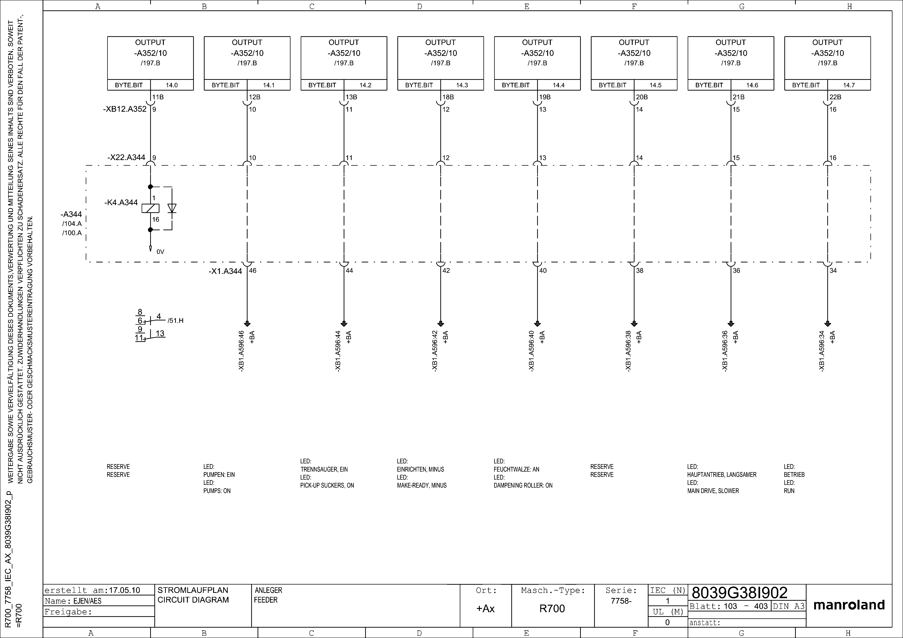

# +Ax — Sheet 103 of 403 — ANLEGER

**FEEDER**

> Part of the manroland **R700** printing press IEC/UL circuit diagrams.
> Drawing class: **Stromlaufplan / Circuit diagram** (DIN A3).
> Document `+Ax` covers the **Central control console** machine section.

## At a glance

| Field | Value |
|---|---|
| Document | `+Ax`  (8039G38I902) |
| Sheet | **103** of 403 |
| Section (DE) | ANLEGER |
| Section (EN) | FEEDER |
| Section type | CIRCUIT — Circuit diagram |
| Machine type | `R700` |
| Series | `7758` |
| Created | 17.05.10 |
| Replaces | — |
| Columns used | A, B, C, D, E, F, G, H |
| Path numbers | — |
| Labels on sheet | 130 |
| Cross-refs out | 11 |
| Cross-refs in | 34 |

**Previous:** [+Ax sheet 102](SHEET_0102.md) · **Next:** [+Ax sheet 104](SHEET_0104.md) · **Document TOC:** [_TOC.md](_TOC.md)  (+Ax) · **Master TOC:** [all sheets](../_MASTER_TOC.md)

## Sheet image (300 DPI, exact vector render)



_Rendered directly from the PDF vector layer at 300 DPI (1-bit), no OCR and no resampling. Use it to confirm anything ambiguous in the text below._

## Cross-references on this sheet

Each entry is a wire leaving this sheet. The printed token is `/sheet.column`; the link resolves to that sheet inside the same document.

| Ref | Target sheet | Col | Path | Destination on target | Target section | From col |
|---|---|---|---|---|---|---|
| `/197.B` | [+Ax sheet 197](SHEET_0197.md) | B | — | — | REFERENZMODUL | A |
| `/197.B` | [+Ax sheet 197](SHEET_0197.md) | B | — | — | REFERENZMODUL | B |
| `/197.B` | [+Ax sheet 197](SHEET_0197.md) | B | — | — | REFERENZMODUL | C |
| `/197.B` | [+Ax sheet 197](SHEET_0197.md) | B | — | — | REFERENZMODUL | D |
| `/197.B` | [+Ax sheet 197](SHEET_0197.md) | B | — | — | REFERENZMODUL | E |
| `/197.B` | [+Ax sheet 197](SHEET_0197.md) | B | — | — | REFERENZMODUL | F |
| `/197.B` | [+Ax sheet 197](SHEET_0197.md) | B | — | — | REFERENZMODUL | G |
| `/197.B` | [+Ax sheet 197](SHEET_0197.md) | B | — | — | REFERENZMODUL | H |
| `/104.A` | [+Ax sheet 104](SHEET_0104.md) | A | — | — | ANLEGER | A |
| `/100.A` | [+Ax sheet 100](SHEET_0100.md) | A | — | — | ANLEGER | A |
| `/51.H` | [+Ax sheet 51](SHEET_0051.md) | H | — | 4 | SIGNALGEBER: AKUSTISCHE WARNSIGNALE | B |

### Incoming references (sheets that point here)

Every other sheet that sends a wire to this one. `Back-ref` is the token printed on *that* sheet; `Path` is its line number.

| From sheet | Cols | Back-ref | Path | Refs | What continues there |
|---|---|---|---|---|---|
| [+Ax#51](SHEET_0051.md) | H | `/51.H` | — | 1 | — |
| [+Ax#100](SHEET_0100.md) | A | `/100.A` | — | 1 | — |
| [+Ax#104](SHEET_0104.md) | A | `/104.A` | — | 1 | — |
| [+Ax#197](SHEET_0197.md) | B | `/197.B` | — | 8 | — |
| [+Ax#207](SHEET_0207.md) | G | `/207.G` | — | 7 | — |
| [+Ax#248](SHEET_0248.md) | E | `/248.E` | — | 8 | — |
| [+Ax#262](SHEET_0262.md) | E | `/262.E` | — | 8 | — |


## Devices on this sheet

| Tag | Class | Class meaning (IEC) | Col | Sub | Terminal | Sign |
|---|---|---|---|---|---|---|
| `A344` | A | Baugruppe / assembly, module, PC board | A | — | — | — |
| `A352/10` | A | Baugruppe / assembly, module, PC board | B | 10 | — | — |
| `A352/10` | A | Baugruppe / assembly, module, PC board | C | 10 | — | — |
| `A352/10` | A | Baugruppe / assembly, module, PC board | D | 10 | — | — |
| `A352/10` | A | Baugruppe / assembly, module, PC board | E | 10 | — | — |
| `A352/10` | A | Baugruppe / assembly, module, PC board | F | 10 | — | — |
| `A352/10` | A | Baugruppe / assembly, module, PC board | G | 10 | — | — |
| `A352/10` | A | Baugruppe / assembly, module, PC board | H | 10 | — | — |
| `A352/10` | A | Baugruppe / assembly, module, PC board | A | 10 | — | — |
| `14.1` | — | cross-device reference | C | — | — | — |
| `14.2` | — | cross-device reference | C | — | — | — |
| `14.3` | — | cross-device reference | D | — | — | — |
| `14.4` | — | cross-device reference | E | — | — | — |
| `14.5` | — | cross-device reference | F | — | — | — |
| `14.6` | — | cross-device reference | G | — | — | — |
| `14.7` | — | cross-device reference | H | — | — | — |
| `XB12.A352` | — | cross-device reference | A | — | — | — |
| `14.0` | — | cross-device reference | B | — | — | — |
| `X1.A344` | — | cross-device reference | B | — | — | — |
| `X22.A344` | — | cross-device reference | A | — | — | — |
| `K4.A344` | — | cross-device reference | A | — | — | — |
| `XB1.A596:46` | — | cross-device reference | B | — | 46 | — |
| `XB1.A596:44` | — | cross-device reference | C | — | 44 | — |
| `XB1.A596:42` | — | cross-device reference | D | — | 42 | — |
| `XB1.A596:40` | — | cross-device reference | E | — | 40 | — |
| `XB1.A596:38` | — | cross-device reference | F | — | 38 | — |
| `XB1.A596:36` | — | cross-device reference | G | — | 36 | — |
| `XB1.A596:34` | — | cross-device reference | H | — | 34 | — |

## Potentials / nets

| Potential | Count | Columns | Attached devices | Terminals |
|---|---|---|---|---|
| `0V` | 1 | B | — | — |


A potential such as `L24+/4` or `M24+` is a named supply/return rail; every place it appears on this sheet is electrically common.

## Wire-end annotations (grouped as printed)

A wire that continues elsewhere is annotated with a small cluster: the destination description, the path/line number `#NN`, and the `/sheet.column` cross reference. Each row below is one such cluster exactly as it is grouped on the drawing.

| Col | Y | Path | Cross-ref | Text on the wire |
|---|---|---|---|---|
| A | 51.6 | — | — | `OUTPUT` |
| B | 51.6 | — | — | `OUTPUT` |
| C | 51.6 | — | — | `OUTPUT` |
| D | 51.6 | — | — | `OUTPUT` |
| E | 51.6 | — | — | `OUTPUT` |
| F | 51.6 | — | — | `OUTPUT` |
| G | 51.6 | — | — | `OUTPUT` |
| H | 51.6 | — | — | `OUTPUT` |
| A | 65.5 | — | — | `A352/10` |
| B | 65.5 | — | — | `A352/10` |
| C | 65.5 | — | — | `A352/10` |
| D | 65.5 | — | — | `A352/10` |
| E | 65.5 | — | — | `A352/10` |
| F | 65.5 | — | — | `A352/10` |
| G | 65.5 | — | — | `A352/10` |
| H | 65.5 | — | — | `A352/10` |
| A | 79.3 | — | `/197.B` | — |
| B | 79.3 | — | `/197.B` | — |
| C | 79.3 | — | `/197.B` | — |
| D | 79.3 | — | `/197.B` | — |
| E | 79.3 | — | `/197.B` | — |
| F | 79.3 | — | `/197.B` | — |
| G | 79.3 | — | `/197.B` | — |
| H | 79.3 | — | `/197.B` | — |
| A | 108.9 | — | — | `BYTE.BIT 14.0` |
| B | 108.9 | — | — | `BYTE.BIT 14.1` |
| C | 108.9 | — | — | `BYTE.BIT 14.2` |
| D | 108.9 | — | — | `BYTE.BIT 14.3` |
| E | 108.9 | — | — | `BYTE.BIT 14.4` |
| F | 108.9 | — | — | `BYTE.BIT 14.5` |
| G | 108.9 | — | — | `BYTE.BIT 14.6` |
| H | 108.9 | — | — | `BYTE.BIT 14.7` |
| B | 124.3 | — | — | `11B` |
| B | 124.3 | — | — | `12B` |
| C | 124.3 | — | — | `13B` |
| D | 124.3 | — | — | `18B` |
| E | 124.3 | — | — | `19B` |
| F | 124.3 | — | — | `20B` |
| G | 124.3 | — | — | `21B` |
| H | 124.3 | — | — | `22B` |
| A | 139.2 | — | — | `XB12.A352 9` |
| E | 140.6 | — | — | `10 11 12 13 14 15 16` |
| D | 203.0 | — | — | `X22.A344 9 10 11 12 13 14 15 16` |
| B | 257.6 | — | — | `1` |
| A | 262.5 | — | — | `K4.A344` |
| A | 278.1 | — | — | `A344` |
| B | 285.9 | — | — | `16` |
| A | 291.2 | — | `/104.A`, `/100.A` | — |
| B | 328.6 | — | — | `0V` |
| E | 353.2 | — | — | `X1.A344 46 44 42 40 38 36 34` |
| A | 407.0 | — | — | `11 8 6 9 13` |
| B | 412.7 | — | `/51.H` | `4` |
| D | 436.0 | — | — | `XB1.A596:42` |
| B | 436.2 | — | — | `XB1.A596:46` |
| C | 436.2 | — | — | `XB1.A596:44` |
| E | 436.2 | — | — | `XB1.A596:40` |
| F | 436.2 | — | — | `XB1.A596:38` |
| G | 436.2 | — | — | `XB1.A596:36` |
| H | 436.2 | — | — | `XB1.A596:34` |
| B | 436.5 | — | — | `+BA` |
| C | 436.5 | — | — | `+BA` |
| D | 436.5 | — | — | `+BA` |
| E | 436.5 | — | — | `+BA` |
| F | 436.5 | — | — | `+BA` |
| G | 436.5 | — | — | `+BA` |
| H | 436.5 | — | — | `+BA` |
| C | 605.7 | — | — | `LED:` |
| D | 605.7 | — | — | `LED: EINRICHTEN, MINUS LED: MAKE READY, MINUS` |
| E | 605.7 | — | — | `LED: FEUCHTWALZE: AN LED: DAMPENING ROLLER: ON` |
| B | 612.8 | — | — | `LED: PUMPEN: EIN LED: PUMPS: ON` |
| G | 612.8 | — | — | `LED: HAUPTANTRIEB, LANGSAMER LED: MAIN DRIVE, SLOWER` |
| G | 612.8 | — | — | `LED: BETRIEB LED: RUN` |
| A | 612.9 | — | — | `RESERVE RESERVE` |
| F | 612.9 | — | — | `RESERVE RESERVE` |
| C | 616.5 | — | — | `LED: PICK UP SUCKERS, ON TRENNSAUGER, EIN` |


## Reconstructed tables

This sheet carries tabular content (pin map / terminal assignment / index). The grid below was rebuilt from the drawing's own rule lines, so each row is exactly one physical row of the table.

### Table 1 — 1 data rows × 2 columns (at x=141.7, y=48.2)

| OUTPUT | A352/10 /197.B |
|---|---|
| `BYTE.BIT` | `14.0` |


### Table 2 — 1 data rows × 2 columns (at x=269.3, y=48.2)

| OUTPUT | A352/10 /197.B |
|---|---|
| `BYTE.BIT` | `14.1` |


### Table 3 — 1 data rows × 2 columns (at x=396.9, y=48.2)

| OUTPUT | A352/10 /197.B |
|---|---|
| `BYTE.BIT` | `14.2` |


### Table 4 — 1 data rows × 2 columns (at x=524.4, y=48.2)

| OUTPUT | A352/10 /197.B |
|---|---|
| `BYTE.BIT` | `14.3` |


### Table 5 — 1 data rows × 2 columns (at x=652.0, y=48.2)

| OUTPUT | A352/10 /197.B |
|---|---|
| `BYTE.BIT` | `14.4` |


### Table 6 — 1 data rows × 2 columns (at x=779.5, y=48.2)

| OUTPUT | A352/10 /197.B |
|---|---|
| `BYTE.BIT` | `14.5` |


### Table 7 — 1 data rows × 2 columns (at x=907.1, y=48.2)

| OUTPUT | A352/10 /197.B |
|---|---|
| `BYTE.BIT` | `14.6` |


### Table 8 — 1 data rows × 2 columns (at x=1034.6, y=48.2)

| OUTPUT | A352/10 /197.B |
|---|---|
| `BYTE.BIT` | `14.7` |


## Notes and free text on this sheet

| Text | Col | Y (pt) |
|---|---|---|
| `12B` | B | 124.3 |
| `OUTPUT` | B | 51.64 |
| `BYTE.BIT` | B | 108.91 |
| `LED:` | B | 612.82 |
| `PUMPEN: EIN` | B | 623.52 |
| `PUMPS: ON` | B | 644.78 |
| `13B` | C | 124.3 |
| `OUTPUT` | C | 51.64 |
| `BYTE.BIT` | C | 108.91 |
| `LED:` | C | 605.73 |
| `TRENNSAUGER, EIN` | C | 616.45 |
| `PICK UP SUCKERS, ON` | C | 637.71 |
| `18B` | D | 124.3 |
| `OUTPUT` | D | 51.64 |
| `BYTE.BIT` | D | 108.91 |
| `LED:` | D | 605.73 |
| `EINRICHTEN, MINUS` | D | 616.46 |
| `MAKE READY, MINUS` | D | 637.72 |
| `19B` | E | 124.3 |
| `OUTPUT` | E | 51.64 |
| `BYTE.BIT` | E | 108.91 |
| `LED:` | E | 605.73 |
| `FEUCHTWALZE: AN` | E | 616.41 |
| `DAMPENING ROLLER: ON` | E | 637.73 |
| `20B` | F | 124.3 |
| `OUTPUT` | F | 51.64 |
| `BYTE.BIT` | F | 108.91 |
| `RESERVE` | F | 612.87 |
| `21B` | G | 124.3 |
| `OUTPUT` | G | 51.64 |
| `BYTE.BIT` | G | 108.91 |
| `LED:` | G | 612.82 |
| `HAUPTANTRIEB, LANGSAMER` | G | 623.54 |
| `MAIN DRIVE, SLOWER` | G | 644.78 |
| `22B` | H | 124.3 |
| `OUTPUT` | H | 51.64 |
| `BYTE.BIT` | H | 108.91 |
| `BETRIEB` | G | 623.49 |
| `RUN` | G | 644.77 |
| `11B` | B | 124.3 |
| `OUTPUT` | A | 51.64 |
| `BYTE.BIT` | A | 108.91 |
| `RESERVE` | A | 612.87 |
| `+BA` | B | 436.54 |
| `+BA` | C | 436.54 |
| `+BA` | D | 436.54 |
| `+BA` | E | 436.54 |
| `+BA` | F | 436.54 |
| `+BA` | G | 436.54 |
| `+BA` | H | 436.54 |

## Complete label inventory (exact text from the drawing)

Every text object inside the drawing area of this sheet, in DIN reading order (column A→H, then top→bottom). This is the authoritative list: if a string is not here it is not printed on this sheet.

| Col | Y | X | Dir | Type | Text |
|---|---|---|---|---|---|
| A | 51.6 | 178.2 | → | text | `OUTPUT` |
| A | 65.5 | 177.0 | → | device tag | `A352/10` |
| A | 79.3 | 185.8 | → | cross-reference | `/197.B` |
| A | 108.9 | 151.7 | → | text | `BYTE.BIT` |
| A | 139.2 | 136.1 | → | device ref | `XB12.A352` |
| A | 203.0 | 141.7 | → | device ref | `X22.A344` |
| A | 262.5 | 137.8 | → | device ref | `K4.A344` |
| A | 278.1 | 79.9 | → | device tag | `A344` |
| A | 291.2 | 82.2 | → | cross-reference | `/104.A` |
| A | 303.6 | 82.2 | → | cross-reference | `/100.A` |
| A | 407.0 | 181.7 | → | number | `8` |
| A | 418.4 | 181.7 | → | number | `6` |
| A | 429.7 | 181.7 | → | number | `9` |
| A | 441.1 | 177.2 | → | number | `11` |
| A | 612.9 | 140.9 | → | text | `RESERVE` |
| A | 623.5 | 140.9 | → | text | `RESERVE` |
| B | 51.6 | 305.7 | → | text | `OUTPUT` |
| B | 65.5 | 304.6 | → | device tag | `A352/10` |
| B | 79.3 | 313.4 | → | cross-reference | `/197.B` |
| B | 108.9 | 218.6 | → | device ref | `14.0` |
| B | 108.9 | 279.2 | → | text | `BYTE.BIT` |
| B | 124.3 | 200.4 | → | text | `11B` |
| B | 124.3 | 328.0 | → | text | `12B` |
| B | 140.6 | 201.0 | → | number | `9` |
| B | 140.6 | 328.0 | → | number | `10` |
| B | 204.4 | 201.0 | → | number | `9` |
| B | 204.4 | 328.0 | → | number | `10` |
| B | 257.6 | 200.4 | → | number | `1` |
| B | 285.9 | 200.4 | → | number | `16` |
| B | 328.6 | 206.6 | → | potential | `0V` |
| B | 353.2 | 275.2 | → | device ref | `X1.A344` |
| B | 353.2 | 328.5 | → | number | `46` |
| B | 412.7 | 206.6 | → | number | `4` |
| B | 419.1 | 221.1 | → | cross-reference | `/51.H` |
| B | 435.4 | 204.9 | → | number | `13` |
| B | 436.3 | 314.2 | ↕ | device ref | `XB1.A596:46` |
| B | 436.5 | 328.4 | ↕ | text | `+BA` |
| B | 612.8 | 268.4 | → | text | `LED:` |
| B | 623.5 | 268.4 | → | text | `PUMPEN: EIN` |
| B | 634.1 | 268.4 | → | text | `LED:` |
| B | 644.8 | 268.4 | → | text | `PUMPS: ON` |
| C | 51.6 | 433.3 | → | text | `OUTPUT` |
| C | 65.5 | 432.1 | → | device tag | `A352/10` |
| C | 79.3 | 440.9 | → | cross-reference | `/197.B` |
| C | 108.9 | 346.7 | → | device ref | `14.1` |
| C | 108.9 | 406.8 | → | text | `BYTE.BIT` |
| C | 108.9 | 473.8 | → | device ref | `14.2` |
| C | 124.3 | 455.5 | → | text | `13B` |
| C | 140.6 | 455.5 | → | number | `11` |
| C | 204.4 | 455.5 | → | number | `11` |
| C | 353.2 | 456.1 | → | number | `44` |
| C | 436.3 | 441.8 | ↕ | device ref | `XB1.A596:44` |
| C | 436.5 | 455.9 | ↕ | text | `+BA` |
| C | 605.7 | 396.0 | → | text | `LED:` |
| C | 616.5 | 396.6 | → | text | `TRENNSAUGER, EIN` |
| C | 627.0 | 396.0 | → | text | `LED:` |
| C | 637.7 | 396.0 | → | text | `PICK UP SUCKERS, ON` |
| D | 51.6 | 560.8 | → | text | `OUTPUT` |
| D | 65.5 | 559.7 | → | device tag | `A352/10` |
| D | 79.3 | 568.5 | → | cross-reference | `/197.B` |
| D | 108.9 | 534.3 | → | text | `BYTE.BIT` |
| D | 108.9 | 601.2 | → | device ref | `14.3` |
| D | 124.3 | 583.1 | → | text | `18B` |
| D | 140.6 | 583.1 | → | number | `12` |
| D | 204.4 | 583.1 | → | number | `12` |
| D | 353.2 | 583.7 | → | number | `42` |
| D | 436.0 | 569.3 | ↕ | device ref | `XB1.A596:42` |
| D | 436.5 | 583.5 | ↕ | text | `+BA` |
| D | 605.7 | 523.6 | → | text | `LED:` |
| D | 616.5 | 523.6 | → | text | `EINRICHTEN, MINUS` |
| D | 627.0 | 523.6 | → | text | `LED:` |
| D | 637.7 | 523.8 | → | text | `MAKE READY, MINUS` |
| E | 51.6 | 688.4 | → | text | `OUTPUT` |
| E | 65.5 | 687.3 | → | device tag | `A352/10` |
| E | 79.3 | 696.0 | → | cross-reference | `/197.B` |
| E | 108.9 | 661.9 | → | text | `BYTE.BIT` |
| E | 108.9 | 728.8 | → | device ref | `14.4` |
| E | 124.3 | 710.6 | → | text | `19B` |
| E | 140.6 | 710.6 | → | number | `13` |
| E | 204.4 | 710.6 | → | number | `13` |
| E | 353.2 | 711.2 | → | number | `40` |
| E | 436.3 | 696.9 | ↕ | device ref | `XB1.A596:40` |
| E | 436.5 | 711.0 | ↕ | text | `+BA` |
| E | 605.7 | 651.1 | → | text | `LED:` |
| E | 616.4 | 651.1 | → | text | `FEUCHTWALZE: AN` |
| E | 627.0 | 651.1 | → | text | `LED:` |
| E | 637.7 | 651.1 | → | text | `DAMPENING ROLLER: ON` |
| F | 51.6 | 816.0 | → | text | `OUTPUT` |
| F | 65.5 | 814.8 | → | device tag | `A352/10` |
| F | 79.3 | 823.6 | → | cross-reference | `/197.B` |
| F | 108.9 | 789.4 | → | text | `BYTE.BIT` |
| F | 108.9 | 856.3 | → | device ref | `14.5` |
| F | 124.3 | 838.8 | → | text | `20B` |
| F | 140.6 | 838.2 | → | number | `14` |
| F | 204.4 | 838.2 | → | number | `14` |
| F | 353.2 | 838.8 | → | number | `38` |
| F | 436.3 | 824.5 | ↕ | device ref | `XB1.A596:38` |
| F | 436.5 | 838.6 | ↕ | text | `+BA` |
| F | 612.9 | 778.7 | → | text | `RESERVE` |
| F | 623.5 | 778.7 | → | text | `RESERVE` |
| G | 51.6 | 943.5 | → | text | `OUTPUT` |
| G | 65.5 | 942.4 | → | device tag | `A352/10` |
| G | 79.3 | 951.2 | → | cross-reference | `/197.B` |
| G | 108.9 | 917.0 | → | text | `BYTE.BIT` |
| G | 108.9 | 983.9 | → | device ref | `14.6` |
| G | 124.3 | 966.3 | → | text | `21B` |
| G | 140.6 | 965.8 | → | number | `15` |
| G | 204.4 | 965.8 | → | number | `15` |
| G | 353.2 | 966.3 | → | number | `36` |
| G | 436.3 | 952.0 | ↕ | device ref | `XB1.A596:36` |
| G | 436.5 | 966.2 | ↕ | text | `+BA` |
| G | 612.8 | 906.2 | → | text | `LED:` |
| G | 612.8 | 1033.8 | → | text | `LED:` |
| G | 623.5 | 906.2 | → | text | `HAUPTANTRIEB, LANGSAMER` |
| G | 623.5 | 1033.8 | → | text | `BETRIEB` |
| G | 634.1 | 906.2 | → | text | `LED:` |
| G | 634.1 | 1033.8 | → | text | `LED:` |
| G | 644.8 | 906.5 | → | text | `MAIN DRIVE, SLOWER` |
| G | 644.8 | 1033.8 | → | text | `RUN` |
| H | 51.6 | 1071.1 | → | text | `OUTPUT` |
| H | 65.5 | 1069.9 | → | device tag | `A352/10` |
| H | 79.3 | 1078.7 | → | cross-reference | `/197.B` |
| H | 108.9 | 1044.6 | → | text | `BYTE.BIT` |
| H | 108.9 | 1111.5 | → | device ref | `14.7` |
| H | 124.3 | 1093.9 | → | text | `22B` |
| H | 140.6 | 1093.3 | → | number | `16` |
| H | 204.4 | 1093.3 | → | number | `16` |
| H | 353.2 | 1093.9 | → | number | `34` |
| H | 436.3 | 1079.6 | ↕ | device ref | `XB1.A596:34` |
| H | 436.5 | 1093.7 | ↕ | text | `+BA` |

## Reading-order text block

The same content as a plain block, grouped by DIN column — convenient to paste or to match against a visual description.

```text
=== Column A ===
  51.6  178.2  text         OUTPUT
  65.5  177.0  devtag       A352/10
  79.3  185.8  xref         /197.B
 108.9  151.7  text         BYTE.BIT
 139.2  136.1  devref       XB12.A352
 203.0  141.7  devref       X22.A344
 262.5  137.8  devref       K4.A344
 278.1   79.9  devtag       A344
 291.2   82.2  xref         /104.A
 303.6   82.2  xref         /100.A
 407.0  181.7  numeric      8
 418.4  181.7  numeric      6
 429.7  181.7  numeric      9
 441.1  177.2  numeric      11
 612.9  140.9  text         RESERVE
 623.5  140.9  text         RESERVE
=== Column B ===
  51.6  305.7  text         OUTPUT
  65.5  304.6  devtag       A352/10
  79.3  313.4  xref         /197.B
 108.9  218.6  devref       14.0
 108.9  279.2  text         BYTE.BIT
 124.3  200.4  text         11B
 124.3  328.0  text         12B
 140.6  201.0  numeric      9
 140.6  328.0  numeric      10
 204.4  201.0  numeric      9
 204.4  328.0  numeric      10
 257.6  200.4  numeric      1
 285.9  200.4  numeric      16
 328.6  206.6  net          0V
 353.2  275.2  devref       X1.A344
 353.2  328.5  numeric      46
 412.7  206.6  numeric      4
 419.1  221.1  xref         /51.H
 435.4  204.9  numeric      13
 436.3  314.2  devref       XB1.A596:46
 436.5  328.4  text         +BA
 612.8  268.4  text         LED:
 623.5  268.4  text         PUMPEN: EIN
 634.1  268.4  text         LED:
 644.8  268.4  text         PUMPS: ON
=== Column C ===
  51.6  433.3  text         OUTPUT
  65.5  432.1  devtag       A352/10
  79.3  440.9  xref         /197.B
 108.9  346.7  devref       14.1
 108.9  406.8  text         BYTE.BIT
 108.9  473.8  devref       14.2
 124.3  455.5  text         13B
 140.6  455.5  numeric      11
 204.4  455.5  numeric      11
 353.2  456.1  numeric      44
 436.3  441.8  devref       XB1.A596:44
 436.5  455.9  text         +BA
 605.7  396.0  text         LED:
 616.5  396.6  text         TRENNSAUGER, EIN
 627.0  396.0  text         LED:
 637.7  396.0  text         PICK UP SUCKERS, ON
=== Column D ===
  51.6  560.8  text         OUTPUT
  65.5  559.7  devtag       A352/10
  79.3  568.5  xref         /197.B
 108.9  534.3  text         BYTE.BIT
 108.9  601.2  devref       14.3
 124.3  583.1  text         18B
 140.6  583.1  numeric      12
 204.4  583.1  numeric      12
 353.2  583.7  numeric      42
 436.0  569.3  devref       XB1.A596:42
 436.5  583.5  text         +BA
 605.7  523.6  text         LED:
 616.5  523.6  text         EINRICHTEN, MINUS
 627.0  523.6  text         LED:
 637.7  523.8  text         MAKE READY, MINUS
=== Column E ===
  51.6  688.4  text         OUTPUT
  65.5  687.3  devtag       A352/10
  79.3  696.0  xref         /197.B
 108.9  661.9  text         BYTE.BIT
 108.9  728.8  devref       14.4
 124.3  710.6  text         19B
 140.6  710.6  numeric      13
 204.4  710.6  numeric      13
 353.2  711.2  numeric      40
 436.3  696.9  devref       XB1.A596:40
 436.5  711.0  text         +BA
 605.7  651.1  text         LED:
 616.4  651.1  text         FEUCHTWALZE: AN
 627.0  651.1  text         LED:
 637.7  651.1  text         DAMPENING ROLLER: ON
=== Column F ===
  51.6  816.0  text         OUTPUT
  65.5  814.8  devtag       A352/10
  79.3  823.6  xref         /197.B
 108.9  789.4  text         BYTE.BIT
 108.9  856.3  devref       14.5
 124.3  838.8  text         20B
 140.6  838.2  numeric      14
 204.4  838.2  numeric      14
 353.2  838.8  numeric      38
 436.3  824.5  devref       XB1.A596:38
 436.5  838.6  text         +BA
 612.9  778.7  text         RESERVE
 623.5  778.7  text         RESERVE
=== Column G ===
  51.6  943.5  text         OUTPUT
  65.5  942.4  devtag       A352/10
  79.3  951.2  xref         /197.B
 108.9  917.0  text         BYTE.BIT
 108.9  983.9  devref       14.6
 124.3  966.3  text         21B
 140.6  965.8  numeric      15
 204.4  965.8  numeric      15
 353.2  966.3  numeric      36
 436.3  952.0  devref       XB1.A596:36
 436.5  966.2  text         +BA
 612.8  906.2  text         LED:
 612.8 1033.8  text         LED:
 623.5  906.2  text         HAUPTANTRIEB, LANGSAMER
 623.5 1033.8  text         BETRIEB
 634.1  906.2  text         LED:
 634.1 1033.8  text         LED:
 644.8  906.5  text         MAIN DRIVE, SLOWER
 644.8 1033.8  text         RUN
=== Column H ===
  51.6 1071.1  text         OUTPUT
  65.5 1069.9  devtag       A352/10
  79.3 1078.7  xref         /197.B
 108.9 1044.6  text         BYTE.BIT
 108.9 1111.5  devref       14.7
 124.3 1093.9  text         22B
 140.6 1093.3  numeric      16
 204.4 1093.3  numeric      16
 353.2 1093.9  numeric      34
 436.3 1079.6  devref       XB1.A596:34
 436.5 1093.7  text         +BA
```

---
_Generated from the PDF vector text layer; no OCR. Source: `R700_7758_IEC_AX_8039G38I902_p`, sheet 103._
