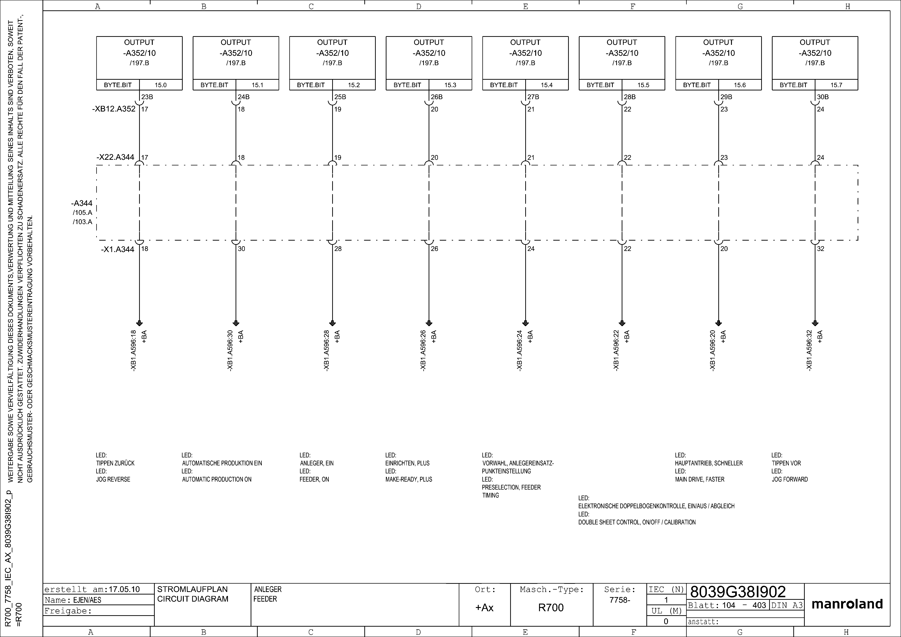

# +Ax — Sheet 104 of 403 — ANLEGER

**FEEDER**

> Part of the manroland **R700** printing press IEC/UL circuit diagrams.
> Drawing class: **Stromlaufplan / Circuit diagram** (DIN A3).
> Document `+Ax` covers the **Central control console** machine section.

## At a glance

| Field | Value |
|---|---|
| Document | `+Ax`  (8039G38I902) |
| Sheet | **104** of 403 |
| Section (DE) | ANLEGER |
| Section (EN) | FEEDER |
| Section type | CIRCUIT — Circuit diagram |
| Machine type | `R700` |
| Series | `7758` |
| Created | 17.05.10 |
| Replaces | — |
| Columns used | A, B, C, D, E, F, G, H |
| Path numbers | — |
| Labels on sheet | 128 |
| Cross-refs out | 10 |
| Cross-refs in | 34 |

**Previous:** [+Ax sheet 103](SHEET_0103.md) · **Next:** [+Ax sheet 105](SHEET_0105.md) · **Document TOC:** [_TOC.md](_TOC.md)  (+Ax) · **Master TOC:** [all sheets](../_MASTER_TOC.md)

## Sheet image (300 DPI, exact vector render)



_Rendered directly from the PDF vector layer at 300 DPI (1-bit), no OCR and no resampling. Use it to confirm anything ambiguous in the text below._

## Cross-references on this sheet

Each entry is a wire leaving this sheet. The printed token is `/sheet.column`; the link resolves to that sheet inside the same document.

| Ref | Target sheet | Col | Path | Destination on target | Target section | From col |
|---|---|---|---|---|---|---|
| `/197.B` | [+Ax sheet 197](SHEET_0197.md) | B | — | — | REFERENZMODUL | A |
| `/197.B` | [+Ax sheet 197](SHEET_0197.md) | B | — | — | REFERENZMODUL | B |
| `/197.B` | [+Ax sheet 197](SHEET_0197.md) | B | — | — | REFERENZMODUL | C |
| `/197.B` | [+Ax sheet 197](SHEET_0197.md) | B | — | — | REFERENZMODUL | D |
| `/197.B` | [+Ax sheet 197](SHEET_0197.md) | B | — | — | REFERENZMODUL | E |
| `/197.B` | [+Ax sheet 197](SHEET_0197.md) | B | — | — | REFERENZMODUL | F |
| `/197.B` | [+Ax sheet 197](SHEET_0197.md) | B | — | — | REFERENZMODUL | G |
| `/197.B` | [+Ax sheet 197](SHEET_0197.md) | B | — | — | REFERENZMODUL | H |
| `/105.A` | [+Ax sheet 105](SHEET_0105.md) | A | — | — | ANLEGER | A |
| `/103.A` | [+Ax sheet 103](SHEET_0103.md) | A | — | — | ANLEGER | A |

### Incoming references (sheets that point here)

Every other sheet that sends a wire to this one. `Back-ref` is the token printed on *that* sheet; `Path` is its line number.

| From sheet | Cols | Back-ref | Path | Refs | What continues there |
|---|---|---|---|---|---|
| [+Ax#103](SHEET_0103.md) | A | `/103.A` | — | 1 | — |
| [+Ax#105](SHEET_0105.md) | A | `/105.A` | — | 1 | — |
| [+Ax#197](SHEET_0197.md) | B | `/197.B` | — | 8 | — |
| [+Ax#207](SHEET_0207.md) | F, G | `/207.F`, `/207.G` | — | 8 | — |
| [+Ax#248](SHEET_0248.md) | E | `/248.E` | — | 8 | — |
| [+Ax#262](SHEET_0262.md) | E | `/262.E` | — | 8 | — |


## Devices on this sheet

| Tag | Class | Class meaning (IEC) | Col | Sub | Terminal | Sign |
|---|---|---|---|---|---|---|
| `A352/10` | A | Baugruppe / assembly, module, PC board | A | 10 | — | — |
| `A352/10` | A | Baugruppe / assembly, module, PC board | B | 10 | — | — |
| `A352/10` | A | Baugruppe / assembly, module, PC board | C | 10 | — | — |
| `A352/10` | A | Baugruppe / assembly, module, PC board | D | 10 | — | — |
| `A352/10` | A | Baugruppe / assembly, module, PC board | E | 10 | — | — |
| `A352/10` | A | Baugruppe / assembly, module, PC board | F | 10 | — | — |
| `A352/10` | A | Baugruppe / assembly, module, PC board | G | 10 | — | — |
| `A352/10` | A | Baugruppe / assembly, module, PC board | H | 10 | — | — |
| `A344` | A | Baugruppe / assembly, module, PC board | A | — | — | — |
| `XB12.A352` | — | cross-device reference | A | — | — | — |
| `15.0` | — | cross-device reference | B | — | — | — |
| `15.1` | — | cross-device reference | C | — | — | — |
| `15.2` | — | cross-device reference | C | — | — | — |
| `15.3` | — | cross-device reference | D | — | — | — |
| `15.4` | — | cross-device reference | E | — | — | — |
| `15.5` | — | cross-device reference | F | — | — | — |
| `15.6` | — | cross-device reference | G | — | — | — |
| `15.7` | — | cross-device reference | H | — | — | — |
| `X1.A344` | — | cross-device reference | A | — | — | — |
| `X22.A344` | — | cross-device reference | A | — | — | — |
| `XB1.A596:18` | — | cross-device reference | A | — | 18 | — |
| `XB1.A596:30` | — | cross-device reference | B | — | 30 | — |
| `XB1.A596:28` | — | cross-device reference | C | — | 28 | — |
| `XB1.A596:26` | — | cross-device reference | D | — | 26 | — |
| `XB1.A596:24` | — | cross-device reference | E | — | 24 | — |
| `XB1.A596:22` | — | cross-device reference | F | — | 22 | — |
| `XB1.A596:20` | — | cross-device reference | G | — | 20 | — |
| `XB1.A596:32` | — | cross-device reference | H | — | 32 | — |

## Potentials / nets

_No named potentials on this sheet._

## Wire-end annotations (grouped as printed)

A wire that continues elsewhere is annotated with a small cluster: the destination description, the path/line number `#NN`, and the `/sheet.column` cross reference. Each row below is one such cluster exactly as it is grouped on the drawing.

| Col | Y | Path | Cross-ref | Text on the wire |
|---|---|---|---|---|
| A | 51.6 | — | — | `OUTPUT` |
| B | 51.6 | — | — | `OUTPUT` |
| C | 51.6 | — | — | `OUTPUT` |
| D | 51.6 | — | — | `OUTPUT` |
| E | 51.6 | — | — | `OUTPUT` |
| F | 51.6 | — | — | `OUTPUT` |
| G | 51.6 | — | — | `OUTPUT` |
| H | 51.6 | — | — | `OUTPUT` |
| A | 65.5 | — | — | `A352/10` |
| B | 65.5 | — | — | `A352/10` |
| C | 65.5 | — | — | `A352/10` |
| D | 65.5 | — | — | `A352/10` |
| E | 65.5 | — | — | `A352/10` |
| F | 65.5 | — | — | `A352/10` |
| G | 65.5 | — | — | `A352/10` |
| H | 65.5 | — | — | `A352/10` |
| A | 79.3 | — | `/197.B` | — |
| B | 79.3 | — | `/197.B` | — |
| C | 79.3 | — | `/197.B` | — |
| D | 79.3 | — | `/197.B` | — |
| E | 79.3 | — | `/197.B` | — |
| F | 79.3 | — | `/197.B` | — |
| G | 79.3 | — | `/197.B` | — |
| H | 79.3 | — | `/197.B` | — |
| A | 108.9 | — | — | `BYTE.BIT 15.0` |
| B | 108.9 | — | — | `BYTE.BIT 15.1` |
| C | 108.9 | — | — | `BYTE.BIT 15.2` |
| D | 108.9 | — | — | `BYTE.BIT 15.3` |
| E | 108.9 | — | — | `BYTE.BIT 15.4` |
| F | 108.9 | — | — | `BYTE.BIT 15.5` |
| G | 108.9 | — | — | `BYTE.BIT 15.6` |
| H | 108.9 | — | — | `BYTE.BIT 15.7` |
| A | 124.3 | — | — | `23B` |
| B | 124.3 | — | — | `24B` |
| C | 124.3 | — | — | `25B` |
| D | 124.3 | — | — | `26B` |
| E | 124.3 | — | — | `27B` |
| F | 124.3 | — | — | `28B` |
| G | 124.3 | — | — | `29B` |
| H | 124.3 | — | — | `30B` |
| D | 139.2 | — | — | `XB12.A352 17 18 19 20 21 22 23 24` |
| D | 203.0 | — | — | `X22.A344 17 18 19 20 21 22 23 24` |
| A | 263.9 | — | — | `A344` |
| A | 277.0 | — | `/105.A`, `/103.A` | — |
| D | 324.9 | — | — | `X1.A344 18 30 28 26 24 22 20 32` |
| F | 436.0 | — | — | `XB1.A596:22` |
| H | 436.0 | — | — | `XB1.A596:32` |
| A | 436.2 | — | — | `XB1.A596:18` |
| B | 436.2 | — | — | `XB1.A596:30` |
| C | 436.2 | — | — | `XB1.A596:28` |
| D | 436.2 | — | — | `XB1.A596:26` |
| E | 436.2 | — | — | `XB1.A596:24` |
| G | 436.2 | — | — | `XB1.A596:20` |
| A | 436.5 | — | — | `+BA` |
| B | 436.5 | — | — | `+BA` |
| C | 436.5 | — | — | `+BA` |
| D | 436.5 | — | — | `+BA` |
| E | 436.5 | — | — | `+BA` |
| F | 436.5 | — | — | `+BA` |
| G | 436.5 | — | — | `+BA` |
| H | 436.5 | — | — | `+BA` |
| A | 598.6 | — | — | `LED:` |
| B | 598.6 | — | — | `LED:` |
| C | 598.6 | — | — | `LED:` |
| D | 598.6 | — | — | `LED: EINRICHTEN, PLUS LED: MAKE READY, PLUS` |
| E | 598.6 | — | — | `LED:` |
| G | 598.6 | — | — | `LED: HAUPTANTRIEB, SCHNELLER LED: MAIN DRIVE, FASTER` |
| G | 598.6 | — | — | `LED:` |
| A | 609.4 | — | — | `LED: TIPPEN ZURÜCK` |
| B | 609.4 | — | — | `LED: AUTOMATISCHE PRODUKTION EIN` |
| C | 609.4 | — | — | `LED: FEEDER, ON ANLEGER, EIN` |
| E | 609.4 | — | — | `PUNKTEINSTELLUNG LED: PRESELECTION, FEEDER VORWAHL, ANLEGEREINSATZ` |
| G | 609.4 | — | — | `LED: TIPPEN VOR` |
| A | 630.6 | — | — | `JOG REVERSE` |
| B | 630.6 | — | — | `AUTOMATIC PRODUCTION ON` |
| G | 630.6 | — | — | `JOG FORWARD` |
| E | 651.9 | — | — | `TIMING` |
| F | 655.3 | — | — | `LED: ELEKTRONISCHE DOPPELBOGENKONTROLLE, EIN/AUS / ABGLEICH LED: DOUBLE SHEET CONTROL, ON/OFF / CALIBRATION` |


## Reconstructed tables

This sheet carries tabular content (pin map / terminal assignment / index). The grid below was rebuilt from the drawing's own rule lines, so each row is exactly one physical row of the table.

### Table 1 — 1 data rows × 2 columns (at x=127.6, y=48.2)

| OUTPUT | A352/10 /197.B |
|---|---|
| `BYTE.BIT` | `15.0` |


### Table 2 — 1 data rows × 2 columns (at x=255.1, y=48.2)

| OUTPUT | A352/10 /197.B |
|---|---|
| `BYTE.BIT` | `15.1` |


### Table 3 — 1 data rows × 2 columns (at x=382.7, y=48.2)

| OUTPUT | A352/10 /197.B |
|---|---|
| `BYTE.BIT` | `15.2` |


### Table 4 — 1 data rows × 2 columns (at x=510.2, y=48.2)

| OUTPUT | A352/10 /197.B |
|---|---|
| `BYTE.BIT` | `15.3` |


### Table 5 — 1 data rows × 2 columns (at x=637.8, y=48.2)

| OUTPUT | A352/10 /197.B |
|---|---|
| `BYTE.BIT` | `15.4` |


### Table 6 — 1 data rows × 2 columns (at x=765.4, y=48.2)

| OUTPUT | A352/10 /197.B |
|---|---|
| `BYTE.BIT` | `15.5` |


### Table 7 — 1 data rows × 2 columns (at x=892.9, y=48.2)

| OUTPUT | A352/10 /197.B |
|---|---|
| `BYTE.BIT` | `15.6` |


### Table 8 — 1 data rows × 2 columns (at x=1020.5, y=48.2)

| OUTPUT | A352/10 /197.B |
|---|---|
| `BYTE.BIT` | `15.7` |


## Notes and free text on this sheet

| Text | Col | Y (pt) |
|---|---|---|
| `23B` | A | 124.3 |
| `OUTPUT` | A | 51.64 |
| `BYTE.BIT` | A | 108.91 |
| `LED:` | A | 598.65 |
| `TIPPEN ZURÜCK` | A | 609.38 |
| `JOG REVERSE` | A | 630.61 |
| `24B` | B | 124.3 |
| `OUTPUT` | B | 51.64 |
| `BYTE.BIT` | B | 108.91 |
| `LED:` | B | 598.65 |
| `AUTOMATISCHE PRODUKTION EIN` | B | 609.38 |
| `AUTOMATIC PRODUCTION ON` | B | 630.65 |
| `25B` | C | 124.3 |
| `OUTPUT` | C | 51.64 |
| `BYTE.BIT` | C | 108.91 |
| `LED:` | C | 598.65 |
| `ANLEGER, EIN` | C | 609.36 |
| `FEEDER, ON` | C | 630.6 |
| `26B` | D | 124.3 |
| `OUTPUT` | D | 51.64 |
| `BYTE.BIT` | D | 108.91 |
| `LED:` | D | 598.65 |
| `EINRICHTEN, PLUS` | D | 609.36 |
| `MAKE READY, PLUS` | D | 630.63 |
| `27B` | E | 124.3 |
| `OUTPUT` | E | 51.64 |
| `BYTE.BIT` | E | 108.91 |
| `LED:` | E | 598.65 |
| `VORWAHL, ANLEGEREINSATZ` | E | 609.36 |
| `PUNKTEINSTELLUNG` | E | 620 |
| `PRESELECTION, FEEDER` | E | 641.26 |
| `TIMING` | E | 651.9 |
| `28B` | F | 124.3 |
| `OUTPUT` | F | 51.64 |
| `BYTE.BIT` | F | 108.91 |
| `LED:` | F | 655.34 |
| `ELEKTRONISCHE DOPPELBOGENKONTROLLE, EIN/AUS / ABGLEICH` | F | 666.06 |
| `DOUBLE SHEET CONTROL, ON/OFF / CALIBRATION` | F | 687.33 |
| `29B` | G | 124.3 |
| `OUTPUT` | G | 51.64 |
| `BYTE.BIT` | G | 108.91 |
| `HAUPTANTRIEB, SCHNELLER` | G | 609.37 |
| `MAIN DRIVE, FASTER` | G | 630.62 |
| `30B` | H | 124.3 |
| `OUTPUT` | H | 51.64 |
| `LED:` | G | 598.65 |
| `TIPPEN VOR` | G | 609.35 |
| `JOG FORWARD` | G | 630.61 |
| `+BA` | A | 436.54 |
| `+BA` | B | 436.54 |
| `+BA` | C | 436.54 |
| `+BA` | D | 436.54 |
| `+BA` | E | 436.54 |
| `+BA` | F | 436.54 |
| `+BA` | G | 436.54 |
| `+BA` | H | 436.54 |

## Complete label inventory (exact text from the drawing)

Every text object inside the drawing area of this sheet, in DIN reading order (column A→H, then top→bottom). This is the authoritative list: if a string is not here it is not printed on this sheet.

| Col | Y | X | Dir | Type | Text |
|---|---|---|---|---|---|
| A | 51.6 | 164.0 | → | text | `OUTPUT` |
| A | 65.5 | 162.9 | → | device tag | `A352/10` |
| A | 79.3 | 171.6 | → | cross-reference | `/197.B` |
| A | 108.9 | 137.5 | → | text | `BYTE.BIT` |
| A | 124.3 | 186.8 | → | text | `23B` |
| A | 139.2 | 121.9 | → | device ref | `XB12.A352` |
| A | 140.6 | 186.2 | → | number | `17` |
| A | 203.0 | 127.6 | → | device ref | `X22.A344` |
| A | 204.4 | 186.2 | → | number | `17` |
| A | 263.9 | 94.1 | → | device tag | `A344` |
| A | 277.0 | 96.4 | → | cross-reference | `/105.A` |
| A | 289.4 | 96.4 | → | cross-reference | `/103.A` |
| A | 324.9 | 133.5 | → | device ref | `X1.A344` |
| A | 324.9 | 186.2 | → | number | `18` |
| A | 436.3 | 172.5 | ↕ | device ref | `XB1.A596:18` |
| A | 436.5 | 186.6 | ↕ | text | `+BA` |
| A | 598.6 | 126.7 | → | text | `LED:` |
| A | 609.4 | 127.3 | → | text | `TIPPEN ZURÜCK` |
| A | 619.9 | 126.7 | → | text | `LED:` |
| A | 630.6 | 127.3 | → | text | `JOG REVERSE` |
| B | 51.6 | 291.5 | → | text | `OUTPUT` |
| B | 65.5 | 290.4 | → | device tag | `A352/10` |
| B | 79.3 | 299.2 | → | cross-reference | `/197.B` |
| B | 108.9 | 204.4 | → | device ref | `15.0` |
| B | 108.9 | 265.0 | → | text | `BYTE.BIT` |
| B | 124.3 | 314.4 | → | text | `24B` |
| B | 140.6 | 313.8 | → | number | `18` |
| B | 204.4 | 313.8 | → | number | `18` |
| B | 324.9 | 314.4 | → | number | `30` |
| B | 436.3 | 300.0 | ↕ | device ref | `XB1.A596:30` |
| B | 436.5 | 314.2 | ↕ | text | `+BA` |
| B | 598.6 | 240.1 | → | text | `LED:` |
| B | 609.4 | 240.9 | → | text | `AUTOMATISCHE PRODUKTION EIN` |
| B | 619.9 | 240.1 | → | text | `LED:` |
| B | 630.7 | 240.9 | → | text | `AUTOMATIC PRODUCTION ON` |
| C | 51.6 | 419.1 | → | text | `OUTPUT` |
| C | 65.5 | 418.0 | → | device tag | `A352/10` |
| C | 79.3 | 426.8 | → | cross-reference | `/197.B` |
| C | 108.9 | 332.5 | → | device ref | `15.1` |
| C | 108.9 | 392.6 | → | text | `BYTE.BIT` |
| C | 108.9 | 459.6 | → | device ref | `15.2` |
| C | 124.3 | 441.9 | → | text | `25B` |
| C | 140.6 | 441.4 | → | number | `19` |
| C | 204.4 | 441.4 | → | number | `19` |
| C | 324.9 | 441.9 | → | number | `28` |
| C | 436.3 | 427.6 | ↕ | device ref | `XB1.A596:28` |
| C | 436.5 | 441.7 | ↕ | text | `+BA` |
| C | 598.6 | 396.0 | → | text | `LED:` |
| C | 609.4 | 396.9 | → | text | `ANLEGER, EIN` |
| C | 619.9 | 396.0 | → | text | `LED:` |
| C | 630.6 | 396.0 | → | text | `FEEDER, ON` |
| D | 51.6 | 546.7 | → | text | `OUTPUT` |
| D | 65.5 | 545.5 | → | device tag | `A352/10` |
| D | 79.3 | 554.3 | → | cross-reference | `/197.B` |
| D | 108.9 | 520.2 | → | text | `BYTE.BIT` |
| D | 108.9 | 587.1 | → | device ref | `15.3` |
| D | 124.3 | 569.5 | → | text | `26B` |
| D | 140.6 | 569.5 | → | number | `20` |
| D | 204.4 | 569.5 | → | number | `20` |
| D | 324.9 | 569.5 | → | number | `26` |
| D | 436.3 | 555.2 | ↕ | device ref | `XB1.A596:26` |
| D | 436.5 | 569.3 | ↕ | text | `+BA` |
| D | 598.6 | 509.4 | → | text | `LED:` |
| D | 609.4 | 509.4 | → | text | `EINRICHTEN, PLUS` |
| D | 619.9 | 509.4 | → | text | `LED:` |
| D | 630.6 | 509.7 | → | text | `MAKE READY, PLUS` |
| E | 51.6 | 674.2 | → | text | `OUTPUT` |
| E | 65.5 | 673.1 | → | device tag | `A352/10` |
| E | 79.3 | 681.9 | → | cross-reference | `/197.B` |
| E | 108.9 | 647.7 | → | text | `BYTE.BIT` |
| E | 108.9 | 714.6 | → | device ref | `15.4` |
| E | 124.3 | 697.0 | → | text | `27B` |
| E | 140.6 | 697.0 | → | number | `21` |
| E | 204.4 | 697.0 | → | number | `21` |
| E | 324.9 | 697.0 | → | number | `24` |
| E | 436.3 | 682.7 | ↕ | device ref | `XB1.A596:24` |
| E | 436.5 | 696.9 | ↕ | text | `+BA` |
| E | 598.6 | 636.9 | → | text | `LED:` |
| E | 609.4 | 637.8 | → | text | `VORWAHL, ANLEGEREINSATZ` |
| E | 620.0 | 636.9 | → | text | `PUNKTEINSTELLUNG` |
| E | 630.5 | 636.9 | → | text | `LED:` |
| E | 641.3 | 636.9 | → | text | `PRESELECTION, FEEDER` |
| E | 651.9 | 637.5 | → | text | `TIMING` |
| F | 51.6 | 801.8 | → | text | `OUTPUT` |
| F | 65.5 | 800.6 | → | device tag | `A352/10` |
| F | 79.3 | 809.4 | → | cross-reference | `/197.B` |
| F | 108.9 | 775.3 | → | text | `BYTE.BIT` |
| F | 108.9 | 842.2 | → | device ref | `15.5` |
| F | 124.3 | 824.6 | → | text | `28B` |
| F | 140.6 | 824.6 | → | number | `22` |
| F | 204.4 | 824.6 | → | number | `22` |
| F | 324.9 | 824.6 | → | number | `22` |
| F | 436.0 | 810.3 | ↕ | device ref | `XB1.A596:22` |
| F | 436.5 | 824.4 | ↕ | text | `+BA` |
| F | 598.6 | 892.1 | → | text | `LED:` |
| F | 619.9 | 892.1 | → | text | `LED:` |
| F | 655.3 | 764.5 | → | text | `LED:` |
| F | 666.1 | 764.5 | → | text | `ELEKTRONISCHE DOPPELBOGENKONTROLLE, EIN/AUS / ABGLEICH` |
| F | 676.6 | 764.5 | → | text | `LED:` |
| F | 687.3 | 764.5 | → | text | `DOUBLE SHEET CONTROL, ON/OFF / CALIBRATION` |
| G | 51.6 | 929.3 | → | text | `OUTPUT` |
| G | 65.5 | 928.2 | → | device tag | `A352/10` |
| G | 79.3 | 937.0 | → | cross-reference | `/197.B` |
| G | 108.9 | 902.8 | → | text | `BYTE.BIT` |
| G | 108.9 | 969.7 | → | device ref | `15.6` |
| G | 108.9 | 1030.4 | → | text | `BYTE.BIT` |
| G | 124.3 | 952.2 | → | text | `29B` |
| G | 140.6 | 952.2 | → | number | `23` |
| G | 204.4 | 952.2 | → | number | `23` |
| G | 324.9 | 952.2 | → | number | `20` |
| G | 436.3 | 937.8 | ↕ | device ref | `XB1.A596:20` |
| G | 436.5 | 952.0 | ↕ | text | `+BA` |
| G | 598.6 | 1019.6 | → | text | `LED:` |
| G | 609.4 | 892.1 | → | text | `HAUPTANTRIEB, SCHNELLER` |
| G | 609.4 | 1020.2 | → | text | `TIPPEN VOR` |
| G | 619.9 | 1019.6 | → | text | `LED:` |
| G | 630.6 | 892.3 | → | text | `MAIN DRIVE, FASTER` |
| G | 630.6 | 1020.2 | → | text | `JOG FORWARD` |
| H | 51.6 | 1056.9 | → | text | `OUTPUT` |
| H | 65.5 | 1055.8 | → | device tag | `A352/10` |
| H | 79.3 | 1064.6 | → | cross-reference | `/197.B` |
| H | 108.9 | 1097.3 | → | device ref | `15.7` |
| H | 124.3 | 1079.7 | → | text | `30B` |
| H | 140.6 | 1079.7 | → | number | `24` |
| H | 204.4 | 1079.7 | → | number | `24` |
| H | 324.9 | 1079.7 | → | number | `32` |
| H | 436.0 | 1065.4 | ↕ | device ref | `XB1.A596:32` |
| H | 436.5 | 1079.5 | ↕ | text | `+BA` |

## Reading-order text block

The same content as a plain block, grouped by DIN column — convenient to paste or to match against a visual description.

```text
=== Column A ===
  51.6  164.0  text         OUTPUT
  65.5  162.9  devtag       A352/10
  79.3  171.6  xref         /197.B
 108.9  137.5  text         BYTE.BIT
 124.3  186.8  text         23B
 139.2  121.9  devref       XB12.A352
 140.6  186.2  numeric      17
 203.0  127.6  devref       X22.A344
 204.4  186.2  numeric      17
 263.9   94.1  devtag       A344
 277.0   96.4  xref         /105.A
 289.4   96.4  xref         /103.A
 324.9  133.5  devref       X1.A344
 324.9  186.2  numeric      18
 436.3  172.5  devref       XB1.A596:18
 436.5  186.6  text         +BA
 598.6  126.7  text         LED:
 609.4  127.3  text         TIPPEN ZURÜCK
 619.9  126.7  text         LED:
 630.6  127.3  text         JOG REVERSE
=== Column B ===
  51.6  291.5  text         OUTPUT
  65.5  290.4  devtag       A352/10
  79.3  299.2  xref         /197.B
 108.9  204.4  devref       15.0
 108.9  265.0  text         BYTE.BIT
 124.3  314.4  text         24B
 140.6  313.8  numeric      18
 204.4  313.8  numeric      18
 324.9  314.4  numeric      30
 436.3  300.0  devref       XB1.A596:30
 436.5  314.2  text         +BA
 598.6  240.1  text         LED:
 609.4  240.9  text         AUTOMATISCHE PRODUKTION EIN
 619.9  240.1  text         LED:
 630.7  240.9  text         AUTOMATIC PRODUCTION ON
=== Column C ===
  51.6  419.1  text         OUTPUT
  65.5  418.0  devtag       A352/10
  79.3  426.8  xref         /197.B
 108.9  332.5  devref       15.1
 108.9  392.6  text         BYTE.BIT
 108.9  459.6  devref       15.2
 124.3  441.9  text         25B
 140.6  441.4  numeric      19
 204.4  441.4  numeric      19
 324.9  441.9  numeric      28
 436.3  427.6  devref       XB1.A596:28
 436.5  441.7  text         +BA
 598.6  396.0  text         LED:
 609.4  396.9  text         ANLEGER, EIN
 619.9  396.0  text         LED:
 630.6  396.0  text         FEEDER, ON
=== Column D ===
  51.6  546.7  text         OUTPUT
  65.5  545.5  devtag       A352/10
  79.3  554.3  xref         /197.B
 108.9  520.2  text         BYTE.BIT
 108.9  587.1  devref       15.3
 124.3  569.5  text         26B
 140.6  569.5  numeric      20
 204.4  569.5  numeric      20
 324.9  569.5  numeric      26
 436.3  555.2  devref       XB1.A596:26
 436.5  569.3  text         +BA
 598.6  509.4  text         LED:
 609.4  509.4  text         EINRICHTEN, PLUS
 619.9  509.4  text         LED:
 630.6  509.7  text         MAKE READY, PLUS
=== Column E ===
  51.6  674.2  text         OUTPUT
  65.5  673.1  devtag       A352/10
  79.3  681.9  xref         /197.B
 108.9  647.7  text         BYTE.BIT
 108.9  714.6  devref       15.4
 124.3  697.0  text         27B
 140.6  697.0  numeric      21
 204.4  697.0  numeric      21
 324.9  697.0  numeric      24
 436.3  682.7  devref       XB1.A596:24
 436.5  696.9  text         +BA
 598.6  636.9  text         LED:
 609.4  637.8  text         VORWAHL, ANLEGEREINSATZ
 620.0  636.9  text         PUNKTEINSTELLUNG
 630.5  636.9  text         LED:
 641.3  636.9  text         PRESELECTION, FEEDER
 651.9  637.5  text         TIMING
=== Column F ===
  51.6  801.8  text         OUTPUT
  65.5  800.6  devtag       A352/10
  79.3  809.4  xref         /197.B
 108.9  775.3  text         BYTE.BIT
 108.9  842.2  devref       15.5
 124.3  824.6  text         28B
 140.6  824.6  numeric      22
 204.4  824.6  numeric      22
 324.9  824.6  numeric      22
 436.0  810.3  devref       XB1.A596:22
 436.5  824.4  text         +BA
 598.6  892.1  text         LED:
 619.9  892.1  text         LED:
 655.3  764.5  text         LED:
 666.1  764.5  text         ELEKTRONISCHE DOPPELBOGENKONTROLLE, EIN/AUS / ABGLEICH
 676.6  764.5  text         LED:
 687.3  764.5  text         DOUBLE SHEET CONTROL, ON/OFF / CALIBRATION
=== Column G ===
  51.6  929.3  text         OUTPUT
  65.5  928.2  devtag       A352/10
  79.3  937.0  xref         /197.B
 108.9  902.8  text         BYTE.BIT
 108.9  969.7  devref       15.6
 108.9 1030.4  text         BYTE.BIT
 124.3  952.2  text         29B
 140.6  952.2  numeric      23
 204.4  952.2  numeric      23
 324.9  952.2  numeric      20
 436.3  937.8  devref       XB1.A596:20
 436.5  952.0  text         +BA
 598.6 1019.6  text         LED:
 609.4  892.1  text         HAUPTANTRIEB, SCHNELLER
 609.4 1020.2  text         TIPPEN VOR
 619.9 1019.6  text         LED:
 630.6  892.3  text         MAIN DRIVE, FASTER
 630.6 1020.2  text         JOG FORWARD
=== Column H ===
  51.6 1056.9  text         OUTPUT
  65.5 1055.8  devtag       A352/10
  79.3 1064.6  xref         /197.B
 108.9 1097.3  devref       15.7
 124.3 1079.7  text         30B
 140.6 1079.7  numeric      24
 204.4 1079.7  numeric      24
 324.9 1079.7  numeric      32
 436.0 1065.4  devref       XB1.A596:32
 436.5 1079.5  text         +BA
```

---
_Generated from the PDF vector text layer; no OCR. Source: `R700_7758_IEC_AX_8039G38I902_p`, sheet 104._
