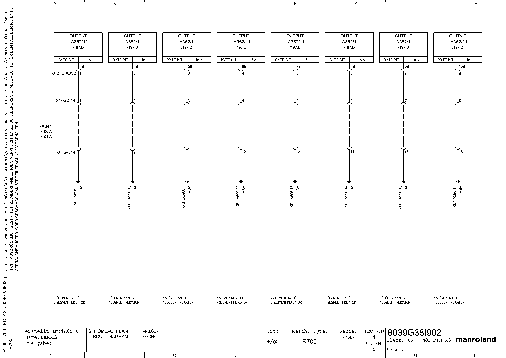

# +Ax — Sheet 105 of 403 — ANLEGER

**FEEDER**

> Part of the manroland **R700** printing press IEC/UL circuit diagrams.
> Drawing class: **Stromlaufplan / Circuit diagram** (DIN A3).
> Document `+Ax` covers the **Central control console** machine section.

## At a glance

| Field | Value |
|---|---|
| Document | `+Ax`  (8039G38I902) |
| Sheet | **105** of 403 |
| Section (DE) | ANLEGER |
| Section (EN) | FEEDER |
| Section type | CIRCUIT — Circuit diagram |
| Machine type | `R700` |
| Series | `7758` |
| Created | 17.05.10 |
| Replaces | — |
| Columns used | A, B, C, D, E, F, G, H |
| Path numbers | — |
| Labels on sheet | 110 |
| Cross-refs out | 10 |
| Cross-refs in | 34 |

**Previous:** [+Ax sheet 104](SHEET_0104.md) · **Next:** [+Ax sheet 106](SHEET_0106.md) · **Document TOC:** [_TOC.md](_TOC.md)  (+Ax) · **Master TOC:** [all sheets](../_MASTER_TOC.md)

## Sheet image (300 DPI, exact vector render)



_Rendered directly from the PDF vector layer at 300 DPI (1-bit), no OCR and no resampling. Use it to confirm anything ambiguous in the text below._

## Cross-references on this sheet

Each entry is a wire leaving this sheet. The printed token is `/sheet.column`; the link resolves to that sheet inside the same document.

| Ref | Target sheet | Col | Path | Destination on target | Target section | From col |
|---|---|---|---|---|---|---|
| `/197.D` | [+Ax sheet 197](SHEET_0197.md) | D | — | — | REFERENZMODUL | A |
| `/197.D` | [+Ax sheet 197](SHEET_0197.md) | D | — | — | REFERENZMODUL | B |
| `/197.D` | [+Ax sheet 197](SHEET_0197.md) | D | — | — | REFERENZMODUL | C |
| `/197.D` | [+Ax sheet 197](SHEET_0197.md) | D | — | — | REFERENZMODUL | D |
| `/197.D` | [+Ax sheet 197](SHEET_0197.md) | D | — | — | REFERENZMODUL | E |
| `/197.D` | [+Ax sheet 197](SHEET_0197.md) | D | — | — | REFERENZMODUL | F |
| `/197.D` | [+Ax sheet 197](SHEET_0197.md) | D | — | — | REFERENZMODUL | G |
| `/197.D` | [+Ax sheet 197](SHEET_0197.md) | D | — | — | REFERENZMODUL | H |
| `/106.A` | [+Ax sheet 106](SHEET_0106.md) | A | — | — | ANLEGER | A |
| `/104.A` | [+Ax sheet 104](SHEET_0104.md) | A | — | — | ANLEGER | A |

### Incoming references (sheets that point here)

Every other sheet that sends a wire to this one. `Back-ref` is the token printed on *that* sheet; `Path` is its line number.

| From sheet | Cols | Back-ref | Path | Refs | What continues there |
|---|---|---|---|---|---|
| [+Ax#104](SHEET_0104.md) | A | `/104.A` | — | 1 | — |
| [+Ax#106](SHEET_0106.md) | A | `/106.A` | — | 1 | — |
| [+Ax#197](SHEET_0197.md) | C, D | `/197.C`, `/197.D` | — | 8 | — |
| [+Ax#207](SHEET_0207.md) | F | `/207.F` | — | 8 | — |
| [+Ax#244](SHEET_0244.md) | F | `/244.F` | — | 8 | — |
| [+Ax#250](SHEET_0250.md) | A | `/250.A` | — | 8 | — |


## Devices on this sheet

| Tag | Class | Class meaning (IEC) | Col | Sub | Terminal | Sign |
|---|---|---|---|---|---|---|
| `A352/11` | A | Baugruppe / assembly, module, PC board | A | 11 | — | — |
| `A352/11` | A | Baugruppe / assembly, module, PC board | B | 11 | — | — |
| `A352/11` | A | Baugruppe / assembly, module, PC board | C | 11 | — | — |
| `A352/11` | A | Baugruppe / assembly, module, PC board | D | 11 | — | — |
| `A352/11` | A | Baugruppe / assembly, module, PC board | E | 11 | — | — |
| `A352/11` | A | Baugruppe / assembly, module, PC board | F | 11 | — | — |
| `A352/11` | A | Baugruppe / assembly, module, PC board | G | 11 | — | — |
| `A352/11` | A | Baugruppe / assembly, module, PC board | H | 11 | — | — |
| `A344` | A | Baugruppe / assembly, module, PC board | A | — | — | — |
| `XB13.A352` | — | cross-device reference | A | — | — | — |
| `16.0` | — | cross-device reference | B | — | — | — |
| `16.1` | — | cross-device reference | C | — | — | — |
| `16.2` | — | cross-device reference | C | — | — | — |
| `16.3` | — | cross-device reference | D | — | — | — |
| `16.4` | — | cross-device reference | E | — | — | — |
| `16.5` | — | cross-device reference | F | — | — | — |
| `16.6` | — | cross-device reference | G | — | — | — |
| `16.7` | — | cross-device reference | H | — | — | — |
| `X1.A344` | — | cross-device reference | A | — | — | — |
| `X10.A344` | — | cross-device reference | A | — | — | — |
| `XB1.A596:9` | — | cross-device reference | A | — | 9 | — |
| `XB1.A596:10` | — | cross-device reference | B | — | 10 | — |
| `XB1.A596:11` | — | cross-device reference | C | — | 11 | — |
| `XB1.A596:12` | — | cross-device reference | D | — | 12 | — |
| `XB1.A596:13` | — | cross-device reference | E | — | 13 | — |
| `XB1.A596:14` | — | cross-device reference | F | — | 14 | — |
| `XB1.A596:15` | — | cross-device reference | G | — | 15 | — |
| `XB1.A596:16` | — | cross-device reference | H | — | 16 | — |

## Potentials / nets

_No named potentials on this sheet._

## Wire-end annotations (grouped as printed)

A wire that continues elsewhere is annotated with a small cluster: the destination description, the path/line number `#NN`, and the `/sheet.column` cross reference. Each row below is one such cluster exactly as it is grouped on the drawing.

| Col | Y | Path | Cross-ref | Text on the wire |
|---|---|---|---|---|
| A | 80.0 | — | — | `OUTPUT` |
| B | 80.0 | — | — | `OUTPUT` |
| C | 80.0 | — | — | `OUTPUT` |
| D | 80.0 | — | — | `OUTPUT` |
| E | 80.0 | — | — | `OUTPUT` |
| F | 80.0 | — | — | `OUTPUT` |
| G | 80.0 | — | — | `OUTPUT` |
| H | 80.0 | — | — | `OUTPUT` |
| A | 93.8 | — | — | `A352/11` |
| B | 93.8 | — | — | `A352/11` |
| C | 93.8 | — | — | `A352/11` |
| D | 93.8 | — | — | `A352/11` |
| E | 93.8 | — | — | `A352/11` |
| F | 93.8 | — | — | `A352/11` |
| G | 93.8 | — | — | `A352/11` |
| H | 93.8 | — | — | `A352/11` |
| A | 107.7 | — | `/197.D` | — |
| B | 107.7 | — | `/197.D` | — |
| C | 107.7 | — | `/197.D` | — |
| D | 107.7 | — | `/197.D` | — |
| E | 107.7 | — | `/197.D` | — |
| F | 107.7 | — | `/197.D` | — |
| G | 107.7 | — | `/197.D` | — |
| H | 107.7 | — | `/197.D` | — |
| A | 137.3 | — | — | `BYTE.BIT 16.0` |
| B | 137.3 | — | — | `BYTE.BIT 16.1` |
| C | 137.3 | — | — | `BYTE.BIT 16.2` |
| D | 137.3 | — | — | `BYTE.BIT 16.3` |
| E | 137.3 | — | — | `BYTE.BIT 16.4` |
| F | 137.3 | — | — | `BYTE.BIT 16.5` |
| G | 137.3 | — | — | `BYTE.BIT 16.6` |
| H | 137.3 | — | — | `BYTE.BIT 16.7` |
| A | 152.6 | — | — | `3B` |
| B | 152.6 | — | — | `4B` |
| C | 152.6 | — | — | `5B` |
| D | 152.6 | — | — | `6B` |
| E | 152.6 | — | — | `7B` |
| F | 152.6 | — | — | `8B` |
| G | 152.6 | — | — | `9B` |
| H | 152.7 | — | — | `10B` |
| D | 167.6 | — | — | `XB13.A352 1 2 3 4 5 6 7 8` |
| D | 231.3 | — | — | `X10.A344 1 2 3 4 5 6 7 8` |
| A | 292.3 | — | — | `A344` |
| A | 305.3 | — | `/106.A`, `/104.A` | — |
| D | 353.2 | — | — | `X1.A344 9 10 11 12 13 14 15 16` |
| C | 434.8 | — | — | `XB1.A596:11` |
| D | 436.0 | — | — | `XB1.A596:12` |
| A | 436.2 | — | — | `XB1.A596:9` |
| B | 436.2 | — | — | `XB1.A596:10` |
| E | 436.2 | — | — | `XB1.A596:13` |
| F | 436.2 | — | — | `XB1.A596:14` |
| G | 436.2 | — | — | `XB1.A596:15` |
| H | 436.2 | — | — | `XB1.A596:16` |
| A | 436.5 | — | — | `+BA` |
| B | 436.5 | — | — | `+BA` |
| C | 436.5 | — | — | `+BA` |
| D | 436.5 | — | — | `+BA` |
| E | 436.5 | — | — | `+BA` |
| F | 436.5 | — | — | `+BA` |
| G | 436.5 | — | — | `+BA` |
| H | 436.5 | — | — | `+BA` |
| A | 698.0 | — | — | `7 SEGMENTANZEIGE 7 SEGMENT INDICATOR` |
| B | 698.0 | — | — | `7 SEGMENTANZEIGE 7 SEGMENT INDICATOR` |
| C | 698.0 | — | — | `7 SEGMENTANZEIGE 7 SEGMENT INDICATOR` |
| D | 698.0 | — | — | `7 SEGMENTANZEIGE 7 SEGMENT INDICATOR` |
| E | 698.0 | — | — | `7 SEGMENTANZEIGE 7 SEGMENT INDICATOR` |
| F | 698.0 | — | — | `7 SEGMENTANZEIGE 7 SEGMENT INDICATOR` |
| G | 698.0 | — | — | `7 SEGMENTANZEIGE 7 SEGMENT INDICATOR` |
| H | 698.0 | — | — | `7 SEGMENTANZEIGE 7 SEGMENT INDICATOR` |


## Reconstructed tables

This sheet carries tabular content (pin map / terminal assignment / index). The grid below was rebuilt from the drawing's own rule lines, so each row is exactly one physical row of the table.

### Table 1 — 1 data rows × 2 columns (at x=127.6, y=76.5)

| OUTPUT | A352/11 /197.D |
|---|---|
| `BYTE.BIT` | `16.0` |


### Table 2 — 1 data rows × 2 columns (at x=255.1, y=76.5)

| OUTPUT | A352/11 /197.D |
|---|---|
| `BYTE.BIT` | `16.1` |


### Table 3 — 1 data rows × 2 columns (at x=382.7, y=76.5)

| OUTPUT | A352/11 /197.D |
|---|---|
| `BYTE.BIT` | `16.2` |


### Table 4 — 1 data rows × 2 columns (at x=510.2, y=76.5)

| OUTPUT | A352/11 /197.D |
|---|---|
| `BYTE.BIT` | `16.3` |


### Table 5 — 1 data rows × 2 columns (at x=637.8, y=76.5)

| OUTPUT | A352/11 /197.D |
|---|---|
| `BYTE.BIT` | `16.4` |


### Table 6 — 1 data rows × 2 columns (at x=765.4, y=76.5)

| OUTPUT | A352/11 /197.D |
|---|---|
| `BYTE.BIT` | `16.5` |


### Table 7 — 1 data rows × 2 columns (at x=892.9, y=76.5)

| OUTPUT | A352/11 /197.D |
|---|---|
| `BYTE.BIT` | `16.6` |


### Table 8 — 1 data rows × 2 columns (at x=1020.5, y=76.5)

| OUTPUT | A352/11 /197.D |
|---|---|
| `BYTE.BIT` | `16.7` |


## Notes and free text on this sheet

| Text | Col | Y (pt) |
|---|---|---|
| `3B` | A | 152.63 |
| `OUTPUT` | A | 79.98 |
| `BYTE.BIT` | A | 137.26 |
| `7 SEGMENTANZEIGE` | A | 697.95 |
| `7 SEGMENT INDICATOR` | A | 708.6 |
| `4B` | B | 152.63 |
| `OUTPUT` | B | 79.98 |
| `BYTE.BIT` | B | 137.26 |
| `7 SEGMENTANZEIGE` | B | 697.95 |
| `7 SEGMENT INDICATOR` | B | 708.6 |
| `5B` | C | 152.63 |
| `OUTPUT` | C | 79.98 |
| `BYTE.BIT` | C | 137.26 |
| `7 SEGMENTANZEIGE` | C | 697.95 |
| `7 SEGMENT INDICATOR` | C | 708.6 |
| `6B` | D | 152.63 |
| `OUTPUT` | D | 79.98 |
| `BYTE.BIT` | D | 137.26 |
| `7 SEGMENTANZEIGE` | D | 697.95 |
| `7 SEGMENT INDICATOR` | D | 708.6 |
| `7B` | E | 152.63 |
| `OUTPUT` | E | 79.98 |
| `BYTE.BIT` | E | 137.26 |
| `7 SEGMENTANZEIGE` | E | 697.95 |
| `7 SEGMENT INDICATOR` | E | 708.6 |
| `8B` | F | 152.63 |
| `OUTPUT` | F | 79.98 |
| `BYTE.BIT` | F | 137.26 |
| `7 SEGMENTANZEIGE` | F | 697.95 |
| `7 SEGMENT INDICATOR` | F | 708.6 |
| `9B` | G | 152.63 |
| `OUTPUT` | G | 79.98 |
| `BYTE.BIT` | G | 137.26 |
| `7 SEGMENTANZEIGE` | G | 697.95 |
| `7 SEGMENT INDICATOR` | G | 708.6 |
| `10B` | H | 152.65 |
| `OUTPUT` | H | 79.98 |
| `7 SEGMENTANZEIGE` | H | 697.95 |
| `7 SEGMENT INDICATOR` | H | 708.6 |
| `+BA` | A | 436.54 |
| `+BA` | B | 436.54 |
| `+BA` | C | 436.54 |
| `+BA` | D | 436.54 |
| `+BA` | E | 436.54 |
| `+BA` | F | 436.54 |
| `+BA` | G | 436.54 |
| `+BA` | H | 436.54 |

## Complete label inventory (exact text from the drawing)

Every text object inside the drawing area of this sheet, in DIN reading order (column A→H, then top→bottom). This is the authoritative list: if a string is not here it is not printed on this sheet.

| Col | Y | X | Dir | Type | Text |
|---|---|---|---|---|---|
| A | 80.0 | 164.0 | → | text | `OUTPUT` |
| A | 93.8 | 163.6 | → | device tag | `A352/11` |
| A | 107.7 | 171.5 | → | cross-reference | `/197.D` |
| A | 137.3 | 137.5 | → | text | `BYTE.BIT` |
| A | 152.6 | 186.8 | → | text | `3B` |
| A | 167.5 | 121.9 | → | device ref | `XB13.A352` |
| A | 169.0 | 186.2 | → | number | `1` |
| A | 231.3 | 127.6 | → | device ref | `X10.A344` |
| A | 232.8 | 186.2 | → | number | `1` |
| A | 292.3 | 94.1 | → | device tag | `A344` |
| A | 305.3 | 96.4 | → | cross-reference | `/106.A` |
| A | 317.7 | 96.4 | → | cross-reference | `/104.A` |
| A | 353.2 | 133.5 | → | device ref | `X1.A344` |
| A | 356.1 | 186.8 | → | number | `9` |
| A | 436.3 | 172.5 | ↕ | device ref | `XB1.A596:9` |
| A | 436.5 | 186.6 | ↕ | text | `+BA` |
| A | 698.0 | 127.3 | → | text | `7 SEGMENTANZEIGE` |
| A | 708.6 | 127.3 | → | text | `7 SEGMENT INDICATOR` |
| B | 80.0 | 291.5 | → | text | `OUTPUT` |
| B | 93.8 | 291.1 | → | device tag | `A352/11` |
| B | 107.7 | 299.1 | → | cross-reference | `/197.D` |
| B | 137.3 | 204.4 | → | device ref | `16.0` |
| B | 137.3 | 265.0 | → | text | `BYTE.BIT` |
| B | 152.6 | 314.4 | → | text | `4B` |
| B | 169.0 | 314.4 | → | number | `2` |
| B | 232.8 | 314.4 | → | number | `2` |
| B | 356.1 | 313.8 | → | number | `10` |
| B | 436.3 | 300.0 | ↕ | device ref | `XB1.A596:10` |
| B | 436.5 | 314.2 | ↕ | text | `+BA` |
| B | 698.0 | 254.8 | → | text | `7 SEGMENTANZEIGE` |
| B | 708.6 | 254.8 | → | text | `7 SEGMENT INDICATOR` |
| C | 80.0 | 419.1 | → | text | `OUTPUT` |
| C | 93.8 | 418.7 | → | device tag | `A352/11` |
| C | 107.7 | 426.6 | → | cross-reference | `/197.D` |
| C | 137.3 | 332.5 | → | device ref | `16.1` |
| C | 137.3 | 392.6 | → | text | `BYTE.BIT` |
| C | 137.3 | 459.6 | → | device ref | `16.2` |
| C | 152.6 | 441.9 | → | text | `5B` |
| C | 169.0 | 441.9 | → | number | `3` |
| C | 232.8 | 441.9 | → | number | `3` |
| C | 353.2 | 441.4 | → | number | `11` |
| C | 434.8 | 427.6 | ↕ | device ref | `XB1.A596:11` |
| C | 436.5 | 441.7 | ↕ | text | `+BA` |
| C | 698.0 | 382.4 | → | text | `7 SEGMENTANZEIGE` |
| C | 708.6 | 382.4 | → | text | `7 SEGMENT INDICATOR` |
| D | 80.0 | 546.7 | → | text | `OUTPUT` |
| D | 93.8 | 546.2 | → | device tag | `A352/11` |
| D | 107.7 | 554.2 | → | cross-reference | `/197.D` |
| D | 137.3 | 520.2 | → | text | `BYTE.BIT` |
| D | 137.3 | 587.1 | → | device ref | `16.3` |
| D | 152.6 | 569.5 | → | text | `6B` |
| D | 169.0 | 569.5 | → | number | `4` |
| D | 232.8 | 569.5 | → | number | `4` |
| D | 353.2 | 568.9 | → | number | `12` |
| D | 436.0 | 555.2 | ↕ | device ref | `XB1.A596:12` |
| D | 436.5 | 569.3 | ↕ | text | `+BA` |
| D | 698.0 | 510.0 | → | text | `7 SEGMENTANZEIGE` |
| D | 708.6 | 510.0 | → | text | `7 SEGMENT INDICATOR` |
| E | 80.0 | 674.2 | → | text | `OUTPUT` |
| E | 93.8 | 673.8 | → | device tag | `A352/11` |
| E | 107.7 | 681.7 | → | cross-reference | `/197.D` |
| E | 137.3 | 647.7 | → | text | `BYTE.BIT` |
| E | 137.3 | 714.6 | → | device ref | `16.4` |
| E | 152.6 | 697.0 | → | text | `7B` |
| E | 169.0 | 697.0 | → | number | `5` |
| E | 232.8 | 697.0 | → | number | `5` |
| E | 353.2 | 696.5 | → | number | `13` |
| E | 436.3 | 682.7 | ↕ | device ref | `XB1.A596:13` |
| E | 436.5 | 696.9 | ↕ | text | `+BA` |
| E | 698.0 | 637.5 | → | text | `7 SEGMENTANZEIGE` |
| E | 708.6 | 637.5 | → | text | `7 SEGMENT INDICATOR` |
| F | 80.0 | 801.8 | → | text | `OUTPUT` |
| F | 93.8 | 801.4 | → | device tag | `A352/11` |
| F | 107.7 | 809.3 | → | cross-reference | `/197.D` |
| F | 137.3 | 775.3 | → | text | `BYTE.BIT` |
| F | 137.3 | 842.2 | → | device ref | `16.5` |
| F | 152.6 | 824.6 | → | text | `8B` |
| F | 169.0 | 824.6 | → | number | `6` |
| F | 232.8 | 824.6 | → | number | `6` |
| F | 353.2 | 824.0 | → | number | `14` |
| F | 436.3 | 810.3 | ↕ | device ref | `XB1.A596:14` |
| F | 436.5 | 824.4 | ↕ | text | `+BA` |
| F | 698.0 | 765.1 | → | text | `7 SEGMENTANZEIGE` |
| F | 708.6 | 765.1 | → | text | `7 SEGMENT INDICATOR` |
| G | 80.0 | 929.3 | → | text | `OUTPUT` |
| G | 93.8 | 928.9 | → | device tag | `A352/11` |
| G | 107.7 | 936.9 | → | cross-reference | `/197.D` |
| G | 137.3 | 902.8 | → | text | `BYTE.BIT` |
| G | 137.3 | 969.7 | → | device ref | `16.6` |
| G | 137.3 | 1030.4 | → | text | `BYTE.BIT` |
| G | 152.6 | 952.2 | → | text | `9B` |
| G | 169.0 | 952.2 | → | number | `7` |
| G | 232.8 | 952.2 | → | number | `7` |
| G | 353.2 | 951.6 | → | number | `15` |
| G | 436.3 | 937.8 | ↕ | device ref | `XB1.A596:15` |
| G | 436.5 | 952.0 | ↕ | text | `+BA` |
| G | 698.0 | 892.6 | → | text | `7 SEGMENTANZEIGE` |
| G | 708.6 | 892.6 | → | text | `7 SEGMENT INDICATOR` |
| H | 80.0 | 1056.9 | → | text | `OUTPUT` |
| H | 93.8 | 1056.5 | → | device tag | `A352/11` |
| H | 107.7 | 1064.4 | → | cross-reference | `/197.D` |
| H | 137.3 | 1097.3 | → | device ref | `16.7` |
| H | 152.6 | 1079.1 | → | text | `10B` |
| H | 169.0 | 1079.7 | → | number | `8` |
| H | 232.8 | 1079.7 | → | number | `8` |
| H | 353.2 | 1079.1 | → | number | `16` |
| H | 436.3 | 1065.4 | ↕ | device ref | `XB1.A596:16` |
| H | 436.5 | 1079.5 | ↕ | text | `+BA` |
| H | 698.0 | 1020.2 | → | text | `7 SEGMENTANZEIGE` |
| H | 708.6 | 1020.2 | → | text | `7 SEGMENT INDICATOR` |

## Reading-order text block

The same content as a plain block, grouped by DIN column — convenient to paste or to match against a visual description.

```text
=== Column A ===
  80.0  164.0  text         OUTPUT
  93.8  163.6  devtag       A352/11
 107.7  171.5  xref         /197.D
 137.3  137.5  text         BYTE.BIT
 152.6  186.8  text         3B
 167.5  121.9  devref       XB13.A352
 169.0  186.2  numeric      1
 231.3  127.6  devref       X10.A344
 232.8  186.2  numeric      1
 292.3   94.1  devtag       A344
 305.3   96.4  xref         /106.A
 317.7   96.4  xref         /104.A
 353.2  133.5  devref       X1.A344
 356.1  186.8  numeric      9
 436.3  172.5  devref       XB1.A596:9
 436.5  186.6  text         +BA
 698.0  127.3  text         7 SEGMENTANZEIGE
 708.6  127.3  text         7 SEGMENT INDICATOR
=== Column B ===
  80.0  291.5  text         OUTPUT
  93.8  291.1  devtag       A352/11
 107.7  299.1  xref         /197.D
 137.3  204.4  devref       16.0
 137.3  265.0  text         BYTE.BIT
 152.6  314.4  text         4B
 169.0  314.4  numeric      2
 232.8  314.4  numeric      2
 356.1  313.8  numeric      10
 436.3  300.0  devref       XB1.A596:10
 436.5  314.2  text         +BA
 698.0  254.8  text         7 SEGMENTANZEIGE
 708.6  254.8  text         7 SEGMENT INDICATOR
=== Column C ===
  80.0  419.1  text         OUTPUT
  93.8  418.7  devtag       A352/11
 107.7  426.6  xref         /197.D
 137.3  332.5  devref       16.1
 137.3  392.6  text         BYTE.BIT
 137.3  459.6  devref       16.2
 152.6  441.9  text         5B
 169.0  441.9  numeric      3
 232.8  441.9  numeric      3
 353.2  441.4  numeric      11
 434.8  427.6  devref       XB1.A596:11
 436.5  441.7  text         +BA
 698.0  382.4  text         7 SEGMENTANZEIGE
 708.6  382.4  text         7 SEGMENT INDICATOR
=== Column D ===
  80.0  546.7  text         OUTPUT
  93.8  546.2  devtag       A352/11
 107.7  554.2  xref         /197.D
 137.3  520.2  text         BYTE.BIT
 137.3  587.1  devref       16.3
 152.6  569.5  text         6B
 169.0  569.5  numeric      4
 232.8  569.5  numeric      4
 353.2  568.9  numeric      12
 436.0  555.2  devref       XB1.A596:12
 436.5  569.3  text         +BA
 698.0  510.0  text         7 SEGMENTANZEIGE
 708.6  510.0  text         7 SEGMENT INDICATOR
=== Column E ===
  80.0  674.2  text         OUTPUT
  93.8  673.8  devtag       A352/11
 107.7  681.7  xref         /197.D
 137.3  647.7  text         BYTE.BIT
 137.3  714.6  devref       16.4
 152.6  697.0  text         7B
 169.0  697.0  numeric      5
 232.8  697.0  numeric      5
 353.2  696.5  numeric      13
 436.3  682.7  devref       XB1.A596:13
 436.5  696.9  text         +BA
 698.0  637.5  text         7 SEGMENTANZEIGE
 708.6  637.5  text         7 SEGMENT INDICATOR
=== Column F ===
  80.0  801.8  text         OUTPUT
  93.8  801.4  devtag       A352/11
 107.7  809.3  xref         /197.D
 137.3  775.3  text         BYTE.BIT
 137.3  842.2  devref       16.5
 152.6  824.6  text         8B
 169.0  824.6  numeric      6
 232.8  824.6  numeric      6
 353.2  824.0  numeric      14
 436.3  810.3  devref       XB1.A596:14
 436.5  824.4  text         +BA
 698.0  765.1  text         7 SEGMENTANZEIGE
 708.6  765.1  text         7 SEGMENT INDICATOR
=== Column G ===
  80.0  929.3  text         OUTPUT
  93.8  928.9  devtag       A352/11
 107.7  936.9  xref         /197.D
 137.3  902.8  text         BYTE.BIT
 137.3  969.7  devref       16.6
 137.3 1030.4  text         BYTE.BIT
 152.6  952.2  text         9B
 169.0  952.2  numeric      7
 232.8  952.2  numeric      7
 353.2  951.6  numeric      15
 436.3  937.8  devref       XB1.A596:15
 436.5  952.0  text         +BA
 698.0  892.6  text         7 SEGMENTANZEIGE
 708.6  892.6  text         7 SEGMENT INDICATOR
=== Column H ===
  80.0 1056.9  text         OUTPUT
  93.8 1056.5  devtag       A352/11
 107.7 1064.4  xref         /197.D
 137.3 1097.3  devref       16.7
 152.6 1079.1  text         10B
 169.0 1079.7  numeric      8
 232.8 1079.7  numeric      8
 353.2 1079.1  numeric      16
 436.3 1065.4  devref       XB1.A596:16
 436.5 1079.5  text         +BA
 698.0 1020.2  text         7 SEGMENTANZEIGE
 708.6 1020.2  text         7 SEGMENT INDICATOR
```

---
_Generated from the PDF vector text layer; no OCR. Source: `R700_7758_IEC_AX_8039G38I902_p`, sheet 105._
