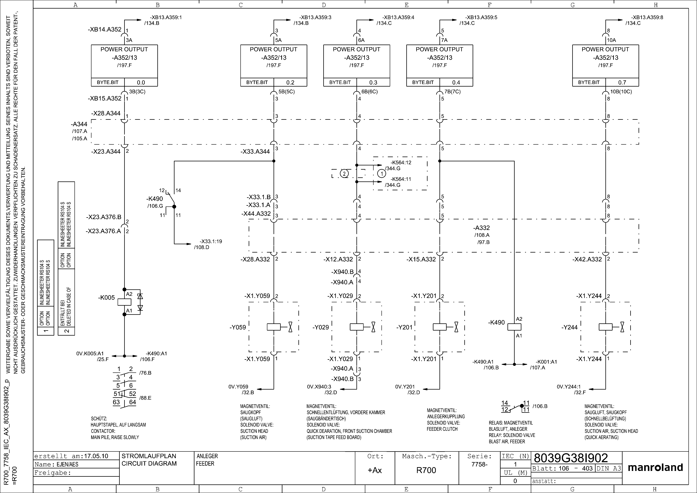

# +Ax — Sheet 106 of 403 — ANLEGER

**FEEDER**

> Part of the manroland **R700** printing press IEC/UL circuit diagrams.
> Drawing class: **Stromlaufplan / Circuit diagram** (DIN A3).
> Document `+Ax` covers the **Central control console** machine section.

## At a glance

| Field | Value |
|---|---|
| Document | `+Ax`  (8039G38I902) |
| Sheet | **106** of 403 |
| Section (DE) | ANLEGER |
| Section (EN) | FEEDER |
| Section type | CIRCUIT — Circuit diagram |
| Machine type | `R700` |
| Series | `7758` |
| Created | 17.05.10 |
| Replaces | — |
| Columns used | A, B, C, D, E, F, G, H |
| Path numbers | — |
| Labels on sheet | 225 |
| Cross-refs out | 28 |
| Cross-refs in | 78 |

**Previous:** [+Ax sheet 105](SHEET_0105.md) · **Next:** [+Ax sheet 107](SHEET_0107.md) · **Document TOC:** [_TOC.md](_TOC.md)  (+Ax) · **Master TOC:** [all sheets](../_MASTER_TOC.md)

## Sheet image (300 DPI, exact vector render)



_Rendered directly from the PDF vector layer at 300 DPI (1-bit), no OCR and no resampling. Use it to confirm anything ambiguous in the text below._

## Cross-references on this sheet

Each entry is a wire leaving this sheet. The printed token is `/sheet.column`; the link resolves to that sheet inside the same document.

| Ref | Target sheet | Col | Path | Destination on target | Target section | From col |
|---|---|---|---|---|---|---|
| `/134.C` | [+Ax sheet 134](SHEET_0134.md) | C | — | XB13.A359:5 | REALTIMERECHNER ANSTEUERUNG DER SPS POWERKARTE | E |
| `/134.C` | [+Ax sheet 134](SHEET_0134.md) | C | — | XB13.A359:8 | REALTIMERECHNER ANSTEUERUNG DER SPS POWERKARTE | G |
| `/134.B` | [+Ax sheet 134](SHEET_0134.md) | B | — | — | REALTIMERECHNER ANSTEUERUNG DER SPS POWERKARTE | B |
| `/134.B` | [+Ax sheet 134](SHEET_0134.md) | B | — | — | REALTIMERECHNER ANSTEUERUNG DER SPS POWERKARTE | D |
| `/134.C` | [+Ax sheet 134](SHEET_0134.md) | C | — | — | REALTIMERECHNER ANSTEUERUNG DER SPS POWERKARTE | H |
| `/197.F` | [+Ax sheet 197](SHEET_0197.md) | F | — | — | REFERENZMODUL | B |
| `/197.F` | [+Ax sheet 197](SHEET_0197.md) | F | — | — | REFERENZMODUL | C |
| `/197.F` | [+Ax sheet 197](SHEET_0197.md) | F | — | — | REFERENZMODUL | D |
| `/197.F` | [+Ax sheet 197](SHEET_0197.md) | F | — | — | REFERENZMODUL | E |
| `/197.F` | [+Ax sheet 197](SHEET_0197.md) | F | — | — | REFERENZMODUL | G |
| `/107.A` | [+Ax sheet 107](SHEET_0107.md) | A | — | — | ANLEGER | A |
| `/105.A` | [+Ax sheet 105](SHEET_0105.md) | A | — | — | ANLEGER | A |
| `/344.G` | [+Ax sheet 344](SHEET_0344.md) | G | — | — | OPTION: INLINESHEETER RS104 S | E |
| `/344.G` | [+Ax sheet 344](SHEET_0344.md) | G | — | — | OPTION: INLINESHEETER RS104 S | E |
| `/106.G` | [+Ax sheet 106](SHEET_0106.md) | G | — | — | ANLEGER | B |
| `/108.A` | [+Ax sheet 108](SHEET_0108.md) | A | — | — | ANLEGER | F |
| `/97.B` | [+Ax sheet 97](SHEET_0097.md) | B | — | — | ANLEGER | F |
| `/108.D` | [+Ax sheet 108](SHEET_0108.md) | D | — | — | ANLEGER | C |
| `/25.F` | [+Ax sheet 25](SHEET_0025.md) | F | — | 0V.K005:A1 | SPANNUNGSVERSORGUNG, SCHALTSCHRANKBELÜFTUNG | A |
| `/106.F` | [+Ax sheet 106](SHEET_0106.md) | F | — | K490:A1 K001:A1 | ANLEGER | D |
| `/106.B` | [+Ax sheet 106](SHEET_0106.md) | B | — | K490:A1 K001:A1 | ANLEGER | D |
| `/107.A` | [+Ax sheet 107](SHEET_0107.md) | A | — | — | ANLEGER | G |
| `/76.B` | [+Ax sheet 76](SHEET_0076.md) | B | — | — | ANLEGER | B |
| `/32.B` | [+Ax sheet 32](SHEET_0032.md) | B | — | 0V.X940:3 0V.Y244:1 0V.Y059 0V.Y201 | SPANNUNGSVERSORGUNG, SCHALTSCHRANKBELÜFTUNG | E |
| `/32.F` | [+Ax sheet 32](SHEET_0032.md) | F | — | 0V.X940:3 0V.Y244:1 0V.Y059 0V.Y201 | SPANNUNGSVERSORGUNG, SCHALTSCHRANKBELÜFTUNG | E |
| `/32.D` | [+Ax sheet 32](SHEET_0032.md) | D | — | 0V.X940:3 0V.Y244:1 0V.Y059 0V.Y201 | SPANNUNGSVERSORGUNG, SCHALTSCHRANKBELÜFTUNG | E |
| `/32.D` | [+Ax sheet 32](SHEET_0032.md) | D | — | 0V.X940:3 0V.Y244:1 0V.Y059 0V.Y201 | SPANNUNGSVERSORGUNG, SCHALTSCHRANKBELÜFTUNG | E |
| `/88.E` | [+Ax sheet 88](SHEET_0088.md) | E | — | — | ANLEGER | B |

### Incoming references (sheets that point here)

Every other sheet that sends a wire to this one. `Back-ref` is the token printed on *that* sheet; `Path` is its line number.

| From sheet | Cols | Back-ref | Path | Refs | What continues there |
|---|---|---|---|---|---|
| [+Ax#25](SHEET_0025.md) | F | `/25.F` | — | 1 | — |
| [+Ax#32](SHEET_0032.md) | B, D, F | `/32.B`, `/32.D`, `/32.F` | — | 4 | 0V.X940:3; 0V.Y201 |
| [+Ax#76](SHEET_0076.md) | B | `/76.B` | — | 1 | — |
| [+Ax#88](SHEET_0088.md) | E | `/88.E` | — | 1 | — |
| [+Ax#97](SHEET_0097.md) | B | `/97.B` | — | 1 | — |
| [+Ax#105](SHEET_0105.md) | A | `/105.A` | — | 1 | — |
| [+Ax#106](SHEET_0106.md) | B, D | `/106.B`, `/106.D` | — | 3 | K490:A1 K001:A1 |
| [+Ax#107](SHEET_0107.md) | A, D | `/107.A`, `/107.D` | — | 2 | K001:A1 K006:A1 |
| [+Ax#108](SHEET_0108.md) | A, D | `/108.A`, `/108.D` | — | 2 | — |
| [+Ax#134](SHEET_0134.md) | B, C | `/134.B`, `/134.C` | — | 5 | — |
| [+Ax#197](SHEET_0197.md) | F | `/197.F` | — | 5 | — |
| [+Ax#216](SHEET_0216.md) | C, E, F, G | `/216.C`, `/216.E`, `/216.F`, `/216.G` | — | 8 | — |
| [+Ax#248](SHEET_0248.md) | C | `/248.C` | — | 1 | — |
| [+Ax#251](SHEET_0251.md) | C | `/251.C` | — | 5 | — |
| [+Ax#252](SHEET_0252.md) | C | `/252.C` | — | 1 | — |
| [+Ax#253](SHEET_0253.md) | A | `/253.A` | — | 5 | — |
| [+Ax#264](SHEET_0264.md) | A, B, E | `/264.A`, `/264.B`, `/264.E` | — | 3 | — |
| [+Ax#271](SHEET_0271.md) | G, H | `/271.G`, `/271.H` | — | 6 | — |
| [+Ax#276](SHEET_0276.md) | A, B, E | `/276.A`, `/276.B`, `/276.E` | — | 12 | — |
| [+Ax#281](SHEET_0281.md) | A, H | `/281.A`, `/281.H` | — | 5 | — |
| [+Ax#296](SHEET_0296.md) | F | `/296.F` | — | 4 | — |
| [+Ax#344](SHEET_0344.md) | E, F | `/344.E`, `/344.F` | — | 2 | 24V.X001 K564:12; K564:11 |


## Devices on this sheet

| Tag | Class | Class meaning (IEC) | Col | Sub | Terminal | Sign |
|---|---|---|---|---|---|---|
| `A352/13` | A | Baugruppe / assembly, module, PC board | E | 13 | — | — |
| `A352/13` | A | Baugruppe / assembly, module, PC board | D | 13 | — | — |
| `A352/13` | A | Baugruppe / assembly, module, PC board | C | 13 | — | — |
| `A352/13` | A | Baugruppe / assembly, module, PC board | G | 13 | — | — |
| `Y201` | Y | Magnetventil / solenoid valve, actuator | E | — | — | — |
| `Y029` | Y | Magnetventil / solenoid valve, actuator | D | — | — | — |
| `Y059` | Y | Magnetventil / solenoid valve, actuator | C | — | — | — |
| `A332` | A | Baugruppe / assembly, module, PC board | F | — | — | — |
| `A2` | A | Baugruppe / assembly, module, PC board | F | — | — | — |
| `A1` | A | Baugruppe / assembly, module, PC board | F | — | — | — |
| `K490` | K | Relais / relay, contactor | F | — | — | — |
| `Y244` | Y | Magnetventil / solenoid valve, actuator | G | — | — | — |
| `A2` | A | Baugruppe / assembly, module, PC board | B | — | — | — |
| `A1` | A | Baugruppe / assembly, module, PC board | B | — | — | — |
| `K005` | K | Relais / relay, contactor | A | — | — | — |
| `A352/13` | A | Baugruppe / assembly, module, PC board | B | 13 | — | — |
| `A344` | A | Baugruppe / assembly, module, PC board | A | — | — | — |
| `K490` | K | Relais / relay, contactor | B | — | — | — |
| `K564:11` | K | Relais / relay, contactor | E | — | 11 | — |
| `K564:12` | K | Relais / relay, contactor | E | — | 12 | — |
| `K001:A1` | K | Relais / relay, contactor | G | — | A1 | — |
| `K490:A1` | K | Relais / relay, contactor | F | — | A1 | — |
| `K490:A1` | K | Relais / relay, contactor | B | — | A1 | — |
| `0.4` | — | cross-device reference | F | — | — | — |
| `0.3` | — | cross-device reference | E | — | — | — |
| `0.2` | — | cross-device reference | D | — | — | — |
| `X33.A344` | — | cross-device reference | C | — | — | — |
| `0.7` | — | cross-device reference | H | — | — | — |
| `X1.Y201` | — | cross-device reference | E | — | — | — |
| `X1.Y201` | — | cross-device reference | E | — | — | — |
| `X15.A332` | — | cross-device reference | E | — | — | — |
| `X12.A332` | — | cross-device reference | D | — | — | — |
| `X940.B` | — | cross-device reference | D | — | — | — |
| `X940.A` | — | cross-device reference | D | — | — | — |
| `X1.Y029` | — | cross-device reference | D | — | — | — |
| `X1.Y029` | — | cross-device reference | D | — | — | — |
| `X940.A` | — | cross-device reference | D | — | — | — |
| `X940.B` | — | cross-device reference | D | — | — | — |
| `X1.Y059` | — | cross-device reference | C | — | — | — |
| `X1.Y059` | — | cross-device reference | C | — | — | — |
| `X28.A332` | — | cross-device reference | C | — | — | — |
| `X42.A332` | — | cross-device reference | G | — | — | — |
| `X1.Y244` | — | cross-device reference | G | — | — | — |
| `X1.Y244` | — | cross-device reference | G | — | — | — |
| `X44.A332` | — | cross-device reference | C | — | — | — |
| `X33.1.B` | — | cross-device reference | C | — | — | — |
| `X33.1.A` | — | cross-device reference | C | — | — | — |
| `X23.A376.B` | — | cross-device reference | A | — | — | — |
| `X23.A376.A` | — | cross-device reference | A | — | — | — |
| `0.0` | — | cross-device reference | B | — | — | — |
| `XB14.A352` | — | cross-device reference | A | — | — | — |
| `XB15.A352` | — | cross-device reference | A | — | — | — |
| `X28.A344` | — | cross-device reference | A | — | — | — |
| `X23.A344` | — | cross-device reference | A | — | — | — |
| `XB13.A359:1` | — | cross-device reference | B | — | 1 | — |
| `XB13.A359:3` | — | cross-device reference | D | — | 3 | — |
| `XB13.A359:8` | — | cross-device reference | H | — | 8 | — |
| `XB13.A359:5` | — | cross-device reference | F | — | 5 | — |
| `XB13.A359:4` | — | cross-device reference | E | — | 4 | — |
| `X33.1:19` | — | cross-device reference | C | — | 19 | — |

## Potentials / nets

| Potential | Count | Columns | Attached devices | Terminals |
|---|---|---|---|---|
| `0V` | 5 | A, C, D, E, G | `K005`, `X940`, `Y059`, `Y201`, `Y244` | `1`, `3`, `A1` |


A potential such as `L24+/4` or `M24+` is a named supply/return rail; every place it appears on this sheet is electrically common.

## Wire-end annotations (grouped as printed)

A wire that continues elsewhere is annotated with a small cluster: the destination description, the path/line number `#NN`, and the `/sheet.column` cross reference. Each row below is one such cluster exactly as it is grouped on the drawing.

| Col | Y | Path | Cross-ref | Text on the wire |
|---|---|---|---|---|
| B | 25.8 | — | — | `XB13.A359:1` |
| D | 25.8 | — | — | `XB13.A359:3` |
| E | 25.8 | — | `/134.C` | `XB13.A359:5` |
| E | 25.8 | — | — | `XB13.A359:4` |
| G | 25.8 | — | `/134.C` | `XB13.A359:8` |
| B | 35.7 | — | `/134.B` | — |
| D | 35.7 | — | `/134.B` | — |
| H | 35.7 | — | `/134.C` | — |
| A | 45.7 | — | — | `XB14.A352 1` |
| C | 48.5 | — | — | `3` |
| D | 48.5 | — | — | `4` |
| E | 48.5 | — | — | `5` |
| G | 48.5 | — | — | `8` |
| B | 64.8 | — | — | `3A` |
| C | 64.8 | — | — | `5A` |
| D | 64.8 | — | — | `6A` |
| E | 64.8 | — | — | `7A` |
| G | 64.8 | — | — | `10A` |
| B | 79.9 | — | — | `POWER OUTPUT` |
| C | 79.9 | — | — | `POWER OUTPUT` |
| D | 79.9 | — | — | `POWER OUTPUT` |
| E | 79.9 | — | — | `POWER OUTPUT` |
| G | 79.9 | — | — | `POWER OUTPUT` |
| B | 93.8 | — | — | `A352/13` |
| C | 93.8 | — | — | `A352/13` |
| D | 93.8 | — | — | `A352/13` |
| E | 93.8 | — | — | `A352/13` |
| G | 93.8 | — | — | `A352/13` |
| B | 107.6 | — | `/197.F` | — |
| C | 107.6 | — | `/197.F` | — |
| D | 107.6 | — | `/197.F` | — |
| E | 107.6 | — | `/197.F` | — |
| G | 107.6 | — | `/197.F` | — |
| B | 136.7 | — | — | `BYTE.BIT 0.0` |
| C | 136.7 | — | — | `BYTE.BIT 0.2` |
| D | 136.7 | — | — | `BYTE.BIT 0.3` |
| E | 136.7 | — | — | `BYTE.BIT 0.4` |
| G | 136.7 | — | — | `BYTE.BIT 0.7` |
| B | 152.7 | — | — | `3B(3C)` |
| D | 152.7 | — | — | `5B(5C)` |
| E | 152.7 | — | — | `6B(6C)` |
| F | 152.7 | — | — | `7B(7C)` |
| H | 152.7 | — | — | `10B(10C)` |
| A | 163.3 | — | — | `XB15.A352 1` |
| C | 164.7 | — | — | `3` |
| D | 164.7 | — | — | `4` |
| E | 164.7 | — | — | `5` |
| G | 164.7 | — | — | `8` |
| A | 188.8 | — | — | `X28.A344 1` |
| C | 194.5 | — | — | `3` |
| D | 194.5 | — | — | `4` |
| E | 194.5 | — | — | `5` |
| G | 194.5 | — | — | `8` |
| A | 207.2 | — | — | `A344` |
| A | 220.3 | — | `/107.A`, `/105.A` | — |
| C | 249.8 | — | — | `X33.A344 3` |
| D | 249.8 | — | — | `4` |
| E | 249.8 | — | — | `5` |
| G | 249.8 | — | — | `8` |
| A | 254.0 | — | — | `X23.A344 2` |
| E | 273.8 | — | — | `K564:12` |
| E | 283.7 | — | `/344.G` | — |
| D | 293.2 | — | — | `2 1` |
| E | 302.2 | — | — | `K564:11` |
| E | 312.1 | — | `/344.G` | — |
| B | 321.4 | — | — | `K490 14` |
| B | 321.4 | — | — | `12` |
| C | 332.0 | — | — | `X33.1.B 3` |
| D | 332.0 | — | — | `4` |
| E | 332.0 | — | — | `5` |
| G | 332.0 | — | — | `8` |
| A | 344.9 | — | — | `INLINESHEETER RS104 S OPTION` |
| A | 344.9 | — | — | `INLINESHEETER RS104 S` |
| C | 345.4 | — | — | `X33.1.A 3` |
| B | 347.9 | — | `/106.G` | — |
| D | 349.0 | — | — | `4` |
| E | 349.0 | — | — | `5` |
| G | 349.0 | — | — | `8` |
| E | 360.3 | — | — | `X44.A332 3 4 5 8` |
| B | 363.9 | — | — | `11 11` |
| A | 366.0 | — | — | `X23.A376.B 2` |
| F | 384.4 | — | — | `A332` |
| A | 390.1 | — | — | `X23.A376.A 2` |
| F | 397.5 | — | `/108.A` | — |
| C | 408.5 | — | — | `X33.1:19` |
| F | 409.9 | — | `/97.B` | — |
| C | 418.4 | — | `/108.D` | — |
| A | 432.4 | — | — | `OPTION DELETED IN CASE OF` |
| C | 438.3 | — | — | `X28.A332 2` |
| E | 438.3 | — | — | `X12.A332 2 X15.A332 2` |
| G | 438.3 | — | — | `X42.A332 2` |
| A | 444.1 | — | — | `INLINESHEETER RS104 S OPTION` |
| A | 444.1 | — | — | `INLINESHEETER RS104 S` |
| D | 459.5 | — | — | `X940.B 4` |
| D | 476.5 | — | — | `X940.A 4` |
| B | 498.5 | — | — | `A2` |
| C | 500.7 | — | — | `X1.Y059 2` |
| D | 500.7 | — | — | `X1.Y029 2` |
| E | 500.7 | — | — | `X1.Y201 2` |
| G | 500.7 | — | — | `X1.Y244 2` |
| A | 503.4 | — | — | `K005` |
| A | 512.7 | — | — | `ENTFÄLLT BEI 2` |
| B | 526.8 | — | — | `A1` |
| A | 531.6 | — | — | `OPTION 1` |
| F | 541.0 | — | — | `A2` |
| F | 546.0 | — | — | `K490` |
| C | 554.6 | — | — | `Y059` |
| D | 554.6 | — | — | `Y029` |
| E | 554.6 | — | — | `Y201` |
| G | 554.6 | — | — | `Y244` |
| F | 569.3 | — | — | `A1` |
| A | 599.8 | — | `/25.F` | `0V.K005:A1` |
| B | 599.8 | — | — | `K490:A1` |
| C | 608.4 | — | — | `X1.Y059 1` |
| D | 608.4 | — | — | `X1.Y029 1` |
| E | 608.4 | — | — | `X1.Y201 1` |
| G | 608.4 | — | — | `X1.Y244 1` |
| D | 609.7 | — | `/106.F`, `/106.B` | `K490:A1 K001:A1` |
| G | 623.9 | — | `/107.A` | — |
| D | 624.6 | — | — | `X940.A 3` |
| B | 625.3 | — | — | `3 5 1` |
| B | 625.3 | — | — | `2 4 6` |
| B | 633.1 | — | `/76.B` | — |
| D | 642.4 | — | — | `X940.B 3` |
| E | 656.5 | — | `/32.B`, `/32.F`, `/32.D`, `/32.D` | `0V.Y059 0V.X940:3 0V.Y201 0V.Y244:1` |
| B | 667.8 | — | — | `63 51 52 64` |
| B | 675.6 | — | `/88.E` | — |
| F | 683.4 | — | — | `14 12 11 11 /106.B` |
| C | 690.9 | — | — | `MAGNETVENTIL: (SAUGLUFT) (SUCTION AIR) SAUGKOPF SOLENOID VALVE: SUCTION HEAD` |
| D | 690.9 | — | — | `MAGNETVENTIL: (SAUGBÄNDERTISCH) (SUCTION TAPE FEED BOARD) SCHNELLENTLÜFTUNG, VORDERE KAMMER SOLENOID VALVE: QUICK DEARATION, FRONT SUCTION CHAMBER` |
| G | 690.9 | — | — | `MAGNETVENTIL: (SCHNELLBELÜFTUNG) (QUICK AERATING) SAUGLUFT, SAUGKOPF SOLENOID VALVE: SUCTION AIR, SUCTION HEAD` |
| E | 697.9 | — | — | `MAGNETVENTIL:` |
| E | 708.6 | — | — | `FEEDER CLUTCH SOLENOID VALVE: ANLEGERKUPPLUNG` |
| B | 712.1 | — | — | `HAUPTSTAPEL, AUF LANGSAM SCHÜTZ:` |
| F | 719.2 | — | — | `RELAIS: MAGNETVENTIL BLASLUFT, ANLEGER RELAY: SOLENOID VALVE BLAST AIR, FEEDER` |
| A | 733.4 | — | — | `MAIN PILE, RAISE SLOWLY CONTACTOR:` |


## Reconstructed tables

This sheet carries tabular content (pin map / terminal assignment / index). The grid below was rebuilt from the drawing's own rule lines, so each row is exactly one physical row of the table.

### Table 1 — 2 data rows × 3 columns (at x=155.9, y=76.5)

| POWER | OUTPUT A352/13 /197.F |  |
|---|---|---|
| `BYTE.BIT` |  | `0.0` |
| `XB15.A352 X28.A344 X23.A344` | `3B(3C) 1 1 2` |  |


### Table 2 — 2 data rows × 2 columns (at x=411.0, y=76.5)

| POWER | OUTPUT A352/13 /197.F |
|---|---|
| `BYTE.BIT` | `0.2` |
| `X33.A344` | `5B(5C) 3 3 3` |


### Table 3 — 2 data rows × 2 columns (at x=552.8, y=76.5)

| POWER | OUTPUT A352/13 /197.F |
|---|---|
| `BYTE.BIT` | `0.3` |
|  | `6B(6C) 4 4 4` |


### Table 4 — 2 data rows × 2 columns (at x=694.5, y=76.5)

| POWER | OUTPUT A352/13 /197.F |
|---|---|
| `BYTE.BIT` | `0.4` |
|  | `7B(7C) 5 5 5` |


### Table 5 — 2 data rows × 2 columns (at x=978.0, y=76.5)

| POWER | OUTPUT A352/13 /197.F |
|---|---|
| `BYTE.BIT` | `0.7` |
|  | `10B(10C) 8 8 8` |


## Notes and free text on this sheet

| Text | Col | Y (pt) |
|---|---|---|
| `7A` | E | 64.76 |
| `7B(7C)` | F | 152.68 |
| `POWER OUTPUT` | E | 79.93 |
| `BYTE.BIT` | E | 137.26 |
| `6A` | D | 64.76 |
| `6B(6C)` | E | 152.68 |
| `POWER OUTPUT` | D | 79.93 |
| `BYTE.BIT` | D | 137.26 |
| `5A` | C | 64.76 |
| `5B(5C)` | D | 152.68 |
| `POWER OUTPUT` | C | 79.93 |
| `BYTE.BIT` | C | 137.26 |
| `10A` | G | 64.77 |
| `10B(10C)` | H | 152.68 |
| `POWER OUTPUT` | G | 79.93 |
| `BYTE.BIT` | G | 137.26 |
| `MAGNETVENTIL:` | E | 697.94 |
| `ANLEGERKUPPLUNG` | E | 708.59 |
| `SOLENOID VALVE:` | E | 719.2 |
| `FEEDER CLUTCH` | E | 729.85 |
| `MAGNETVENTIL:` | D | 690.85 |
| `SCHNELLENTLÜFTUNG, VORDERE KAMMER` | D | 701.52 |
| `(SAUGBÄNDERTISCH)` | D | 712.13 |
| `SOLENOID VALVE:` | D | 722.74 |
| `QUICK DEARATION, FRONT SUCTION CHAMBER` | D | 733.41 |
| `(SUCTION TAPE FEED BOARD)` | D | 744.02 |
| `MAGNETVENTIL:` | C | 690.85 |
| `SAUGKOPF` | C | 701.48 |
| `(SAUGLUFT)` | C | 712.13 |
| `SOLENOID VALVE:` | C | 722.74 |
| `SUCTION HEAD` | C | 733.4 |
| `(SUCTION AIR)` | C | 744.03 |
| `11 /106.B` | G | 689.79 |
| `RELAIS: MAGNETVENTIL` | F | 719.2 |
| `BLASLUFT, ANLEGER` | F | 729.83 |
| `RELAY: SOLENOID VALVE` | F | 740.46 |
| `BLAST AIR, FEEDER` | F | 751.08 |
| `MAGNETVENTIL:` | G | 690.85 |
| `SAUGLUFT, SAUGKOPF` | G | 701.49 |
| `(SCHNELLBELÜFTUNG)` | G | 712.15 |
| `SOLENOID VALVE:` | G | 722.74 |
| `SUCTION AIR, SUCTION HEAD` | G | 733.4 |
| `(QUICK AERATING)` | G | 744.02 |
| `SCHÜTZ:` | A | 712.11 |
| `HAUPTSTAPEL, AUF LANGSAM` | B | 722.75 |
| `CONTACTOR:` | A | 733.39 |
| `MAIN PILE, RAISE SLOWLY` | A | 743.99 |
| `3A` | B | 64.76 |
| `3B(3C)` | B | 152.68 |
| `POWER OUTPUT` | B | 79.93 |
| `BYTE.BIT` | A | 137.26 |
| `OPTION` | A | 531.6 |
| `INLINESHEETER RS104 S` | A | 444.12 |
| `ENTFÄLLT BEI` | A | 512.68 |
| `DELETED IN CASE OF` | A | 489.9 |

## Complete label inventory (exact text from the drawing)

Every text object inside the drawing area of this sheet, in DIN reading order (column A→H, then top→bottom). This is the authoritative list: if a string is not here it is not printed on this sheet.

| Col | Y | X | Dir | Type | Text |
|---|---|---|---|---|---|
| A | 45.7 | 150.2 | → | device ref | `XB14.A352` |
| A | 137.3 | 165.8 | → | text | `BYTE.BIT` |
| A | 163.3 | 150.2 | → | device ref | `XB15.A352` |
| A | 188.8 | 155.9 | → | device ref | `X28.A344` |
| A | 207.2 | 121.0 | → | device tag | `A344` |
| A | 220.3 | 123.3 | → | cross-reference | `/107.A` |
| A | 232.7 | 123.3 | → | cross-reference | `/105.A` |
| A | 254.0 | 155.9 | → | device ref | `X23.A344` |
| A | 344.9 | 104.1 | ↕ | text | `INLINESHEETER RS104 S` |
| A | 344.9 | 114.7 | ↕ | text | `INLINESHEETER RS104 S` |
| A | 366.0 | 147.4 | → | device ref | `X23.A376.B` |
| A | 390.1 | 146.6 | → | device ref | `X23.A376.A` |
| A | 432.4 | 104.1 | ↕ | text | `OPTION` |
| A | 432.4 | 114.7 | ↕ | text | `OPTION` |
| A | 444.1 | 68.6 | ↕ | text | `INLINESHEETER RS104 S` |
| A | 444.1 | 79.3 | ↕ | text | `INLINESHEETER RS104 S` |
| A | 489.9 | 114.7 | ↕ | text | `DELETED IN CASE OF` |
| A | 503.5 | 167.8 | → | device tag | `K005` |
| A | 512.7 | 104.1 | ↕ | text | `ENTFÄLLT BEI` |
| A | 531.6 | 68.6 | ↕ | text | `OPTION` |
| A | 531.6 | 79.3 | ↕ | text | `OPTION` |
| A | 562.1 | 74.0 | ↕ | number | `1` |
| A | 562.4 | 109.4 | ↕ | number | `2` |
| A | 599.8 | 130.4 | → | potential | `0V.K005:A1` |
| A | 609.7 | 165.8 | → | cross-reference | `/25.F` |
| A | 682.0 | 192.8 | → | number | `63` |
| A | 712.1 | 155.6 | → | text | `SCHÜTZ:` |
| A | 733.4 | 155.6 | → | text | `CONTACTOR:` |
| A | 744.0 | 155.3 | → | text | `MAIN PILE, RAISE SLOWLY` |
| B | 25.8 | 256.3 | → | device ref | `XB13.A359:1` |
| B | 35.7 | 246.6 | → | cross-reference | `/134.B` |
| B | 48.5 | 214.6 | → | number | `1` |
| B | 64.8 | 215.1 | → | text | `3A` |
| B | 79.9 | 171.8 | → | text | `POWER OUTPUT` |
| B | 93.8 | 191.2 | → | device tag | `A352/13` |
| B | 107.6 | 200.3 | → | cross-reference | `/197.F` |
| B | 136.7 | 234.1 | → | device ref | `0.0` |
| B | 152.7 | 220.8 | → | text | `3B(3C)` |
| B | 164.7 | 214.6 | → | number | `1` |
| B | 194.5 | 214.6 | → | number | `1` |
| B | 254.0 | 215.1 | → | number | `2` |
| B | 321.3 | 271.6 | → | number | `12` |
| B | 321.3 | 299.6 | → | number | `14` |
| B | 334.8 | 250.0 | → | device tag | `K490` |
| B | 347.9 | 252.0 | → | cross-reference | `/106.G` |
| B | 363.9 | 272.7 | → | number | `11` |
| B | 363.9 | 299.6 | → | number | `11` |
| B | 374.5 | 215.1 | → | number | `2` |
| B | 391.5 | 215.1 | → | number | `2` |
| B | 498.5 | 215.4 | → | device tag | `A2` |
| B | 526.8 | 215.4 | → | device tag | `A1` |
| B | 599.8 | 249.2 | → | device tag | `K490:A1` |
| B | 609.7 | 239.5 | → | cross-reference | `/106.F` |
| B | 625.3 | 200.1 | → | number | `1` |
| B | 625.3 | 220.8 | → | number | `2` |
| B | 633.1 | 238.1 | → | cross-reference | `/76.B` |
| B | 639.5 | 198.7 | → | number | `3` |
| B | 639.5 | 220.8 | → | number | `4` |
| B | 653.7 | 198.7 | → | number | `5` |
| B | 653.7 | 220.8 | → | number | `6` |
| B | 667.8 | 194.2 | → | number | `51` |
| B | 667.8 | 220.5 | → | number | `52` |
| B | 675.6 | 238.1 | → | cross-reference | `/88.E` |
| B | 682.0 | 220.8 | → | number | `64` |
| B | 722.7 | 155.1 | → | text | `HAUPTSTAPEL, AUF LANGSAM` |
| C | 48.5 | 470.3 | → | number | `3` |
| C | 64.8 | 470.3 | → | text | `5A` |
| C | 79.9 | 426.9 | → | text | `POWER OUTPUT` |
| C | 93.8 | 446.3 | → | device tag | `A352/13` |
| C | 107.6 | 455.4 | → | cross-reference | `/197.F` |
| C | 137.3 | 420.9 | → | text | `BYTE.BIT` |
| C | 164.7 | 470.3 | → | number | `3` |
| C | 194.5 | 470.3 | → | number | `3` |
| C | 249.8 | 470.3 | → | number | `3` |
| C | 254.0 | 411.0 | → | device ref | `X33.A344` |
| C | 332.0 | 421.5 | → | device ref | `X33.1.B` |
| C | 332.0 | 470.3 | → | number | `3` |
| C | 345.4 | 420.7 | → | device ref | `X33.1.A` |
| C | 349.0 | 470.3 | → | number | `3` |
| C | 360.3 | 412.4 | → | device ref | `X44.A332` |
| C | 364.6 | 470.3 | → | number | `3` |
| C | 408.5 | 341.3 | → | device ref | `X33.1:19` |
| C | 418.4 | 331.7 | → | cross-reference | `/108.D` |
| C | 438.3 | 411.0 | → | device ref | `X28.A332` |
| C | 438.3 | 470.3 | → | number | `2` |
| C | 500.7 | 417.5 | → | device ref | `X1.Y059` |
| C | 502.1 | 470.3 | → | number | `2` |
| C | 554.6 | 392.3 | → | device tag | `Y059` |
| C | 608.4 | 417.5 | → | device ref | `X1.Y059` |
| C | 608.4 | 469.7 | → | number | `1` |
| C | 656.5 | 390.3 | → | potential | `0V.Y059` |
| C | 666.4 | 413.3 | → | cross-reference | `/32.B` |
| C | 690.9 | 410.5 | → | text | `MAGNETVENTIL:` |
| C | 701.5 | 410.7 | → | text | `SAUGKOPF` |
| C | 712.1 | 410.5 | → | text | `(SAUGLUFT)` |
| C | 722.7 | 410.7 | → | text | `SOLENOID VALVE:` |
| C | 733.4 | 410.7 | → | text | `SUCTION HEAD` |
| C | 744.0 | 410.5 | → | text | `(SUCTION AIR)` |
| D | 25.8 | 511.4 | → | device ref | `XB13.A359:3` |
| D | 35.7 | 501.7 | → | cross-reference | `/134.B` |
| D | 48.5 | 612.0 | → | number | `4` |
| D | 64.8 | 612.0 | → | text | `6A` |
| D | 79.9 | 568.6 | → | text | `POWER OUTPUT` |
| D | 93.8 | 588.0 | → | device tag | `A352/13` |
| D | 107.6 | 597.1 | → | cross-reference | `/197.F` |
| D | 136.7 | 489.3 | → | device ref | `0.2` |
| D | 137.3 | 562.7 | → | text | `BYTE.BIT` |
| D | 152.7 | 475.9 | → | text | `5B(5C)` |
| D | 164.7 | 612.0 | → | number | `4` |
| D | 194.5 | 612.0 | → | number | `4` |
| D | 249.8 | 612.0 | → | number | `4` |
| D | 293.7 | 586.2 | → | number | `2` |
| D | 332.0 | 612.0 | → | number | `4` |
| D | 349.0 | 612.0 | → | number | `4` |
| D | 364.6 | 612.0 | → | number | `4` |
| D | 438.3 | 552.8 | → | device ref | `X12.A332` |
| D | 438.3 | 612.0 | → | number | `2` |
| D | 459.5 | 566.1 | → | device ref | `X940.B` |
| D | 459.5 | 612.0 | → | number | `4` |
| D | 476.5 | 612.0 | → | number | `4` |
| D | 477.2 | 565.2 | → | device ref | `X940.A` |
| D | 500.7 | 559.3 | → | device ref | `X1.Y029` |
| D | 502.1 | 612.0 | → | number | `2` |
| D | 554.6 | 534.0 | → | device tag | `Y029` |
| D | 608.4 | 559.3 | → | device ref | `X1.Y029` |
| D | 608.4 | 611.4 | → | number | `1` |
| D | 624.6 | 565.2 | → | device ref | `X940.A` |
| D | 626.8 | 612.0 | → | number | `3` |
| D | 642.4 | 566.1 | → | device ref | `X940.B` |
| D | 643.8 | 612.0 | → | number | `3` |
| D | 656.5 | 524.7 | → | potential | `0V.X940:3` |
| D | 666.4 | 554.7 | → | cross-reference | `/32.D` |
| D | 690.9 | 523.8 | → | text | `MAGNETVENTIL:` |
| D | 701.5 | 524.1 | → | text | `SCHNELLENTLÜFTUNG, VORDERE KAMMER` |
| D | 712.1 | 523.8 | → | text | `(SAUGBÄNDERTISCH)` |
| D | 722.7 | 524.1 | → | text | `SOLENOID VALVE:` |
| D | 733.4 | 524.1 | → | text | `QUICK DEARATION, FRONT SUCTION CHAMBER` |
| D | 744.0 | 523.8 | → | text | `(SUCTION TAPE FEED BOARD)` |
| E | 25.8 | 653.1 | → | device ref | `XB13.A359:4` |
| E | 35.7 | 643.5 | → | cross-reference | `/134.C` |
| E | 48.5 | 753.7 | → | number | `5` |
| E | 64.8 | 753.7 | → | text | `7A` |
| E | 79.9 | 710.4 | → | text | `POWER OUTPUT` |
| E | 93.8 | 729.8 | → | device tag | `A352/13` |
| E | 107.6 | 738.9 | → | cross-reference | `/197.F` |
| E | 136.7 | 631.0 | → | device ref | `0.3` |
| E | 137.3 | 704.4 | → | text | `BYTE.BIT` |
| E | 152.7 | 617.7 | → | text | `6B(6C)` |
| E | 164.7 | 753.7 | → | number | `5` |
| E | 194.5 | 753.7 | → | number | `5` |
| E | 249.8 | 753.7 | → | number | `5` |
| E | 273.8 | 667.3 | → | device tag | `K564:12` |
| E | 283.7 | 657.6 | → | cross-reference | `/344.G` |
| E | 293.2 | 650.2 | → | number | `1` |
| E | 302.2 | 667.3 | → | device tag | `K564:11` |
| E | 312.1 | 657.6 | → | cross-reference | `/344.G` |
| E | 332.0 | 753.7 | → | number | `5` |
| E | 349.0 | 753.7 | → | number | `5` |
| E | 364.6 | 753.7 | → | number | `5` |
| E | 438.3 | 694.5 | → | device ref | `X15.A332` |
| E | 438.3 | 753.7 | → | number | `2` |
| E | 500.7 | 702.4 | → | device ref | `X1.Y201` |
| E | 502.1 | 753.7 | → | number | `2` |
| E | 554.6 | 677.2 | → | device tag | `Y201` |
| E | 608.4 | 702.4 | → | device ref | `X1.Y201` |
| E | 608.4 | 753.2 | → | number | `1` |
| E | 656.5 | 675.2 | → | potential | `0V.Y201` |
| E | 666.4 | 696.5 | → | cross-reference | `/32.D` |
| E | 697.9 | 729.4 | → | text | `MAGNETVENTIL:` |
| E | 708.6 | 729.9 | → | text | `ANLEGERKUPPLUNG` |
| E | 719.2 | 729.6 | → | text | `SOLENOID VALVE:` |
| E | 729.8 | 729.1 | → | text | `FEEDER CLUTCH` |
| F | 25.8 | 794.8 | → | device ref | `XB13.A359:5` |
| F | 35.7 | 785.2 | → | cross-reference | `/134.C` |
| F | 136.7 | 772.7 | → | device ref | `0.4` |
| F | 152.7 | 759.4 | → | text | `7B(7C)` |
| F | 384.4 | 808.4 | → | device tag | `A332` |
| F | 397.5 | 810.7 | → | cross-reference | `/108.A` |
| F | 409.9 | 815.8 | → | cross-reference | `/97.B` |
| F | 541.0 | 881.6 | → | device tag | `A2` |
| F | 546.0 | 834.0 | → | device tag | `K490` |
| F | 569.3 | 881.6 | → | device tag | `A1` |
| F | 614.0 | 807.0 | → | device tag | `K490:A1` |
| F | 623.9 | 826.6 | → | cross-reference | `/106.B` |
| F | 683.4 | 856.1 | → | number | `14` |
| F | 683.4 | 893.2 | → | number | `11` |
| F | 694.8 | 856.1 | → | number | `12` |
| F | 719.2 | 835.4 | → | text | `RELAIS: MAGNETVENTIL` |
| F | 729.8 | 835.4 | → | text | `BLASLUFT, ANLEGER` |
| F | 740.5 | 835.4 | → | text | `RELAY: SOLENOID VALVE` |
| F | 751.1 | 835.4 | → | text | `BLAST AIR, FEEDER` |
| G | 48.5 | 1037.2 | → | number | `8` |
| G | 64.8 | 1036.6 | → | text | `10A` |
| G | 79.9 | 993.8 | → | text | `POWER OUTPUT` |
| G | 93.8 | 1013.2 | → | device tag | `A352/13` |
| G | 107.6 | 1022.3 | → | cross-reference | `/197.F` |
| G | 137.3 | 987.9 | → | text | `BYTE.BIT` |
| G | 164.7 | 1037.2 | → | number | `8` |
| G | 194.5 | 1037.2 | → | number | `8` |
| G | 249.8 | 1037.2 | → | number | `8` |
| G | 332.0 | 1037.2 | → | number | `8` |
| G | 349.0 | 1037.2 | → | number | `8` |
| G | 364.6 | 1037.2 | → | number | `8` |
| G | 438.3 | 978.0 | → | device ref | `X42.A332` |
| G | 438.3 | 1037.2 | → | number | `2` |
| G | 500.7 | 984.5 | → | device ref | `X1.Y244` |
| G | 502.1 | 1037.2 | → | number | `2` |
| G | 554.6 | 959.2 | → | device tag | `Y244` |
| G | 608.4 | 984.5 | → | device ref | `X1.Y244` |
| G | 608.4 | 1036.6 | → | number | `1` |
| G | 614.0 | 915.3 | → | device tag | `K001:A1` |
| G | 623.9 | 905.7 | → | cross-reference | `/107.A` |
| G | 656.5 | 951.3 | → | potential | `0V.Y244:1` |
| G | 666.4 | 980.8 | → | cross-reference | `/32.F` |
| G | 689.8 | 893.2 | → | text | `11 /106.B` |
| G | 690.9 | 998.6 | → | text | `MAGNETVENTIL:` |
| G | 701.5 | 998.9 | → | text | `SAUGLUFT, SAUGKOPF` |
| G | 712.1 | 998.6 | → | text | `(SCHNELLBELÜFTUNG)` |
| G | 722.7 | 998.9 | → | text | `SOLENOID VALVE:` |
| G | 733.4 | 998.9 | → | text | `SUCTION AIR, SUCTION HEAD` |
| G | 744.0 | 998.6 | → | text | `(QUICK AERATING)` |
| H | 25.8 | 1078.3 | → | device ref | `XB13.A359:8` |
| H | 35.7 | 1068.7 | → | cross-reference | `/134.C` |
| H | 136.7 | 1056.2 | → | device ref | `0.7` |
| H | 152.7 | 1042.3 | → | text | `10B(10C)` |

## Reading-order text block

The same content as a plain block, grouped by DIN column — convenient to paste or to match against a visual description.

```text
=== Column A ===
  45.7  150.2  devref       XB14.A352
 137.3  165.8  text         BYTE.BIT
 163.3  150.2  devref       XB15.A352
 188.8  155.9  devref       X28.A344
 207.2  121.0  devtag       A344
 220.3  123.3  xref         /107.A
 232.7  123.3  xref         /105.A
 254.0  155.9  devref       X23.A344
 344.9  104.1  text         INLINESHEETER RS104 S
 344.9  114.7  text         INLINESHEETER RS104 S
 366.0  147.4  devref       X23.A376.B
 390.1  146.6  devref       X23.A376.A
 432.4  104.1  text         OPTION
 432.4  114.7  text         OPTION
 444.1   68.6  text         INLINESHEETER RS104 S
 444.1   79.3  text         INLINESHEETER RS104 S
 489.9  114.7  text         DELETED IN CASE OF
 503.5  167.8  devtag       K005
 512.7  104.1  text         ENTFÄLLT BEI
 531.6   68.6  text         OPTION
 531.6   79.3  text         OPTION
 562.1   74.0  numeric      1
 562.4  109.4  numeric      2
 599.8  130.4  net          0V.K005:A1
 609.7  165.8  xref         /25.F
 682.0  192.8  numeric      63
 712.1  155.6  text         SCHÜTZ:
 733.4  155.6  text         CONTACTOR:
 744.0  155.3  text         MAIN PILE, RAISE SLOWLY
=== Column B ===
  25.8  256.3  devref       XB13.A359:1
  35.7  246.6  xref         /134.B
  48.5  214.6  numeric      1
  64.8  215.1  text         3A
  79.9  171.8  text         POWER OUTPUT
  93.8  191.2  devtag       A352/13
 107.6  200.3  xref         /197.F
 136.7  234.1  devref       0.0
 152.7  220.8  text         3B(3C)
 164.7  214.6  numeric      1
 194.5  214.6  numeric      1
 254.0  215.1  numeric      2
 321.3  271.6  numeric      12
 321.3  299.6  numeric      14
 334.8  250.0  devtag       K490
 347.9  252.0  xref         /106.G
 363.9  272.7  numeric      11
 363.9  299.6  numeric      11
 374.5  215.1  numeric      2
 391.5  215.1  numeric      2
 498.5  215.4  devtag       A2
 526.8  215.4  devtag       A1
 599.8  249.2  devtag       K490:A1
 609.7  239.5  xref         /106.F
 625.3  200.1  numeric      1
 625.3  220.8  numeric      2
 633.1  238.1  xref         /76.B
 639.5  198.7  numeric      3
 639.5  220.8  numeric      4
 653.7  198.7  numeric      5
 653.7  220.8  numeric      6
 667.8  194.2  numeric      51
 667.8  220.5  numeric      52
 675.6  238.1  xref         /88.E
 682.0  220.8  numeric      64
 722.7  155.1  text         HAUPTSTAPEL, AUF LANGSAM
=== Column C ===
  48.5  470.3  numeric      3
  64.8  470.3  text         5A
  79.9  426.9  text         POWER OUTPUT
  93.8  446.3  devtag       A352/13
 107.6  455.4  xref         /197.F
 137.3  420.9  text         BYTE.BIT
 164.7  470.3  numeric      3
 194.5  470.3  numeric      3
 249.8  470.3  numeric      3
 254.0  411.0  devref       X33.A344
 332.0  421.5  devref       X33.1.B
 332.0  470.3  numeric      3
 345.4  420.7  devref       X33.1.A
 349.0  470.3  numeric      3
 360.3  412.4  devref       X44.A332
 364.6  470.3  numeric      3
 408.5  341.3  devref       X33.1:19
 418.4  331.7  xref         /108.D
 438.3  411.0  devref       X28.A332
 438.3  470.3  numeric      2
 500.7  417.5  devref       X1.Y059
 502.1  470.3  numeric      2
 554.6  392.3  devtag       Y059
 608.4  417.5  devref       X1.Y059
 608.4  469.7  numeric      1
 656.5  390.3  net          0V.Y059
 666.4  413.3  xref         /32.B
 690.9  410.5  text         MAGNETVENTIL:
 701.5  410.7  text         SAUGKOPF
 712.1  410.5  text         (SAUGLUFT)
 722.7  410.7  text         SOLENOID VALVE:
 733.4  410.7  text         SUCTION HEAD
 744.0  410.5  text         (SUCTION AIR)
=== Column D ===
  25.8  511.4  devref       XB13.A359:3
  35.7  501.7  xref         /134.B
  48.5  612.0  numeric      4
  64.8  612.0  text         6A
  79.9  568.6  text         POWER OUTPUT
  93.8  588.0  devtag       A352/13
 107.6  597.1  xref         /197.F
 136.7  489.3  devref       0.2
 137.3  562.7  text         BYTE.BIT
 152.7  475.9  text         5B(5C)
 164.7  612.0  numeric      4
 194.5  612.0  numeric      4
 249.8  612.0  numeric      4
 293.7  586.2  numeric      2
 332.0  612.0  numeric      4
 349.0  612.0  numeric      4
 364.6  612.0  numeric      4
 438.3  552.8  devref       X12.A332
 438.3  612.0  numeric      2
 459.5  566.1  devref       X940.B
 459.5  612.0  numeric      4
 476.5  612.0  numeric      4
 477.2  565.2  devref       X940.A
 500.7  559.3  devref       X1.Y029
 502.1  612.0  numeric      2
 554.6  534.0  devtag       Y029
 608.4  559.3  devref       X1.Y029
 608.4  611.4  numeric      1
 624.6  565.2  devref       X940.A
 626.8  612.0  numeric      3
 642.4  566.1  devref       X940.B
 643.8  612.0  numeric      3
 656.5  524.7  net          0V.X940:3
 666.4  554.7  xref         /32.D
 690.9  523.8  text         MAGNETVENTIL:
 701.5  524.1  text         SCHNELLENTLÜFTUNG, VORDERE KAMMER
 712.1  523.8  text         (SAUGBÄNDERTISCH)
 722.7  524.1  text         SOLENOID VALVE:
 733.4  524.1  text         QUICK DEARATION, FRONT SUCTION CHAMBER
 744.0  523.8  text         (SUCTION TAPE FEED BOARD)
=== Column E ===
  25.8  653.1  devref       XB13.A359:4
  35.7  643.5  xref         /134.C
  48.5  753.7  numeric      5
  64.8  753.7  text         7A
  79.9  710.4  text         POWER OUTPUT
  93.8  729.8  devtag       A352/13
 107.6  738.9  xref         /197.F
 136.7  631.0  devref       0.3
 137.3  704.4  text         BYTE.BIT
 152.7  617.7  text         6B(6C)
 164.7  753.7  numeric      5
 194.5  753.7  numeric      5
 249.8  753.7  numeric      5
 273.8  667.3  devtag       K564:12
 283.7  657.6  xref         /344.G
 293.2  650.2  numeric      1
 302.2  667.3  devtag       K564:11
 312.1  657.6  xref         /344.G
 332.0  753.7  numeric      5
 349.0  753.7  numeric      5
 364.6  753.7  numeric      5
 438.3  694.5  devref       X15.A332
 438.3  753.7  numeric      2
 500.7  702.4  devref       X1.Y201
 502.1  753.7  numeric      2
 554.6  677.2  devtag       Y201
 608.4  702.4  devref       X1.Y201
 608.4  753.2  numeric      1
 656.5  675.2  net          0V.Y201
 666.4  696.5  xref         /32.D
 697.9  729.4  text         MAGNETVENTIL:
 708.6  729.9  text         ANLEGERKUPPLUNG
 719.2  729.6  text         SOLENOID VALVE:
 729.8  729.1  text         FEEDER CLUTCH
=== Column F ===
  25.8  794.8  devref       XB13.A359:5
  35.7  785.2  xref         /134.C
 136.7  772.7  devref       0.4
 152.7  759.4  text         7B(7C)
 384.4  808.4  devtag       A332
 397.5  810.7  xref         /108.A
 409.9  815.8  xref         /97.B
 541.0  881.6  devtag       A2
 546.0  834.0  devtag       K490
 569.3  881.6  devtag       A1
 614.0  807.0  devtag       K490:A1
 623.9  826.6  xref         /106.B
 683.4  856.1  numeric      14
 683.4  893.2  numeric      11
 694.8  856.1  numeric      12
 719.2  835.4  text         RELAIS: MAGNETVENTIL
 729.8  835.4  text         BLASLUFT, ANLEGER
 740.5  835.4  text         RELAY: SOLENOID VALVE
 751.1  835.4  text         BLAST AIR, FEEDER
=== Column G ===
  48.5 1037.2  numeric      8
  64.8 1036.6  text         10A
  79.9  993.8  text         POWER OUTPUT
  93.8 1013.2  devtag       A352/13
 107.6 1022.3  xref         /197.F
 137.3  987.9  text         BYTE.BIT
 164.7 1037.2  numeric      8
 194.5 1037.2  numeric      8
 249.8 1037.2  numeric      8
 332.0 1037.2  numeric      8
 349.0 1037.2  numeric      8
 364.6 1037.2  numeric      8
 438.3  978.0  devref       X42.A332
 438.3 1037.2  numeric      2
 500.7  984.5  devref       X1.Y244
 502.1 1037.2  numeric      2
 554.6  959.2  devtag       Y244
 608.4  984.5  devref       X1.Y244
 608.4 1036.6  numeric      1
 614.0  915.3  devtag       K001:A1
 623.9  905.7  xref         /107.A
 656.5  951.3  net          0V.Y244:1
 666.4  980.8  xref         /32.F
 689.8  893.2  text         11 /106.B
 690.9  998.6  text         MAGNETVENTIL:
 701.5  998.9  text         SAUGLUFT, SAUGKOPF
 712.1  998.6  text         (SCHNELLBELÜFTUNG)
 722.7  998.9  text         SOLENOID VALVE:
 733.4  998.9  text         SUCTION AIR, SUCTION HEAD
 744.0  998.6  text         (QUICK AERATING)
=== Column H ===
  25.8 1078.3  devref       XB13.A359:8
  35.7 1068.7  xref         /134.C
 136.7 1056.2  devref       0.7
 152.7 1042.3  text         10B(10C)
```

---
_Generated from the PDF vector text layer; no OCR. Source: `R700_7758_IEC_AX_8039G38I902_p`, sheet 106._
