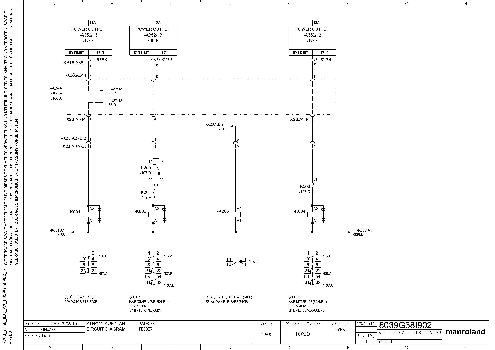

# +Ax — Sheet 107 of 403 — ANLEGER

**FEEDER**

> Part of the manroland **R700** printing press IEC/UL circuit diagrams.
> Drawing class: **Stromlaufplan / Circuit diagram** (DIN A3).
> Document `+Ax` covers the **Central control console** machine section.

## At a glance

| Field | Value |
|---|---|
| Document | `+Ax`  (8039G38I902) |
| Sheet | **107** of 403 |
| Section (DE) | ANLEGER |
| Section (EN) | FEEDER |
| Section type | CIRCUIT — Circuit diagram |
| Machine type | `R700` |
| Series | `7758` |
| Created | 17.05.10 |
| Replaces | — |
| Columns used | A, B, C, D, E, F |
| Path numbers | — |
| Labels on sheet | 139 |
| Cross-refs out | 21 |
| Cross-refs in | 38 |

**Previous:** [+Ax sheet 106](SHEET_0106.md) · **Next:** [+Ax sheet 108](SHEET_0108.md) · **Document TOC:** [_TOC.md](_TOC.md)  (+Ax) · **Master TOC:** [all sheets](../_MASTER_TOC.md)

## Sheet image (300 DPI, exact vector render)



_Rendered directly from the PDF vector layer at 300 DPI (1-bit), no OCR and no resampling. Use it to confirm anything ambiguous in the text below._

## Cross-references on this sheet

Each entry is a wire leaving this sheet. The printed token is `/sheet.column`; the link resolves to that sheet inside the same document.

| Ref | Target sheet | Col | Path | Destination on target | Target section | From col |
|---|---|---|---|---|---|---|
| `/197.F` | [+Ax sheet 197](SHEET_0197.md) | F | — | — | REFERENZMODUL | B |
| `/197.F` | [+Ax sheet 197](SHEET_0197.md) | F | — | — | REFERENZMODUL | C |
| `/197.F` | [+Ax sheet 197](SHEET_0197.md) | F | — | — | REFERENZMODUL | E |
| `/156.B` | [+Ax sheet 156](SHEET_0156.md) | B | — | — | ÜBERWACHUNGSRECHNER/ANSTEUERUNG NOT AUS | B |
| `/108.A` | [+Ax sheet 108](SHEET_0108.md) | A | — | — | ANLEGER | A |
| `/106.A` | [+Ax sheet 106](SHEET_0106.md) | A | — | — | ANLEGER | A |
| `/156.B` | [+Ax sheet 156](SHEET_0156.md) | B | — | — | ÜBERWACHUNGSRECHNER/ANSTEUERUNG NOT AUS | B |
| `/79.F` | [+Ax sheet 79](SHEET_0079.md) | F | — | X23.1.B:9 | ANLEGER | D |
| `/107.D` | [+Ax sheet 107](SHEET_0107.md) | D | — | — | ANLEGER | C |
| `/107.C` | [+Ax sheet 107](SHEET_0107.md) | C | — | — | ANLEGER | E |
| `/107.F` | [+Ax sheet 107](SHEET_0107.md) | F | — | — | ANLEGER | C |
| `/106.F` | [+Ax sheet 106](SHEET_0106.md) | F | — | K001:A1 K006:A1 | ANLEGER | D |
| `/328.B` | [+Ax sheet 328](SHEET_0328.md) | B | — | — | OPTION: NONSTOP EINRICHTUNG MANUELL, ANLEGER | F |
| `/76.B` | [+Ax sheet 76](SHEET_0076.md) | B | — | — | ANLEGER | B |
| `/76.A` | [+Ax sheet 76](SHEET_0076.md) | A | — | — | ANLEGER | C |
| `/76.B` | [+Ax sheet 76](SHEET_0076.md) | B | — | — | ANLEGER | F |
| `/87.A` | [+Ax sheet 87](SHEET_0087.md) | A | — | — | ANLEGER | B |
| `/87.E` | [+Ax sheet 87](SHEET_0087.md) | E | — | — | ANLEGER | C |
| `/88.A` | [+Ax sheet 88](SHEET_0088.md) | A | — | — | ANLEGER | F |
| `/107.E` | [+Ax sheet 107](SHEET_0107.md) | E | — | — | ANLEGER | C |
| `/107.C` | [+Ax sheet 107](SHEET_0107.md) | C | — | — | ANLEGER | F |

### Incoming references (sheets that point here)

Every other sheet that sends a wire to this one. `Back-ref` is the token printed on *that* sheet; `Path` is its line number.

| From sheet | Cols | Back-ref | Path | Refs | What continues there |
|---|---|---|---|---|---|
| [+Ax#76](SHEET_0076.md) | A | `/76.A` | — | 3 | — |
| [+Ax#79](SHEET_0079.md) | F | `/79.F` | — | 1 | — |
| [+Ax#87](SHEET_0087.md) | A, E | `/87.A`, `/87.E` | — | 2 | — |
| [+Ax#88](SHEET_0088.md) | A | `/88.A` | — | 1 | — |
| [+Ax#106](SHEET_0106.md) | A, G | `/106.A`, `/106.G` | — | 2 | — |
| [+Ax#107](SHEET_0107.md) | C, E, F | `/107.C`, `/107.E`, `/107.F` | — | 5 | — |
| [+Ax#108](SHEET_0108.md) | A | `/108.A` | — | 1 | — |
| [+Ax#156](SHEET_0156.md) | B, D | `/156.B`, `/156.D` | — | 2 | X23:7 X37:12; X37:13 |
| [+Ax#197](SHEET_0197.md) | F | `/197.F` | — | 3 | — |
| [+Ax#253](SHEET_0253.md) | A | `/253.A` | — | 3 | — |
| [+Ax#264](SHEET_0264.md) | A, B, E | `/264.A`, `/264.B`, `/264.E` | — | 11 | — |
| [+Ax#271](SHEET_0271.md) | H | `/271.H` | — | 3 | — |
| [+Ax#328](SHEET_0328.md) | B | `/328.B` | — | 1 | K006:A1 |


## Devices on this sheet

| Tag | Class | Class meaning (IEC) | Col | Sub | Terminal | Sign |
|---|---|---|---|---|---|---|
| `A352/13` | A | Baugruppe / assembly, module, PC board | B | 13 | — | — |
| `A352/13` | A | Baugruppe / assembly, module, PC board | C | 13 | — | — |
| `A352/13` | A | Baugruppe / assembly, module, PC board | E | 13 | — | — |
| `K265` | K | Relais / relay, contactor | C | — | — | — |
| `K003` | K | Relais / relay, contactor | E | — | — | — |
| `K004` | K | Relais / relay, contactor | C | — | — | — |
| `A1` | A | Baugruppe / assembly, module, PC board | B | — | — | — |
| `A2` | A | Baugruppe / assembly, module, PC board | B | — | — | — |
| `K001` | K | Relais / relay, contactor | A | — | — | — |
| `A2` | A | Baugruppe / assembly, module, PC board | D | — | — | — |
| `A1` | A | Baugruppe / assembly, module, PC board | D | — | — | — |
| `K265` | K | Relais / relay, contactor | D | — | — | — |
| `A2` | A | Baugruppe / assembly, module, PC board | C | — | — | — |
| `A1` | A | Baugruppe / assembly, module, PC board | C | — | — | — |
| `K003` | K | Relais / relay, contactor | B | — | — | — |
| `A2` | A | Baugruppe / assembly, module, PC board | E | — | — | — |
| `A1` | A | Baugruppe / assembly, module, PC board | E | — | — | — |
| `K004` | K | Relais / relay, contactor | E | — | — | — |
| `A344` | A | Baugruppe / assembly, module, PC board | A | — | — | — |
| `X37:12` | X | Klemme / terminal, plug connector | B | — | 12 | — |
| `X37:13` | X | Klemme / terminal, plug connector | B | — | 13 | — |
| `K006:A1` | K | Relais / relay, contactor | F | — | A1 | — |
| `K001:A1` | K | Relais / relay, contactor | A | — | A1 | — |
| `17.0` | — | cross-device reference | B | — | — | — |
| `XB15.A352` | — | cross-device reference | A | — | — | — |
| `X28.A344` | — | cross-device reference | A | — | — | — |
| `17.1` | — | cross-device reference | C | — | — | — |
| `17.2` | — | cross-device reference | F | — | — | — |
| `X23.A344` | — | cross-device reference | A | — | — | — |
| `X23.A344` | — | cross-device reference | E | — | — | — |
| `X23.A376.B` | — | cross-device reference | A | — | — | — |
| `X23.A376.A` | — | cross-device reference | A | — | — | — |
| `X23.1.B:9` | — | cross-device reference | D | — | 9 | — |

## Potentials / nets

_No named potentials on this sheet._

## Wire-end annotations (grouped as printed)

A wire that continues elsewhere is annotated with a small cluster: the destination description, the path/line number `#NN`, and the `/sheet.column` cross reference. Each row below is one such cluster exactly as it is grouped on the drawing.

| Col | Y | Path | Cross-ref | Text on the wire |
|---|---|---|---|---|
| B | 50.6 | — | — | `11A` |
| C | 50.6 | — | — | `12A` |
| E | 50.6 | — | — | `13A` |
| B | 65.8 | — | — | `POWER OUTPUT` |
| C | 65.8 | — | — | `POWER OUTPUT` |
| E | 65.8 | — | — | `POWER OUTPUT` |
| B | 79.7 | — | — | `A352/13` |
| C | 79.7 | — | — | `A352/13` |
| E | 79.7 | — | — | `A352/13` |
| B | 93.5 | — | `/197.F` | — |
| C | 93.5 | — | `/197.F` | — |
| E | 93.5 | — | `/197.F` | — |
| B | 122.5 | — | — | `BYTE.BIT 17.0` |
| C | 122.5 | — | — | `BYTE.BIT 17.1` |
| E | 122.5 | — | — | `BYTE.BIT 17.2` |
| B | 138.5 | — | — | `11B(11C)` |
| C | 138.5 | — | — | `12B(12C)` |
| F | 138.5 | — | — | `13B(13C)` |
| A | 146.3 | — | — | `XB15.A352 9` |
| E | 150.6 | — | — | `11` |
| C | 153.4 | — | — | `10` |
| A | 176.1 | — | — | `X28.A344 9` |
| C | 180.3 | — | — | `10` |
| E | 180.3 | — | — | `11` |
| A | 207.2 | — | — | `A344` |
| B | 210.1 | — | — | `X37:13` |
| B | 219.9 | — | `/156.B` | — |
| A | 220.3 | — | `/108.A`, `/106.A` | — |
| B | 238.4 | — | — | `X37:12` |
| B | 248.3 | — | `/156.B` | — |
| C | 282.4 | — | — | `X23.A344 1 4 X23.A344 5` |
| D | 295.1 | — | `/79.F` | `X23.1.B:9` |
| A | 327.7 | — | — | `X23.A376.B 1` |
| C | 332.0 | — | — | `4` |
| D | 332.0 | — | — | `9` |
| E | 332.0 | — | — | `5` |
| A | 347.6 | — | — | `X23.A376.A 1` |
| C | 349.0 | — | — | `4` |
| D | 349.0 | — | — | `9` |
| E | 349.0 | — | — | `5` |
| C | 385.1 | — | — | `K265 14` |
| C | 385.1 | — | — | `12` |
| C | 411.7 | — | `/107.D` | — |
| C | 427.6 | — | — | `11 11` |
| E | 427.6 | — | — | `61` |
| C | 441.8 | — | — | `61` |
| E | 443.9 | — | — | `K003 62` |
| E | 457.0 | — | `/107.C` | — |
| C | 458.1 | — | — | `K004 62` |
| C | 471.2 | — | `/107.F` | — |
| A | 498.5 | — | — | `K001 A2` |
| C | 498.5 | — | — | `A2` |
| D | 498.5 | — | — | `A2` |
| E | 498.5 | — | — | `A2` |
| B | 503.4 | — | — | `K003` |
| D | 503.4 | — | — | `K265` |
| E | 503.4 | — | — | `K004` |
| B | 526.8 | — | — | `A1` |
| C | 526.8 | — | — | `A1` |
| D | 526.8 | — | — | `A1` |
| E | 526.8 | — | — | `A1` |
| D | 550.2 | — | `/106.F` | `K001:A1 K006:A1` |
| F | 560.1 | — | `/328.B` | — |
| B | 604.0 | — | — | `21 3 5 1` |
| B | 604.0 | — | — | `2 4 6 22` |
| C | 604.0 | — | — | `53 21 61 3 5 1` |
| C | 604.0 | — | — | `54 2 4 6 22 62` |
| E | 604.0 | — | — | `53 21 61 3 5 1` |
| E | 604.0 | — | — | `54 2 4 6 22 62` |
| B | 611.8 | — | `/76.B` | — |
| C | 611.8 | — | `/76.A` | — |
| F | 611.8 | — | `/76.B` | — |
| D | 619.6 | — | — | `14 12 11 11 /107.C` |
| B | 654.3 | — | `/87.A` | — |
| C | 654.3 | — | `/87.E` | — |
| F | 654.3 | — | `/88.A` | — |
| C | 682.7 | — | `/107.E` | — |
| F | 682.7 | — | `/107.C` | — |
| A | 712.1 | — | — | `SCHÜTZ: STAPEL, STOP CONTACTOR: PILE, STOP` |
| C | 712.1 | — | — | `HAUPTSTAPEL, AUF (SCHNELL) SCHÜTZ:` |
| D | 712.1 | — | — | `RELAIS: HAUPTSTAPEL, AUF (STOP) RELAY: MAIN PILE, RAISE (STOP)` |
| E | 712.1 | — | — | `HAUPTSTAPEL, AB (SCHNELL) SCHÜTZ:` |
| C | 733.4 | — | — | `MAIN PILE, RAISE (QUICK) CONTACTOR:` |
| E | 733.4 | — | — | `MAIN PILE, LOWER (QUICKLY) CONTACTOR:` |


## Reconstructed tables

This sheet carries tabular content (pin map / terminal assignment / index). The grid below was rebuilt from the drawing's own rule lines, so each row is exactly one physical row of the table.

### Table 1 — 2 data rows × 8 columns (at x=155.9, y=62.4)

| POWER | OUTPUT A352/13 /197.F |  |  | POWER | A352/13 /197.F | OUTPUT |  |
|---|---|---|---|---|---|---|---|
| `BYTE.BIT` |  | `17.0` |  | `BYTE.BIT` |  |  | `17.1` |
| `XB15.A352 X28.A344 X23.A344 X23.A376.B X23.A376.A K001` | `11B(11C) 9 9 1 1 1 A2 A1` | `/156.B /156.B` | `X37:13 X37:12` | `12 K265 /107.D 11 K004 /107.F K003` | `10 10 4 4 4 61 62 A2 A1` | `12B(12C) 14 11` |  |


### Table 2 — 2 data rows × 3 columns (at x=694.5, y=62.4)

| POWER | OUTPUT A352/13 /197.F |  |
|---|---|---|
| `BYTE.BIT` |  | `17.2` |
| `X23.A344 K003 /107.C K004` | `13B(13C) 11 11 5 5 5 61 62 A2 A1` |  |


## Notes and free text on this sheet

| Text | Col | Y (pt) |
|---|---|---|
| `11A` | B | 50.6 |
| `11B(11C)` | B | 138.51 |
| `POWER OUTPUT` | B | 65.76 |
| `BYTE.BIT` | A | 123.08 |
| `12A` | C | 50.6 |
| `12B(12C)` | C | 138.51 |
| `POWER OUTPUT` | C | 65.76 |
| `BYTE.BIT` | B | 123.08 |
| `13A` | E | 50.6 |
| `13B(13C)` | F | 138.51 |
| `POWER OUTPUT` | E | 65.76 |
| `BYTE.BIT` | E | 123.08 |
| `SCHÜTZ: STAPEL, STOP` | A | 712.11 |
| `CONTACTOR: PILE, STOP` | A | 722.75 |
| `11 /107.C` | D | 626.04 |
| `RELAIS: HAUPTSTAPEL, AUF (STOP)` | D | 712.11 |
| `RELAY: MAIN PILE, RAISE (STOP)` | D | 722.74 |
| `SCHÜTZ:` | B | 712.11 |
| `HAUPTSTAPEL, AUF (SCHNELL)` | C | 722.75 |
| `CONTACTOR:` | B | 733.39 |
| `MAIN PILE, RAISE (QUICK)` | C | 744.01 |
| `SCHÜTZ:` | E | 712.11 |
| `HAUPTSTAPEL, AB (SCHNELL)` | E | 722.75 |
| `CONTACTOR:` | E | 733.39 |
| `MAIN PILE, LOWER (QUICKLY)` | E | 744 |

## Complete label inventory (exact text from the drawing)

Every text object inside the drawing area of this sheet, in DIN reading order (column A→H, then top→bottom). This is the authoritative list: if a string is not here it is not printed on this sheet.

| Col | Y | X | Dir | Type | Text |
|---|---|---|---|---|---|
| A | 123.1 | 165.8 | → | text | `BYTE.BIT` |
| A | 146.3 | 148.8 | → | device ref | `XB15.A352` |
| A | 176.1 | 157.3 | → | device ref | `X28.A344` |
| A | 207.2 | 121.0 | → | device tag | `A344` |
| A | 220.3 | 123.3 | → | cross-reference | `/108.A` |
| A | 232.7 | 123.3 | → | cross-reference | `/106.A` |
| A | 282.4 | 155.9 | → | device ref | `X23.A344` |
| A | 327.7 | 147.4 | → | device ref | `X23.A376.B` |
| A | 347.6 | 146.6 | → | device ref | `X23.A376.A` |
| A | 504.9 | 165.0 | → | device tag | `K001` |
| A | 550.2 | 119.6 | → | device tag | `K001:A1` |
| A | 560.1 | 139.7 | → | cross-reference | `/106.F` |
| A | 712.1 | 155.6 | → | text | `SCHÜTZ: STAPEL, STOP` |
| A | 722.8 | 155.6 | → | text | `CONTACTOR: PILE, STOP` |
| B | 50.6 | 214.6 | → | text | `11A` |
| B | 65.8 | 171.8 | → | text | `POWER OUTPUT` |
| B | 79.7 | 191.2 | → | device tag | `A352/13` |
| B | 93.5 | 200.3 | → | cross-reference | `/197.F` |
| B | 122.5 | 231.2 | → | device ref | `17.0` |
| B | 123.1 | 321.7 | → | text | `BYTE.BIT` |
| B | 138.5 | 220.3 | → | text | `11B(11C)` |
| B | 153.4 | 215.1 | → | number | `9` |
| B | 180.3 | 215.1 | → | number | `9` |
| B | 210.1 | 263.3 | → | device tag | `X37:13` |
| B | 219.9 | 253.7 | → | cross-reference | `/156.B` |
| B | 238.4 | 263.3 | → | device tag | `X37:12` |
| B | 248.3 | 253.7 | → | cross-reference | `/156.B` |
| B | 282.4 | 214.6 | → | number | `1` |
| B | 332.0 | 214.6 | → | number | `1` |
| B | 349.0 | 214.6 | → | number | `1` |
| B | 498.5 | 215.4 | → | device tag | `A2` |
| B | 503.5 | 323.7 | → | device tag | `K003` |
| B | 526.8 | 215.4 | → | device tag | `A1` |
| B | 604.1 | 200.1 | → | number | `1` |
| B | 604.1 | 220.8 | → | number | `2` |
| B | 611.8 | 238.1 | → | cross-reference | `/76.B` |
| B | 618.2 | 198.7 | → | number | `3` |
| B | 618.2 | 220.8 | → | number | `4` |
| B | 632.4 | 198.7 | → | number | `5` |
| B | 632.4 | 220.8 | → | number | `6` |
| B | 646.6 | 194.2 | → | number | `21` |
| B | 646.6 | 220.8 | → | number | `22` |
| B | 654.3 | 238.1 | → | cross-reference | `/87.A` |
| B | 712.1 | 311.5 | → | text | `SCHÜTZ:` |
| B | 733.4 | 311.5 | → | text | `CONTACTOR:` |
| C | 50.6 | 370.5 | → | text | `12A` |
| C | 65.8 | 327.7 | → | text | `POWER OUTPUT` |
| C | 79.7 | 347.1 | → | device tag | `A352/13` |
| C | 93.5 | 356.2 | → | cross-reference | `/197.F` |
| C | 122.5 | 387.9 | → | device ref | `17.1` |
| C | 138.5 | 376.2 | → | text | `12B(12C)` |
| C | 153.4 | 370.5 | → | number | `10` |
| C | 180.3 | 370.5 | → | number | `10` |
| C | 282.4 | 371.1 | → | number | `4` |
| C | 332.0 | 371.1 | → | number | `4` |
| C | 349.0 | 371.1 | → | number | `4` |
| C | 385.1 | 356.6 | → | number | `12` |
| C | 385.1 | 384.7 | → | number | `14` |
| C | 398.6 | 335.1 | → | device tag | `K265` |
| C | 411.7 | 337.3 | → | cross-reference | `/107.D` |
| C | 427.6 | 357.7 | → | number | `11` |
| C | 427.6 | 384.7 | → | number | `11` |
| C | 441.8 | 371.1 | → | number | `61` |
| C | 458.1 | 335.1 | → | device tag | `K004` |
| C | 470.2 | 371.1 | → | number | `62` |
| C | 471.2 | 338.2 | → | cross-reference | `/107.F` |
| C | 498.5 | 371.3 | → | device tag | `A2` |
| C | 526.8 | 371.3 | → | device tag | `A1` |
| C | 604.1 | 356.0 | → | number | `1` |
| C | 604.1 | 376.7 | → | number | `2` |
| C | 611.8 | 394.0 | → | cross-reference | `/76.A` |
| C | 618.2 | 354.6 | → | number | `3` |
| C | 618.2 | 376.7 | → | number | `4` |
| C | 632.4 | 354.6 | → | number | `5` |
| C | 632.4 | 376.7 | → | number | `6` |
| C | 646.6 | 350.1 | → | number | `21` |
| C | 646.6 | 376.7 | → | number | `22` |
| C | 654.3 | 394.0 | → | cross-reference | `/87.E` |
| C | 660.7 | 348.7 | → | number | `53` |
| C | 660.7 | 376.4 | → | number | `54` |
| C | 674.9 | 350.1 | → | number | `61` |
| C | 674.9 | 376.7 | → | number | `62` |
| C | 682.7 | 394.0 | → | cross-reference | `/107.E` |
| C | 722.8 | 311.0 | → | text | `HAUPTSTAPEL, AUF (SCHNELL)` |
| C | 744.0 | 311.2 | → | text | `MAIN PILE, RAISE (QUICK)` |
| D | 295.1 | 495.8 | → | device ref | `X23.1.B:9` |
| D | 305.0 | 527.2 | → | cross-reference | `/79.F` |
| D | 332.0 | 569.5 | → | number | `9` |
| D | 349.0 | 569.5 | → | number | `9` |
| D | 498.5 | 569.8 | → | device tag | `A2` |
| D | 503.5 | 522.1 | → | device tag | `K265` |
| D | 526.8 | 569.8 | → | device tag | `A1` |
| D | 619.6 | 544.3 | → | number | `14` |
| D | 619.6 | 581.4 | → | number | `11` |
| D | 626.0 | 581.4 | → | text | `11 /107.C` |
| D | 631.0 | 544.3 | → | number | `12` |
| D | 712.1 | 495.2 | → | text | `RELAIS: HAUPTSTAPEL, AUF (STOP)` |
| D | 722.7 | 495.2 | → | text | `RELAY: MAIN PILE, RAISE (STOP)` |
| E | 50.6 | 753.2 | → | text | `13A` |
| E | 65.8 | 710.4 | → | text | `POWER OUTPUT` |
| E | 79.7 | 729.8 | → | device tag | `A352/13` |
| E | 93.5 | 738.9 | → | cross-reference | `/197.F` |
| E | 123.1 | 704.4 | → | text | `BYTE.BIT` |
| E | 150.6 | 753.2 | → | number | `11` |
| E | 180.3 | 753.2 | → | number | `11` |
| E | 282.4 | 694.5 | → | device ref | `X23.A344` |
| E | 282.4 | 753.7 | → | number | `5` |
| E | 332.0 | 753.7 | → | number | `5` |
| E | 349.0 | 753.7 | → | number | `5` |
| E | 427.6 | 753.7 | → | number | `61` |
| E | 443.9 | 717.7 | → | device tag | `K003` |
| E | 456.0 | 753.7 | → | number | `62` |
| E | 457.0 | 720.0 | → | cross-reference | `/107.C` |
| E | 498.5 | 754.0 | → | device tag | `A2` |
| E | 503.5 | 706.4 | → | device tag | `K004` |
| E | 526.8 | 754.0 | → | device tag | `A1` |
| E | 604.1 | 738.7 | → | number | `1` |
| E | 604.1 | 759.4 | → | number | `2` |
| E | 618.2 | 737.3 | → | number | `3` |
| E | 618.2 | 759.4 | → | number | `4` |
| E | 632.4 | 737.3 | → | number | `5` |
| E | 632.4 | 759.4 | → | number | `6` |
| E | 646.6 | 732.8 | → | number | `21` |
| E | 660.7 | 731.3 | → | number | `53` |
| E | 660.7 | 759.1 | → | number | `54` |
| E | 674.9 | 732.8 | → | number | `61` |
| E | 712.1 | 694.2 | → | text | `SCHÜTZ:` |
| E | 722.7 | 693.6 | → | text | `HAUPTSTAPEL, AB (SCHNELL)` |
| E | 733.4 | 694.2 | → | text | `CONTACTOR:` |
| E | 744.0 | 693.9 | → | text | `MAIN PILE, LOWER (QUICKLY)` |
| F | 122.5 | 769.7 | → | device ref | `17.2` |
| F | 138.5 | 758.8 | → | text | `13B(13C)` |
| F | 550.2 | 858.6 | → | device tag | `K006:A1` |
| F | 560.1 | 849.0 | → | cross-reference | `/328.B` |
| F | 611.8 | 776.7 | → | cross-reference | `/76.B` |
| F | 646.6 | 759.4 | → | number | `22` |
| F | 654.3 | 776.7 | → | cross-reference | `/88.A` |
| F | 674.9 | 759.4 | → | number | `62` |
| F | 682.7 | 776.7 | → | cross-reference | `/107.C` |

## Reading-order text block

The same content as a plain block, grouped by DIN column — convenient to paste or to match against a visual description.

```text
=== Column A ===
 123.1  165.8  text         BYTE.BIT
 146.3  148.8  devref       XB15.A352
 176.1  157.3  devref       X28.A344
 207.2  121.0  devtag       A344
 220.3  123.3  xref         /108.A
 232.7  123.3  xref         /106.A
 282.4  155.9  devref       X23.A344
 327.7  147.4  devref       X23.A376.B
 347.6  146.6  devref       X23.A376.A
 504.9  165.0  devtag       K001
 550.2  119.6  devtag       K001:A1
 560.1  139.7  xref         /106.F
 712.1  155.6  text         SCHÜTZ: STAPEL, STOP
 722.8  155.6  text         CONTACTOR: PILE, STOP
=== Column B ===
  50.6  214.6  text         11A
  65.8  171.8  text         POWER OUTPUT
  79.7  191.2  devtag       A352/13
  93.5  200.3  xref         /197.F
 122.5  231.2  devref       17.0
 123.1  321.7  text         BYTE.BIT
 138.5  220.3  text         11B(11C)
 153.4  215.1  numeric      9
 180.3  215.1  numeric      9
 210.1  263.3  devtag       X37:13
 219.9  253.7  xref         /156.B
 238.4  263.3  devtag       X37:12
 248.3  253.7  xref         /156.B
 282.4  214.6  numeric      1
 332.0  214.6  numeric      1
 349.0  214.6  numeric      1
 498.5  215.4  devtag       A2
 503.5  323.7  devtag       K003
 526.8  215.4  devtag       A1
 604.1  200.1  numeric      1
 604.1  220.8  numeric      2
 611.8  238.1  xref         /76.B
 618.2  198.7  numeric      3
 618.2  220.8  numeric      4
 632.4  198.7  numeric      5
 632.4  220.8  numeric      6
 646.6  194.2  numeric      21
 646.6  220.8  numeric      22
 654.3  238.1  xref         /87.A
 712.1  311.5  text         SCHÜTZ:
 733.4  311.5  text         CONTACTOR:
=== Column C ===
  50.6  370.5  text         12A
  65.8  327.7  text         POWER OUTPUT
  79.7  347.1  devtag       A352/13
  93.5  356.2  xref         /197.F
 122.5  387.9  devref       17.1
 138.5  376.2  text         12B(12C)
 153.4  370.5  numeric      10
 180.3  370.5  numeric      10
 282.4  371.1  numeric      4
 332.0  371.1  numeric      4
 349.0  371.1  numeric      4
 385.1  356.6  numeric      12
 385.1  384.7  numeric      14
 398.6  335.1  devtag       K265
 411.7  337.3  xref         /107.D
 427.6  357.7  numeric      11
 427.6  384.7  numeric      11
 441.8  371.1  numeric      61
 458.1  335.1  devtag       K004
 470.2  371.1  numeric      62
 471.2  338.2  xref         /107.F
 498.5  371.3  devtag       A2
 526.8  371.3  devtag       A1
 604.1  356.0  numeric      1
 604.1  376.7  numeric      2
 611.8  394.0  xref         /76.A
 618.2  354.6  numeric      3
 618.2  376.7  numeric      4
 632.4  354.6  numeric      5
 632.4  376.7  numeric      6
 646.6  350.1  numeric      21
 646.6  376.7  numeric      22
 654.3  394.0  xref         /87.E
 660.7  348.7  numeric      53
 660.7  376.4  numeric      54
 674.9  350.1  numeric      61
 674.9  376.7  numeric      62
 682.7  394.0  xref         /107.E
 722.8  311.0  text         HAUPTSTAPEL, AUF (SCHNELL)
 744.0  311.2  text         MAIN PILE, RAISE (QUICK)
=== Column D ===
 295.1  495.8  devref       X23.1.B:9
 305.0  527.2  xref         /79.F
 332.0  569.5  numeric      9
 349.0  569.5  numeric      9
 498.5  569.8  devtag       A2
 503.5  522.1  devtag       K265
 526.8  569.8  devtag       A1
 619.6  544.3  numeric      14
 619.6  581.4  numeric      11
 626.0  581.4  text         11 /107.C
 631.0  544.3  numeric      12
 712.1  495.2  text         RELAIS: HAUPTSTAPEL, AUF (STOP)
 722.7  495.2  text         RELAY: MAIN PILE, RAISE (STOP)
=== Column E ===
  50.6  753.2  text         13A
  65.8  710.4  text         POWER OUTPUT
  79.7  729.8  devtag       A352/13
  93.5  738.9  xref         /197.F
 123.1  704.4  text         BYTE.BIT
 150.6  753.2  numeric      11
 180.3  753.2  numeric      11
 282.4  694.5  devref       X23.A344
 282.4  753.7  numeric      5
 332.0  753.7  numeric      5
 349.0  753.7  numeric      5
 427.6  753.7  numeric      61
 443.9  717.7  devtag       K003
 456.0  753.7  numeric      62
 457.0  720.0  xref         /107.C
 498.5  754.0  devtag       A2
 503.5  706.4  devtag       K004
 526.8  754.0  devtag       A1
 604.1  738.7  numeric      1
 604.1  759.4  numeric      2
 618.2  737.3  numeric      3
 618.2  759.4  numeric      4
 632.4  737.3  numeric      5
 632.4  759.4  numeric      6
 646.6  732.8  numeric      21
 660.7  731.3  numeric      53
 660.7  759.1  numeric      54
 674.9  732.8  numeric      61
 712.1  694.2  text         SCHÜTZ:
 722.7  693.6  text         HAUPTSTAPEL, AB (SCHNELL)
 733.4  694.2  text         CONTACTOR:
 744.0  693.9  text         MAIN PILE, LOWER (QUICKLY)
=== Column F ===
 122.5  769.7  devref       17.2
 138.5  758.8  text         13B(13C)
 550.2  858.6  devtag       K006:A1
 560.1  849.0  xref         /328.B
 611.8  776.7  xref         /76.B
 646.6  759.4  numeric      22
 654.3  776.7  xref         /88.A
 674.9  759.4  numeric      62
 682.7  776.7  xref         /107.C
```

---
_Generated from the PDF vector text layer; no OCR. Source: `R700_7758_IEC_AX_8039G38I902_p`, sheet 107._
