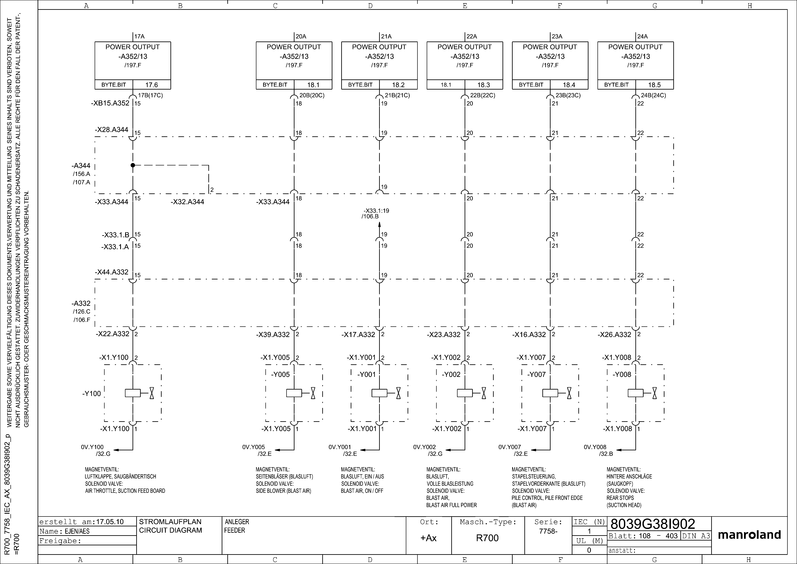

# +Ax — Sheet 108 of 403 — ANLEGER

**FEEDER**

> Part of the manroland **R700** printing press IEC/UL circuit diagrams.
> Drawing class: **Stromlaufplan / Circuit diagram** (DIN A3).
> Document `+Ax` covers the **Central control console** machine section.

## At a glance

| Field | Value |
|---|---|
| Document | `+Ax`  (8039G38I902) |
| Sheet | **108** of 403 |
| Section (DE) | ANLEGER |
| Section (EN) | FEEDER |
| Section type | CIRCUIT — Circuit diagram |
| Machine type | `R700` |
| Series | `7758` |
| Created | 17.05.10 |
| Replaces | — |
| Columns used | A, B, C, D, E, F, G |
| Path numbers | — |
| Labels on sheet | 179 |
| Cross-refs out | 17 |
| Cross-refs in | 72 |

**Previous:** [+Ax sheet 107](SHEET_0107.md) · **Next:** [+Ax sheet 109](SHEET_0109.md) · **Document TOC:** [_TOC.md](_TOC.md)  (+Ax) · **Master TOC:** [all sheets](../_MASTER_TOC.md)

## Sheet image (300 DPI, exact vector render)



_Rendered directly from the PDF vector layer at 300 DPI (1-bit), no OCR and no resampling. Use it to confirm anything ambiguous in the text below._

## Cross-references on this sheet

Each entry is a wire leaving this sheet. The printed token is `/sheet.column`; the link resolves to that sheet inside the same document.

| Ref | Target sheet | Col | Path | Destination on target | Target section | From col |
|---|---|---|---|---|---|---|
| `/197.F` | [+Ax sheet 197](SHEET_0197.md) | F | — | — | REFERENZMODUL | A |
| `/197.F` | [+Ax sheet 197](SHEET_0197.md) | F | — | — | REFERENZMODUL | C |
| `/197.F` | [+Ax sheet 197](SHEET_0197.md) | F | — | — | REFERENZMODUL | D |
| `/197.F` | [+Ax sheet 197](SHEET_0197.md) | F | — | — | REFERENZMODUL | E |
| `/197.F` | [+Ax sheet 197](SHEET_0197.md) | F | — | — | REFERENZMODUL | F |
| `/197.F` | [+Ax sheet 197](SHEET_0197.md) | F | — | — | REFERENZMODUL | G |
| `/156.A` | [+Ax sheet 156](SHEET_0156.md) | A | — | — | ÜBERWACHUNGSRECHNER/ANSTEUERUNG NOT AUS | A |
| `/107.A` | [+Ax sheet 107](SHEET_0107.md) | A | — | — | ANLEGER | A |
| `/106.B` | [+Ax sheet 106](SHEET_0106.md) | B | — | — | ANLEGER | D |
| `/126.C` | [+Ax sheet 126](SHEET_0126.md) | C | — | — | REALTIMERECHNER ANLEGER | A |
| `/106.F` | [+Ax sheet 106](SHEET_0106.md) | F | — | — | ANLEGER | A |
| `/32.E` | [+Ax sheet 32](SHEET_0032.md) | E | — | 0V.Y100 0V.Y005 0V.Y001 0V.Y002 0V.Y007 0V.Y008 | SPANNUNGSVERSORGUNG, SCHALTSCHRANKBELÜFTUNG | D |
| `/32.E` | [+Ax sheet 32](SHEET_0032.md) | E | — | 0V.Y100 0V.Y005 0V.Y001 0V.Y002 0V.Y007 0V.Y008 | SPANNUNGSVERSORGUNG, SCHALTSCHRANKBELÜFTUNG | D |
| `/32.E` | [+Ax sheet 32](SHEET_0032.md) | E | — | 0V.Y100 0V.Y005 0V.Y001 0V.Y002 0V.Y007 0V.Y008 | SPANNUNGSVERSORGUNG, SCHALTSCHRANKBELÜFTUNG | D |
| `/32.B` | [+Ax sheet 32](SHEET_0032.md) | B | — | 0V.Y100 0V.Y005 0V.Y001 0V.Y002 0V.Y007 0V.Y008 | SPANNUNGSVERSORGUNG, SCHALTSCHRANKBELÜFTUNG | D |
| `/32.G` | [+Ax sheet 32](SHEET_0032.md) | G | — | 0V.Y100 0V.Y005 0V.Y001 0V.Y002 0V.Y007 0V.Y008 | SPANNUNGSVERSORGUNG, SCHALTSCHRANKBELÜFTUNG | D |
| `/32.G` | [+Ax sheet 32](SHEET_0032.md) | G | — | 0V.Y100 0V.Y005 0V.Y001 0V.Y002 0V.Y007 0V.Y008 | SPANNUNGSVERSORGUNG, SCHALTSCHRANKBELÜFTUNG | D |

### Incoming references (sheets that point here)

Every other sheet that sends a wire to this one. `Back-ref` is the token printed on *that* sheet; `Path` is its line number.

| From sheet | Cols | Back-ref | Path | Refs | What continues there |
|---|---|---|---|---|---|
| [+Ax#32](SHEET_0032.md) | B, E, G | `/32.B`, `/32.E`, `/32.G` | — | 6 | 0V.Y001; 0V.Y002; 0V.Y007; 0V.Y100 |
| [+Ax#106](SHEET_0106.md) | C, F | `/106.C`, `/106.F` | — | 2 | — |
| [+Ax#107](SHEET_0107.md) | A | `/107.A` | — | 1 | — |
| [+Ax#126](SHEET_0126.md) | C | `/126.C` | — | 1 | — |
| [+Ax#156](SHEET_0156.md) | A | `/156.A` | — | 1 | — |
| [+Ax#197](SHEET_0197.md) | F | `/197.F` | — | 6 | — |
| [+Ax#216](SHEET_0216.md) | B, C, E | `/216.B`, `/216.C`, `/216.E` | — | 12 | — |
| [+Ax#253](SHEET_0253.md) | A | `/253.A` | — | 6 | — |
| [+Ax#254](SHEET_0254.md) | A | `/254.A` | — | 1 | — |
| [+Ax#255](SHEET_0255.md) | A | `/255.A` | — | 1 | — |
| [+Ax#262](SHEET_0262.md) | C | `/262.C` | — | 1 | — |
| [+Ax#264](SHEET_0264.md) | C | `/264.C` | — | 1 | — |
| [+Ax#268](SHEET_0268.md) | E | `/268.E` | — | 1 | — |
| [+Ax#271](SHEET_0271.md) | H | `/271.H` | — | 6 | — |
| [+Ax#275](SHEET_0275.md) | D | `/275.D` | — | 1 | — |
| [+Ax#276](SHEET_0276.md) | A, B, E | `/276.A`, `/276.B`, `/276.E` | — | 18 | — |
| [+Ax#280](SHEET_0280.md) | B | `/280.B` | — | 1 | — |
| [+Ax#281](SHEET_0281.md) | H | `/281.H` | — | 6 | — |


## Devices on this sheet

| Tag | Class | Class meaning (IEC) | Col | Sub | Terminal | Sign |
|---|---|---|---|---|---|---|
| `Y005` | Y | Magnetventil / solenoid valve, actuator | C | — | — | — |
| `Y001` | Y | Magnetventil / solenoid valve, actuator | D | — | — | — |
| `Y002` | Y | Magnetventil / solenoid valve, actuator | E | — | — | — |
| `Y007` | Y | Magnetventil / solenoid valve, actuator | F | — | — | — |
| `Y008` | Y | Magnetventil / solenoid valve, actuator | G | — | — | — |
| `A352/13` | A | Baugruppe / assembly, module, PC board | C | 13 | — | — |
| `A352/13` | A | Baugruppe / assembly, module, PC board | D | 13 | — | — |
| `A352/13` | A | Baugruppe / assembly, module, PC board | E | 13 | — | — |
| `A352/13` | A | Baugruppe / assembly, module, PC board | F | 13 | — | — |
| `A352/13` | A | Baugruppe / assembly, module, PC board | G | 13 | — | — |
| `Y100` | Y | Magnetventil / solenoid valve, actuator | A | — | — | — |
| `A352/13` | A | Baugruppe / assembly, module, PC board | A | 13 | — | — |
| `A344` | A | Baugruppe / assembly, module, PC board | A | — | — | — |
| `A332` | A | Baugruppe / assembly, module, PC board | A | — | — | — |
| `X1.Y005` | — | cross-device reference | C | — | — | — |
| `X1.Y005` | — | cross-device reference | C | — | — | — |
| `X1.Y001` | — | cross-device reference | D | — | — | — |
| `X1.Y001` | — | cross-device reference | D | — | — | — |
| `X1.Y002` | — | cross-device reference | E | — | — | — |
| `X1.Y002` | — | cross-device reference | E | — | — | — |
| `X1.Y007` | — | cross-device reference | F | — | — | — |
| `X1.Y007` | — | cross-device reference | F | — | — | — |
| `X1.Y008` | — | cross-device reference | G | — | — | — |
| `X1.Y008` | — | cross-device reference | G | — | — | — |
| `X33.A344` | — | cross-device reference | C | — | — | — |
| `X39.A332` | — | cross-device reference | C | — | — | — |
| `X17.A332` | — | cross-device reference | D | — | — | — |
| `X23.A332` | — | cross-device reference | E | — | — | — |
| `X16.A332` | — | cross-device reference | F | — | — | — |
| `X26.A332` | — | cross-device reference | G | — | — | — |
| `18.1` | — | cross-device reference | C | — | — | — |
| `18.2` | — | cross-device reference | D | — | — | — |
| `18.1` | — | cross-device reference | E | — | — | — |
| `18.3` | — | cross-device reference | E | — | — | — |
| `18.4` | — | cross-device reference | F | — | — | — |
| `18.5` | — | cross-device reference | G | — | — | — |
| `X1.Y100` | — | cross-device reference | A | — | — | — |
| `X1.Y100` | — | cross-device reference | A | — | — | — |
| `X22.A332` | — | cross-device reference | A | — | — | — |
| `17.6` | — | cross-device reference | B | — | — | — |
| `XB15.A352` | — | cross-device reference | A | — | — | — |
| `X28.A344` | — | cross-device reference | A | — | — | — |
| `X44.A332` | — | cross-device reference | A | — | — | — |
| `X33.A344` | — | cross-device reference | A | — | — | — |
| `X33.1.B` | — | cross-device reference | A | — | — | — |
| `X33.1.A` | — | cross-device reference | A | — | — | — |
| `X33.1:19` | — | cross-device reference | D | — | 19 | — |
| `X32.A344` | — | cross-device reference | B | — | — | — |

## Potentials / nets

| Potential | Count | Columns | Attached devices | Terminals |
|---|---|---|---|---|
| `0V` | 6 | A, C, D, E, F | `Y001`, `Y002`, `Y005`, `Y007`, `Y008`, `Y100` | — |


A potential such as `L24+/4` or `M24+` is a named supply/return rail; every place it appears on this sheet is electrically common.

## Wire-end annotations (grouped as printed)

A wire that continues elsewhere is annotated with a small cluster: the destination description, the path/line number `#NN`, and the `/sheet.column` cross reference. Each row below is one such cluster exactly as it is grouped on the drawing.

| Col | Y | Path | Cross-ref | Text on the wire |
|---|---|---|---|---|
| B | 50.6 | — | — | `17A` |
| C | 50.6 | — | — | `20A` |
| D | 50.6 | — | — | `21A` |
| E | 50.6 | — | — | `22A` |
| F | 50.6 | — | — | `23A` |
| G | 50.6 | — | — | `24A` |
| A | 65.8 | — | — | `POWER OUTPUT` |
| C | 65.8 | — | — | `POWER OUTPUT` |
| D | 65.8 | — | — | `POWER OUTPUT` |
| E | 65.8 | — | — | `POWER OUTPUT` |
| F | 65.8 | — | — | `POWER OUTPUT` |
| G | 65.8 | — | — | `POWER OUTPUT` |
| A | 79.7 | — | — | `A352/13` |
| C | 79.7 | — | — | `A352/13` |
| D | 79.7 | — | — | `A352/13` |
| E | 79.7 | — | — | `A352/13` |
| F | 79.7 | — | — | `A352/13` |
| G | 79.7 | — | — | `A352/13` |
| A | 93.5 | — | `/197.F` | — |
| C | 93.5 | — | `/197.F` | — |
| D | 93.5 | — | `/197.F` | — |
| E | 93.5 | — | `/197.F` | — |
| F | 93.5 | — | `/197.F` | — |
| G | 93.5 | — | `/197.F` | — |
| A | 122.5 | — | — | `BYTE.BIT 17.6` |
| C | 122.5 | — | — | `BYTE.BIT 18.1` |
| D | 122.5 | — | — | `BYTE.BIT 18.2` |
| E | 122.5 | — | — | `18.1 18.3` |
| F | 122.5 | — | — | `BYTE.BIT 18.4` |
| G | 122.5 | — | — | `BYTE.BIT 18.5` |
| B | 138.5 | — | — | `17B(17C)` |
| C | 138.5 | — | — | `20B(20C)` |
| D | 138.5 | — | — | `21B(21C)` |
| E | 138.5 | — | — | `22B(22C)` |
| F | 138.5 | — | — | `23B(23C)` |
| G | 138.5 | — | — | `24B(24C)` |
| A | 149.1 | — | — | `XB15.A352 15` |
| E | 150.6 | — | — | `18 19 20 21 22` |
| A | 188.8 | — | — | `X28.A344 15` |
| E | 194.5 | — | — | `18 19 20 21 22` |
| A | 242.7 | — | — | `A344` |
| A | 255.7 | — | `/156.A`, `/107.A` | — |
| D | 275.3 | — | — | `19` |
| B | 279.5 | — | — | `2` |
| A | 292.3 | — | — | `X33.A344 15` |
| C | 292.3 | — | — | `X33.A344 18` |
| F | 292.3 | — | — | `20 21 22` |
| B | 296.5 | — | — | `X32.A344` |
| D | 310.7 | — | — | `X33.1:19` |
| D | 319.2 | — | `/106.B` | — |
| A | 346.1 | — | — | `X33.1.B 15` |
| C | 346.1 | — | — | `18` |
| D | 346.1 | — | — | `19` |
| E | 346.1 | — | — | `20` |
| F | 346.1 | — | — | `21` |
| G | 346.1 | — | — | `22` |
| A | 363.2 | — | — | `X33.1.A 15` |
| C | 363.2 | — | — | `18` |
| D | 363.2 | — | — | `19` |
| E | 363.2 | — | — | `20` |
| F | 363.2 | — | — | `21` |
| G | 363.2 | — | — | `22` |
| A | 401.4 | — | — | `X44.A332 15` |
| E | 407.1 | — | — | `18 19 20 21 22` |
| A | 448.2 | — | — | `A332` |
| A | 461.3 | — | `/126.C` | — |
| A | 473.7 | — | `/106.F` | — |
| A | 493.5 | — | — | `X22.A332 2` |
| E | 494.9 | — | — | `X39.A332 2 X17.A332 2 X23.A332 2 X16.A332 2 X26.A332 2` |
| A | 529.0 | — | — | `X1.Y100 2` |
| C | 529.0 | — | — | `X1.Y005 2` |
| D | 529.0 | — | — | `X1.Y001 2` |
| E | 529.0 | — | — | `X1.Y002 2` |
| F | 529.0 | — | — | `X1.Y007 2` |
| G | 529.0 | — | — | `X1.Y008 2` |
| C | 554.6 | — | — | `Y005` |
| D | 554.6 | — | — | `Y001` |
| E | 554.6 | — | — | `Y002` |
| F | 554.6 | — | — | `Y007` |
| G | 554.6 | — | — | `Y008` |
| A | 582.9 | — | — | `Y100` |
| A | 635.3 | — | — | `X1.Y100 1` |
| C | 635.3 | — | — | `X1.Y005 1` |
| D | 635.3 | — | — | `X1.Y001 1` |
| E | 635.3 | — | — | `X1.Y002 1` |
| F | 635.3 | — | — | `X1.Y007 1` |
| G | 635.3 | — | — | `X1.Y008 1` |
| D | 663.6 | — | `/32.E`, `/32.E`, `/32.E`, `/32.B`, `/32.G`, `/32.G` | `0V.Y100 0V.Y005 0V.Y001 0V.Y002 0V.Y007 0V.Y008` |
| A | 697.9 | — | — | `LUFTKLAPPE, SAUGBÄNDERTISCH MAGNETVENTIL:` |
| C | 697.9 | — | — | `MAGNETVENTIL: SEITENBLÄSER (BLASLUFT) SOLENOID VALVE: SIDE BLOWER (BLAST AIR)` |
| D | 697.9 | — | — | `BLASLUFT, EIN / AUS MAGNETVENTIL:` |
| E | 697.9 | — | — | `BLASLUFT, MAGNETVENTIL:` |
| F | 697.9 | — | — | `PILE CONTROL, PILE FRONT EDGE MAGNETVENTIL: (BLAST AIR) STAPELSTEUERUNG, STAPELVORDERKANTE (BLASLUFT) SOLENOID VALVE:` |
| G | 697.9 | — | — | `HINTERE ANSCHLÄGE REAR STOPS MAGNETVENTIL: (SAUGKOPF) (SUCTION HEAD) SOLENOID VALVE:` |
| A | 719.2 | — | — | `SOLENOID VALVE: AIR THROTTLE, SUCTION FEED BOARD` |
| D | 719.2 | — | — | `BLAST AIR, ON / OFF SOLENOID VALVE:` |
| E | 719.2 | — | — | `BLAST AIR, BLAST AIR FULL POWER SOLENOID VALVE: VOLLE BLASLEISTUNG` |


## Reconstructed tables

This sheet carries tabular content (pin map / terminal assignment / index). The grid below was rebuilt from the drawing's own rule lines, so each row is exactly one physical row of the table.

### Table 1 — 2 data rows × 2 columns (at x=141.7, y=62.4)

| POWER | OUTPUT A352/13 /197.F |
|---|---|
| `BYTE.BIT` | `17.6` |
| `XB15.A352 X28.A344` | `17B(17C) 15 15` |


### Table 2 — 2 data rows × 2 columns (at x=382.7, y=62.4)

| POWER | OUTPUT A352/13 /197.F |
|---|---|
| `BYTE.BIT` | `18.1` |
|  | `20B(20C) 18 18` |


### Table 3 — 2 data rows × 2 columns (at x=510.2, y=62.4)

| POWER | OUTPUT A352/13 /197.F |
|---|---|
| `BYTE.BIT` | `18.2` |
|  | `21B(21C) 19 19` |


### Table 4 — 2 data rows × 2 columns (at x=637.8, y=62.4)

| POWER | OUTPUT A352/13 /197.F |
|---|---|
| `18.1` | `18.3` |
|  | `22B(22C) 20 20` |


### Table 5 — 2 data rows × 2 columns (at x=765.4, y=62.4)

| POWER | OUTPUT A352/13 /197.F |
|---|---|
| `BYTE.BIT` | `18.4` |
|  | `23B(23C) 21 21` |


### Table 6 — 2 data rows × 2 columns (at x=892.9, y=62.4)

| POWER | OUTPUT A352/13 /197.F |
|---|---|
| `BYTE.BIT` | `18.5` |
|  | `24B(24C) 22 22` |


## Notes and free text on this sheet

| Text | Col | Y (pt) |
|---|---|---|
| `MAGNETVENTIL:` | C | 697.94 |
| `SEITENBLÄSER (BLASLUFT)` | C | 708.58 |
| `SOLENOID VALVE:` | C | 719.2 |
| `SIDE BLOWER (BLAST AIR)` | C | 729.82 |
| `MAGNETVENTIL:` | D | 697.94 |
| `BLASLUFT, EIN / AUS` | D | 708.55 |
| `SOLENOID VALVE:` | D | 719.2 |
| `BLAST AIR, ON / OFF` | D | 729.82 |
| `MAGNETVENTIL:` | E | 697.94 |
| `BLASLUFT,` | E | 708.54 |
| `VOLLE BLASLEISTUNG` | E | 719.21 |
| `SOLENOID VALVE:` | E | 729.83 |
| `BLAST AIR,` | E | 740.42 |
| `BLAST AIR FULL POWER` | E | 751.08 |
| `MAGNETVENTIL:` | F | 697.94 |
| `STAPELSTEUERUNG,` | F | 708.57 |
| `STAPELVORDERKANTE (BLASLUFT)` | F | 719.22 |
| `SOLENOID VALVE:` | F | 729.83 |
| `PILE CONTROL, PILE FRONT EDGE` | F | 740.48 |
| `(BLAST AIR)` | F | 751.09 |
| `MAGNETVENTIL:` | G | 697.94 |
| `HINTERE ANSCHLÄGE` | G | 708.58 |
| `(SAUGKOPF)` | G | 719.2 |
| `SOLENOID VALVE:` | G | 729.83 |
| `REAR STOPS` | G | 740.45 |
| `(SUCTION HEAD)` | G | 751.12 |
| `20A` | C | 50.6 |
| `20B(20C)` | C | 138.51 |
| `POWER OUTPUT` | C | 65.76 |
| `BYTE.BIT` | C | 123.08 |
| `21A` | D | 50.6 |
| `21B(21C)` | D | 138.51 |
| `POWER OUTPUT` | D | 65.76 |
| `BYTE.BIT` | D | 123.08 |
| `22A` | E | 50.6 |
| `22B(22C)` | E | 138.51 |
| `POWER OUTPUT` | E | 65.76 |
| `23A` | F | 50.6 |
| `23B(23C)` | F | 138.51 |
| `POWER OUTPUT` | F | 65.76 |
| `BYTE.BIT` | F | 123.08 |
| `24A` | G | 50.6 |
| `24B(24C)` | G | 138.51 |
| `POWER OUTPUT` | G | 65.76 |
| `BYTE.BIT` | G | 123.08 |
| `MAGNETVENTIL:` | A | 697.94 |
| `LUFTKLAPPE, SAUGBÄNDERTISCH` | A | 708.57 |
| `SOLENOID VALVE:` | A | 719.2 |
| `AIR THROTTLE, SUCTION FEED BOARD` | A | 729.85 |
| `17A` | B | 50.6 |
| `17B(17C)` | B | 138.51 |
| `POWER OUTPUT` | A | 65.76 |
| `BYTE.BIT` | A | 123.08 |

## Complete label inventory (exact text from the drawing)

Every text object inside the drawing area of this sheet, in DIN reading order (column A→H, then top→bottom). This is the authoritative list: if a string is not here it is not printed on this sheet.

| Col | Y | X | Dir | Type | Text |
|---|---|---|---|---|---|
| A | 65.8 | 157.6 | → | text | `POWER OUTPUT` |
| A | 79.7 | 177.0 | → | device tag | `A352/13` |
| A | 93.5 | 186.1 | → | cross-reference | `/197.F` |
| A | 123.1 | 151.7 | → | text | `BYTE.BIT` |
| A | 149.1 | 136.1 | → | device ref | `XB15.A352` |
| A | 188.8 | 141.7 | → | device ref | `X28.A344` |
| A | 242.7 | 106.9 | → | device tag | `A344` |
| A | 255.7 | 109.1 | → | cross-reference | `/156.A` |
| A | 268.1 | 109.1 | → | cross-reference | `/107.A` |
| A | 296.5 | 141.7 | → | device ref | `X33.A344` |
| A | 346.2 | 152.2 | → | device ref | `X33.1.B` |
| A | 363.9 | 151.4 | → | device ref | `X33.1.A` |
| A | 401.4 | 141.7 | → | device ref | `X44.A332` |
| A | 448.2 | 106.9 | → | device tag | `A332` |
| A | 461.3 | 109.1 | → | cross-reference | `/126.C` |
| A | 473.7 | 110.0 | → | cross-reference | `/106.F` |
| A | 493.5 | 143.1 | → | device ref | `X22.A332` |
| A | 529.0 | 148.3 | → | device ref | `X1.Y100` |
| A | 582.9 | 123.0 | → | device tag | `Y100` |
| A | 635.3 | 149.7 | → | device ref | `X1.Y100` |
| A | 663.6 | 121.0 | → | potential | `0V.Y100` |
| A | 673.5 | 143.4 | → | cross-reference | `/32.G` |
| A | 697.9 | 127.0 | → | text | `MAGNETVENTIL:` |
| A | 708.6 | 126.7 | → | text | `LUFTKLAPPE, SAUGBÄNDERTISCH` |
| A | 719.2 | 127.3 | → | text | `SOLENOID VALVE:` |
| A | 729.9 | 127.6 | → | text | `AIR THROTTLE, SUCTION FEED BOARD` |
| B | 50.6 | 200.4 | → | text | `17A` |
| B | 122.5 | 217.0 | → | device ref | `17.6` |
| B | 138.5 | 206.1 | → | text | `17B(17C)` |
| B | 150.6 | 200.4 | → | number | `15` |
| B | 194.5 | 200.4 | → | number | `15` |
| B | 279.5 | 314.4 | → | number | `2` |
| B | 292.3 | 200.4 | → | number | `15` |
| B | 296.5 | 255.1 | → | device ref | `X32.A344` |
| B | 346.2 | 200.4 | → | number | `15` |
| B | 363.2 | 200.4 | → | number | `15` |
| B | 407.1 | 200.4 | → | number | `15` |
| B | 495.0 | 201.0 | → | number | `2` |
| B | 530.4 | 201.0 | → | number | `2` |
| B | 636.7 | 200.4 | → | number | `1` |
| C | 50.6 | 441.9 | → | text | `20A` |
| C | 65.8 | 398.6 | → | text | `POWER OUTPUT` |
| C | 79.7 | 418.0 | → | device tag | `A352/13` |
| C | 93.5 | 427.0 | → | cross-reference | `/197.F` |
| C | 122.5 | 458.8 | → | device ref | `18.1` |
| C | 123.1 | 392.6 | → | text | `BYTE.BIT` |
| C | 138.5 | 447.6 | → | text | `20B(20C)` |
| C | 150.6 | 441.4 | → | number | `18` |
| C | 194.5 | 441.4 | → | number | `18` |
| C | 292.3 | 441.4 | → | number | `18` |
| C | 296.5 | 382.7 | → | device ref | `X33.A344` |
| C | 346.2 | 441.4 | → | number | `18` |
| C | 363.2 | 441.4 | → | number | `18` |
| C | 407.1 | 441.4 | → | number | `18` |
| C | 495.0 | 382.7 | → | device ref | `X39.A332` |
| C | 495.0 | 441.9 | → | number | `2` |
| C | 529.0 | 389.2 | → | device ref | `X1.Y005` |
| C | 530.4 | 441.9 | → | number | `2` |
| C | 554.6 | 405.1 | → | device tag | `Y005` |
| C | 635.3 | 390.6 | → | device ref | `X1.Y005` |
| C | 636.7 | 441.4 | → | number | `1` |
| C | 663.6 | 362.0 | → | potential | `0V.Y005` |
| C | 673.5 | 385.2 | → | cross-reference | `/32.E` |
| C | 697.9 | 382.1 | → | text | `MAGNETVENTIL:` |
| C | 708.6 | 382.4 | → | text | `SEITENBLÄSER (BLASLUFT)` |
| C | 719.2 | 382.4 | → | text | `SOLENOID VALVE:` |
| C | 729.8 | 382.4 | → | text | `SIDE BLOWER (BLAST AIR)` |
| D | 50.6 | 569.5 | → | text | `21A` |
| D | 65.8 | 526.1 | → | text | `POWER OUTPUT` |
| D | 79.7 | 545.5 | → | device tag | `A352/13` |
| D | 93.5 | 554.6 | → | cross-reference | `/197.F` |
| D | 122.5 | 585.5 | → | device ref | `18.2` |
| D | 123.1 | 520.2 | → | text | `BYTE.BIT` |
| D | 138.5 | 575.1 | → | text | `21B(21C)` |
| D | 150.6 | 568.9 | → | number | `19` |
| D | 194.5 | 568.9 | → | number | `19` |
| D | 275.3 | 568.9 | → | number | `19` |
| D | 310.7 | 543.4 | → | device ref | `X33.1:19` |
| D | 319.2 | 540.3 | → | cross-reference | `/106.B` |
| D | 346.2 | 568.9 | → | number | `19` |
| D | 363.2 | 568.9 | → | number | `19` |
| D | 407.1 | 568.9 | → | number | `19` |
| D | 495.0 | 510.2 | → | device ref | `X17.A332` |
| D | 495.0 | 569.5 | → | number | `2` |
| D | 529.0 | 518.2 | → | device ref | `X1.Y001` |
| D | 530.4 | 569.5 | → | number | `2` |
| D | 554.6 | 534.0 | → | device tag | `Y001` |
| D | 635.3 | 519.6 | → | device ref | `X1.Y001` |
| D | 636.7 | 568.9 | → | number | `1` |
| D | 663.6 | 491.0 | → | potential | `0V.Y001` |
| D | 673.5 | 512.8 | → | cross-reference | `/32.E` |
| D | 697.9 | 509.7 | → | text | `MAGNETVENTIL:` |
| D | 708.6 | 509.4 | → | text | `BLASLUFT, EIN / AUS` |
| D | 719.2 | 510.0 | → | text | `SOLENOID VALVE:` |
| D | 729.8 | 509.4 | → | text | `BLAST AIR, ON / OFF` |
| E | 50.6 | 697.0 | → | text | `22A` |
| E | 65.8 | 653.7 | → | text | `POWER OUTPUT` |
| E | 79.7 | 673.1 | → | device tag | `A352/13` |
| E | 93.5 | 682.2 | → | cross-reference | `/197.F` |
| E | 122.5 | 713.1 | → | device ref | `18.3` |
| E | 123.1 | 658.5 | → | device ref | `18.1` |
| E | 138.5 | 702.7 | → | text | `22B(22C)` |
| E | 150.6 | 697.0 | → | number | `20` |
| E | 194.5 | 697.0 | → | number | `20` |
| E | 292.3 | 697.0 | → | number | `20` |
| E | 346.2 | 697.0 | → | number | `20` |
| E | 363.2 | 697.0 | → | number | `20` |
| E | 407.1 | 697.0 | → | number | `20` |
| E | 495.0 | 637.8 | → | device ref | `X23.A332` |
| E | 495.0 | 697.0 | → | number | `2` |
| E | 529.0 | 644.3 | → | device ref | `X1.Y002` |
| E | 530.4 | 697.0 | → | number | `2` |
| E | 554.6 | 660.2 | → | device tag | `Y002` |
| E | 635.3 | 645.7 | → | device ref | `X1.Y002` |
| E | 636.7 | 696.5 | → | number | `1` |
| E | 663.6 | 617.4 | → | potential | `0V.Y002` |
| E | 663.6 | 744.7 | → | potential | `0V.Y007` |
| E | 673.5 | 639.5 | → | cross-reference | `/32.G` |
| E | 697.9 | 637.2 | → | text | `MAGNETVENTIL:` |
| E | 708.5 | 636.9 | → | text | `BLASLUFT,` |
| E | 719.2 | 637.8 | → | text | `VOLLE BLASLEISTUNG` |
| E | 729.8 | 637.5 | → | text | `SOLENOID VALVE:` |
| E | 740.4 | 636.9 | → | text | `BLAST AIR,` |
| E | 751.1 | 636.9 | → | text | `BLAST AIR FULL POWER` |
| F | 50.6 | 824.6 | → | text | `23A` |
| F | 65.8 | 781.2 | → | text | `POWER OUTPUT` |
| F | 79.7 | 800.6 | → | device tag | `A352/13` |
| F | 93.5 | 809.7 | → | cross-reference | `/197.F` |
| F | 122.5 | 840.6 | → | device ref | `18.4` |
| F | 123.1 | 775.3 | → | text | `BYTE.BIT` |
| F | 138.5 | 830.3 | → | text | `23B(23C)` |
| F | 150.6 | 824.6 | → | number | `21` |
| F | 194.5 | 824.6 | → | number | `21` |
| F | 292.3 | 824.6 | → | number | `21` |
| F | 346.2 | 824.6 | → | number | `21` |
| F | 363.2 | 824.6 | → | number | `21` |
| F | 407.1 | 824.6 | → | number | `21` |
| F | 495.0 | 765.4 | → | device ref | `X16.A332` |
| F | 495.0 | 824.6 | → | number | `2` |
| F | 529.0 | 771.9 | → | device ref | `X1.Y007` |
| F | 530.4 | 824.6 | → | number | `2` |
| F | 554.6 | 787.7 | → | device tag | `Y007` |
| F | 635.3 | 773.3 | → | device ref | `X1.Y007` |
| F | 636.7 | 824.0 | → | number | `1` |
| F | 663.6 | 872.2 | → | potential | `0V.Y008` |
| F | 673.5 | 767.9 | → | cross-reference | `/32.E` |
| F | 673.5 | 895.2 | → | cross-reference | `/32.B` |
| F | 697.9 | 764.8 | → | text | `MAGNETVENTIL:` |
| F | 708.6 | 765.1 | → | text | `STAPELSTEUERUNG,` |
| F | 719.2 | 765.1 | → | text | `STAPELVORDERKANTE (BLASLUFT)` |
| F | 729.8 | 765.1 | → | text | `SOLENOID VALVE:` |
| F | 740.5 | 764.5 | → | text | `PILE CONTROL, PILE FRONT EDGE` |
| F | 751.1 | 764.8 | → | text | `(BLAST AIR)` |
| G | 50.6 | 952.2 | → | text | `24A` |
| G | 65.8 | 908.8 | → | text | `POWER OUTPUT` |
| G | 79.7 | 928.2 | → | device tag | `A352/13` |
| G | 93.5 | 937.3 | → | cross-reference | `/197.F` |
| G | 122.5 | 968.2 | → | device ref | `18.5` |
| G | 123.1 | 902.8 | → | text | `BYTE.BIT` |
| G | 138.5 | 957.8 | → | text | `24B(24C)` |
| G | 150.6 | 952.2 | → | number | `22` |
| G | 194.5 | 952.2 | → | number | `22` |
| G | 292.3 | 952.2 | → | number | `22` |
| G | 346.2 | 952.2 | → | number | `22` |
| G | 363.2 | 952.2 | → | number | `22` |
| G | 407.1 | 952.2 | → | number | `22` |
| G | 495.0 | 892.9 | → | device ref | `X26.A332` |
| G | 495.0 | 952.2 | → | number | `2` |
| G | 529.0 | 899.4 | → | device ref | `X1.Y008` |
| G | 530.4 | 952.2 | → | number | `2` |
| G | 554.6 | 915.3 | → | device tag | `Y008` |
| G | 635.3 | 900.9 | → | device ref | `X1.Y008` |
| G | 636.7 | 951.6 | → | number | `1` |
| G | 697.9 | 906.5 | → | text | `MAGNETVENTIL:` |
| G | 708.6 | 906.2 | → | text | `HINTERE ANSCHLÄGE` |
| G | 719.2 | 906.5 | → | text | `(SAUGKOPF)` |
| G | 729.8 | 906.8 | → | text | `SOLENOID VALVE:` |
| G | 740.4 | 906.2 | → | text | `REAR STOPS` |
| G | 751.1 | 906.5 | → | text | `(SUCTION HEAD)` |

## Reading-order text block

The same content as a plain block, grouped by DIN column — convenient to paste or to match against a visual description.

```text
=== Column A ===
  65.8  157.6  text         POWER OUTPUT
  79.7  177.0  devtag       A352/13
  93.5  186.1  xref         /197.F
 123.1  151.7  text         BYTE.BIT
 149.1  136.1  devref       XB15.A352
 188.8  141.7  devref       X28.A344
 242.7  106.9  devtag       A344
 255.7  109.1  xref         /156.A
 268.1  109.1  xref         /107.A
 296.5  141.7  devref       X33.A344
 346.2  152.2  devref       X33.1.B
 363.9  151.4  devref       X33.1.A
 401.4  141.7  devref       X44.A332
 448.2  106.9  devtag       A332
 461.3  109.1  xref         /126.C
 473.7  110.0  xref         /106.F
 493.5  143.1  devref       X22.A332
 529.0  148.3  devref       X1.Y100
 582.9  123.0  devtag       Y100
 635.3  149.7  devref       X1.Y100
 663.6  121.0  net          0V.Y100
 673.5  143.4  xref         /32.G
 697.9  127.0  text         MAGNETVENTIL:
 708.6  126.7  text         LUFTKLAPPE, SAUGBÄNDERTISCH
 719.2  127.3  text         SOLENOID VALVE:
 729.9  127.6  text         AIR THROTTLE, SUCTION FEED BOARD
=== Column B ===
  50.6  200.4  text         17A
 122.5  217.0  devref       17.6
 138.5  206.1  text         17B(17C)
 150.6  200.4  numeric      15
 194.5  200.4  numeric      15
 279.5  314.4  numeric      2
 292.3  200.4  numeric      15
 296.5  255.1  devref       X32.A344
 346.2  200.4  numeric      15
 363.2  200.4  numeric      15
 407.1  200.4  numeric      15
 495.0  201.0  numeric      2
 530.4  201.0  numeric      2
 636.7  200.4  numeric      1
=== Column C ===
  50.6  441.9  text         20A
  65.8  398.6  text         POWER OUTPUT
  79.7  418.0  devtag       A352/13
  93.5  427.0  xref         /197.F
 122.5  458.8  devref       18.1
 123.1  392.6  text         BYTE.BIT
 138.5  447.6  text         20B(20C)
 150.6  441.4  numeric      18
 194.5  441.4  numeric      18
 292.3  441.4  numeric      18
 296.5  382.7  devref       X33.A344
 346.2  441.4  numeric      18
 363.2  441.4  numeric      18
 407.1  441.4  numeric      18
 495.0  382.7  devref       X39.A332
 495.0  441.9  numeric      2
 529.0  389.2  devref       X1.Y005
 530.4  441.9  numeric      2
 554.6  405.1  devtag       Y005
 635.3  390.6  devref       X1.Y005
 636.7  441.4  numeric      1
 663.6  362.0  net          0V.Y005
 673.5  385.2  xref         /32.E
 697.9  382.1  text         MAGNETVENTIL:
 708.6  382.4  text         SEITENBLÄSER (BLASLUFT)
 719.2  382.4  text         SOLENOID VALVE:
 729.8  382.4  text         SIDE BLOWER (BLAST AIR)
=== Column D ===
  50.6  569.5  text         21A
  65.8  526.1  text         POWER OUTPUT
  79.7  545.5  devtag       A352/13
  93.5  554.6  xref         /197.F
 122.5  585.5  devref       18.2
 123.1  520.2  text         BYTE.BIT
 138.5  575.1  text         21B(21C)
 150.6  568.9  numeric      19
 194.5  568.9  numeric      19
 275.3  568.9  numeric      19
 310.7  543.4  devref       X33.1:19
 319.2  540.3  xref         /106.B
 346.2  568.9  numeric      19
 363.2  568.9  numeric      19
 407.1  568.9  numeric      19
 495.0  510.2  devref       X17.A332
 495.0  569.5  numeric      2
 529.0  518.2  devref       X1.Y001
 530.4  569.5  numeric      2
 554.6  534.0  devtag       Y001
 635.3  519.6  devref       X1.Y001
 636.7  568.9  numeric      1
 663.6  491.0  net          0V.Y001
 673.5  512.8  xref         /32.E
 697.9  509.7  text         MAGNETVENTIL:
 708.6  509.4  text         BLASLUFT, EIN / AUS
 719.2  510.0  text         SOLENOID VALVE:
 729.8  509.4  text         BLAST AIR, ON / OFF
=== Column E ===
  50.6  697.0  text         22A
  65.8  653.7  text         POWER OUTPUT
  79.7  673.1  devtag       A352/13
  93.5  682.2  xref         /197.F
 122.5  713.1  devref       18.3
 123.1  658.5  devref       18.1
 138.5  702.7  text         22B(22C)
 150.6  697.0  numeric      20
 194.5  697.0  numeric      20
 292.3  697.0  numeric      20
 346.2  697.0  numeric      20
 363.2  697.0  numeric      20
 407.1  697.0  numeric      20
 495.0  637.8  devref       X23.A332
 495.0  697.0  numeric      2
 529.0  644.3  devref       X1.Y002
 530.4  697.0  numeric      2
 554.6  660.2  devtag       Y002
 635.3  645.7  devref       X1.Y002
 636.7  696.5  numeric      1
 663.6  617.4  net          0V.Y002
 663.6  744.7  net          0V.Y007
 673.5  639.5  xref         /32.G
 697.9  637.2  text         MAGNETVENTIL:
 708.5  636.9  text         BLASLUFT,
 719.2  637.8  text         VOLLE BLASLEISTUNG
 729.8  637.5  text         SOLENOID VALVE:
 740.4  636.9  text         BLAST AIR,
 751.1  636.9  text         BLAST AIR FULL POWER
=== Column F ===
  50.6  824.6  text         23A
  65.8  781.2  text         POWER OUTPUT
  79.7  800.6  devtag       A352/13
  93.5  809.7  xref         /197.F
 122.5  840.6  devref       18.4
 123.1  775.3  text         BYTE.BIT
 138.5  830.3  text         23B(23C)
 150.6  824.6  numeric      21
 194.5  824.6  numeric      21
 292.3  824.6  numeric      21
 346.2  824.6  numeric      21
 363.2  824.6  numeric      21
 407.1  824.6  numeric      21
 495.0  765.4  devref       X16.A332
 495.0  824.6  numeric      2
 529.0  771.9  devref       X1.Y007
 530.4  824.6  numeric      2
 554.6  787.7  devtag       Y007
 635.3  773.3  devref       X1.Y007
 636.7  824.0  numeric      1
 663.6  872.2  net          0V.Y008
 673.5  767.9  xref         /32.E
 673.5  895.2  xref         /32.B
 697.9  764.8  text         MAGNETVENTIL:
 708.6  765.1  text         STAPELSTEUERUNG,
 719.2  765.1  text         STAPELVORDERKANTE (BLASLUFT)
 729.8  765.1  text         SOLENOID VALVE:
 740.5  764.5  text         PILE CONTROL, PILE FRONT EDGE
 751.1  764.8  text         (BLAST AIR)
=== Column G ===
  50.6  952.2  text         24A
  65.8  908.8  text         POWER OUTPUT
  79.7  928.2  devtag       A352/13
  93.5  937.3  xref         /197.F
 122.5  968.2  devref       18.5
 123.1  902.8  text         BYTE.BIT
 138.5  957.8  text         24B(24C)
 150.6  952.2  numeric      22
 194.5  952.2  numeric      22
 292.3  952.2  numeric      22
 346.2  952.2  numeric      22
 363.2  952.2  numeric      22
 407.1  952.2  numeric      22
 495.0  892.9  devref       X26.A332
 495.0  952.2  numeric      2
 529.0  899.4  devref       X1.Y008
 530.4  952.2  numeric      2
 554.6  915.3  devtag       Y008
 635.3  900.9  devref       X1.Y008
 636.7  951.6  numeric      1
 697.9  906.5  text         MAGNETVENTIL:
 708.6  906.2  text         HINTERE ANSCHLÄGE
 719.2  906.5  text         (SAUGKOPF)
 729.8  906.8  text         SOLENOID VALVE:
 740.4  906.2  text         REAR STOPS
 751.1  906.5  text         (SUCTION HEAD)
```

---
_Generated from the PDF vector text layer; no OCR. Source: `R700_7758_IEC_AX_8039G38I902_p`, sheet 108._
