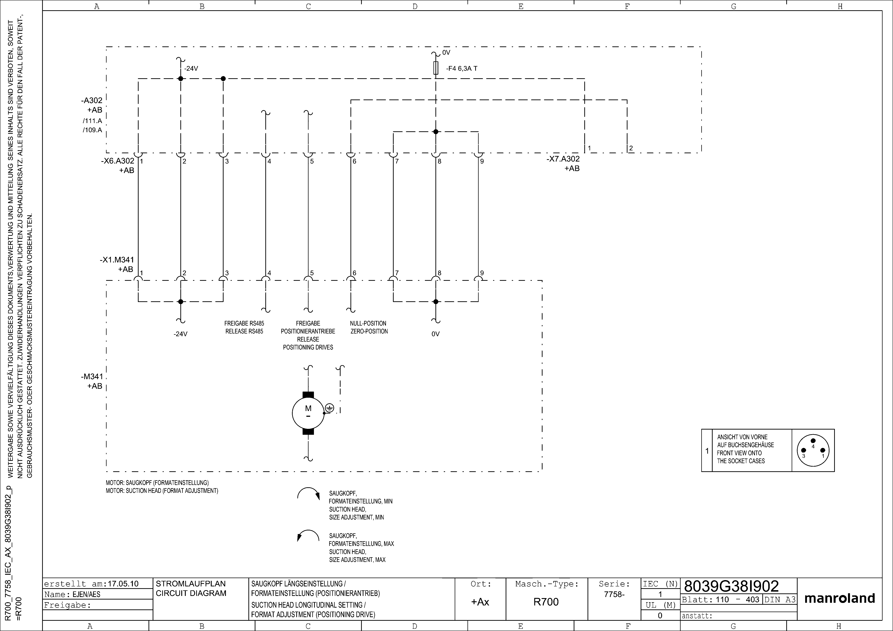

# +Ax — Sheet 110 of 403 — SAUGKOPF LÄNGSEINSTELLUNG /

**FORMATEINSTELLUNG (POSITIONIERANTRIEB)**

> Part of the manroland **R700** printing press IEC/UL circuit diagrams.
> Drawing class: **Stromlaufplan / Circuit diagram** (DIN A3).
> Document `+Ax` covers the **Central control console** machine section.

## At a glance

| Field | Value |
|---|---|
| Document | `+Ax`  (8039G38I902) |
| Sheet | **110** of 403 |
| Section (DE) | SAUGKOPF LÄNGSEINSTELLUNG / |
| Section (EN) | FORMATEINSTELLUNG (POSITIONIERANTRIEB) |
| Section type | CIRCUIT — Circuit diagram |
| Machine type | `R700` |
| Series | `7758` |
| Created | 17.05.10 |
| Replaces | — |
| Columns used | A, B, C, D, E, F, G, H |
| Path numbers | — |
| Labels on sheet | 64 |
| Cross-refs out | 2 |
| Cross-refs in | 22 |

**Previous:** [+Ax sheet 109](SHEET_0109.md) · **Next:** [+Ax sheet 111](SHEET_0111.md) · **Document TOC:** [_TOC.md](_TOC.md)  (+Ax) · **Master TOC:** [all sheets](../_MASTER_TOC.md)

## Sheet image (300 DPI, exact vector render)



_Rendered directly from the PDF vector layer at 300 DPI (1-bit), no OCR and no resampling. Use it to confirm anything ambiguous in the text below._

## Cross-references on this sheet

Each entry is a wire leaving this sheet. The printed token is `/sheet.column`; the link resolves to that sheet inside the same document.

| Ref | Target sheet | Col | Path | Destination on target | Target section | From col |
|---|---|---|---|---|---|---|
| `/111.A` | [+Ax sheet 111](SHEET_0111.md) | A | — | — | ANLEGEREINSATZPUNKTEINSTELLUNG | A |
| `/109.A` | [+Ax sheet 109](SHEET_0109.md) | A | — | — | SAUGKOPF, FORMATEINSTELLUNG / | A |

### Incoming references (sheets that point here)

Every other sheet that sends a wire to this one. `Back-ref` is the token printed on *that* sheet; `Path` is its line number.

| From sheet | Cols | Back-ref | Path | Refs | What continues there |
|---|---|---|---|---|---|
| [+Ax#109](SHEET_0109.md) | A | `/109.A` | — | 1 | — |
| [+Ax#111](SHEET_0111.md) | A | `/111.A` | — | 1 | — |
| [+Ax#214](SHEET_0214.md) | E | `/214.E` | — | 9 | — |
| [+Ax#233](SHEET_0233.md) | C | `/233.C` | — | 9 | — |
| [+Ax#235](SHEET_0235.md) | C | `/235.C` | — | 2 | — |


## Devices on this sheet

| Tag | Class | Class meaning (IEC) | Col | Sub | Terminal | Sign |
|---|---|---|---|---|---|---|
| `A302` | A | Baugruppe / assembly, module, PC board | A | — | — | — |
| `X1.M341` | — | cross-device reference | A | — | — | — |
| `X6.A302` | — | cross-device reference | A | — | — | — |
| `X7.A302` | — | cross-device reference | E | — | — | — |

## Potentials / nets

| Potential | Count | Columns | Attached devices | Terminals |
|---|---|---|---|---|
| `0V` | 2 | D | — | — |
| `24V` | 2 | B | — | — |
| `M341` | 1 | A | — | — |


A potential such as `L24+/4` or `M24+` is a named supply/return rail; every place it appears on this sheet is electrically common.

## Wire-end annotations (grouped as printed)

A wire that continues elsewhere is annotated with a small cluster: the destination description, the path/line number `#NN`, and the `/sheet.column` cross reference. Each row below is one such cluster exactly as it is grouped on the drawing.

| Col | Y | Path | Cross-ref | Text on the wire |
|---|---|---|---|---|
| D | 66.2 | — | — | `0V` |
| D | 87.4 | — | — | `F4 6,3A T` |
| B | 87.5 | — | — | `24V` |
| A | 129.3 | — | — | `A302` |
| A | 142.0 | — | — | `+AB` |
| A | 157.2 | — | `/111.A`, `/109.A` | — |
| F | 193.8 | — | — | `1 2` |
| E | 207.2 | — | — | `X7.A302` |
| A | 210.1 | — | — | `X6.A302 1` |
| C | 211.5 | — | — | `2 3 4 5 6 7 8 9` |
| E | 219.9 | — | — | `+AB` |
| A | 222.8 | — | — | `+AB` |
| A | 341.9 | — | — | `X1.M341` |
| C | 354.6 | — | — | `+AB 2 3 4 5 6 7 8 9` |
| A | 360.3 | — | — | `1` |
| B | 428.6 | — | — | `FREIGABE RS485` |
| C | 428.6 | — | — | `POSITIONIERANTRIEBE FREIGABE` |
| D | 428.6 | — | — | `NULL POSITION` |
| B | 439.3 | — | — | `RELEASE RS485` |
| D | 439.3 | — | — | `ZERO POSITION` |
| C | 441.8 | — | — | `24V 0V` |
| C | 449.9 | — | — | `POSITIONING DRIVES RELEASE` |
| A | 497.8 | — | — | `M341` |
| A | 510.5 | — | — | `+AB` |
| C | 540.3 | — | — | `M` |
| G | 580.3 | — | — | `FRONT VIEW ONTO ANSICHT VON VORNE AUF BUCHSENGEHÄUSE` |
| G | 592.6 | — | — | `1 THE SOCKET CASES 4` |
| H | 605.4 | — | — | `3 1` |
| B | 641.3 | — | — | `MOTOR: SAUGKOPF (FORMATEINSTELLUNG) MOTOR: SUCTION HEAD (FORMAT ADJUSTMENT)` |
| C | 655.4 | — | — | `FORMATEINSTELLUNG, MIN SAUGKOPF,` |
| C | 676.7 | — | — | `SUCTION HEAD, SIZE ADJUSTMENT, MIN` |
| C | 712.1 | — | — | `FORMATEINSTELLUNG, MAX SAUGKOPF,` |
| C | 733.4 | — | — | `SUCTION HEAD, SIZE ADJUSTMENT, MAX` |


## Notes and free text on this sheet

| Text | Col | Y (pt) |
|---|---|---|
| `+AB` | A | 510.47 |
| `MOTOR: SAUGKOPF (FORMATEINSTELLUNG)` | B | 641.27 |
| `MOTOR: SUCTION HEAD (FORMAT ADJUSTMENT)` | B | 651.9 |
| `M` | C | 540.33 |
| `FREIGABE` | C | 428.61 |
| `POSITIONIERANTRIEBE` | C | 439.27 |
| `RELEASE` | C | 449.88 |
| `POSITIONING DRIVES` | C | 460.54 |
| `FREIGABE RS485` | B | 428.64 |
| `RELEASE RS485` | B | 439.28 |
| `NULL POSITION` | D | 428.65 |
| `ZERO POSITION` | D | 439.29 |
| `ANSICHT VON VORNE` | G | 580.32 |
| `AUF BUCHSENGEHÄUSE` | G | 590.95 |
| `FRONT VIEW ONTO` | G | 601.54 |
| `THE SOCKET CASES` | G | 612.19 |
| `F4 6,3A T` | D | 87.43 |
| `SAUGKOPF,` | C | 712.09 |
| `FORMATEINSTELLUNG, MAX` | C | 722.77 |
| `SUCTION HEAD,` | C | 733.38 |
| `SIZE ADJUSTMENT, MAX` | C | 744.02 |
| `FORMATEINSTELLUNG, MIN` | C | 666.07 |
| `SIZE ADJUSTMENT, MIN` | C | 687.32 |
| `+AB` | E | 219.92 |

## Complete label inventory (exact text from the drawing)

Every text object inside the drawing area of this sheet, in DIN reading order (column A→H, then top→bottom). This is the authoritative list: if a string is not here it is not printed on this sheet.

| Col | Y | X | Dir | Type | Text |
|---|---|---|---|---|---|
| A | 129.3 | 108.3 | → | device tag | `A302` |
| A | 142.0 | 116.2 | → | text | `+AB` |
| A | 157.2 | 110.6 | → | cross-reference | `/111.A` |
| A | 169.6 | 110.6 | → | cross-reference | `/109.A` |
| A | 210.1 | 134.9 | → | device ref | `X6.A302` |
| A | 211.5 | 186.2 | → | number | `1` |
| A | 222.8 | 158.7 | → | text | `+AB` |
| A | 341.9 | 133.2 | → | device ref | `X1.M341` |
| A | 354.6 | 157.3 | → | text | `+AB` |
| A | 360.3 | 186.2 | → | number | `1` |
| A | 497.8 | 108.0 | → | potential | `M341` |
| A | 510.5 | 116.2 | → | text | `+AB` |
| B | 87.5 | 245.8 | → | potential | `24V` |
| B | 211.5 | 243.5 | → | number | `2` |
| B | 211.5 | 300.2 | → | number | `3` |
| B | 360.3 | 243.5 | → | number | `2` |
| B | 360.3 | 300.2 | → | number | `3` |
| B | 428.6 | 299.3 | → | text | `FREIGABE RS485` |
| B | 439.3 | 300.7 | → | text | `RELEASE RS485` |
| B | 441.8 | 231.6 | → | potential | `24V` |
| B | 641.3 | 141.2 | → | text | `MOTOR: SAUGKOPF (FORMATEINSTELLUNG)` |
| B | 651.9 | 141.2 | → | text | `MOTOR: SUCTION HEAD (FORMAT ADJUSTMENT)` |
| C | 211.5 | 356.9 | → | number | `4` |
| C | 211.5 | 413.6 | → | number | `5` |
| C | 211.5 | 470.3 | → | number | `6` |
| C | 360.3 | 356.9 | → | number | `4` |
| C | 360.3 | 413.6 | → | number | `5` |
| C | 360.3 | 470.3 | → | number | `6` |
| C | 428.6 | 394.8 | → | text | `FREIGABE` |
| C | 439.3 | 374.8 | → | text | `POSITIONIERANTRIEBE` |
| C | 449.9 | 396.2 | → | text | `RELEASE` |
| C | 460.5 | 377.6 | → | text | `POSITIONING DRIVES` |
| C | 540.3 | 406.6 | → | text | `M` |
| C | 655.4 | 439.1 | → | text | `SAUGKOPF,` |
| C | 666.1 | 438.5 | → | text | `FORMATEINSTELLUNG, MIN` |
| C | 676.7 | 439.1 | → | text | `SUCTION HEAD,` |
| C | 687.3 | 439.1 | → | text | `SIZE ADJUSTMENT, MIN` |
| C | 712.1 | 439.1 | → | text | `SAUGKOPF,` |
| C | 722.8 | 438.5 | → | text | `FORMATEINSTELLUNG, MAX` |
| C | 733.4 | 439.1 | → | text | `SUCTION HEAD,` |
| C | 744.0 | 439.1 | → | text | `SIZE ADJUSTMENT, MAX` |
| D | 66.2 | 589.7 | → | potential | `0V` |
| D | 87.4 | 595.0 | → | text | `F4 6,3A T` |
| D | 211.5 | 527.0 | → | number | `7` |
| D | 211.5 | 583.7 | → | number | `8` |
| D | 360.3 | 527.0 | → | number | `7` |
| D | 360.3 | 583.7 | → | number | `8` |
| D | 428.7 | 466.9 | → | text | `NULL POSITION` |
| D | 439.3 | 467.7 | → | text | `ZERO POSITION` |
| D | 441.8 | 575.6 | → | potential | `0V` |
| E | 207.2 | 728.8 | → | device ref | `X7.A302` |
| E | 211.5 | 640.3 | → | number | `9` |
| E | 219.9 | 752.6 | → | text | `+AB` |
| E | 360.3 | 640.3 | → | number | `9` |
| F | 193.8 | 783.5 | → | number | `1` |
| F | 193.8 | 839.1 | → | number | `2` |
| G | 580.3 | 956.7 | → | text | `ANSICHT VON VORNE` |
| G | 591.0 | 956.7 | → | text | `AUF BUCHSENGEHÄUSE` |
| G | 597.0 | 940.0 | → | number | `1` |
| G | 601.5 | 955.8 | → | text | `FRONT VIEW ONTO` |
| G | 612.2 | 956.4 | → | text | `THE SOCKET CASES` |
| H | 592.6 | 1082.3 | → | number | `4` |
| H | 605.4 | 1069.5 | → | number | `3` |
| H | 605.4 | 1095.4 | → | number | `1` |

## Reading-order text block

The same content as a plain block, grouped by DIN column — convenient to paste or to match against a visual description.

```text
=== Column A ===
 129.3  108.3  devtag       A302
 142.0  116.2  text         +AB
 157.2  110.6  xref         /111.A
 169.6  110.6  xref         /109.A
 210.1  134.9  devref       X6.A302
 211.5  186.2  numeric      1
 222.8  158.7  text         +AB
 341.9  133.2  devref       X1.M341
 354.6  157.3  text         +AB
 360.3  186.2  numeric      1
 497.8  108.0  net          M341
 510.5  116.2  text         +AB
=== Column B ===
  87.5  245.8  net          24V
 211.5  243.5  numeric      2
 211.5  300.2  numeric      3
 360.3  243.5  numeric      2
 360.3  300.2  numeric      3
 428.6  299.3  text         FREIGABE RS485
 439.3  300.7  text         RELEASE RS485
 441.8  231.6  net          24V
 641.3  141.2  text         MOTOR: SAUGKOPF (FORMATEINSTELLUNG)
 651.9  141.2  text         MOTOR: SUCTION HEAD (FORMAT ADJUSTMENT)
=== Column C ===
 211.5  356.9  numeric      4
 211.5  413.6  numeric      5
 211.5  470.3  numeric      6
 360.3  356.9  numeric      4
 360.3  413.6  numeric      5
 360.3  470.3  numeric      6
 428.6  394.8  text         FREIGABE
 439.3  374.8  text         POSITIONIERANTRIEBE
 449.9  396.2  text         RELEASE
 460.5  377.6  text         POSITIONING DRIVES
 540.3  406.6  text         M
 655.4  439.1  text         SAUGKOPF,
 666.1  438.5  text         FORMATEINSTELLUNG, MIN
 676.7  439.1  text         SUCTION HEAD,
 687.3  439.1  text         SIZE ADJUSTMENT, MIN
 712.1  439.1  text         SAUGKOPF,
 722.8  438.5  text         FORMATEINSTELLUNG, MAX
 733.4  439.1  text         SUCTION HEAD,
 744.0  439.1  text         SIZE ADJUSTMENT, MAX
=== Column D ===
  66.2  589.7  net          0V
  87.4  595.0  text         F4 6,3A T
 211.5  527.0  numeric      7
 211.5  583.7  numeric      8
 360.3  527.0  numeric      7
 360.3  583.7  numeric      8
 428.7  466.9  text         NULL POSITION
 439.3  467.7  text         ZERO POSITION
 441.8  575.6  net          0V
=== Column E ===
 207.2  728.8  devref       X7.A302
 211.5  640.3  numeric      9
 219.9  752.6  text         +AB
 360.3  640.3  numeric      9
=== Column F ===
 193.8  783.5  numeric      1
 193.8  839.1  numeric      2
=== Column G ===
 580.3  956.7  text         ANSICHT VON VORNE
 591.0  956.7  text         AUF BUCHSENGEHÄUSE
 597.0  940.0  numeric      1
 601.5  955.8  text         FRONT VIEW ONTO
 612.2  956.4  text         THE SOCKET CASES
=== Column H ===
 592.6 1082.3  numeric      4
 605.4 1069.5  numeric      3
 605.4 1095.4  numeric      1
```

---
_Generated from the PDF vector text layer; no OCR. Source: `R700_7758_IEC_AX_8039G38I902_p`, sheet 110._
