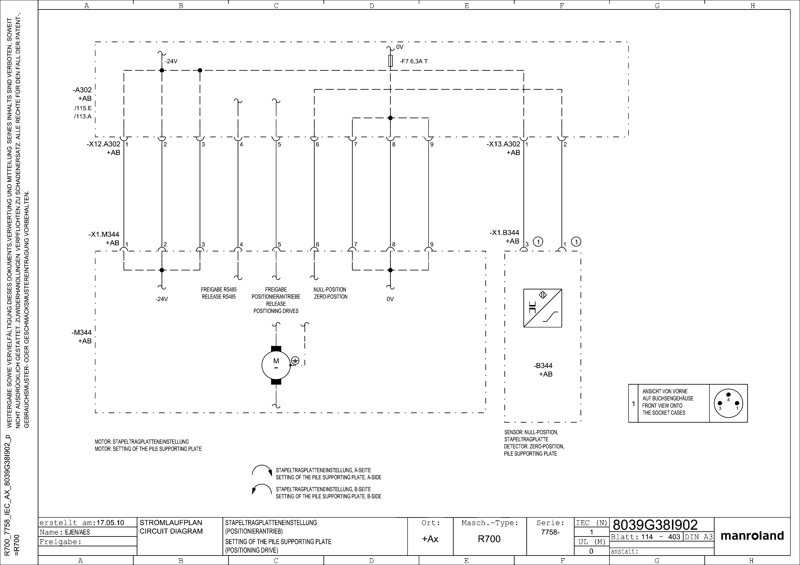

# +Ax — Sheet 114 of 403 — STAPELTRAGPLATTENEINSTELLUNG

**(POSITIONIERANTRIEB)**

> Part of the manroland **R700** printing press IEC/UL circuit diagrams.
> Drawing class: **Stromlaufplan / Circuit diagram** (DIN A3).
> Document `+Ax` covers the **Central control console** machine section.

## At a glance

| Field | Value |
|---|---|
| Document | `+Ax`  (8039G38I902) |
| Sheet | **114** of 403 |
| Section (DE) | STAPELTRAGPLATTENEINSTELLUNG |
| Section (EN) | (POSITIONIERANTRIEB) |
| Section type | CIRCUIT — Circuit diagram |
| Machine type | `R700` |
| Series | `7758` |
| Created | 17.05.10 |
| Replaces | — |
| Columns used | A, B, C, D, E, F, G, H |
| Path numbers | — |
| Labels on sheet | 72 |
| Cross-refs out | 2 |
| Cross-refs in | 24 |

**Previous:** [+Ax sheet 113](SHEET_0113.md) · **Next:** [+Ax sheet 115](SHEET_0115.md) · **Document TOC:** [_TOC.md](_TOC.md)  (+Ax) · **Master TOC:** [all sheets](../_MASTER_TOC.md)

## Sheet image (300 DPI, exact vector render)



_Rendered directly from the PDF vector layer at 300 DPI (1-bit), no OCR and no resampling. Use it to confirm anything ambiguous in the text below._

## Cross-references on this sheet

Each entry is a wire leaving this sheet. The printed token is `/sheet.column`; the link resolves to that sheet inside the same document.

| Ref | Target sheet | Col | Path | Destination on target | Target section | From col |
|---|---|---|---|---|---|---|
| `/115.E` | [+Ax sheet 115](SHEET_0115.md) | E | — | — | HANDTERMINAL | A |
| `/113.A` | [+Ax sheet 113](SHEET_0113.md) | A | — | — | FORMATEINSTELLUNG MOTORISCH, SEITLICHE | A |

### Incoming references (sheets that point here)

Every other sheet that sends a wire to this one. `Back-ref` is the token printed on *that* sheet; `Path` is its line number.

| From sheet | Cols | Back-ref | Path | Refs | What continues there |
|---|---|---|---|---|---|
| [+Ax#113](SHEET_0113.md) | A | `/113.A` | — | 1 | — |
| [+Ax#115](SHEET_0115.md) | E | `/115.E` | — | 1 | — |
| [+Ax#213](SHEET_0213.md) | F | `/213.F` | — | 2 | — |
| [+Ax#214](SHEET_0214.md) | G | `/214.G` | — | 9 | — |
| [+Ax#248](SHEET_0248.md) | B | `/248.B` | — | 9 | — |
| [+Ax#249](SHEET_0249.md) | F | `/249.F` | — | 2 | — |


## Devices on this sheet

| Tag | Class | Class meaning (IEC) | Col | Sub | Terminal | Sign |
|---|---|---|---|---|---|---|
| `A302` | A | Baugruppe / assembly, module, PC board | A | — | — | — |
| `B344` | B | Umformer / transducer, sensor | F | — | — | — |
| `X1.M344` | — | cross-device reference | A | — | — | — |
| `X13.A302` | — | cross-device reference | E | — | — | — |
| `X12.A302` | — | cross-device reference | A | — | — | — |
| `X1.B344` | — | cross-device reference | E | — | — | — |

## Potentials / nets

| Potential | Count | Columns | Attached devices | Terminals |
|---|---|---|---|---|
| `0V` | 2 | D | — | — |
| `24V` | 2 | B | — | — |
| `M344` | 1 | A | — | — |


A potential such as `L24+/4` or `M24+` is a named supply/return rail; every place it appears on this sheet is electrically common.

## Wire-end annotations (grouped as printed)

A wire that continues elsewhere is annotated with a small cluster: the destination description, the path/line number `#NN`, and the `/sheet.column` cross reference. Each row below is one such cluster exactly as it is grouped on the drawing.

| Col | Y | Path | Cross-ref | Text on the wire |
|---|---|---|---|---|
| D | 66.2 | — | — | `0V` |
| D | 87.4 | — | — | `F7 6,3A T` |
| B | 87.5 | — | — | `24V` |
| A | 129.3 | — | — | `A302` |
| A | 142.0 | — | — | `+AB` |
| A | 157.2 | — | `/115.E`, `/113.A` | — |
| D | 210.1 | — | — | `X12.A302 1 2` |
| E | 210.1 | — | — | `X13.A302 1` |
| C | 211.5 | — | — | `2 3 4 5 6 7 8 9` |
| A | 222.8 | — | — | `+AB` |
| E | 222.8 | — | — | `+AB` |
| E | 341.9 | — | — | `X1.B344` |
| A | 344.7 | — | — | `X1.M344 1` |
| F | 354.6 | — | — | `+AB 1` |
| F | 356.9 | — | — | `1 1` |
| C | 357.4 | — | — | `+AB 2 3 4 5 6 7 8 9` |
| F | 360.3 | — | — | `3` |
| B | 428.6 | — | — | `FREIGABE RS485` |
| C | 428.6 | — | — | `POSITIONIERANTRIEBE FREIGABE` |
| D | 428.6 | — | — | `NULL POSITION` |
| B | 439.3 | — | — | `RELEASE RS485` |
| D | 439.3 | — | — | `ZERO POSITION` |
| C | 441.8 | — | — | `24V 0V` |
| C | 449.9 | — | — | `POSITIONING DRIVES RELEASE` |
| A | 490.7 | — | — | `M344` |
| A | 503.4 | — | — | `+AB` |
| C | 533.2 | — | — | `M` |
| F | 540.3 | — | — | `B344` |
| F | 553.0 | — | — | `+AB` |
| G | 580.3 | — | — | `FRONT VIEW ONTO ANSICHT VON VORNE AUF BUCHSENGEHÄUSE` |
| G | 592.6 | — | — | `1 THE SOCKET CASES 4` |
| H | 605.4 | — | — | `3 1` |
| F | 641.2 | — | — | `DETECTOR: ZERO POSITION, PILE SUPPORTING PLATE SENSOR: NULL POSITION, STAPELTRAGPLATTE` |
| B | 655.4 | — | — | `MOTOR: STAPELTRAGPLATTENEINSTELLUNG MOTOR: SETTING OF THE PILE SUPPORTING PLATE` |
| D | 697.9 | — | — | `STAPELTRAGPLATTENEINSTELLUNG, A SEITE SETTING OF THE PILE SUPPORTING PLATE, A SIDE` |
| D | 726.3 | — | — | `STAPELTRAGPLATTENEINSTELLUNG, B SEITE SETTING OF THE PILE SUPPORTING PLATE, B SIDE` |


## Notes and free text on this sheet

| Text | Col | Y (pt) |
|---|---|---|
| `+AB` | A | 503.38 |
| `MOTOR: STAPELTRAGPLATTENEINSTELLUNG` | B | 655.43 |
| `MOTOR: SETTING OF THE PILE SUPPORTING PLATE` | B | 666.06 |
| `+AB` | E | 222.75 |
| `M` | C | 533.24 |
| `+AB` | F | 552.99 |
| `SENSOR: NULL POSITION,` | F | 641.25 |
| `STAPELTRAGPLATTE` | F | 651.88 |
| `DETECTOR: ZERO POSITION,` | F | 662.51 |
| `PILE SUPPORTING PLATE` | F | 673.14 |
| `FREIGABE` | C | 428.61 |
| `POSITIONIERANTRIEBE` | C | 439.27 |
| `RELEASE` | C | 449.88 |
| `POSITIONING DRIVES` | C | 460.54 |
| `FREIGABE RS485` | B | 428.64 |
| `RELEASE RS485` | B | 439.28 |
| `NULL POSITION` | D | 428.65 |
| `ZERO POSITION` | D | 439.29 |
| `ANSICHT VON VORNE` | G | 580.32 |
| `AUF BUCHSENGEHÄUSE` | G | 590.95 |
| `FRONT VIEW ONTO` | G | 601.54 |
| `THE SOCKET CASES` | G | 612.19 |
| `F7 6,3A T` | D | 87.43 |
| `STAPELTRAGPLATTENEINSTELLUNG, A SEITE` | C | 697.94 |
| `SETTING OF THE PILE SUPPORTING PLATE, A SIDE` | D | 708.57 |
| `STAPELTRAGPLATTENEINSTELLUNG, B SEITE` | C | 726.29 |
| `SETTING OF THE PILE SUPPORTING PLATE, B SIDE` | D | 736.92 |

## Complete label inventory (exact text from the drawing)

Every text object inside the drawing area of this sheet, in DIN reading order (column A→H, then top→bottom). This is the authoritative list: if a string is not here it is not printed on this sheet.

| Col | Y | X | Dir | Type | Text |
|---|---|---|---|---|---|
| A | 129.3 | 108.3 | → | device tag | `A302` |
| A | 142.0 | 116.2 | → | text | `+AB` |
| A | 157.2 | 111.1 | → | cross-reference | `/115.E` |
| A | 169.6 | 110.6 | → | cross-reference | `/113.A` |
| A | 210.1 | 129.0 | → | device ref | `X12.A302` |
| A | 211.5 | 186.2 | → | number | `1` |
| A | 222.8 | 158.7 | → | text | `+AB` |
| A | 344.7 | 131.8 | → | device ref | `X1.M344` |
| A | 357.4 | 157.3 | → | text | `+AB` |
| A | 360.3 | 186.2 | → | number | `1` |
| A | 490.7 | 106.6 | → | potential | `M344` |
| A | 503.4 | 116.2 | → | text | `+AB` |
| B | 87.5 | 245.8 | → | potential | `24V` |
| B | 211.5 | 243.5 | → | number | `2` |
| B | 211.5 | 300.2 | → | number | `3` |
| B | 360.3 | 243.5 | → | number | `2` |
| B | 360.3 | 300.2 | → | number | `3` |
| B | 428.6 | 299.3 | → | text | `FREIGABE RS485` |
| B | 439.3 | 300.7 | → | text | `RELEASE RS485` |
| B | 441.8 | 231.6 | → | potential | `24V` |
| B | 655.4 | 141.2 | → | text | `MOTOR: STAPELTRAGPLATTENEINSTELLUNG` |
| B | 666.1 | 141.2 | → | text | `MOTOR: SETTING OF THE PILE SUPPORTING PLATE` |
| C | 211.5 | 356.9 | → | number | `4` |
| C | 211.5 | 413.6 | → | number | `5` |
| C | 211.5 | 470.3 | → | number | `6` |
| C | 360.3 | 356.9 | → | number | `4` |
| C | 360.3 | 413.6 | → | number | `5` |
| C | 360.3 | 470.3 | → | number | `6` |
| C | 428.6 | 394.8 | → | text | `FREIGABE` |
| C | 439.3 | 374.8 | → | text | `POSITIONIERANTRIEBE` |
| C | 449.9 | 396.2 | → | text | `RELEASE` |
| C | 460.5 | 377.6 | → | text | `POSITIONING DRIVES` |
| C | 533.2 | 406.6 | → | text | `M` |
| C | 697.9 | 410.7 | → | text | `STAPELTRAGPLATTENEINSTELLUNG, A SEITE` |
| C | 726.3 | 410.7 | → | text | `STAPELTRAGPLATTENEINSTELLUNG, B SEITE` |
| D | 66.2 | 589.7 | → | potential | `0V` |
| D | 87.4 | 595.0 | → | text | `F7 6,3A T` |
| D | 211.5 | 527.0 | → | number | `7` |
| D | 211.5 | 583.7 | → | number | `8` |
| D | 360.3 | 527.0 | → | number | `7` |
| D | 360.3 | 583.7 | → | number | `8` |
| D | 428.7 | 466.9 | → | text | `NULL POSITION` |
| D | 439.3 | 467.7 | → | text | `ZERO POSITION` |
| D | 441.8 | 575.6 | → | potential | `0V` |
| D | 708.6 | 410.7 | → | text | `SETTING OF THE PILE SUPPORTING PLATE, A SIDE` |
| D | 736.9 | 410.7 | → | text | `SETTING OF THE PILE SUPPORTING PLATE, B SIDE` |
| E | 210.1 | 724.3 | → | device ref | `X13.A302` |
| E | 211.5 | 640.3 | → | number | `9` |
| E | 222.8 | 754.0 | → | text | `+AB` |
| E | 341.9 | 728.8 | → | device ref | `X1.B344` |
| E | 354.6 | 752.6 | → | text | `+AB` |
| E | 360.3 | 640.3 | → | number | `9` |
| F | 211.5 | 781.5 | → | number | `1` |
| F | 211.5 | 838.8 | → | number | `2` |
| F | 356.9 | 799.0 | → | number | `1` |
| F | 356.9 | 855.7 | → | number | `1` |
| F | 360.3 | 782.1 | → | number | `3` |
| F | 360.3 | 838.2 | → | number | `1` |
| F | 540.3 | 794.3 | → | device tag | `B344` |
| F | 553.0 | 802.2 | → | text | `+AB` |
| F | 641.3 | 750.9 | → | text | `SENSOR: NULL POSITION,` |
| F | 651.9 | 750.9 | → | text | `STAPELTRAGPLATTE` |
| F | 662.5 | 750.3 | → | text | `DETECTOR: ZERO POSITION,` |
| F | 673.1 | 750.3 | → | text | `PILE SUPPORTING PLATE` |
| G | 580.3 | 956.7 | → | text | `ANSICHT VON VORNE` |
| G | 591.0 | 956.7 | → | text | `AUF BUCHSENGEHÄUSE` |
| G | 597.0 | 940.0 | → | number | `1` |
| G | 601.5 | 955.8 | → | text | `FRONT VIEW ONTO` |
| G | 612.2 | 956.4 | → | text | `THE SOCKET CASES` |
| H | 592.6 | 1082.3 | → | number | `4` |
| H | 605.4 | 1069.5 | → | number | `3` |
| H | 605.4 | 1095.4 | → | number | `1` |

## Reading-order text block

The same content as a plain block, grouped by DIN column — convenient to paste or to match against a visual description.

```text
=== Column A ===
 129.3  108.3  devtag       A302
 142.0  116.2  text         +AB
 157.2  111.1  xref         /115.E
 169.6  110.6  xref         /113.A
 210.1  129.0  devref       X12.A302
 211.5  186.2  numeric      1
 222.8  158.7  text         +AB
 344.7  131.8  devref       X1.M344
 357.4  157.3  text         +AB
 360.3  186.2  numeric      1
 490.7  106.6  net          M344
 503.4  116.2  text         +AB
=== Column B ===
  87.5  245.8  net          24V
 211.5  243.5  numeric      2
 211.5  300.2  numeric      3
 360.3  243.5  numeric      2
 360.3  300.2  numeric      3
 428.6  299.3  text         FREIGABE RS485
 439.3  300.7  text         RELEASE RS485
 441.8  231.6  net          24V
 655.4  141.2  text         MOTOR: STAPELTRAGPLATTENEINSTELLUNG
 666.1  141.2  text         MOTOR: SETTING OF THE PILE SUPPORTING PLATE
=== Column C ===
 211.5  356.9  numeric      4
 211.5  413.6  numeric      5
 211.5  470.3  numeric      6
 360.3  356.9  numeric      4
 360.3  413.6  numeric      5
 360.3  470.3  numeric      6
 428.6  394.8  text         FREIGABE
 439.3  374.8  text         POSITIONIERANTRIEBE
 449.9  396.2  text         RELEASE
 460.5  377.6  text         POSITIONING DRIVES
 533.2  406.6  text         M
 697.9  410.7  text         STAPELTRAGPLATTENEINSTELLUNG, A SEITE
 726.3  410.7  text         STAPELTRAGPLATTENEINSTELLUNG, B SEITE
=== Column D ===
  66.2  589.7  net          0V
  87.4  595.0  text         F7 6,3A T
 211.5  527.0  numeric      7
 211.5  583.7  numeric      8
 360.3  527.0  numeric      7
 360.3  583.7  numeric      8
 428.7  466.9  text         NULL POSITION
 439.3  467.7  text         ZERO POSITION
 441.8  575.6  net          0V
 708.6  410.7  text         SETTING OF THE PILE SUPPORTING PLATE, A SIDE
 736.9  410.7  text         SETTING OF THE PILE SUPPORTING PLATE, B SIDE
=== Column E ===
 210.1  724.3  devref       X13.A302
 211.5  640.3  numeric      9
 222.8  754.0  text         +AB
 341.9  728.8  devref       X1.B344
 354.6  752.6  text         +AB
 360.3  640.3  numeric      9
=== Column F ===
 211.5  781.5  numeric      1
 211.5  838.8  numeric      2
 356.9  799.0  numeric      1
 356.9  855.7  numeric      1
 360.3  782.1  numeric      3
 360.3  838.2  numeric      1
 540.3  794.3  devtag       B344
 553.0  802.2  text         +AB
 641.3  750.9  text         SENSOR: NULL POSITION,
 651.9  750.9  text         STAPELTRAGPLATTE
 662.5  750.3  text         DETECTOR: ZERO POSITION,
 673.1  750.3  text         PILE SUPPORTING PLATE
=== Column G ===
 580.3  956.7  text         ANSICHT VON VORNE
 591.0  956.7  text         AUF BUCHSENGEHÄUSE
 597.0  940.0  numeric      1
 601.5  955.8  text         FRONT VIEW ONTO
 612.2  956.4  text         THE SOCKET CASES
=== Column H ===
 592.6 1082.3  numeric      4
 605.4 1069.5  numeric      3
 605.4 1095.4  numeric      1
```

---
_Generated from the PDF vector text layer; no OCR. Source: `R700_7758_IEC_AX_8039G38I902_p`, sheet 114._
