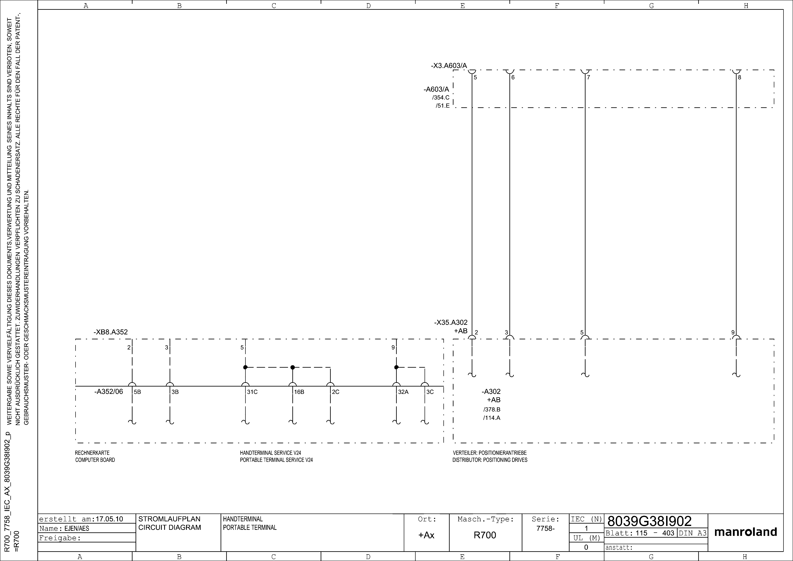

# +Ax — Sheet 115 of 403 — HANDTERMINAL

**PORTABLE TERMINAL**

> Part of the manroland **R700** printing press IEC/UL circuit diagrams.
> Drawing class: **Stromlaufplan / Circuit diagram** (DIN A3).
> Document `+Ax` covers the **Central control console** machine section.

## At a glance

| Field | Value |
|---|---|
| Document | `+Ax`  (8039G38I902) |
| Sheet | **115** of 403 |
| Section (DE) | HANDTERMINAL |
| Section (EN) | PORTABLE TERMINAL |
| Section type | CIRCUIT — Circuit diagram |
| Machine type | `R700` |
| Series | `7758` |
| Created | 17.05.10 |
| Replaces | — |
| Columns used | A, B, C, D, E, F, H |
| Path numbers | — |
| Labels on sheet | 37 |
| Cross-refs out | 4 |
| Cross-refs in | 16 |

**Previous:** [+Ax sheet 114](SHEET_0114.md) · **Next:** [+Ax sheet 116](SHEET_0116.md) · **Document TOC:** [_TOC.md](_TOC.md)  (+Ax) · **Master TOC:** [all sheets](../_MASTER_TOC.md)

## Sheet image (300 DPI, exact vector render)



_Rendered directly from the PDF vector layer at 300 DPI (1-bit), no OCR and no resampling. Use it to confirm anything ambiguous in the text below._

## Cross-references on this sheet

Each entry is a wire leaving this sheet. The printed token is `/sheet.column`; the link resolves to that sheet inside the same document.

| Ref | Target sheet | Col | Path | Destination on target | Target section | From col |
|---|---|---|---|---|---|---|
| `/354.C` | [+Ax sheet 354](SHEET_0354.md) | C | — | — | OPTION: LOGISTIK ANLEGER | E |
| `/51.E` | [+Ax sheet 51](SHEET_0051.md) | E | — | — | SIGNALGEBER: AKUSTISCHE WARNSIGNALE | E |
| `/378.B` | [+Ax sheet 378](SHEET_0378.md) | B | — | — | OPTION: TELEPRESENCE | E |
| `/114.A` | [+Ax sheet 114](SHEET_0114.md) | A | — | — | STAPELTRAGPLATTENEINSTELLUNG | E |

### Incoming references (sheets that point here)

Every other sheet that sends a wire to this one. `Back-ref` is the token printed on *that* sheet; `Path` is its line number.

| From sheet | Cols | Back-ref | Path | Refs | What continues there |
|---|---|---|---|---|---|
| [+Ax#51](SHEET_0051.md) | E | `/51.E` | — | 1 | — |
| [+Ax#114](SHEET_0114.md) | A | `/114.A` | — | 1 | — |
| [+Ax#225](SHEET_0225.md) | G | `/225.G` | — | 4 | — |
| [+Ax#238](SHEET_0238.md) | C | `/238.C` | — | 4 | — |
| [+Ax#278](SHEET_0278.md) | D | `/278.D` | — | 4 | — |
| [+Ax#354](SHEET_0354.md) | C | `/354.C` | — | 1 | — |
| [+Ax#378](SHEET_0378.md) | B | `/378.B` | — | 1 | — |


## Devices on this sheet

| Tag | Class | Class meaning (IEC) | Col | Sub | Terminal | Sign |
|---|---|---|---|---|---|---|
| `A352/06` | A | Baugruppe / assembly, module, PC board | A | 06 | — | — |
| `A302` | A | Baugruppe / assembly, module, PC board | E | — | — | — |
| `X35.A302` | — | cross-device reference | E | — | — | — |
| `XB8.A352` | — | cross-device reference | A | — | — | — |

## Potentials / nets

_No named potentials on this sheet._

## Wire-end annotations (grouped as printed)

A wire that continues elsewhere is annotated with a small cluster: the destination description, the path/line number `#NN`, and the `/sheet.column` cross reference. Each row below is one such cluster exactly as it is grouped on the drawing.

| Col | Y | Path | Cross-ref | Text on the wire |
|---|---|---|---|---|
| E | 93.9 | — | — | `X3.A603/A` |
| G | 112.3 | — | — | `5 6 7 8` |
| E | 129.3 | — | — | `A603/A` |
| E | 142.4 | — | `/354.C` | — |
| E | 154.7 | — | `/51.E` | — |
| E | 479.4 | — | — | `X35.A302 2 3` |
| F | 492.0 | — | — | `+AB 5 9` |
| A | 493.5 | — | — | `XB8.A352` |
| C | 517.6 | — | — | `2 3 5 9` |
| A | 582.8 | — | — | `A352/06` |
| E | 582.8 | — | — | `A302` |
| C | 584.2 | — | — | `5B 3B 31C 16B 2C 32A 3C` |
| E | 595.5 | — | — | `+AB` |
| E | 610.8 | — | `/378.B`, `/114.A` | — |
| A | 676.7 | — | — | `RECHNERKARTE` |
| C | 676.7 | — | — | `HANDTERMINAL SERVICE V24 PORTABLE TERMINAL SERVICE V24` |
| E | 676.7 | — | — | `DISTRIBUTOR: POSITIONING DRIVES VERTEILER: POSITIONIERANTRIEBE` |
| A | 687.3 | — | — | `COMPUTER BOARD` |


## Notes and free text on this sheet

| Text | Col | Y (pt) |
|---|---|---|
| `RECHNERKARTE` | A | 676.69 |
| `COMPUTER BOARD` | A | 687.34 |
| `+AB` | E | 492.04 |
| `VERTEILER: POSITIONIERANTRIEBE` | E | 676.68 |
| `DISTRIBUTOR: POSITIONING DRIVES` | E | 687.31 |
| `A603/A` | E | 129.29 |
| `3B` | B | 584.21 |
| `5B` | B | 584.21 |
| `32A` | D | 584.22 |
| `31C` | C | 584.27 |
| `16B` | C | 584.22 |
| `2C` | D | 584.27 |
| `3C` | E | 584.27 |
| `HANDTERMINAL SERVICE V24` | C | 676.69 |
| `PORTABLE TERMINAL SERVICE V24` | C | 687.32 |
| `X3.A603/A` | E | 93.86 |

## Complete label inventory (exact text from the drawing)

Every text object inside the drawing area of this sheet, in DIN reading order (column A→H, then top→bottom). This is the authoritative list: if a string is not here it is not printed on this sheet.

| Col | Y | X | Dir | Type | Text |
|---|---|---|---|---|---|
| A | 493.5 | 140.6 | → | device ref | `XB8.A352` |
| A | 517.6 | 191.3 | → | number | `2` |
| A | 582.8 | 141.7 | → | device tag | `A352/06` |
| A | 676.7 | 112.5 | → | text | `RECHNERKARTE` |
| A | 687.3 | 113.1 | → | text | `COMPUTER BOARD` |
| B | 517.6 | 247.7 | → | number | `3` |
| B | 584.2 | 201.0 | → | text | `5B` |
| B | 584.2 | 257.7 | → | text | `3B` |
| C | 517.6 | 361.1 | → | number | `5` |
| C | 584.2 | 441.4 | → | text | `16B` |
| C | 584.3 | 371.1 | → | text | `31C` |
| C | 676.7 | 360.6 | → | text | `HANDTERMINAL SERVICE V24` |
| C | 687.3 | 360.6 | → | text | `PORTABLE TERMINAL SERVICE V24` |
| D | 517.6 | 587.9 | → | number | `9` |
| D | 584.2 | 597.8 | → | text | `32A` |
| D | 584.3 | 498.6 | → | text | `2C` |
| E | 93.9 | 647.1 | → | text | `X3.A603/A` |
| E | 112.3 | 711.2 | → | number | `5` |
| E | 129.3 | 636.1 | → | text | `A603/A` |
| E | 142.4 | 649.1 | → | cross-reference | `/354.C` |
| E | 154.7 | 654.5 | → | cross-reference | `/51.E` |
| E | 479.4 | 652.0 | → | device ref | `X35.A302` |
| E | 492.0 | 681.7 | → | text | `+AB` |
| E | 495.0 | 712.9 | → | number | `2` |
| E | 495.0 | 758.0 | → | number | `3` |
| E | 582.8 | 723.4 | → | device tag | `A302` |
| E | 584.3 | 640.3 | → | text | `3C` |
| E | 595.5 | 731.3 | → | text | `+AB` |
| E | 610.8 | 726.0 | → | cross-reference | `/378.B` |
| E | 623.2 | 725.7 | → | cross-reference | `/114.A` |
| E | 676.7 | 680.3 | → | text | `VERTEILER: POSITIONIERANTRIEBE` |
| E | 687.3 | 679.5 | → | text | `DISTRIBUTOR: POSITIONING DRIVES` |
| F | 112.3 | 767.9 | → | number | `6` |
| F | 112.3 | 881.3 | → | number | `7` |
| F | 495.0 | 871.4 | → | number | `5` |
| H | 112.3 | 1108.1 | → | number | `8` |
| H | 495.0 | 1098.1 | → | number | `9` |

## Reading-order text block

The same content as a plain block, grouped by DIN column — convenient to paste or to match against a visual description.

```text
=== Column A ===
 493.5  140.6  devref       XB8.A352
 517.6  191.3  numeric      2
 582.8  141.7  devtag       A352/06
 676.7  112.5  text         RECHNERKARTE
 687.3  113.1  text         COMPUTER BOARD
=== Column B ===
 517.6  247.7  numeric      3
 584.2  201.0  text         5B
 584.2  257.7  text         3B
=== Column C ===
 517.6  361.1  numeric      5
 584.2  441.4  text         16B
 584.3  371.1  text         31C
 676.7  360.6  text         HANDTERMINAL SERVICE V24
 687.3  360.6  text         PORTABLE TERMINAL SERVICE V24
=== Column D ===
 517.6  587.9  numeric      9
 584.2  597.8  text         32A
 584.3  498.6  text         2C
=== Column E ===
  93.9  647.1  text         X3.A603/A
 112.3  711.2  numeric      5
 129.3  636.1  text         A603/A
 142.4  649.1  xref         /354.C
 154.7  654.5  xref         /51.E
 479.4  652.0  devref       X35.A302
 492.0  681.7  text         +AB
 495.0  712.9  numeric      2
 495.0  758.0  numeric      3
 582.8  723.4  devtag       A302
 584.3  640.3  text         3C
 595.5  731.3  text         +AB
 610.8  726.0  xref         /378.B
 623.2  725.7  xref         /114.A
 676.7  680.3  text         VERTEILER: POSITIONIERANTRIEBE
 687.3  679.5  text         DISTRIBUTOR: POSITIONING DRIVES
=== Column F ===
 112.3  767.9  numeric      6
 112.3  881.3  numeric      7
 495.0  871.4  numeric      5
=== Column H ===
 112.3 1108.1  numeric      8
 495.0 1098.1  numeric      9
```

---
_Generated from the PDF vector text layer; no OCR. Source: `R700_7758_IEC_AX_8039G38I902_p`, sheet 115._
