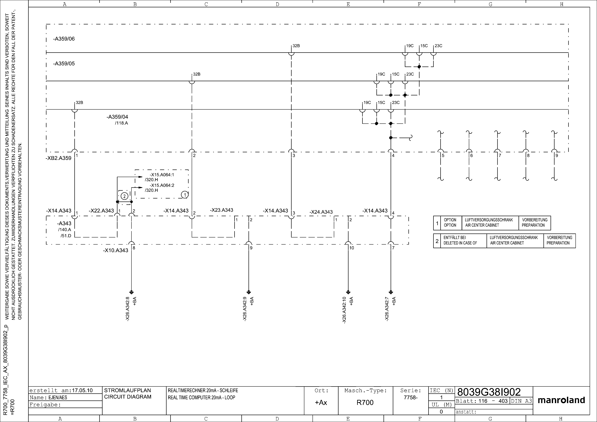

# +Ax — Sheet 116 of 403 — REALTIMERECHNER 20mA SCHLEIFE

**REAL TIME COMPUTER 20mA LOOP**

> Part of the manroland **R700** printing press IEC/UL circuit diagrams.
> Drawing class: **Stromlaufplan / Circuit diagram** (DIN A3).
> Document `+Ax` covers the **Central control console** machine section.

## At a glance

| Field | Value |
|---|---|
| Document | `+Ax`  (8039G38I902) |
| Sheet | **116** of 403 |
| Section (DE) | REALTIMERECHNER 20mA SCHLEIFE |
| Section (EN) | REAL TIME COMPUTER 20mA LOOP |
| Section type | CIRCUIT — Circuit diagram |
| Machine type | `R700` |
| Series | `7758` |
| Created | 17.05.10 |
| Replaces | — |
| Columns used | A, B, C, D, E, F, G, H |
| Path numbers | — |
| Labels on sheet | 79 |
| Cross-refs out | 5 |
| Cross-refs in | 28 |

**Previous:** [+Ax sheet 115](SHEET_0115.md) · **Next:** [+Ax sheet 117](SHEET_0117.md) · **Document TOC:** [_TOC.md](_TOC.md)  (+Ax) · **Master TOC:** [all sheets](../_MASTER_TOC.md)

## Sheet image (300 DPI, exact vector render)



_Rendered directly from the PDF vector layer at 300 DPI (1-bit), no OCR and no resampling. Use it to confirm anything ambiguous in the text below._

## Cross-references on this sheet

Each entry is a wire leaving this sheet. The printed token is `/sheet.column`; the link resolves to that sheet inside the same document.

| Ref | Target sheet | Col | Path | Destination on target | Target section | From col |
|---|---|---|---|---|---|---|
| `/118.A` | [+Ax sheet 118](SHEET_0118.md) | A | — | — | REALTIMERECHNER WINKELKODIERER | B |
| `/320.H` | [+Ax sheet 320](SHEET_0320.md) | H | — | X15.A064:2 | OPTION: "EJEKTOR" ANLAGE / SELECT AIRSTATION / | B |
| `/320.H` | [+Ax sheet 320](SHEET_0320.md) | H | — | — | OPTION: "EJEKTOR" ANLAGE / SELECT AIRSTATION / | B |
| `/140.A` | [+Ax sheet 140](SHEET_0140.md) | A | — | — | ÜBERWACHUNGSRECHNER SICHERHEITSBUS | A |
| `/51.D` | [+Ax sheet 51](SHEET_0051.md) | D | — | — | SIGNALGEBER: AKUSTISCHE WARNSIGNALE | A |

### Incoming references (sheets that point here)

Every other sheet that sends a wire to this one. `Back-ref` is the token printed on *that* sheet; `Path` is its line number.

| From sheet | Cols | Back-ref | Path | Refs | What continues there |
|---|---|---|---|---|---|
| [+Ax#51](SHEET_0051.md) | D | `/51.D` | — | 1 | — |
| [+Ax#118](SHEET_0118.md) | A | `/118.A` | — | 1 | — |
| [+Ax#140](SHEET_0140.md) | A | `/140.A` | — | 1 | — |
| [+Ax#219](SHEET_0219.md) | H | `/219.H` | — | 9 | — |
| [+Ax#243](SHEET_0243.md) | H | `/243.H` | — | 4 | — |
| [+Ax#251](SHEET_0251.md) | B | `/251.B` | — | 4 | — |
| [+Ax#262](SHEET_0262.md) | C | `/262.C` | — | 2 | — |
| [+Ax#264](SHEET_0264.md) | C | `/264.C` | — | 2 | — |
| [+Ax#266](SHEET_0266.md) | A | `/266.A` | — | 2 | — |
| [+Ax#320](SHEET_0320.md) | H | `/320.H` | — | 2 | X15.A064:1; X15.A064:2 |


## Devices on this sheet

| Tag | Class | Class meaning (IEC) | Col | Sub | Terminal | Sign |
|---|---|---|---|---|---|---|
| `A359/04` | A | Baugruppe / assembly, module, PC board | B | 04 | — | — |
| `A343` | A | Baugruppe / assembly, module, PC board | A | — | — | — |
| `A359/06` | A | Baugruppe / assembly, module, PC board | A | 06 | — | — |
| `A359/05` | A | Baugruppe / assembly, module, PC board | A | 05 | — | — |
| `XB2.A359` | — | cross-device reference | A | — | — | — |
| `X14.A343` | — | cross-device reference | C | — | — | — |
| `X14.A343` | — | cross-device reference | D | — | — | — |
| `X14.A343` | — | cross-device reference | E | — | — | — |
| `X14.A343` | — | cross-device reference | A | — | — | — |
| `X22.A343` | — | cross-device reference | B | — | — | — |
| `X10.A343` | — | cross-device reference | B | — | — | — |
| `X26.A342:9` | — | cross-device reference | D | — | 9 | — |
| `X26.A342:10` | — | cross-device reference | E | — | 10 | — |
| `X26.A342:7` | — | cross-device reference | F | — | 7 | — |
| `X26.A342:8` | — | cross-device reference | B | — | 8 | — |
| `X15.A064:2` | — | cross-device reference | B | — | 2 | — |
| `X15.A064:1` | — | cross-device reference | B | — | 1 | — |
| `X23.A343` | — | cross-device reference | C | — | — | — |
| `X24.A343` | — | cross-device reference | E | — | — | — |

## Potentials / nets

_No named potentials on this sheet._

## Wire-end annotations (grouped as printed)

A wire that continues elsewhere is annotated with a small cluster: the destination description, the path/line number `#NN`, and the `/sheet.column` cross reference. Each row below is one such cluster exactly as it is grouped on the drawing.

| Col | Y | Path | Cross-ref | Text on the wire |
|---|---|---|---|---|
| A | 72.6 | — | — | `A359/06` |
| E | 87.7 | — | — | `32B 19C 15C 23C` |
| A | 122.2 | — | — | `A359/05` |
| C | 144.4 | — | — | `32B` |
| F | 144.4 | — | — | `19C 15C 23C` |
| C | 201.1 | — | — | `32B 19C 15C 23C` |
| B | 228.5 | — | — | `A359/04` |
| B | 241.6 | — | `/118.A` | — |
| D | 306.5 | — | — | `XB2.A359 1 2 3 4 5 6 7 8 9` |
| B | 344.7 | — | — | `X15.A064:1` |
| B | 354.6 | — | `/320.H` | `X15.A064:2` |
| B | 375.9 | — | `/320.H` | — |
| B | 385.3 | — | — | `2 1` |
| D | 414.8 | — | — | `X23.A343 X24.A343` |
| C | 415.6 | — | — | `X14.A343 1 X22.A343 1 2 X14.A343 2 X14.A343 3 X14.A343 4` |
| D | 434.9 | — | — | `1 2 1 2` |
| F | 435.7 | — | — | `OPTION OPTION` |
| G | 435.8 | — | — | `LUFTVERSORGUNGSSCHRANK` |
| H | 435.8 | — | — | `PREPARATION VORBEREITUNG` |
| A | 441.1 | — | — | `A343` |
| G | 441.1 | — | — | `1 AIR CENTER CABINET` |
| A | 454.2 | — | `/140.A` | — |
| A | 466.6 | — | `/51.D` | — |
| G | 471.1 | — | — | `2 ENTFÄLLT BEI DELETED IN CASE OF` |
| G | 471.2 | — | — | `LUFTVERSORGUNGSSCHRANK` |
| H | 471.2 | — | — | `PREPARATION VORBEREITUNG` |
| G | 481.8 | — | — | `AIR CENTER CABINET` |
| D | 490.7 | — | — | `X10.A343 8 9 10 7` |
| B | 592.2 | — | — | `X26.A342:8` |
| D | 592.2 | — | — | `X26.A342:9` |
| E | 592.2 | — | — | `X26.A342:10` |
| F | 592.2 | — | — | `X26.A342:7` |
| B | 592.4 | — | — | `+BA` |
| D | 592.4 | — | — | `+BA` |
| E | 592.4 | — | — | `+BA` |
| F | 592.4 | — | — | `+BA` |


## Reconstructed tables

This sheet carries tabular content (pin map / terminal assignment / index). The grid below was rebuilt from the drawing's own rule lines, so each row is exactly one physical row of the table.

### Table 1 — 2 data rows × 13 columns (at x=382.7, y=133.2)

| 32B |  |  |  |  | 19C | 15C | 23C |  |  |  |  |  |
|---|---|---|---|---|---|---|---|---|---|---|---|---|
|  |  |  |  |  | `19C 15C` | `23C` |  |  |  |  |  |  |
| `2 X23.A343 2` | `1` | `X14.A343 2` | `3 X24.A343 3` | `1` | `X14.A343 2` | `4 4` |  | `1` | `5 OPTION OPTION AIR` | `6 LUFTVERSORGUNGSSCHRANK CENTER CABINET` | `7` | `8 VORBEREITUNG PREPARATION` |


## Notes and free text on this sheet

| Text | Col | Y (pt) |
|---|---|---|
| `+BA` | D | 592.44 |
| `+BA` | E | 592.44 |
| `+BA` | F | 592.44 |
| `+BA` | B | 592.44 |
| `32B` | C | 144.38 |
| `32B` | D | 87.69 |
| `19C` | F | 87.66 |
| `15C` | F | 87.66 |
| `23C` | F | 87.66 |
| `19C` | E | 144.36 |
| `15C` | E | 201.05 |
| `32B` | A | 201.08 |
| `OPTION` | F | 435.72 |
| `LUFTVERSORGUNGSSCHRANK` | G | 435.76 |
| `AIR CENTER CABINET` | G | 446.38 |
| `ENTFÄLLT BEI` | F | 471.14 |
| `DELETED IN CASE OF` | G | 481.8 |
| `VORBEREITUNG` | H | 435.75 |
| `PREPARATION` | H | 446.35 |

## Complete label inventory (exact text from the drawing)

Every text object inside the drawing area of this sheet, in DIN reading order (column A→H, then top→bottom). This is the authoritative list: if a string is not here it is not printed on this sheet.

| Col | Y | X | Dir | Type | Text |
|---|---|---|---|---|---|
| A | 72.6 | 106.0 | → | device tag | `A359/06` |
| A | 122.2 | 106.0 | → | device tag | `A359/05` |
| A | 201.1 | 151.4 | → | text | `32B` |
| A | 306.5 | 150.8 | → | number | `1` |
| A | 310.7 | 91.0 | → | device ref | `XB2.A359` |
| A | 415.6 | 92.1 | → | device ref | `X14.A343` |
| A | 421.3 | 150.8 | → | number | `1` |
| A | 441.1 | 114.0 | → | device tag | `A343` |
| A | 454.2 | 116.2 | → | cross-reference | `/140.A` |
| A | 466.6 | 121.0 | → | cross-reference | `/51.D` |
| B | 228.5 | 212.6 | → | device tag | `A359/04` |
| B | 241.6 | 229.6 | → | cross-reference | `/118.A` |
| B | 344.7 | 298.8 | → | device ref | `X15.A064:1` |
| B | 354.6 | 289.1 | → | cross-reference | `/320.H` |
| B | 366.0 | 298.8 | → | device ref | `X15.A064:2` |
| B | 375.9 | 289.1 | → | cross-reference | `/320.H` |
| B | 388.6 | 246.3 | → | number | `2` |
| B | 415.6 | 177.2 | → | device ref | `X22.A343` |
| B | 417.0 | 235.8 | → | number | `1` |
| B | 417.0 | 264.8 | → | number | `2` |
| B | 490.7 | 264.8 | → | number | `8` |
| B | 495.0 | 205.5 | → | device ref | `X10.A343` |
| B | 592.2 | 250.4 | ↕ | device ref | `X26.A342:8` |
| B | 592.4 | 264.6 | ↕ | text | `+BA` |
| C | 144.4 | 385.2 | → | text | `32B` |
| C | 306.5 | 385.2 | → | number | `2` |
| C | 385.3 | 366.7 | → | number | `1` |
| C | 414.8 | 419.0 | → | device ref | `X23.A343` |
| C | 415.6 | 326.0 | → | device ref | `X14.A343` |
| C | 421.3 | 385.2 | → | number | `2` |
| C | 434.9 | 469.7 | → | number | `1` |
| D | 87.7 | 583.7 | → | text | `32B` |
| D | 306.5 | 583.7 | → | number | `3` |
| D | 415.6 | 524.4 | → | device ref | `X14.A343` |
| D | 421.3 | 583.7 | → | number | `3` |
| D | 434.9 | 498.6 | → | number | `2` |
| D | 490.7 | 498.6 | → | number | `9` |
| D | 592.2 | 484.3 | ↕ | device ref | `X26.A342:9` |
| D | 592.4 | 498.4 | ↕ | text | `+BA` |
| E | 144.4 | 753.2 | → | text | `19C` |
| E | 201.1 | 724.8 | → | text | `19C` |
| E | 201.1 | 753.2 | → | text | `15C` |
| E | 415.6 | 722.8 | → | device ref | `X14.A343` |
| E | 418.7 | 617.4 | → | device ref | `X24.A343` |
| E | 434.9 | 668.1 | → | number | `1` |
| E | 434.9 | 697.0 | → | number | `2` |
| E | 490.7 | 696.5 | → | number | `10` |
| E | 592.2 | 682.7 | ↕ | device ref | `X26.A342:10` |
| E | 592.4 | 696.9 | ↕ | text | `+BA` |
| F | 87.7 | 809.9 | → | text | `19C` |
| F | 87.7 | 838.2 | → | text | `15C` |
| F | 87.7 | 867.1 | → | text | `23C` |
| F | 144.4 | 781.5 | → | text | `15C` |
| F | 144.4 | 810.4 | → | text | `23C` |
| F | 201.1 | 782.1 | → | text | `23C` |
| F | 306.5 | 782.1 | → | number | `4` |
| F | 306.5 | 881.3 | → | number | `5` |
| F | 421.3 | 782.1 | → | number | `4` |
| F | 435.7 | 885.5 | → | text | `OPTION` |
| F | 441.1 | 869.1 | → | number | `1` |
| F | 446.3 | 885.5 | → | text | `OPTION` |
| F | 471.1 | 885.0 | → | text | `ENTFÄLLT BEI` |
| F | 476.5 | 868.8 | → | number | `2` |
| F | 490.7 | 782.1 | → | number | `7` |
| F | 592.2 | 767.8 | ↕ | device ref | `X26.A342:7` |
| F | 592.4 | 781.9 | ↕ | text | `+BA` |
| G | 306.5 | 938.0 | → | number | `6` |
| G | 306.5 | 994.7 | → | number | `7` |
| G | 435.8 | 927.5 | → | text | `LUFTVERSORGUNGSSCHRANK` |
| G | 446.4 | 928.3 | → | text | `AIR CENTER CABINET` |
| G | 471.2 | 977.1 | → | text | `LUFTVERSORGUNGSSCHRANK` |
| G | 481.8 | 885.0 | → | text | `DELETED IN CASE OF` |
| G | 481.8 | 978.0 | → | text | `AIR CENTER CABINET` |
| H | 306.5 | 1051.4 | → | number | `8` |
| H | 306.5 | 1108.1 | → | number | `9` |
| H | 435.7 | 1041.7 | → | text | `VORBEREITUNG` |
| H | 446.3 | 1040.9 | → | text | `PREPARATION` |
| H | 471.2 | 1091.3 | → | text | `VORBEREITUNG` |
| H | 481.8 | 1090.5 | → | text | `PREPARATION` |

## Reading-order text block

The same content as a plain block, grouped by DIN column — convenient to paste or to match against a visual description.

```text
=== Column A ===
  72.6  106.0  devtag       A359/06
 122.2  106.0  devtag       A359/05
 201.1  151.4  text         32B
 306.5  150.8  numeric      1
 310.7   91.0  devref       XB2.A359
 415.6   92.1  devref       X14.A343
 421.3  150.8  numeric      1
 441.1  114.0  devtag       A343
 454.2  116.2  xref         /140.A
 466.6  121.0  xref         /51.D
=== Column B ===
 228.5  212.6  devtag       A359/04
 241.6  229.6  xref         /118.A
 344.7  298.8  devref       X15.A064:1
 354.6  289.1  xref         /320.H
 366.0  298.8  devref       X15.A064:2
 375.9  289.1  xref         /320.H
 388.6  246.3  numeric      2
 415.6  177.2  devref       X22.A343
 417.0  235.8  numeric      1
 417.0  264.8  numeric      2
 490.7  264.8  numeric      8
 495.0  205.5  devref       X10.A343
 592.2  250.4  devref       X26.A342:8
 592.4  264.6  text         +BA
=== Column C ===
 144.4  385.2  text         32B
 306.5  385.2  numeric      2
 385.3  366.7  numeric      1
 414.8  419.0  devref       X23.A343
 415.6  326.0  devref       X14.A343
 421.3  385.2  numeric      2
 434.9  469.7  numeric      1
=== Column D ===
  87.7  583.7  text         32B
 306.5  583.7  numeric      3
 415.6  524.4  devref       X14.A343
 421.3  583.7  numeric      3
 434.9  498.6  numeric      2
 490.7  498.6  numeric      9
 592.2  484.3  devref       X26.A342:9
 592.4  498.4  text         +BA
=== Column E ===
 144.4  753.2  text         19C
 201.1  724.8  text         19C
 201.1  753.2  text         15C
 415.6  722.8  devref       X14.A343
 418.7  617.4  devref       X24.A343
 434.9  668.1  numeric      1
 434.9  697.0  numeric      2
 490.7  696.5  numeric      10
 592.2  682.7  devref       X26.A342:10
 592.4  696.9  text         +BA
=== Column F ===
  87.7  809.9  text         19C
  87.7  838.2  text         15C
  87.7  867.1  text         23C
 144.4  781.5  text         15C
 144.4  810.4  text         23C
 201.1  782.1  text         23C
 306.5  782.1  numeric      4
 306.5  881.3  numeric      5
 421.3  782.1  numeric      4
 435.7  885.5  text         OPTION
 441.1  869.1  numeric      1
 446.3  885.5  text         OPTION
 471.1  885.0  text         ENTFÄLLT BEI
 476.5  868.8  numeric      2
 490.7  782.1  numeric      7
 592.2  767.8  devref       X26.A342:7
 592.4  781.9  text         +BA
=== Column G ===
 306.5  938.0  numeric      6
 306.5  994.7  numeric      7
 435.8  927.5  text         LUFTVERSORGUNGSSCHRANK
 446.4  928.3  text         AIR CENTER CABINET
 471.2  977.1  text         LUFTVERSORGUNGSSCHRANK
 481.8  885.0  text         DELETED IN CASE OF
 481.8  978.0  text         AIR CENTER CABINET
=== Column H ===
 306.5 1051.4  numeric      8
 306.5 1108.1  numeric      9
 435.7 1041.7  text         VORBEREITUNG
 446.3 1040.9  text         PREPARATION
 471.2 1091.3  text         VORBEREITUNG
 481.8 1090.5  text         PREPARATION
```

---
_Generated from the PDF vector text layer; no OCR. Source: `R700_7758_IEC_AX_8039G38I902_p`, sheet 116._
