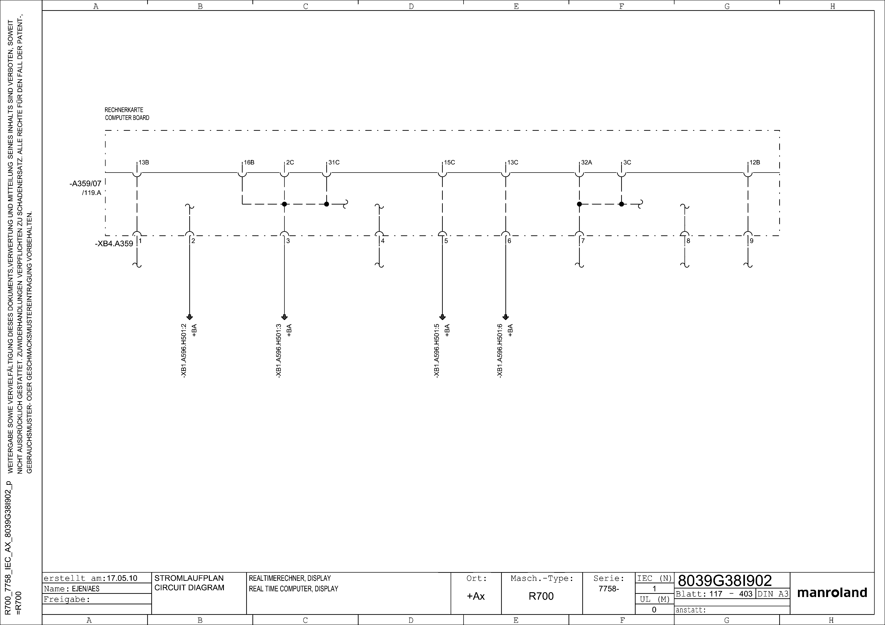

# +Ax — Sheet 117 of 403 — REALTIMERECHNER, DISPLAY

**REAL TIME COMPUTER, DISPLAY**

> Part of the manroland **R700** printing press IEC/UL circuit diagrams.
> Drawing class: **Stromlaufplan / Circuit diagram** (DIN A3).
> Document `+Ax` covers the **Central control console** machine section.

## At a glance

| Field | Value |
|---|---|
| Document | `+Ax`  (8039G38I902) |
| Sheet | **117** of 403 |
| Section (DE) | REALTIMERECHNER, DISPLAY |
| Section (EN) | REAL TIME COMPUTER, DISPLAY |
| Section type | CIRCUIT — Circuit diagram |
| Machine type | `R700` |
| Series | `7758` |
| Created | 17.05.10 |
| Replaces | — |
| Columns used | A, B, C, D, E, F, G |
| Path numbers | — |
| Labels on sheet | 31 |
| Cross-refs out | 1 |
| Cross-refs in | 10 |

**Previous:** [+Ax sheet 116](SHEET_0116.md) · **Next:** [+Ax sheet 118](SHEET_0118.md) · **Document TOC:** [_TOC.md](_TOC.md)  (+Ax) · **Master TOC:** [all sheets](../_MASTER_TOC.md)

## Sheet image (300 DPI, exact vector render)



_Rendered directly from the PDF vector layer at 300 DPI (1-bit), no OCR and no resampling. Use it to confirm anything ambiguous in the text below._

## Cross-references on this sheet

Each entry is a wire leaving this sheet. The printed token is `/sheet.column`; the link resolves to that sheet inside the same document.

| Ref | Target sheet | Col | Path | Destination on target | Target section | From col |
|---|---|---|---|---|---|---|
| `/119.A` | [+Ax sheet 119](SHEET_0119.md) | A | — | — | REALTIMERECHNER HAUPTANTRIEB | A |

### Incoming references (sheets that point here)

Every other sheet that sends a wire to this one. `Back-ref` is the token printed on *that* sheet; `Path` is its line number.

| From sheet | Cols | Back-ref | Path | Refs | What continues there |
|---|---|---|---|---|---|
| [+Ax#119](SHEET_0119.md) | A | `/119.A` | — | 1 | — |
| [+Ax#228](SHEET_0228.md) | E | `/228.E` | — | 9 | — |


## Devices on this sheet

| Tag | Class | Class meaning (IEC) | Col | Sub | Terminal | Sign |
|---|---|---|---|---|---|---|
| `A359/07` | A | Baugruppe / assembly, module, PC board | A | 07 | — | — |
| `XB4.A359` | — | cross-device reference | A | — | — | — |
| `XB1.A596.H501:2` | — | cross-device reference | B | — | 2 | — |
| `XB1.A596.H501:3` | — | cross-device reference | C | — | 3 | — |
| `XB1.A596.H501:5` | — | cross-device reference | D | — | 5 | — |
| `XB1.A596.H501:6` | — | cross-device reference | E | — | 6 | — |

## Potentials / nets

_No named potentials on this sheet._

## Wire-end annotations (grouped as printed)

A wire that continues elsewhere is annotated with a small cluster: the destination description, the path/line number `#NN`, and the `/sheet.column` cross reference. Each row below is one such cluster exactly as it is grouped on the drawing.

| Col | Y | Path | Cross-ref | Text on the wire |
|---|---|---|---|---|
| A | 145.2 | — | — | `RECHNERKARTE` |
| A | 155.8 | — | — | `COMPUTER BOARD` |
| D | 215.2 | — | — | `13B 16B 2C 31C 15C 13C 32A 3C 12B` |
| A | 242.7 | — | — | `A359/07` |
| A | 255.7 | — | `/119.A` | — |
| D | 320.6 | — | — | `XB4.A359 1 2 3 4 5 6 7 8 9` |
| B | 436.0 | — | — | `XB1.A596.H501:2` |
| C | 436.2 | — | — | `XB1.A596.H501:3` |
| D | 436.2 | — | — | `XB1.A596.H501:5` |
| E | 436.2 | — | — | `XB1.A596.H501:6` |
| B | 436.5 | — | — | `+BA` |
| C | 436.5 | — | — | `+BA` |
| D | 436.5 | — | — | `+BA` |
| E | 436.5 | — | — | `+BA` |


## Notes and free text on this sheet

| Text | Col | Y (pt) |
|---|---|---|
| `RECHNERKARTE` | A | 145.19 |
| `COMPUTER BOARD` | A | 155.84 |
| `+BA` | B | 436.54 |
| `+BA` | C | 436.54 |
| `+BA` | D | 436.54 |
| `+BA` | E | 436.54 |
| `13B` | A | 215.25 |
| `16B` | B | 215.25 |
| `2C` | C | 215.22 |
| `31C` | C | 215.22 |
| `15C` | D | 215.22 |
| `13C` | E | 215.22 |
| `32A` | F | 215.25 |
| `3C` | F | 215.22 |
| `12B` | G | 215.25 |

## Complete label inventory (exact text from the drawing)

Every text object inside the drawing area of this sheet, in DIN reading order (column A→H, then top→bottom). This is the authoritative list: if a string is not here it is not printed on this sheet.

| Col | Y | X | Dir | Type | Text |
|---|---|---|---|---|---|
| A | 145.2 | 140.9 | → | text | `RECHNERKARTE` |
| A | 155.8 | 141.4 | → | text | `COMPUTER BOARD` |
| A | 215.2 | 186.2 | → | text | `13B` |
| A | 242.7 | 93.5 | → | device tag | `A359/07` |
| A | 255.7 | 110.6 | → | cross-reference | `/119.A` |
| A | 320.6 | 186.2 | → | number | `1` |
| A | 323.5 | 127.8 | → | device ref | `XB4.A359` |
| B | 215.2 | 328.0 | → | text | `16B` |
| B | 320.6 | 257.7 | → | number | `2` |
| B | 436.0 | 243.4 | ↕ | device ref | `XB1.A596.H501:2` |
| B | 436.5 | 257.5 | ↕ | text | `+BA` |
| C | 215.2 | 385.2 | → | text | `2C` |
| C | 215.2 | 441.9 | → | text | `31C` |
| C | 320.6 | 385.2 | → | number | `3` |
| C | 436.3 | 370.9 | ↕ | device ref | `XB1.A596.H501:3` |
| C | 436.5 | 385.0 | ↕ | text | `+BA` |
| D | 215.2 | 597.3 | → | text | `15C` |
| D | 320.6 | 512.8 | → | number | `4` |
| D | 320.6 | 597.8 | → | number | `5` |
| D | 436.3 | 583.5 | ↕ | device ref | `XB1.A596.H501:5` |
| D | 436.5 | 597.6 | ↕ | text | `+BA` |
| E | 215.2 | 682.3 | → | text | `13C` |
| E | 320.6 | 682.9 | → | number | `6` |
| E | 436.3 | 668.6 | ↕ | device ref | `XB1.A596.H501:6` |
| E | 436.5 | 682.7 | ↕ | text | `+BA` |
| F | 215.2 | 782.1 | → | text | `32A` |
| F | 215.2 | 838.8 | → | text | `3C` |
| F | 320.6 | 782.1 | → | number | `7` |
| G | 215.2 | 1008.3 | → | text | `12B` |
| G | 320.6 | 923.8 | → | number | `8` |
| G | 320.6 | 1008.9 | → | number | `9` |

## Reading-order text block

The same content as a plain block, grouped by DIN column — convenient to paste or to match against a visual description.

```text
=== Column A ===
 145.2  140.9  text         RECHNERKARTE
 155.8  141.4  text         COMPUTER BOARD
 215.2  186.2  text         13B
 242.7   93.5  devtag       A359/07
 255.7  110.6  xref         /119.A
 320.6  186.2  numeric      1
 323.5  127.8  devref       XB4.A359
=== Column B ===
 215.2  328.0  text         16B
 320.6  257.7  numeric      2
 436.0  243.4  devref       XB1.A596.H501:2
 436.5  257.5  text         +BA
=== Column C ===
 215.2  385.2  text         2C
 215.2  441.9  text         31C
 320.6  385.2  numeric      3
 436.3  370.9  devref       XB1.A596.H501:3
 436.5  385.0  text         +BA
=== Column D ===
 215.2  597.3  text         15C
 320.6  512.8  numeric      4
 320.6  597.8  numeric      5
 436.3  583.5  devref       XB1.A596.H501:5
 436.5  597.6  text         +BA
=== Column E ===
 215.2  682.3  text         13C
 320.6  682.9  numeric      6
 436.3  668.6  devref       XB1.A596.H501:6
 436.5  682.7  text         +BA
=== Column F ===
 215.2  782.1  text         32A
 215.2  838.8  text         3C
 320.6  782.1  numeric      7
=== Column G ===
 215.2 1008.3  text         12B
 320.6  923.8  numeric      8
 320.6 1008.9  numeric      9
```

---
_Generated from the PDF vector text layer; no OCR. Source: `R700_7758_IEC_AX_8039G38I902_p`, sheet 117._
