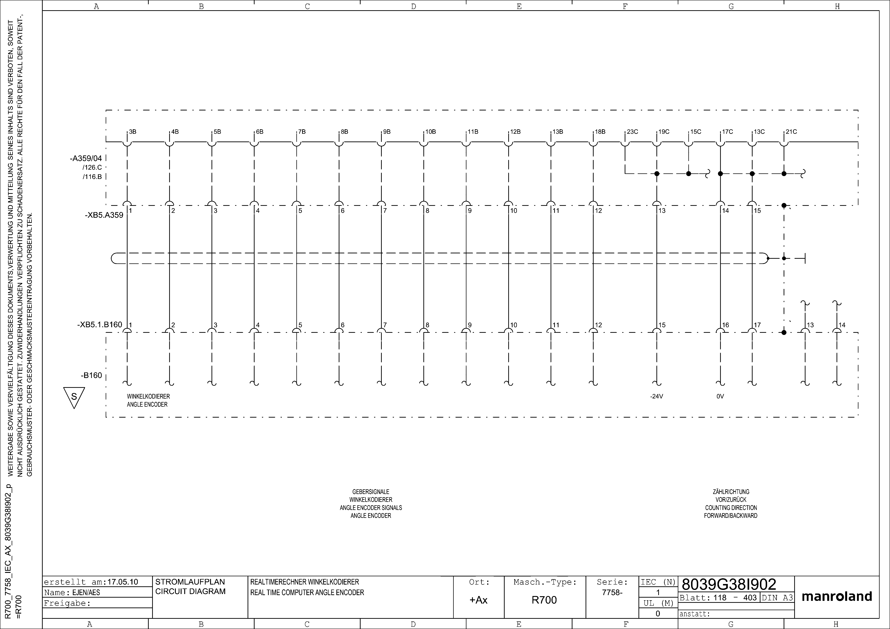

# +Ax — Sheet 118 of 403 — REALTIMERECHNER WINKELKODIERER

**REAL TIME COMPUTER ANGLE ENCODER**

> Part of the manroland **R700** printing press IEC/UL circuit diagrams.
> Drawing class: **Stromlaufplan / Circuit diagram** (DIN A3).
> Document `+Ax` covers the **Central control console** machine section.

## At a glance

| Field | Value |
|---|---|
| Document | `+Ax`  (8039G38I902) |
| Sheet | **118** of 403 |
| Section (DE) | REALTIMERECHNER WINKELKODIERER |
| Section (EN) | REAL TIME COMPUTER ANGLE ENCODER |
| Section type | CIRCUIT — Circuit diagram |
| Machine type | `R700` |
| Series | `7758` |
| Created | 17.05.10 |
| Replaces | — |
| Columns used | A, B, C, D, E, F, G, H |
| Path numbers | — |
| Labels on sheet | 71 |
| Cross-refs out | 2 |
| Cross-refs in | 34 |

**Previous:** [+Ax sheet 117](SHEET_0117.md) · **Next:** [+Ax sheet 119](SHEET_0119.md) · **Document TOC:** [_TOC.md](_TOC.md)  (+Ax) · **Master TOC:** [all sheets](../_MASTER_TOC.md)

## Sheet image (300 DPI, exact vector render)



_Rendered directly from the PDF vector layer at 300 DPI (1-bit), no OCR and no resampling. Use it to confirm anything ambiguous in the text below._

## Cross-references on this sheet

Each entry is a wire leaving this sheet. The printed token is `/sheet.column`; the link resolves to that sheet inside the same document.

| Ref | Target sheet | Col | Path | Destination on target | Target section | From col |
|---|---|---|---|---|---|---|
| `/126.C` | [+Ax sheet 126](SHEET_0126.md) | C | — | — | REALTIMERECHNER ANLEGER | A |
| `/116.B` | [+Ax sheet 116](SHEET_0116.md) | B | — | — | REALTIMERECHNER 20mA SCHLEIFE | A |

### Incoming references (sheets that point here)

Every other sheet that sends a wire to this one. `Back-ref` is the token printed on *that* sheet; `Path` is its line number.

| From sheet | Cols | Back-ref | Path | Refs | What continues there |
|---|---|---|---|---|---|
| [+Ax#116](SHEET_0116.md) | B | `/116.B` | — | 1 | — |
| [+Ax#126](SHEET_0126.md) | C | `/126.C` | — | 1 | — |
| [+Ax#231](SHEET_0231.md) | G | `/231.G` | — | 15 | — |
| [+Ax#232](SHEET_0232.md) | H | `/232.H` | — | 17 | — |


## Devices on this sheet

| Tag | Class | Class meaning (IEC) | Col | Sub | Terminal | Sign |
|---|---|---|---|---|---|---|
| `B160` | B | Umformer / transducer, sensor | A | — | — | — |
| `A359/04` | A | Baugruppe / assembly, module, PC board | A | 04 | — | — |
| `XB5.A359` | — | cross-device reference | A | — | — | — |
| `XB5.1.B160` | — | cross-device reference | A | — | — | — |

## Potentials / nets

| Potential | Count | Columns | Attached devices | Terminals |
|---|---|---|---|---|
| `0V` | 1 | G | — | — |
| `24V` | 1 | F | — | — |


A potential such as `L24+/4` or `M24+` is a named supply/return rail; every place it appears on this sheet is electrically common.

## Wire-end annotations (grouped as printed)

A wire that continues elsewhere is annotated with a small cluster: the destination description, the path/line number `#NN`, and the `/sheet.column` cross reference. Each row below is one such cluster exactly as it is grouped on the drawing.

| Col | Y | Path | Cross-ref | Text on the wire |
|---|---|---|---|---|
| D | 172.7 | — | — | `3B 4B 5B 6B 7B 8B 9B 10B 11B 12B 13B 18B` |
| F | 172.7 | — | — | `23C 19C 15C` |
| G | 172.7 | — | — | `17C 13C 21C` |
| A | 207.2 | — | — | `A359/04` |
| A | 220.3 | — | `/126.C`, `/116.B` | — |
| D | 277.6 | — | — | `XB5.A359 1 2 3 4 5 6 7 8 9 10 11 12 13 14 15 '` |
| H | 428.6 | — | — | `'` |
| D | 429.8 | — | — | `XB5.1.B160 1 2 3 4 5 6 7 8 9 10 11 12 15 16 17 13 14` |
| A | 497.8 | — | — | `B160` |
| A | 525.5 | — | — | `S` |
| F | 527.0 | — | — | `24V` |
| G | 527.1 | — | — | `0V` |
| A | 527.9 | — | — | `WINKELKODIERER ANGLE ENCODER` |
| D | 655.4 | — | — | `ANGLE ENCODER SIGNALS WINKELKODIERER GEBERSIGNALE` |
| G | 655.5 | — | — | `ZÄHLRICHTUNG` |
| G | 666.1 | — | — | `FORWARD/BACKWARD COUNTING DIRECTION VOR/ZURÜCK` |
| D | 687.3 | — | — | `ANGLE ENCODER` |


## Notes and free text on this sheet

| Text | Col | Y (pt) |
|---|---|---|
| `WINKELKODIERER` | A | 527.85 |
| `ANGLE ENCODER` | A | 538.52 |
| `3B` | A | 172.73 |
| `4B` | B | 172.73 |
| `5B` | B | 172.73 |
| `6B` | C | 172.73 |
| `7B` | C | 172.73 |
| `8B` | C | 172.73 |
| `9B` | D | 172.73 |
| `10B` | D | 172.73 |
| `11B` | E | 172.73 |
| `12B` | E | 172.73 |
| `13B` | E | 172.73 |
| `18B` | F | 172.73 |
| `S` | A | 525.5 |
| `23C` | F | 172.7 |
| `19C` | F | 172.7 |
| `15C` | G | 172.7 |
| `17C` | G | 172.7 |
| `13C` | G | 172.7 |
| `21C` | H | 172.7 |
| `GEBERSIGNALE` | D | 655.42 |
| `WINKELKODIERER` | D | 666.04 |
| `ANGLE ENCODER SIGNALS` | D | 676.7 |
| `ANGLE ENCODER` | D | 687.34 |
| `ZÄHLRICHTUNG` | G | 655.46 |
| `VOR/ZURÜCK` | G | 666.09 |
| `COUNTING DIRECTION` | G | 676.71 |
| `FORWARD/BACKWARD` | G | 687.29 |

## Complete label inventory (exact text from the drawing)

Every text object inside the drawing area of this sheet, in DIN reading order (column A→H, then top→bottom). This is the authoritative list: if a string is not here it is not printed on this sheet.

| Col | Y | X | Dir | Type | Text |
|---|---|---|---|---|---|
| A | 172.7 | 172.6 | → | text | `3B` |
| A | 207.2 | 93.5 | → | device tag | `A359/04` |
| A | 220.3 | 110.6 | → | cross-reference | `/126.C` |
| A | 232.7 | 110.8 | → | cross-reference | `/116.B` |
| A | 278.1 | 172.1 | → | number | `1` |
| A | 283.1 | 113.7 | → | device ref | `XB5.A359` |
| A | 429.8 | 103.5 | → | device ref | `XB5.1.B160` |
| A | 431.2 | 172.1 | → | number | `1` |
| A | 497.8 | 108.3 | → | device tag | `B160` |
| A | 525.5 | 95.1 | → | text | `S` |
| A | 527.8 | 170.1 | → | text | `WINKELKODIERER` |
| A | 538.5 | 170.1 | → | text | `ANGLE ENCODER` |
| B | 172.7 | 229.3 | → | text | `4B` |
| B | 172.7 | 286.0 | → | text | `5B` |
| B | 278.1 | 229.3 | → | number | `2` |
| B | 278.1 | 286.0 | → | number | `3` |
| B | 431.2 | 229.3 | → | number | `2` |
| B | 431.2 | 286.0 | → | number | `3` |
| C | 172.7 | 342.7 | → | text | `6B` |
| C | 172.7 | 399.1 | → | text | `7B` |
| C | 172.7 | 456.1 | → | text | `8B` |
| C | 278.1 | 342.7 | → | number | `4` |
| C | 278.1 | 399.4 | → | number | `5` |
| C | 278.1 | 456.1 | → | number | `6` |
| C | 431.2 | 342.7 | → | number | `4` |
| C | 431.2 | 399.4 | → | number | `5` |
| C | 431.2 | 456.1 | → | number | `6` |
| D | 172.7 | 512.8 | → | text | `9B` |
| D | 172.7 | 568.9 | → | text | `10B` |
| D | 278.1 | 512.8 | → | number | `7` |
| D | 278.1 | 569.5 | → | number | `8` |
| D | 431.2 | 512.8 | → | number | `7` |
| D | 431.2 | 569.5 | → | number | `8` |
| D | 655.4 | 471.5 | → | text | `GEBERSIGNALE` |
| D | 666.0 | 467.6 | → | text | `WINKELKODIERER` |
| D | 676.7 | 454.8 | → | text | `ANGLE ENCODER SIGNALS` |
| D | 687.3 | 469.2 | → | text | `ANGLE ENCODER` |
| E | 172.7 | 625.6 | → | text | `11B` |
| E | 172.7 | 682.3 | → | text | `12B` |
| E | 172.7 | 739.0 | → | text | `13B` |
| E | 278.1 | 626.2 | → | number | `9` |
| E | 278.1 | 682.3 | → | number | `10` |
| E | 278.1 | 739.0 | → | number | `11` |
| E | 431.2 | 626.2 | → | number | `9` |
| E | 431.2 | 682.3 | → | number | `10` |
| E | 431.2 | 739.0 | → | number | `11` |
| F | 172.7 | 795.7 | → | text | `18B` |
| F | 172.7 | 838.8 | → | text | `23C` |
| F | 172.7 | 880.7 | → | text | `19C` |
| F | 278.1 | 795.7 | → | number | `12` |
| F | 278.1 | 880.7 | → | number | `13` |
| F | 431.2 | 795.7 | → | number | `12` |
| F | 431.2 | 880.7 | → | number | `15` |
| F | 527.0 | 870.0 | → | potential | `24V` |
| G | 172.7 | 923.2 | → | text | `15C` |
| G | 172.7 | 965.8 | → | text | `17C` |
| G | 172.7 | 1008.3 | → | text | `13C` |
| G | 278.1 | 965.8 | → | number | `14` |
| G | 278.1 | 1008.3 | → | number | `15` |
| G | 431.2 | 965.8 | → | number | `16` |
| G | 431.2 | 1008.3 | → | number | `17` |
| G | 527.1 | 958.7 | → | potential | `0V` |
| G | 655.5 | 953.9 | → | text | `ZÄHLRICHTUNG` |
| G | 666.1 | 957.4 | → | text | `VOR/ZURÜCK` |
| G | 676.7 | 943.6 | → | text | `COUNTING DIRECTION` |
| G | 687.3 | 942.0 | → | text | `FORWARD/BACKWARD` |
| H | 172.7 | 1051.4 | → | text | `21C` |
| H | 277.6 | 1055.3 | → | other | `'` |
| H | 428.6 | 1055.3 | → | other | `'` |
| H | 431.2 | 1079.1 | → | number | `13` |
| H | 431.2 | 1121.7 | → | number | `14` |

## Reading-order text block

The same content as a plain block, grouped by DIN column — convenient to paste or to match against a visual description.

```text
=== Column A ===
 172.7  172.6  text         3B
 207.2   93.5  devtag       A359/04
 220.3  110.6  xref         /126.C
 232.7  110.8  xref         /116.B
 278.1  172.1  numeric      1
 283.1  113.7  devref       XB5.A359
 429.8  103.5  devref       XB5.1.B160
 431.2  172.1  numeric      1
 497.8  108.3  devtag       B160
 525.5   95.1  text         S
 527.8  170.1  text         WINKELKODIERER
 538.5  170.1  text         ANGLE ENCODER
=== Column B ===
 172.7  229.3  text         4B
 172.7  286.0  text         5B
 278.1  229.3  numeric      2
 278.1  286.0  numeric      3
 431.2  229.3  numeric      2
 431.2  286.0  numeric      3
=== Column C ===
 172.7  342.7  text         6B
 172.7  399.1  text         7B
 172.7  456.1  text         8B
 278.1  342.7  numeric      4
 278.1  399.4  numeric      5
 278.1  456.1  numeric      6
 431.2  342.7  numeric      4
 431.2  399.4  numeric      5
 431.2  456.1  numeric      6
=== Column D ===
 172.7  512.8  text         9B
 172.7  568.9  text         10B
 278.1  512.8  numeric      7
 278.1  569.5  numeric      8
 431.2  512.8  numeric      7
 431.2  569.5  numeric      8
 655.4  471.5  text         GEBERSIGNALE
 666.0  467.6  text         WINKELKODIERER
 676.7  454.8  text         ANGLE ENCODER SIGNALS
 687.3  469.2  text         ANGLE ENCODER
=== Column E ===
 172.7  625.6  text         11B
 172.7  682.3  text         12B
 172.7  739.0  text         13B
 278.1  626.2  numeric      9
 278.1  682.3  numeric      10
 278.1  739.0  numeric      11
 431.2  626.2  numeric      9
 431.2  682.3  numeric      10
 431.2  739.0  numeric      11
=== Column F ===
 172.7  795.7  text         18B
 172.7  838.8  text         23C
 172.7  880.7  text         19C
 278.1  795.7  numeric      12
 278.1  880.7  numeric      13
 431.2  795.7  numeric      12
 431.2  880.7  numeric      15
 527.0  870.0  net          24V
=== Column G ===
 172.7  923.2  text         15C
 172.7  965.8  text         17C
 172.7 1008.3  text         13C
 278.1  965.8  numeric      14
 278.1 1008.3  numeric      15
 431.2  965.8  numeric      16
 431.2 1008.3  numeric      17
 527.1  958.7  net          0V
 655.5  953.9  text         ZÄHLRICHTUNG
 666.1  957.4  text         VOR/ZURÜCK
 676.7  943.6  text         COUNTING DIRECTION
 687.3  942.0  text         FORWARD/BACKWARD
=== Column H ===
 172.7 1051.4  text         21C
 277.6 1055.3  other        `
 428.6 1055.3  other        `
 431.2 1079.1  numeric      13
 431.2 1121.7  numeric      14
```

---
_Generated from the PDF vector text layer; no OCR. Source: `R700_7758_IEC_AX_8039G38I902_p`, sheet 118._
