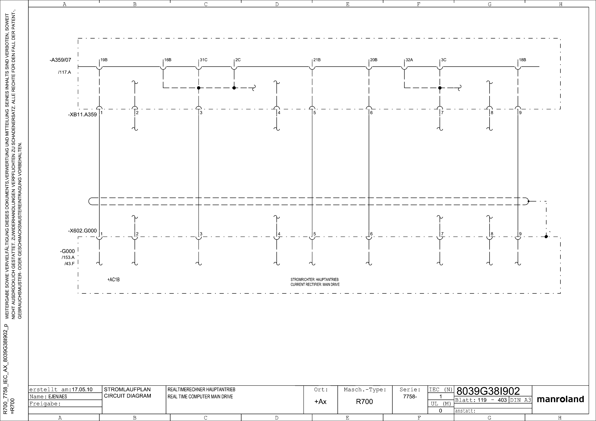

# +Ax — Sheet 119 of 403 — REALTIMERECHNER HAUPTANTRIEB

**REAL TIME COMPUTER MAIN DRIVE**

> Part of the manroland **R700** printing press IEC/UL circuit diagrams.
> Drawing class: **Stromlaufplan / Circuit diagram** (DIN A3).
> Document `+Ax` covers the **Central control console** machine section.

## At a glance

| Field | Value |
|---|---|
| Document | `+Ax`  (8039G38I902) |
| Sheet | **119** of 403 |
| Section (DE) | REALTIMERECHNER HAUPTANTRIEB |
| Section (EN) | REAL TIME COMPUTER MAIN DRIVE |
| Section type | CIRCUIT — Circuit diagram |
| Machine type | `R700` |
| Series | `7758` |
| Created | 17.05.10 |
| Replaces | — |
| Columns used | A, B, C, D, E, F, G, H |
| Path numbers | — |
| Labels on sheet | 38 |
| Cross-refs out | 3 |
| Cross-refs in | 21 |

**Previous:** [+Ax sheet 118](SHEET_0118.md) · **Next:** [+Ax sheet 120](SHEET_0120.md) · **Document TOC:** [_TOC.md](_TOC.md)  (+Ax) · **Master TOC:** [all sheets](../_MASTER_TOC.md)

## Sheet image (300 DPI, exact vector render)



_Rendered directly from the PDF vector layer at 300 DPI (1-bit), no OCR and no resampling. Use it to confirm anything ambiguous in the text below._

## Cross-references on this sheet

Each entry is a wire leaving this sheet. The printed token is `/sheet.column`; the link resolves to that sheet inside the same document.

| Ref | Target sheet | Col | Path | Destination on target | Target section | From col |
|---|---|---|---|---|---|---|
| `/117.A` | [+Ax sheet 117](SHEET_0117.md) | A | — | — | REALTIMERECHNER, DISPLAY | A |
| `/153.A` | [+Ax sheet 153](SHEET_0153.md) | A | — | — | ÜBERWACHUNGSRECHNER HAUPTANTRIEB | A |
| `/43.F` | [+Ax sheet 43](SHEET_0043.md) | F | — | — | HAUPTANTRIEB | A |

### Incoming references (sheets that point here)

Every other sheet that sends a wire to this one. `Back-ref` is the token printed on *that* sheet; `Path` is its line number.

| From sheet | Cols | Back-ref | Path | Refs | What continues there |
|---|---|---|---|---|---|
| [+Ax#43](SHEET_0043.md) | F | `/43.F` | — | 1 | — |
| [+Ax#117](SHEET_0117.md) | A | `/117.A` | — | 1 | — |
| [+Ax#153](SHEET_0153.md) | A | `/153.A` | — | 1 | — |
| [+Ax#247](SHEET_0247.md) | B, E | `/247.B`, `/247.E` | — | 9 | X11.A566/01 |
| [+Ax#296](SHEET_0296.md) | B | `/296.B` | — | 9 | — |


## Devices on this sheet

| Tag | Class | Class meaning (IEC) | Col | Sub | Terminal | Sign |
|---|---|---|---|---|---|---|
| `A359/07` | A | Baugruppe / assembly, module, PC board | A | 07 | — | — |
| `G000` | G | Stromversorgung / power supply | A | — | — | — |
| `XB11.A359` | — | cross-device reference | A | — | — | — |
| `X602.G000` | — | cross-device reference | A | — | — | — |

## Potentials / nets

_No named potentials on this sheet._

## Wire-end annotations (grouped as printed)

A wire that continues elsewhere is annotated with a small cluster: the destination description, the path/line number `#NN`, and the `/sheet.column` cross reference. Each row below is one such cluster exactly as it is grouped on the drawing.

| Col | Y | Path | Cross-ref | Text on the wire |
|---|---|---|---|---|
| A | 115.1 | — | — | `A359/07` |
| E | 116.0 | — | — | `19B 16B 31C 2C 18B` |
| E | 116.0 | — | — | `21B 20B 32A 3C` |
| A | 140.6 | — | `/117.A` | — |
| D | 221.4 | — | — | `XB11.A359 1 2 3 9` |
| D | 221.4 | — | — | `4` |
| E | 221.4 | — | — | `5` |
| F | 221.4 | — | — | `6 7 8` |
| A | 456.7 | — | — | `X602.G000 1` |
| E | 461.9 | — | — | `2 3 9 '` |
| D | 463.8 | — | — | `4` |
| E | 463.8 | — | — | `5` |
| F | 463.8 | — | — | `6 7 8` |
| A | 497.8 | — | — | `G000` |
| A | 510.9 | — | `/153.A` | — |
| A | 523.2 | — | `/43.F` | — |
| B | 555.7 | — | — | `+AC1B` |
| E | 556.4 | — | — | `STROMRICHTER: HAUPTANTRIEB CURRENT RECTIFIER: MAIN DRIVE` |


## Notes and free text on this sheet

| Text | Col | Y (pt) |
|---|---|---|
| `STROMRICHTER: HAUPTANTRIEB` | E | 556.36 |
| `CURRENT RECTIFIER: MAIN DRIVE` | E | 566.33 |
| `19B` | B | 116.04 |
| `16B` | B | 116.04 |
| `31C` | C | 116.01 |
| `2C` | C | 116.01 |
| `18B` | G | 116.04 |
| `+AC1B` | B | 555.71 |
| `20B` | E | 116.04 |
| `32A` | F | 116.04 |
| `3C` | F | 116.01 |
| `21B` | E | 116.04 |

## Complete label inventory (exact text from the drawing)

Every text object inside the drawing area of this sheet, in DIN reading order (column A→H, then top→bottom). This is the authoritative list: if a string is not here it is not printed on this sheet.

| Col | Y | X | Dir | Type | Text |
|---|---|---|---|---|---|
| A | 115.1 | 99.2 | → | device tag | `A359/07` |
| A | 140.6 | 116.2 | → | cross-reference | `/117.A` |
| A | 224.2 | 136.1 | → | device ref | `XB11.A359` |
| A | 456.7 | 136.1 | → | device ref | `X602.G000` |
| A | 497.8 | 119.9 | → | device tag | `G000` |
| A | 510.9 | 123.3 | → | cross-reference | `/153.A` |
| A | 523.3 | 129.0 | → | cross-reference | `/43.F` |
| B | 116.0 | 200.4 | → | text | `19B` |
| B | 116.0 | 328.0 | → | text | `16B` |
| B | 221.4 | 200.4 | → | number | `1` |
| B | 221.4 | 271.8 | → | number | `2` |
| B | 463.8 | 200.4 | → | number | `1` |
| B | 463.8 | 271.8 | → | number | `2` |
| B | 555.7 | 214.5 | → | text | `+AC1B` |
| C | 116.0 | 399.4 | → | text | `31C` |
| C | 116.0 | 470.3 | → | text | `2C` |
| C | 221.4 | 399.4 | → | number | `3` |
| C | 463.8 | 399.4 | → | number | `3` |
| D | 221.4 | 555.3 | → | number | `4` |
| D | 463.8 | 555.3 | → | number | `4` |
| E | 116.0 | 626.2 | → | text | `21B` |
| E | 116.0 | 739.6 | → | text | `20B` |
| E | 221.4 | 626.2 | → | number | `5` |
| E | 221.4 | 739.6 | → | number | `6` |
| E | 463.8 | 626.2 | → | number | `5` |
| E | 463.8 | 739.6 | → | number | `6` |
| E | 556.4 | 580.8 | → | text | `STROMRICHTER: HAUPTANTRIEB` |
| E | 566.3 | 580.8 | → | text | `CURRENT RECTIFIER: MAIN DRIVE` |
| F | 116.0 | 810.4 | → | text | `32A` |
| F | 116.0 | 881.3 | → | text | `3C` |
| F | 221.4 | 881.3 | → | number | `7` |
| F | 463.8 | 881.3 | → | number | `7` |
| G | 116.0 | 1036.6 | → | text | `18B` |
| G | 221.4 | 980.5 | → | number | `8` |
| G | 221.4 | 1037.2 | → | number | `9` |
| G | 463.8 | 980.5 | → | number | `8` |
| G | 463.8 | 1037.2 | → | number | `9` |
| H | 461.9 | 1096.7 | → | other | `'` |

## Reading-order text block

The same content as a plain block, grouped by DIN column — convenient to paste or to match against a visual description.

```text
=== Column A ===
 115.1   99.2  devtag       A359/07
 140.6  116.2  xref         /117.A
 224.2  136.1  devref       XB11.A359
 456.7  136.1  devref       X602.G000
 497.8  119.9  devtag       G000
 510.9  123.3  xref         /153.A
 523.3  129.0  xref         /43.F
=== Column B ===
 116.0  200.4  text         19B
 116.0  328.0  text         16B
 221.4  200.4  numeric      1
 221.4  271.8  numeric      2
 463.8  200.4  numeric      1
 463.8  271.8  numeric      2
 555.7  214.5  text         +AC1B
=== Column C ===
 116.0  399.4  text         31C
 116.0  470.3  text         2C
 221.4  399.4  numeric      3
 463.8  399.4  numeric      3
=== Column D ===
 221.4  555.3  numeric      4
 463.8  555.3  numeric      4
=== Column E ===
 116.0  626.2  text         21B
 116.0  739.6  text         20B
 221.4  626.2  numeric      5
 221.4  739.6  numeric      6
 463.8  626.2  numeric      5
 463.8  739.6  numeric      6
 556.4  580.8  text         STROMRICHTER: HAUPTANTRIEB
 566.3  580.8  text         CURRENT RECTIFIER: MAIN DRIVE
=== Column F ===
 116.0  810.4  text         32A
 116.0  881.3  text         3C
 221.4  881.3  numeric      7
 463.8  881.3  numeric      7
=== Column G ===
 116.0 1036.6  text         18B
 221.4  980.5  numeric      8
 221.4 1037.2  numeric      9
 463.8  980.5  numeric      8
 463.8 1037.2  numeric      9
=== Column H ===
 461.9 1096.7  other        `
```

---
_Generated from the PDF vector text layer; no OCR. Source: `R700_7758_IEC_AX_8039G38I902_p`, sheet 119._
