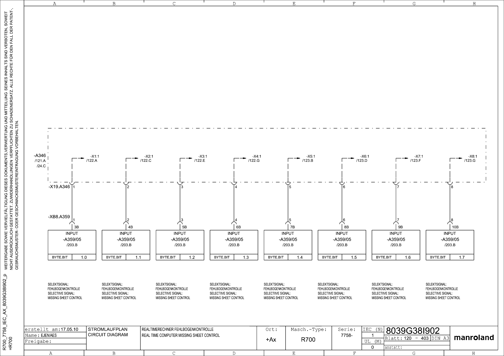

# +Ax — Sheet 120 of 403 — REALTIMERECHNER FEHLBOGENKONTROLLE

**REAL TIME COMPUTER MISSING SHEET CONTROL**

> Part of the manroland **R700** printing press IEC/UL circuit diagrams.
> Drawing class: **Stromlaufplan / Circuit diagram** (DIN A3).
> Document `+Ax` covers the **Central control console** machine section.

## At a glance

| Field | Value |
|---|---|
| Document | `+Ax`  (8039G38I902) |
| Sheet | **120** of 403 |
| Section (DE) | REALTIMERECHNER FEHLBOGENKONTROLLE |
| Section (EN) | REAL TIME COMPUTER MISSING SHEET CONTROL |
| Section type | CIRCUIT — Circuit diagram |
| Machine type | `R700` |
| Series | `7758` |
| Created | 17.05.10 |
| Replaces | — |
| Columns used | A, B, C, D, E, F, G, H |
| Path numbers | — |
| Labels on sheet | 117 |
| Cross-refs out | 18 |
| Cross-refs in | 34 |

**Previous:** [+Ax sheet 119](SHEET_0119.md) · **Next:** [+Ax sheet 121](SHEET_0121.md) · **Document TOC:** [_TOC.md](_TOC.md)  (+Ax) · **Master TOC:** [all sheets](../_MASTER_TOC.md)

## Sheet image (300 DPI, exact vector render)



_Rendered directly from the PDF vector layer at 300 DPI (1-bit), no OCR and no resampling. Use it to confirm anything ambiguous in the text below._

## Cross-references on this sheet

Each entry is a wire leaving this sheet. The printed token is `/sheet.column`; the link resolves to that sheet inside the same document.

| Ref | Target sheet | Col | Path | Destination on target | Target section | From col |
|---|---|---|---|---|---|---|
| `/122.A` | [+Ax sheet 122](SHEET_0122.md) | A | — | X6:1 | REALTIMERECHNER FEHLBOGENKONTROLLE | D |
| `/122.C` | [+Ax sheet 122](SHEET_0122.md) | C | — | X5:1 | REALTIMERECHNER FEHLBOGENKONTROLLE | D |
| `/123.B` | [+Ax sheet 123](SHEET_0123.md) | B | — | X8:1 | REALTIMERECHNER FEHLBOGENKONTROLLE | G |
| `/123.D` | [+Ax sheet 123](SHEET_0123.md) | D | — | X7:1 | REALTIMERECHNER FEHLBOGENKONTROLLE | G |
| `/122.E` | [+Ax sheet 122](SHEET_0122.md) | E | — | — | REALTIMERECHNER FEHLBOGENKONTROLLE | C |
| `/123.F` | [+Ax sheet 123](SHEET_0123.md) | F | — | — | REALTIMERECHNER FEHLBOGENKONTROLLE | G |
| `/122.G` | [+Ax sheet 122](SHEET_0122.md) | G | — | — | REALTIMERECHNER FEHLBOGENKONTROLLE | D |
| `/123.G` | [+Ax sheet 123](SHEET_0123.md) | G | — | — | REALTIMERECHNER FEHLBOGENKONTROLLE | H |
| `/121.A` | [+Ax sheet 121](SHEET_0121.md) | A | — | — | REALTIMERECHNER FEHLBOGENKONTROLLE | A |
| `/24.C` | [+Ax sheet 24](SHEET_0024.md) | C | — | — | SPANNUNGSVERSORGUNG, SCHALTSCHRANKBELÜFTUNG | A |
| `/203.B` | [+Ax sheet 203](SHEET_0203.md) | B | — | — | REFERENZMODUL | A |
| `/203.B` | [+Ax sheet 203](SHEET_0203.md) | B | — | — | REFERENZMODUL | B |
| `/203.B` | [+Ax sheet 203](SHEET_0203.md) | B | — | — | REFERENZMODUL | C |
| `/203.B` | [+Ax sheet 203](SHEET_0203.md) | B | — | — | REFERENZMODUL | D |
| `/203.B` | [+Ax sheet 203](SHEET_0203.md) | B | — | — | REFERENZMODUL | E |
| `/203.B` | [+Ax sheet 203](SHEET_0203.md) | B | — | — | REFERENZMODUL | F |
| `/203.B` | [+Ax sheet 203](SHEET_0203.md) | B | — | — | REFERENZMODUL | G |
| `/203.B` | [+Ax sheet 203](SHEET_0203.md) | B | — | — | REFERENZMODUL | H |

### Incoming references (sheets that point here)

Every other sheet that sends a wire to this one. `Back-ref` is the token printed on *that* sheet; `Path` is its line number.

| From sheet | Cols | Back-ref | Path | Refs | What continues there |
|---|---|---|---|---|---|
| [+Ax#24](SHEET_0024.md) | C | `/24.C` | — | 1 | — |
| [+Ax#121](SHEET_0121.md) | A | `/121.A` | — | 1 | — |
| [+Ax#122](SHEET_0122.md) | A, C, E, G | `/122.A`, `/122.C`, `/122.E`, `/122.G` | — | 4 | X1:1; X2:1; X3:1; X4:1 |
| [+Ax#123](SHEET_0123.md) | B, D, F, G | `/123.B`, `/123.D`, `/123.F`, `/123.G` | — | 4 | X5:1; X6:1; X7:1; X8:1 |
| [+Ax#203](SHEET_0203.md) | B | `/203.B` | — | 8 | — |
| [+Ax#238](SHEET_0238.md) | F | `/238.F` | — | 8 | — |
| [+Ax#259](SHEET_0259.md) | A | `/259.A` | — | 8 | — |


## Devices on this sheet

| Tag | Class | Class meaning (IEC) | Col | Sub | Terminal | Sign |
|---|---|---|---|---|---|---|
| `A359/05` | A | Baugruppe / assembly, module, PC board | A | 05 | — | — |
| `A359/05` | A | Baugruppe / assembly, module, PC board | B | 05 | — | — |
| `A359/05` | A | Baugruppe / assembly, module, PC board | C | 05 | — | — |
| `A359/05` | A | Baugruppe / assembly, module, PC board | D | 05 | — | — |
| `A359/05` | A | Baugruppe / assembly, module, PC board | E | 05 | — | — |
| `A359/05` | A | Baugruppe / assembly, module, PC board | F | 05 | — | — |
| `A359/05` | A | Baugruppe / assembly, module, PC board | G | 05 | — | — |
| `A359/05` | A | Baugruppe / assembly, module, PC board | H | 05 | — | — |
| `A346` | A | Baugruppe / assembly, module, PC board | A | — | — | — |
| `X7:1` | X | Klemme / terminal, plug connector | G | — | 1 | — |
| `X6:1` | X | Klemme / terminal, plug connector | F | — | 1 | — |
| `X1:1` | X | Klemme / terminal, plug connector | B | — | 1 | — |
| `X3:1` | X | Klemme / terminal, plug connector | C | — | 1 | — |
| `X4:1` | X | Klemme / terminal, plug connector | D | — | 1 | — |
| `X8:1` | X | Klemme / terminal, plug connector | H | — | 1 | — |
| `X5:1` | X | Klemme / terminal, plug connector | E | — | 1 | — |
| `X2:1` | X | Klemme / terminal, plug connector | C | — | 1 | — |
| `1.0` | — | cross-device reference | A | — | — | — |
| `1.1` | — | cross-device reference | B | — | — | — |
| `1.2` | — | cross-device reference | C | — | — | — |
| `1.3` | — | cross-device reference | D | — | — | — |
| `1.4` | — | cross-device reference | E | — | — | — |
| `1.5` | — | cross-device reference | F | — | — | — |
| `1.6` | — | cross-device reference | G | — | — | — |
| `1.7` | — | cross-device reference | H | — | — | — |
| `X19.A346` | — | cross-device reference | A | — | — | — |
| `XB8.A359` | — | cross-device reference | A | — | — | — |

## Potentials / nets

_No named potentials on this sheet._

## Wire-end annotations (grouped as printed)

A wire that continues elsewhere is annotated with a small cluster: the destination description, the path/line number `#NN`, and the `/sheet.column` cross reference. Each row below is one such cluster exactly as it is grouped on the drawing.

| Col | Y | Path | Cross-ref | Text on the wire |
|---|---|---|---|---|
| A | 363.1 | — | — | `A346` |
| D | 365.9 | — | `/122.A` | `X6:1` |
| B | 365.9 | — | — | `X1:1` |
| D | 365.9 | — | `/122.C` | `X5:1` |
| C | 365.9 | — | — | `X2:1` |
| C | 365.9 | — | — | `X3:1` |
| D | 365.9 | — | — | `X4:1` |
| G | 365.9 | — | `/123.B` | `X8:1` |
| G | 365.9 | — | `/123.D` | `X7:1` |
| C | 375.9 | — | `/122.E` | — |
| D | 375.9 | — | `/122.G` | — |
| G | 375.9 | — | `/123.F` | — |
| H | 375.9 | — | `/123.G` | — |
| A | 376.2 | — | `/121.A` | — |
| A | 388.6 | — | `/24.C` | — |
| D | 436.8 | — | — | `X19.A346 1 2 3 4 5 6 7 8` |
| A | 507.7 | — | — | `XB8.A359 1` |
| E | 516.2 | — | — | `2 3 4 5 6 7 8` |
| A | 533.2 | — | — | `3B` |
| B | 533.2 | — | — | `4B` |
| C | 533.2 | — | — | `5B` |
| D | 533.2 | — | — | `6B` |
| E | 533.2 | — | — | `7B` |
| F | 533.2 | — | — | `8B` |
| G | 533.2 | — | — | `9B` |
| H | 533.2 | — | — | `10B` |
| A | 547.7 | — | — | `INPUT` |
| B | 547.7 | — | — | `INPUT` |
| C | 547.7 | — | — | `INPUT` |
| D | 547.7 | — | — | `INPUT` |
| E | 547.7 | — | — | `INPUT` |
| F | 547.7 | — | — | `INPUT` |
| G | 547.7 | — | — | `INPUT` |
| H | 547.7 | — | — | `INPUT` |
| A | 561.6 | — | — | `A359/05` |
| B | 561.6 | — | — | `A359/05` |
| C | 561.6 | — | — | `A359/05` |
| D | 561.6 | — | — | `A359/05` |
| E | 561.6 | — | — | `A359/05` |
| F | 561.6 | — | — | `A359/05` |
| G | 561.6 | — | — | `A359/05` |
| H | 561.6 | — | — | `A359/05` |
| A | 575.3 | — | `/203.B` | — |
| B | 575.3 | — | `/203.B` | — |
| C | 575.3 | — | `/203.B` | — |
| D | 575.3 | — | `/203.B` | — |
| E | 575.3 | — | `/203.B` | — |
| F | 575.3 | — | `/203.B` | — |
| G | 575.3 | — | `/203.B` | — |
| H | 575.3 | — | `/203.B` | — |
| A | 604.4 | — | — | `BYTE.BIT 1.0` |
| B | 604.4 | — | — | `BYTE.BIT 1.1` |
| C | 604.4 | — | — | `BYTE.BIT 1.2` |
| D | 604.4 | — | — | `BYTE.BIT 1.3` |
| E | 604.4 | — | — | `BYTE.BIT 1.4` |
| F | 604.4 | — | — | `BYTE.BIT 1.5` |
| G | 604.4 | — | — | `BYTE.BIT 1.6` |
| H | 604.4 | — | — | `BYTE.BIT 1.7` |
| A | 669.6 | — | — | `FEHLBOGENKONTROLLE SELEKTSIGNAL:` |
| B | 669.6 | — | — | `FEHLBOGENKONTROLLE SELEKTSIGNAL:` |
| C | 669.6 | — | — | `FEHLBOGENKONTROLLE SELEKTSIGNAL:` |
| D | 669.6 | — | — | `FEHLBOGENKONTROLLE SELEKTSIGNAL:` |
| E | 669.6 | — | — | `FEHLBOGENKONTROLLE SELEKTSIGNAL:` |
| F | 669.6 | — | — | `FEHLBOGENKONTROLLE SELEKTSIGNAL:` |
| G | 669.6 | — | — | `FEHLBOGENKONTROLLE SELEKTSIGNAL:` |
| G | 669.6 | — | — | `FEHLBOGENKONTROLLE SELEKTSIGNAL:` |
| A | 690.8 | — | — | `MISSING SHEET CONTROL SELECTIIVE SIGNAL:` |
| B | 690.8 | — | — | `MISSING SHEET CONTROL SELECTIIVE SIGNAL:` |
| C | 690.8 | — | — | `MISSING SHEET CONTROL SELECTIIVE SIGNAL:` |
| D | 690.8 | — | — | `MISSING SHEET CONTROL SELECTIIVE SIGNAL:` |
| E | 690.8 | — | — | `MISSING SHEET CONTROL SELECTIIVE SIGNAL:` |
| F | 690.8 | — | — | `MISSING SHEET CONTROL SELECTIIVE SIGNAL:` |
| G | 690.8 | — | — | `MISSING SHEET CONTROL SELECTIIVE SIGNAL:` |
| G | 690.8 | — | — | `MISSING SHEET CONTROL SELECTIIVE SIGNAL:` |


## Reconstructed tables

This sheet carries tabular content (pin map / terminal assignment / index). The grid below was rebuilt from the drawing's own rule lines, so each row is exactly one physical row of the table.

### Table 1 — 1 data rows × 2 columns (at x=113.4, y=544.3)

| INPUT | A359/05 /203.B |
|---|---|
| `BYTE.BIT` | `1.0` |


### Table 2 — 1 data rows × 2 columns (at x=240.9, y=544.3)

| INPUT | A359/05 /203.B |
|---|---|
| `BYTE.BIT` | `1.1` |


### Table 3 — 1 data rows × 2 columns (at x=368.5, y=544.3)

| INPUT | A359/05 /203.B |
|---|---|
| `BYTE.BIT` | `1.2` |


### Table 4 — 1 data rows × 2 columns (at x=496.1, y=544.3)

| INPUT | A359/05 /203.B |
|---|---|
| `BYTE.BIT` | `1.3` |


### Table 5 — 1 data rows × 2 columns (at x=623.6, y=544.3)

| INPUT | A359/05 /203.B |
|---|---|
| `BYTE.BIT` | `1.4` |


### Table 6 — 1 data rows × 2 columns (at x=751.2, y=544.3)

| INPUT | A359/05 /203.B |
|---|---|
| `BYTE.BIT` | `1.5` |


### Table 7 — 1 data rows × 2 columns (at x=878.7, y=544.3)

| INPUT | A359/05 /203.B |
|---|---|
| `BYTE.BIT` | `1.6` |


### Table 8 — 1 data rows × 2 columns (at x=1006.3, y=544.3)

| INPUT | A359/05 /203.B |
|---|---|
| `BYTE.BIT` | `1.7` |


## Notes and free text on this sheet

| Text | Col | Y (pt) |
|---|---|---|
| `3B` | A | 533.18 |
| `INPUT` | A | 547.72 |
| `BYTE.BIT` | A | 604.97 |
| `SELEKTSIGNAL:` | A | 669.58 |
| `FEHLBOGENKONTROLLE` | A | 680.24 |
| `SELECTIIVE SIGNAL:` | A | 690.84 |
| `MISSING SHEET CONTROL` | A | 701.51 |
| `4B` | B | 533.18 |
| `INPUT` | B | 547.72 |
| `BYTE.BIT` | B | 604.97 |
| `SELEKTSIGNAL:` | B | 669.58 |
| `FEHLBOGENKONTROLLE` | B | 680.24 |
| `SELECTIIVE SIGNAL:` | B | 690.84 |
| `MISSING SHEET CONTROL` | B | 701.51 |
| `5B` | C | 533.18 |
| `INPUT` | C | 547.72 |
| `BYTE.BIT` | C | 604.97 |
| `SELEKTSIGNAL:` | C | 669.58 |
| `FEHLBOGENKONTROLLE` | C | 680.24 |
| `SELECTIIVE SIGNAL:` | C | 690.84 |
| `MISSING SHEET CONTROL` | C | 701.51 |
| `6B` | D | 533.18 |
| `INPUT` | D | 547.72 |
| `BYTE.BIT` | D | 604.97 |
| `SELEKTSIGNAL:` | D | 669.58 |
| `FEHLBOGENKONTROLLE` | D | 680.24 |
| `SELECTIIVE SIGNAL:` | D | 690.84 |
| `MISSING SHEET CONTROL` | D | 701.51 |
| `7B` | E | 533.18 |
| `INPUT` | E | 547.72 |
| `BYTE.BIT` | E | 604.97 |
| `SELEKTSIGNAL:` | E | 669.58 |
| `FEHLBOGENKONTROLLE` | E | 680.24 |
| `SELECTIIVE SIGNAL:` | E | 690.84 |
| `MISSING SHEET CONTROL` | E | 701.51 |
| `8B` | F | 533.18 |
| `INPUT` | F | 547.72 |
| `BYTE.BIT` | F | 604.97 |
| `SELEKTSIGNAL:` | F | 669.58 |
| `FEHLBOGENKONTROLLE` | F | 680.24 |
| `SELECTIIVE SIGNAL:` | F | 690.84 |
| `MISSING SHEET CONTROL` | F | 701.51 |
| `9B` | G | 533.18 |
| `INPUT` | G | 547.72 |
| `FEHLBOGENKONTROLLE` | G | 680.24 |
| `SELECTIIVE SIGNAL:` | G | 690.84 |
| `MISSING SHEET CONTROL` | G | 701.51 |
| `10B` | H | 533.2 |
| `INPUT` | H | 547.72 |
| `BYTE.BIT` | G | 604.97 |
| `SELEKTSIGNAL:` | G | 669.58 |

## Complete label inventory (exact text from the drawing)

Every text object inside the drawing area of this sheet, in DIN reading order (column A→H, then top→bottom). This is the authoritative list: if a string is not here it is not printed on this sheet.

| Col | Y | X | Dir | Type | Text |
|---|---|---|---|---|---|
| A | 363.1 | 79.9 | → | device tag | `A346` |
| A | 376.2 | 82.2 | → | cross-reference | `/121.A` |
| A | 388.6 | 87.0 | → | cross-reference | `/24.C` |
| A | 436.8 | 114.8 | → | device ref | `X19.A346` |
| A | 438.3 | 172.1 | → | number | `1` |
| A | 507.7 | 113.7 | → | device ref | `XB8.A359` |
| A | 516.2 | 172.1 | → | number | `1` |
| A | 533.2 | 175.5 | → | text | `3B` |
| A | 547.7 | 155.2 | → | text | `INPUT` |
| A | 561.6 | 148.7 | → | device tag | `A359/05` |
| A | 575.3 | 157.5 | → | cross-reference | `/203.B` |
| A | 604.4 | 191.3 | → | device ref | `1.0` |
| A | 605.0 | 123.3 | → | text | `BYTE.BIT` |
| A | 669.6 | 113.1 | → | text | `SELEKTSIGNAL:` |
| A | 680.2 | 112.5 | → | text | `FEHLBOGENKONTROLLE` |
| A | 690.8 | 113.1 | → | text | `SELECTIIVE SIGNAL:` |
| A | 701.5 | 112.8 | → | text | `MISSING SHEET CONTROL` |
| B | 366.0 | 213.7 | → | device tag | `X1:1` |
| B | 375.9 | 204.1 | → | cross-reference | `/122.A` |
| B | 438.3 | 300.2 | → | number | `2` |
| B | 516.2 | 300.2 | → | number | `2` |
| B | 533.2 | 303.0 | → | text | `4B` |
| B | 547.7 | 282.8 | → | text | `INPUT` |
| B | 561.6 | 276.2 | → | device tag | `A359/05` |
| B | 575.3 | 285.0 | → | cross-reference | `/203.B` |
| B | 604.4 | 319.7 | → | device ref | `1.1` |
| B | 605.0 | 250.9 | → | text | `BYTE.BIT` |
| B | 669.6 | 240.7 | → | text | `SELEKTSIGNAL:` |
| B | 680.2 | 240.1 | → | text | `FEHLBOGENKONTROLLE` |
| B | 690.8 | 240.7 | → | text | `SELECTIIVE SIGNAL:` |
| B | 701.5 | 240.4 | → | text | `MISSING SHEET CONTROL` |
| C | 366.0 | 341.3 | → | device tag | `X2:1` |
| C | 366.0 | 468.9 | → | device tag | `X3:1` |
| C | 375.9 | 331.7 | → | cross-reference | `/122.C` |
| C | 375.9 | 459.2 | → | cross-reference | `/122.E` |
| C | 438.3 | 427.7 | → | number | `3` |
| C | 516.2 | 427.7 | → | number | `3` |
| C | 533.2 | 430.6 | → | text | `5B` |
| C | 547.7 | 410.3 | → | text | `INPUT` |
| C | 561.6 | 403.8 | → | device tag | `A359/05` |
| C | 575.3 | 412.6 | → | cross-reference | `/203.B` |
| C | 604.4 | 446.5 | → | device ref | `1.2` |
| C | 605.0 | 378.4 | → | text | `BYTE.BIT` |
| C | 669.6 | 368.2 | → | text | `SELEKTSIGNAL:` |
| C | 680.2 | 367.7 | → | text | `FEHLBOGENKONTROLLE` |
| C | 690.8 | 368.2 | → | text | `SELECTIIVE SIGNAL:` |
| C | 701.5 | 367.9 | → | text | `MISSING SHEET CONTROL` |
| D | 366.0 | 596.4 | → | device tag | `X4:1` |
| D | 375.9 | 586.8 | → | cross-reference | `/122.G` |
| D | 438.3 | 555.3 | → | number | `4` |
| D | 516.2 | 555.3 | → | number | `4` |
| D | 533.2 | 558.1 | → | text | `6B` |
| D | 547.7 | 537.9 | → | text | `INPUT` |
| D | 561.6 | 531.4 | → | device tag | `A359/05` |
| D | 575.3 | 540.1 | → | cross-reference | `/203.B` |
| D | 604.4 | 574.0 | → | device ref | `1.3` |
| D | 605.0 | 506.0 | → | text | `BYTE.BIT` |
| D | 669.6 | 495.8 | → | text | `SELEKTSIGNAL:` |
| D | 680.2 | 495.2 | → | text | `FEHLBOGENKONTROLLE` |
| D | 690.8 | 495.8 | → | text | `SELECTIIVE SIGNAL:` |
| D | 701.5 | 495.5 | → | text | `MISSING SHEET CONTROL` |
| E | 366.0 | 724.0 | → | device tag | `X5:1` |
| E | 375.9 | 714.3 | → | cross-reference | `/123.B` |
| E | 438.3 | 682.9 | → | number | `5` |
| E | 516.2 | 682.9 | → | number | `5` |
| E | 533.2 | 685.7 | → | text | `7B` |
| E | 547.7 | 665.4 | → | text | `INPUT` |
| E | 561.6 | 658.9 | → | device tag | `A359/05` |
| E | 575.3 | 667.7 | → | cross-reference | `/203.B` |
| E | 604.4 | 701.6 | → | device ref | `1.4` |
| E | 605.0 | 633.5 | → | text | `BYTE.BIT` |
| E | 669.6 | 623.3 | → | text | `SELEKTSIGNAL:` |
| E | 680.2 | 622.8 | → | text | `FEHLBOGENKONTROLLE` |
| E | 690.8 | 623.3 | → | text | `SELECTIIVE SIGNAL:` |
| E | 701.5 | 623.1 | → | text | `MISSING SHEET CONTROL` |
| F | 366.0 | 851.5 | → | device tag | `X6:1` |
| F | 375.9 | 841.9 | → | cross-reference | `/123.D` |
| F | 438.3 | 810.4 | → | number | `6` |
| F | 516.2 | 810.4 | → | number | `6` |
| F | 533.2 | 813.3 | → | text | `8B` |
| F | 547.7 | 793.0 | → | text | `INPUT` |
| F | 561.6 | 786.5 | → | device tag | `A359/05` |
| F | 575.3 | 795.3 | → | cross-reference | `/203.B` |
| F | 604.4 | 829.1 | → | device ref | `1.5` |
| F | 605.0 | 761.1 | → | text | `BYTE.BIT` |
| F | 605.0 | 888.7 | → | text | `BYTE.BIT` |
| F | 669.6 | 750.9 | → | text | `SELEKTSIGNAL:` |
| F | 669.6 | 878.5 | → | text | `SELEKTSIGNAL:` |
| F | 680.2 | 750.3 | → | text | `FEHLBOGENKONTROLLE` |
| F | 690.8 | 750.9 | → | text | `SELECTIIVE SIGNAL:` |
| F | 701.5 | 750.6 | → | text | `MISSING SHEET CONTROL` |
| G | 366.0 | 979.1 | → | device tag | `X7:1` |
| G | 375.9 | 969.4 | → | cross-reference | `/123.F` |
| G | 438.3 | 938.0 | → | number | `7` |
| G | 516.2 | 938.0 | → | number | `7` |
| G | 533.2 | 940.8 | → | text | `9B` |
| G | 547.7 | 920.6 | → | text | `INPUT` |
| G | 561.6 | 914.0 | → | device tag | `A359/05` |
| G | 575.3 | 922.8 | → | cross-reference | `/203.B` |
| G | 604.4 | 956.7 | → | device ref | `1.6` |
| G | 605.0 | 1016.2 | → | text | `BYTE.BIT` |
| G | 669.6 | 1006.0 | → | text | `SELEKTSIGNAL:` |
| G | 680.2 | 877.9 | → | text | `FEHLBOGENKONTROLLE` |
| G | 680.2 | 1005.4 | → | text | `FEHLBOGENKONTROLLE` |
| G | 690.8 | 878.5 | → | text | `SELECTIIVE SIGNAL:` |
| G | 690.8 | 1006.0 | → | text | `SELECTIIVE SIGNAL:` |
| G | 701.5 | 878.2 | → | text | `MISSING SHEET CONTROL` |
| G | 701.5 | 1005.7 | → | text | `MISSING SHEET CONTROL` |
| H | 366.0 | 1106.6 | → | device tag | `X8:1` |
| H | 375.9 | 1097.0 | → | cross-reference | `/123.G` |
| H | 438.3 | 1065.5 | → | number | `8` |
| H | 516.2 | 1065.5 | → | number | `8` |
| H | 533.2 | 1067.8 | → | text | `10B` |
| H | 547.7 | 1048.1 | → | text | `INPUT` |
| H | 561.6 | 1041.6 | → | device tag | `A359/05` |
| H | 575.3 | 1050.4 | → | cross-reference | `/203.B` |
| H | 604.4 | 1084.3 | → | device ref | `1.7` |

## Reading-order text block

The same content as a plain block, grouped by DIN column — convenient to paste or to match against a visual description.

```text
=== Column A ===
 363.1   79.9  devtag       A346
 376.2   82.2  xref         /121.A
 388.6   87.0  xref         /24.C
 436.8  114.8  devref       X19.A346
 438.3  172.1  numeric      1
 507.7  113.7  devref       XB8.A359
 516.2  172.1  numeric      1
 533.2  175.5  text         3B
 547.7  155.2  text         INPUT
 561.6  148.7  devtag       A359/05
 575.3  157.5  xref         /203.B
 604.4  191.3  devref       1.0
 605.0  123.3  text         BYTE.BIT
 669.6  113.1  text         SELEKTSIGNAL:
 680.2  112.5  text         FEHLBOGENKONTROLLE
 690.8  113.1  text         SELECTIIVE SIGNAL:
 701.5  112.8  text         MISSING SHEET CONTROL
=== Column B ===
 366.0  213.7  devtag       X1:1
 375.9  204.1  xref         /122.A
 438.3  300.2  numeric      2
 516.2  300.2  numeric      2
 533.2  303.0  text         4B
 547.7  282.8  text         INPUT
 561.6  276.2  devtag       A359/05
 575.3  285.0  xref         /203.B
 604.4  319.7  devref       1.1
 605.0  250.9  text         BYTE.BIT
 669.6  240.7  text         SELEKTSIGNAL:
 680.2  240.1  text         FEHLBOGENKONTROLLE
 690.8  240.7  text         SELECTIIVE SIGNAL:
 701.5  240.4  text         MISSING SHEET CONTROL
=== Column C ===
 366.0  341.3  devtag       X2:1
 366.0  468.9  devtag       X3:1
 375.9  331.7  xref         /122.C
 375.9  459.2  xref         /122.E
 438.3  427.7  numeric      3
 516.2  427.7  numeric      3
 533.2  430.6  text         5B
 547.7  410.3  text         INPUT
 561.6  403.8  devtag       A359/05
 575.3  412.6  xref         /203.B
 604.4  446.5  devref       1.2
 605.0  378.4  text         BYTE.BIT
 669.6  368.2  text         SELEKTSIGNAL:
 680.2  367.7  text         FEHLBOGENKONTROLLE
 690.8  368.2  text         SELECTIIVE SIGNAL:
 701.5  367.9  text         MISSING SHEET CONTROL
=== Column D ===
 366.0  596.4  devtag       X4:1
 375.9  586.8  xref         /122.G
 438.3  555.3  numeric      4
 516.2  555.3  numeric      4
 533.2  558.1  text         6B
 547.7  537.9  text         INPUT
 561.6  531.4  devtag       A359/05
 575.3  540.1  xref         /203.B
 604.4  574.0  devref       1.3
 605.0  506.0  text         BYTE.BIT
 669.6  495.8  text         SELEKTSIGNAL:
 680.2  495.2  text         FEHLBOGENKONTROLLE
 690.8  495.8  text         SELECTIIVE SIGNAL:
 701.5  495.5  text         MISSING SHEET CONTROL
=== Column E ===
 366.0  724.0  devtag       X5:1
 375.9  714.3  xref         /123.B
 438.3  682.9  numeric      5
 516.2  682.9  numeric      5
 533.2  685.7  text         7B
 547.7  665.4  text         INPUT
 561.6  658.9  devtag       A359/05
 575.3  667.7  xref         /203.B
 604.4  701.6  devref       1.4
 605.0  633.5  text         BYTE.BIT
 669.6  623.3  text         SELEKTSIGNAL:
 680.2  622.8  text         FEHLBOGENKONTROLLE
 690.8  623.3  text         SELECTIIVE SIGNAL:
 701.5  623.1  text         MISSING SHEET CONTROL
=== Column F ===
 366.0  851.5  devtag       X6:1
 375.9  841.9  xref         /123.D
 438.3  810.4  numeric      6
 516.2  810.4  numeric      6
 533.2  813.3  text         8B
 547.7  793.0  text         INPUT
 561.6  786.5  devtag       A359/05
 575.3  795.3  xref         /203.B
 604.4  829.1  devref       1.5
 605.0  761.1  text         BYTE.BIT
 605.0  888.7  text         BYTE.BIT
 669.6  750.9  text         SELEKTSIGNAL:
 669.6  878.5  text         SELEKTSIGNAL:
 680.2  750.3  text         FEHLBOGENKONTROLLE
 690.8  750.9  text         SELECTIIVE SIGNAL:
 701.5  750.6  text         MISSING SHEET CONTROL
=== Column G ===
 366.0  979.1  devtag       X7:1
 375.9  969.4  xref         /123.F
 438.3  938.0  numeric      7
 516.2  938.0  numeric      7
 533.2  940.8  text         9B
 547.7  920.6  text         INPUT
 561.6  914.0  devtag       A359/05
 575.3  922.8  xref         /203.B
 604.4  956.7  devref       1.6
 605.0 1016.2  text         BYTE.BIT
 669.6 1006.0  text         SELEKTSIGNAL:
 680.2  877.9  text         FEHLBOGENKONTROLLE
 680.2 1005.4  text         FEHLBOGENKONTROLLE
 690.8  878.5  text         SELECTIIVE SIGNAL:
 690.8 1006.0  text         SELECTIIVE SIGNAL:
 701.5  878.2  text         MISSING SHEET CONTROL
 701.5 1005.7  text         MISSING SHEET CONTROL
=== Column H ===
 366.0 1106.6  devtag       X8:1
 375.9 1097.0  xref         /123.G
 438.3 1065.5  numeric      8
 516.2 1065.5  numeric      8
 533.2 1067.8  text         10B
 547.7 1048.1  text         INPUT
 561.6 1041.6  devtag       A359/05
 575.3 1050.4  xref         /203.B
 604.4 1084.3  devref       1.7
```

---
_Generated from the PDF vector text layer; no OCR. Source: `R700_7758_IEC_AX_8039G38I902_p`, sheet 120._
