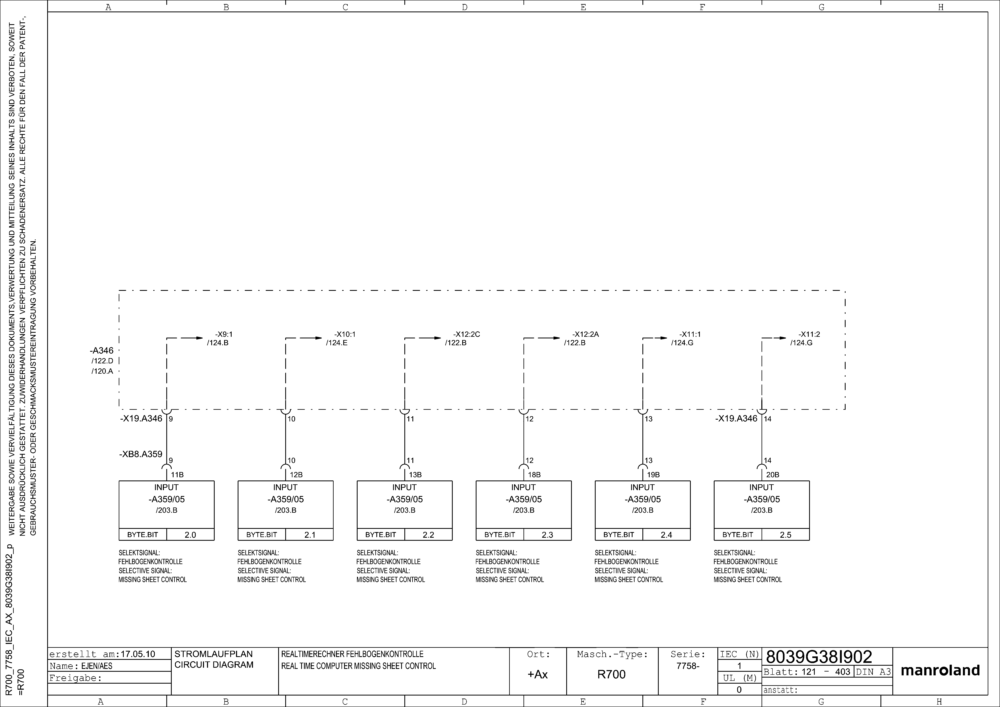

# +Ax — Sheet 121 of 403 — REALTIMERECHNER FEHLBOGENKONTROLLE

**REAL TIME COMPUTER MISSING SHEET CONTROL**

> Part of the manroland **R700** printing press IEC/UL circuit diagrams.
> Drawing class: **Stromlaufplan / Circuit diagram** (DIN A3).
> Document `+Ax` covers the **Central control console** machine section.

## At a glance

| Field | Value |
|---|---|
| Document | `+Ax`  (8039G38I902) |
| Sheet | **121** of 403 |
| Section (DE) | REALTIMERECHNER FEHLBOGENKONTROLLE |
| Section (EN) | REAL TIME COMPUTER MISSING SHEET CONTROL |
| Section type | CIRCUIT — Circuit diagram |
| Machine type | `R700` |
| Series | `7758` |
| Created | 17.05.10 |
| Replaces | — |
| Columns used | A, B, C, D, E, F, G |
| Path numbers | — |
| Labels on sheet | 90 |
| Cross-refs out | 14 |
| Cross-refs in | 26 |

**Previous:** [+Ax sheet 120](SHEET_0120.md) · **Next:** [+Ax sheet 122](SHEET_0122.md) · **Document TOC:** [_TOC.md](_TOC.md)  (+Ax) · **Master TOC:** [all sheets](../_MASTER_TOC.md)

## Sheet image (300 DPI, exact vector render)



_Rendered directly from the PDF vector layer at 300 DPI (1-bit), no OCR and no resampling. Use it to confirm anything ambiguous in the text below._

## Cross-references on this sheet

Each entry is a wire leaving this sheet. The printed token is `/sheet.column`; the link resolves to that sheet inside the same document.

| Ref | Target sheet | Col | Path | Destination on target | Target section | From col |
|---|---|---|---|---|---|---|
| `/122.B` | [+Ax sheet 122](SHEET_0122.md) | B | — | X12:2A | REALTIMERECHNER FEHLBOGENKONTROLLE | D |
| `/124.B` | [+Ax sheet 124](SHEET_0124.md) | B | — | X10:1 | REALTIMERECHNER FEHLBOGENKONTROLLE | B |
| `/124.E` | [+Ax sheet 124](SHEET_0124.md) | E | — | X12:2C | REALTIMERECHNER FEHLBOGENKONTROLLE | C |
| `/122.B` | [+Ax sheet 122](SHEET_0122.md) | B | — | X11:2 | REALTIMERECHNER FEHLBOGENKONTROLLE | F |
| `/124.G` | [+Ax sheet 124](SHEET_0124.md) | G | — | — | REALTIMERECHNER FEHLBOGENKONTROLLE | F |
| `/124.G` | [+Ax sheet 124](SHEET_0124.md) | G | — | — | REALTIMERECHNER FEHLBOGENKONTROLLE | G |
| `/122.D` | [+Ax sheet 122](SHEET_0122.md) | D | — | — | REALTIMERECHNER FEHLBOGENKONTROLLE | A |
| `/120.A` | [+Ax sheet 120](SHEET_0120.md) | A | — | — | REALTIMERECHNER FEHLBOGENKONTROLLE | A |
| `/203.B` | [+Ax sheet 203](SHEET_0203.md) | B | — | — | REFERENZMODUL | A |
| `/203.B` | [+Ax sheet 203](SHEET_0203.md) | B | — | — | REFERENZMODUL | B |
| `/203.B` | [+Ax sheet 203](SHEET_0203.md) | B | — | — | REFERENZMODUL | C |
| `/203.B` | [+Ax sheet 203](SHEET_0203.md) | B | — | — | REFERENZMODUL | E |
| `/203.B` | [+Ax sheet 203](SHEET_0203.md) | B | — | — | REFERENZMODUL | F |
| `/203.B` | [+Ax sheet 203](SHEET_0203.md) | B | — | — | REFERENZMODUL | G |

### Incoming references (sheets that point here)

Every other sheet that sends a wire to this one. `Back-ref` is the token printed on *that* sheet; `Path` is its line number.

| From sheet | Cols | Back-ref | Path | Refs | What continues there |
|---|---|---|---|---|---|
| [+Ax#120](SHEET_0120.md) | A | `/120.A` | — | 1 | — |
| [+Ax#122](SHEET_0122.md) | A, D | `/122.A`, `/122.D` | — | 3 | X12:2A; X12:2C |
| [+Ax#124](SHEET_0124.md) | B, E, G | `/124.B`, `/124.E`, `/124.G` | — | 4 | X10:1; X11:1; X11:2; X9:1 |
| [+Ax#203](SHEET_0203.md) | B | `/203.B` | — | 6 | — |
| [+Ax#238](SHEET_0238.md) | F | `/238.F` | — | 6 | — |
| [+Ax#259](SHEET_0259.md) | A | `/259.A` | — | 6 | — |


## Devices on this sheet

| Tag | Class | Class meaning (IEC) | Col | Sub | Terminal | Sign |
|---|---|---|---|---|---|---|
| `A346` | A | Baugruppe / assembly, module, PC board | A | — | — | — |
| `A359/05` | A | Baugruppe / assembly, module, PC board | A | 05 | — | — |
| `A359/05` | A | Baugruppe / assembly, module, PC board | B | 05 | — | — |
| `A359/05` | A | Baugruppe / assembly, module, PC board | C | 05 | — | — |
| `A359/05` | A | Baugruppe / assembly, module, PC board | F | 05 | — | — |
| `A359/05` | A | Baugruppe / assembly, module, PC board | E | 05 | — | — |
| `A359/05` | A | Baugruppe / assembly, module, PC board | G | 05 | — | — |
| `X11:1` | X | Klemme / terminal, plug connector | F | — | 1 | — |
| `X11:2` | X | Klemme / terminal, plug connector | G | — | 2 | — |
| `X12:2A` | X | Klemme / terminal, plug connector | E | — | 2A | — |
| `X12:2C` | X | Klemme / terminal, plug connector | D | — | 2C | — |
| `X10:1` | X | Klemme / terminal, plug connector | C | — | 1 | — |
| `X9:1` | X | Klemme / terminal, plug connector | B | — | 1 | — |
| `2.0` | — | cross-device reference | B | — | — | — |
| `XB8.A359` | — | cross-device reference | A | — | — | — |
| `X19.A346` | — | cross-device reference | A | — | — | — |
| `2.1` | — | cross-device reference | C | — | — | — |
| `2.2` | — | cross-device reference | D | — | — | — |
| `2.4` | — | cross-device reference | F | — | — | — |
| `2.3` | — | cross-device reference | E | — | — | — |
| `2.5` | — | cross-device reference | G | — | — | — |
| `X19.A346` | — | cross-device reference | F | — | — | — |

## Potentials / nets

_No named potentials on this sheet._

## Wire-end annotations (grouped as printed)

A wire that continues elsewhere is annotated with a small cluster: the destination description, the path/line number `#NN`, and the `/sheet.column` cross reference. Each row below is one such cluster exactly as it is grouped on the drawing.

| Col | Y | Path | Cross-ref | Text on the wire |
|---|---|---|---|---|
| B | 394.3 | — | `/124.B` | `X10:1` |
| B | 394.3 | — | — | `X9:1` |
| C | 394.3 | — | `/124.E` | `X12:2C` |
| D | 394.3 | — | `/122.B` | `X12:2A` |
| F | 394.3 | — | `/122.B` | `X11:2` |
| F | 394.3 | — | — | `X11:1` |
| F | 404.2 | — | `/124.G` | — |
| G | 404.2 | — | `/124.G` | — |
| A | 412.7 | — | — | `A346` |
| A | 425.8 | — | `/122.D`, `/120.A` | — |
| A | 493.5 | — | — | `X19.A346 9` |
| F | 493.5 | — | — | `X19.A346 14` |
| C | 495.0 | — | — | `10` |
| D | 495.0 | — | — | `11` |
| E | 495.0 | — | — | `12` |
| F | 495.0 | — | — | `13` |
| A | 536.1 | — | — | `XB8.A359 9` |
| C | 544.6 | — | — | `10` |
| D | 544.6 | — | — | `11` |
| E | 544.6 | — | — | `12` |
| F | 544.6 | — | — | `13` |
| G | 544.6 | — | — | `14` |
| B | 561.5 | — | — | `11B` |
| C | 561.5 | — | — | `12B` |
| D | 561.5 | — | — | `13B` |
| E | 561.5 | — | — | `18B` |
| F | 561.5 | — | — | `19B` |
| G | 561.5 | — | — | `20B` |
| A | 576.1 | — | — | `INPUT` |
| B | 576.1 | — | — | `INPUT` |
| C | 576.1 | — | — | `INPUT` |
| D | 576.1 | — | — | `INPUT` |
| E | 576.1 | — | — | `INPUT` |
| F | 576.1 | — | — | `INPUT` |
| A | 589.9 | — | — | `A359/05` |
| B | 589.9 | — | — | `A359/05` |
| C | 589.9 | — | — | `A359/05` |
| E | 589.9 | — | — | `A359/05` |
| F | 589.9 | — | — | `A359/05` |
| G | 589.9 | — | — | `A359/05` |
| A | 603.7 | — | `/203.B` | — |
| B | 603.7 | — | `/203.B` | — |
| C | 603.7 | — | `/203.B` | — |
| E | 603.7 | — | `/203.B` | — |
| F | 603.7 | — | `/203.B` | — |
| G | 603.7 | — | `/203.B` | — |
| A | 632.7 | — | — | `BYTE.BIT 2.0` |
| B | 632.7 | — | — | `BYTE.BIT 2.1` |
| C | 632.7 | — | — | `BYTE.BIT 2.2` |
| D | 632.7 | — | — | `BYTE.BIT 2.3` |
| E | 632.7 | — | — | `BYTE.BIT 2.4` |
| F | 632.7 | — | — | `BYTE.BIT 2.5` |
| A | 655.4 | — | — | `FEHLBOGENKONTROLLE SELEKTSIGNAL:` |
| B | 655.4 | — | — | `FEHLBOGENKONTROLLE SELEKTSIGNAL:` |
| C | 655.4 | — | — | `FEHLBOGENKONTROLLE SELEKTSIGNAL:` |
| D | 655.4 | — | — | `FEHLBOGENKONTROLLE SELEKTSIGNAL:` |
| E | 655.4 | — | — | `FEHLBOGENKONTROLLE SELEKTSIGNAL:` |
| F | 655.4 | — | — | `FEHLBOGENKONTROLLE SELEKTSIGNAL:` |
| A | 676.7 | — | — | `MISSING SHEET CONTROL SELECTIIVE SIGNAL:` |
| B | 676.7 | — | — | `MISSING SHEET CONTROL SELECTIIVE SIGNAL:` |
| C | 676.7 | — | — | `MISSING SHEET CONTROL SELECTIIVE SIGNAL:` |
| D | 676.7 | — | — | `MISSING SHEET CONTROL SELECTIIVE SIGNAL:` |
| E | 676.7 | — | — | `MISSING SHEET CONTROL SELECTIIVE SIGNAL:` |
| F | 676.7 | — | — | `MISSING SHEET CONTROL SELECTIIVE SIGNAL:` |


## Reconstructed tables

This sheet carries tabular content (pin map / terminal assignment / index). The grid below was rebuilt from the drawing's own rule lines, so each row is exactly one physical row of the table.

### Table 1 — 1 data rows × 2 columns (at x=141.7, y=572.6)

| INPUT | A359/05 /203.B |
|---|---|
| `BYTE.BIT` | `2.0` |


### Table 2 — 1 data rows × 2 columns (at x=283.5, y=572.6)

| INPUT | A359/05 /203.B |
|---|---|
| `BYTE.BIT` | `2.1` |


### Table 3 — 1 data rows × 2 columns (at x=425.2, y=572.6)

| INPUT | A359/05 /203.B |
|---|---|
| `BYTE.BIT` | `2.2` |


### Table 4 — 1 data rows × 2 columns (at x=566.9, y=572.6)

| INPUT | A359/05 /203.B |
|---|---|
| `BYTE.BIT` | `2.3` |


### Table 5 — 1 data rows × 2 columns (at x=708.7, y=572.6)

| INPUT | A359/05 /203.B |
|---|---|
| `BYTE.BIT` | `2.4` |


### Table 6 — 1 data rows × 2 columns (at x=850.4, y=572.6)

| INPUT | A359/05 /203.B |
|---|---|
| `BYTE.BIT` | `2.5` |


## Notes and free text on this sheet

| Text | Col | Y (pt) |
|---|---|---|
| `11B` | B | 561.55 |
| `INPUT` | A | 576.07 |
| `BYTE.BIT` | A | 633.32 |
| `SELEKTSIGNAL:` | A | 655.4 |
| `FEHLBOGENKONTROLLE` | A | 666.07 |
| `SELECTIIVE SIGNAL:` | A | 676.67 |
| `MISSING SHEET CONTROL` | A | 687.33 |
| `12B` | C | 561.55 |
| `INPUT` | B | 576.07 |
| `BYTE.BIT` | B | 633.32 |
| `SELEKTSIGNAL:` | B | 655.4 |
| `FEHLBOGENKONTROLLE` | B | 666.07 |
| `SELECTIIVE SIGNAL:` | B | 676.67 |
| `MISSING SHEET CONTROL` | B | 687.33 |
| `13B` | D | 561.55 |
| `INPUT` | C | 576.07 |
| `BYTE.BIT` | C | 633.32 |
| `SELEKTSIGNAL:` | C | 655.4 |
| `FEHLBOGENKONTROLLE` | C | 666.07 |
| `SELECTIIVE SIGNAL:` | C | 676.67 |
| `MISSING SHEET CONTROL` | C | 687.33 |
| `19B` | F | 561.55 |
| `INPUT` | E | 576.07 |
| `BYTE.BIT` | E | 633.32 |
| `SELEKTSIGNAL:` | E | 655.4 |
| `FEHLBOGENKONTROLLE` | E | 666.07 |
| `SELECTIIVE SIGNAL:` | E | 676.67 |
| `MISSING SHEET CONTROL` | E | 687.33 |
| `18B` | E | 561.55 |
| `INPUT` | D | 576.07 |
| `BYTE.BIT` | D | 633.32 |
| `SELEKTSIGNAL:` | D | 655.4 |
| `FEHLBOGENKONTROLLE` | D | 666.07 |
| `SELECTIIVE SIGNAL:` | D | 676.67 |
| `MISSING SHEET CONTROL` | D | 687.33 |
| `20B` | G | 561.55 |
| `INPUT` | F | 576.07 |
| `BYTE.BIT` | F | 633.32 |
| `SELEKTSIGNAL:` | F | 655.4 |
| `FEHLBOGENKONTROLLE` | F | 666.07 |
| `SELECTIIVE SIGNAL:` | F | 676.67 |
| `MISSING SHEET CONTROL` | F | 687.33 |

## Complete label inventory (exact text from the drawing)

Every text object inside the drawing area of this sheet, in DIN reading order (column A→H, then top→bottom). This is the authoritative list: if a string is not here it is not printed on this sheet.

| Col | Y | X | Dir | Type | Text |
|---|---|---|---|---|---|
| A | 412.7 | 106.9 | → | device tag | `A346` |
| A | 425.8 | 109.1 | → | cross-reference | `/122.D` |
| A | 438.2 | 109.1 | → | cross-reference | `/120.A` |
| A | 493.5 | 143.1 | → | device ref | `X19.A346` |
| A | 536.1 | 142.0 | → | device ref | `XB8.A359` |
| A | 576.1 | 183.5 | → | text | `INPUT` |
| A | 589.9 | 177.0 | → | device tag | `A359/05` |
| A | 603.7 | 185.8 | → | cross-reference | `/203.B` |
| A | 633.3 | 151.7 | → | text | `BYTE.BIT` |
| A | 655.4 | 141.4 | → | text | `SELEKTSIGNAL:` |
| A | 666.1 | 140.9 | → | text | `FEHLBOGENKONTROLLE` |
| A | 676.7 | 141.4 | → | text | `SELECTIIVE SIGNAL:` |
| A | 687.3 | 141.2 | → | text | `MISSING SHEET CONTROL` |
| B | 394.3 | 256.3 | → | device tag | `X9:1` |
| B | 404.2 | 246.6 | → | cross-reference | `/124.B` |
| B | 495.0 | 201.0 | → | number | `9` |
| B | 544.6 | 201.0 | → | number | `9` |
| B | 561.5 | 203.2 | → | text | `11B` |
| B | 576.1 | 325.3 | → | text | `INPUT` |
| B | 589.9 | 318.8 | → | device tag | `A359/05` |
| B | 603.7 | 327.5 | → | cross-reference | `/203.B` |
| B | 632.7 | 220.0 | → | device ref | `2.0` |
| B | 633.3 | 293.4 | → | text | `BYTE.BIT` |
| B | 655.4 | 283.2 | → | text | `SELEKTSIGNAL:` |
| B | 666.1 | 282.6 | → | text | `FEHLBOGENKONTROLLE` |
| B | 676.7 | 283.2 | → | text | `SELECTIIVE SIGNAL:` |
| B | 687.3 | 282.9 | → | text | `MISSING SHEET CONTROL` |
| C | 394.3 | 398.0 | → | device tag | `X10:1` |
| C | 404.2 | 388.3 | → | cross-reference | `/124.E` |
| C | 495.0 | 342.1 | → | number | `10` |
| C | 544.6 | 342.1 | → | number | `10` |
| C | 561.5 | 345.0 | → | text | `12B` |
| C | 576.1 | 467.0 | → | text | `INPUT` |
| C | 589.9 | 460.5 | → | device tag | `A359/05` |
| C | 603.7 | 469.3 | → | cross-reference | `/203.B` |
| C | 632.7 | 362.6 | → | device ref | `2.1` |
| C | 633.3 | 435.1 | → | text | `BYTE.BIT` |
| C | 655.4 | 424.9 | → | text | `SELEKTSIGNAL:` |
| C | 666.1 | 424.3 | → | text | `FEHLBOGENKONTROLLE` |
| C | 676.7 | 424.9 | → | text | `SELECTIIVE SIGNAL:` |
| C | 687.3 | 424.6 | → | text | `MISSING SHEET CONTROL` |
| D | 394.3 | 539.7 | → | device tag | `X12:2C` |
| D | 404.2 | 530.1 | → | cross-reference | `/122.B` |
| D | 495.0 | 483.9 | → | number | `11` |
| D | 544.6 | 483.9 | → | number | `11` |
| D | 561.5 | 486.7 | → | text | `13B` |
| D | 576.1 | 608.7 | → | text | `INPUT` |
| D | 632.7 | 503.4 | → | device ref | `2.2` |
| D | 633.3 | 576.9 | → | text | `BYTE.BIT` |
| D | 655.4 | 566.6 | → | text | `SELEKTSIGNAL:` |
| D | 666.1 | 566.1 | → | text | `FEHLBOGENKONTROLLE` |
| D | 676.7 | 566.6 | → | text | `SELECTIIVE SIGNAL:` |
| D | 687.3 | 566.4 | → | text | `MISSING SHEET CONTROL` |
| E | 394.3 | 681.4 | → | device tag | `X12:2A` |
| E | 404.2 | 671.8 | → | cross-reference | `/122.B` |
| E | 495.0 | 625.6 | → | number | `12` |
| E | 544.6 | 625.6 | → | number | `12` |
| E | 561.5 | 628.4 | → | text | `18B` |
| E | 576.1 | 750.5 | → | text | `INPUT` |
| E | 589.9 | 602.2 | → | device tag | `A359/05` |
| E | 603.7 | 611.0 | → | cross-reference | `/203.B` |
| E | 632.7 | 645.2 | → | device ref | `2.3` |
| E | 633.3 | 718.6 | → | text | `BYTE.BIT` |
| E | 655.4 | 708.4 | → | text | `SELEKTSIGNAL:` |
| E | 666.1 | 707.8 | → | text | `FEHLBOGENKONTROLLE` |
| E | 676.7 | 708.4 | → | text | `SELECTIIVE SIGNAL:` |
| E | 687.3 | 708.1 | → | text | `MISSING SHEET CONTROL` |
| F | 394.3 | 809.0 | → | device tag | `X11:1` |
| F | 404.2 | 799.4 | → | cross-reference | `/124.G` |
| F | 493.5 | 851.8 | → | device ref | `X19.A346` |
| F | 495.0 | 767.3 | → | number | `13` |
| F | 544.6 | 767.3 | → | number | `13` |
| F | 561.5 | 770.2 | → | text | `19B` |
| F | 576.1 | 892.2 | → | text | `INPUT` |
| F | 589.9 | 744.0 | → | device tag | `A359/05` |
| F | 603.7 | 752.7 | → | cross-reference | `/203.B` |
| F | 632.7 | 786.9 | → | device ref | `2.4` |
| F | 633.3 | 860.3 | → | text | `BYTE.BIT` |
| F | 655.4 | 850.1 | → | text | `SELEKTSIGNAL:` |
| F | 666.1 | 849.5 | → | text | `FEHLBOGENKONTROLLE` |
| F | 676.7 | 850.1 | → | text | `SELECTIIVE SIGNAL:` |
| F | 687.3 | 849.8 | → | text | `MISSING SHEET CONTROL` |
| G | 394.3 | 950.7 | → | device tag | `X11:2` |
| G | 404.2 | 941.1 | → | cross-reference | `/124.G` |
| G | 495.0 | 909.1 | → | number | `14` |
| G | 544.6 | 909.1 | → | number | `14` |
| G | 561.5 | 912.5 | → | text | `20B` |
| G | 589.9 | 885.7 | → | device tag | `A359/05` |
| G | 603.7 | 894.5 | → | cross-reference | `/203.B` |
| G | 632.7 | 928.6 | → | device ref | `2.5` |

## Reading-order text block

The same content as a plain block, grouped by DIN column — convenient to paste or to match against a visual description.

```text
=== Column A ===
 412.7  106.9  devtag       A346
 425.8  109.1  xref         /122.D
 438.2  109.1  xref         /120.A
 493.5  143.1  devref       X19.A346
 536.1  142.0  devref       XB8.A359
 576.1  183.5  text         INPUT
 589.9  177.0  devtag       A359/05
 603.7  185.8  xref         /203.B
 633.3  151.7  text         BYTE.BIT
 655.4  141.4  text         SELEKTSIGNAL:
 666.1  140.9  text         FEHLBOGENKONTROLLE
 676.7  141.4  text         SELECTIIVE SIGNAL:
 687.3  141.2  text         MISSING SHEET CONTROL
=== Column B ===
 394.3  256.3  devtag       X9:1
 404.2  246.6  xref         /124.B
 495.0  201.0  numeric      9
 544.6  201.0  numeric      9
 561.5  203.2  text         11B
 576.1  325.3  text         INPUT
 589.9  318.8  devtag       A359/05
 603.7  327.5  xref         /203.B
 632.7  220.0  devref       2.0
 633.3  293.4  text         BYTE.BIT
 655.4  283.2  text         SELEKTSIGNAL:
 666.1  282.6  text         FEHLBOGENKONTROLLE
 676.7  283.2  text         SELECTIIVE SIGNAL:
 687.3  282.9  text         MISSING SHEET CONTROL
=== Column C ===
 394.3  398.0  devtag       X10:1
 404.2  388.3  xref         /124.E
 495.0  342.1  numeric      10
 544.6  342.1  numeric      10
 561.5  345.0  text         12B
 576.1  467.0  text         INPUT
 589.9  460.5  devtag       A359/05
 603.7  469.3  xref         /203.B
 632.7  362.6  devref       2.1
 633.3  435.1  text         BYTE.BIT
 655.4  424.9  text         SELEKTSIGNAL:
 666.1  424.3  text         FEHLBOGENKONTROLLE
 676.7  424.9  text         SELECTIIVE SIGNAL:
 687.3  424.6  text         MISSING SHEET CONTROL
=== Column D ===
 394.3  539.7  devtag       X12:2C
 404.2  530.1  xref         /122.B
 495.0  483.9  numeric      11
 544.6  483.9  numeric      11
 561.5  486.7  text         13B
 576.1  608.7  text         INPUT
 632.7  503.4  devref       2.2
 633.3  576.9  text         BYTE.BIT
 655.4  566.6  text         SELEKTSIGNAL:
 666.1  566.1  text         FEHLBOGENKONTROLLE
 676.7  566.6  text         SELECTIIVE SIGNAL:
 687.3  566.4  text         MISSING SHEET CONTROL
=== Column E ===
 394.3  681.4  devtag       X12:2A
 404.2  671.8  xref         /122.B
 495.0  625.6  numeric      12
 544.6  625.6  numeric      12
 561.5  628.4  text         18B
 576.1  750.5  text         INPUT
 589.9  602.2  devtag       A359/05
 603.7  611.0  xref         /203.B
 632.7  645.2  devref       2.3
 633.3  718.6  text         BYTE.BIT
 655.4  708.4  text         SELEKTSIGNAL:
 666.1  707.8  text         FEHLBOGENKONTROLLE
 676.7  708.4  text         SELECTIIVE SIGNAL:
 687.3  708.1  text         MISSING SHEET CONTROL
=== Column F ===
 394.3  809.0  devtag       X11:1
 404.2  799.4  xref         /124.G
 493.5  851.8  devref       X19.A346
 495.0  767.3  numeric      13
 544.6  767.3  numeric      13
 561.5  770.2  text         19B
 576.1  892.2  text         INPUT
 589.9  744.0  devtag       A359/05
 603.7  752.7  xref         /203.B
 632.7  786.9  devref       2.4
 633.3  860.3  text         BYTE.BIT
 655.4  850.1  text         SELEKTSIGNAL:
 666.1  849.5  text         FEHLBOGENKONTROLLE
 676.7  850.1  text         SELECTIIVE SIGNAL:
 687.3  849.8  text         MISSING SHEET CONTROL
=== Column G ===
 394.3  950.7  devtag       X11:2
 404.2  941.1  xref         /124.G
 495.0  909.1  numeric      14
 544.6  909.1  numeric      14
 561.5  912.5  text         20B
 589.9  885.7  devtag       A359/05
 603.7  894.5  xref         /203.B
 632.7  928.6  devref       2.5
```

---
_Generated from the PDF vector text layer; no OCR. Source: `R700_7758_IEC_AX_8039G38I902_p`, sheet 121._
