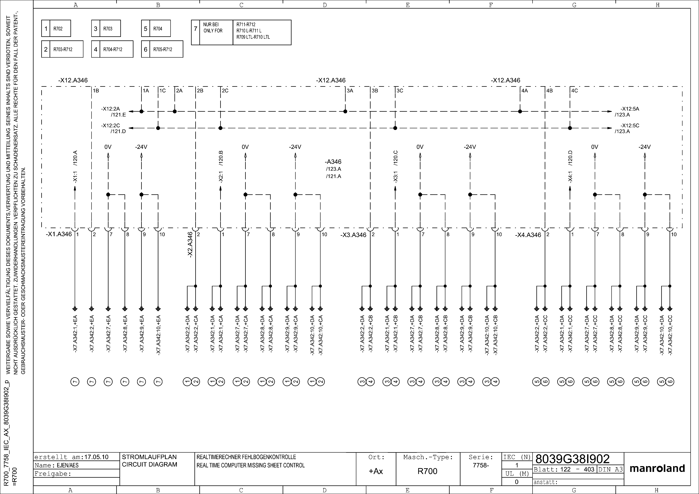

# +Ax — Sheet 122 of 403 — REALTIMERECHNER FEHLBOGENKONTROLLE

**REAL TIME COMPUTER MISSING SHEET CONTROL**

> Part of the manroland **R700** printing press IEC/UL circuit diagrams.
> Drawing class: **Stromlaufplan / Circuit diagram** (DIN A3).
> Document `+Ax` covers the **Central control console** machine section.

## At a glance

| Field | Value |
|---|---|
| Document | `+Ax`  (8039G38I902) |
| Sheet | **122** of 403 |
| Section (DE) | REALTIMERECHNER FEHLBOGENKONTROLLE |
| Section (EN) | REAL TIME COMPUTER MISSING SHEET CONTROL |
| Section type | CIRCUIT — Circuit diagram |
| Machine type | `R700` |
| Series | `7758` |
| Created | 17.05.10 |
| Replaces | — |
| Columns used | A, B, C, D, E, F, G, H |
| Path numbers | — |
| Labels on sheet | 172 |
| Cross-refs out | 10 |
| Cross-refs in | 34 |

**Previous:** [+Ax sheet 121](SHEET_0121.md) · **Next:** [+Ax sheet 123](SHEET_0123.md) · **Document TOC:** [_TOC.md](_TOC.md)  (+Ax) · **Master TOC:** [all sheets](../_MASTER_TOC.md)

## Sheet image (300 DPI, exact vector render)



_Rendered directly from the PDF vector layer at 300 DPI (1-bit), no OCR and no resampling. Use it to confirm anything ambiguous in the text below._

## Cross-references on this sheet

Each entry is a wire leaving this sheet. The printed token is `/sheet.column`; the link resolves to that sheet inside the same document.

| Ref | Target sheet | Col | Path | Destination on target | Target section | From col |
|---|---|---|---|---|---|---|
| `/121.E` | [+Ax sheet 121](SHEET_0121.md) | E | — | X12:2A | REALTIMERECHNER FEHLBOGENKONTROLLE | A |
| `/123.A` | [+Ax sheet 123](SHEET_0123.md) | A | — | — | REALTIMERECHNER FEHLBOGENKONTROLLE | H |
| `/121.D` | [+Ax sheet 121](SHEET_0121.md) | D | — | X12:2C | REALTIMERECHNER FEHLBOGENKONTROLLE | A |
| `/123.A` | [+Ax sheet 123](SHEET_0123.md) | A | — | — | REALTIMERECHNER FEHLBOGENKONTROLLE | H |
| `/120.C` | [+Ax sheet 120](SHEET_0120.md) | C | — | X3:1 | REALTIMERECHNER FEHLBOGENKONTROLLE | E |
| `/120.D` | [+Ax sheet 120](SHEET_0120.md) | D | — | X4:1 | REALTIMERECHNER FEHLBOGENKONTROLLE | G |
| `/120.A` | [+Ax sheet 120](SHEET_0120.md) | A | — | X1:1 | REALTIMERECHNER FEHLBOGENKONTROLLE | A |
| `/120.B` | [+Ax sheet 120](SHEET_0120.md) | B | — | X2:1 | REALTIMERECHNER FEHLBOGENKONTROLLE | C |
| `/123.A` | [+Ax sheet 123](SHEET_0123.md) | A | — | — | REALTIMERECHNER FEHLBOGENKONTROLLE | D |
| `/121.A` | [+Ax sheet 121](SHEET_0121.md) | A | — | — | REALTIMERECHNER FEHLBOGENKONTROLLE | D |

### Incoming references (sheets that point here)

Every other sheet that sends a wire to this one. `Back-ref` is the token printed on *that* sheet; `Path` is its line number.

| From sheet | Cols | Back-ref | Path | Refs | What continues there |
|---|---|---|---|---|---|
| [+Ax#120](SHEET_0120.md) | C, D | `/120.C`, `/120.D` | — | 4 | X5:1; X6:1 |
| [+Ax#121](SHEET_0121.md) | A, D, F | `/121.A`, `/121.D`, `/121.F` | — | 3 | X11:2; X12:2A |
| [+Ax#123](SHEET_0123.md) | A | `/123.A` | — | 3 | X12:5A; X12:5C |
| [+Ax#208](SHEET_0208.md) | A | `/208.A` | — | 6 | — |
| [+Ax#218](SHEET_0218.md) | A | `/218.A` | — | 6 | — |
| [+Ax#223](SHEET_0223.md) | C | `/223.C` | — | 6 | — |
| [+Ax#227](SHEET_0227.md) | B | `/227.B` | — | 6 | — |


## Devices on this sheet

| Tag | Class | Class meaning (IEC) | Col | Sub | Terminal | Sign |
|---|---|---|---|---|---|---|
| `A346` | A | Baugruppe / assembly, module, PC board | D | — | — | — |
| `X1:1` | X | Klemme / terminal, plug connector | A | — | 1 | — |
| `X12:2A` | X | Klemme / terminal, plug connector | A | — | 2A | — |
| `X12:2C` | X | Klemme / terminal, plug connector | A | — | 2C | — |
| `X12:5C` | X | Klemme / terminal, plug connector | H | — | 5C | — |
| `X12:5A` | X | Klemme / terminal, plug connector | H | — | 5A | — |
| `X3:1` | X | Klemme / terminal, plug connector | E | — | 1 | — |
| `X4:1` | X | Klemme / terminal, plug connector | G | — | 1 | — |
| `X2:1` | X | Klemme / terminal, plug connector | C | — | 1 | — |
| `R702` | R | Widerstand / resistor | A | — | — | — |
| `R703` | R | Widerstand / resistor | A | — | — | — |
| `R704` | R | Widerstand / resistor | B | — | — | — |
| `X1.A346` | — | cross-device reference | A | — | — | — |
| `X2.A346` | — | cross-device reference | B | — | — | — |
| `X3.A346` | — | cross-device reference | D | — | — | — |
| `X4.A346` | — | cross-device reference | F | — | — | — |
| `X12.A346` | — | cross-device reference | A | — | — | — |
| `X12.A346` | — | cross-device reference | D | — | — | — |
| `X12.A346` | — | cross-device reference | F | — | — | — |

## Potentials / nets

| Potential | Count | Columns | Attached devices | Terminals |
|---|---|---|---|---|
| `0V` | 4 | A, C, E, G | — | — |
| `24V` | 4 | B, D, F, H | — | — |


A potential such as `L24+/4` or `M24+` is a named supply/return rail; every place it appears on this sheet is electrically common.

## Wire-end annotations (grouped as printed)

A wire that continues elsewhere is annotated with a small cluster: the destination description, the path/line number `#NN`, and the `/sheet.column` cross reference. Each row below is one such cluster exactly as it is grouped on the drawing.

| Col | Y | Path | Cross-ref | Text on the wire |
|---|---|---|---|---|
| C | 38.9 | — | — | `7 ONLY FOR R711 R712 R710 L R711 L R709 LTL R710 LTL` |
| C | 38.9 | — | — | `NUR BEI` |
| A | 44.2 | — | — | `1` |
| A | 44.2 | — | — | `3` |
| B | 44.2 | — | — | `5` |
| A | 46.0 | — | — | `R702` |
| A | 46.0 | — | — | `R703` |
| B | 46.0 | — | — | `R704` |
| A | 79.6 | — | — | `2` |
| A | 79.6 | — | — | `4` |
| B | 79.6 | — | — | `6` |
| A | 81.4 | — | — | `R703 R712` |
| A | 81.4 | — | — | `R704 R712` |
| B | 81.4 | — | — | `R705 R712` |
| A | 132.1 | — | — | `X12.A346` |
| E | 132.1 | — | — | `X12.A346 X12.A346` |
| A | 150.5 | — | — | `1B` |
| D | 150.5 | — | — | `1A 1C 2A 2B 2C 3A 3B 3C 4A 4B 4C` |
| A | 181.7 | — | `/121.E` | `X12:2A` |
| H | 181.7 | — | — | `X12:5A` |
| H | 191.6 | — | `/123.A` | — |
| A | 210.1 | — | `/121.D` | `X12:2C` |
| H | 210.1 | — | — | `X12:5C` |
| H | 219.9 | — | `/123.A` | — |
| A | 246.1 | — | — | `0V` |
| B | 246.1 | — | — | `24V` |
| E | 246.1 | — | — | `0V 24V 0V 24V 0V 24V` |
| E | 256.2 | — | `/120.C` | `X3:1` |
| G | 256.2 | — | `/120.D` | `X4:1` |
| A | 256.5 | — | `/120.A` | `X1:1` |
| C | 256.5 | — | `/120.B` | `X2:1` |
| D | 271.0 | — | — | `A346` |
| D | 284.1 | — | `/123.A`, `/121.A` | — |
| A | 394.3 | — | — | `X1.A346 1 2 7 8` |
| B | 394.9 | — | — | `X2.A346` |
| F | 395.7 | — | — | `X3.A346 2 1 X4.A346 2 1 10` |
| B | 395.8 | — | — | `9 10` |
| E | 395.8 | — | — | `2 1 7 8 9 10 7 8 9 10 7 8 9` |
| E | 536.9 | — | — | `X7.A342:2,+CB` |
| E | 536.9 | — | — | `X7.A342:1,+CB` |
| E | 536.9 | — | — | `X7.A342:7,+CB` |
| E | 536.9 | — | — | `X7.A342:8,+CB` |
| F | 536.9 | — | — | `X7.A342:9,+CB` |
| F | 536.9 | — | — | `X7.A342:10,+CB` |
| G | 536.9 | — | — | `X7.A342:2,+CC` |
| G | 536.9 | — | — | `X7.A342:1,+CC` |
| G | 536.9 | — | — | `X7.A342:7,+CC` |
| H | 536.9 | — | — | `X7.A342:8,+CC` |
| H | 536.9 | — | — | `X7.A342:9,+CC` |
| H | 536.9 | — | — | `X7.A342:10,+CC` |
| A | 537.2 | — | — | `X7.A342:1,+EA` |
| A | 537.2 | — | — | `X7.A342:2,+EA` |
| A | 537.2 | — | — | `X7.A342:7,+EA` |
| B | 537.2 | — | — | `X7.A342:8,+EA` |
| B | 537.2 | — | — | `X7.A342:9,+EA` |
| B | 537.2 | — | — | `X7.A342:10,+EA` |
| B | 537.2 | — | — | `X7.A342:2,+DA` |
| B | 537.2 | — | — | `X7.A342:2,+CA` |
| C | 537.2 | — | — | `X7.A342:1,+DA` |
| C | 537.2 | — | — | `X7.A342:1,+CA` |
| C | 537.2 | — | — | `X7.A342:7,+DA` |
| C | 537.2 | — | — | `X7.A342:7,+CA` |
| C | 537.2 | — | — | `X7.A342:8,+DA` |
| C | 537.2 | — | — | `X7.A342:8,+CA` |
| D | 537.2 | — | — | `X7.A342:9,+DA` |
| D | 537.2 | — | — | `X7.A342:9,+CA` |
| D | 537.2 | — | — | `X7.A342:10,+DA` |
| D | 537.2 | — | — | `X7.A342:10,+CA` |
| D | 537.2 | — | — | `X7.A342:2,+DA` |
| E | 537.2 | — | — | `X7.A342:1,+DA` |
| E | 537.2 | — | — | `X7.A342:7,+DA` |
| E | 537.2 | — | — | `X7.A342:8,+DA` |
| F | 537.2 | — | — | `X7.A342:9,+DA` |
| F | 537.2 | — | — | `X7.A342:10,+DA` |
| G | 537.2 | — | — | `X7.A342:2,+DA` |
| G | 537.2 | — | — | `X7.A342:1,+DA` |
| G | 537.2 | — | — | `X7.A342:7,+DA` |
| G | 537.2 | — | — | `X7.A342:8,+DA` |
| H | 537.2 | — | — | `X7.A342:9,+DA` |
| H | 537.2 | — | — | `X7.A342:10,+DA` |
| B | 647.6 | — | — | `1 2` |
| C | 647.6 | — | — | `1 2` |
| C | 647.6 | — | — | `1 2` |
| C | 647.6 | — | — | `1 2` |
| D | 647.6 | — | — | `1 2` |
| D | 647.6 | — | — | `1 2` |
| E | 648.2 | — | — | `4` |
| E | 648.2 | — | — | `4` |
| E | 648.2 | — | — | `4` |
| E | 648.2 | — | — | `4` |
| F | 648.2 | — | — | `4` |
| F | 648.2 | — | — | `4` |
| G | 648.2 | — | — | `6` |
| G | 648.2 | — | — | `6` |
| G | 648.2 | — | — | `6` |
| H | 648.2 | — | — | `6` |
| H | 648.2 | — | — | `6` |
| H | 648.2 | — | — | `6` |
| D | 648.3 | — | — | `3` |
| E | 648.3 | — | — | `3` |
| E | 648.3 | — | — | `3` |
| E | 648.3 | — | — | `3` |
| F | 648.3 | — | — | `3` |
| F | 648.3 | — | — | `3` |
| G | 648.3 | — | — | `5` |
| G | 648.3 | — | — | `5` |
| G | 648.3 | — | — | `5` |
| G | 648.3 | — | — | `5` |
| H | 648.3 | — | — | `5` |
| H | 648.3 | — | — | `5` |
| A | 648.6 | — | — | `7` |
| A | 648.6 | — | — | `7` |
| A | 648.6 | — | — | `7` |
| B | 648.6 | — | — | `7` |
| B | 648.6 | — | — | `7` |
| B | 648.6 | — | — | `7` |


## Reconstructed tables

This sheet carries tabular content (pin map / terminal assignment / index). The grid below was rebuilt from the drawing's own rule lines, so each row is exactly one physical row of the table.

### Table 1 — 0 data rows × 4 columns (at x=127.6, y=189.9) — **/121.E X12:2C**

_none_


### Table 2 — 0 data rows × 2 columns (at x=1055.9, y=189.9) — **/123.A X12:5C**

_none_


## Notes and free text on this sheet

| Text | Col | Y (pt) |
|---|---|---|
| `1B` | A | 150.51 |
| `X7.A342:2,+DA` | B | 537.17 |
| `X7.A342:2,+CA` | B | 537.17 |
| `X7.A342:1,+DA` | C | 537.17 |
| `X7.A342:1,+CA` | C | 537.17 |
| `X7.A342:7,+DA` | C | 537.17 |
| `X7.A342:7,+CA` | C | 537.17 |
| `X7.A342:8,+DA` | C | 537.17 |
| `X7.A342:8,+CA` | C | 537.17 |
| `X7.A342:9,+DA` | D | 537.17 |
| `X7.A342:9,+CA` | D | 537.17 |
| `X7.A342:10,+DA` | D | 537.17 |
| `X7.A342:10,+CA` | D | 537.17 |
| `X7.A342:2,+DA` | D | 537.17 |
| `X7.A342:2,+CB` | E | 536.88 |
| `X7.A342:1,+DA` | E | 537.17 |
| `X7.A342:1,+CB` | E | 536.88 |
| `X7.A342:7,+DA` | E | 537.17 |
| `X7.A342:7,+CB` | E | 536.88 |
| `X7.A342:8,+DA` | E | 537.17 |
| `X7.A342:8,+CB` | E | 536.88 |
| `X7.A342:9,+DA` | F | 537.17 |
| `X7.A342:9,+CB` | F | 536.88 |
| `X7.A342:10,+DA` | F | 537.17 |
| `X7.A342:10,+CB` | F | 536.88 |
| `X7.A342:2,+DA` | G | 537.17 |
| `X7.A342:2,+CC` | G | 536.88 |
| `X7.A342:1,+DA` | G | 537.17 |
| `X7.A342:1,+CC` | G | 536.88 |
| `X7.A342:7,+DA` | G | 537.17 |
| `X7.A342:7,+CC` | G | 536.88 |
| `X7.A342:8,+DA` | G | 537.17 |
| `X7.A342:8,+CC` | H | 536.88 |
| `X7.A342:9,+DA` | H | 537.17 |
| `X7.A342:9,+CC` | H | 536.88 |
| `X7.A342:10,+DA` | H | 537.17 |
| `X7.A342:10,+CC` | H | 536.88 |
| `2B` | C | 150.51 |
| `2C` | C | 150.57 |
| `3B` | E | 150.51 |
| `3A` | D | 150.51 |
| `3C` | E | 150.57 |
| `4B` | G | 150.51 |
| `4A` | F | 150.51 |
| `4C` | G | 150.57 |
| `1C` | B | 150.57 |
| `1A` | B | 150.51 |
| `2A` | B | 150.51 |
| `X7.A342:1,+EA` | A | 537.17 |
| `X7.A342:2,+EA` | A | 537.17 |
| `X7.A342:7,+EA` | A | 537.17 |
| `X7.A342:8,+EA` | B | 537.17 |
| `X7.A342:9,+EA` | B | 537.17 |
| `X7.A342:10,+EA` | B | 537.16 |
| `R703 R712` | A | 81.44 |
| `R704 R712` | A | 81.44 |
| `R705 R712` | B | 81.44 |
| `NUR BEI` | C | 38.85 |
| `ONLY FOR` | C | 49.53 |
| `R711 R712` | C | 38.92 |
| `R710 L R711 L` | C | 49.55 |
| `R709 LTL R710 LTL` | C | 60.18 |

## Complete label inventory (exact text from the drawing)

Every text object inside the drawing area of this sheet, in DIN reading order (column A→H, then top→bottom). This is the authoritative list: if a string is not here it is not printed on this sheet.

| Col | Y | X | Dir | Type | Text |
|---|---|---|---|---|---|
| A | 44.2 | 75.4 | → | number | `1` |
| A | 44.2 | 160.0 | → | number | `3` |
| A | 46.0 | 91.3 | → | device tag | `R702` |
| A | 46.0 | 176.3 | → | device tag | `R703` |
| A | 79.6 | 75.1 | → | number | `2` |
| A | 79.6 | 160.2 | → | number | `4` |
| A | 81.4 | 91.3 | → | text | `R703 R712` |
| A | 81.4 | 176.3 | → | text | `R704 R712` |
| A | 132.1 | 99.2 | → | device ref | `X12.A346` |
| A | 150.5 | 157.9 | → | text | `1B` |
| A | 181.7 | 172.3 | → | device tag | `X12:2A` |
| A | 210.1 | 172.3 | → | device tag | `X12:2C` |
| A | 246.1 | 178.0 | → | potential | `0V` |
| A | 256.5 | 124.3 | ↕ | cross-reference | `/120.A` |
| A | 291.1 | 124.3 | ↕ | device tag | `X1:1` |
| A | 394.3 | 78.2 | → | device ref | `X1.A346` |
| A | 395.8 | 129.5 | → | number | `1` |
| A | 395.8 | 158.5 | → | number | `2` |
| A | 395.8 | 186.8 | → | number | `7` |
| A | 537.2 | 124.3 | ↕ | text | `X7.A342:1,+EA` |
| A | 537.2 | 152.6 | ↕ | text | `X7.A342:2,+EA` |
| A | 537.2 | 181.0 | ↕ | text | `X7.A342:7,+EA` |
| A | 648.6 | 125.0 | ↕ | number | `7` |
| A | 648.6 | 153.4 | ↕ | number | `7` |
| A | 648.6 | 181.7 | ↕ | number | `7` |
| B | 44.2 | 245.1 | → | number | `5` |
| B | 44.2 | 330.2 | → | number | `7` |
| B | 46.0 | 261.4 | → | device tag | `R704` |
| B | 79.6 | 245.2 | → | number | `6` |
| B | 81.4 | 261.4 | → | text | `R705 R712` |
| B | 150.5 | 242.9 | → | text | `1A` |
| B | 150.5 | 300.2 | → | text | `2A` |
| B | 150.6 | 271.3 | → | text | `1C` |
| B | 191.6 | 189.1 | → | cross-reference | `/121.E` |
| B | 220.0 | 188.5 | → | cross-reference | `/121.D` |
| B | 246.1 | 230.3 | → | potential | `24V` |
| B | 394.9 | 319.2 | ↕ | device ref | `X2.A346` |
| B | 395.8 | 215.1 | → | number | `8` |
| B | 395.8 | 243.5 | → | number | `9` |
| B | 395.8 | 271.3 | → | number | `10` |
| B | 395.8 | 335.6 | → | number | `2` |
| B | 537.2 | 209.3 | ↕ | text | `X7.A342:8,+EA` |
| B | 537.2 | 237.7 | ↕ | text | `X7.A342:9,+EA` |
| B | 537.2 | 266.0 | ↕ | text | `X7.A342:10,+EA` |
| B | 537.2 | 315.6 | ↕ | text | `X7.A342:2,+DA` |
| B | 537.2 | 329.8 | ↕ | text | `X7.A342:2,+CA` |
| B | 647.6 | 315.5 | ↕ | number | `1` |
| B | 648.2 | 330.2 | ↕ | number | `2` |
| B | 648.6 | 210.1 | ↕ | number | `7` |
| B | 648.6 | 238.4 | ↕ | number | `7` |
| B | 648.6 | 266.7 | ↕ | number | `7` |
| C | 38.8 | 346.4 | → | text | `NUR BEI` |
| C | 38.9 | 403.1 | → | text | `R711 R712` |
| C | 49.5 | 347.0 | → | text | `ONLY FOR` |
| C | 49.5 | 403.1 | → | text | `R710 L R711 L` |
| C | 60.2 | 403.1 | → | text | `R709 LTL R710 LTL` |
| C | 150.5 | 335.6 | → | text | `2B` |
| C | 150.6 | 378.1 | → | text | `2C` |
| C | 246.1 | 411.9 | → | potential | `0V` |
| C | 256.5 | 372.3 | ↕ | cross-reference | `/120.B` |
| C | 291.1 | 372.3 | ↕ | device tag | `X2:1` |
| C | 395.8 | 377.6 | → | number | `1` |
| C | 395.8 | 420.7 | → | number | `7` |
| C | 395.8 | 463.2 | → | number | `8` |
| C | 537.2 | 358.1 | ↕ | text | `X7.A342:1,+DA` |
| C | 537.2 | 372.3 | ↕ | text | `X7.A342:1,+CA` |
| C | 537.2 | 400.7 | ↕ | text | `X7.A342:7,+DA` |
| C | 537.2 | 414.8 | ↕ | text | `X7.A342:7,+CA` |
| C | 537.2 | 443.2 | ↕ | text | `X7.A342:8,+DA` |
| C | 537.2 | 457.4 | ↕ | text | `X7.A342:8,+CA` |
| C | 647.6 | 358.0 | ↕ | number | `1` |
| C | 647.6 | 400.5 | ↕ | number | `1` |
| C | 647.6 | 443.1 | ↕ | number | `1` |
| C | 648.2 | 372.7 | ↕ | number | `2` |
| C | 648.2 | 415.2 | ↕ | number | `2` |
| C | 648.2 | 457.7 | ↕ | number | `2` |
| D | 132.1 | 538.6 | → | device ref | `X12.A346` |
| D | 150.5 | 590.7 | → | text | `3A` |
| D | 246.1 | 492.5 | → | potential | `24V` |
| D | 271.0 | 553.3 | → | device tag | `A346` |
| D | 284.1 | 555.6 | → | cross-reference | `/123.A` |
| D | 296.5 | 555.6 | → | cross-reference | `/121.A` |
| D | 395.7 | 580.0 | → | device ref | `X3.A346` |
| D | 395.8 | 505.7 | → | number | `9` |
| D | 395.8 | 547.7 | → | number | `10` |
| D | 537.2 | 485.7 | ↕ | text | `X7.A342:9,+DA` |
| D | 537.2 | 499.9 | ↕ | text | `X7.A342:9,+CA` |
| D | 537.2 | 528.2 | ↕ | text | `X7.A342:10,+DA` |
| D | 537.2 | 542.4 | ↕ | text | `X7.A342:10,+CA` |
| D | 537.2 | 613.3 | ↕ | text | `X7.A342:2,+DA` |
| D | 647.6 | 485.6 | ↕ | number | `1` |
| D | 647.6 | 528.1 | ↕ | number | `1` |
| D | 648.2 | 500.3 | ↕ | number | `2` |
| D | 648.2 | 542.8 | ↕ | number | `2` |
| D | 648.3 | 613.6 | ↕ | number | `3` |
| E | 150.5 | 633.3 | → | text | `3B` |
| E | 150.6 | 675.8 | → | text | `3C` |
| E | 246.1 | 709.5 | → | potential | `0V` |
| E | 256.3 | 670.0 | ↕ | cross-reference | `/120.C` |
| E | 291.1 | 670.0 | ↕ | device tag | `X3:1` |
| E | 395.8 | 633.3 | → | number | `2` |
| E | 395.8 | 675.2 | → | number | `1` |
| E | 395.8 | 718.3 | → | number | `7` |
| E | 395.8 | 760.8 | → | number | `8` |
| E | 536.9 | 627.4 | ↕ | text | `X7.A342:2,+CB` |
| E | 536.9 | 670.0 | ↕ | text | `X7.A342:1,+CB` |
| E | 536.9 | 712.5 | ↕ | text | `X7.A342:7,+CB` |
| E | 536.9 | 755.0 | ↕ | text | `X7.A342:8,+CB` |
| E | 537.2 | 655.8 | ↕ | text | `X7.A342:1,+DA` |
| E | 537.2 | 698.3 | ↕ | text | `X7.A342:7,+DA` |
| E | 537.2 | 740.8 | ↕ | text | `X7.A342:8,+DA` |
| E | 648.2 | 627.8 | ↕ | number | `4` |
| E | 648.2 | 670.3 | ↕ | number | `4` |
| E | 648.2 | 712.9 | ↕ | number | `4` |
| E | 648.2 | 755.4 | ↕ | number | `4` |
| E | 648.3 | 656.1 | ↕ | number | `3` |
| E | 648.3 | 698.6 | ↕ | number | `3` |
| E | 648.3 | 741.1 | ↕ | number | `3` |
| F | 132.1 | 836.2 | → | device ref | `X12.A346` |
| F | 150.5 | 888.4 | → | text | `4A` |
| F | 246.1 | 790.2 | → | potential | `24V` |
| F | 395.7 | 877.6 | → | device ref | `X4.A346` |
| F | 395.8 | 803.3 | → | number | `9` |
| F | 395.8 | 845.3 | → | number | `10` |
| F | 536.9 | 797.5 | ↕ | text | `X7.A342:9,+CB` |
| F | 536.9 | 840.0 | ↕ | text | `X7.A342:10,+CB` |
| F | 537.2 | 783.3 | ↕ | text | `X7.A342:9,+DA` |
| F | 537.2 | 825.9 | ↕ | text | `X7.A342:10,+DA` |
| F | 648.2 | 797.9 | ↕ | number | `4` |
| F | 648.2 | 840.4 | ↕ | number | `4` |
| F | 648.3 | 783.7 | ↕ | number | `3` |
| F | 648.3 | 826.2 | ↕ | number | `3` |
| G | 150.5 | 930.9 | → | text | `4B` |
| G | 150.6 | 973.4 | → | text | `4C` |
| G | 246.1 | 1007.1 | → | potential | `0V` |
| G | 256.3 | 967.6 | ↕ | cross-reference | `/120.D` |
| G | 291.1 | 967.6 | ↕ | device tag | `X4:1` |
| G | 395.8 | 930.9 | → | number | `2` |
| G | 395.8 | 972.9 | → | number | `1` |
| G | 395.8 | 1015.9 | → | number | `7` |
| G | 536.9 | 925.1 | ↕ | text | `X7.A342:2,+CC` |
| G | 536.9 | 967.6 | ↕ | text | `X7.A342:1,+CC` |
| G | 536.9 | 1010.1 | ↕ | text | `X7.A342:7,+CC` |
| G | 537.2 | 910.9 | ↕ | text | `X7.A342:2,+DA` |
| G | 537.2 | 953.4 | ↕ | text | `X7.A342:1,+DA` |
| G | 537.2 | 995.9 | ↕ | text | `X7.A342:7,+DA` |
| G | 537.2 | 1038.5 | ↕ | text | `X7.A342:8,+DA` |
| G | 648.2 | 925.5 | ↕ | number | `6` |
| G | 648.2 | 968.0 | ↕ | number | `6` |
| G | 648.2 | 1010.5 | ↕ | number | `6` |
| G | 648.3 | 911.2 | ↕ | number | `5` |
| G | 648.3 | 953.7 | ↕ | number | `5` |
| G | 648.3 | 996.3 | ↕ | number | `5` |
| G | 648.3 | 1038.8 | ↕ | number | `5` |
| H | 181.7 | 1057.0 | → | device tag | `X12:5A` |
| H | 191.6 | 1047.4 | → | cross-reference | `/123.A` |
| H | 210.1 | 1057.0 | → | device tag | `X12:5C` |
| H | 219.9 | 1047.4 | → | cross-reference | `/123.A` |
| H | 246.1 | 1087.8 | → | potential | `24V` |
| H | 395.8 | 1058.5 | → | number | `8` |
| H | 395.8 | 1101.0 | → | number | `9` |
| H | 395.8 | 1142.9 | → | number | `10` |
| H | 536.9 | 1052.6 | ↕ | text | `X7.A342:8,+CC` |
| H | 536.9 | 1095.2 | ↕ | text | `X7.A342:9,+CC` |
| H | 536.9 | 1137.7 | ↕ | text | `X7.A342:10,+CC` |
| H | 537.2 | 1081.0 | ↕ | text | `X7.A342:9,+DA` |
| H | 537.2 | 1123.5 | ↕ | text | `X7.A342:10,+DA` |
| H | 648.2 | 1053.0 | ↕ | number | `6` |
| H | 648.2 | 1095.5 | ↕ | number | `6` |
| H | 648.2 | 1138.1 | ↕ | number | `6` |
| H | 648.3 | 1081.3 | ↕ | number | `5` |
| H | 648.3 | 1123.8 | ↕ | number | `5` |

## Reading-order text block

The same content as a plain block, grouped by DIN column — convenient to paste or to match against a visual description.

```text
=== Column A ===
  44.2   75.4  numeric      1
  44.2  160.0  numeric      3
  46.0   91.3  devtag       R702
  46.0  176.3  devtag       R703
  79.6   75.1  numeric      2
  79.6  160.2  numeric      4
  81.4   91.3  text         R703 R712
  81.4  176.3  text         R704 R712
 132.1   99.2  devref       X12.A346
 150.5  157.9  text         1B
 181.7  172.3  devtag       X12:2A
 210.1  172.3  devtag       X12:2C
 246.1  178.0  net          0V
 256.5  124.3  xref         /120.A
 291.1  124.3  devtag       X1:1
 394.3   78.2  devref       X1.A346
 395.8  129.5  numeric      1
 395.8  158.5  numeric      2
 395.8  186.8  numeric      7
 537.2  124.3  text         X7.A342:1,+EA
 537.2  152.6  text         X7.A342:2,+EA
 537.2  181.0  text         X7.A342:7,+EA
 648.6  125.0  numeric      7
 648.6  153.4  numeric      7
 648.6  181.7  numeric      7
=== Column B ===
  44.2  245.1  numeric      5
  44.2  330.2  numeric      7
  46.0  261.4  devtag       R704
  79.6  245.2  numeric      6
  81.4  261.4  text         R705 R712
 150.5  242.9  text         1A
 150.5  300.2  text         2A
 150.6  271.3  text         1C
 191.6  189.1  xref         /121.E
 220.0  188.5  xref         /121.D
 246.1  230.3  net          24V
 394.9  319.2  devref       X2.A346
 395.8  215.1  numeric      8
 395.8  243.5  numeric      9
 395.8  271.3  numeric      10
 395.8  335.6  numeric      2
 537.2  209.3  text         X7.A342:8,+EA
 537.2  237.7  text         X7.A342:9,+EA
 537.2  266.0  text         X7.A342:10,+EA
 537.2  315.6  text         X7.A342:2,+DA
 537.2  329.8  text         X7.A342:2,+CA
 647.6  315.5  numeric      1
 648.2  330.2  numeric      2
 648.6  210.1  numeric      7
 648.6  238.4  numeric      7
 648.6  266.7  numeric      7
=== Column C ===
  38.8  346.4  text         NUR BEI
  38.9  403.1  text         R711 R712
  49.5  347.0  text         ONLY FOR
  49.5  403.1  text         R710 L R711 L
  60.2  403.1  text         R709 LTL R710 LTL
 150.5  335.6  text         2B
 150.6  378.1  text         2C
 246.1  411.9  net          0V
 256.5  372.3  xref         /120.B
 291.1  372.3  devtag       X2:1
 395.8  377.6  numeric      1
 395.8  420.7  numeric      7
 395.8  463.2  numeric      8
 537.2  358.1  text         X7.A342:1,+DA
 537.2  372.3  text         X7.A342:1,+CA
 537.2  400.7  text         X7.A342:7,+DA
 537.2  414.8  text         X7.A342:7,+CA
 537.2  443.2  text         X7.A342:8,+DA
 537.2  457.4  text         X7.A342:8,+CA
 647.6  358.0  numeric      1
 647.6  400.5  numeric      1
 647.6  443.1  numeric      1
 648.2  372.7  numeric      2
 648.2  415.2  numeric      2
 648.2  457.7  numeric      2
=== Column D ===
 132.1  538.6  devref       X12.A346
 150.5  590.7  text         3A
 246.1  492.5  net          24V
 271.0  553.3  devtag       A346
 284.1  555.6  xref         /123.A
 296.5  555.6  xref         /121.A
 395.7  580.0  devref       X3.A346
 395.8  505.7  numeric      9
 395.8  547.7  numeric      10
 537.2  485.7  text         X7.A342:9,+DA
 537.2  499.9  text         X7.A342:9,+CA
 537.2  528.2  text         X7.A342:10,+DA
 537.2  542.4  text         X7.A342:10,+CA
 537.2  613.3  text         X7.A342:2,+DA
 647.6  485.6  numeric      1
 647.6  528.1  numeric      1
 648.2  500.3  numeric      2
 648.2  542.8  numeric      2
 648.3  613.6  numeric      3
=== Column E ===
 150.5  633.3  text         3B
 150.6  675.8  text         3C
 246.1  709.5  net          0V
 256.3  670.0  xref         /120.C
 291.1  670.0  devtag       X3:1
 395.8  633.3  numeric      2
 395.8  675.2  numeric      1
 395.8  718.3  numeric      7
 395.8  760.8  numeric      8
 536.9  627.4  text         X7.A342:2,+CB
 536.9  670.0  text         X7.A342:1,+CB
 536.9  712.5  text         X7.A342:7,+CB
 536.9  755.0  text         X7.A342:8,+CB
 537.2  655.8  text         X7.A342:1,+DA
 537.2  698.3  text         X7.A342:7,+DA
 537.2  740.8  text         X7.A342:8,+DA
 648.2  627.8  numeric      4
 648.2  670.3  numeric      4
 648.2  712.9  numeric      4
 648.2  755.4  numeric      4
 648.3  656.1  numeric      3
 648.3  698.6  numeric      3
 648.3  741.1  numeric      3
=== Column F ===
 132.1  836.2  devref       X12.A346
 150.5  888.4  text         4A
 246.1  790.2  net          24V
 395.7  877.6  devref       X4.A346
 395.8  803.3  numeric      9
 395.8  845.3  numeric      10
 536.9  797.5  text         X7.A342:9,+CB
 536.9  840.0  text         X7.A342:10,+CB
 537.2  783.3  text         X7.A342:9,+DA
 537.2  825.9  text         X7.A342:10,+DA
 648.2  797.9  numeric      4
 648.2  840.4  numeric      4
 648.3  783.7  numeric      3
 648.3  826.2  numeric      3
=== Column G ===
 150.5  930.9  text         4B
 150.6  973.4  text         4C
 246.1 1007.1  net          0V
 256.3  967.6  xref         /120.D
 291.1  967.6  devtag       X4:1
 395.8  930.9  numeric      2
 395.8  972.9  numeric      1
 395.8 1015.9  numeric      7
 536.9  925.1  text         X7.A342:2,+CC
 536.9  967.6  text         X7.A342:1,+CC
 536.9 1010.1  text         X7.A342:7,+CC
 537.2  910.9  text         X7.A342:2,+DA
 537.2  953.4  text         X7.A342:1,+DA
 537.2  995.9  text         X7.A342:7,+DA
 537.2 1038.5  text         X7.A342:8,+DA
 648.2  925.5  numeric      6
 648.2  968.0  numeric      6
 648.2 1010.5  numeric      6
 648.3  911.2  numeric      5
 648.3  953.7  numeric      5
 648.3  996.3  numeric      5
 648.3 1038.8  numeric      5
=== Column H ===
 181.7 1057.0  devtag       X12:5A
 191.6 1047.4  xref         /123.A
 210.1 1057.0  devtag       X12:5C
 219.9 1047.4  xref         /123.A
 246.1 1087.8  net          24V
 395.8 1058.5  numeric      8
 395.8 1101.0  numeric      9
 395.8 1142.9  numeric      10
 536.9 1052.6  text         X7.A342:8,+CC
 536.9 1095.2  text         X7.A342:9,+CC
 536.9 1137.7  text         X7.A342:10,+CC
 537.2 1081.0  text         X7.A342:9,+DA
 537.2 1123.5  text         X7.A342:10,+DA
 648.2 1053.0  numeric      6
 648.2 1095.5  numeric      6
 648.2 1138.1  numeric      6
 648.3 1081.3  numeric      5
 648.3 1123.8  numeric      5
```

---
_Generated from the PDF vector text layer; no OCR. Source: `R700_7758_IEC_AX_8039G38I902_p`, sheet 122._
