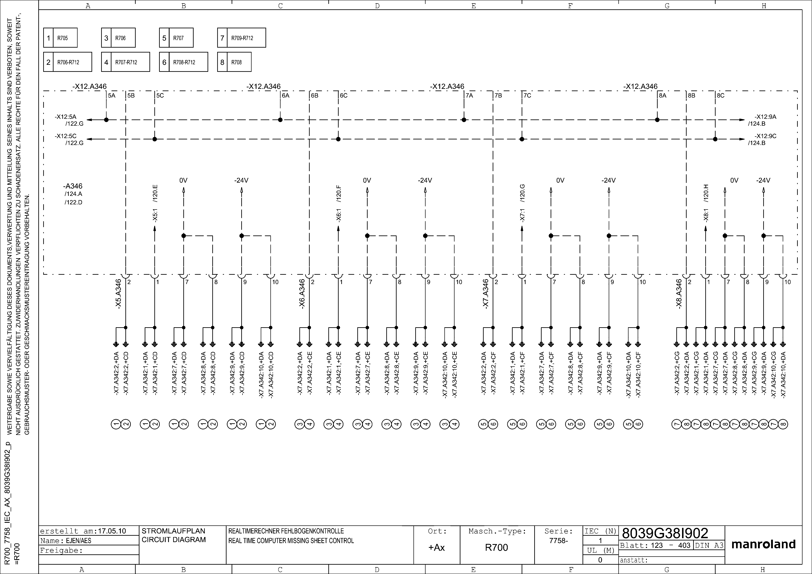

# +Ax — Sheet 123 of 403 — REALTIMERECHNER FEHLBOGENKONTROLLE

**REAL TIME COMPUTER MISSING SHEET CONTROL**

> Part of the manroland **R700** printing press IEC/UL circuit diagrams.
> Drawing class: **Stromlaufplan / Circuit diagram** (DIN A3).
> Document `+Ax` covers the **Central control console** machine section.

## At a glance

| Field | Value |
|---|---|
| Document | `+Ax`  (8039G38I902) |
| Sheet | **123** of 403 |
| Section (DE) | REALTIMERECHNER FEHLBOGENKONTROLLE |
| Section (EN) | REAL TIME COMPUTER MISSING SHEET CONTROL |
| Section type | CIRCUIT — Circuit diagram |
| Machine type | `R700` |
| Series | `7758` |
| Created | 17.05.10 |
| Replaces | — |
| Columns used | A, B, C, D, E, F, G, H |
| Path numbers | — |
| Labels on sheet | 183 |
| Cross-refs out | 10 |
| Cross-refs in | 34 |

**Previous:** [+Ax sheet 122](SHEET_0122.md) · **Next:** [+Ax sheet 124](SHEET_0124.md) · **Document TOC:** [_TOC.md](_TOC.md)  (+Ax) · **Master TOC:** [all sheets](../_MASTER_TOC.md)

## Sheet image (300 DPI, exact vector render)



_Rendered directly from the PDF vector layer at 300 DPI (1-bit), no OCR and no resampling. Use it to confirm anything ambiguous in the text below._

## Cross-references on this sheet

Each entry is a wire leaving this sheet. The printed token is `/sheet.column`; the link resolves to that sheet inside the same document.

| Ref | Target sheet | Col | Path | Destination on target | Target section | From col |
|---|---|---|---|---|---|---|
| `/122.G` | [+Ax sheet 122](SHEET_0122.md) | G | — | X12:5A | REALTIMERECHNER FEHLBOGENKONTROLLE | A |
| `/124.B` | [+Ax sheet 124](SHEET_0124.md) | B | — | — | REALTIMERECHNER FEHLBOGENKONTROLLE | H |
| `/122.G` | [+Ax sheet 122](SHEET_0122.md) | G | — | X12:5C | REALTIMERECHNER FEHLBOGENKONTROLLE | A |
| `/124.B` | [+Ax sheet 124](SHEET_0124.md) | B | — | — | REALTIMERECHNER FEHLBOGENKONTROLLE | H |
| `/120.G` | [+Ax sheet 120](SHEET_0120.md) | G | — | X7:1 | REALTIMERECHNER FEHLBOGENKONTROLLE | F |
| `/120.H` | [+Ax sheet 120](SHEET_0120.md) | H | — | X8:1 | REALTIMERECHNER FEHLBOGENKONTROLLE | G |
| `/120.E` | [+Ax sheet 120](SHEET_0120.md) | E | — | X5:1 | REALTIMERECHNER FEHLBOGENKONTROLLE | B |
| `/120.F` | [+Ax sheet 120](SHEET_0120.md) | F | — | X6:1 | REALTIMERECHNER FEHLBOGENKONTROLLE | D |
| `/124.A` | [+Ax sheet 124](SHEET_0124.md) | A | — | — | REALTIMERECHNER FEHLBOGENKONTROLLE | A |
| `/122.D` | [+Ax sheet 122](SHEET_0122.md) | D | — | — | REALTIMERECHNER FEHLBOGENKONTROLLE | A |

### Incoming references (sheets that point here)

Every other sheet that sends a wire to this one. `Back-ref` is the token printed on *that* sheet; `Path` is its line number.

| From sheet | Cols | Back-ref | Path | Refs | What continues there |
|---|---|---|---|---|---|
| [+Ax#120](SHEET_0120.md) | G, H | `/120.G`, `/120.H` | — | 4 | X7:1; X8:1 |
| [+Ax#122](SHEET_0122.md) | D, H | `/122.D`, `/122.H` | — | 3 | — |
| [+Ax#124](SHEET_0124.md) | A | `/124.A` | — | 3 | X12:9A; X12:9C |
| [+Ax#231](SHEET_0231.md) | B | `/231.B` | — | 6 | — |
| [+Ax#233](SHEET_0233.md) | H | `/233.H` | — | 6 | — |
| [+Ax#236](SHEET_0236.md) | A | `/236.A` | — | 6 | — |
| [+Ax#238](SHEET_0238.md) | B | `/238.B` | — | 6 | — |


## Devices on this sheet

| Tag | Class | Class meaning (IEC) | Col | Sub | Terminal | Sign |
|---|---|---|---|---|---|---|
| `A346` | A | Baugruppe / assembly, module, PC board | A | — | — | — |
| `X7:1` | X | Klemme / terminal, plug connector | F | — | 1 | — |
| `X6:1` | X | Klemme / terminal, plug connector | D | — | 1 | — |
| `X12:9A` | X | Klemme / terminal, plug connector | H | — | 9A | — |
| `X12:5C` | X | Klemme / terminal, plug connector | A | — | 5C | — |
| `X12:5A` | X | Klemme / terminal, plug connector | A | — | 5A | — |
| `X12:9C` | X | Klemme / terminal, plug connector | H | — | 9C | — |
| `X8:1` | X | Klemme / terminal, plug connector | G | — | 1 | — |
| `X5:1` | X | Klemme / terminal, plug connector | B | — | 1 | — |
| `R705` | R | Widerstand / resistor | A | — | — | — |
| `R706` | R | Widerstand / resistor | A | — | — | — |
| `R707` | R | Widerstand / resistor | B | — | — | — |
| `R708` | R | Widerstand / resistor | C | — | — | — |
| `X5.A346` | — | cross-device reference | A | — | — | — |
| `X6.A346` | — | cross-device reference | C | — | — | — |
| `X7.A346` | — | cross-device reference | E | — | — | — |
| `X8.A346` | — | cross-device reference | G | — | — | — |
| `X12.A346` | — | cross-device reference | C | — | — | — |
| `X12.A346` | — | cross-device reference | E | — | — | — |
| `X12.A346` | — | cross-device reference | G | — | — | — |
| `X12.A346` | — | cross-device reference | A | — | — | — |

## Potentials / nets

| Potential | Count | Columns | Attached devices | Terminals |
|---|---|---|---|---|
| `0V` | 4 | B, D, F, H | — | — |
| `24V` | 4 | C, D, F, H | — | — |


A potential such as `L24+/4` or `M24+` is a named supply/return rail; every place it appears on this sheet is electrically common.

## Wire-end annotations (grouped as printed)

A wire that continues elsewhere is annotated with a small cluster: the destination description, the path/line number `#NN`, and the `/sheet.column` cross reference. Each row below is one such cluster exactly as it is grouped on the drawing.

| Col | Y | Path | Cross-ref | Text on the wire |
|---|---|---|---|---|
| A | 51.3 | — | — | `1` |
| A | 51.3 | — | — | `3` |
| B | 51.3 | — | — | `5` |
| B | 51.3 | — | — | `7` |
| A | 53.1 | — | — | `R705` |
| A | 53.1 | — | — | `R706` |
| B | 53.1 | — | — | `R707` |
| C | 53.1 | — | — | `R709 R712` |
| A | 86.7 | — | — | `2` |
| A | 86.7 | — | — | `4` |
| B | 86.7 | — | — | `6` |
| B | 86.7 | — | — | `8` |
| A | 88.5 | — | — | `R706 R712` |
| A | 88.5 | — | — | `R707 R712` |
| B | 88.5 | — | — | `R708 R712` |
| C | 88.5 | — | — | `R708` |
| D | 122.2 | — | — | `X12.A346 X12.A346 X12.A346 X12.A346` |
| D | 136.3 | — | — | `5A 5B 5C 6A 6B 6C 7A 7B 7C 8A 8B 8C` |
| A | 167.5 | — | `/122.G` | `X12:5A` |
| H | 167.5 | — | — | `X12:9A` |
| H | 177.4 | — | `/124.B` | — |
| A | 195.9 | — | `/122.G` | `X12:5C` |
| H | 195.9 | — | — | `X12:9C` |
| H | 205.8 | — | `/124.B` | — |
| E | 260.3 | — | — | `0V 24V 0V 24V 0V 24V 0V 24V` |
| A | 268.2 | — | — | `A346` |
| F | 269.9 | — | `/120.G` | `X7:1` |
| G | 270.4 | — | `/120.H` | `X8:1` |
| B | 270.7 | — | `/120.E` | `X5:1` |
| D | 271.3 | — | `/120.F` | `X6:1` |
| A | 280.5 | — | `/124.A`, `/122.D` | — |
| A | 409.0 | — | — | `X5.A346` |
| C | 409.0 | — | — | `X6.A346` |
| E | 409.0 | — | — | `X7.A346` |
| G | 409.0 | — | — | `X8.A346` |
| D | 409.9 | — | — | `2 1 7 8 9 10 9 8` |
| D | 409.9 | — | — | `2 1 7 8` |
| E | 409.9 | — | — | `10 2 1 7` |
| G | 409.9 | — | — | `9 10 2 1` |
| H | 409.9 | — | — | `7 8 9 10` |
| C | 515.3 | — | — | `X7.A342:2,+CE` |
| D | 515.3 | — | — | `X7.A342:1,+CE` |
| D | 515.3 | — | — | `X7.A342:7,+CE` |
| D | 515.3 | — | — | `X7.A342:8,+CE` |
| E | 515.3 | — | — | `X7.A342:9,+CE` |
| E | 515.3 | — | — | `X7.A342:10,+CE` |
| G | 515.3 | — | — | `X7.A342:2,+CG` |
| G | 515.3 | — | — | `X7.A342:1,+CG` |
| H | 515.3 | — | — | `X7.A342:7,+CG` |
| H | 515.3 | — | — | `X7.A342:8,+CG` |
| H | 515.3 | — | — | `X7.A342:9,+CG` |
| H | 515.3 | — | — | `X7.A342:10,+CG` |
| A | 515.6 | — | — | `X7.A342:2,+CD` |
| B | 515.6 | — | — | `X7.A342:1,+CD` |
| B | 515.6 | — | — | `X7.A342:7,+CD` |
| B | 515.6 | — | — | `X7.A342:8,+CD` |
| C | 515.6 | — | — | `X7.A342:9,+CD` |
| C | 515.6 | — | — | `X7.A342:10,+CD` |
| E | 515.6 | — | — | `X7.A342:2,+CF` |
| F | 515.6 | — | — | `X7.A342:1,+CF` |
| F | 515.6 | — | — | `X7.A342:7,+CF` |
| F | 515.6 | — | — | `X7.A342:8,+CF` |
| F | 515.6 | — | — | `X7.A342:9,+CF` |
| G | 515.6 | — | — | `X7.A342:10,+CF` |
| A | 515.9 | — | — | `X7.A342:2,+DA` |
| B | 515.9 | — | — | `X7.A342:1,+DA` |
| B | 515.9 | — | — | `X7.A342:7,+DA` |
| B | 515.9 | — | — | `X7.A342:8,+DA` |
| C | 515.9 | — | — | `X7.A342:9,+DA` |
| C | 515.9 | — | — | `X7.A342:10,+DA` |
| C | 515.9 | — | — | `X7.A342:2,+DA` |
| D | 515.9 | — | — | `X7.A342:1,+DA` |
| D | 515.9 | — | — | `X7.A342:7,+DA` |
| D | 515.9 | — | — | `X7.A342:8,+DA` |
| D | 515.9 | — | — | `X7.A342:9,+DA` |
| E | 515.9 | — | — | `X7.A342:10,+DA` |
| E | 515.9 | — | — | `X7.A342:2,+DA` |
| E | 515.9 | — | — | `X7.A342:1,+DA` |
| F | 515.9 | — | — | `X7.A342:7,+DA` |
| F | 515.9 | — | — | `X7.A342:8,+DA` |
| F | 515.9 | — | — | `X7.A342:9,+DA` |
| G | 515.9 | — | — | `X7.A342:10,+DA` |
| G | 515.9 | — | — | `X7.A342:2,+DA` |
| G | 515.9 | — | — | `X7.A342:1,+DA` |
| H | 515.9 | — | — | `X7.A342:7,+DA` |
| H | 515.9 | — | — | `X7.A342:8,+DA` |
| H | 515.9 | — | — | `X7.A342:9,+DA` |
| H | 515.9 | — | — | `X7.A342:10,+DA` |
| A | 619.2 | — | — | `1 2` |
| B | 619.2 | — | — | `1 2` |
| B | 619.2 | — | — | `1 2` |
| B | 619.2 | — | — | `1 2` |
| C | 619.2 | — | — | `1 2` |
| C | 619.2 | — | — | `1 2` |
| C | 619.8 | — | — | `4` |
| D | 619.8 | — | — | `4` |
| D | 619.8 | — | — | `4` |
| D | 619.8 | — | — | `4` |
| E | 619.8 | — | — | `4` |
| E | 619.8 | — | — | `4` |
| E | 619.8 | — | — | `6` |
| F | 619.8 | — | — | `6` |
| F | 619.8 | — | — | `6` |
| F | 619.8 | — | — | `6` |
| F | 619.8 | — | — | `6` |
| G | 619.8 | — | — | `6` |
| G | 619.8 | — | — | `7` |
| G | 619.8 | — | — | `7` |
| H | 619.8 | — | — | `7` |
| H | 619.8 | — | — | `7` |
| H | 619.8 | — | — | `7` |
| H | 619.8 | — | — | `7` |
| C | 619.9 | — | — | `3` |
| D | 619.9 | — | — | `3` |
| D | 619.9 | — | — | `3` |
| D | 619.9 | — | — | `3` |
| D | 619.9 | — | — | `3` |
| E | 619.9 | — | — | `3` |
| E | 619.9 | — | — | `5` |
| E | 619.9 | — | — | `5` |
| F | 619.9 | — | — | `5` |
| F | 619.9 | — | — | `5` |
| F | 619.9 | — | — | `5` |
| G | 619.9 | — | — | `5` |
| G | 619.9 | — | — | `8` |
| G | 619.9 | — | — | `8` |
| H | 619.9 | — | — | `8` |
| H | 619.9 | — | — | `8` |
| H | 619.9 | — | — | `8` |
| H | 619.9 | — | — | `8` |


## Reconstructed tables

This sheet carries tabular content (pin map / terminal assignment / index). The grid below was rebuilt from the drawing's own rule lines, so each row is exactly one physical row of the table.

### Table 1 — 1 data rows × 3 columns (at x=1063.0, y=175.7)

|  | /124.B | X12:9C |
|---|---|---|
| `0V` | `/124.B 24V` |  |


## Notes and free text on this sheet

| Text | Col | Y (pt) |
|---|---|---|
| `5B` | A | 136.33 |
| `5C` | B | 136.39 |
| `6B` | C | 136.33 |
| `6A` | C | 136.33 |
| `6C` | D | 136.39 |
| `7B` | E | 136.33 |
| `7A` | E | 136.33 |
| `7C` | F | 136.39 |
| `8B` | G | 136.33 |
| `8A` | G | 136.33 |
| `8C` | H | 136.39 |
| `5A` | A | 136.33 |
| `X7.A342:2,+DA` | A | 515.91 |
| `X7.A342:2,+CD` | A | 515.62 |
| `X7.A342:1,+DA` | B | 515.91 |
| `X7.A342:1,+CD` | B | 515.62 |
| `X7.A342:7,+DA` | B | 515.91 |
| `X7.A342:7,+CD` | B | 515.62 |
| `X7.A342:8,+DA` | B | 515.91 |
| `X7.A342:8,+CD` | B | 515.62 |
| `X7.A342:9,+DA` | C | 515.91 |
| `X7.A342:9,+CD` | C | 515.62 |
| `X7.A342:10,+DA` | C | 515.91 |
| `X7.A342:10,+CD` | C | 515.62 |
| `X7.A342:2,+DA` | C | 515.91 |
| `X7.A342:2,+CE` | C | 515.34 |
| `X7.A342:1,+DA` | D | 515.91 |
| `X7.A342:1,+CE` | D | 515.34 |
| `X7.A342:7,+DA` | D | 515.91 |
| `X7.A342:7,+CE` | D | 515.34 |
| `X7.A342:8,+DA` | D | 515.91 |
| `X7.A342:8,+CE` | D | 515.34 |
| `X7.A342:9,+DA` | D | 515.91 |
| `X7.A342:9,+CE` | E | 515.34 |
| `X7.A342:10,+DA` | E | 515.91 |
| `X7.A342:10,+CE` | E | 515.34 |
| `X7.A342:2,+DA` | E | 515.91 |
| `X7.A342:2,+CF` | E | 515.62 |
| `X7.A342:1,+DA` | E | 515.91 |
| `X7.A342:1,+CF` | F | 515.62 |
| `X7.A342:7,+DA` | F | 515.91 |
| `X7.A342:7,+CF` | F | 515.62 |
| `X7.A342:8,+DA` | F | 515.91 |
| `X7.A342:8,+CF` | F | 515.62 |
| `X7.A342:9,+DA` | F | 515.91 |
| `X7.A342:9,+CF` | F | 515.62 |
| `X7.A342:10,+DA` | G | 515.91 |
| `X7.A342:10,+CF` | G | 515.63 |
| `X7.A342:1,+DA` | G | 515.91 |
| `X7.A342:7,+DA` | H | 515.91 |
| `X7.A342:8,+DA` | H | 515.91 |
| `X7.A342:9,+DA` | H | 515.91 |
| `X7.A342:10,+DA` | H | 515.91 |
| `X7.A342:1,+CG` | G | 515.34 |
| `X7.A342:7,+CG` | H | 515.34 |
| `X7.A342:8,+CG` | H | 515.34 |
| `X7.A342:9,+CG` | H | 515.34 |
| `X7.A342:10,+CG` | H | 515.34 |
| `X7.A342:2,+DA` | G | 515.91 |
| `X7.A342:2,+CG` | G | 515.34 |
| `R706 R712` | A | 88.52 |
| `R707 R712` | A | 88.52 |
| `R708 R712` | B | 88.52 |
| `R709 R712` | C | 53.09 |

## Complete label inventory (exact text from the drawing)

Every text object inside the drawing area of this sheet, in DIN reading order (column A→H, then top→bottom). This is the authoritative list: if a string is not here it is not printed on this sheet.

| Col | Y | X | Dir | Type | Text |
|---|---|---|---|---|---|
| A | 51.3 | 68.3 | → | number | `1` |
| A | 51.3 | 152.9 | → | number | `3` |
| A | 53.1 | 84.2 | → | device tag | `R705` |
| A | 53.1 | 169.2 | → | device tag | `R706` |
| A | 86.7 | 68.0 | → | number | `2` |
| A | 86.7 | 153.1 | → | number | `4` |
| A | 88.5 | 84.2 | → | text | `R706 R712` |
| A | 88.5 | 169.2 | → | text | `R707 R712` |
| A | 122.2 | 106.3 | → | device ref | `X12.A346` |
| A | 136.3 | 158.5 | → | text | `5A` |
| A | 136.3 | 186.8 | → | text | `5B` |
| A | 167.5 | 80.2 | → | device tag | `X12:5A` |
| A | 177.4 | 96.1 | → | cross-reference | `/122.G` |
| A | 195.9 | 80.2 | → | device tag | `X12:5C` |
| A | 205.8 | 96.1 | → | cross-reference | `/122.G` |
| A | 268.2 | 92.7 | → | device tag | `A346` |
| A | 280.5 | 95.0 | → | cross-reference | `/124.A` |
| A | 293.0 | 95.0 | → | cross-reference | `/122.D` |
| A | 409.0 | 169.0 | ↕ | device ref | `X5.A346` |
| A | 409.9 | 186.8 | → | number | `2` |
| A | 515.6 | 181.0 | ↕ | text | `X7.A342:2,+CD` |
| A | 515.9 | 166.8 | ↕ | text | `X7.A342:2,+DA` |
| A | 619.2 | 166.7 | ↕ | number | `1` |
| A | 619.8 | 181.4 | ↕ | number | `2` |
| B | 51.3 | 238.0 | → | number | `5` |
| B | 51.3 | 323.1 | → | number | `7` |
| B | 53.1 | 254.3 | → | device tag | `R707` |
| B | 86.7 | 238.1 | → | number | `6` |
| B | 86.7 | 323.0 | → | number | `8` |
| B | 88.5 | 254.3 | → | text | `R708 R712` |
| B | 136.4 | 229.3 | → | text | `5C` |
| B | 260.3 | 263.1 | → | potential | `0V` |
| B | 270.7 | 223.5 | ↕ | cross-reference | `/120.E` |
| B | 305.3 | 223.5 | ↕ | device tag | `X5:1` |
| B | 409.9 | 228.8 | → | number | `1` |
| B | 409.9 | 271.8 | → | number | `7` |
| B | 409.9 | 314.4 | → | number | `8` |
| B | 515.6 | 223.5 | ↕ | text | `X7.A342:1,+CD` |
| B | 515.6 | 266.0 | ↕ | text | `X7.A342:7,+CD` |
| B | 515.6 | 308.6 | ↕ | text | `X7.A342:8,+CD` |
| B | 515.9 | 209.3 | ↕ | text | `X7.A342:1,+DA` |
| B | 515.9 | 251.9 | ↕ | text | `X7.A342:7,+DA` |
| B | 515.9 | 294.4 | ↕ | text | `X7.A342:8,+DA` |
| B | 619.2 | 209.2 | ↕ | number | `1` |
| B | 619.2 | 251.7 | ↕ | number | `1` |
| B | 619.2 | 294.2 | ↕ | number | `1` |
| B | 619.8 | 223.9 | ↕ | number | `2` |
| B | 619.8 | 266.4 | ↕ | number | `2` |
| B | 619.8 | 308.9 | ↕ | number | `2` |
| C | 53.1 | 339.3 | → | text | `R709 R712` |
| C | 88.5 | 339.3 | → | device tag | `R708` |
| C | 122.2 | 361.4 | → | device ref | `X12.A346` |
| C | 136.3 | 413.6 | → | text | `6A` |
| C | 136.3 | 456.1 | → | text | `6B` |
| C | 260.3 | 343.7 | → | potential | `24V` |
| C | 409.0 | 438.3 | ↕ | device ref | `X6.A346` |
| C | 409.9 | 356.9 | → | number | `9` |
| C | 409.9 | 398.8 | → | number | `10` |
| C | 409.9 | 456.1 | → | number | `2` |
| C | 515.3 | 450.3 | ↕ | text | `X7.A342:2,+CE` |
| C | 515.6 | 351.1 | ↕ | text | `X7.A342:9,+CD` |
| C | 515.6 | 393.6 | ↕ | text | `X7.A342:10,+CD` |
| C | 515.9 | 336.9 | ↕ | text | `X7.A342:9,+DA` |
| C | 515.9 | 379.4 | ↕ | text | `X7.A342:10,+DA` |
| C | 515.9 | 436.1 | ↕ | text | `X7.A342:2,+DA` |
| C | 619.2 | 336.8 | ↕ | number | `1` |
| C | 619.2 | 379.3 | ↕ | number | `1` |
| C | 619.8 | 351.4 | ↕ | number | `2` |
| C | 619.8 | 394.0 | ↕ | number | `2` |
| C | 619.8 | 450.7 | ↕ | number | `4` |
| C | 619.9 | 436.4 | ↕ | number | `3` |
| D | 136.4 | 498.6 | → | text | `6C` |
| D | 260.3 | 532.3 | → | potential | `0V` |
| D | 260.3 | 613.0 | → | potential | `24V` |
| D | 271.3 | 492.8 | ↕ | cross-reference | `/120.F` |
| D | 305.3 | 492.8 | ↕ | device tag | `X6:1` |
| D | 409.9 | 498.0 | → | number | `1` |
| D | 409.9 | 541.1 | → | number | `7` |
| D | 409.9 | 583.7 | → | number | `8` |
| D | 515.3 | 492.8 | ↕ | text | `X7.A342:1,+CE` |
| D | 515.3 | 535.3 | ↕ | text | `X7.A342:7,+CE` |
| D | 515.3 | 577.8 | ↕ | text | `X7.A342:8,+CE` |
| D | 515.9 | 478.6 | ↕ | text | `X7.A342:1,+DA` |
| D | 515.9 | 521.1 | ↕ | text | `X7.A342:7,+DA` |
| D | 515.9 | 563.7 | ↕ | text | `X7.A342:8,+DA` |
| D | 515.9 | 606.2 | ↕ | text | `X7.A342:9,+DA` |
| D | 619.8 | 493.2 | ↕ | number | `4` |
| D | 619.8 | 535.7 | ↕ | number | `4` |
| D | 619.8 | 578.2 | ↕ | number | `4` |
| D | 619.9 | 478.9 | ↕ | number | `3` |
| D | 619.9 | 521.5 | ↕ | number | `3` |
| D | 619.9 | 564.0 | ↕ | number | `3` |
| D | 619.9 | 606.5 | ↕ | number | `3` |
| E | 122.2 | 630.7 | → | device ref | `X12.A346` |
| E | 136.3 | 682.9 | → | text | `7A` |
| E | 136.3 | 725.4 | → | text | `7B` |
| E | 409.0 | 707.6 | ↕ | device ref | `X7.A346` |
| E | 409.9 | 626.2 | → | number | `9` |
| E | 409.9 | 668.1 | → | number | `10` |
| E | 409.9 | 725.4 | → | number | `2` |
| E | 515.3 | 620.4 | ↕ | text | `X7.A342:9,+CE` |
| E | 515.3 | 662.9 | ↕ | text | `X7.A342:10,+CE` |
| E | 515.6 | 719.6 | ↕ | text | `X7.A342:2,+CF` |
| E | 515.9 | 648.7 | ↕ | text | `X7.A342:10,+DA` |
| E | 515.9 | 705.4 | ↕ | text | `X7.A342:2,+DA` |
| E | 515.9 | 747.9 | ↕ | text | `X7.A342:1,+DA` |
| E | 619.8 | 620.7 | ↕ | number | `4` |
| E | 619.8 | 663.3 | ↕ | number | `4` |
| E | 619.8 | 719.9 | ↕ | number | `6` |
| E | 619.9 | 649.0 | ↕ | number | `3` |
| E | 619.9 | 705.7 | ↕ | number | `5` |
| E | 619.9 | 748.2 | ↕ | number | `5` |
| F | 136.4 | 767.9 | → | text | `7C` |
| F | 260.3 | 815.8 | → | potential | `0V` |
| F | 260.3 | 882.3 | → | potential | `24V` |
| F | 269.9 | 762.1 | ↕ | cross-reference | `/120.G` |
| F | 305.3 | 762.1 | ↕ | device tag | `X7:1` |
| F | 409.9 | 767.3 | → | number | `1` |
| F | 409.9 | 810.4 | → | number | `7` |
| F | 409.9 | 852.9 | → | number | `8` |
| F | 409.9 | 895.5 | → | number | `9` |
| F | 515.6 | 762.1 | ↕ | text | `X7.A342:1,+CF` |
| F | 515.6 | 804.6 | ↕ | text | `X7.A342:7,+CF` |
| F | 515.6 | 847.1 | ↕ | text | `X7.A342:8,+CF` |
| F | 515.6 | 889.6 | ↕ | text | `X7.A342:9,+CF` |
| F | 515.9 | 790.4 | ↕ | text | `X7.A342:7,+DA` |
| F | 515.9 | 833.0 | ↕ | text | `X7.A342:8,+DA` |
| F | 515.9 | 875.5 | ↕ | text | `X7.A342:9,+DA` |
| F | 619.8 | 762.5 | ↕ | number | `6` |
| F | 619.8 | 805.0 | ↕ | number | `6` |
| F | 619.8 | 847.5 | ↕ | number | `6` |
| F | 619.8 | 890.0 | ↕ | number | `6` |
| F | 619.9 | 790.8 | ↕ | number | `5` |
| F | 619.9 | 833.3 | ↕ | number | `5` |
| F | 619.9 | 875.8 | ↕ | number | `5` |
| G | 122.2 | 914.2 | → | device ref | `X12.A346` |
| G | 136.3 | 966.3 | → | text | `8A` |
| G | 136.3 | 1008.9 | → | text | `8B` |
| G | 270.4 | 1031.4 | ↕ | cross-reference | `/120.H` |
| G | 305.3 | 1031.4 | ↕ | device tag | `X8:1` |
| G | 409.0 | 991.0 | ↕ | device ref | `X8.A346` |
| G | 409.9 | 937.4 | → | number | `10` |
| G | 409.9 | 1008.9 | → | number | `2` |
| G | 409.9 | 1036.6 | → | number | `1` |
| G | 515.3 | 988.9 | ↕ | text | `X7.A342:2,+CG` |
| G | 515.3 | 1017.2 | ↕ | text | `X7.A342:1,+CG` |
| G | 515.6 | 932.2 | ↕ | text | `X7.A342:10,+CF` |
| G | 515.9 | 918.0 | ↕ | text | `X7.A342:10,+DA` |
| G | 515.9 | 1003.0 | ↕ | text | `X7.A342:2,+DA` |
| G | 515.9 | 1031.4 | ↕ | text | `X7.A342:1,+DA` |
| G | 619.8 | 932.5 | ↕ | number | `6` |
| G | 619.8 | 989.2 | ↕ | number | `7` |
| G | 619.8 | 1017.6 | ↕ | number | `7` |
| G | 619.9 | 918.3 | ↕ | number | `5` |
| G | 619.9 | 1003.3 | ↕ | number | `8` |
| G | 619.9 | 1031.7 | ↕ | number | `8` |
| H | 136.4 | 1051.4 | → | text | `8C` |
| H | 167.5 | 1106.6 | → | device tag | `X12:9A` |
| H | 177.4 | 1097.0 | → | cross-reference | `/124.B` |
| H | 195.9 | 1106.6 | → | device tag | `X12:9C` |
| H | 205.8 | 1097.0 | → | cross-reference | `/124.B` |
| H | 260.3 | 1070.9 | → | potential | `0V` |
| H | 260.3 | 1109.1 | → | potential | `24V` |
| H | 409.9 | 1065.5 | → | number | `7` |
| H | 409.9 | 1093.9 | → | number | `8` |
| H | 409.9 | 1122.2 | → | number | `9` |
| H | 409.9 | 1150.0 | → | number | `10` |
| H | 515.3 | 1045.6 | ↕ | text | `X7.A342:7,+CG` |
| H | 515.3 | 1073.9 | ↕ | text | `X7.A342:8,+CG` |
| H | 515.3 | 1102.3 | ↕ | text | `X7.A342:9,+CG` |
| H | 515.3 | 1130.6 | ↕ | text | `X7.A342:10,+CG` |
| H | 515.9 | 1059.7 | ↕ | text | `X7.A342:7,+DA` |
| H | 515.9 | 1088.1 | ↕ | text | `X7.A342:8,+DA` |
| H | 515.9 | 1116.4 | ↕ | text | `X7.A342:9,+DA` |
| H | 515.9 | 1144.8 | ↕ | text | `X7.A342:10,+DA` |
| H | 619.8 | 1045.9 | ↕ | number | `7` |
| H | 619.8 | 1074.3 | ↕ | number | `7` |
| H | 619.8 | 1102.6 | ↕ | number | `7` |
| H | 619.8 | 1131.0 | ↕ | number | `7` |
| H | 619.9 | 1060.0 | ↕ | number | `8` |
| H | 619.9 | 1088.4 | ↕ | number | `8` |
| H | 619.9 | 1116.7 | ↕ | number | `8` |
| H | 619.9 | 1145.1 | ↕ | number | `8` |

## Reading-order text block

The same content as a plain block, grouped by DIN column — convenient to paste or to match against a visual description.

```text
=== Column A ===
  51.3   68.3  numeric      1
  51.3  152.9  numeric      3
  53.1   84.2  devtag       R705
  53.1  169.2  devtag       R706
  86.7   68.0  numeric      2
  86.7  153.1  numeric      4
  88.5   84.2  text         R706 R712
  88.5  169.2  text         R707 R712
 122.2  106.3  devref       X12.A346
 136.3  158.5  text         5A
 136.3  186.8  text         5B
 167.5   80.2  devtag       X12:5A
 177.4   96.1  xref         /122.G
 195.9   80.2  devtag       X12:5C
 205.8   96.1  xref         /122.G
 268.2   92.7  devtag       A346
 280.5   95.0  xref         /124.A
 293.0   95.0  xref         /122.D
 409.0  169.0  devref       X5.A346
 409.9  186.8  numeric      2
 515.6  181.0  text         X7.A342:2,+CD
 515.9  166.8  text         X7.A342:2,+DA
 619.2  166.7  numeric      1
 619.8  181.4  numeric      2
=== Column B ===
  51.3  238.0  numeric      5
  51.3  323.1  numeric      7
  53.1  254.3  devtag       R707
  86.7  238.1  numeric      6
  86.7  323.0  numeric      8
  88.5  254.3  text         R708 R712
 136.4  229.3  text         5C
 260.3  263.1  net          0V
 270.7  223.5  xref         /120.E
 305.3  223.5  devtag       X5:1
 409.9  228.8  numeric      1
 409.9  271.8  numeric      7
 409.9  314.4  numeric      8
 515.6  223.5  text         X7.A342:1,+CD
 515.6  266.0  text         X7.A342:7,+CD
 515.6  308.6  text         X7.A342:8,+CD
 515.9  209.3  text         X7.A342:1,+DA
 515.9  251.9  text         X7.A342:7,+DA
 515.9  294.4  text         X7.A342:8,+DA
 619.2  209.2  numeric      1
 619.2  251.7  numeric      1
 619.2  294.2  numeric      1
 619.8  223.9  numeric      2
 619.8  266.4  numeric      2
 619.8  308.9  numeric      2
=== Column C ===
  53.1  339.3  text         R709 R712
  88.5  339.3  devtag       R708
 122.2  361.4  devref       X12.A346
 136.3  413.6  text         6A
 136.3  456.1  text         6B
 260.3  343.7  net          24V
 409.0  438.3  devref       X6.A346
 409.9  356.9  numeric      9
 409.9  398.8  numeric      10
 409.9  456.1  numeric      2
 515.3  450.3  text         X7.A342:2,+CE
 515.6  351.1  text         X7.A342:9,+CD
 515.6  393.6  text         X7.A342:10,+CD
 515.9  336.9  text         X7.A342:9,+DA
 515.9  379.4  text         X7.A342:10,+DA
 515.9  436.1  text         X7.A342:2,+DA
 619.2  336.8  numeric      1
 619.2  379.3  numeric      1
 619.8  351.4  numeric      2
 619.8  394.0  numeric      2
 619.8  450.7  numeric      4
 619.9  436.4  numeric      3
=== Column D ===
 136.4  498.6  text         6C
 260.3  532.3  net          0V
 260.3  613.0  net          24V
 271.3  492.8  xref         /120.F
 305.3  492.8  devtag       X6:1
 409.9  498.0  numeric      1
 409.9  541.1  numeric      7
 409.9  583.7  numeric      8
 515.3  492.8  text         X7.A342:1,+CE
 515.3  535.3  text         X7.A342:7,+CE
 515.3  577.8  text         X7.A342:8,+CE
 515.9  478.6  text         X7.A342:1,+DA
 515.9  521.1  text         X7.A342:7,+DA
 515.9  563.7  text         X7.A342:8,+DA
 515.9  606.2  text         X7.A342:9,+DA
 619.8  493.2  numeric      4
 619.8  535.7  numeric      4
 619.8  578.2  numeric      4
 619.9  478.9  numeric      3
 619.9  521.5  numeric      3
 619.9  564.0  numeric      3
 619.9  606.5  numeric      3
=== Column E ===
 122.2  630.7  devref       X12.A346
 136.3  682.9  text         7A
 136.3  725.4  text         7B
 409.0  707.6  devref       X7.A346
 409.9  626.2  numeric      9
 409.9  668.1  numeric      10
 409.9  725.4  numeric      2
 515.3  620.4  text         X7.A342:9,+CE
 515.3  662.9  text         X7.A342:10,+CE
 515.6  719.6  text         X7.A342:2,+CF
 515.9  648.7  text         X7.A342:10,+DA
 515.9  705.4  text         X7.A342:2,+DA
 515.9  747.9  text         X7.A342:1,+DA
 619.8  620.7  numeric      4
 619.8  663.3  numeric      4
 619.8  719.9  numeric      6
 619.9  649.0  numeric      3
 619.9  705.7  numeric      5
 619.9  748.2  numeric      5
=== Column F ===
 136.4  767.9  text         7C
 260.3  815.8  net          0V
 260.3  882.3  net          24V
 269.9  762.1  xref         /120.G
 305.3  762.1  devtag       X7:1
 409.9  767.3  numeric      1
 409.9  810.4  numeric      7
 409.9  852.9  numeric      8
 409.9  895.5  numeric      9
 515.6  762.1  text         X7.A342:1,+CF
 515.6  804.6  text         X7.A342:7,+CF
 515.6  847.1  text         X7.A342:8,+CF
 515.6  889.6  text         X7.A342:9,+CF
 515.9  790.4  text         X7.A342:7,+DA
 515.9  833.0  text         X7.A342:8,+DA
 515.9  875.5  text         X7.A342:9,+DA
 619.8  762.5  numeric      6
 619.8  805.0  numeric      6
 619.8  847.5  numeric      6
 619.8  890.0  numeric      6
 619.9  790.8  numeric      5
 619.9  833.3  numeric      5
 619.9  875.8  numeric      5
=== Column G ===
 122.2  914.2  devref       X12.A346
 136.3  966.3  text         8A
 136.3 1008.9  text         8B
 270.4 1031.4  xref         /120.H
 305.3 1031.4  devtag       X8:1
 409.0  991.0  devref       X8.A346
 409.9  937.4  numeric      10
 409.9 1008.9  numeric      2
 409.9 1036.6  numeric      1
 515.3  988.9  text         X7.A342:2,+CG
 515.3 1017.2  text         X7.A342:1,+CG
 515.6  932.2  text         X7.A342:10,+CF
 515.9  918.0  text         X7.A342:10,+DA
 515.9 1003.0  text         X7.A342:2,+DA
 515.9 1031.4  text         X7.A342:1,+DA
 619.8  932.5  numeric      6
 619.8  989.2  numeric      7
 619.8 1017.6  numeric      7
 619.9  918.3  numeric      5
 619.9 1003.3  numeric      8
 619.9 1031.7  numeric      8
=== Column H ===
 136.4 1051.4  text         8C
 167.5 1106.6  devtag       X12:9A
 177.4 1097.0  xref         /124.B
 195.9 1106.6  devtag       X12:9C
 205.8 1097.0  xref         /124.B
 260.3 1070.9  net          0V
 260.3 1109.1  net          24V
 409.9 1065.5  numeric      7
 409.9 1093.9  numeric      8
 409.9 1122.2  numeric      9
 409.9 1150.0  numeric      10
 515.3 1045.6  text         X7.A342:7,+CG
 515.3 1073.9  text         X7.A342:8,+CG
 515.3 1102.3  text         X7.A342:9,+CG
 515.3 1130.6  text         X7.A342:10,+CG
 515.9 1059.7  text         X7.A342:7,+DA
 515.9 1088.1  text         X7.A342:8,+DA
 515.9 1116.4  text         X7.A342:9,+DA
 515.9 1144.8  text         X7.A342:10,+DA
 619.8 1045.9  numeric      7
 619.8 1074.3  numeric      7
 619.8 1102.6  numeric      7
 619.8 1131.0  numeric      7
 619.9 1060.0  numeric      8
 619.9 1088.4  numeric      8
 619.9 1116.7  numeric      8
 619.9 1145.1  numeric      8
```

---
_Generated from the PDF vector text layer; no OCR. Source: `R700_7758_IEC_AX_8039G38I902_p`, sheet 123._
