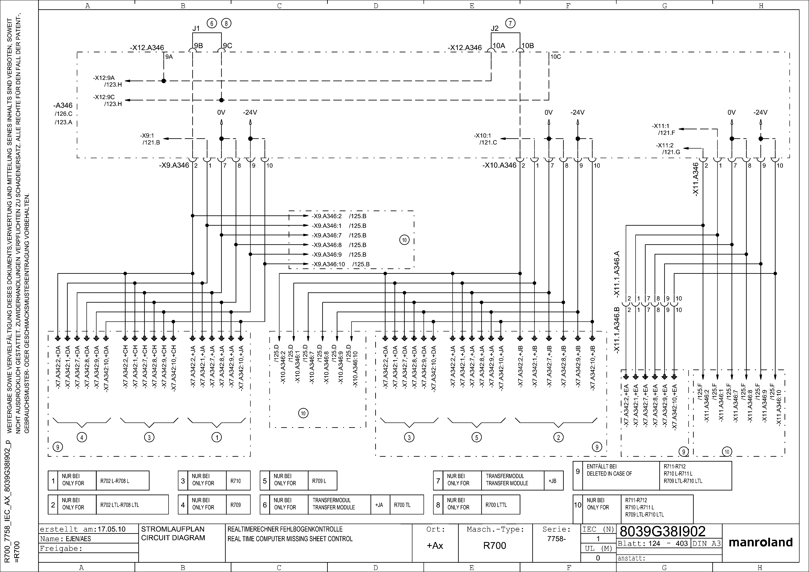

# +Ax — Sheet 124 of 403 — REALTIMERECHNER FEHLBOGENKONTROLLE

**REAL TIME COMPUTER MISSING SHEET CONTROL**

> Part of the manroland **R700** printing press IEC/UL circuit diagrams.
> Drawing class: **Stromlaufplan / Circuit diagram** (DIN A3).
> Document `+Ax` covers the **Central control console** machine section.

## At a glance

| Field | Value |
|---|---|
| Document | `+Ax`  (8039G38I902) |
| Sheet | **124** of 403 |
| Section (DE) | REALTIMERECHNER FEHLBOGENKONTROLLE |
| Section (EN) | REAL TIME COMPUTER MISSING SHEET CONTROL |
| Section type | CIRCUIT — Circuit diagram |
| Machine type | `R700` |
| Series | `7758` |
| Created | 17.05.10 |
| Replaces | — |
| Columns used | A, B, C, D, E, F, G, H |
| Path numbers | — |
| Labels on sheet | 208 |
| Cross-refs out | 26 |
| Cross-refs in | 44 |

**Previous:** [+Ax sheet 123](SHEET_0123.md) · **Next:** [+Ax sheet 125](SHEET_0125.md) · **Document TOC:** [_TOC.md](_TOC.md)  (+Ax) · **Master TOC:** [all sheets](../_MASTER_TOC.md)

## Sheet image (300 DPI, exact vector render)



_Rendered directly from the PDF vector layer at 300 DPI (1-bit), no OCR and no resampling. Use it to confirm anything ambiguous in the text below._

## Cross-references on this sheet

Each entry is a wire leaving this sheet. The printed token is `/sheet.column`; the link resolves to that sheet inside the same document.

| Ref | Target sheet | Col | Path | Destination on target | Target section | From col |
|---|---|---|---|---|---|---|
| `/123.H` | [+Ax sheet 123](SHEET_0123.md) | H | — | X12:9A | REALTIMERECHNER FEHLBOGENKONTROLLE | A |
| `/123.H` | [+Ax sheet 123](SHEET_0123.md) | H | — | X12:9C | REALTIMERECHNER FEHLBOGENKONTROLLE | A |
| `/126.C` | [+Ax sheet 126](SHEET_0126.md) | C | — | — | REALTIMERECHNER ANLEGER | A |
| `/123.A` | [+Ax sheet 123](SHEET_0123.md) | A | — | — | REALTIMERECHNER FEHLBOGENKONTROLLE | A |
| `/121.F` | [+Ax sheet 121](SHEET_0121.md) | F | — | X11:1 | REALTIMERECHNER FEHLBOGENKONTROLLE | G |
| `/121.B` | [+Ax sheet 121](SHEET_0121.md) | B | — | X9:1 | REALTIMERECHNER FEHLBOGENKONTROLLE | B |
| `/121.C` | [+Ax sheet 121](SHEET_0121.md) | C | — | X10:1 | REALTIMERECHNER FEHLBOGENKONTROLLE | E |
| `/121.G` | [+Ax sheet 121](SHEET_0121.md) | G | — | X11:2 | REALTIMERECHNER FEHLBOGENKONTROLLE | G |
| `/125.B` | [+Ax sheet 125](SHEET_0125.md) | B | — | X9.A346:2 | REALTIMERECHNER FEHLBOGENKONTROLLE | D |
| `/125.B` | [+Ax sheet 125](SHEET_0125.md) | B | — | X9.A346:1 | REALTIMERECHNER FEHLBOGENKONTROLLE | D |
| `/125.B` | [+Ax sheet 125](SHEET_0125.md) | B | — | X9.A346:7 | REALTIMERECHNER FEHLBOGENKONTROLLE | D |
| `/125.B` | [+Ax sheet 125](SHEET_0125.md) | B | — | X9.A346:8 | REALTIMERECHNER FEHLBOGENKONTROLLE | D |
| `/125.B` | [+Ax sheet 125](SHEET_0125.md) | B | — | X9.A346:9 | REALTIMERECHNER FEHLBOGENKONTROLLE | D |
| `/125.B` | [+Ax sheet 125](SHEET_0125.md) | B | — | X9.A346:10 | REALTIMERECHNER FEHLBOGENKONTROLLE | D |
| `/125.D` | [+Ax sheet 125](SHEET_0125.md) | D | — | — | REALTIMERECHNER FEHLBOGENKONTROLLE | C |
| `/125.D` | [+Ax sheet 125](SHEET_0125.md) | D | — | — | REALTIMERECHNER FEHLBOGENKONTROLLE | C |
| `/125.D` | [+Ax sheet 125](SHEET_0125.md) | D | — | — | REALTIMERECHNER FEHLBOGENKONTROLLE | C |
| `/125.D` | [+Ax sheet 125](SHEET_0125.md) | D | — | — | REALTIMERECHNER FEHLBOGENKONTROLLE | C |
| `/125.D` | [+Ax sheet 125](SHEET_0125.md) | D | — | — | REALTIMERECHNER FEHLBOGENKONTROLLE | D |
| `/125.D` | [+Ax sheet 125](SHEET_0125.md) | D | — | — | REALTIMERECHNER FEHLBOGENKONTROLLE | D |
| `/125.F` | [+Ax sheet 125](SHEET_0125.md) | F | — | — | REALTIMERECHNER FEHLBOGENKONTROLLE | G |
| `/125.F` | [+Ax sheet 125](SHEET_0125.md) | F | — | — | REALTIMERECHNER FEHLBOGENKONTROLLE | H |
| `/125.F` | [+Ax sheet 125](SHEET_0125.md) | F | — | — | REALTIMERECHNER FEHLBOGENKONTROLLE | H |
| `/125.F` | [+Ax sheet 125](SHEET_0125.md) | F | — | — | REALTIMERECHNER FEHLBOGENKONTROLLE | H |
| `/125.F` | [+Ax sheet 125](SHEET_0125.md) | F | — | — | REALTIMERECHNER FEHLBOGENKONTROLLE | H |
| `/125.F` | [+Ax sheet 125](SHEET_0125.md) | F | — | — | REALTIMERECHNER FEHLBOGENKONTROLLE | H |

### Incoming references (sheets that point here)

Every other sheet that sends a wire to this one. `Back-ref` is the token printed on *that* sheet; `Path` is its line number.

| From sheet | Cols | Back-ref | Path | Refs | What continues there |
|---|---|---|---|---|---|
| [+Ax#121](SHEET_0121.md) | B, C, F, G | `/121.B`, `/121.C`, `/121.F`, `/121.G` | — | 4 | X10:1; X12:2C |
| [+Ax#123](SHEET_0123.md) | A, H | `/123.A`, `/123.H` | — | 3 | — |
| [+Ax#125](SHEET_0125.md) | A, C, E | `/125.A`, `/125.C`, `/125.E` | — | 18 | X10.A346:1; X10.A346:10; X10.A346:2; X10.A346:7; X10.A346:8; X10.A346:9; X11.A346:1; X11.A346:10; X11.A346:2; X11.A346:7; X11.A346:8; X11.A346:9; X9.A346:1; X9. |
| [+Ax#126](SHEET_0126.md) | C | `/126.C` | — | 1 | — |
| [+Ax#241](SHEET_0241.md) | A | `/241.A` | — | 6 | — |
| [+Ax#244](SHEET_0244.md) | H | `/244.H` | — | 6 | — |
| [+Ax#246](SHEET_0246.md) | D | `/246.D` | — | 6 | — |


## Devices on this sheet

| Tag | Class | Class meaning (IEC) | Col | Sub | Terminal | Sign |
|---|---|---|---|---|---|---|
| `A346` | A | Baugruppe / assembly, module, PC board | A | — | — | — |
| `X11:2` | X | Klemme / terminal, plug connector | G | — | 2 | — |
| `X11:1` | X | Klemme / terminal, plug connector | G | — | 1 | — |
| `X12:9C` | X | Klemme / terminal, plug connector | A | — | 9C | — |
| `X12:9A` | X | Klemme / terminal, plug connector | A | — | 9A | — |
| `X10:1` | X | Klemme / terminal, plug connector | E | — | 1 | — |
| `X9:1` | X | Klemme / terminal, plug connector | B | — | 1 | — |
| `R710` | R | Widerstand / resistor | C | — | — | — |
| `R709` | R | Widerstand / resistor | C | — | — | — |
| `J1` | J |  | B | — | — | — |
| `J2` | J |  | E | — | — | — |
| `X11.A346` | — | cross-device reference | G | — | — | — |
| `X9.A346` | — | cross-device reference | B | — | — | — |
| `X10.A346` | — | cross-device reference | E | — | — | — |
| `X10.A346:1` | — | cross-device reference | C | — | 1 | — |
| `X10.A346:2` | — | cross-device reference | C | — | 2 | — |
| `X10.A346:7` | — | cross-device reference | C | — | 7 | — |
| `X10.A346:8` | — | cross-device reference | C | — | 8 | — |
| `X10.A346:9` | — | cross-device reference | D | — | 9 | — |
| `X10.A346:10` | — | cross-device reference | D | — | 10 | — |
| `X11.A346:9` | — | cross-device reference | H | — | 9 | — |
| `X11.A346:10` | — | cross-device reference | H | — | 10 | — |
| `X11.A346:8` | — | cross-device reference | H | — | 8 | — |
| `X11.A346:1` | — | cross-device reference | H | — | 1 | — |
| `X11.A346:2` | — | cross-device reference | G | — | 2 | — |
| `X11.A346:7` | — | cross-device reference | H | — | 7 | — |
| `X9.A346:10` | — | cross-device reference | D | — | 10 | — |
| `X9.A346:9` | — | cross-device reference | C | — | 9 | — |
| `X9.A346:1` | — | cross-device reference | C | — | 1 | — |
| `X9.A346:2` | — | cross-device reference | C | — | 2 | — |
| `X9.A346:7` | — | cross-device reference | C | — | 7 | — |
| `X9.A346:8` | — | cross-device reference | C | — | 8 | — |
| `X12.A346` | — | cross-device reference | B | — | — | — |
| `X12.A346` | — | cross-device reference | E | — | — | — |
| `X11.1.A346.B` | — | cross-device reference | G | — | — | — |
| `X11.1.A346.A` | — | cross-device reference | G | — | — | — |

## Potentials / nets

| Potential | Count | Columns | Attached devices | Terminals |
|---|---|---|---|---|
| `0V` | 3 | B, F, H | — | — |
| `24V` | 3 | C, F, H | — | — |


A potential such as `L24+/4` or `M24+` is a named supply/return rail; every place it appears on this sheet is electrically common.

## Wire-end annotations (grouped as printed)

A wire that continues elsewhere is annotated with a small cluster: the destination description, the path/line number `#NN`, and the `/sheet.column` cross reference. Each row below is one such cluster exactly as it is grouped on the drawing.

| Col | Y | Path | Cross-ref | Text on the wire |
|---|---|---|---|---|
| B | 31.5 | — | — | `6 8` |
| E | 31.5 | — | — | `7` |
| B | 37.1 | — | — | `J1` |
| E | 37.1 | — | — | `J2` |
| B | 62.6 | — | — | `9A 9B 9C` |
| F | 62.6 | — | — | `10A 10B 10C` |
| B | 65.5 | — | — | `X12.A346` |
| E | 65.5 | — | — | `X12.A346` |
| A | 110.8 | — | `/123.H` | `X12:9A` |
| A | 139.2 | — | `/123.H` | `X12:9C` |
| A | 150.5 | — | — | `A346` |
| C | 161.1 | — | — | `0V 24V` |
| F | 161.1 | — | — | `0V 24V` |
| H | 161.1 | — | — | `0V 24V` |
| A | 163.6 | — | `/126.C`, `/123.A` | — |
| G | 181.7 | — | `/121.F` | `X11:1` |
| B | 195.9 | — | `/121.B` | `X9:1` |
| E | 195.9 | — | `/121.C` | `X10:1` |
| G | 210.1 | — | `/121.G` | `X11:2` |
| D | 238.4 | — | — | `X9.A346 2 1 7 8 9 10 X10.A346 2 1 7 8 9 10` |
| G | 239.0 | — | — | `X11.A346` |
| H | 239.8 | — | — | `2 1 7 8 9 10` |
| D | 314.2 | — | `/125.B` | `X9.A346:2` |
| D | 328.4 | — | `/125.B` | `X9.A346:1` |
| D | 342.6 | — | `/125.B` | `X9.A346:7` |
| D | 350.8 | — | — | `10` |
| D | 356.7 | — | `/125.B` | `X9.A346:8` |
| G | 369.4 | — | — | `X11.1.A346.A X11.1.A346.B` |
| D | 370.9 | — | `/125.B` | `X9.A346:9` |
| D | 385.1 | — | `/125.B` | `X9.A346:10` |
| G | 435.4 | — | — | `2 1 7 8 9 10` |
| G | 452.4 | — | — | `2 1 7 8 9 10` |
| C | 507.1 | — | `/125.D` | — |
| C | 507.1 | — | `/125.D` | — |
| C | 507.1 | — | `/125.D` | — |
| C | 507.1 | — | `/125.D` | — |
| D | 507.1 | — | `/125.D` | — |
| D | 507.1 | — | `/125.D` | — |
| A | 508.0 | — | — | `X7.A342:2,+CH` |
| B | 508.0 | — | — | `X7.A342:1,+CH` |
| B | 508.0 | — | — | `X7.A342:7,+CH` |
| B | 508.0 | — | — | `X7.A342:8,+CH` |
| B | 508.0 | — | — | `X7.A342:9,+CH` |
| B | 508.0 | — | — | `X7.A342:10,+CH` |
| F | 508.5 | — | — | `X7.A342:2,+JB` |
| F | 508.5 | — | — | `X7.A342:1,+JB` |
| F | 508.5 | — | — | `X7.A342:7,+JB` |
| F | 508.5 | — | — | `X7.A342:8,+JB` |
| F | 508.5 | — | — | `X7.A342:9,+JB` |
| F | 508.5 | — | — | `X7.A342:10,+JB` |
| A | 508.8 | — | — | `X7.A342:2,+DA` |
| A | 508.8 | — | — | `X7.A342:1,+DA` |
| A | 508.8 | — | — | `X7.A342:7,+DA` |
| A | 508.8 | — | — | `X7.A342:8,+DA` |
| A | 508.8 | — | — | `X7.A342:9,+DA` |
| A | 508.8 | — | — | `X7.A342:10,+DA` |
| B | 508.8 | — | — | `X7.A342:2,+JA` |
| B | 508.8 | — | — | `X7.A342:1,+JA` |
| B | 508.8 | — | — | `X7.A342:7,+JA` |
| B | 508.8 | — | — | `X7.A342:8,+JA` |
| C | 508.8 | — | — | `X7.A342:9,+JA` |
| C | 508.8 | — | — | `X7.A342:10,+JA` |
| D | 508.8 | — | — | `X7.A342:2,+DA` |
| D | 508.8 | — | — | `X7.A342:1,+DA` |
| D | 508.8 | — | — | `X7.A342:7,+DA` |
| D | 508.8 | — | — | `X7.A342:8,+DA` |
| E | 508.8 | — | — | `X7.A342:9,+DA` |
| E | 508.8 | — | — | `X7.A342:10,+DA` |
| E | 508.8 | — | — | `X7.A342:2,+JA` |
| E | 508.8 | — | — | `X7.A342:1,+JA` |
| E | 508.8 | — | — | `X7.A342:7,+JA` |
| E | 508.8 | — | — | `X7.A342:8,+JA` |
| E | 508.8 | — | — | `X7.A342:9,+JA` |
| E | 508.8 | — | — | `X7.A342:10,+JA` |
| C | 515.6 | — | — | `X10.A346:1` |
| C | 516.8 | — | — | `X10.A346:2` |
| C | 517.0 | — | — | `X10.A346:7` |
| C | 517.0 | — | — | `X10.A346:8` |
| D | 517.0 | — | — | `X10.A346:9` |
| D | 517.0 | — | — | `X10.A346:10` |
| G | 563.8 | — | `/125.F` | — |
| H | 563.8 | — | `/125.F` | — |
| H | 563.8 | — | `/125.F` | — |
| H | 563.8 | — | `/125.F` | — |
| H | 563.8 | — | `/125.F` | — |
| H | 563.8 | — | `/125.F` | — |
| G | 565.5 | — | — | `X7.A342:2,+EA` |
| G | 565.5 | — | — | `X7.A342:1,+EA` |
| G | 565.5 | — | — | `X7.A342:7,+EA` |
| G | 565.5 | — | — | `X7.A342:8,+EA` |
| G | 565.5 | — | — | `X7.A342:9,+EA` |
| G | 565.5 | — | — | `X7.A342:10,+EA` |
| H | 572.3 | — | — | `X11.A346:1` |
| G | 573.5 | — | — | `X11.A346:2` |
| H | 573.7 | — | — | `X11.A346:7` |
| H | 573.7 | — | — | `X11.A346:8` |
| H | 573.7 | — | — | `X11.A346:9` |
| H | 573.7 | — | — | `X11.A346:10` |
| C | 605.9 | — | — | `10` |
| B | 640.4 | — | — | `4 3 1` |
| E | 640.9 | — | — | `3 5` |
| F | 640.9 | — | — | `2` |
| A | 655.1 | — | — | `9` |
| F | 655.1 | — | — | `9` |
| G | 662.2 | — | — | `9 10` |
| G | 683.7 | — | — | `9 ENTFÄLLT BEI DELETED IN CASE OF R711 R712 R710 L R711 L R709 LTL R710 LTL` |
| A | 697.9 | — | — | `NUR BEI` |
| B | 697.9 | — | — | `NUR BEI` |
| C | 697.9 | — | — | `NUR BEI` |
| E | 697.9 | — | — | `NUR BEI` |
| E | 698.0 | — | — | `TRANSFERMODUL TRANSFER MODULE` |
| A | 703.3 | — | — | `1` |
| B | 703.3 | — | — | `3` |
| C | 703.3 | — | — | `5` |
| E | 703.3 | — | — | `7 +JB` |
| C | 705.0 | — | — | `R710` |
| C | 705.0 | — | — | `R709 L` |
| A | 705.1 | — | — | `R702 L R708 L` |
| A | 708.6 | — | — | `ONLY FOR` |
| B | 708.6 | — | — | `ONLY FOR` |
| C | 708.6 | — | — | `ONLY FOR` |
| E | 708.6 | — | — | `ONLY FOR` |
| A | 733.3 | — | — | `NUR BEI` |
| B | 733.3 | — | — | `NUR BEI` |
| C | 733.3 | — | — | `NUR BEI` |
| F | 733.3 | — | — | `8 NUR BEI` |
| E | 733.3 | — | — | `NUR BEI` |
| D | 733.4 | — | — | `TRANSFERMODUL TRANSFER MODULE +JA R700 TL` |
| G | 733.4 | — | — | `R711 R712 R710 L R711 L R709 LTL R710 LTL` |
| A | 738.7 | — | — | `2` |
| B | 738.7 | — | — | `4` |
| C | 738.7 | — | — | `6` |
| F | 738.7 | — | — | `10 ONLY FOR` |
| A | 740.5 | — | — | `R702 LTL R708 LTL` |
| C | 740.5 | — | — | `R709` |
| E | 740.5 | — | — | `R700 LTTL` |
| A | 744.0 | — | — | `ONLY FOR` |
| B | 744.0 | — | — | `ONLY FOR` |
| C | 744.0 | — | — | `ONLY FOR` |
| E | 744.0 | — | — | `ONLY FOR` |


## Reconstructed tables

This sheet carries tabular content (pin map / terminal assignment / index). The grid below was rebuilt from the drawing's own rule lines, so each row is exactly one physical row of the table.

### Table 1 — 14 data rows × 51 columns (at x=85.0, y=48.2)

|  |  |  |  | X12:9A |  |  | X12.A346 |  | 9A | 9B |  |  |  | 9C |  |  |  |  |  |  |  |  |  |  |  |  |  |  |  | X12.A346 |  |  | 10A | 10B |  | 10C |  |  |  |  |  |  |  |  |  |  |  |  |  |  |
|---|---|---|---|---|---|---|---|---|---|---|---|---|---|---|---|---|---|---|---|---|---|---|---|---|---|---|---|---|---|---|---|---|---|---|---|---|---|---|---|---|---|---|---|---|---|---|---|---|---|---|
|  |  |  |  | `/123.H X12:9C` |  |  |  |  |  |  |  |  |  |  |  |  |  |  |  |  |  |  |  |  |  |  |  |  |  |  |  |  |  |  |  |  |  |  |  |  |  |  |  |  |  |  |  |  |  |  |
| `A346 /126.C /123.A` |  |  |  | `/123.H` |  |  |  |  |  |  |  |  | `0V` |  |  | `24V` |  |  |  |  |  |  |  |  |  |  |  |  |  |  |  |  |  |  | `0V` |  | `24V` |  |  |  |  |  | `X11:1` |  |  |  | `0V` |  | `24V` |  |
|  |  |  |  |  |  |  | `X9:1` |  |  |  |  |  |  |  |  |  |  |  |  |  |  |  |  |  |  |  |  |  |  |  |  | `X10:1` |  |  |  |  |  |  |  |  |  |  |  | `/121.F` |  |  |  |  |  |  |
|  |  |  |  |  |  |  | `/121.B` |  | `X9.A346` | `2` |  | `1` |  | `7` |  | `8` | `9` | `10` |  |  |  |  |  |  |  |  |  |  |  |  |  | `/121.C` | `X10.A346` | `2` | `1` | `7` | `8` | `9` | `10` |  |  |  |  | `X11:2 /121.G` | `X11.A346` | `2` | `1` | `7` | `8` | `9` |
|  |  |  |  |  |  |  |  |  |  |  |  |  |  |  |  |  |  |  |  |  |  | `X9.A346:2` | `/125.B` |  |  |  |  |  |  |  |  |  |  |  |  |  |  |  |  |  |  |  |  |  |  |  |  |  |  |  |
|  |  |  |  |  |  |  |  |  |  |  |  |  |  |  |  |  |  |  |  |  |  | `X9.A346:1` | `/125.B` |  |  |  |  |  |  |  |  |  |  |  |  |  |  |  |  |  |  |  |  |  |  |  |  |  |  |  |
|  |  |  |  |  |  |  |  |  |  |  |  |  |  |  |  |  |  |  |  |  |  | `X9.A346:7` | `/125.B` |  | `10` |  |  |  |  |  |  |  |  |  |  |  |  |  |  |  |  |  |  |  |  |  |  |  |  |  |
|  |  |  |  |  |  |  |  |  |  |  |  |  |  |  |  |  |  |  |  |  |  | `X9.A346:8` | `/125.B` |  |  |  |  |  |  |  |  |  |  |  |  |  |  |  |  |  |  |  |  |  |  |  |  |  |  |  |
|  |  |  |  |  |  |  |  |  |  |  |  |  |  |  |  |  |  |  |  |  |  | `X9.A346:9` | `/125.B` |  |  |  |  |  |  |  |  |  |  |  |  |  |  |  |  |  |  |  |  |  |  |  |  |  |  |  |
|  |  |  |  |  |  |  |  |  |  |  |  |  |  |  |  |  |  |  |  |  |  | `X9.A346:10` | `/125.B` |  |  |  |  |  |  |  |  |  |  |  |  |  |  |  |  |  |  |  |  |  |  |  |  |  |  |  |
|  |  |  |  |  |  |  |  |  |  |  |  |  |  |  |  |  |  |  |  |  |  |  |  |  |  |  |  |  |  |  |  |  |  |  |  |  |  |  | `X11.1.A346.A` |  |  |  |  |  |  |  |  |  |  |  |
|  |  |  |  |  |  |  |  |  |  |  |  |  |  |  |  |  |  |  |  |  |  |  |  |  |  |  |  |  |  |  |  |  |  |  |  |  |  |  |  | `2` | `1` | `7` | `8` | `9` | `10` |  |  |  |  |  |
|  |  |  |  |  |  |  |  |  |  |  |  |  |  |  |  |  |  |  |  |  |  |  |  |  |  |  |  |  |  |  |  |  |  |  |  |  |  |  |  | `2` | `1` | `7` | `8` | `9` | `10` |  |  |  |  |  |
| `X7.A342:2,+DA` | `X7.A342:1,+DA` | `X7.A342:7,+DA` | `X7.A342:8,+DA` | `X7.A342:10,+DA X7.A342:9,+DA` | `X7.A342:2,+CH` | `X7.A342:1,+CH` | `X7.A342:7,+CH` | `X7.A342:8,+CH` | `X7.A342:10,+CH X7.A342:9,+CH` | `X7.A342:2,+JA` | `X7.A342:1,+JA` |  | `X7.A342:7,+JA` | `X7.A342:8,+JA` | `X7.A342:9,+JA` | `X7.A342:10,+JA` |  | `/125.D` | `/125.D X10.A346:2` | `/125.D X10.A346:1 10` | `/125.D X10.A346:7` | `/125.D X10.A346:8` | `/125.D X10.A346:10 X10.A346:9` | `X7.A342:2,+DA` | `X7.A342:1,+DA` | `X7.A342:7,+DA` | `X7.A342:8,+DA` | `X7.A342:10,+DA X7.A342:9,+DA` | `X7.A342:2,+JA` | `X7.A342:1,+JA` | `X7.A342:7,+JA` | `X7.A342:8,+JA` | `X7.A342:9,+JA X7.A342:10,+JA` | `X7.A342:2,+JB` | `X7.A342:1,+JB` | `X7.A342:7,+JB` | `X7.A342:8,+JB` | `X7.A342:9,+JB` | `X11.1.A346.B X7.A342:10,+JB` | `X7.A342:2,+EA` | `X7.A342:1,+EA` | `X7.A342:7,+EA` | `X7.A342:8,+EA` | `X7.A342:9,+EA` | `/125.F X7.A342:10,+EA` | `/125.F X11.A346:2` | `/125.F X11.A346:1` | `/125.F X11.A346:7` | `/125.F X11.A346:8` | `/125.F X11.A346:9` |


## Notes and free text on this sheet

| Text | Col | Y (pt) |
|---|---|---|
| `X7.A342:9,+DA` | A | 508.82 |
| `X7.A342:8,+DA` | A | 508.82 |
| `X7.A342:7,+DA` | A | 508.82 |
| `X7.A342:1,+DA` | A | 508.82 |
| `X7.A342:2,+DA` | A | 508.82 |
| `X7.A342:10,+DA` | A | 508.82 |
| `X7.A342:9,+CH` | B | 507.97 |
| `X7.A342:8,+CH` | B | 507.97 |
| `X7.A342:7,+CH` | B | 507.97 |
| `X7.A342:1,+CH` | B | 507.97 |
| `X7.A342:2,+CH` | A | 507.97 |
| `X7.A342:10,+CH` | B | 507.97 |
| `X7.A342:2,+JA` | B | 508.82 |
| `X7.A342:1,+JA` | B | 508.82 |
| `X7.A342:7,+JA` | B | 508.82 |
| `X7.A342:8,+JA` | B | 508.82 |
| `X7.A342:9,+JA` | C | 508.82 |
| `X7.A342:10,+JA` | C | 508.82 |
| `X7.A342:9,+DA` | E | 508.82 |
| `X7.A342:7,+DA` | D | 508.82 |
| `X7.A342:1,+DA` | D | 508.82 |
| `X7.A342:2,+DA` | D | 508.82 |
| `X7.A342:8,+DA` | D | 508.82 |
| `X7.A342:10,+DA` | E | 508.82 |
| `X7.A342:10,+JA` | E | 508.82 |
| `X7.A342:9,+JA` | E | 508.82 |
| `X7.A342:8,+JA` | E | 508.82 |
| `X7.A342:7,+JA` | E | 508.82 |
| `X7.A342:1,+JA` | E | 508.82 |
| `X7.A342:2,+JA` | E | 508.82 |
| `X7.A342:2,+JB` | F | 508.54 |
| `X7.A342:1,+JB` | F | 508.54 |
| `X7.A342:7,+JB` | F | 508.54 |
| `X7.A342:8,+JB` | F | 508.54 |
| `X7.A342:9,+JB` | F | 508.54 |
| `X7.A342:10,+JB` | F | 508.54 |
| `X7.A342:2,+EA` | G | 565.51 |
| `X7.A342:1,+EA` | G | 565.51 |
| `X7.A342:7,+EA` | G | 565.51 |
| `X7.A342:8,+EA` | G | 565.51 |
| `X7.A342:9,+EA` | G | 565.51 |
| `X7.A342:10,+EA` | G | 565.51 |
| `9A` | B | 79.64 |
| `9B` | B | 62.65 |
| `9C` | B | 62.66 |
| `10C` | F | 79.7 |
| `10A` | E | 62.64 |
| `10B` | F | 62.64 |
| `NUR BEI` | A | 697.9 |
| `ONLY FOR` | A | 708.59 |
| `R702 L R708 L` | A | 705.06 |
| `R702 LTL R708 LTL` | A | 740.49 |
| `NUR BEI` | B | 697.9 |
| `ONLY FOR` | B | 708.59 |
| `NUR BEI` | C | 697.9 |
| `ONLY FOR` | C | 708.59 |
| `R709 L` | C | 705.03 |
| `TRANSFERMODUL` | D | 733.41 |
| `TRANSFER MODULE` | D | 744.03 |
| `+JA` | D | 740.42 |
| `R700 TL` | D | 740.47 |
| `NUR BEI` | E | 697.9 |
| `ONLY FOR` | E | 708.59 |
| `TRANSFERMODUL` | E | 697.98 |
| `TRANSFER MODULE` | E | 708.6 |
| `R700 LTTL` | E | 740.47 |
| `+JB` | F | 704.97 |
| `NUR BEI` | F | 733.33 |
| `ONLY FOR` | F | 744.02 |
| `ENTFÄLLT BEI` | F | 683.74 |
| `DELETED IN CASE OF` | F | 694.39 |
| `R711 R712` | G | 683.8 |
| `R710 L R711 L` | G | 694.43 |
| `R709 LTL R710 LTL` | G | 705.07 |

## Complete label inventory (exact text from the drawing)

Every text object inside the drawing area of this sheet, in DIN reading order (column A→H, then top→bottom). This is the authoritative list: if a string is not here it is not printed on this sheet.

| Col | Y | X | Dir | Type | Text |
|---|---|---|---|---|---|
| A | 110.8 | 136.9 | → | device tag | `X12:9A` |
| A | 120.8 | 153.6 | → | cross-reference | `/123.H` |
| A | 139.2 | 136.9 | → | device tag | `X12:9C` |
| A | 149.1 | 153.6 | → | cross-reference | `/123.H` |
| A | 150.5 | 78.5 | → | device tag | `A346` |
| A | 163.6 | 80.8 | → | cross-reference | `/126.C` |
| A | 176.0 | 80.8 | → | cross-reference | `/123.A` |
| A | 508.0 | 181.0 | ↕ | text | `X7.A342:2,+CH` |
| A | 508.8 | 81.8 | ↕ | text | `X7.A342:2,+DA` |
| A | 508.8 | 95.9 | ↕ | text | `X7.A342:1,+DA` |
| A | 508.8 | 110.1 | ↕ | text | `X7.A342:7,+DA` |
| A | 508.8 | 124.3 | ↕ | text | `X7.A342:8,+DA` |
| A | 508.8 | 138.5 | ↕ | text | `X7.A342:9,+DA` |
| A | 508.8 | 152.6 | ↕ | text | `X7.A342:10,+DA` |
| A | 640.9 | 118.5 | → | number | `4` |
| A | 655.1 | 83.0 | → | number | `9` |
| A | 697.9 | 91.3 | → | text | `NUR BEI` |
| A | 703.3 | 75.4 | → | number | `1` |
| A | 705.1 | 148.0 | → | text | `R702 L R708 L` |
| A | 708.6 | 91.8 | → | text | `ONLY FOR` |
| A | 733.3 | 91.3 | → | text | `NUR BEI` |
| A | 738.7 | 75.1 | → | number | `2` |
| A | 740.5 | 148.0 | → | text | `R702 LTL R708 LTL` |
| A | 744.0 | 91.8 | → | text | `ONLY FOR` |
| B | 31.5 | 309.8 | → | number | `6` |
| B | 31.5 | 331.1 | → | number | `8` |
| B | 37.1 | 283.2 | → | device tag | `J1` |
| B | 62.6 | 285.7 | → | text | `9B` |
| B | 62.7 | 328.3 | → | text | `9C` |
| B | 65.5 | 191.3 | → | device ref | `X12.A346` |
| B | 79.6 | 243.5 | → | text | `9A` |
| B | 161.1 | 319.7 | → | potential | `0V` |
| B | 195.9 | 206.1 | → | device tag | `X9:1` |
| B | 205.8 | 210.0 | → | cross-reference | `/121.B` |
| B | 238.4 | 234.1 | → | device ref | `X9.A346` |
| B | 239.9 | 286.0 | → | number | `2` |
| B | 239.9 | 306.7 | → | number | `1` |
| B | 239.9 | 328.5 | → | number | `7` |
| B | 508.0 | 195.2 | ↕ | text | `X7.A342:1,+CH` |
| B | 508.0 | 209.3 | ↕ | text | `X7.A342:7,+CH` |
| B | 508.0 | 223.5 | ↕ | text | `X7.A342:8,+CH` |
| B | 508.0 | 237.7 | ↕ | text | `X7.A342:9,+CH` |
| B | 508.0 | 251.9 | ↕ | text | `X7.A342:10,+CH` |
| B | 508.8 | 280.2 | ↕ | text | `X7.A342:2,+JA` |
| B | 508.8 | 294.4 | ↕ | text | `X7.A342:1,+JA` |
| B | 508.8 | 308.5 | ↕ | text | `X7.A342:7,+JA` |
| B | 508.8 | 322.7 | ↕ | text | `X7.A342:8,+JA` |
| B | 640.4 | 317.1 | → | number | `1` |
| B | 640.9 | 217.7 | → | number | `3` |
| B | 697.9 | 282.6 | → | text | `NUR BEI` |
| B | 703.3 | 266.3 | → | number | `3` |
| B | 708.6 | 283.2 | → | text | `ONLY FOR` |
| B | 733.3 | 282.6 | → | text | `NUR BEI` |
| B | 738.7 | 266.5 | → | number | `4` |
| B | 744.0 | 283.2 | → | text | `ONLY FOR` |
| C | 161.1 | 357.9 | → | potential | `24V` |
| C | 239.9 | 349.8 | → | number | `8` |
| C | 239.9 | 371.1 | → | number | `9` |
| C | 239.9 | 391.7 | → | number | `10` |
| C | 314.2 | 458.9 | → | device ref | `X9.A346:2` |
| C | 328.4 | 458.9 | → | device ref | `X9.A346:1` |
| C | 342.6 | 458.9 | → | device ref | `X9.A346:7` |
| C | 356.7 | 458.9 | → | device ref | `X9.A346:8` |
| C | 370.9 | 458.9 | → | device ref | `X9.A346:9` |
| C | 507.1 | 402.8 | ↕ | cross-reference | `/125.D` |
| C | 507.1 | 424.1 | ↕ | cross-reference | `/125.D` |
| C | 507.1 | 445.3 | ↕ | cross-reference | `/125.D` |
| C | 507.1 | 466.6 | ↕ | cross-reference | `/125.D` |
| C | 508.8 | 336.9 | ↕ | text | `X7.A342:9,+JA` |
| C | 508.8 | 351.1 | ↕ | text | `X7.A342:10,+JA` |
| C | 515.6 | 434.0 | ↕ | device ref | `X10.A346:1` |
| C | 516.8 | 412.7 | ↕ | device ref | `X10.A346:2` |
| C | 517.0 | 455.2 | ↕ | device ref | `X10.A346:7` |
| C | 517.0 | 476.5 | ↕ | device ref | `X10.A346:8` |
| C | 605.9 | 442.8 | → | number | `10` |
| C | 697.9 | 403.1 | → | text | `NUR BEI` |
| C | 703.3 | 386.8 | → | number | `5` |
| C | 705.0 | 339.3 | → | device tag | `R710` |
| C | 705.0 | 459.8 | → | text | `R709 L` |
| C | 708.6 | 403.7 | → | text | `ONLY FOR` |
| C | 733.3 | 403.1 | → | text | `NUR BEI` |
| C | 738.7 | 386.9 | → | number | `6` |
| C | 740.5 | 339.3 | → | device tag | `R709` |
| C | 744.0 | 403.7 | → | text | `ONLY FOR` |
| D | 314.2 | 513.8 | → | cross-reference | `/125.B` |
| D | 328.4 | 513.8 | → | cross-reference | `/125.B` |
| D | 342.5 | 513.8 | → | cross-reference | `/125.B` |
| D | 350.7 | 591.6 | → | number | `10` |
| D | 356.7 | 513.8 | → | cross-reference | `/125.B` |
| D | 370.9 | 513.8 | → | cross-reference | `/125.B` |
| D | 385.1 | 458.9 | → | device ref | `X9.A346:10` |
| D | 385.1 | 518.7 | → | cross-reference | `/125.B` |
| D | 507.1 | 487.8 | ↕ | cross-reference | `/125.D` |
| D | 507.1 | 509.1 | ↕ | cross-reference | `/125.D` |
| D | 508.8 | 563.7 | ↕ | text | `X7.A342:2,+DA` |
| D | 508.8 | 577.8 | ↕ | text | `X7.A342:1,+DA` |
| D | 508.8 | 592.0 | ↕ | text | `X7.A342:7,+DA` |
| D | 508.8 | 606.2 | ↕ | text | `X7.A342:8,+DA` |
| D | 517.0 | 497.8 | ↕ | device ref | `X10.A346:9` |
| D | 517.0 | 519.0 | ↕ | device ref | `X10.A346:10` |
| D | 640.9 | 600.4 | → | number | `3` |
| D | 733.4 | 460.3 | → | text | `TRANSFERMODUL` |
| D | 740.4 | 552.5 | → | text | `+JA` |
| D | 740.5 | 580.3 | → | text | `R700 TL` |
| D | 744.0 | 460.3 | → | text | `TRANSFER MODULE` |
| E | 31.5 | 749.2 | → | number | `7` |
| E | 37.1 | 722.6 | → | device tag | `J2` |
| E | 62.6 | 724.5 | → | text | `10A` |
| E | 65.5 | 659.1 | → | device ref | `X12.A346` |
| E | 195.9 | 697.3 | → | device tag | `X10:1` |
| E | 205.8 | 705.8 | → | cross-reference | `/121.C` |
| E | 238.4 | 710.1 | → | device ref | `X10.A346` |
| E | 508.8 | 620.4 | ↕ | text | `X7.A342:9,+DA` |
| E | 508.8 | 634.5 | ↕ | text | `X7.A342:10,+DA` |
| E | 508.8 | 662.9 | ↕ | text | `X7.A342:2,+JA` |
| E | 508.8 | 677.0 | ↕ | text | `X7.A342:1,+JA` |
| E | 508.8 | 691.2 | ↕ | text | `X7.A342:7,+JA` |
| E | 508.8 | 705.4 | ↕ | text | `X7.A342:8,+JA` |
| E | 508.8 | 719.6 | ↕ | text | `X7.A342:9,+JA` |
| E | 508.8 | 733.7 | ↕ | text | `X7.A342:10,+JA` |
| E | 640.9 | 699.6 | → | number | `5` |
| E | 697.9 | 658.2 | → | text | `NUR BEI` |
| E | 698.0 | 715.5 | → | text | `TRANSFERMODUL` |
| E | 703.3 | 642.0 | → | number | `7` |
| E | 708.6 | 658.8 | → | text | `ONLY FOR` |
| E | 708.6 | 715.5 | → | text | `TRANSFER MODULE` |
| E | 733.3 | 658.2 | → | text | `NUR BEI` |
| E | 738.7 | 641.9 | → | number | `8` |
| E | 740.5 | 714.9 | → | text | `R700 LTTL` |
| E | 744.0 | 658.8 | → | text | `ONLY FOR` |
| F | 62.6 | 767.1 | → | text | `10B` |
| F | 79.7 | 809.9 | → | text | `10C` |
| F | 161.1 | 801.6 | → | potential | `0V` |
| F | 161.1 | 839.8 | → | potential | `24V` |
| F | 239.9 | 767.9 | → | number | `2` |
| F | 239.9 | 788.6 | → | number | `1` |
| F | 239.9 | 810.4 | → | number | `7` |
| F | 239.9 | 831.7 | → | number | `8` |
| F | 239.9 | 852.9 | → | number | `9` |
| F | 239.9 | 873.6 | → | number | `10` |
| F | 508.5 | 762.1 | ↕ | text | `X7.A342:2,+JB` |
| F | 508.5 | 783.3 | ↕ | text | `X7.A342:1,+JB` |
| F | 508.5 | 804.6 | ↕ | text | `X7.A342:7,+JB` |
| F | 508.5 | 825.9 | ↕ | text | `X7.A342:8,+JB` |
| F | 508.5 | 847.1 | ↕ | text | `X7.A342:9,+JB` |
| F | 508.5 | 868.4 | ↕ | text | `X7.A342:10,+JB` |
| F | 640.9 | 820.1 | → | number | `2` |
| F | 655.1 | 876.7 | → | number | `9` |
| F | 683.7 | 863.7 | → | text | `ENTFÄLLT BEI` |
| F | 689.1 | 847.4 | → | number | `9` |
| F | 694.4 | 863.7 | → | text | `DELETED IN CASE OF` |
| F | 705.0 | 807.6 | → | text | `+JB` |
| F | 733.3 | 863.7 | → | text | `NUR BEI` |
| F | 738.7 | 844.2 | → | number | `10` |
| F | 744.0 | 864.3 | → | text | `ONLY FOR` |
| G | 181.7 | 959.5 | → | device tag | `X11:1` |
| G | 191.6 | 968.9 | → | cross-reference | `/121.F` |
| G | 210.1 | 965.5 | → | device tag | `X11:2` |
| G | 220.0 | 974.8 | → | cross-reference | `/121.G` |
| G | 239.0 | 1019.4 | ↕ | device ref | `X11.A346` |
| G | 239.9 | 1037.2 | → | number | `2` |
| G | 369.4 | 903.1 | ↕ | device ref | `X11.1.A346.A` |
| G | 435.4 | 923.8 | → | number | `2` |
| G | 435.4 | 937.4 | → | number | `1` |
| G | 435.4 | 952.2 | → | number | `7` |
| G | 435.4 | 966.3 | → | number | `8` |
| G | 435.4 | 980.5 | → | number | `9` |
| G | 435.4 | 994.1 | → | number | `10` |
| G | 451.6 | 903.1 | ↕ | device ref | `X11.1.A346.B` |
| G | 452.5 | 923.8 | → | number | `2` |
| G | 452.5 | 937.4 | → | number | `1` |
| G | 452.5 | 952.2 | → | number | `7` |
| G | 452.5 | 966.3 | → | number | `8` |
| G | 452.5 | 980.5 | → | number | `9` |
| G | 452.5 | 994.1 | → | number | `10` |
| G | 563.8 | 1026.4 | ↕ | cross-reference | `/125.F` |
| G | 565.5 | 918.0 | ↕ | text | `X7.A342:2,+EA` |
| G | 565.5 | 932.2 | ↕ | text | `X7.A342:1,+EA` |
| G | 565.5 | 946.3 | ↕ | text | `X7.A342:7,+EA` |
| G | 565.5 | 960.5 | ↕ | text | `X7.A342:8,+EA` |
| G | 565.5 | 974.7 | ↕ | text | `X7.A342:9,+EA` |
| G | 565.5 | 988.9 | ↕ | text | `X7.A342:10,+EA` |
| G | 573.4 | 1036.3 | ↕ | device ref | `X11.A346:2` |
| G | 662.2 | 1004.3 | → | number | `9` |
| G | 683.8 | 977.1 | → | text | `R711 R712` |
| G | 694.4 | 977.1 | → | text | `R710 L R711 L` |
| G | 705.1 | 977.1 | → | text | `R709 LTL R710 LTL` |
| G | 733.4 | 920.4 | → | text | `R711 R712` |
| G | 744.0 | 920.4 | → | text | `R710 L R711 L` |
| G | 754.7 | 920.4 | → | text | `R709 LTL R710 LTL` |
| H | 161.1 | 1070.9 | → | potential | `0V` |
| H | 161.1 | 1109.1 | → | potential | `24V` |
| H | 239.9 | 1057.9 | → | number | `1` |
| H | 239.9 | 1079.7 | → | number | `7` |
| H | 239.9 | 1101.0 | → | number | `8` |
| H | 239.9 | 1122.2 | → | number | `9` |
| H | 239.9 | 1142.9 | → | number | `10` |
| H | 563.8 | 1047.7 | ↕ | cross-reference | `/125.F` |
| H | 563.8 | 1068.9 | ↕ | cross-reference | `/125.F` |
| H | 563.8 | 1090.2 | ↕ | cross-reference | `/125.F` |
| H | 563.8 | 1111.5 | ↕ | cross-reference | `/125.F` |
| H | 563.8 | 1132.7 | ↕ | cross-reference | `/125.F` |
| H | 572.3 | 1057.6 | ↕ | device ref | `X11.A346:1` |
| H | 573.7 | 1078.9 | ↕ | device ref | `X11.A346:7` |
| H | 573.7 | 1100.1 | ↕ | device ref | `X11.A346:8` |
| H | 573.7 | 1121.4 | ↕ | device ref | `X11.A346:9` |
| H | 573.7 | 1142.6 | ↕ | device ref | `X11.A346:10` |
| H | 662.6 | 1066.4 | → | number | `10` |

## Reading-order text block

The same content as a plain block, grouped by DIN column — convenient to paste or to match against a visual description.

```text
=== Column A ===
 110.8  136.9  devtag       X12:9A
 120.8  153.6  xref         /123.H
 139.2  136.9  devtag       X12:9C
 149.1  153.6  xref         /123.H
 150.5   78.5  devtag       A346
 163.6   80.8  xref         /126.C
 176.0   80.8  xref         /123.A
 508.0  181.0  text         X7.A342:2,+CH
 508.8   81.8  text         X7.A342:2,+DA
 508.8   95.9  text         X7.A342:1,+DA
 508.8  110.1  text         X7.A342:7,+DA
 508.8  124.3  text         X7.A342:8,+DA
 508.8  138.5  text         X7.A342:9,+DA
 508.8  152.6  text         X7.A342:10,+DA
 640.9  118.5  numeric      4
 655.1   83.0  numeric      9
 697.9   91.3  text         NUR BEI
 703.3   75.4  numeric      1
 705.1  148.0  text         R702 L R708 L
 708.6   91.8  text         ONLY FOR
 733.3   91.3  text         NUR BEI
 738.7   75.1  numeric      2
 740.5  148.0  text         R702 LTL R708 LTL
 744.0   91.8  text         ONLY FOR
=== Column B ===
  31.5  309.8  numeric      6
  31.5  331.1  numeric      8
  37.1  283.2  devtag       J1
  62.6  285.7  text         9B
  62.7  328.3  text         9C
  65.5  191.3  devref       X12.A346
  79.6  243.5  text         9A
 161.1  319.7  net          0V
 195.9  206.1  devtag       X9:1
 205.8  210.0  xref         /121.B
 238.4  234.1  devref       X9.A346
 239.9  286.0  numeric      2
 239.9  306.7  numeric      1
 239.9  328.5  numeric      7
 508.0  195.2  text         X7.A342:1,+CH
 508.0  209.3  text         X7.A342:7,+CH
 508.0  223.5  text         X7.A342:8,+CH
 508.0  237.7  text         X7.A342:9,+CH
 508.0  251.9  text         X7.A342:10,+CH
 508.8  280.2  text         X7.A342:2,+JA
 508.8  294.4  text         X7.A342:1,+JA
 508.8  308.5  text         X7.A342:7,+JA
 508.8  322.7  text         X7.A342:8,+JA
 640.4  317.1  numeric      1
 640.9  217.7  numeric      3
 697.9  282.6  text         NUR BEI
 703.3  266.3  numeric      3
 708.6  283.2  text         ONLY FOR
 733.3  282.6  text         NUR BEI
 738.7  266.5  numeric      4
 744.0  283.2  text         ONLY FOR
=== Column C ===
 161.1  357.9  net          24V
 239.9  349.8  numeric      8
 239.9  371.1  numeric      9
 239.9  391.7  numeric      10
 314.2  458.9  devref       X9.A346:2
 328.4  458.9  devref       X9.A346:1
 342.6  458.9  devref       X9.A346:7
 356.7  458.9  devref       X9.A346:8
 370.9  458.9  devref       X9.A346:9
 507.1  402.8  xref         /125.D
 507.1  424.1  xref         /125.D
 507.1  445.3  xref         /125.D
 507.1  466.6  xref         /125.D
 508.8  336.9  text         X7.A342:9,+JA
 508.8  351.1  text         X7.A342:10,+JA
 515.6  434.0  devref       X10.A346:1
 516.8  412.7  devref       X10.A346:2
 517.0  455.2  devref       X10.A346:7
 517.0  476.5  devref       X10.A346:8
 605.9  442.8  numeric      10
 697.9  403.1  text         NUR BEI
 703.3  386.8  numeric      5
 705.0  339.3  devtag       R710
 705.0  459.8  text         R709 L
 708.6  403.7  text         ONLY FOR
 733.3  403.1  text         NUR BEI
 738.7  386.9  numeric      6
 740.5  339.3  devtag       R709
 744.0  403.7  text         ONLY FOR
=== Column D ===
 314.2  513.8  xref         /125.B
 328.4  513.8  xref         /125.B
 342.5  513.8  xref         /125.B
 350.7  591.6  numeric      10
 356.7  513.8  xref         /125.B
 370.9  513.8  xref         /125.B
 385.1  458.9  devref       X9.A346:10
 385.1  518.7  xref         /125.B
 507.1  487.8  xref         /125.D
 507.1  509.1  xref         /125.D
 508.8  563.7  text         X7.A342:2,+DA
 508.8  577.8  text         X7.A342:1,+DA
 508.8  592.0  text         X7.A342:7,+DA
 508.8  606.2  text         X7.A342:8,+DA
 517.0  497.8  devref       X10.A346:9
 517.0  519.0  devref       X10.A346:10
 640.9  600.4  numeric      3
 733.4  460.3  text         TRANSFERMODUL
 740.4  552.5  text         +JA
 740.5  580.3  text         R700 TL
 744.0  460.3  text         TRANSFER MODULE
=== Column E ===
  31.5  749.2  numeric      7
  37.1  722.6  devtag       J2
  62.6  724.5  text         10A
  65.5  659.1  devref       X12.A346
 195.9  697.3  devtag       X10:1
 205.8  705.8  xref         /121.C
 238.4  710.1  devref       X10.A346
 508.8  620.4  text         X7.A342:9,+DA
 508.8  634.5  text         X7.A342:10,+DA
 508.8  662.9  text         X7.A342:2,+JA
 508.8  677.0  text         X7.A342:1,+JA
 508.8  691.2  text         X7.A342:7,+JA
 508.8  705.4  text         X7.A342:8,+JA
 508.8  719.6  text         X7.A342:9,+JA
 508.8  733.7  text         X7.A342:10,+JA
 640.9  699.6  numeric      5
 697.9  658.2  text         NUR BEI
 698.0  715.5  text         TRANSFERMODUL
 703.3  642.0  numeric      7
 708.6  658.8  text         ONLY FOR
 708.6  715.5  text         TRANSFER MODULE
 733.3  658.2  text         NUR BEI
 738.7  641.9  numeric      8
 740.5  714.9  text         R700 LTTL
 744.0  658.8  text         ONLY FOR
=== Column F ===
  62.6  767.1  text         10B
  79.7  809.9  text         10C
 161.1  801.6  net          0V
 161.1  839.8  net          24V
 239.9  767.9  numeric      2
 239.9  788.6  numeric      1
 239.9  810.4  numeric      7
 239.9  831.7  numeric      8
 239.9  852.9  numeric      9
 239.9  873.6  numeric      10
 508.5  762.1  text         X7.A342:2,+JB
 508.5  783.3  text         X7.A342:1,+JB
 508.5  804.6  text         X7.A342:7,+JB
 508.5  825.9  text         X7.A342:8,+JB
 508.5  847.1  text         X7.A342:9,+JB
 508.5  868.4  text         X7.A342:10,+JB
 640.9  820.1  numeric      2
 655.1  876.7  numeric      9
 683.7  863.7  text         ENTFÄLLT BEI
 689.1  847.4  numeric      9
 694.4  863.7  text         DELETED IN CASE OF
 705.0  807.6  text         +JB
 733.3  863.7  text         NUR BEI
 738.7  844.2  numeric      10
 744.0  864.3  text         ONLY FOR
=== Column G ===
 181.7  959.5  devtag       X11:1
 191.6  968.9  xref         /121.F
 210.1  965.5  devtag       X11:2
 220.0  974.8  xref         /121.G
 239.0 1019.4  devref       X11.A346
 239.9 1037.2  numeric      2
 369.4  903.1  devref       X11.1.A346.A
 435.4  923.8  numeric      2
 435.4  937.4  numeric      1
 435.4  952.2  numeric      7
 435.4  966.3  numeric      8
 435.4  980.5  numeric      9
 435.4  994.1  numeric      10
 451.6  903.1  devref       X11.1.A346.B
 452.5  923.8  numeric      2
 452.5  937.4  numeric      1
 452.5  952.2  numeric      7
 452.5  966.3  numeric      8
 452.5  980.5  numeric      9
 452.5  994.1  numeric      10
 563.8 1026.4  xref         /125.F
 565.5  918.0  text         X7.A342:2,+EA
 565.5  932.2  text         X7.A342:1,+EA
 565.5  946.3  text         X7.A342:7,+EA
 565.5  960.5  text         X7.A342:8,+EA
 565.5  974.7  text         X7.A342:9,+EA
 565.5  988.9  text         X7.A342:10,+EA
 573.4 1036.3  devref       X11.A346:2
 662.2 1004.3  numeric      9
 683.8  977.1  text         R711 R712
 694.4  977.1  text         R710 L R711 L
 705.1  977.1  text         R709 LTL R710 LTL
 733.4  920.4  text         R711 R712
 744.0  920.4  text         R710 L R711 L
 754.7  920.4  text         R709 LTL R710 LTL
=== Column H ===
 161.1 1070.9  net          0V
 161.1 1109.1  net          24V
 239.9 1057.9  numeric      1
 239.9 1079.7  numeric      7
 239.9 1101.0  numeric      8
 239.9 1122.2  numeric      9
 239.9 1142.9  numeric      10
 563.8 1047.7  xref         /125.F
 563.8 1068.9  xref         /125.F
 563.8 1090.2  xref         /125.F
 563.8 1111.5  xref         /125.F
 563.8 1132.7  xref         /125.F
 572.3 1057.6  devref       X11.A346:1
 573.7 1078.9  devref       X11.A346:7
 573.7 1100.1  devref       X11.A346:8
 573.7 1121.4  devref       X11.A346:9
 573.7 1142.6  devref       X11.A346:10
 662.6 1066.4  numeric      10
```

---
_Generated from the PDF vector text layer; no OCR. Source: `R700_7758_IEC_AX_8039G38I902_p`, sheet 124._
