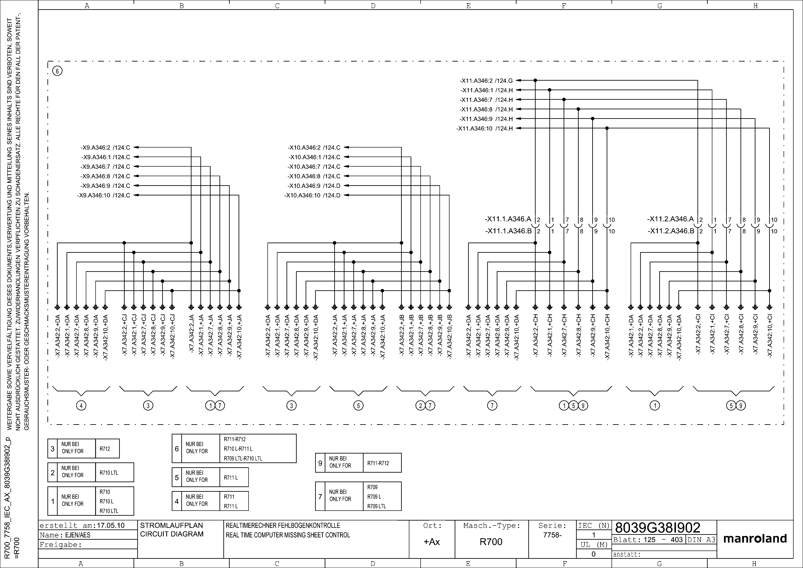

# +Ax — Sheet 125 of 403 — REALTIMERECHNER FEHLBOGENKONTROLLE

**REAL TIME COMPUTER MISSING SHEET CONTROL**

> Part of the manroland **R700** printing press IEC/UL circuit diagrams.
> Drawing class: **Stromlaufplan / Circuit diagram** (DIN A3).
> Document `+Ax` covers the **Central control console** machine section.

## At a glance

| Field | Value |
|---|---|
| Document | `+Ax`  (8039G38I902) |
| Sheet | **125** of 403 |
| Section (DE) | REALTIMERECHNER FEHLBOGENKONTROLLE |
| Section (EN) | REAL TIME COMPUTER MISSING SHEET CONTROL |
| Section type | CIRCUIT — Circuit diagram |
| Machine type | `R700` |
| Series | `7758` |
| Created | 17.05.10 |
| Replaces | — |
| Columns used | A, B, C, D, E, F, G, H |
| Path numbers | — |
| Labels on sheet | 179 |
| Cross-refs out | 18 |
| Cross-refs in | 42 |

**Previous:** [+Ax sheet 124](SHEET_0124.md) · **Next:** [+Ax sheet 126](SHEET_0126.md) · **Document TOC:** [_TOC.md](_TOC.md)  (+Ax) · **Master TOC:** [all sheets](../_MASTER_TOC.md)

## Sheet image (300 DPI, exact vector render)



_Rendered directly from the PDF vector layer at 300 DPI (1-bit), no OCR and no resampling. Use it to confirm anything ambiguous in the text below._

## Cross-references on this sheet

Each entry is a wire leaving this sheet. The printed token is `/sheet.column`; the link resolves to that sheet inside the same document.

| Ref | Target sheet | Col | Path | Destination on target | Target section | From col |
|---|---|---|---|---|---|---|
| `/124.G` | [+Ax sheet 124](SHEET_0124.md) | G | — | X11.A346:2 | REALTIMERECHNER FEHLBOGENKONTROLLE | E |
| `/124.H` | [+Ax sheet 124](SHEET_0124.md) | H | — | X11.A346:1 | REALTIMERECHNER FEHLBOGENKONTROLLE | E |
| `/124.H` | [+Ax sheet 124](SHEET_0124.md) | H | — | X11.A346:7 | REALTIMERECHNER FEHLBOGENKONTROLLE | E |
| `/124.H` | [+Ax sheet 124](SHEET_0124.md) | H | — | X11.A346:8 | REALTIMERECHNER FEHLBOGENKONTROLLE | E |
| `/124.H` | [+Ax sheet 124](SHEET_0124.md) | H | — | X11.A346:9 | REALTIMERECHNER FEHLBOGENKONTROLLE | E |
| `/124.H` | [+Ax sheet 124](SHEET_0124.md) | H | — | X11.A346:10 | REALTIMERECHNER FEHLBOGENKONTROLLE | E |
| `/124.C` | [+Ax sheet 124](SHEET_0124.md) | C | — | X9.A346:2 | REALTIMERECHNER FEHLBOGENKONTROLLE | A |
| `/124.C` | [+Ax sheet 124](SHEET_0124.md) | C | — | X10.A346:2 | REALTIMERECHNER FEHLBOGENKONTROLLE | C |
| `/124.C` | [+Ax sheet 124](SHEET_0124.md) | C | — | X9.A346:1 | REALTIMERECHNER FEHLBOGENKONTROLLE | A |
| `/124.C` | [+Ax sheet 124](SHEET_0124.md) | C | — | X10.A346:1 | REALTIMERECHNER FEHLBOGENKONTROLLE | C |
| `/124.C` | [+Ax sheet 124](SHEET_0124.md) | C | — | X9.A346:7 | REALTIMERECHNER FEHLBOGENKONTROLLE | A |
| `/124.C` | [+Ax sheet 124](SHEET_0124.md) | C | — | X10.A346:7 | REALTIMERECHNER FEHLBOGENKONTROLLE | C |
| `/124.C` | [+Ax sheet 124](SHEET_0124.md) | C | — | X9.A346:8 | REALTIMERECHNER FEHLBOGENKONTROLLE | A |
| `/124.C` | [+Ax sheet 124](SHEET_0124.md) | C | — | X10.A346:8 | REALTIMERECHNER FEHLBOGENKONTROLLE | C |
| `/124.C` | [+Ax sheet 124](SHEET_0124.md) | C | — | X9.A346:9 | REALTIMERECHNER FEHLBOGENKONTROLLE | A |
| `/124.D` | [+Ax sheet 124](SHEET_0124.md) | D | — | X10.A346:9 | REALTIMERECHNER FEHLBOGENKONTROLLE | C |
| `/124.C` | [+Ax sheet 124](SHEET_0124.md) | C | — | X9.A346:10 | REALTIMERECHNER FEHLBOGENKONTROLLE | A |
| `/124.D` | [+Ax sheet 124](SHEET_0124.md) | D | — | X10.A346:10 | REALTIMERECHNER FEHLBOGENKONTROLLE | C |

### Incoming references (sheets that point here)

Every other sheet that sends a wire to this one. `Back-ref` is the token printed on *that* sheet; `Path` is its line number.

| From sheet | Cols | Back-ref | Path | Refs | What continues there |
|---|---|---|---|---|---|
| [+Ax#124](SHEET_0124.md) | C, D, G, H | `/124.C`, `/124.D`, `/124.G`, `/124.H` | — | 18 | X9.A346:1; X9.A346:10; X9.A346:2; X9.A346:7; X9.A346:8; X9.A346:9 |
| [+Ax#246](SHEET_0246.md) | F, G | `/246.F`, `/246.G` | — | 24 | — |


## Devices on this sheet

| Tag | Class | Class meaning (IEC) | Col | Sub | Terminal | Sign |
|---|---|---|---|---|---|---|
| `R711` | R | Widerstand / resistor | B | — | — | — |
| `R709` | R | Widerstand / resistor | D | — | — | — |
| `R712` | R | Widerstand / resistor | A | — | — | — |
| `R710` | R | Widerstand / resistor | A | — | — | — |
| `X11.1.A346.B` | — | cross-device reference | E | — | — | — |
| `X11.1.A346.A` | — | cross-device reference | E | — | — | — |
| `X11.2.A346.B` | — | cross-device reference | G | — | — | — |
| `X11.2.A346.A` | — | cross-device reference | G | — | — | — |
| `X10.A346:1` | — | cross-device reference | C | — | 1 | — |
| `X10.A346:2` | — | cross-device reference | C | — | 2 | — |
| `X10.A346:7` | — | cross-device reference | C | — | 7 | — |
| `X10.A346:8` | — | cross-device reference | C | — | 8 | — |
| `X10.A346:9` | — | cross-device reference | C | — | 9 | — |
| `X10.A346:10` | — | cross-device reference | C | — | 10 | — |
| `X11.A346:10` | — | cross-device reference | E | — | 10 | — |
| `X11.A346:9` | — | cross-device reference | E | — | 9 | — |
| `X11.A346:2` | — | cross-device reference | E | — | 2 | — |
| `X11.A346:7` | — | cross-device reference | E | — | 7 | — |
| `X11.A346:8` | — | cross-device reference | E | — | 8 | — |
| `X11.A346:1` | — | cross-device reference | E | — | 1 | — |
| `X9.A346:10` | — | cross-device reference | A | — | 10 | — |
| `X9.A346:9` | — | cross-device reference | A | — | 9 | — |
| `X9.A346:1` | — | cross-device reference | A | — | 1 | — |
| `X9.A346:2` | — | cross-device reference | A | — | 2 | — |
| `X9.A346:7` | — | cross-device reference | A | — | 7 | — |
| `X9.A346:8` | — | cross-device reference | A | — | 8 | — |

## Potentials / nets

_No named potentials on this sheet._

## Wire-end annotations (grouped as printed)

A wire that continues elsewhere is annotated with a small cluster: the destination description, the path/line number `#NN`, and the `/sheet.column` cross reference. Each row below is one such cluster exactly as it is grouped on the drawing.

| Col | Y | Path | Cross-ref | Text on the wire |
|---|---|---|---|---|
| A | 102.3 | — | — | `6` |
| E | 115.8 | — | `/124.G` | `X11.A346:2` |
| E | 130.0 | — | `/124.H` | `X11.A346:1` |
| E | 144.1 | — | `/124.H` | `X11.A346:7` |
| E | 158.3 | — | `/124.H` | `X11.A346:8` |
| E | 172.5 | — | `/124.H` | `X11.A346:9` |
| E | 186.7 | — | `/124.H` | `X11.A346:10` |
| A | 215.0 | — | `/124.C` | `X9.A346:2` |
| C | 215.0 | — | `/124.C` | `X10.A346:2` |
| A | 229.2 | — | `/124.C` | `X9.A346:1` |
| C | 229.2 | — | `/124.C` | `X10.A346:1` |
| A | 243.3 | — | `/124.C` | `X9.A346:7` |
| C | 243.3 | — | `/124.C` | `X10.A346:7` |
| A | 257.5 | — | `/124.C` | `X9.A346:8` |
| C | 257.5 | — | `/124.C` | `X10.A346:8` |
| A | 271.7 | — | `/124.C` | `X9.A346:9` |
| C | 271.7 | — | `/124.D` | `X10.A346:9` |
| A | 285.9 | — | `/124.C` | `X9.A346:10` |
| C | 285.9 | — | `/124.D` | `X10.A346:10` |
| F | 319.9 | — | — | `X11.1.A346.A 2 1 7 8 9 10` |
| H | 319.9 | — | — | `X11.2.A346.A 2 1 7 8 9 10` |
| F | 337.6 | — | — | `X11.1.A346.B 2 1 7 8 9 10` |
| H | 337.6 | — | — | `X11.2.A346.B 2 1 7 8 9 10` |
| A | 465.4 | — | — | `X7.A342:2,+CJ` |
| B | 465.4 | — | — | `X7.A342:1,+CJ` |
| B | 465.4 | — | — | `X7.A342:7,+CJ` |
| B | 465.4 | — | — | `X7.A342:8,+CJ` |
| B | 465.4 | — | — | `X7.A342:9,+CJ` |
| B | 465.4 | — | — | `X7.A342:10,+CJ` |
| F | 465.4 | — | — | `X7.A342:2,+CH` |
| F | 465.4 | — | — | `X7.A342:1,+CH` |
| F | 465.4 | — | — | `X7.A342:7,+CH` |
| F | 465.4 | — | — | `X7.A342:8,+CH` |
| F | 465.4 | — | — | `X7.A342:9,+CH` |
| F | 465.4 | — | — | `X7.A342:10,+CH` |
| G | 465.4 | — | — | `X7.A342:2,+CI` |
| H | 465.4 | — | — | `X7.A342:1,+CI` |
| H | 465.4 | — | — | `X7.A342:7,+CI` |
| H | 465.4 | — | — | `X7.A342:8,+CI` |
| H | 465.4 | — | — | `X7.A342:9,+CI` |
| H | 465.4 | — | — | `X7.A342:10,+CI` |
| D | 466.0 | — | — | `X7.A342:2,+JB` |
| D | 466.0 | — | — | `X7.A342:1,+JB` |
| E | 466.0 | — | — | `X7.A342:7,+JB` |
| E | 466.0 | — | — | `X7.A342:8,+JB` |
| E | 466.0 | — | — | `X7.A342:9,+JB` |
| E | 466.0 | — | — | `X7.A342:10,+JB` |
| A | 466.3 | — | — | `X7.A342:2,+DA` |
| A | 466.3 | — | — | `X7.A342:1,+DA` |
| A | 466.3 | — | — | `X7.A342:7,+DA` |
| A | 466.3 | — | — | `X7.A342:8,+DA` |
| A | 466.3 | — | — | `X7.A342:9,+DA` |
| A | 466.3 | — | — | `X7.A342:10,+DA` |
| B | 466.3 | — | — | `X7.A342:2,JA` |
| B | 466.3 | — | — | `X7.A342:1,+JA` |
| B | 466.3 | — | — | `X7.A342:7,+JA` |
| B | 466.3 | — | — | `X7.A342:8,+JA` |
| C | 466.3 | — | — | `X7.A342:9,+JA` |
| C | 466.3 | — | — | `X7.A342:10,+JA` |
| C | 466.3 | — | — | `X7.A342:2,+DA` |
| C | 466.3 | — | — | `X7.A342:1,+DA` |
| C | 466.3 | — | — | `X7.A342:7,+DA` |
| C | 466.3 | — | — | `X7.A342:8,+DA` |
| C | 466.3 | — | — | `X7.A342:9,+DA` |
| C | 466.3 | — | — | `X7.A342:10,+DA` |
| D | 466.3 | — | — | `X7.A342:2,+JA` |
| D | 466.3 | — | — | `X7.A342:1,+JA` |
| D | 466.3 | — | — | `X7.A342:7,+JA` |
| D | 466.3 | — | — | `X7.A342:8,+JA` |
| D | 466.3 | — | — | `X7.A342:9,+JA` |
| D | 466.3 | — | — | `X7.A342:10,+JA` |
| E | 466.3 | — | — | `X7.A342:2,+DA` |
| E | 466.3 | — | — | `X7.A342:1,+DA` |
| E | 466.3 | — | — | `X7.A342:7,+DA` |
| E | 466.3 | — | — | `X7.A342:8,+DA` |
| E | 466.3 | — | — | `X7.A342:9,+DA` |
| F | 466.3 | — | — | `X7.A342:10,+DA` |
| G | 466.3 | — | — | `X7.A342:1,+DA` |
| G | 466.3 | — | — | `X7.A342:2,+DA` |
| G | 466.3 | — | — | `X7.A342:7,+DA` |
| G | 466.3 | — | — | `X7.A342:8,+DA` |
| G | 466.3 | — | — | `X7.A342:9,+DA` |
| G | 466.3 | — | — | `X7.A342:10,+DA` |
| E | 597.9 | — | — | `1 7 2 7 1 9 5 9` |
| F | 597.9 | — | — | `7 1` |
| D | 598.4 | — | — | `4 3 3 5 5` |
| C | 648.4 | — | — | `R711 R712` |
| A | 655.4 | — | — | `NUR BEI` |
| B | 655.4 | — | — | `6 NUR BEI R709 LTL R710 LTL` |
| A | 660.7 | — | — | `3 ONLY FOR R712` |
| C | 662.5 | — | — | `R710 L R711 L` |
| B | 666.1 | — | — | `ONLY FOR` |
| D | 676.6 | — | — | `NUR BEI` |
| D | 682.0 | — | — | `9 ONLY FOR R711 R712` |
| A | 690.8 | — | — | `NUR BEI` |
| A | 696.2 | — | — | `2 ONLY FOR R710 LTL` |
| B | 697.9 | — | — | `NUR BEI` |
| B | 703.3 | — | — | `5 ONLY FOR R711 L` |
| D | 719.2 | — | — | `R709` |
| D | 726.2 | — | — | `NUR BEI` |
| A | 726.3 | — | — | `R710` |
| D | 731.6 | — | — | `7 ONLY FOR` |
| B | 733.3 | — | — | `NUR BEI 4 ONLY FOR` |
| B | 733.3 | — | — | `NUR BEI` |
| B | 733.3 | — | — | `R711` |
| D | 733.4 | — | — | `R709 L` |
| A | 738.7 | — | — | `1 ONLY FOR` |
| A | 740.5 | — | — | `R710 L` |
| C | 747.5 | — | — | `R711 L` |
| D | 747.6 | — | — | `R709 LTL` |
| A | 754.6 | — | — | `R710 LTL` |


## Reconstructed tables

This sheet carries tabular content (pin map / terminal assignment / index). The grid below was rebuilt from the drawing's own rule lines, so each row is exactly one physical row of the table.

### Table 1 — 12 data rows × 53 columns (at x=85.0, y=119.1)

|  |  |  |  |  |  |  |  |  |  |  |  |  |  |  |  |  |  |  |  |  |  |  |  |  |  |  |  |  |  |  |  | X11.A346:2 |  |  | /124.G |  |  |  |  |  |  |  |  |  |  |  |  |  |  |  |  |  |
|---|---|---|---|---|---|---|---|---|---|---|---|---|---|---|---|---|---|---|---|---|---|---|---|---|---|---|---|---|---|---|---|---|---|---|---|---|---|---|---|---|---|---|---|---|---|---|---|---|---|---|---|---|
|  |  |  |  |  |  |  |  |  |  |  |  |  |  |  |  |  |  |  |  |  |  |  |  |  |  |  |  |  |  |  |  | `X11.A346:1` |  |  | `/124.H` |  |  |  |  |  |  |  |  |  |  |  |  |  |  |  |  |  |
|  |  |  |  |  |  |  |  |  |  |  |  |  |  |  |  |  |  |  |  |  |  |  |  |  |  |  |  |  |  |  |  | `X11.A346:7` |  |  | `/124.H` |  |  |  |  |  |  |  |  |  |  |  |  |  |  |  |  |  |
|  |  |  |  |  |  |  |  |  |  |  |  |  |  |  |  |  |  |  |  |  |  |  |  |  |  |  |  |  |  |  |  | `X11.A346:8` |  |  | `/124.H` |  |  |  |  |  |  |  |  |  |  |  |  |  |  |  |  |  |
|  |  |  |  |  |  |  |  |  |  |  |  |  |  |  |  |  |  |  |  |  |  |  |  |  |  |  |  |  |  |  |  | `X11.A346:9` |  |  | `/124.H` |  |  |  |  |  |  |  |  |  |  |  |  |  |  |  |  |  |
|  |  |  |  |  |  |  |  |  |  |  |  |  |  |  |  |  |  |  |  |  |  |  |  |  |  |  |  |  |  |  |  | `X11.A346:10` |  |  | `/124.H` |  |  |  |  |  |  |  |  |  |  |  |  |  |  |  |  |  |
|  |  |  | `X9.A346:2` | `/124.C` |  |  |  |  |  |  |  |  |  |  |  |  |  |  | `X10.A346:2` | `/124.C` |  |  |  |  |  |  |  |  |  |  |  |  |  |  |  |  |  |  |  |  |  |  |  |  |  |  |  |  |  |  |  |  |
|  |  |  |  | `X9.A346:1 /124.C` |  |  |  |  |  |  |  |  |  |  |  |  |  |  | `X10.A346:1` | `/124.C` |  |  |  |  |  |  |  |  |  |  |  |  |  |  |  |  |  |  |  |  |  |  |  |  |  |  |  |  |  |  |  |  |
|  |  |  | `X9.A346:7` | `/124.C` |  |  |  |  |  |  |  |  |  |  |  |  |  |  | `X10.A346:7` | `/124.C` |  |  |  |  |  |  |  |  |  |  |  |  |  |  |  |  |  |  |  |  |  |  |  |  |  |  |  |  |  |  |  |  |
|  |  |  | `X9.A346:8` | `/124.C` |  |  |  |  |  |  |  |  |  |  |  |  |  |  | `X10.A346:8` | `/124.C` |  |  |  |  |  |  |  |  |  |  |  |  |  |  |  |  |  |  |  |  |  |  |  |  |  |  |  |  |  |  |  |  |
|  |  |  | `X9.A346:9` | `/124.C` |  |  |  |  |  |  |  |  |  |  |  |  |  |  | `X10.A346:9` | `/124.D` |  |  |  |  |  |  |  |  |  |  |  |  |  |  |  |  |  |  |  |  |  |  |  |  |  |  |  |  |  |  |  |  |
|  |  |  | `X9.A346:10` | `/124.C` |  |  |  |  |  |  |  |  |  |  |  |  |  |  | `X10.A346:10` | `/124.D` |  |  |  |  |  |  |  |  |  |  |  |  |  |  |  | `X11.1.A346.A X11.1.A346.B` | `2 2` | `1 1` | `7 7` | `8 8` | `9 9` | `10 10` |  |  |  |  | `X11.2.A346.A X11.2.A346.B` | `2 2` | `1 1` | `7 7` | `8 8` | `9 9` |
| `X7.A342:2,+DA` | `X7.A342:1,+DA` | `X7.A342:7,+DA` | `X7.A342:8,+DA` | `X7.A342:10,+DA X7.A342:9,+DA` | `X7.A342:2,+CJ` | `X7.A342:1,+CJ` | `X7.A342:7,+CJ` | `X7.A342:8,+CJ` | `X7.A342:10,+CJ X7.A342:9,+CJ` | `X7.A342:2,JA` | `X7.A342:1,+JA` | `X7.A342:7,+JA` | `X7.A342:8,+JA` | `X7.A342:9,+JA` | `X7.A342:10,+JA` | `X7.A342:2,+DA` | `X7.A342:1,+DA` | `X7.A342:7,+DA` | `X7.A342:8,+DA` | `X7.A342:10,+DA X7.A342:9,+DA` | `X7.A342:2,+JA` | `X7.A342:1,+JA` | `X7.A342:7,+JA` | `X7.A342:8,+JA` | `X7.A342:9,+JA X7.A342:10,+JA` | `X7.A342:2,+JB` | `X7.A342:1,+JB` | `X7.A342:7,+JB` | `X7.A342:8,+JB` | `X7.A342:9,+JB` | `X7.A342:10,+JB` | `X7.A342:2,+DA` | `X7.A342:1,+DA` | `X7.A342:7,+DA` | `X7.A342:8,+DA` | `X7.A342:10,+DA X7.A342:9,+DA` | `X7.A342:2,+CH` | `X7.A342:1,+CH` | `X7.A342:7,+CH` | `X7.A342:8,+CH` | `X7.A342:9,+CH` | `X7.A342:10,+CH` | `X7.A342:1,+DA` | `X7.A342:2,+DA` | `X7.A342:7,+DA` | `X7.A342:8,+DA` | `X7.A342:10,+DA X7.A342:9,+DA` | `X7.A342:2,+CI` | `X7.A342:1,+CI` | `X7.A342:7,+CI` | `X7.A342:8,+CI` | `X7.A342:9,+CI` |


## Notes and free text on this sheet

| Text | Col | Y (pt) |
|---|---|---|
| `X7.A342:9,+DA` | A | 466.3 |
| `X7.A342:8,+DA` | A | 466.3 |
| `X7.A342:7,+DA` | A | 466.3 |
| `X7.A342:1,+DA` | A | 466.3 |
| `X7.A342:2,+DA` | A | 466.3 |
| `X7.A342:10,+DA` | A | 466.3 |
| `X7.A342:9,+CJ` | B | 465.45 |
| `X7.A342:8,+CJ` | B | 465.45 |
| `X7.A342:7,+CJ` | B | 465.45 |
| `X7.A342:1,+CJ` | B | 465.45 |
| `X7.A342:2,+CJ` | A | 465.45 |
| `X7.A342:10,+CJ` | B | 465.45 |
| `X7.A342:2,JA` | B | 466.3 |
| `X7.A342:1,+JA` | B | 466.3 |
| `X7.A342:7,+JA` | B | 466.3 |
| `X7.A342:8,+JA` | B | 466.3 |
| `X7.A342:9,+JA` | C | 466.3 |
| `X7.A342:10,+JA` | C | 466.3 |
| `X7.A342:9,+DA` | C | 466.3 |
| `X7.A342:8,+DA` | C | 466.3 |
| `X7.A342:7,+DA` | C | 466.3 |
| `X7.A342:1,+DA` | C | 466.3 |
| `X7.A342:2,+DA` | C | 466.3 |
| `X7.A342:10,+DA` | C | 466.3 |
| `X7.A342:2,+JB` | D | 466.02 |
| `X7.A342:1,+JB` | D | 466.02 |
| `X7.A342:7,+JB` | E | 466.02 |
| `X7.A342:8,+JB` | E | 466.02 |
| `X7.A342:9,+JB` | E | 466.02 |
| `X7.A342:10,+JB` | E | 466.02 |
| `X7.A342:2,+JA` | D | 466.3 |
| `X7.A342:1,+JA` | D | 466.3 |
| `X7.A342:7,+JA` | D | 466.3 |
| `X7.A342:8,+JA` | D | 466.3 |
| `X7.A342:9,+JA` | D | 466.3 |
| `X7.A342:10,+JA` | D | 466.3 |
| `X7.A342:2,+CH` | F | 465.45 |
| `X7.A342:1,+CH` | F | 465.45 |
| `X7.A342:7,+CH` | F | 465.45 |
| `X7.A342:8,+CH` | F | 465.45 |
| `X7.A342:9,+CH` | F | 465.45 |
| `X7.A342:10,+CH` | F | 465.45 |
| `X7.A342:2,+CI` | G | 465.45 |
| `X7.A342:1,+CI` | H | 465.45 |
| `X7.A342:7,+CI` | H | 465.45 |
| `X7.A342:8,+CI` | H | 465.45 |
| `X7.A342:9,+CI` | H | 465.45 |
| `X7.A342:10,+CI` | H | 465.45 |
| `X7.A342:2,+DA` | E | 466.3 |
| `X7.A342:1,+DA` | E | 466.3 |
| `X7.A342:7,+DA` | E | 466.3 |
| `X7.A342:8,+DA` | E | 466.3 |
| `X7.A342:9,+DA` | E | 466.3 |
| `X7.A342:10,+DA` | F | 466.3 |
| `X7.A342:1,+DA` | G | 466.3 |
| `X7.A342:2,+DA` | G | 466.3 |
| `X7.A342:7,+DA` | G | 466.3 |
| `X7.A342:8,+DA` | G | 466.3 |
| `X7.A342:9,+DA` | G | 466.3 |
| `X7.A342:10,+DA` | G | 466.3 |
| `NUR BEI` | B | 733.33 |
| `ONLY FOR` | B | 744.02 |
| `NUR BEI` | A | 733.33 |
| `ONLY FOR` | A | 744.02 |
| `R711 L` | C | 705.03 |
| `R711 R712` | C | 648.37 |
| `R710 L R711 L` | C | 662.54 |
| `R709 LTL R710 LTL` | C | 676.71 |
| `NUR BEI` | D | 676.64 |
| `ONLY FOR` | D | 687.33 |
| `R711 R712` | D | 683.8 |
| `R709 L` | D | 733.38 |
| `R709 LTL` | D | 747.56 |
| `R710 LTL` | A | 697.95 |
| `R710 L` | A | 740.46 |

## Complete label inventory (exact text from the drawing)

Every text object inside the drawing area of this sheet, in DIN reading order (column A→H, then top→bottom). This is the authoritative list: if a string is not here it is not printed on this sheet.

| Col | Y | X | Dir | Type | Text |
|---|---|---|---|---|---|
| A | 102.3 | 83.0 | → | number | `6` |
| A | 215.0 | 119.6 | → | device ref | `X9.A346:2` |
| A | 215.0 | 167.2 | → | cross-reference | `/124.C` |
| A | 229.2 | 120.8 | → | device ref | `X9.A346:1` |
| A | 229.2 | 167.2 | → | cross-reference | `/124.C` |
| A | 243.4 | 119.3 | → | device ref | `X9.A346:7` |
| A | 243.4 | 167.2 | → | cross-reference | `/124.C` |
| A | 257.5 | 119.3 | → | device ref | `X9.A346:8` |
| A | 257.5 | 167.2 | → | cross-reference | `/124.C` |
| A | 271.7 | 119.3 | → | device ref | `X9.A346:9` |
| A | 271.7 | 167.2 | → | cross-reference | `/124.C` |
| A | 285.9 | 114.5 | → | device ref | `X9.A346:10` |
| A | 285.9 | 167.2 | → | cross-reference | `/124.C` |
| A | 465.5 | 181.0 | ↕ | text | `X7.A342:2,+CJ` |
| A | 466.3 | 81.8 | ↕ | text | `X7.A342:2,+DA` |
| A | 466.3 | 95.9 | ↕ | text | `X7.A342:1,+DA` |
| A | 466.3 | 110.1 | ↕ | text | `X7.A342:7,+DA` |
| A | 466.3 | 124.3 | ↕ | text | `X7.A342:8,+DA` |
| A | 466.3 | 138.5 | ↕ | text | `X7.A342:9,+DA` |
| A | 466.3 | 152.6 | ↕ | text | `X7.A342:10,+DA` |
| A | 598.4 | 118.5 | → | number | `4` |
| A | 655.4 | 91.3 | → | text | `NUR BEI` |
| A | 660.7 | 75.0 | → | number | `3` |
| A | 662.5 | 148.0 | → | device tag | `R712` |
| A | 666.1 | 91.8 | → | text | `ONLY FOR` |
| A | 690.8 | 91.3 | → | text | `NUR BEI` |
| A | 696.2 | 75.1 | → | number | `2` |
| A | 698.0 | 148.0 | → | text | `R710 LTL` |
| A | 701.5 | 91.8 | → | text | `ONLY FOR` |
| A | 726.3 | 148.0 | → | device tag | `R710` |
| A | 733.3 | 91.3 | → | text | `NUR BEI` |
| A | 738.7 | 75.4 | → | number | `1` |
| A | 740.5 | 148.0 | → | text | `R710 L` |
| A | 744.0 | 91.8 | → | text | `ONLY FOR` |
| A | 754.6 | 148.0 | → | text | `R710 LTL` |
| B | 465.4 | 251.9 | ↕ | text | `X7.A342:10,+CJ` |
| B | 465.5 | 195.2 | ↕ | text | `X7.A342:1,+CJ` |
| B | 465.5 | 209.3 | ↕ | text | `X7.A342:7,+CJ` |
| B | 465.5 | 223.5 | ↕ | text | `X7.A342:8,+CJ` |
| B | 465.5 | 237.7 | ↕ | text | `X7.A342:9,+CJ` |
| B | 466.3 | 280.2 | ↕ | text | `X7.A342:2,JA` |
| B | 466.3 | 294.4 | ↕ | text | `X7.A342:1,+JA` |
| B | 466.3 | 308.5 | ↕ | text | `X7.A342:7,+JA` |
| B | 466.3 | 322.7 | ↕ | text | `X7.A342:8,+JA` |
| B | 597.9 | 310.1 | → | number | `1` |
| B | 598.4 | 217.7 | → | number | `3` |
| B | 598.4 | 324.0 | → | number | `7` |
| B | 655.4 | 275.5 | → | text | `NUR BEI` |
| B | 660.7 | 259.4 | → | number | `6` |
| B | 666.1 | 276.1 | → | text | `ONLY FOR` |
| B | 697.9 | 275.5 | → | text | `NUR BEI` |
| B | 703.3 | 259.2 | → | number | `5` |
| B | 708.6 | 276.1 | → | text | `ONLY FOR` |
| B | 733.3 | 275.5 | → | text | `NUR BEI` |
| B | 733.3 | 332.2 | → | device tag | `R711` |
| B | 738.7 | 259.4 | → | number | `4` |
| B | 744.0 | 276.1 | → | text | `ONLY FOR` |
| C | 215.0 | 426.6 | → | device ref | `X10.A346:2` |
| C | 229.2 | 427.7 | → | device ref | `X10.A346:1` |
| C | 243.4 | 426.3 | → | device ref | `X10.A346:7` |
| C | 257.5 | 426.3 | → | device ref | `X10.A346:8` |
| C | 271.7 | 426.3 | → | device ref | `X10.A346:9` |
| C | 285.9 | 421.5 | → | device ref | `X10.A346:10` |
| C | 466.3 | 336.9 | ↕ | text | `X7.A342:9,+JA` |
| C | 466.3 | 351.1 | ↕ | text | `X7.A342:10,+JA` |
| C | 466.3 | 393.6 | ↕ | text | `X7.A342:2,+DA` |
| C | 466.3 | 407.8 | ↕ | text | `X7.A342:1,+DA` |
| C | 466.3 | 421.9 | ↕ | text | `X7.A342:7,+DA` |
| C | 466.3 | 436.1 | ↕ | text | `X7.A342:8,+DA` |
| C | 466.3 | 450.3 | ↕ | text | `X7.A342:9,+DA` |
| C | 466.3 | 464.5 | ↕ | text | `X7.A342:10,+DA` |
| C | 598.4 | 430.3 | → | number | `3` |
| C | 648.4 | 332.2 | → | text | `R711 R712` |
| C | 662.5 | 332.2 | → | text | `R710 L R711 L` |
| C | 676.7 | 332.2 | → | text | `R709 LTL R710 LTL` |
| C | 682.0 | 471.8 | → | number | `9` |
| C | 705.0 | 332.2 | → | text | `R711 L` |
| C | 731.6 | 472.0 | → | number | `7` |
| C | 747.5 | 332.2 | → | text | `R711 L` |
| D | 215.0 | 479.1 | → | cross-reference | `/124.C` |
| D | 229.2 | 479.1 | → | cross-reference | `/124.C` |
| D | 243.4 | 479.1 | → | cross-reference | `/124.C` |
| D | 257.5 | 479.1 | → | cross-reference | `/124.C` |
| D | 271.7 | 479.1 | → | cross-reference | `/124.D` |
| D | 285.9 | 479.1 | → | cross-reference | `/124.D` |
| D | 466.0 | 592.0 | ↕ | text | `X7.A342:2,+JB` |
| D | 466.0 | 606.2 | ↕ | text | `X7.A342:1,+JB` |
| D | 466.3 | 492.8 | ↕ | text | `X7.A342:2,+JA` |
| D | 466.3 | 507.0 | ↕ | text | `X7.A342:1,+JA` |
| D | 466.3 | 521.1 | ↕ | text | `X7.A342:7,+JA` |
| D | 466.3 | 535.3 | ↕ | text | `X7.A342:8,+JA` |
| D | 466.3 | 549.5 | ↕ | text | `X7.A342:9,+JA` |
| D | 466.3 | 563.7 | ↕ | text | `X7.A342:10,+JA` |
| D | 598.4 | 529.5 | → | number | `5` |
| D | 598.4 | 621.6 | → | number | `2` |
| D | 676.6 | 488.1 | → | text | `NUR BEI` |
| D | 683.8 | 544.8 | → | text | `R711 R712` |
| D | 687.3 | 488.7 | → | text | `ONLY FOR` |
| D | 719.2 | 544.8 | → | device tag | `R709` |
| D | 726.2 | 488.1 | → | text | `NUR BEI` |
| D | 733.4 | 544.8 | → | text | `R709 L` |
| D | 736.9 | 488.7 | → | text | `ONLY FOR` |
| D | 747.6 | 544.8 | → | text | `R709 LTL` |
| E | 115.8 | 681.7 | → | device ref | `X11.A346:2` |
| E | 115.8 | 733.9 | → | cross-reference | `/124.G` |
| E | 130.0 | 682.9 | → | device ref | `X11.A346:1` |
| E | 130.0 | 734.7 | → | cross-reference | `/124.H` |
| E | 144.1 | 681.4 | → | device ref | `X11.A346:7` |
| E | 144.1 | 734.7 | → | cross-reference | `/124.H` |
| E | 158.3 | 681.4 | → | device ref | `X11.A346:8` |
| E | 158.3 | 734.7 | → | cross-reference | `/124.H` |
| E | 172.5 | 681.4 | → | device ref | `X11.A346:9` |
| E | 172.5 | 734.7 | → | cross-reference | `/124.H` |
| E | 186.7 | 676.6 | → | device ref | `X11.A346:10` |
| E | 186.7 | 734.7 | → | cross-reference | `/124.H` |
| E | 319.9 | 718.9 | → | device ref | `X11.1.A346.A` |
| E | 337.6 | 719.7 | → | device ref | `X11.1.A346.B` |
| E | 466.0 | 620.3 | ↕ | text | `X7.A342:7,+JB` |
| E | 466.0 | 634.5 | ↕ | text | `X7.A342:8,+JB` |
| E | 466.0 | 648.7 | ↕ | text | `X7.A342:9,+JB` |
| E | 466.0 | 662.9 | ↕ | text | `X7.A342:10,+JB` |
| E | 466.3 | 691.2 | ↕ | text | `X7.A342:2,+DA` |
| E | 466.3 | 705.4 | ↕ | text | `X7.A342:1,+DA` |
| E | 466.3 | 719.6 | ↕ | text | `X7.A342:7,+DA` |
| E | 466.3 | 733.7 | ↕ | text | `X7.A342:8,+DA` |
| E | 466.3 | 747.9 | ↕ | text | `X7.A342:9,+DA` |
| E | 598.4 | 635.8 | → | number | `7` |
| E | 598.4 | 727.9 | → | number | `7` |
| F | 322.1 | 796.3 | → | number | `2` |
| F | 322.1 | 816.9 | → | number | `1` |
| F | 322.1 | 838.8 | → | number | `7` |
| F | 322.1 | 860.0 | → | number | `8` |
| F | 322.1 | 881.3 | → | number | `9` |
| F | 322.1 | 902.0 | → | number | `10` |
| F | 339.1 | 796.3 | → | number | `2` |
| F | 339.1 | 816.9 | → | number | `1` |
| F | 339.1 | 838.8 | → | number | `7` |
| F | 339.1 | 860.0 | → | number | `8` |
| F | 339.1 | 881.3 | → | number | `9` |
| F | 339.1 | 902.0 | → | number | `10` |
| F | 465.4 | 896.7 | ↕ | text | `X7.A342:10,+CH` |
| F | 465.5 | 790.4 | ↕ | text | `X7.A342:2,+CH` |
| F | 465.5 | 811.7 | ↕ | text | `X7.A342:1,+CH` |
| F | 465.5 | 833.0 | ↕ | text | `X7.A342:7,+CH` |
| F | 465.5 | 854.2 | ↕ | text | `X7.A342:8,+CH` |
| F | 465.5 | 875.5 | ↕ | text | `X7.A342:9,+CH` |
| F | 466.3 | 762.1 | ↕ | text | `X7.A342:10,+DA` |
| F | 597.9 | 834.5 | → | number | `1` |
| F | 598.4 | 848.4 | → | number | `5` |
| F | 598.4 | 862.6 | → | number | `9` |
| G | 319.9 | 959.8 | → | device ref | `X11.2.A346.A` |
| G | 322.1 | 1037.2 | → | number | `2` |
| G | 337.6 | 960.7 | → | device ref | `X11.2.A346.B` |
| G | 339.1 | 1037.2 | → | number | `2` |
| G | 465.5 | 1031.4 | ↕ | text | `X7.A342:2,+CI` |
| G | 466.3 | 932.2 | ↕ | text | `X7.A342:1,+DA` |
| G | 466.3 | 946.3 | ↕ | text | `X7.A342:2,+DA` |
| G | 466.3 | 960.5 | ↕ | text | `X7.A342:7,+DA` |
| G | 466.3 | 974.7 | ↕ | text | `X7.A342:8,+DA` |
| G | 466.3 | 988.9 | ↕ | text | `X7.A342:9,+DA` |
| G | 466.3 | 1003.0 | ↕ | text | `X7.A342:10,+DA` |
| G | 597.9 | 969.1 | → | number | `1` |
| H | 322.1 | 1057.9 | → | number | `1` |
| H | 322.1 | 1079.7 | → | number | `7` |
| H | 322.1 | 1101.0 | → | number | `8` |
| H | 322.1 | 1122.2 | → | number | `9` |
| H | 322.1 | 1142.9 | → | number | `10` |
| H | 339.1 | 1057.9 | → | number | `1` |
| H | 339.1 | 1079.7 | → | number | `7` |
| H | 339.1 | 1101.0 | → | number | `8` |
| H | 339.1 | 1122.2 | → | number | `9` |
| H | 339.1 | 1142.9 | → | number | `10` |
| H | 465.4 | 1137.7 | ↕ | text | `X7.A342:10,+CI` |
| H | 465.5 | 1052.6 | ↕ | text | `X7.A342:1,+CI` |
| H | 465.5 | 1073.9 | ↕ | text | `X7.A342:7,+CI` |
| H | 465.5 | 1095.2 | ↕ | text | `X7.A342:8,+CI` |
| H | 465.5 | 1116.4 | ↕ | text | `X7.A342:9,+CI` |
| H | 598.4 | 1082.3 | → | number | `5` |
| H | 598.4 | 1096.4 | → | number | `9` |

## Reading-order text block

The same content as a plain block, grouped by DIN column — convenient to paste or to match against a visual description.

```text
=== Column A ===
 102.3   83.0  numeric      6
 215.0  119.6  devref       X9.A346:2
 215.0  167.2  xref         /124.C
 229.2  120.8  devref       X9.A346:1
 229.2  167.2  xref         /124.C
 243.4  119.3  devref       X9.A346:7
 243.4  167.2  xref         /124.C
 257.5  119.3  devref       X9.A346:8
 257.5  167.2  xref         /124.C
 271.7  119.3  devref       X9.A346:9
 271.7  167.2  xref         /124.C
 285.9  114.5  devref       X9.A346:10
 285.9  167.2  xref         /124.C
 465.5  181.0  text         X7.A342:2,+CJ
 466.3   81.8  text         X7.A342:2,+DA
 466.3   95.9  text         X7.A342:1,+DA
 466.3  110.1  text         X7.A342:7,+DA
 466.3  124.3  text         X7.A342:8,+DA
 466.3  138.5  text         X7.A342:9,+DA
 466.3  152.6  text         X7.A342:10,+DA
 598.4  118.5  numeric      4
 655.4   91.3  text         NUR BEI
 660.7   75.0  numeric      3
 662.5  148.0  devtag       R712
 666.1   91.8  text         ONLY FOR
 690.8   91.3  text         NUR BEI
 696.2   75.1  numeric      2
 698.0  148.0  text         R710 LTL
 701.5   91.8  text         ONLY FOR
 726.3  148.0  devtag       R710
 733.3   91.3  text         NUR BEI
 738.7   75.4  numeric      1
 740.5  148.0  text         R710 L
 744.0   91.8  text         ONLY FOR
 754.6  148.0  text         R710 LTL
=== Column B ===
 465.4  251.9  text         X7.A342:10,+CJ
 465.5  195.2  text         X7.A342:1,+CJ
 465.5  209.3  text         X7.A342:7,+CJ
 465.5  223.5  text         X7.A342:8,+CJ
 465.5  237.7  text         X7.A342:9,+CJ
 466.3  280.2  text         X7.A342:2,JA
 466.3  294.4  text         X7.A342:1,+JA
 466.3  308.5  text         X7.A342:7,+JA
 466.3  322.7  text         X7.A342:8,+JA
 597.9  310.1  numeric      1
 598.4  217.7  numeric      3
 598.4  324.0  numeric      7
 655.4  275.5  text         NUR BEI
 660.7  259.4  numeric      6
 666.1  276.1  text         ONLY FOR
 697.9  275.5  text         NUR BEI
 703.3  259.2  numeric      5
 708.6  276.1  text         ONLY FOR
 733.3  275.5  text         NUR BEI
 733.3  332.2  devtag       R711
 738.7  259.4  numeric      4
 744.0  276.1  text         ONLY FOR
=== Column C ===
 215.0  426.6  devref       X10.A346:2
 229.2  427.7  devref       X10.A346:1
 243.4  426.3  devref       X10.A346:7
 257.5  426.3  devref       X10.A346:8
 271.7  426.3  devref       X10.A346:9
 285.9  421.5  devref       X10.A346:10
 466.3  336.9  text         X7.A342:9,+JA
 466.3  351.1  text         X7.A342:10,+JA
 466.3  393.6  text         X7.A342:2,+DA
 466.3  407.8  text         X7.A342:1,+DA
 466.3  421.9  text         X7.A342:7,+DA
 466.3  436.1  text         X7.A342:8,+DA
 466.3  450.3  text         X7.A342:9,+DA
 466.3  464.5  text         X7.A342:10,+DA
 598.4  430.3  numeric      3
 648.4  332.2  text         R711 R712
 662.5  332.2  text         R710 L R711 L
 676.7  332.2  text         R709 LTL R710 LTL
 682.0  471.8  numeric      9
 705.0  332.2  text         R711 L
 731.6  472.0  numeric      7
 747.5  332.2  text         R711 L
=== Column D ===
 215.0  479.1  xref         /124.C
 229.2  479.1  xref         /124.C
 243.4  479.1  xref         /124.C
 257.5  479.1  xref         /124.C
 271.7  479.1  xref         /124.D
 285.9  479.1  xref         /124.D
 466.0  592.0  text         X7.A342:2,+JB
 466.0  606.2  text         X7.A342:1,+JB
 466.3  492.8  text         X7.A342:2,+JA
 466.3  507.0  text         X7.A342:1,+JA
 466.3  521.1  text         X7.A342:7,+JA
 466.3  535.3  text         X7.A342:8,+JA
 466.3  549.5  text         X7.A342:9,+JA
 466.3  563.7  text         X7.A342:10,+JA
 598.4  529.5  numeric      5
 598.4  621.6  numeric      2
 676.6  488.1  text         NUR BEI
 683.8  544.8  text         R711 R712
 687.3  488.7  text         ONLY FOR
 719.2  544.8  devtag       R709
 726.2  488.1  text         NUR BEI
 733.4  544.8  text         R709 L
 736.9  488.7  text         ONLY FOR
 747.6  544.8  text         R709 LTL
=== Column E ===
 115.8  681.7  devref       X11.A346:2
 115.8  733.9  xref         /124.G
 130.0  682.9  devref       X11.A346:1
 130.0  734.7  xref         /124.H
 144.1  681.4  devref       X11.A346:7
 144.1  734.7  xref         /124.H
 158.3  681.4  devref       X11.A346:8
 158.3  734.7  xref         /124.H
 172.5  681.4  devref       X11.A346:9
 172.5  734.7  xref         /124.H
 186.7  676.6  devref       X11.A346:10
 186.7  734.7  xref         /124.H
 319.9  718.9  devref       X11.1.A346.A
 337.6  719.7  devref       X11.1.A346.B
 466.0  620.3  text         X7.A342:7,+JB
 466.0  634.5  text         X7.A342:8,+JB
 466.0  648.7  text         X7.A342:9,+JB
 466.0  662.9  text         X7.A342:10,+JB
 466.3  691.2  text         X7.A342:2,+DA
 466.3  705.4  text         X7.A342:1,+DA
 466.3  719.6  text         X7.A342:7,+DA
 466.3  733.7  text         X7.A342:8,+DA
 466.3  747.9  text         X7.A342:9,+DA
 598.4  635.8  numeric      7
 598.4  727.9  numeric      7
=== Column F ===
 322.1  796.3  numeric      2
 322.1  816.9  numeric      1
 322.1  838.8  numeric      7
 322.1  860.0  numeric      8
 322.1  881.3  numeric      9
 322.1  902.0  numeric      10
 339.1  796.3  numeric      2
 339.1  816.9  numeric      1
 339.1  838.8  numeric      7
 339.1  860.0  numeric      8
 339.1  881.3  numeric      9
 339.1  902.0  numeric      10
 465.4  896.7  text         X7.A342:10,+CH
 465.5  790.4  text         X7.A342:2,+CH
 465.5  811.7  text         X7.A342:1,+CH
 465.5  833.0  text         X7.A342:7,+CH
 465.5  854.2  text         X7.A342:8,+CH
 465.5  875.5  text         X7.A342:9,+CH
 466.3  762.1  text         X7.A342:10,+DA
 597.9  834.5  numeric      1
 598.4  848.4  numeric      5
 598.4  862.6  numeric      9
=== Column G ===
 319.9  959.8  devref       X11.2.A346.A
 322.1 1037.2  numeric      2
 337.6  960.7  devref       X11.2.A346.B
 339.1 1037.2  numeric      2
 465.5 1031.4  text         X7.A342:2,+CI
 466.3  932.2  text         X7.A342:1,+DA
 466.3  946.3  text         X7.A342:2,+DA
 466.3  960.5  text         X7.A342:7,+DA
 466.3  974.7  text         X7.A342:8,+DA
 466.3  988.9  text         X7.A342:9,+DA
 466.3 1003.0  text         X7.A342:10,+DA
 597.9  969.1  numeric      1
=== Column H ===
 322.1 1057.9  numeric      1
 322.1 1079.7  numeric      7
 322.1 1101.0  numeric      8
 322.1 1122.2  numeric      9
 322.1 1142.9  numeric      10
 339.1 1057.9  numeric      1
 339.1 1079.7  numeric      7
 339.1 1101.0  numeric      8
 339.1 1122.2  numeric      9
 339.1 1142.9  numeric      10
 465.4 1137.7  text         X7.A342:10,+CI
 465.5 1052.6  text         X7.A342:1,+CI
 465.5 1073.9  text         X7.A342:7,+CI
 465.5 1095.2  text         X7.A342:8,+CI
 465.5 1116.4  text         X7.A342:9,+CI
 598.4 1082.3  numeric      5
 598.4 1096.4  numeric      9
```

---
_Generated from the PDF vector text layer; no OCR. Source: `R700_7758_IEC_AX_8039G38I902_p`, sheet 125._
