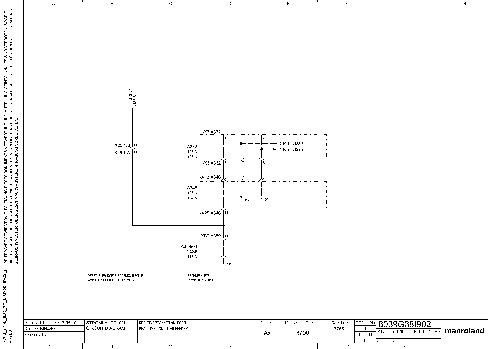

# +Ax — Sheet 126 of 403 — REALTIMERECHNER ANLEGER

**REAL TIME COMPUTER FEEDER**

> Part of the manroland **R700** printing press IEC/UL circuit diagrams.
> Drawing class: **Stromlaufplan / Circuit diagram** (DIN A3).
> Document `+Ax` covers the **Central control console** machine section.

## At a glance

| Field | Value |
|---|---|
| Document | `+Ax`  (8039G38I902) |
| Sheet | **126** of 403 |
| Section (DE) | REALTIMERECHNER ANLEGER |
| Section (EN) | REAL TIME COMPUTER FEEDER |
| Section type | CIRCUIT — Circuit diagram |
| Machine type | `R700` |
| Series | `7758` |
| Created | 17.05.10 |
| Replaces | — |
| Columns used | B, C, D, E |
| Path numbers | — |
| Labels on sheet | 42 |
| Cross-refs out | 9 |
| Cross-refs in | 22 |

**Previous:** [+Ax sheet 125](SHEET_0125.md) · **Next:** [+Ax sheet 127](SHEET_0127.md) · **Document TOC:** [_TOC.md](_TOC.md)  (+Ax) · **Master TOC:** [all sheets](../_MASTER_TOC.md)

## Sheet image (300 DPI, exact vector render)



_Rendered directly from the PDF vector layer at 300 DPI (1-bit), no OCR and no resampling. Use it to confirm anything ambiguous in the text below._

## Cross-references on this sheet

Each entry is a wire leaving this sheet. The printed token is `/sheet.column`; the link resolves to that sheet inside the same document.

| Ref | Target sheet | Col | Path | Destination on target | Target section | From col |
|---|---|---|---|---|---|---|
| `/127.B` | [+Ax sheet 127](SHEET_0127.md) | B | — | U101:7 | REALTIMERECHNER ANLEGER | B |
| `/128.B` | [+Ax sheet 128](SHEET_0128.md) | B | — | X10:1 | REALTIMERECHNER ANLEGER | E |
| `/128.B` | [+Ax sheet 128](SHEET_0128.md) | B | — | X10:3 | REALTIMERECHNER ANLEGER | E |
| `/128.A` | [+Ax sheet 128](SHEET_0128.md) | A | — | — | REALTIMERECHNER ANLEGER | C |
| `/108.A` | [+Ax sheet 108](SHEET_0108.md) | A | — | — | ANLEGER | C |
| `/128.A` | [+Ax sheet 128](SHEET_0128.md) | A | — | — | REALTIMERECHNER ANLEGER | C |
| `/124.A` | [+Ax sheet 124](SHEET_0124.md) | A | — | — | REALTIMERECHNER FEHLBOGENKONTROLLE | C |
| `/129.F` | [+Ax sheet 129](SHEET_0129.md) | F | — | — | REALTIMERECHNER ANLAGE | C |
| `/118.A` | [+Ax sheet 118](SHEET_0118.md) | A | — | — | REALTIMERECHNER WINKELKODIERER | C |

### Incoming references (sheets that point here)

Every other sheet that sends a wire to this one. `Back-ref` is the token printed on *that* sheet; `Path` is its line number.

| From sheet | Cols | Back-ref | Path | Refs | What continues there |
|---|---|---|---|---|---|
| [+Ax#108](SHEET_0108.md) | A | `/108.A` | — | 1 | — |
| [+Ax#118](SHEET_0118.md) | A | `/118.A` | — | 1 | — |
| [+Ax#124](SHEET_0124.md) | A | `/124.A` | — | 1 | — |
| [+Ax#127](SHEET_0127.md) | A | `/127.A` | — | 1 | U101:7 |
| [+Ax#128](SHEET_0128.md) | A, B | `/128.A`, `/128.B` | — | 4 | X10:1; X10:3 |
| [+Ax#129](SHEET_0129.md) | E | `/129.E` | — | 1 | — |
| [+Ax#222](SHEET_0222.md) | F | `/222.F` | — | 3 | — |
| [+Ax#235](SHEET_0235.md) | C | `/235.C` | — | 3 | — |
| [+Ax#236](SHEET_0236.md) | B | `/236.B` | — | 1 | — |
| [+Ax#250](SHEET_0250.md) | A | `/250.A` | — | 3 | — |
| [+Ax#267](SHEET_0267.md) | A, B, F | `/267.A`, `/267.B`, `/267.F` | — | 3 | — |


## Devices on this sheet

| Tag | Class | Class meaning (IEC) | Col | Sub | Terminal | Sign |
|---|---|---|---|---|---|---|
| `A346` | A | Baugruppe / assembly, module, PC board | C | — | — | — |
| `A332` | A | Baugruppe / assembly, module, PC board | C | — | — | — |
| `A359/04` | A | Baugruppe / assembly, module, PC board | C | 04 | — | — |
| `U101:7` | U | Umrichter / frequency converter | B | — | 7 | — |
| `X10:1` | X | Klemme / terminal, plug connector | E | — | 1 | — |
| `X10:3` | X | Klemme / terminal, plug connector | E | — | 3 | — |
| `X13.A346` | — | cross-device reference | D | — | — | — |
| `X3.A332` | — | cross-device reference | D | — | — | — |
| `X25.A346` | — | cross-device reference | D | — | — | — |
| `XB7.A359` | — | cross-device reference | D | — | — | — |
| `X25.1.B` | — | cross-device reference | B | — | — | — |
| `X25.1.A` | — | cross-device reference | B | — | — | — |
| `X7.A332` | — | cross-device reference | D | — | — | — |

## Potentials / nets

| Potential | Count | Columns | Attached devices | Terminals |
|---|---|---|---|---|
| `0V` | 1 | E | — | — |
| `24V` | 1 | D | — | — |


A potential such as `L24+/4` or `M24+` is a named supply/return rail; every place it appears on this sheet is electrically common.

## Wire-end annotations (grouped as printed)

A wire that continues elsewhere is annotated with a small cluster: the destination description, the path/line number `#NN`, and the `/sheet.column` cross reference. Each row below is one such cluster exactly as it is grouped on the drawing.

| Col | Y | Path | Cross-ref | Text on the wire |
|---|---|---|---|---|
| B | 214.6 | — | `/127.B` | `U101:7` |
| D | 313.5 | — | — | `X7.A332` |
| D | 327.7 | — | — | `2` |
| D | 327.7 | — | — | `1` |
| E | 327.7 | — | — | `3` |
| E | 342.6 | — | `/128.B` | `X10:1` |
| B | 346.1 | — | — | `X25.1.B 11` |
| C | 349.0 | — | — | `A332` |
| E | 356.7 | — | `/128.B` | `X10:3` |
| C | 362.0 | — | `/128.A`, `/108.A` | — |
| B | 363.2 | — | — | `X25.1.A 11` |
| D | 388.7 | — | — | `X3.A332 5` |
| D | 388.7 | — | — | `7` |
| E | 388.7 | — | — | `8` |
| D | 422.7 | — | — | `X13.A346 5` |
| D | 424.1 | — | — | `7` |
| E | 424.1 | — | — | `8` |
| C | 448.2 | — | — | `A346` |
| C | 461.2 | — | `/128.A`, `/124.A` | — |
| D | 478.2 | — | — | `24V 0V` |
| D | 509.1 | — | — | `X25.A346 11` |
| D | 564.4 | — | — | `XB7.A359 11` |
| C | 589.9 | — | — | `A359/04` |
| C | 603.0 | — | `/129.F`, `/118.A` | — |
| D | 634.1 | — | — | `29B` |
| B | 662.5 | — | — | `VERSTÄRKER: DOPPELBOGENKONTROLLE AMPLIFIER: DOUBLE SHEET CONTROL` |
| C | 662.5 | — | — | `RECHNERKARTE` |
| D | 673.2 | — | — | `COMPUTER BOARD` |


## Reconstructed tables

This sheet carries tabular content (pin map / terminal assignment / index). The grid below was rebuilt from the drawing's own rule lines, so each row is exactly one physical row of the table.

### Table 1 — 1 data rows × 2 columns (at x=538.6, y=345.8)

| 5 5 11 | 7 7 24V |
|---|---|
| `11` |  |


## Notes and free text on this sheet

| Text | Col | Y (pt) |
|---|---|---|
| `RECHNERKARTE` | C | 662.51 |
| `COMPUTER BOARD` | D | 673.17 |
| `29B` | D | 634.15 |
| `VERSTÄRKER: DOPPELBOGENKONTROLLE` | B | 662.52 |
| `AMPLIFIER: DOUBLE SHEET CONTROL` | B | 673.16 |

## Complete label inventory (exact text from the drawing)

Every text object inside the drawing area of this sheet, in DIN reading order (column A→H, then top→bottom). This is the authoritative list: if a string is not here it is not printed on this sheet.

| Col | Y | X | Dir | Type | Text |
|---|---|---|---|---|---|
| B | 214.6 | 310.7 | ↕ | device tag | `U101:7` |
| B | 229.6 | 320.6 | ↕ | cross-reference | `/127.B` |
| B | 346.2 | 272.7 | → | device ref | `X25.1.B` |
| B | 346.2 | 320.9 | → | number | `11` |
| B | 363.2 | 320.9 | → | number | `11` |
| B | 363.9 | 271.8 | → | device ref | `X25.1.A` |
| B | 662.5 | 212.6 | → | text | `VERSTÄRKER: DOPPELBOGENKONTROLLE` |
| B | 673.2 | 212.6 | → | text | `AMPLIFIER: DOUBLE SHEET CONTROL` |
| C | 349.0 | 447.0 | → | device tag | `A332` |
| C | 362.0 | 449.3 | → | cross-reference | `/128.A` |
| C | 374.4 | 449.3 | → | cross-reference | `/108.A` |
| C | 448.2 | 447.0 | → | device tag | `A346` |
| C | 461.2 | 449.3 | → | cross-reference | `/128.A` |
| C | 473.6 | 449.3 | → | cross-reference | `/124.A` |
| C | 589.9 | 432.3 | → | device tag | `A359/04` |
| C | 603.0 | 450.1 | → | cross-reference | `/129.F` |
| C | 615.4 | 449.3 | → | cross-reference | `/118.A` |
| C | 662.5 | 452.7 | → | text | `RECHNERKARTE` |
| D | 313.5 | 487.8 | → | device ref | `X7.A332` |
| D | 327.7 | 541.1 | → | number | `2` |
| D | 327.7 | 583.1 | → | number | `1` |
| D | 388.7 | 487.8 | → | device ref | `X3.A332` |
| D | 388.7 | 541.1 | → | number | `5` |
| D | 388.7 | 583.7 | → | number | `7` |
| D | 422.7 | 481.9 | → | device ref | `X13.A346` |
| D | 424.1 | 541.1 | → | number | `5` |
| D | 424.1 | 583.7 | → | number | `7` |
| D | 478.3 | 587.9 | → | potential | `24V` |
| D | 509.1 | 481.9 | → | device ref | `X25.A346` |
| D | 509.1 | 540.6 | → | number | `11` |
| D | 564.4 | 480.8 | → | device ref | `XB7.A359` |
| D | 565.8 | 540.6 | → | number | `11` |
| D | 634.1 | 545.4 | → | text | `29B` |
| D | 673.2 | 453.3 | → | text | `COMPUTER BOARD` |
| E | 327.7 | 633.3 | → | number | `3` |
| E | 342.5 | 706.5 | → | cross-reference | `/128.B` |
| E | 342.6 | 671.5 | → | device tag | `X10:1` |
| E | 356.7 | 671.5 | → | device tag | `X10:3` |
| E | 356.7 | 706.5 | → | cross-reference | `/128.B` |
| E | 388.7 | 633.3 | → | number | `8` |
| E | 424.1 | 633.3 | → | number | `8` |
| E | 478.2 | 637.5 | → | potential | `0V` |

## Reading-order text block

The same content as a plain block, grouped by DIN column — convenient to paste or to match against a visual description.

```text
=== Column B ===
 214.6  310.7  devtag       U101:7
 229.6  320.6  xref         /127.B
 346.2  272.7  devref       X25.1.B
 346.2  320.9  numeric      11
 363.2  320.9  numeric      11
 363.9  271.8  devref       X25.1.A
 662.5  212.6  text         VERSTÄRKER: DOPPELBOGENKONTROLLE
 673.2  212.6  text         AMPLIFIER: DOUBLE SHEET CONTROL
=== Column C ===
 349.0  447.0  devtag       A332
 362.0  449.3  xref         /128.A
 374.4  449.3  xref         /108.A
 448.2  447.0  devtag       A346
 461.2  449.3  xref         /128.A
 473.6  449.3  xref         /124.A
 589.9  432.3  devtag       A359/04
 603.0  450.1  xref         /129.F
 615.4  449.3  xref         /118.A
 662.5  452.7  text         RECHNERKARTE
=== Column D ===
 313.5  487.8  devref       X7.A332
 327.7  541.1  numeric      2
 327.7  583.1  numeric      1
 388.7  487.8  devref       X3.A332
 388.7  541.1  numeric      5
 388.7  583.7  numeric      7
 422.7  481.9  devref       X13.A346
 424.1  541.1  numeric      5
 424.1  583.7  numeric      7
 478.3  587.9  net          24V
 509.1  481.9  devref       X25.A346
 509.1  540.6  numeric      11
 564.4  480.8  devref       XB7.A359
 565.8  540.6  numeric      11
 634.1  545.4  text         29B
 673.2  453.3  text         COMPUTER BOARD
=== Column E ===
 327.7  633.3  numeric      3
 342.5  706.5  xref         /128.B
 342.6  671.5  devtag       X10:1
 356.7  671.5  devtag       X10:3
 356.7  706.5  xref         /128.B
 388.7  633.3  numeric      8
 424.1  633.3  numeric      8
 478.2  637.5  net          0V
```

---
_Generated from the PDF vector text layer; no OCR. Source: `R700_7758_IEC_AX_8039G38I902_p`, sheet 126._
