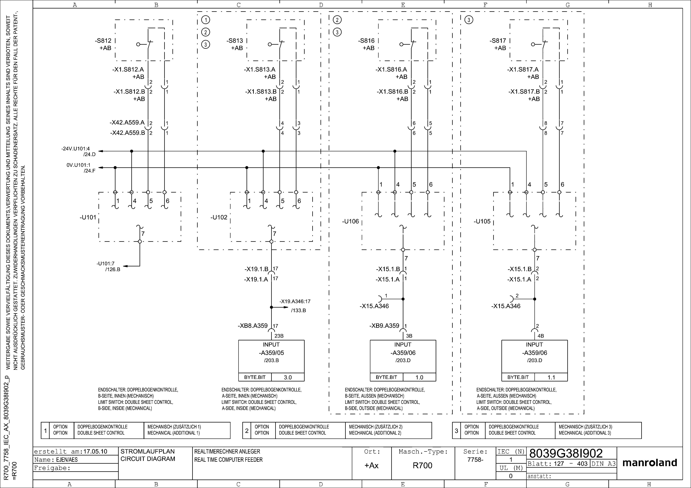

# +Ax — Sheet 127 of 403 — REALTIMERECHNER ANLEGER

**REAL TIME COMPUTER FEEDER**

> Part of the manroland **R700** printing press IEC/UL circuit diagrams.
> Drawing class: **Stromlaufplan / Circuit diagram** (DIN A3).
> Document `+Ax` covers the **Central control console** machine section.

## At a glance

| Field | Value |
|---|---|
| Document | `+Ax`  (8039G38I902) |
| Sheet | **127** of 403 |
| Section (DE) | REALTIMERECHNER ANLEGER |
| Section (EN) | REAL TIME COMPUTER FEEDER |
| Section type | CIRCUIT — Circuit diagram |
| Machine type | `R700` |
| Series | `7758` |
| Created | 17.05.10 |
| Replaces | — |
| Columns used | A, B, C, D, E, F, G |
| Path numbers | — |
| Labels on sheet | 172 |
| Cross-refs out | 7 |
| Cross-refs in | 50 |

**Previous:** [+Ax sheet 126](SHEET_0126.md) · **Next:** [+Ax sheet 128](SHEET_0128.md) · **Document TOC:** [_TOC.md](_TOC.md)  (+Ax) · **Master TOC:** [all sheets](../_MASTER_TOC.md)

## Sheet image (300 DPI, exact vector render)



_Rendered directly from the PDF vector layer at 300 DPI (1-bit), no OCR and no resampling. Use it to confirm anything ambiguous in the text below._

## Cross-references on this sheet

Each entry is a wire leaving this sheet. The printed token is `/sheet.column`; the link resolves to that sheet inside the same document.

| Ref | Target sheet | Col | Path | Destination on target | Target section | From col |
|---|---|---|---|---|---|---|
| `/24.D` | [+Ax sheet 24](SHEET_0024.md) | D | — | 24V.U101:4 | SPANNUNGSVERSORGUNG, SCHALTSCHRANKBELÜFTUNG | A |
| `/24.F` | [+Ax sheet 24](SHEET_0024.md) | F | — | 0V.U101:1 | SPANNUNGSVERSORGUNG, SCHALTSCHRANKBELÜFTUNG | A |
| `/126.B` | [+Ax sheet 126](SHEET_0126.md) | B | — | U101:7 | REALTIMERECHNER ANLEGER | A |
| `/133.B` | [+Ax sheet 133](SHEET_0133.md) | B | — | — | REALTIMERECHNER DRUCKWERK | D |
| `/203.B` | [+Ax sheet 203](SHEET_0203.md) | B | — | — | REFERENZMODUL | C |
| `/203.D` | [+Ax sheet 203](SHEET_0203.md) | D | — | — | REFERENZMODUL | E |
| `/203.D` | [+Ax sheet 203](SHEET_0203.md) | D | — | — | REFERENZMODUL | G |

### Incoming references (sheets that point here)

Every other sheet that sends a wire to this one. `Back-ref` is the token printed on *that* sheet; `Path` is its line number.

| From sheet | Cols | Back-ref | Path | Refs | What continues there |
|---|---|---|---|---|---|
| [+Ax#24](SHEET_0024.md) | D, F | `/24.D`, `/24.F` | — | 2 | 0V.U101:1; 24V.U101:4 |
| [+Ax#126](SHEET_0126.md) | B | `/126.B` | — | 1 | U101:7 |
| [+Ax#133](SHEET_0133.md) | B | `/133.B` | — | 1 | — |
| [+Ax#203](SHEET_0203.md) | B, D | `/203.B`, `/203.D` | — | 3 | — |
| [+Ax#215](SHEET_0215.md) | E, G, H | `/215.E`, `/215.G`, `/215.H` | — | 16 | — |
| [+Ax#238](SHEET_0238.md) | F | `/238.F` | — | 1 | — |
| [+Ax#242](SHEET_0242.md) | C | `/242.C` | — | 2 | — |
| [+Ax#252](SHEET_0252.md) | A, B, G | `/252.A`, `/252.B`, `/252.G` | — | 6 | — |
| [+Ax#258](SHEET_0258.md) | A, B | `/258.A`, `/258.B` | — | 2 | — |
| [+Ax#281](SHEET_0281.md) | B, C | `/281.B`, `/281.C` | — | 16 | — |


## Devices on this sheet

| Tag | Class | Class meaning (IEC) | Col | Sub | Terminal | Sign |
|---|---|---|---|---|---|---|
| `S812` | S | Schalter / switch | A | — | — | — |
| `U101` | U | Umrichter / frequency converter | A | — | — | — |
| `S813` | S | Schalter / switch | C | — | — | — |
| `U102` | U | Umrichter / frequency converter | C | — | — | — |
| `A359/05` | A | Baugruppe / assembly, module, PC board | C | 05 | — | — |
| `S816` | S | Schalter / switch | E | — | — | — |
| `U106` | U | Umrichter / frequency converter | D | — | — | — |
| `A359/06` | A | Baugruppe / assembly, module, PC board | E | 06 | — | — |
| `S817` | S | Schalter / switch | F | — | — | — |
| `U105` | U | Umrichter / frequency converter | F | — | — | — |
| `A359/06` | A | Baugruppe / assembly, module, PC board | G | 06 | — | — |
| `U101:7` | U | Umrichter / frequency converter | A | — | 7 | — |
| `X1.S812.B` | — | cross-device reference | B | — | — | — |
| `X1.S812.A` | — | cross-device reference | B | — | — | — |
| `X42.A559.B` | — | cross-device reference | B | — | — | — |
| `X42.A559.A` | — | cross-device reference | B | — | — | — |
| `X1.S813.B` | — | cross-device reference | C | — | — | — |
| `X1.S813.A` | — | cross-device reference | C | — | — | — |
| `3.0` | — | cross-device reference | D | — | — | — |
| `XB8.A359` | — | cross-device reference | C | — | — | — |
| `X19.1.A` | — | cross-device reference | C | — | — | — |
| `X19.1.B` | — | cross-device reference | C | — | — | — |
| `X1.S816.B` | — | cross-device reference | E | — | — | — |
| `X1.S816.A` | — | cross-device reference | E | — | — | — |
| `1.0` | — | cross-device reference | E | — | — | — |
| `XB9.A359` | — | cross-device reference | E | — | — | — |
| `X15.1.A` | — | cross-device reference | E | — | — | — |
| `X15.1.B` | — | cross-device reference | E | — | — | — |
| `X15.A346` | — | cross-device reference | E | — | — | — |
| `X1.S817.B` | — | cross-device reference | F | — | — | — |
| `X1.S817.A` | — | cross-device reference | F | — | — | — |
| `1.1` | — | cross-device reference | G | — | — | — |
| `X15.1.A` | — | cross-device reference | F | — | — | — |
| `X15.1.B` | — | cross-device reference | F | — | — | — |
| `X15.A346` | — | cross-device reference | F | — | — | — |
| `X19.A346:17` | — | cross-device reference | D | — | 17 | — |

## Potentials / nets

| Potential | Count | Columns | Attached devices | Terminals |
|---|---|---|---|---|
| `0V` | 1 | A | `U101` | `1` |
| `24V` | 1 | A | `U101` | `4` |


A potential such as `L24+/4` or `M24+` is a named supply/return rail; every place it appears on this sheet is electrically common.

## Wire-end annotations (grouped as printed)

A wire that continues elsewhere is annotated with a small cluster: the destination description, the path/line number `#NN`, and the `/sheet.column` cross reference. Each row below is one such cluster exactly as it is grouped on the drawing.

| Col | Y | Path | Cross-ref | Text on the wire |
|---|---|---|---|---|
| C | 31.0 | — | — | `1` |
| E | 31.5 | — | — | `2 3` |
| C | 52.7 | — | — | `2` |
| D | 52.7 | — | — | `3` |
| A | 65.5 | — | — | `S812` |
| C | 65.5 | — | — | `S813` |
| E | 65.5 | — | — | `S816` |
| F | 65.5 | — | — | `S817` |
| C | 74.0 | — | — | `3` |
| A | 78.2 | — | — | `+AB` |
| C | 78.2 | — | — | `+AB` |
| E | 78.2 | — | — | `+AB` |
| F | 78.2 | — | — | `+AB` |
| B | 115.1 | — | — | `X1.S812.A` |
| C | 115.1 | — | — | `X1.S813.A` |
| E | 115.1 | — | — | `X1.S816.A` |
| F | 115.1 | — | — | `X1.S817.A` |
| B | 127.8 | — | — | `+AB` |
| C | 127.8 | — | — | `+AB` |
| E | 127.8 | — | — | `+AB` |
| G | 127.8 | — | — | `+AB` |
| B | 137.8 | — | — | `2` |
| B | 137.8 | — | — | `1` |
| D | 137.8 | — | — | `2` |
| D | 137.8 | — | — | `1` |
| E | 137.8 | — | — | `2` |
| E | 137.8 | — | — | `1` |
| G | 137.8 | — | — | `2` |
| G | 137.8 | — | — | `1` |
| B | 153.4 | — | — | `X1.S812.B 2` |
| C | 153.4 | — | — | `X1.S813.B 2` |
| E | 153.4 | — | — | `X1.S816.B 2` |
| G | 153.4 | — | — | `X1.S817.B 2` |
| B | 154.8 | — | — | `1` |
| D | 154.8 | — | — | `1` |
| E | 154.8 | — | — | `1` |
| G | 154.8 | — | — | `1` |
| B | 166.1 | — | — | `+AB` |
| C | 166.1 | — | — | `+AB` |
| E | 166.1 | — | — | `+AB` |
| G | 166.1 | — | — | `+AB` |
| B | 206.5 | — | — | `X42.A559.A 2` |
| B | 208.7 | — | — | `1` |
| D | 208.7 | — | — | `4` |
| D | 208.7 | — | — | `3` |
| E | 208.7 | — | — | `6` |
| E | 208.7 | — | — | `5` |
| G | 208.7 | — | — | `8` |
| G | 208.7 | — | — | `7` |
| B | 224.2 | — | — | `X42.A559.B 2` |
| B | 225.7 | — | — | `1` |
| D | 225.7 | — | — | `4` |
| D | 225.7 | — | — | `3` |
| E | 225.7 | — | — | `6` |
| E | 225.7 | — | — | `5` |
| G | 225.7 | — | — | `8` |
| G | 225.7 | — | — | `7` |
| A | 252.6 | — | `/24.D` | `24V.U101:4` |
| A | 280.9 | — | `/24.F` | `0V.U101:1` |
| E | 313.5 | — | — | `1 4 5 6` |
| G | 313.5 | — | — | `1 4 5 6` |
| B | 341.9 | — | — | `1 4 5 6` |
| C | 341.9 | — | — | `1 4 5 6` |
| A | 370.2 | — | — | `U101` |
| C | 370.2 | — | — | `U102` |
| D | 377.3 | — | — | `U106` |
| F | 377.3 | — | — | `U105` |
| B | 398.5 | — | — | `7` |
| C | 398.5 | — | — | `7` |
| E | 441.1 | — | — | `7` |
| G | 441.1 | — | — | `7` |
| A | 451.0 | — | `/126.B` | `U101:7` |
| C | 459.5 | — | — | `X19.1.B 17` |
| E | 459.5 | — | — | `X15.1.B 1` |
| F | 459.5 | — | — | `X15.1.B 2` |
| C | 476.5 | — | — | `X19.1.A 17` |
| E | 476.5 | — | — | `X15.1.A 1` |
| F | 476.5 | — | — | `X15.1.A 2` |
| E | 506.3 | — | — | `1` |
| F | 506.3 | — | — | `2` |
| D | 516.2 | — | — | `X19.A346:17` |
| E | 523.3 | — | — | `X15.A346` |
| F | 523.3 | — | — | `X15.A346` |
| D | 531.8 | — | `/133.B` | — |
| C | 557.3 | — | — | `XB8.A359 17` |
| E | 557.3 | — | — | `XB9.A359 1` |
| G | 558.8 | — | — | `2` |
| C | 575.7 | — | — | `23B` |
| E | 575.7 | — | — | `3B` |
| G | 575.7 | — | — | `4B` |
| C | 590.2 | — | — | `INPUT` |
| E | 590.2 | — | — | `INPUT` |
| G | 590.2 | — | — | `INPUT` |
| C | 604.1 | — | — | `A359/05` |
| E | 604.1 | — | — | `A359/06` |
| G | 604.1 | — | — | `A359/06` |
| C | 617.9 | — | `/203.B` | — |
| E | 617.9 | — | `/203.D` | — |
| G | 617.9 | — | `/203.D` | — |
| C | 646.9 | — | — | `BYTE.BIT 3.0` |
| E | 646.9 | — | — | `BYTE.BIT 1.0` |
| G | 646.9 | — | — | `BYTE.BIT 1.1` |
| B | 669.6 | — | — | `ENDSCHALTER: DOPPELBOGENKONTROLLE, B SEITE, INNEN (MECHANISCH) LIMIT SWITCH: DOUBLE SHEET CONTROL, B SIDE, INSIDE (MECHANICAL)` |
| C | 669.6 | — | — | `ENDSCHALTER: DOPPELBOGENKONTROLLE,` |
| E | 669.6 | — | — | `ENDSCHALTER: DOPPELBOGENKONTROLLE, B SEITE, AUSSEN (MECHANISCH) LIMIT SWITCH: DOUBLE SHEET CONTROL, B SIDE, OUTSIDE (MECHANICAL)` |
| F | 669.6 | — | — | `ENDSCHALTER: DOPPELBOGENKONTROLLE,` |
| C | 680.2 | — | — | `LIMIT SWITCH: DOUBLE SHEET CONTROL, A SEITE, INNEN (MECHANISCH)` |
| F | 680.2 | — | — | `LIMIT SWITCH: DOUBLE SHEET CONTROL, A SEITE, AUSSEN (MECHANISCH)` |
| C | 701.5 | — | — | `A SIDE, INSIDE (MECHANICAL)` |
| F | 701.5 | — | — | `A SIDE, OUTSIDE (MECHANICAL)` |
| B | 733.4 | — | — | `1 DOPPELBOGENKONTROLLE DOUBLE SHEET CONTROL MECHANISCH (ZUSÄTZLICH 1) MECHANICAL (ADDITIONAL 1)` |
| A | 733.4 | — | — | `OPTION OPTION` |
| D | 733.4 | — | — | `2 DOPPELBOGENKONTROLLE DOUBLE SHEET CONTROL MECHANISCH (ZUSÄTZLICH 2) MECHANICAL (ADDITIONAL 2)` |
| C | 733.4 | — | — | `OPTION OPTION` |
| G | 733.4 | — | — | `3 DOPPELBOGENKONTROLLE DOUBLE SHEET CONTROL MECHANISCH (ZUSÄTZLICH 3) MECHANICAL (ADDITIONAL 3)` |
| F | 733.4 | — | — | `OPTION OPTION` |


## Reconstructed tables

This sheet carries tabular content (pin map / terminal assignment / index). The grid below was rebuilt from the drawing's own rule lines, so each row is exactly one physical row of the table.

### Table 1 — 2 data rows × 5 columns (at x=425.2, y=260.8)

| 1 X19.1.B X19.1.A XB8.A359 | 4 | 7 17 17 17 23B | 5 X19.A346:17 | 6 /133.B |
|---|---|---|---|---|
|  | `INPUT` | `A359/05 /203.B` |  |  |
| `BYTE.BIT` |  |  | `3.0` |  |


### Table 2 — 2 data rows × 6 columns (at x=637.8, y=260.8)

| X15.A346 | 1 X15.1.B X15.1.A 1 XB9.A359 | 4 | 7 1 1 1 3B | 5 | 6 |
|---|---|---|---|---|---|
|  |  | `INPUT` | `A359/06 /203.D` |  |  |
|  | `BYTE.BIT` |  |  | `1.0` |  |


### Table 3 — 2 data rows × 6 columns (at x=864.6, y=260.8)

| X15.A346 | 1 X15.1.B X15.1.A 2 | 4 | 7 2 2 2 4B | 5 | 6 |
|---|---|---|---|---|---|
|  |  | `INPUT` | `A359/06 /203.D` |  |  |
|  | `BYTE.BIT` |  |  | `1.1` |  |


## Notes and free text on this sheet

| Text | Col | Y (pt) |
|---|---|---|
| `+AB` | A | 78.18 |
| `ENDSCHALTER: DOPPELBOGENKONTROLLE,` | B | 669.61 |
| `B SEITE, INNEN (MECHANISCH)` | B | 680.24 |
| `LIMIT SWITCH: DOUBLE SHEET CONTROL,` | B | 690.86 |
| `B SIDE, INSIDE (MECHANICAL)` | B | 701.5 |
| `+AB` | B | 166.06 |
| `+AB` | C | 78.18 |
| `23B` | C | 575.72 |
| `INPUT` | C | 590.24 |
| `BYTE.BIT` | C | 647.49 |
| `ENDSCHALTER: DOPPELBOGENKONTROLLE,` | C | 669.61 |
| `A SEITE, INNEN (MECHANISCH)` | C | 680.24 |
| `LIMIT SWITCH: DOUBLE SHEET CONTROL,` | C | 690.86 |
| `A SIDE, INSIDE (MECHANICAL)` | C | 701.51 |
| `+AB` | E | 78.18 |
| `3B` | E | 575.7 |
| `INPUT` | E | 590.24 |
| `BYTE.BIT` | E | 647.49 |
| `ENDSCHALTER: DOPPELBOGENKONTROLLE,` | E | 669.61 |
| `B SEITE, AUSSEN (MECHANISCH)` | E | 680.23 |
| `LIMIT SWITCH: DOUBLE SHEET CONTROL,` | E | 690.86 |
| `B SIDE, OUTSIDE (MECHANICAL)` | E | 701.5 |
| `+AB` | F | 78.18 |
| `+AB` | G | 166.06 |
| `4B` | G | 575.7 |
| `INPUT` | G | 590.24 |
| `BYTE.BIT` | F | 647.49 |
| `ENDSCHALTER: DOPPELBOGENKONTROLLE,` | F | 669.61 |
| `A SEITE, AUSSEN (MECHANISCH)` | F | 680.24 |
| `LIMIT SWITCH: DOUBLE SHEET CONTROL,` | F | 690.86 |
| `A SIDE, OUTSIDE (MECHANICAL)` | F | 701.51 |
| `OPTION` | A | 733.35 |
| `DOPPELBOGENKONTROLLE` | A | 733.39 |
| `DOUBLE SHEET CONTROL` | A | 744.02 |
| `MECHANISCH (ZUSÄTZLICH 1)` | B | 733.4 |
| `MECHANICAL (ADDITIONAL 1)` | B | 744.03 |
| `OPTION` | C | 733.35 |
| `DOPPELBOGENKONTROLLE` | D | 733.39 |
| `DOUBLE SHEET CONTROL` | D | 744.02 |
| `MECHANISCH (ZUSÄTZLICH 2)` | E | 733.4 |
| `MECHANICAL (ADDITIONAL 2)` | E | 744.03 |
| `OPTION` | F | 733.35 |
| `DOPPELBOGENKONTROLLE` | F | 733.39 |
| `DOUBLE SHEET CONTROL` | F | 744.02 |
| `MECHANISCH (ZUSÄTZLICH 3)` | G | 733.4 |
| `MECHANICAL (ADDITIONAL 3)` | G | 744.03 |

## Complete label inventory (exact text from the drawing)

Every text object inside the drawing area of this sheet, in DIN reading order (column A→H, then top→bottom). This is the authoritative list: if a string is not here it is not printed on this sheet.

| Col | Y | X | Dir | Type | Text |
|---|---|---|---|---|---|
| A | 65.5 | 163.6 | → | device tag | `S812` |
| A | 78.2 | 171.5 | → | text | `+AB` |
| A | 252.6 | 105.7 | → | potential | `24V.U101:4` |
| A | 262.5 | 143.7 | → | cross-reference | `/24.D` |
| A | 280.9 | 114.8 | → | potential | `0V.U101:1` |
| A | 290.8 | 144.6 | → | cross-reference | `/24.F` |
| A | 370.2 | 137.5 | → | device tag | `U101` |
| A | 451.0 | 166.4 | → | device tag | `U101:7` |
| A | 460.9 | 181.7 | → | cross-reference | `/126.B` |
| A | 733.4 | 91.8 | → | text | `OPTION` |
| A | 733.4 | 133.8 | → | text | `DOPPELBOGENKONTROLLE` |
| A | 738.7 | 75.4 | → | number | `1` |
| A | 744.0 | 91.8 | → | text | `OPTION` |
| A | 744.0 | 133.8 | → | text | `DOUBLE SHEET CONTROL` |
| B | 115.1 | 193.6 | → | device ref | `X1.S812.A` |
| B | 127.8 | 228.2 | → | text | `+AB` |
| B | 137.8 | 257.7 | → | number | `2` |
| B | 137.8 | 285.4 | → | number | `1` |
| B | 153.4 | 195.9 | → | device ref | `X1.S812.B` |
| B | 154.8 | 257.7 | → | number | `2` |
| B | 154.8 | 285.4 | → | number | `1` |
| B | 166.1 | 229.6 | → | text | `+AB` |
| B | 206.5 | 189.1 | → | device ref | `X42.A559.A` |
| B | 208.7 | 257.7 | → | number | `2` |
| B | 208.7 | 285.4 | → | number | `1` |
| B | 224.2 | 189.9 | → | device ref | `X42.A559.B` |
| B | 225.7 | 257.7 | → | number | `2` |
| B | 225.7 | 285.4 | → | number | `1` |
| B | 341.8 | 200.1 | → | number | `1` |
| B | 341.8 | 229.3 | → | number | `4` |
| B | 341.8 | 257.4 | → | number | `5` |
| B | 341.8 | 286.0 | → | number | `6` |
| B | 398.5 | 243.5 | → | number | `7` |
| B | 669.6 | 169.2 | → | text | `ENDSCHALTER: DOPPELBOGENKONTROLLE,` |
| B | 680.2 | 169.2 | → | text | `B SEITE, INNEN (MECHANISCH)` |
| B | 690.9 | 169.2 | → | text | `LIMIT SWITCH: DOUBLE SHEET CONTROL,` |
| B | 701.5 | 169.2 | → | text | `B SIDE, INSIDE (MECHANICAL)` |
| B | 733.4 | 254.6 | → | text | `MECHANISCH (ZUSÄTZLICH 1)` |
| B | 744.0 | 254.6 | → | text | `MECHANICAL (ADDITIONAL 1)` |
| C | 31.0 | 352.6 | → | number | `1` |
| C | 52.7 | 352.3 | → | number | `2` |
| C | 65.5 | 390.3 | → | device tag | `S813` |
| C | 74.0 | 352.3 | → | number | `3` |
| C | 78.2 | 398.3 | → | text | `+AB` |
| C | 115.1 | 420.4 | → | device ref | `X1.S813.A` |
| C | 127.8 | 455.0 | → | text | `+AB` |
| C | 153.4 | 422.6 | → | device ref | `X1.S813.B` |
| C | 166.1 | 456.4 | → | text | `+AB` |
| C | 341.8 | 426.9 | → | number | `1` |
| C | 341.8 | 456.1 | → | number | `4` |
| C | 370.2 | 362.8 | → | device tag | `U102` |
| C | 398.5 | 470.3 | → | number | `7` |
| C | 459.5 | 421.5 | → | device ref | `X19.1.B` |
| C | 459.5 | 469.7 | → | number | `17` |
| C | 476.5 | 469.7 | → | number | `17` |
| C | 477.3 | 420.7 | → | device ref | `X19.1.A` |
| C | 557.3 | 409.9 | → | device ref | `XB8.A359` |
| C | 558.7 | 469.7 | → | number | `17` |
| C | 575.7 | 473.1 | → | text | `23B` |
| C | 590.2 | 452.8 | → | text | `INPUT` |
| C | 604.1 | 446.3 | → | device tag | `A359/05` |
| C | 617.9 | 455.1 | → | cross-reference | `/203.B` |
| C | 647.5 | 420.9 | → | text | `BYTE.BIT` |
| C | 669.6 | 381.8 | → | text | `ENDSCHALTER: DOPPELBOGENKONTROLLE,` |
| C | 680.2 | 382.7 | → | text | `A SEITE, INNEN (MECHANISCH)` |
| C | 690.9 | 381.8 | → | text | `LIMIT SWITCH: DOUBLE SHEET CONTROL,` |
| C | 701.5 | 382.7 | → | text | `A SIDE, INSIDE (MECHANICAL)` |
| C | 733.4 | 439.1 | → | text | `OPTION` |
| C | 738.7 | 422.4 | → | number | `2` |
| C | 744.0 | 439.1 | → | text | `OPTION` |
| D | 31.5 | 579.1 | → | number | `2` |
| D | 52.7 | 579.1 | → | number | `3` |
| D | 137.8 | 484.4 | → | number | `2` |
| D | 137.8 | 512.2 | → | number | `1` |
| D | 154.8 | 484.4 | → | number | `2` |
| D | 154.8 | 512.2 | → | number | `1` |
| D | 208.7 | 484.4 | → | number | `4` |
| D | 208.7 | 512.8 | → | number | `3` |
| D | 225.7 | 484.4 | → | number | `4` |
| D | 225.7 | 512.8 | → | number | `3` |
| D | 341.8 | 484.2 | → | number | `5` |
| D | 341.8 | 512.8 | → | number | `6` |
| D | 377.3 | 589.6 | → | device tag | `U106` |
| D | 516.2 | 481.6 | → | device ref | `X19.A346:17` |
| D | 531.8 | 501.7 | → | cross-reference | `/133.B` |
| D | 646.9 | 489.3 | → | device ref | `3.0` |
| D | 733.4 | 481.0 | → | text | `DOPPELBOGENKONTROLLE` |
| D | 744.0 | 481.0 | → | text | `DOUBLE SHEET CONTROL` |
| E | 65.5 | 617.1 | → | device tag | `S816` |
| E | 78.2 | 625.0 | → | text | `+AB` |
| E | 115.1 | 647.1 | → | device ref | `X1.S816.A` |
| E | 127.8 | 681.7 | → | text | `+AB` |
| E | 137.8 | 711.2 | → | number | `2` |
| E | 137.8 | 739.0 | → | number | `1` |
| E | 153.4 | 649.4 | → | device ref | `X1.S816.B` |
| E | 154.8 | 711.2 | → | number | `2` |
| E | 154.8 | 739.0 | → | number | `1` |
| E | 166.1 | 683.1 | → | text | `+AB` |
| E | 208.7 | 711.2 | → | number | `6` |
| E | 208.7 | 739.6 | → | number | `5` |
| E | 225.7 | 711.2 | → | number | `6` |
| E | 225.7 | 739.6 | → | number | `5` |
| E | 313.5 | 653.7 | → | number | `1` |
| E | 313.5 | 682.9 | → | number | `4` |
| E | 313.5 | 710.9 | → | number | `5` |
| E | 313.5 | 739.6 | → | number | `6` |
| E | 441.1 | 697.0 | → | number | `7` |
| E | 459.5 | 648.3 | → | device ref | `X15.1.B` |
| E | 459.5 | 696.5 | → | number | `1` |
| E | 476.5 | 696.5 | → | number | `1` |
| E | 477.3 | 647.4 | → | device ref | `X15.1.A` |
| E | 506.3 | 663.0 | → | number | `1` |
| E | 523.3 | 619.9 | → | device ref | `X15.A346` |
| E | 557.3 | 636.7 | → | device ref | `XB9.A359` |
| E | 558.7 | 696.5 | → | number | `1` |
| E | 575.7 | 699.9 | → | text | `3B` |
| E | 590.2 | 679.6 | → | text | `INPUT` |
| E | 604.1 | 673.1 | → | device tag | `A359/06` |
| E | 617.9 | 681.7 | → | cross-reference | `/203.D` |
| E | 646.9 | 715.7 | → | device ref | `1.0` |
| E | 647.5 | 647.7 | → | text | `BYTE.BIT` |
| E | 669.6 | 594.4 | → | text | `ENDSCHALTER: DOPPELBOGENKONTROLLE,` |
| E | 680.2 | 594.4 | → | text | `B SEITE, AUSSEN (MECHANISCH)` |
| E | 690.9 | 594.4 | → | text | `LIMIT SWITCH: DOUBLE SHEET CONTROL,` |
| E | 701.5 | 594.4 | → | text | `B SIDE, OUTSIDE (MECHANICAL)` |
| E | 733.4 | 601.8 | → | text | `MECHANISCH (ZUSÄTZLICH 2)` |
| E | 744.0 | 601.8 | → | text | `MECHANICAL (ADDITIONAL 2)` |
| F | 31.5 | 805.9 | → | number | `3` |
| F | 65.5 | 843.9 | → | device tag | `S817` |
| F | 78.2 | 851.8 | → | text | `+AB` |
| F | 115.1 | 873.9 | → | device ref | `X1.S817.A` |
| F | 153.4 | 876.2 | → | device ref | `X1.S817.B` |
| F | 313.5 | 880.4 | → | number | `1` |
| F | 377.3 | 816.4 | → | device tag | `U105` |
| F | 459.5 | 875.1 | → | device ref | `X15.1.B` |
| F | 477.3 | 874.2 | → | device ref | `X15.1.A` |
| F | 506.3 | 888.7 | → | number | `2` |
| F | 523.3 | 846.7 | → | device ref | `X15.A346` |
| F | 647.5 | 874.5 | → | text | `BYTE.BIT` |
| F | 669.6 | 821.2 | → | text | `ENDSCHALTER: DOPPELBOGENKONTROLLE,` |
| F | 680.2 | 822.0 | → | text | `A SEITE, AUSSEN (MECHANISCH)` |
| F | 690.9 | 821.2 | → | text | `LIMIT SWITCH: DOUBLE SHEET CONTROL,` |
| F | 701.5 | 822.0 | → | text | `A SIDE, OUTSIDE (MECHANICAL)` |
| F | 733.4 | 800.5 | → | text | `OPTION` |
| F | 733.4 | 842.5 | → | text | `DOPPELBOGENKONTROLLE` |
| F | 738.7 | 783.6 | → | number | `3` |
| F | 744.0 | 800.5 | → | text | `OPTION` |
| F | 744.0 | 842.5 | → | text | `DOUBLE SHEET CONTROL` |
| G | 127.8 | 908.5 | → | text | `+AB` |
| G | 137.8 | 938.0 | → | number | `2` |
| G | 137.8 | 965.8 | → | number | `1` |
| G | 154.8 | 938.0 | → | number | `2` |
| G | 154.8 | 965.8 | → | number | `1` |
| G | 166.1 | 909.9 | → | text | `+AB` |
| G | 208.7 | 938.0 | → | number | `8` |
| G | 208.7 | 966.3 | → | number | `7` |
| G | 225.7 | 938.0 | → | number | `8` |
| G | 225.7 | 966.3 | → | number | `7` |
| G | 313.5 | 909.6 | → | number | `4` |
| G | 313.5 | 937.7 | → | number | `5` |
| G | 313.5 | 966.3 | → | number | `6` |
| G | 441.1 | 923.8 | → | number | `7` |
| G | 459.5 | 923.8 | → | number | `2` |
| G | 476.5 | 923.8 | → | number | `2` |
| G | 558.7 | 923.8 | → | number | `2` |
| G | 575.7 | 926.6 | → | text | `4B` |
| G | 590.2 | 906.4 | → | text | `INPUT` |
| G | 604.1 | 899.9 | → | device tag | `A359/06` |
| G | 617.9 | 908.5 | → | cross-reference | `/203.D` |
| G | 646.9 | 943.4 | → | device ref | `1.1` |
| G | 733.4 | 963.2 | → | text | `MECHANISCH (ZUSÄTZLICH 3)` |
| G | 744.0 | 963.2 | → | text | `MECHANICAL (ADDITIONAL 3)` |

## Reading-order text block

The same content as a plain block, grouped by DIN column — convenient to paste or to match against a visual description.

```text
=== Column A ===
  65.5  163.6  devtag       S812
  78.2  171.5  text         +AB
 252.6  105.7  net          24V.U101:4
 262.5  143.7  xref         /24.D
 280.9  114.8  net          0V.U101:1
 290.8  144.6  xref         /24.F
 370.2  137.5  devtag       U101
 451.0  166.4  devtag       U101:7
 460.9  181.7  xref         /126.B
 733.4   91.8  text         OPTION
 733.4  133.8  text         DOPPELBOGENKONTROLLE
 738.7   75.4  numeric      1
 744.0   91.8  text         OPTION
 744.0  133.8  text         DOUBLE SHEET CONTROL
=== Column B ===
 115.1  193.6  devref       X1.S812.A
 127.8  228.2  text         +AB
 137.8  257.7  numeric      2
 137.8  285.4  numeric      1
 153.4  195.9  devref       X1.S812.B
 154.8  257.7  numeric      2
 154.8  285.4  numeric      1
 166.1  229.6  text         +AB
 206.5  189.1  devref       X42.A559.A
 208.7  257.7  numeric      2
 208.7  285.4  numeric      1
 224.2  189.9  devref       X42.A559.B
 225.7  257.7  numeric      2
 225.7  285.4  numeric      1
 341.8  200.1  numeric      1
 341.8  229.3  numeric      4
 341.8  257.4  numeric      5
 341.8  286.0  numeric      6
 398.5  243.5  numeric      7
 669.6  169.2  text         ENDSCHALTER: DOPPELBOGENKONTROLLE,
 680.2  169.2  text         B SEITE, INNEN (MECHANISCH)
 690.9  169.2  text         LIMIT SWITCH: DOUBLE SHEET CONTROL,
 701.5  169.2  text         B SIDE, INSIDE (MECHANICAL)
 733.4  254.6  text         MECHANISCH (ZUSÄTZLICH 1)
 744.0  254.6  text         MECHANICAL (ADDITIONAL 1)
=== Column C ===
  31.0  352.6  numeric      1
  52.7  352.3  numeric      2
  65.5  390.3  devtag       S813
  74.0  352.3  numeric      3
  78.2  398.3  text         +AB
 115.1  420.4  devref       X1.S813.A
 127.8  455.0  text         +AB
 153.4  422.6  devref       X1.S813.B
 166.1  456.4  text         +AB
 341.8  426.9  numeric      1
 341.8  456.1  numeric      4
 370.2  362.8  devtag       U102
 398.5  470.3  numeric      7
 459.5  421.5  devref       X19.1.B
 459.5  469.7  numeric      17
 476.5  469.7  numeric      17
 477.3  420.7  devref       X19.1.A
 557.3  409.9  devref       XB8.A359
 558.7  469.7  numeric      17
 575.7  473.1  text         23B
 590.2  452.8  text         INPUT
 604.1  446.3  devtag       A359/05
 617.9  455.1  xref         /203.B
 647.5  420.9  text         BYTE.BIT
 669.6  381.8  text         ENDSCHALTER: DOPPELBOGENKONTROLLE,
 680.2  382.7  text         A SEITE, INNEN (MECHANISCH)
 690.9  381.8  text         LIMIT SWITCH: DOUBLE SHEET CONTROL,
 701.5  382.7  text         A SIDE, INSIDE (MECHANICAL)
 733.4  439.1  text         OPTION
 738.7  422.4  numeric      2
 744.0  439.1  text         OPTION
=== Column D ===
  31.5  579.1  numeric      2
  52.7  579.1  numeric      3
 137.8  484.4  numeric      2
 137.8  512.2  numeric      1
 154.8  484.4  numeric      2
 154.8  512.2  numeric      1
 208.7  484.4  numeric      4
 208.7  512.8  numeric      3
 225.7  484.4  numeric      4
 225.7  512.8  numeric      3
 341.8  484.2  numeric      5
 341.8  512.8  numeric      6
 377.3  589.6  devtag       U106
 516.2  481.6  devref       X19.A346:17
 531.8  501.7  xref         /133.B
 646.9  489.3  devref       3.0
 733.4  481.0  text         DOPPELBOGENKONTROLLE
 744.0  481.0  text         DOUBLE SHEET CONTROL
=== Column E ===
  65.5  617.1  devtag       S816
  78.2  625.0  text         +AB
 115.1  647.1  devref       X1.S816.A
 127.8  681.7  text         +AB
 137.8  711.2  numeric      2
 137.8  739.0  numeric      1
 153.4  649.4  devref       X1.S816.B
 154.8  711.2  numeric      2
 154.8  739.0  numeric      1
 166.1  683.1  text         +AB
 208.7  711.2  numeric      6
 208.7  739.6  numeric      5
 225.7  711.2  numeric      6
 225.7  739.6  numeric      5
 313.5  653.7  numeric      1
 313.5  682.9  numeric      4
 313.5  710.9  numeric      5
 313.5  739.6  numeric      6
 441.1  697.0  numeric      7
 459.5  648.3  devref       X15.1.B
 459.5  696.5  numeric      1
 476.5  696.5  numeric      1
 477.3  647.4  devref       X15.1.A
 506.3  663.0  numeric      1
 523.3  619.9  devref       X15.A346
 557.3  636.7  devref       XB9.A359
 558.7  696.5  numeric      1
 575.7  699.9  text         3B
 590.2  679.6  text         INPUT
 604.1  673.1  devtag       A359/06
 617.9  681.7  xref         /203.D
 646.9  715.7  devref       1.0
 647.5  647.7  text         BYTE.BIT
 669.6  594.4  text         ENDSCHALTER: DOPPELBOGENKONTROLLE,
 680.2  594.4  text         B SEITE, AUSSEN (MECHANISCH)
 690.9  594.4  text         LIMIT SWITCH: DOUBLE SHEET CONTROL,
 701.5  594.4  text         B SIDE, OUTSIDE (MECHANICAL)
 733.4  601.8  text         MECHANISCH (ZUSÄTZLICH 2)
 744.0  601.8  text         MECHANICAL (ADDITIONAL 2)
=== Column F ===
  31.5  805.9  numeric      3
  65.5  843.9  devtag       S817
  78.2  851.8  text         +AB
 115.1  873.9  devref       X1.S817.A
 153.4  876.2  devref       X1.S817.B
 313.5  880.4  numeric      1
 377.3  816.4  devtag       U105
 459.5  875.1  devref       X15.1.B
 477.3  874.2  devref       X15.1.A
 506.3  888.7  numeric      2
 523.3  846.7  devref       X15.A346
 647.5  874.5  text         BYTE.BIT
 669.6  821.2  text         ENDSCHALTER: DOPPELBOGENKONTROLLE,
 680.2  822.0  text         A SEITE, AUSSEN (MECHANISCH)
 690.9  821.2  text         LIMIT SWITCH: DOUBLE SHEET CONTROL,
 701.5  822.0  text         A SIDE, OUTSIDE (MECHANICAL)
 733.4  800.5  text         OPTION
 733.4  842.5  text         DOPPELBOGENKONTROLLE
 738.7  783.6  numeric      3
 744.0  800.5  text         OPTION
 744.0  842.5  text         DOUBLE SHEET CONTROL
=== Column G ===
 127.8  908.5  text         +AB
 137.8  938.0  numeric      2
 137.8  965.8  numeric      1
 154.8  938.0  numeric      2
 154.8  965.8  numeric      1
 166.1  909.9  text         +AB
 208.7  938.0  numeric      8
 208.7  966.3  numeric      7
 225.7  938.0  numeric      8
 225.7  966.3  numeric      7
 313.5  909.6  numeric      4
 313.5  937.7  numeric      5
 313.5  966.3  numeric      6
 441.1  923.8  numeric      7
 459.5  923.8  numeric      2
 476.5  923.8  numeric      2
 558.7  923.8  numeric      2
 575.7  926.6  text         4B
 590.2  906.4  text         INPUT
 604.1  899.9  devtag       A359/06
 617.9  908.5  xref         /203.D
 646.9  943.4  devref       1.1
 733.4  963.2  text         MECHANISCH (ZUSÄTZLICH 3)
 744.0  963.2  text         MECHANICAL (ADDITIONAL 3)
```

---
_Generated from the PDF vector text layer; no OCR. Source: `R700_7758_IEC_AX_8039G38I902_p`, sheet 127._
