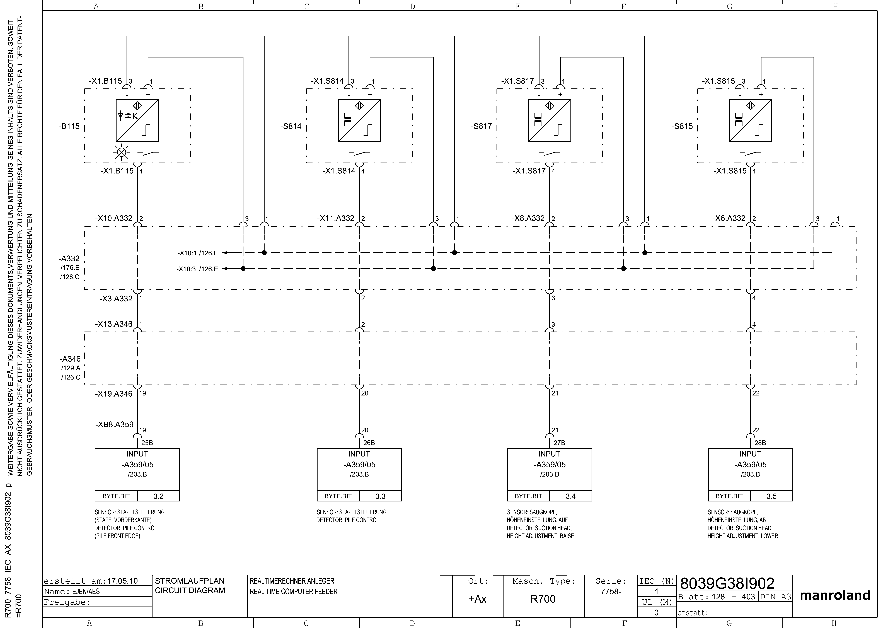

# +Ax — Sheet 128 of 403 — REALTIMERECHNER ANLEGER

**REAL TIME COMPUTER FEEDER**

> Part of the manroland **R700** printing press IEC/UL circuit diagrams.
> Drawing class: **Stromlaufplan / Circuit diagram** (DIN A3).
> Document `+Ax` covers the **Central control console** machine section.

## At a glance

| Field | Value |
|---|---|
| Document | `+Ax`  (8039G38I902) |
| Sheet | **128** of 403 |
| Section (DE) | REALTIMERECHNER ANLEGER |
| Section (EN) | REAL TIME COMPUTER FEEDER |
| Section type | CIRCUIT — Circuit diagram |
| Machine type | `R700` |
| Series | `7758` |
| Created | 17.05.10 |
| Replaces | — |
| Columns used | A, B, C, D, E, F, G, H |
| Path numbers | — |
| Labels on sheet | 112 |
| Cross-refs out | 10 |
| Cross-refs in | 50 |

**Previous:** [+Ax sheet 127](SHEET_0127.md) · **Next:** [+Ax sheet 129](SHEET_0129.md) · **Document TOC:** [_TOC.md](_TOC.md)  (+Ax) · **Master TOC:** [all sheets](../_MASTER_TOC.md)

## Sheet image (300 DPI, exact vector render)



_Rendered directly from the PDF vector layer at 300 DPI (1-bit), no OCR and no resampling. Use it to confirm anything ambiguous in the text below._

## Cross-references on this sheet

Each entry is a wire leaving this sheet. The printed token is `/sheet.column`; the link resolves to that sheet inside the same document.

| Ref | Target sheet | Col | Path | Destination on target | Target section | From col |
|---|---|---|---|---|---|---|
| `/126.E` | [+Ax sheet 126](SHEET_0126.md) | E | — | X10:1 | REALTIMERECHNER ANLEGER | B |
| `/176.E` | [+Ax sheet 176](SHEET_0176.md) | E | — | — | RESERVE | A |
| `/126.C` | [+Ax sheet 126](SHEET_0126.md) | C | — | — | REALTIMERECHNER ANLEGER | A |
| `/126.E` | [+Ax sheet 126](SHEET_0126.md) | E | — | X10:3 | REALTIMERECHNER ANLEGER | B |
| `/129.A` | [+Ax sheet 129](SHEET_0129.md) | A | — | — | REALTIMERECHNER ANLAGE | A |
| `/126.C` | [+Ax sheet 126](SHEET_0126.md) | C | — | — | REALTIMERECHNER ANLEGER | A |
| `/203.B` | [+Ax sheet 203](SHEET_0203.md) | B | — | — | REFERENZMODUL | A |
| `/203.B` | [+Ax sheet 203](SHEET_0203.md) | B | — | — | REFERENZMODUL | C |
| `/203.B` | [+Ax sheet 203](SHEET_0203.md) | B | — | — | REFERENZMODUL | E |
| `/203.B` | [+Ax sheet 203](SHEET_0203.md) | B | — | — | REFERENZMODUL | G |

### Incoming references (sheets that point here)

Every other sheet that sends a wire to this one. `Back-ref` is the token printed on *that* sheet; `Path` is its line number.

| From sheet | Cols | Back-ref | Path | Refs | What continues there |
|---|---|---|---|---|---|
| [+Ax#126](SHEET_0126.md) | C, E | `/126.C`, `/126.E` | — | 4 | X10:1; X10:3 |
| [+Ax#129](SHEET_0129.md) | A | `/129.A` | — | 1 | — |
| [+Ax#176](SHEET_0176.md) | D | `/176.D` | — | 1 | — |
| [+Ax#203](SHEET_0203.md) | B | `/203.B` | — | 4 | — |
| [+Ax#212](SHEET_0212.md) | A | `/212.A` | — | 3 | — |
| [+Ax#215](SHEET_0215.md) | F, H | `/215.F`, `/215.H` | — | 9 | — |
| [+Ax#222](SHEET_0222.md) | F | `/222.F` | — | 4 | — |
| [+Ax#233](SHEET_0233.md) | C | `/233.C` | — | 3 | — |
| [+Ax#237](SHEET_0237.md) | F | `/237.F` | — | 3 | — |
| [+Ax#238](SHEET_0238.md) | F | `/238.F` | — | 4 | — |
| [+Ax#243](SHEET_0243.md) | G | `/243.G` | — | 3 | — |
| [+Ax#246](SHEET_0246.md) | A | `/246.A` | — | 3 | — |
| [+Ax#250](SHEET_0250.md) | A | `/250.A` | — | 4 | — |
| [+Ax#259](SHEET_0259.md) | A | `/259.A` | — | 4 | — |


## Devices on this sheet

| Tag | Class | Class meaning (IEC) | Col | Sub | Terminal | Sign |
|---|---|---|---|---|---|---|
| `B115` | B | Umformer / transducer, sensor | A | — | — | — |
| `A332` | A | Baugruppe / assembly, module, PC board | A | — | — | — |
| `A359/05` | A | Baugruppe / assembly, module, PC board | A | 05 | — | — |
| `A346` | A | Baugruppe / assembly, module, PC board | A | — | — | — |
| `A359/05` | A | Baugruppe / assembly, module, PC board | G | 05 | — | — |
| `S817` | S | Schalter / switch | E | — | — | — |
| `A359/05` | A | Baugruppe / assembly, module, PC board | E | 05 | — | — |
| `S814` | S | Schalter / switch | C | — | — | — |
| `A359/05` | A | Baugruppe / assembly, module, PC board | C | 05 | — | — |
| `S815` | S | Schalter / switch | G | — | — | — |
| `X10:1` | X | Klemme / terminal, plug connector | B | — | 1 | — |
| `X10:3` | X | Klemme / terminal, plug connector | B | — | 3 | — |
| `X1.B115` | — | cross-device reference | A | — | — | — |
| `X1.B115` | — | cross-device reference | A | — | — | — |
| `X10.A332` | — | cross-device reference | A | — | — | — |
| `3.2` | — | cross-device reference | B | — | — | — |
| `XB8.A359` | — | cross-device reference | A | — | — | — |
| `X19.A346` | — | cross-device reference | A | — | — | — |
| `X13.A346` | — | cross-device reference | A | — | — | — |
| `X3.A332` | — | cross-device reference | A | — | — | — |
| `X1.S815` | — | cross-device reference | G | — | — | — |
| `X1.S815` | — | cross-device reference | G | — | — | — |
| `X6.A332` | — | cross-device reference | G | — | — | — |
| `3.5` | — | cross-device reference | G | — | — | — |
| `X1.S817` | — | cross-device reference | E | — | — | — |
| `X1.S817` | — | cross-device reference | E | — | — | — |
| `X8.A332` | — | cross-device reference | E | — | — | — |
| `3.4` | — | cross-device reference | F | — | — | — |
| `X1.S814` | — | cross-device reference | C | — | — | — |
| `X1.S814` | — | cross-device reference | C | — | — | — |
| `X11.A332` | — | cross-device reference | C | — | — | — |
| `3.3` | — | cross-device reference | D | — | — | — |

## Potentials / nets

_No named potentials on this sheet._

## Wire-end annotations (grouped as printed)

A wire that continues elsewhere is annotated with a small cluster: the destination description, the path/line number `#NN`, and the `/sheet.column` cross reference. Each row below is one such cluster exactly as it is grouped on the drawing.

| Col | Y | Path | Cross-ref | Text on the wire |
|---|---|---|---|---|
| A | 103.8 | — | — | `X1.B115 3 1` |
| C | 103.8 | — | — | `X1.S814 3 1` |
| E | 103.8 | — | — | `X1.S817 3 1` |
| G | 103.8 | — | — | `X1.S815 3 1` |
| D | 122.2 | — | — | `+ + + +` |
| A | 164.7 | — | — | `B115` |
| C | 164.7 | — | — | `S814` |
| E | 164.7 | — | — | `S817` |
| G | 164.7 | — | — | `S815` |
| A | 224.2 | — | — | `X1.B115 4` |
| C | 224.2 | — | — | `X1.S814 4` |
| E | 224.2 | — | — | `X1.S817 4` |
| G | 224.2 | — | — | `X1.S815 4` |
| A | 288.0 | — | — | `X10.A332 2` |
| C | 288.0 | — | — | `X11.A332 2` |
| E | 288.0 | — | — | `X8.A332 2` |
| G | 288.0 | — | — | `X6.A332 2` |
| C | 289.5 | — | — | `3 1 3 1` |
| F | 289.5 | — | — | `3 1` |
| H | 289.5 | — | — | `3 1` |
| B | 335.5 | — | `/126.E` | `X10:1` |
| A | 341.9 | — | — | `A332` |
| A | 354.9 | — | `/176.E`, `/126.C` | — |
| B | 356.7 | — | `/126.E` | `X10:3` |
| A | 395.7 | — | — | `X3.A332 1` |
| D | 395.8 | — | — | `2` |
| E | 395.8 | — | — | `3` |
| G | 395.8 | — | — | `4` |
| A | 429.8 | — | — | `X13.A346 1` |
| D | 431.2 | — | — | `2` |
| E | 431.2 | — | — | `3` |
| G | 431.2 | — | — | `4` |
| A | 476.5 | — | — | `A346` |
| A | 489.6 | — | `/129.A`, `/126.C` | — |
| A | 523.3 | — | — | `X19.A346 19` |
| D | 523.3 | — | — | `20` |
| E | 523.3 | — | — | `21` |
| G | 523.3 | — | — | `22` |
| A | 564.4 | — | — | `XB8.A359 19` |
| D | 572.9 | — | — | `20` |
| E | 572.9 | — | — | `21` |
| G | 572.9 | — | — | `22` |
| A | 589.9 | — | — | `25B` |
| D | 589.9 | — | — | `26B` |
| E | 589.9 | — | — | `27B` |
| G | 589.9 | — | — | `28B` |
| A | 604.4 | — | — | `INPUT` |
| C | 604.4 | — | — | `INPUT` |
| E | 604.4 | — | — | `INPUT` |
| G | 604.4 | — | — | `INPUT` |
| A | 618.3 | — | — | `A359/05` |
| C | 618.3 | — | — | `A359/05` |
| E | 618.3 | — | — | `A359/05` |
| G | 618.3 | — | — | `A359/05` |
| A | 632.0 | — | `/203.B` | — |
| C | 632.0 | — | `/203.B` | — |
| E | 632.0 | — | `/203.B` | — |
| G | 632.0 | — | `/203.B` | — |
| A | 661.1 | — | — | `BYTE.BIT 3.2` |
| C | 661.1 | — | — | `BYTE.BIT 3.3` |
| E | 661.1 | — | — | `BYTE.BIT 3.4` |
| G | 661.1 | — | — | `BYTE.BIT 3.5` |
| A | 683.8 | — | — | `DETECTOR: PILE CONTROL (STAPELVORDERKANTE) (PILE FRONT EDGE) SENSOR: STAPELSTEUERUNG` |
| C | 683.8 | — | — | `DETECTOR: PILE CONTROL SENSOR: STAPELSTEUERUNG` |
| E | 683.8 | — | — | `HÖHENEINSTELLUNG, AUF DETECTOR: SUCTION HEAD, HEIGHT ADJUSTMENT, RAISE SENSOR: SAUGKOPF,` |
| G | 683.8 | — | — | `HÖHENEINSTELLUNG, AB DETECTOR: SUCTION HEAD, HEIGHT ADJUSTMENT, LOWER SENSOR: SAUGKOPF,` |


## Reconstructed tables

This sheet carries tabular content (pin map / terminal assignment / index). The grid below was rebuilt from the drawing's own rule lines, so each row is exactly one physical row of the table.

### Table 1 — 4 data rows × 5 columns (at x=127.6, y=48.2)

| X1.B115 |  | 3 |  | 1 + |
|---|---|---|---|---|
| `X10.A332` | `X1.B115` |  | `4 2` |  |
| `X3.A332 X13.A346 X19.A346 XB8.A359` |  |  | `1 1 19 19 25B` |  |
|  |  | `INPUT` | `A359/05 /203.B` |  |
| `BYTE.BIT` |  |  |  | `3.2` |


### Table 2 — 6 data rows × 9 columns (at x=240.9, y=48.2)

|  |  |  | X1.S814 |  | 3 |  | 1 + |  |
|---|---|---|---|---|---|---|---|---|
|  |  | `S814` |  |  |  |  |  |  |
|  | `3` | `1` | `X11.A332` | `X1.S814` |  | `4 2` |  |  |
| `/126.E X10:1` |  |  |  |  |  |  |  |  |
| `/126.E X10:3` |  |  |  |  |  | `2 2 20 20 26B` |  |  |
|  |  |  |  |  | `INPUT` | `A359/05 /203.B` |  |  |
|  |  |  | `BYTE.BIT` |  |  |  |  | `3.3` |


### Table 3 — 5 data rows × 7 columns (at x=581.1, y=48.2)

|  |  | X1.S817 |  | 3 |  | 1 + |
|---|---|---|---|---|---|---|
|  | `S817` |  |  |  |  |  |
| `3` | `1` | `X8.A332` | `X1.S817` |  | `4 2` |  |
|  |  |  |  |  | `3 3 21 21 27B` |  |
|  |  |  |  | `INPUT` | `A359/05 /203.B` |  |
|  |  | `BYTE.BIT` |  |  |  | `3.4` |


### Table 4 — 5 data rows × 8 columns (at x=836.2, y=48.2)

|  |  | X1.S815 |  | 3 |  | 1 + |  |
|---|---|---|---|---|---|---|---|
|  | `S815` |  |  |  |  |  |  |
| `3` | `1` | `X6.A332` | `X1.S815` |  | `4 2` |  |  |
|  |  |  |  |  | `4 4 22 22 28B` |  |  |
|  |  |  |  | `INPUT` | `A359/05 /203.B` |  |  |
|  |  | `BYTE.BIT` |  |  |  |  | `3.5` |


## Notes and free text on this sheet

| Text | Col | Y (pt) |
|---|---|---|
| `25B` | A | 589.89 |
| `INPUT` | A | 604.42 |
| `BYTE.BIT` | A | 661.67 |
| `SENSOR: STAPELSTEUERUNG` | A | 683.77 |
| `(STAPELVORDERKANTE)` | A | 694.41 |
| `DETECTOR: PILE CONTROL` | A | 705.05 |
| `(PILE FRONT EDGE)` | A | 715.67 |
| `28B` | G | 589.89 |
| `INPUT` | G | 604.42 |
| `BYTE.BIT` | G | 661.67 |
| `SENSOR: SAUGKOPF,` | G | 683.76 |
| `HÖHENEINSTELLUNG, AB` | G | 694.41 |
| `DETECTOR: SUCTION HEAD,` | G | 705.04 |
| `HEIGHT ADJUSTMENT, LOWER` | G | 715.66 |
| `27B` | E | 589.89 |
| `INPUT` | E | 604.42 |
| `BYTE.BIT` | E | 661.67 |
| `SENSOR: SAUGKOPF,` | E | 683.76 |
| `HÖHENEINSTELLUNG, AUF` | E | 694.42 |
| `DETECTOR: SUCTION HEAD,` | E | 705.04 |
| `HEIGHT ADJUSTMENT, RAISE` | E | 715.66 |
| `26B` | D | 589.89 |
| `INPUT` | C | 604.42 |
| `BYTE.BIT` | C | 661.67 |
| `SENSOR: STAPELSTEUERUNG` | C | 683.77 |
| `DETECTOR: PILE CONTROL` | C | 694.41 |

## Complete label inventory (exact text from the drawing)

Every text object inside the drawing area of this sheet, in DIN reading order (column A→H, then top→bottom). This is the authoritative list: if a string is not here it is not printed on this sheet.

| Col | Y | X | Dir | Type | Text |
|---|---|---|---|---|---|
| A | 103.8 | 119.3 | → | device ref | `X1.B115` |
| A | 105.2 | 172.6 | → | number | `3` |
| A | 122.2 | 195.4 | → | number | `+` |
| A | 164.7 | 78.5 | → | device tag | `B115` |
| A | 224.2 | 134.9 | → | device ref | `X1.B115` |
| A | 225.7 | 186.8 | → | number | `4` |
| A | 288.0 | 127.6 | → | device ref | `X10.A332` |
| A | 289.5 | 186.8 | → | number | `2` |
| A | 341.9 | 78.5 | → | device tag | `A332` |
| A | 354.9 | 81.4 | → | cross-reference | `/176.E` |
| A | 367.4 | 80.8 | → | cross-reference | `/126.C` |
| A | 395.7 | 133.5 | → | device ref | `X3.A332` |
| A | 395.8 | 186.2 | → | number | `1` |
| A | 429.8 | 127.6 | → | device ref | `X13.A346` |
| A | 431.2 | 186.2 | → | number | `1` |
| A | 476.5 | 79.9 | → | device tag | `A346` |
| A | 489.6 | 82.2 | → | cross-reference | `/129.A` |
| A | 502.0 | 82.2 | → | cross-reference | `/126.C` |
| A | 523.3 | 127.6 | → | device ref | `X19.A346` |
| A | 523.3 | 186.2 | → | number | `19` |
| A | 564.4 | 127.8 | → | device ref | `XB8.A359` |
| A | 572.9 | 186.2 | → | number | `19` |
| A | 589.9 | 189.6 | → | text | `25B` |
| A | 604.4 | 169.4 | → | text | `INPUT` |
| A | 618.3 | 162.9 | → | device tag | `A359/05` |
| A | 632.0 | 171.6 | → | cross-reference | `/203.B` |
| A | 661.7 | 137.5 | → | text | `BYTE.BIT` |
| A | 683.8 | 127.3 | → | text | `SENSOR: STAPELSTEUERUNG` |
| A | 694.4 | 127.0 | → | text | `(STAPELVORDERKANTE)` |
| A | 705.0 | 126.7 | → | text | `DETECTOR: PILE CONTROL` |
| A | 715.7 | 127.0 | → | text | `(PILE FRONT EDGE)` |
| B | 105.2 | 200.4 | → | number | `1` |
| B | 289.5 | 328.5 | → | number | `3` |
| B | 335.5 | 238.1 | → | device tag | `X10:1` |
| B | 335.5 | 267.0 | → | cross-reference | `/126.E` |
| B | 356.7 | 236.7 | → | device tag | `X10:3` |
| B | 356.7 | 267.0 | → | cross-reference | `/126.E` |
| B | 661.1 | 205.8 | → | device ref | `3.2` |
| C | 103.8 | 417.0 | → | device ref | `X1.S814` |
| C | 105.2 | 470.3 | → | number | `3` |
| C | 164.7 | 376.2 | → | device tag | `S814` |
| C | 224.2 | 432.6 | → | device ref | `X1.S814` |
| C | 288.0 | 425.2 | → | device ref | `X11.A332` |
| C | 289.5 | 356.3 | → | number | `1` |
| C | 604.4 | 467.0 | → | text | `INPUT` |
| C | 618.3 | 460.5 | → | device tag | `A359/05` |
| C | 632.0 | 469.3 | → | cross-reference | `/203.B` |
| C | 661.7 | 435.1 | → | text | `BYTE.BIT` |
| C | 683.8 | 424.9 | → | text | `SENSOR: STAPELSTEUERUNG` |
| C | 694.4 | 424.3 | → | text | `DETECTOR: PILE CONTROL` |
| D | 105.2 | 498.0 | → | number | `1` |
| D | 122.2 | 493.1 | → | number | `+` |
| D | 225.7 | 484.4 | → | number | `4` |
| D | 289.5 | 484.4 | → | number | `2` |
| D | 289.5 | 583.7 | → | number | `3` |
| D | 289.5 | 611.4 | → | number | `1` |
| D | 395.8 | 484.4 | → | number | `2` |
| D | 431.2 | 484.4 | → | number | `2` |
| D | 523.3 | 484.4 | → | number | `20` |
| D | 572.9 | 484.4 | → | number | `20` |
| D | 589.9 | 487.3 | → | text | `26B` |
| D | 661.1 | 503.4 | → | device ref | `3.3` |
| E | 103.8 | 672.1 | → | device ref | `X1.S817` |
| E | 105.2 | 725.4 | → | number | `3` |
| E | 105.2 | 753.2 | → | number | `1` |
| E | 122.2 | 748.2 | → | number | `+` |
| E | 164.7 | 631.3 | → | device tag | `S817` |
| E | 224.2 | 687.7 | → | device ref | `X1.S817` |
| E | 225.7 | 739.6 | → | number | `4` |
| E | 288.0 | 686.3 | → | device ref | `X8.A332` |
| E | 289.5 | 739.6 | → | number | `2` |
| E | 395.8 | 739.6 | → | number | `3` |
| E | 431.2 | 739.6 | → | number | `3` |
| E | 523.3 | 739.6 | → | number | `21` |
| E | 572.9 | 739.6 | → | number | `21` |
| E | 589.9 | 742.4 | → | text | `27B` |
| E | 604.4 | 722.1 | → | text | `INPUT` |
| E | 618.3 | 715.6 | → | device tag | `A359/05` |
| E | 632.0 | 724.4 | → | cross-reference | `/203.B` |
| E | 661.7 | 690.2 | → | text | `BYTE.BIT` |
| E | 683.8 | 680.0 | → | text | `SENSOR: SAUGKOPF,` |
| E | 694.4 | 679.5 | → | text | `HÖHENEINSTELLUNG, AUF` |
| E | 705.0 | 679.5 | → | text | `DETECTOR: SUCTION HEAD,` |
| E | 715.7 | 679.5 | → | text | `HEIGHT ADJUSTMENT, RAISE` |
| F | 289.5 | 838.8 | → | number | `3` |
| F | 289.5 | 866.6 | → | number | `1` |
| F | 661.1 | 758.6 | → | device ref | `3.4` |
| G | 103.8 | 941.4 | → | device ref | `X1.S815` |
| G | 105.2 | 994.7 | → | number | `3` |
| G | 105.2 | 1022.5 | → | number | `1` |
| G | 122.2 | 1017.5 | → | number | `+` |
| G | 164.7 | 900.6 | → | device tag | `S815` |
| G | 224.2 | 957.0 | → | device ref | `X1.S815` |
| G | 225.7 | 1008.9 | → | number | `4` |
| G | 288.0 | 955.6 | → | device ref | `X6.A332` |
| G | 289.5 | 1008.9 | → | number | `2` |
| G | 395.8 | 1008.9 | → | number | `4` |
| G | 431.2 | 1008.9 | → | number | `4` |
| G | 523.3 | 1008.9 | → | number | `22` |
| G | 572.9 | 1008.9 | → | number | `22` |
| G | 589.9 | 1011.7 | → | text | `28B` |
| G | 604.4 | 991.4 | → | text | `INPUT` |
| G | 618.3 | 984.9 | → | device tag | `A359/05` |
| G | 632.0 | 993.7 | → | cross-reference | `/203.B` |
| G | 661.1 | 1027.8 | → | device ref | `3.5` |
| G | 661.7 | 959.5 | → | text | `BYTE.BIT` |
| G | 683.8 | 949.3 | → | text | `SENSOR: SAUGKOPF,` |
| G | 694.4 | 948.8 | → | text | `HÖHENEINSTELLUNG, AB` |
| G | 705.0 | 948.8 | → | text | `DETECTOR: SUCTION HEAD,` |
| G | 715.7 | 948.8 | → | text | `HEIGHT ADJUSTMENT, LOWER` |
| H | 289.5 | 1093.9 | → | number | `3` |
| H | 289.5 | 1121.7 | → | number | `1` |

## Reading-order text block

The same content as a plain block, grouped by DIN column — convenient to paste or to match against a visual description.

```text
=== Column A ===
 103.8  119.3  devref       X1.B115
 105.2  172.6  numeric      3
 122.2  195.4  numeric      +
 164.7   78.5  devtag       B115
 224.2  134.9  devref       X1.B115
 225.7  186.8  numeric      4
 288.0  127.6  devref       X10.A332
 289.5  186.8  numeric      2
 341.9   78.5  devtag       A332
 354.9   81.4  xref         /176.E
 367.4   80.8  xref         /126.C
 395.7  133.5  devref       X3.A332
 395.8  186.2  numeric      1
 429.8  127.6  devref       X13.A346
 431.2  186.2  numeric      1
 476.5   79.9  devtag       A346
 489.6   82.2  xref         /129.A
 502.0   82.2  xref         /126.C
 523.3  127.6  devref       X19.A346
 523.3  186.2  numeric      19
 564.4  127.8  devref       XB8.A359
 572.9  186.2  numeric      19
 589.9  189.6  text         25B
 604.4  169.4  text         INPUT
 618.3  162.9  devtag       A359/05
 632.0  171.6  xref         /203.B
 661.7  137.5  text         BYTE.BIT
 683.8  127.3  text         SENSOR: STAPELSTEUERUNG
 694.4  127.0  text         (STAPELVORDERKANTE)
 705.0  126.7  text         DETECTOR: PILE CONTROL
 715.7  127.0  text         (PILE FRONT EDGE)
=== Column B ===
 105.2  200.4  numeric      1
 289.5  328.5  numeric      3
 335.5  238.1  devtag       X10:1
 335.5  267.0  xref         /126.E
 356.7  236.7  devtag       X10:3
 356.7  267.0  xref         /126.E
 661.1  205.8  devref       3.2
=== Column C ===
 103.8  417.0  devref       X1.S814
 105.2  470.3  numeric      3
 164.7  376.2  devtag       S814
 224.2  432.6  devref       X1.S814
 288.0  425.2  devref       X11.A332
 289.5  356.3  numeric      1
 604.4  467.0  text         INPUT
 618.3  460.5  devtag       A359/05
 632.0  469.3  xref         /203.B
 661.7  435.1  text         BYTE.BIT
 683.8  424.9  text         SENSOR: STAPELSTEUERUNG
 694.4  424.3  text         DETECTOR: PILE CONTROL
=== Column D ===
 105.2  498.0  numeric      1
 122.2  493.1  numeric      +
 225.7  484.4  numeric      4
 289.5  484.4  numeric      2
 289.5  583.7  numeric      3
 289.5  611.4  numeric      1
 395.8  484.4  numeric      2
 431.2  484.4  numeric      2
 523.3  484.4  numeric      20
 572.9  484.4  numeric      20
 589.9  487.3  text         26B
 661.1  503.4  devref       3.3
=== Column E ===
 103.8  672.1  devref       X1.S817
 105.2  725.4  numeric      3
 105.2  753.2  numeric      1
 122.2  748.2  numeric      +
 164.7  631.3  devtag       S817
 224.2  687.7  devref       X1.S817
 225.7  739.6  numeric      4
 288.0  686.3  devref       X8.A332
 289.5  739.6  numeric      2
 395.8  739.6  numeric      3
 431.2  739.6  numeric      3
 523.3  739.6  numeric      21
 572.9  739.6  numeric      21
 589.9  742.4  text         27B
 604.4  722.1  text         INPUT
 618.3  715.6  devtag       A359/05
 632.0  724.4  xref         /203.B
 661.7  690.2  text         BYTE.BIT
 683.8  680.0  text         SENSOR: SAUGKOPF,
 694.4  679.5  text         HÖHENEINSTELLUNG, AUF
 705.0  679.5  text         DETECTOR: SUCTION HEAD,
 715.7  679.5  text         HEIGHT ADJUSTMENT, RAISE
=== Column F ===
 289.5  838.8  numeric      3
 289.5  866.6  numeric      1
 661.1  758.6  devref       3.4
=== Column G ===
 103.8  941.4  devref       X1.S815
 105.2  994.7  numeric      3
 105.2 1022.5  numeric      1
 122.2 1017.5  numeric      +
 164.7  900.6  devtag       S815
 224.2  957.0  devref       X1.S815
 225.7 1008.9  numeric      4
 288.0  955.6  devref       X6.A332
 289.5 1008.9  numeric      2
 395.8 1008.9  numeric      4
 431.2 1008.9  numeric      4
 523.3 1008.9  numeric      22
 572.9 1008.9  numeric      22
 589.9 1011.7  text         28B
 604.4  991.4  text         INPUT
 618.3  984.9  devtag       A359/05
 632.0  993.7  xref         /203.B
 661.1 1027.8  devref       3.5
 661.7  959.5  text         BYTE.BIT
 683.8  949.3  text         SENSOR: SAUGKOPF,
 694.4  948.8  text         HÖHENEINSTELLUNG, AB
 705.0  948.8  text         DETECTOR: SUCTION HEAD,
 715.7  948.8  text         HEIGHT ADJUSTMENT, LOWER
=== Column H ===
 289.5 1093.9  numeric      3
 289.5 1121.7  numeric      1
```

---
_Generated from the PDF vector text layer; no OCR. Source: `R700_7758_IEC_AX_8039G38I902_p`, sheet 128._
