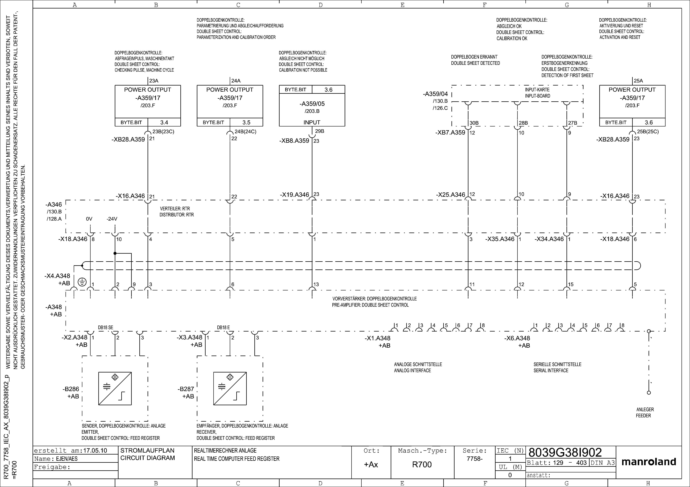

# +Ax — Sheet 129 of 403 — REALTIMERECHNER ANLAGE

**REAL TIME COMPUTER FEED REGISTER**

> Part of the manroland **R700** printing press IEC/UL circuit diagrams.
> Drawing class: **Stromlaufplan / Circuit diagram** (DIN A3).
> Document `+Ax` covers the **Central control console** machine section.

## At a glance

| Field | Value |
|---|---|
| Document | `+Ax`  (8039G38I902) |
| Sheet | **129** of 403 |
| Section (DE) | REALTIMERECHNER ANLAGE |
| Section (EN) | REAL TIME COMPUTER FEED REGISTER |
| Section type | CIRCUIT — Circuit diagram |
| Machine type | `R700` |
| Series | `7758` |
| Created | 17.05.10 |
| Replaces | — |
| Columns used | A, B, C, D, E, F, G, H |
| Path numbers | — |
| Labels on sheet | 169 |
| Cross-refs out | 8 |
| Cross-refs in | 48 |

**Previous:** [+Ax sheet 128](SHEET_0128.md) · **Next:** [+Ax sheet 130](SHEET_0130.md) · **Document TOC:** [_TOC.md](_TOC.md)  (+Ax) · **Master TOC:** [all sheets](../_MASTER_TOC.md)

## Sheet image (300 DPI, exact vector render)



_Rendered directly from the PDF vector layer at 300 DPI (1-bit), no OCR and no resampling. Use it to confirm anything ambiguous in the text below._

## Cross-references on this sheet

Each entry is a wire leaving this sheet. The printed token is `/sheet.column`; the link resolves to that sheet inside the same document.

| Ref | Target sheet | Col | Path | Destination on target | Target section | From col |
|---|---|---|---|---|---|---|
| `/130.B` | [+Ax sheet 130](SHEET_0130.md) | B | — | — | REALTIMERECHNER ANLAGE | E |
| `/126.C` | [+Ax sheet 126](SHEET_0126.md) | C | — | — | REALTIMERECHNER ANLEGER | E |
| `/203.F` | [+Ax sheet 203](SHEET_0203.md) | F | — | — | REFERENZMODUL | B |
| `/203.F` | [+Ax sheet 203](SHEET_0203.md) | F | — | — | REFERENZMODUL | C |
| `/203.F` | [+Ax sheet 203](SHEET_0203.md) | F | — | — | REFERENZMODUL | H |
| `/203.B` | [+Ax sheet 203](SHEET_0203.md) | B | — | — | REFERENZMODUL | D |
| `/130.B` | [+Ax sheet 130](SHEET_0130.md) | B | — | — | REALTIMERECHNER ANLAGE | A |
| `/128.A` | [+Ax sheet 128](SHEET_0128.md) | A | — | — | REALTIMERECHNER ANLEGER | A |

### Incoming references (sheets that point here)

Every other sheet that sends a wire to this one. `Back-ref` is the token printed on *that* sheet; `Path` is its line number.

| From sheet | Cols | Back-ref | Path | Refs | What continues there |
|---|---|---|---|---|---|
| [+Ax#126](SHEET_0126.md) | C | `/126.C` | — | 1 | — |
| [+Ax#128](SHEET_0128.md) | A | `/128.A` | — | 1 | — |
| [+Ax#130](SHEET_0130.md) | B | `/130.B` | — | 2 | — |
| [+Ax#203](SHEET_0203.md) | B, F | `/203.B`, `/203.F` | — | 4 | — |
| [+Ax#218](SHEET_0218.md) | A | `/218.A` | — | 3 | — |
| [+Ax#223](SHEET_0223.md) | C | `/223.C` | — | 3 | — |
| [+Ax#227](SHEET_0227.md) | C | `/227.C` | — | 11 | — |
| [+Ax#236](SHEET_0236.md) | B | `/236.B` | — | 3 | — |
| [+Ax#238](SHEET_0238.md) | F | `/238.F` | — | 1 | — |
| [+Ax#254](SHEET_0254.md) | E | `/254.E` | — | 3 | — |
| [+Ax#256](SHEET_0256.md) | F | `/256.F` | — | 7 | — |
| [+Ax#259](SHEET_0259.md) | A | `/259.A` | — | 1 | — |
| [+Ax#267](SHEET_0267.md) | F | `/267.F` | — | 3 | — |
| [+Ax#272](SHEET_0272.md) | D | `/272.D` | — | 3 | — |
| [+Ax#278](SHEET_0278.md) | B, F | `/278.B`, `/278.F` | — | 2 | — |


## Devices on this sheet

| Tag | Class | Class meaning (IEC) | Col | Sub | Terminal | Sign |
|---|---|---|---|---|---|---|
| `B286` | B | Umformer / transducer, sensor | A | — | — | — |
| `B287` | B | Umformer / transducer, sensor | B | — | — | — |
| `A346` | A | Baugruppe / assembly, module, PC board | A | — | — | — |
| `A348` | A | Baugruppe / assembly, module, PC board | A | — | — | — |
| `A359/17` | A | Baugruppe / assembly, module, PC board | H | 17 | — | — |
| `A359/05` | A | Baugruppe / assembly, module, PC board | D | 05 | — | — |
| `A359/17` | A | Baugruppe / assembly, module, PC board | C | 17 | — | — |
| `A359/17` | A | Baugruppe / assembly, module, PC board | B | 17 | — | — |
| `A359/04` | A | Baugruppe / assembly, module, PC board | E | 04 | — | — |
| `X2.A348` | — | cross-device reference | A | — | — | — |
| `X3.A348` | — | cross-device reference | B | — | — | — |
| `X18.A346` | — | cross-device reference | A | — | — | — |
| `X16.A346` | — | cross-device reference | H | — | — | — |
| `X34.A346` | — | cross-device reference | G | — | — | — |
| `X18.A346` | — | cross-device reference | H | — | — | — |
| `X35.A346` | — | cross-device reference | F | — | — | — |
| `X19.A346` | — | cross-device reference | D | — | — | — |
| `X16.A346` | — | cross-device reference | B | — | — | — |
| `X25.A346` | — | cross-device reference | F | — | — | — |
| `X4.A348` | — | cross-device reference | A | — | — | — |
| `3.6` | — | cross-device reference | H | — | — | — |
| `XB28.A359` | — | cross-device reference | H | — | — | — |
| `3.6` | — | cross-device reference | D | — | — | — |
| `XB8.A359` | — | cross-device reference | D | — | — | — |
| `3.5` | — | cross-device reference | C | — | — | — |
| `3.4` | — | cross-device reference | B | — | — | — |
| `XB28.A359` | — | cross-device reference | B | — | — | — |
| `XB7.A359` | — | cross-device reference | F | — | — | — |
| `X6.A348` | — | cross-device reference | F | — | — | — |
| `X1.A348` | — | cross-device reference | E | — | — | — |

## Potentials / nets

| Potential | Count | Columns | Attached devices | Terminals |
|---|---|---|---|---|
| `0V` | 1 | A | — | — |
| `24V` | 1 | A | — | — |


A potential such as `L24+/4` or `M24+` is a named supply/return rail; every place it appears on this sheet is electrically common.

## Wire-end annotations (grouped as printed)

A wire that continues elsewhere is annotated with a small cluster: the destination description, the path/line number `#NN`, and the `/sheet.column` cross reference. Each row below is one such cluster exactly as it is grouped on the drawing.

| Col | Y | Path | Cross-ref | Text on the wire |
|---|---|---|---|---|
| F | 31.8 | — | — | `DOPPELBOGENKONTROLLE:` |
| C | 31.9 | — | — | `DOPPELBOGENKONTROLLE: PARAMETRIERUNG UND ABGLEICHAUFFORDERUNG DOUBLE SHEET CONTROL: PARAMETERIZATION AND CALIBRATION ORDER` |
| H | 31.9 | — | — | `DOPPELBOGENKONTROLLE:` |
| H | 41.9 | — | — | `DOUBLE SHEET CONTROL: AKTIVIERUNG UND RESET` |
| F | 42.4 | — | — | `DOUBLE SHEET CONTROL: ABGLEICH OK` |
| H | 61.8 | — | — | `ACTIVATION AND RESET` |
| F | 63.7 | — | — | `CALIBRATION OK` |
| B | 88.6 | — | — | `DOPPELBOGENKONTROLLE:` |
| D | 88.6 | — | — | `DOPPELBOGENKONTROLLE:` |
| F | 95.6 | — | — | `DOPPELBOGEN ERKANNT DOUBLE SHEET DETECTED` |
| G | 95.6 | — | — | `DOPPELBOGENKONTROLLE: ERSTBOGENERKENNUNG DOUBLE SHEET CONTROL: DETECTION OF FIRST SHEET` |
| B | 98.6 | — | — | `DOUBLE SHEET CONTROL: CHECKING PULSE, MACHINE CYCLE ABFRAGEIMPULS, MASCHINENTAKT` |
| D | 98.6 | — | — | `DOUBLE SHEET CONTROL: CALIBRATION NOT POSSIBLE ABGLEICH NICHT MÖGLICH` |
| B | 135.6 | — | — | `23A` |
| C | 135.6 | — | — | `24A` |
| H | 135.6 | — | — | `25A` |
| B | 150.8 | — | — | `POWER OUTPUT` |
| C | 150.8 | — | — | `POWER OUTPUT` |
| D | 150.8 | — | — | `BYTE.BIT 3.6` |
| H | 150.8 | — | — | `POWER OUTPUT` |
| G | 152.3 | — | — | `INPUT KARTE INPUT BOARD` |
| E | 157.6 | — | — | `A359/04` |
| B | 164.7 | — | — | `A359/17` |
| C | 164.7 | — | — | `A359/17` |
| H | 164.7 | — | — | `A359/17` |
| E | 170.7 | — | `/130.B`, `/126.C` | — |
| D | 174.6 | — | — | `A359/05` |
| B | 178.5 | — | `/203.F` | — |
| C | 178.5 | — | `/203.F` | — |
| H | 178.5 | — | `/203.F` | — |
| D | 188.4 | — | `/203.B` | — |
| B | 207.5 | — | — | `BYTE.BIT 3.4` |
| C | 207.5 | — | — | `BYTE.BIT 3.5` |
| H | 207.5 | — | — | `BYTE.BIT 3.6` |
| D | 207.6 | — | — | `INPUT 29B` |
| F | 208.6 | — | — | `30B` |
| F | 208.6 | — | — | `28B` |
| G | 208.6 | — | — | `27B` |
| B | 223.6 | — | — | `23B(23C)` |
| C | 223.6 | — | — | `24B(24C)` |
| H | 223.6 | — | — | `25B(25C)` |
| F | 224.2 | — | — | `XB7.A359 12` |
| F | 225.7 | — | — | `10` |
| G | 225.7 | — | — | `9 XB28.A359 23` |
| B | 235.6 | — | — | `XB28.A359 21` |
| C | 235.6 | — | — | `22` |
| D | 238.4 | — | — | `XB8.A359 23` |
| C | 332.0 | — | — | `X16.A346 21 22 X19.A346 23` |
| F | 332.0 | — | — | `X25.A346 12` |
| F | 332.0 | — | — | `10` |
| G | 332.0 | — | — | `9 X16.A346 23` |
| A | 349.0 | — | — | `A346` |
| B | 357.8 | — | — | `DISTRIBUTOR: RTR VERTEILER: RTR` |
| A | 362.0 | — | `/130.B`, `/128.A` | — |
| A | 374.4 | — | — | `0V 24V` |
| A | 408.5 | — | — | `X18.A346 8 10` |
| F | 408.5 | — | — | `X35.A346 1` |
| G | 408.5 | — | — | `X34.A346 1 X18.A346 6` |
| D | 409.9 | — | — | `4 5 1 3` |
| D | 472.3 | — | — | `X4.A348 1 2 9 3 6 13 11 12 15 5` |
| A | 485.0 | — | — | `+AB` |
| E | 513.7 | — | — | `PRE AMPLIFIER: DOUBLE SHEET CONTROL VORVERSTÄRKER: DOPPELBOGENKONTROLLE` |
| A | 526.1 | — | — | `A348` |
| A | 538.8 | — | — | `+AB` |
| F | 558.8 | — | — | `1 2 3 4 5 6 7 8 1 2 3 4 5 6 7 8` |
| B | 563.3 | — | — | `DB18 SE DB18 E` |
| A | 578.6 | — | — | `X2.A348 1` |
| B | 578.6 | — | — | `X3.A348 1` |
| B | 580.0 | — | — | `2 3` |
| C | 580.0 | — | — | `2 3` |
| F | 580.0 | — | — | `X1.A348 +AB` |
| F | 580.0 | — | — | `X6.A348` |
| H | 582.4 | — | — | `'` |
| A | 591.2 | — | — | `+AB` |
| B | 591.2 | — | — | `+AB` |
| E | 592.7 | — | — | `+AB` |
| E | 627.1 | — | — | `ANALOGE SCHNITTSTELLE ANALOG INTERFACE` |
| G | 627.1 | — | — | `SERIELLE SCHNITTSTELLE SERIAL INTERFACE` |
| H | 660.3 | — | — | `'` |
| A | 667.9 | — | — | `B286` |
| B | 667.9 | — | — | `B287` |
| A | 680.5 | — | — | `+AB` |
| B | 680.5 | — | — | `+AB` |
| H | 705.0 | — | — | `FEEDER ANLEGER` |
| B | 733.4 | — | — | `EMITTER, DOUBLE SHEET CONTROL: FEED REGISTER SENDER, DOPPELBOGENKONTROLLE: ANLAGE` |
| C | 733.4 | — | — | `EMPFÄNGER, DOPPELBOGENKONTROLLE: ANLAGE RECEIVER, DOUBLE SHEET CONTROL: FEED REGISTER` |


## Reconstructed tables

This sheet carries tabular content (pin map / terminal assignment / index). The grid below was rebuilt from the drawing's own rule lines, so each row is exactly one physical row of the table.

### Table 1 — 5 data rows × 8 columns (at x=127.6, y=147.4)

|  |  |  |  | POWER |  | OUTPUT |  |
|---|---|---|---|---|---|---|---|
|  |  |  |  |  |  | `A359/17 /203.F` |  |
|  |  |  | `BYTE.BIT` |  |  | `3.4` |  |
| `0V` | `8` | `24V` | `XB28.A359 X16.A346 10` |  |  | `23B(23C) 21 21 VERTEILER: DISTRIBUTOR: 4` | `RTR RTR` |
| `X2.A348 +AB` | `1 1` | `DB18 SE` | `2 2` | `9` | `3` | `3` | `X3.A348 +AB` |
|  |  |  |  |  |  |  | `B287 +AB` |


### Table 2 — 4 data rows × 3 columns (at x=354.3, y=147.4)

|  | POWER | OUTPUT |
|---|---|---|
|  |  | `A359/17 /203.F` |
| `BYTE.BIT` |  | `3.5` |
|  |  | `24B(24C) 22 22 5` |
| `1` | `DB18 E` | `6 2` |


### Table 3 — 4 data rows × 2 columns (at x=481.9, y=147.4)

| BYTE.BIT | 3.6 |
|---|---|
|  | `A359/05 /203.B` |
| `INPUT` |  |
| `XB8.A359 X19.A346` | `29B 23 23 1` |
|  | `13` |


### Table 4 — 3 data rows × 5 columns (at x=807.9, y=147.4)

|  | INPUT KARTE INPUT BOARD |  | POWER | OUTPUT A359/17 |
|---|---|---|---|---|
|  |  |  |  | `/203.F` |
| `30B` | `28B` | `27B` | `BYTE.BIT` | `3.6` |
| `12 12 X35.A346 3` | `10 10 X34.A346 1` | `9 9 1` | `XB28.A359 X16.A346 X18.A346` | `25B(25C) 23 23 6` |


## Notes and free text on this sheet

| Text | Col | Y (pt) |
|---|---|---|
| `+AB` | A | 591.25 |
| `SENDER, DOPPELBOGENKONTROLLE: ANLAGE` | B | 733.39 |
| `EMITTER,` | A | 743.97 |
| `DOUBLE SHEET CONTROL: FEED REGISTER` | B | 754.65 |
| `+AB` | B | 680.55 |
| `EMPFÄNGER, DOPPELBOGENKONTROLLE: ANLAGE` | C | 733.39 |
| `RECEIVER,` | C | 743.97 |
| `DOUBLE SHEET CONTROL: FEED REGISTER` | C | 754.65 |
| `VERTEILER: RTR` | B | 357.79 |
| `DISTRIBUTOR: RTR` | B | 368.42 |
| `VORVERSTÄRKER: DOPPELBOGENKONTROLLE` | E | 513.7 |
| `PRE AMPLIFIER: DOUBLE SHEET CONTROL` | E | 524.34 |
| `25A` | H | 135.64 |
| `25B(25C)` | H | 223.55 |
| `POWER OUTPUT` | H | 150.8 |
| `BYTE.BIT` | H | 208.12 |
| `DOPPELBOGENKONTROLLE:` | H | 31.95 |
| `AKTIVIERUNG UND RESET` | H | 41.92 |
| `DOUBLE SHEET CONTROL:` | H | 51.83 |
| `ACTIVATION AND RESET` | H | 61.8 |
| `27B` | G | 208.63 |
| `28B` | F | 208.63 |
| `29B` | D | 222.81 |
| `INPUT` | D | 207.57 |
| `BYTE.BIT` | D | 151.43 |
| `DOPPELBOGENKONTROLLE:` | D | 88.64 |
| `ABGLEICH NICHT MÖGLICH` | D | 98.62 |
| `DOUBLE SHEET CONTROL:` | D | 108.52 |
| `CALIBRATION NOT POSSIBLE` | D | 118.5 |
| `24A` | C | 135.64 |
| `24B(24C)` | C | 223.55 |
| `POWER OUTPUT` | C | 150.8 |
| `BYTE.BIT` | C | 208.12 |
| `DOPPELBOGENKONTROLLE:` | C | 31.95 |
| `PARAMETRIERUNG UND ABGLEICHAUFFORDERUNG` | C | 41.91 |
| `DOUBLE SHEET CONTROL:` | C | 51.83 |
| `PARAMETERIZATION AND CALIBRATION ORDER` | C | 61.81 |
| `23A` | B | 135.64 |
| `23B(23C)` | B | 223.55 |
| `POWER OUTPUT` | B | 150.8 |
| `BYTE.BIT` | B | 208.12 |
| `DOPPELBOGENKONTROLLE:` | B | 88.64 |
| `ABFRAGEIMPULS, MASCHINENTAKT` | B | 98.63 |
| `DOUBLE SHEET CONTROL:` | B | 108.52 |
| `CHECKING PULSE, MACHINE CYCLE` | B | 118.52 |
| `30B` | F | 208.63 |
| `+AB` | F | 592.67 |
| `+AB` | E | 592.67 |
| `DB18 SE` | A | 563.26 |
| `DB18 E` | C | 563.26 |
| `ANLEGER` | H | 705.04 |
| `FEEDER` | H | 715.64 |
| `ANALOGE SCHNITTSTELLE` | E | 627.09 |
| `ANALOG INTERFACE` | E | 637.72 |
| `SERIELLE SCHNITTSTELLE` | G | 627.08 |
| `SERIAL INTERFACE` | G | 637.7 |
| `INPUT KARTE` | G | 152.26 |
| `INPUT BOARD` | G | 162.91 |
| `DOPPELBOGENKONTROLLE:` | F | 31.81 |
| `ABGLEICH OK` | F | 42.44 |
| `DOUBLE SHEET CONTROL:` | F | 53.07 |
| `CALIBRATION OK` | F | 63.71 |
| `DOPPELBOGENKONTROLLE:` | G | 95.59 |
| `ERSTBOGENERKENNUNG` | G | 106.22 |
| `DOUBLE SHEET CONTROL:` | G | 116.85 |
| `DETECTION OF FIRST SHEET` | G | 127.48 |
| `DOPPELBOGEN ERKANNT` | F | 95.59 |
| `DOUBLE SHEET DETECTED` | F | 106.22 |

## Complete label inventory (exact text from the drawing)

Every text object inside the drawing area of this sheet, in DIN reading order (column A→H, then top→bottom). This is the authoritative list: if a string is not here it is not printed on this sheet.

| Col | Y | X | Dir | Type | Text |
|---|---|---|---|---|---|
| A | 349.0 | 78.5 | → | device tag | `A346` |
| A | 362.0 | 81.1 | → | cross-reference | `/130.B` |
| A | 374.4 | 80.8 | → | cross-reference | `/128.A` |
| A | 374.4 | 148.5 | → | potential | `0V` |
| A | 374.5 | 184.0 | → | potential | `24V` |
| A | 408.5 | 100.6 | → | device ref | `X18.A346` |
| A | 409.9 | 158.5 | → | number | `8` |
| A | 472.3 | 76.8 | → | device ref | `X4.A348` |
| A | 485.0 | 100.6 | → | text | `+AB` |
| A | 487.9 | 157.9 | → | number | `1` |
| A | 526.1 | 78.5 | → | device tag | `A348` |
| A | 538.8 | 86.5 | → | text | `+AB` |
| A | 563.3 | 169.2 | → | text | `DB18 SE` |
| A | 578.6 | 106.6 | → | device ref | `X2.A348` |
| A | 580.0 | 157.9 | → | number | `1` |
| A | 591.3 | 130.4 | → | text | `+AB` |
| A | 667.9 | 108.3 | → | device tag | `B286` |
| A | 680.5 | 116.2 | → | text | `+AB` |
| A | 744.0 | 140.9 | → | text | `EMITTER,` |
| B | 88.6 | 197.9 | → | text | `DOPPELBOGENKONTROLLE:` |
| B | 98.6 | 198.7 | → | text | `ABFRAGEIMPULS, MASCHINENTAKT` |
| B | 108.5 | 197.9 | → | text | `DOUBLE SHEET CONTROL:` |
| B | 118.5 | 198.1 | → | text | `CHECKING PULSE, MACHINE CYCLE` |
| B | 135.6 | 257.7 | → | text | `23A` |
| B | 150.8 | 214.3 | → | text | `POWER OUTPUT` |
| B | 164.7 | 233.7 | → | device tag | `A359/17` |
| B | 178.5 | 242.8 | → | cross-reference | `/203.F` |
| B | 207.5 | 276.7 | → | device ref | `3.4` |
| B | 208.1 | 208.3 | → | text | `BYTE.BIT` |
| B | 223.5 | 263.3 | → | text | `23B(23C)` |
| B | 235.6 | 257.7 | → | number | `21` |
| B | 236.3 | 192.8 | → | device ref | `XB28.A359` |
| B | 334.1 | 199.8 | → | device ref | `X16.A346` |
| B | 336.2 | 257.7 | → | number | `21` |
| B | 357.8 | 276.4 | → | text | `VERTEILER: RTR` |
| B | 368.4 | 275.5 | → | text | `DISTRIBUTOR: RTR` |
| B | 409.9 | 200.4 | → | number | `10` |
| B | 409.9 | 257.7 | → | number | `4` |
| B | 487.9 | 201.0 | → | number | `2` |
| B | 487.9 | 229.3 | → | number | `9` |
| B | 487.9 | 257.7 | → | number | `3` |
| B | 578.6 | 305.0 | → | device ref | `X3.A348` |
| B | 580.0 | 201.0 | → | number | `2` |
| B | 580.0 | 243.5 | → | number | `3` |
| B | 591.3 | 328.8 | → | text | `+AB` |
| B | 667.9 | 306.7 | → | device tag | `B287` |
| B | 680.5 | 314.6 | → | text | `+AB` |
| B | 733.4 | 141.4 | → | text | `SENDER, DOPPELBOGENKONTROLLE: ANLAGE` |
| B | 754.6 | 140.9 | → | text | `DOUBLE SHEET CONTROL: FEED REGISTER` |
| C | 31.9 | 339.6 | → | text | `DOPPELBOGENKONTROLLE:` |
| C | 41.9 | 339.6 | → | text | `PARAMETRIERUNG UND ABGLEICHAUFFORDERUNG` |
| C | 51.8 | 339.6 | → | text | `DOUBLE SHEET CONTROL:` |
| C | 61.8 | 339.6 | → | text | `PARAMETERIZATION AND CALIBRATION ORDER` |
| C | 135.6 | 399.4 | → | text | `24A` |
| C | 150.8 | 356.0 | → | text | `POWER OUTPUT` |
| C | 164.7 | 375.4 | → | device tag | `A359/17` |
| C | 178.5 | 384.5 | → | cross-reference | `/203.F` |
| C | 207.5 | 418.4 | → | device ref | `3.5` |
| C | 208.1 | 350.1 | → | text | `BYTE.BIT` |
| C | 223.5 | 405.1 | → | text | `24B(24C)` |
| C | 235.6 | 399.4 | → | number | `22` |
| C | 336.2 | 399.4 | → | number | `22` |
| C | 409.9 | 399.4 | → | number | `5` |
| C | 487.9 | 399.4 | → | number | `6` |
| C | 563.3 | 374.7 | → | text | `DB18 E` |
| C | 580.0 | 356.3 | → | number | `1` |
| C | 580.0 | 399.4 | → | number | `2` |
| C | 580.0 | 441.9 | → | number | `3` |
| C | 733.4 | 339.3 | → | text | `EMPFÄNGER, DOPPELBOGENKONTROLLE: ANLAGE` |
| C | 744.0 | 339.3 | → | text | `RECEIVER,` |
| C | 754.6 | 339.3 | → | text | `DOUBLE SHEET CONTROL: FEED REGISTER` |
| D | 88.6 | 481.3 | → | text | `DOPPELBOGENKONTROLLE:` |
| D | 98.6 | 482.2 | → | text | `ABGLEICH NICHT MÖGLICH` |
| D | 108.5 | 481.3 | → | text | `DOUBLE SHEET CONTROL:` |
| D | 118.5 | 481.6 | → | text | `CALIBRATION NOT POSSIBLE` |
| D | 150.9 | 560.1 | → | device ref | `3.6` |
| D | 151.4 | 491.8 | → | text | `BYTE.BIT` |
| D | 174.6 | 517.2 | → | device tag | `A359/05` |
| D | 188.4 | 526.0 | → | cross-reference | `/203.B` |
| D | 207.6 | 523.7 | → | text | `INPUT` |
| D | 222.8 | 544.0 | → | text | `29B` |
| D | 238.4 | 482.2 | → | device ref | `XB8.A359` |
| D | 239.9 | 541.1 | → | number | `23` |
| D | 332.0 | 483.3 | → | device ref | `X19.A346` |
| D | 332.0 | 541.1 | → | number | `23` |
| D | 409.9 | 540.6 | → | number | `1` |
| D | 487.9 | 540.6 | → | number | `13` |
| E | 157.6 | 729.9 | → | device tag | `A359/04` |
| E | 170.7 | 747.2 | → | cross-reference | `/130.B` |
| E | 183.1 | 746.9 | → | cross-reference | `/126.C` |
| E | 513.7 | 574.0 | → | text | `VORVERSTÄRKER: DOPPELBOGENKONTROLLE` |
| E | 524.3 | 573.2 | → | text | `PRE AMPLIFIER: DOUBLE SHEET CONTROL` |
| E | 558.7 | 682.3 | → | number | `1` |
| E | 558.7 | 704.1 | → | number | `2` |
| E | 558.7 | 725.4 | → | number | `3` |
| E | 558.7 | 746.6 | → | number | `4` |
| E | 580.0 | 629.6 | → | device ref | `X1.A348` |
| E | 592.7 | 653.4 | → | text | `+AB` |
| E | 627.1 | 680.3 | → | text | `ANALOGE SCHNITTSTELLE` |
| E | 637.7 | 680.3 | → | text | `ANALOG INTERFACE` |
| F | 31.8 | 856.6 | → | text | `DOPPELBOGENKONTROLLE:` |
| F | 42.4 | 857.5 | → | text | `ABGLEICH OK` |
| F | 53.1 | 856.6 | → | text | `DOUBLE SHEET CONTROL:` |
| F | 63.7 | 857.2 | → | text | `CALIBRATION OK` |
| F | 95.6 | 778.7 | → | text | `DOPPELBOGEN ERKANNT` |
| F | 106.2 | 778.7 | → | text | `DOUBLE SHEET DETECTED` |
| F | 208.6 | 810.4 | → | text | `30B` |
| F | 208.6 | 895.5 | → | text | `28B` |
| F | 224.2 | 751.5 | → | device ref | `XB7.A359` |
| F | 225.7 | 809.9 | → | number | `12` |
| F | 225.7 | 894.9 | → | number | `10` |
| F | 332.0 | 752.6 | → | device ref | `X25.A346` |
| F | 332.0 | 809.9 | → | number | `12` |
| F | 332.0 | 894.9 | → | number | `10` |
| F | 408.5 | 837.6 | → | device ref | `X35.A346` |
| F | 409.9 | 810.4 | → | number | `3` |
| F | 409.9 | 894.9 | → | number | `1` |
| F | 487.9 | 809.9 | → | number | `11` |
| F | 487.9 | 894.9 | → | number | `12` |
| F | 558.7 | 767.9 | → | number | `5` |
| F | 558.7 | 789.2 | → | number | `6` |
| F | 558.7 | 810.4 | → | number | `7` |
| F | 558.7 | 831.7 | → | number | `8` |
| F | 580.0 | 870.5 | → | device ref | `X6.A348` |
| F | 592.7 | 894.3 | → | text | `+AB` |
| G | 95.6 | 934.6 | → | text | `DOPPELBOGENKONTROLLE:` |
| G | 106.2 | 934.6 | → | text | `ERSTBOGENERKENNUNG` |
| G | 116.9 | 934.6 | → | text | `DOUBLE SHEET CONTROL:` |
| G | 127.5 | 934.6 | → | text | `DETECTION OF FIRST SHEET` |
| G | 152.3 | 906.2 | → | text | `INPUT KARTE` |
| G | 162.9 | 906.2 | → | text | `INPUT BOARD` |
| G | 208.6 | 980.5 | → | text | `27B` |
| G | 225.7 | 980.5 | → | number | `9` |
| G | 332.0 | 980.5 | → | number | `9` |
| G | 408.5 | 922.7 | → | device ref | `X34.A346` |
| G | 409.9 | 979.9 | → | number | `1` |
| G | 487.9 | 979.9 | → | number | `15` |
| G | 558.7 | 923.2 | → | number | `1` |
| G | 558.7 | 945.1 | → | number | `2` |
| G | 558.7 | 966.3 | → | number | `3` |
| G | 558.7 | 987.6 | → | number | `4` |
| G | 558.7 | 1008.9 | → | number | `5` |
| G | 558.7 | 1030.1 | → | number | `6` |
| G | 627.1 | 921.0 | → | text | `SERIELLE SCHNITTSTELLE` |
| G | 637.7 | 921.0 | → | text | `SERIAL INTERFACE` |
| H | 31.9 | 1034.1 | → | text | `DOPPELBOGENKONTROLLE:` |
| H | 41.9 | 1034.9 | → | text | `AKTIVIERUNG UND RESET` |
| H | 51.8 | 1034.1 | → | text | `DOUBLE SHEET CONTROL:` |
| H | 61.8 | 1034.9 | → | text | `ACTIVATION AND RESET` |
| H | 135.6 | 1093.9 | → | text | `25A` |
| H | 150.8 | 1050.5 | → | text | `POWER OUTPUT` |
| H | 164.7 | 1069.9 | → | device tag | `A359/17` |
| H | 178.5 | 1079.0 | → | cross-reference | `/203.F` |
| H | 207.5 | 1112.9 | → | device ref | `3.6` |
| H | 208.1 | 1044.6 | → | text | `BYTE.BIT` |
| H | 223.5 | 1099.6 | → | text | `25B(25C)` |
| H | 235.6 | 1093.9 | → | number | `23` |
| H | 236.3 | 1029.0 | → | device ref | `XB28.A359` |
| H | 334.1 | 1036.1 | → | device ref | `X16.A346` |
| H | 336.2 | 1093.9 | → | number | `23` |
| H | 408.5 | 1036.1 | → | device ref | `X18.A346` |
| H | 409.9 | 1093.9 | → | number | `6` |
| H | 487.9 | 1093.9 | → | number | `5` |
| H | 558.7 | 1051.4 | → | number | `7` |
| H | 558.7 | 1072.6 | → | number | `8` |
| H | 582.4 | 1122.0 | → | other | `'` |
| H | 660.3 | 1122.0 | → | other | `'` |
| H | 705.0 | 1098.4 | → | text | `ANLEGER` |
| H | 715.6 | 1097.6 | → | text | `FEEDER` |

## Reading-order text block

The same content as a plain block, grouped by DIN column — convenient to paste or to match against a visual description.

```text
=== Column A ===
 349.0   78.5  devtag       A346
 362.0   81.1  xref         /130.B
 374.4   80.8  xref         /128.A
 374.4  148.5  net          0V
 374.5  184.0  net          24V
 408.5  100.6  devref       X18.A346
 409.9  158.5  numeric      8
 472.3   76.8  devref       X4.A348
 485.0  100.6  text         +AB
 487.9  157.9  numeric      1
 526.1   78.5  devtag       A348
 538.8   86.5  text         +AB
 563.3  169.2  text         DB18 SE
 578.6  106.6  devref       X2.A348
 580.0  157.9  numeric      1
 591.3  130.4  text         +AB
 667.9  108.3  devtag       B286
 680.5  116.2  text         +AB
 744.0  140.9  text         EMITTER,
=== Column B ===
  88.6  197.9  text         DOPPELBOGENKONTROLLE:
  98.6  198.7  text         ABFRAGEIMPULS, MASCHINENTAKT
 108.5  197.9  text         DOUBLE SHEET CONTROL:
 118.5  198.1  text         CHECKING PULSE, MACHINE CYCLE
 135.6  257.7  text         23A
 150.8  214.3  text         POWER OUTPUT
 164.7  233.7  devtag       A359/17
 178.5  242.8  xref         /203.F
 207.5  276.7  devref       3.4
 208.1  208.3  text         BYTE.BIT
 223.5  263.3  text         23B(23C)
 235.6  257.7  numeric      21
 236.3  192.8  devref       XB28.A359
 334.1  199.8  devref       X16.A346
 336.2  257.7  numeric      21
 357.8  276.4  text         VERTEILER: RTR
 368.4  275.5  text         DISTRIBUTOR: RTR
 409.9  200.4  numeric      10
 409.9  257.7  numeric      4
 487.9  201.0  numeric      2
 487.9  229.3  numeric      9
 487.9  257.7  numeric      3
 578.6  305.0  devref       X3.A348
 580.0  201.0  numeric      2
 580.0  243.5  numeric      3
 591.3  328.8  text         +AB
 667.9  306.7  devtag       B287
 680.5  314.6  text         +AB
 733.4  141.4  text         SENDER, DOPPELBOGENKONTROLLE: ANLAGE
 754.6  140.9  text         DOUBLE SHEET CONTROL: FEED REGISTER
=== Column C ===
  31.9  339.6  text         DOPPELBOGENKONTROLLE:
  41.9  339.6  text         PARAMETRIERUNG UND ABGLEICHAUFFORDERUNG
  51.8  339.6  text         DOUBLE SHEET CONTROL:
  61.8  339.6  text         PARAMETERIZATION AND CALIBRATION ORDER
 135.6  399.4  text         24A
 150.8  356.0  text         POWER OUTPUT
 164.7  375.4  devtag       A359/17
 178.5  384.5  xref         /203.F
 207.5  418.4  devref       3.5
 208.1  350.1  text         BYTE.BIT
 223.5  405.1  text         24B(24C)
 235.6  399.4  numeric      22
 336.2  399.4  numeric      22
 409.9  399.4  numeric      5
 487.9  399.4  numeric      6
 563.3  374.7  text         DB18 E
 580.0  356.3  numeric      1
 580.0  399.4  numeric      2
 580.0  441.9  numeric      3
 733.4  339.3  text         EMPFÄNGER, DOPPELBOGENKONTROLLE: ANLAGE
 744.0  339.3  text         RECEIVER,
 754.6  339.3  text         DOUBLE SHEET CONTROL: FEED REGISTER
=== Column D ===
  88.6  481.3  text         DOPPELBOGENKONTROLLE:
  98.6  482.2  text         ABGLEICH NICHT MÖGLICH
 108.5  481.3  text         DOUBLE SHEET CONTROL:
 118.5  481.6  text         CALIBRATION NOT POSSIBLE
 150.9  560.1  devref       3.6
 151.4  491.8  text         BYTE.BIT
 174.6  517.2  devtag       A359/05
 188.4  526.0  xref         /203.B
 207.6  523.7  text         INPUT
 222.8  544.0  text         29B
 238.4  482.2  devref       XB8.A359
 239.9  541.1  numeric      23
 332.0  483.3  devref       X19.A346
 332.0  541.1  numeric      23
 409.9  540.6  numeric      1
 487.9  540.6  numeric      13
=== Column E ===
 157.6  729.9  devtag       A359/04
 170.7  747.2  xref         /130.B
 183.1  746.9  xref         /126.C
 513.7  574.0  text         VORVERSTÄRKER: DOPPELBOGENKONTROLLE
 524.3  573.2  text         PRE AMPLIFIER: DOUBLE SHEET CONTROL
 558.7  682.3  numeric      1
 558.7  704.1  numeric      2
 558.7  725.4  numeric      3
 558.7  746.6  numeric      4
 580.0  629.6  devref       X1.A348
 592.7  653.4  text         +AB
 627.1  680.3  text         ANALOGE SCHNITTSTELLE
 637.7  680.3  text         ANALOG INTERFACE
=== Column F ===
  31.8  856.6  text         DOPPELBOGENKONTROLLE:
  42.4  857.5  text         ABGLEICH OK
  53.1  856.6  text         DOUBLE SHEET CONTROL:
  63.7  857.2  text         CALIBRATION OK
  95.6  778.7  text         DOPPELBOGEN ERKANNT
 106.2  778.7  text         DOUBLE SHEET DETECTED
 208.6  810.4  text         30B
 208.6  895.5  text         28B
 224.2  751.5  devref       XB7.A359
 225.7  809.9  numeric      12
 225.7  894.9  numeric      10
 332.0  752.6  devref       X25.A346
 332.0  809.9  numeric      12
 332.0  894.9  numeric      10
 408.5  837.6  devref       X35.A346
 409.9  810.4  numeric      3
 409.9  894.9  numeric      1
 487.9  809.9  numeric      11
 487.9  894.9  numeric      12
 558.7  767.9  numeric      5
 558.7  789.2  numeric      6
 558.7  810.4  numeric      7
 558.7  831.7  numeric      8
 580.0  870.5  devref       X6.A348
 592.7  894.3  text         +AB
=== Column G ===
  95.6  934.6  text         DOPPELBOGENKONTROLLE:
 106.2  934.6  text         ERSTBOGENERKENNUNG
 116.9  934.6  text         DOUBLE SHEET CONTROL:
 127.5  934.6  text         DETECTION OF FIRST SHEET
 152.3  906.2  text         INPUT KARTE
 162.9  906.2  text         INPUT BOARD
 208.6  980.5  text         27B
 225.7  980.5  numeric      9
 332.0  980.5  numeric      9
 408.5  922.7  devref       X34.A346
 409.9  979.9  numeric      1
 487.9  979.9  numeric      15
 558.7  923.2  numeric      1
 558.7  945.1  numeric      2
 558.7  966.3  numeric      3
 558.7  987.6  numeric      4
 558.7 1008.9  numeric      5
 558.7 1030.1  numeric      6
 627.1  921.0  text         SERIELLE SCHNITTSTELLE
 637.7  921.0  text         SERIAL INTERFACE
=== Column H ===
  31.9 1034.1  text         DOPPELBOGENKONTROLLE:
  41.9 1034.9  text         AKTIVIERUNG UND RESET
  51.8 1034.1  text         DOUBLE SHEET CONTROL:
  61.8 1034.9  text         ACTIVATION AND RESET
 135.6 1093.9  text         25A
 150.8 1050.5  text         POWER OUTPUT
 164.7 1069.9  devtag       A359/17
 178.5 1079.0  xref         /203.F
 207.5 1112.9  devref       3.6
 208.1 1044.6  text         BYTE.BIT
 223.5 1099.6  text         25B(25C)
 235.6 1093.9  numeric      23
 236.3 1029.0  devref       XB28.A359
 334.1 1036.1  devref       X16.A346
 336.2 1093.9  numeric      23
 408.5 1036.1  devref       X18.A346
 409.9 1093.9  numeric      6
 487.9 1093.9  numeric      5
 558.7 1051.4  numeric      7
 558.7 1072.6  numeric      8
 582.4 1122.0  other        `
 660.3 1122.0  other        `
 705.0 1098.4  text         ANLEGER
 715.6 1097.6  text         FEEDER
```

---
_Generated from the PDF vector text layer; no OCR. Source: `R700_7758_IEC_AX_8039G38I902_p`, sheet 129._
