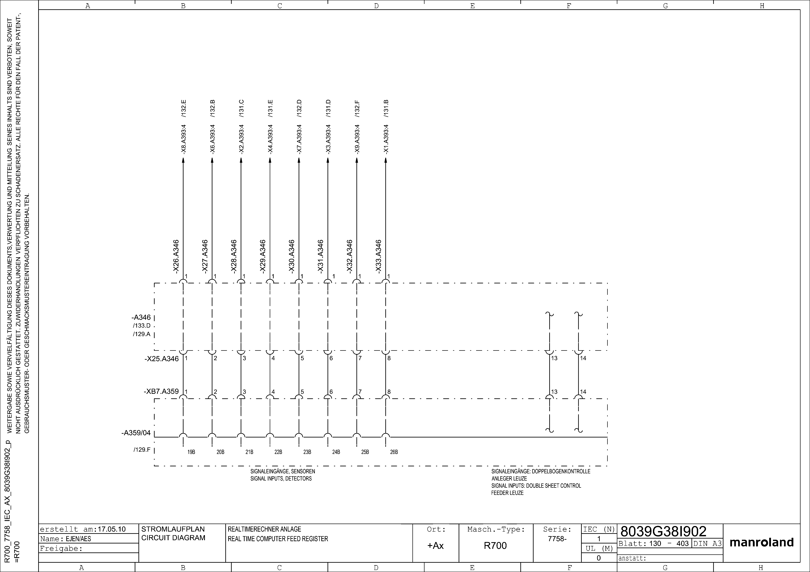

# +Ax — Sheet 130 of 403 — REALTIMERECHNER ANLAGE

**REAL TIME COMPUTER FEED REGISTER**

> Part of the manroland **R700** printing press IEC/UL circuit diagrams.
> Drawing class: **Stromlaufplan / Circuit diagram** (DIN A3).
> Document `+Ax` covers the **Central control console** machine section.

## At a glance

| Field | Value |
|---|---|
| Document | `+Ax`  (8039G38I902) |
| Sheet | **130** of 403 |
| Section (DE) | REALTIMERECHNER ANLAGE |
| Section (EN) | REAL TIME COMPUTER FEED REGISTER |
| Section type | CIRCUIT — Circuit diagram |
| Machine type | `R700` |
| Series | `7758` |
| Created | 17.05.10 |
| Replaces | — |
| Columns used | B, C, D, E, F |
| Path numbers | — |
| Labels on sheet | 73 |
| Cross-refs out | 11 |
| Cross-refs in | 39 |

**Previous:** [+Ax sheet 129](SHEET_0129.md) · **Next:** [+Ax sheet 131](SHEET_0131.md) · **Document TOC:** [_TOC.md](_TOC.md)  (+Ax) · **Master TOC:** [all sheets](../_MASTER_TOC.md)

## Sheet image (300 DPI, exact vector render)



_Rendered directly from the PDF vector layer at 300 DPI (1-bit), no OCR and no resampling. Use it to confirm anything ambiguous in the text below._

## Cross-references on this sheet

Each entry is a wire leaving this sheet. The printed token is `/sheet.column`; the link resolves to that sheet inside the same document.

| Ref | Target sheet | Col | Path | Destination on target | Target section | From col |
|---|---|---|---|---|---|---|
| `/131.C` | [+Ax sheet 131](SHEET_0131.md) | C | — | X2.A393:4 | REALTIMERECHNER ANLAGE | C |
| `/132.D` | [+Ax sheet 132](SHEET_0132.md) | D | — | X7.A393:4 | REALTIMERECHNER ANLAGE | C |
| `/131.D` | [+Ax sheet 131](SHEET_0131.md) | D | — | X3.A393:4 | REALTIMERECHNER ANLAGE | D |
| `/132.E` | [+Ax sheet 132](SHEET_0132.md) | E | — | X8.A393:4 | REALTIMERECHNER ANLAGE | B |
| `/132.B` | [+Ax sheet 132](SHEET_0132.md) | B | — | X6.A393:4 | REALTIMERECHNER ANLAGE | B |
| `/131.E` | [+Ax sheet 131](SHEET_0131.md) | E | — | X4.A393:4 | REALTIMERECHNER ANLAGE | C |
| `/131.B` | [+Ax sheet 131](SHEET_0131.md) | B | — | X1.A393:4 | REALTIMERECHNER ANLAGE | D |
| `/132.F` | [+Ax sheet 132](SHEET_0132.md) | F | — | X9.A393:4 | REALTIMERECHNER ANLAGE | D |
| `/133.D` | [+Ax sheet 133](SHEET_0133.md) | D | — | — | REALTIMERECHNER DRUCKWERK | B |
| `/129.A` | [+Ax sheet 129](SHEET_0129.md) | A | — | — | REALTIMERECHNER ANLAGE | B |
| `/129.F` | [+Ax sheet 129](SHEET_0129.md) | F | — | — | REALTIMERECHNER ANLAGE | B |

### Incoming references (sheets that point here)

Every other sheet that sends a wire to this one. `Back-ref` is the token printed on *that* sheet; `Path` is its line number.

| From sheet | Cols | Back-ref | Path | Refs | What continues there |
|---|---|---|---|---|---|
| [+Ax#129](SHEET_0129.md) | A, E | `/129.A`, `/129.E` | — | 2 | — |
| [+Ax#131](SHEET_0131.md) | B, C, D, E | `/131.B`, `/131.C`, `/131.D`, `/131.E` | — | 4 | X1.A393:4; X2.A393:4; X3.A393:4; X4.A393:4 |
| [+Ax#132](SHEET_0132.md) | B, D, E, F | `/132.B`, `/132.D`, `/132.E`, `/132.F` | — | 4 | X6.A393:4; X7.A393:4; X8.A393:4; X9.A393:4 |
| [+Ax#133](SHEET_0133.md) | D | `/133.D` | — | 1 | — |
| [+Ax#236](SHEET_0236.md) | B | `/236.B` | — | 10 | — |
| [+Ax#267](SHEET_0267.md) | F | `/267.F` | — | 10 | — |
| [+Ax#268](SHEET_0268.md) | F | `/268.F` | — | 1 | — |
| [+Ax#270](SHEET_0270.md) | C | `/270.C` | — | 1 | — |
| [+Ax#272](SHEET_0272.md) | A | `/272.A` | — | 1 | — |
| [+Ax#273](SHEET_0273.md) | E | `/273.E` | — | 1 | — |
| [+Ax#274](SHEET_0274.md) | G | `/274.G` | — | 1 | — |
| [+Ax#275](SHEET_0275.md) | B, E | `/275.B`, `/275.E` | — | 2 | — |
| [+Ax#276](SHEET_0276.md) | G | `/276.G` | — | 1 | — |


## Devices on this sheet

| Tag | Class | Class meaning (IEC) | Col | Sub | Terminal | Sign |
|---|---|---|---|---|---|---|
| `A359/04` | A | Baugruppe / assembly, module, PC board | B | 04 | — | — |
| `A346` | A | Baugruppe / assembly, module, PC board | B | — | — | — |
| `X26.A346` | — | cross-device reference | B | — | — | — |
| `X27.A346` | — | cross-device reference | B | — | — | — |
| `X28.A346` | — | cross-device reference | C | — | — | — |
| `X29.A346` | — | cross-device reference | C | — | — | — |
| `X30.A346` | — | cross-device reference | C | — | — | — |
| `X32.A346` | — | cross-device reference | D | — | — | — |
| `X33.A346` | — | cross-device reference | D | — | — | — |
| `X25.A346` | — | cross-device reference | B | — | — | — |
| `X31.A346` | — | cross-device reference | C | — | — | — |
| `XB7.A359` | — | cross-device reference | B | — | — | — |
| `X6.A393:4` | — | cross-device reference | B | — | 4 | — |
| `X7.A393:4` | — | cross-device reference | C | — | 4 | — |
| `X4.A393:4` | — | cross-device reference | C | — | 4 | — |
| `X3.A393:4` | — | cross-device reference | D | — | 4 | — |
| `X1.A393:4` | — | cross-device reference | D | — | 4 | — |
| `X8.A393:4` | — | cross-device reference | B | — | 4 | — |
| `X9.A393:4` | — | cross-device reference | D | — | 4 | — |
| `X2.A393:4` | — | cross-device reference | C | — | 4 | — |

## Potentials / nets

_No named potentials on this sheet._

## Wire-end annotations (grouped as printed)

A wire that continues elsewhere is annotated with a small cluster: the destination description, the path/line number `#NN`, and the `/sheet.column` cross reference. Each row below is one such cluster exactly as it is grouped on the drawing.

| Col | Y | Path | Cross-ref | Text on the wire |
|---|---|---|---|---|
| C | 146.4 | — | `/131.C` | `X2.A393:4` |
| C | 146.4 | — | `/132.D` | `X7.A393:4` |
| D | 146.4 | — | `/131.D` | `X3.A393:4` |
| B | 146.7 | — | `/132.E` | `X8.A393:4` |
| B | 146.7 | — | `/132.B` | `X6.A393:4` |
| C | 146.7 | — | `/131.E` | `X4.A393:4` |
| D | 146.7 | — | `/131.B` | `X1.A393:4` |
| D | 147.3 | — | `/132.F` | `X9.A393:4` |
| B | 352.6 | — | — | `X26.A346` |
| B | 352.6 | — | — | `X27.A346` |
| C | 352.6 | — | — | `X28.A346` |
| C | 352.6 | — | — | `X29.A346` |
| C | 352.6 | — | — | `X30.A346` |
| C | 352.6 | — | — | `X31.A346` |
| D | 352.6 | — | — | `X32.A346` |
| D | 352.6 | — | — | `X33.A346` |
| B | 402.8 | — | — | `1` |
| B | 402.8 | — | — | `1` |
| C | 402.8 | — | — | `1` |
| C | 402.8 | — | — | `1` |
| C | 402.8 | — | — | `1` |
| D | 402.8 | — | — | `1` |
| D | 402.8 | — | — | `1` |
| D | 402.8 | — | — | `1` |
| B | 462.4 | — | — | `A346` |
| B | 475.4 | — | `/133.D`, `/129.A` | — |
| C | 523.3 | — | — | `X25.A346 1 2 3 4 5 6 7 8` |
| F | 523.3 | — | — | `13 14` |
| C | 571.5 | — | — | `XB7.A359 1 2 3 4 5 6 7 8` |
| F | 572.9 | — | — | `13 14` |
| B | 632.4 | — | — | `A359/04` |
| B | 657.9 | — | `/129.F` | — |
| C | 662.5 | — | — | `19B 20B 21B 22B 23B 24B 25B 26B` |
| C | 690.9 | — | — | `SIGNALEINGÄNGE, SENSOREN SIGNAL INPUTS, DETECTORS` |
| F | 690.9 | — | — | `FEEDER LEUZE SIGNALEINGÄNGE: DOPPELBOGENKONTROLLE SIGNAL INPUTS: DOUBLE SHEET CONTROL ANLEGER LEUZE` |


## Notes and free text on this sheet

| Text | Col | Y (pt) |
|---|---|---|
| `19B` | B | 662.45 |
| `20B` | B | 662.5 |
| `21B` | C | 662.5 |
| `22B` | C | 662.5 |
| `23B` | C | 662.5 |
| `24B` | D | 662.5 |
| `25B` | D | 662.5 |
| `26B` | D | 662.5 |
| `SIGNALEINGÄNGE: DOPPELBOGENKONTROLLE` | F | 690.87 |
| `ANLEGER LEUZE` | E | 701.5 |
| `SIGNAL INPUTS: DOUBLE SHEET CONTROL` | F | 712.13 |
| `FEEDER LEUZE` | E | 722.74 |
| `SIGNALEINGÄNGE, SENSOREN` | C | 690.86 |
| `SIGNAL INPUTS, DETECTORS` | C | 701.49 |

## Complete label inventory (exact text from the drawing)

Every text object inside the drawing area of this sheet, in DIN reading order (column A→H, then top→bottom). This is the authoritative list: if a string is not here it is not printed on this sheet.

| Col | Y | X | Dir | Type | Text |
|---|---|---|---|---|---|
| B | 146.7 | 266.0 | ↕ | cross-reference | `/132.E` |
| B | 146.7 | 308.5 | ↕ | cross-reference | `/132.B` |
| B | 183.1 | 266.0 | ↕ | device ref | `X8.A393:4` |
| B | 183.1 | 308.5 | ↕ | device ref | `X6.A393:4` |
| B | 352.6 | 254.0 | ↕ | device ref | `X26.A346` |
| B | 352.6 | 296.5 | ↕ | device ref | `X27.A346` |
| B | 402.8 | 271.3 | → | number | `1` |
| B | 402.8 | 313.8 | → | number | `1` |
| B | 462.3 | 193.3 | → | device tag | `A346` |
| B | 475.4 | 195.6 | → | cross-reference | `/133.D` |
| B | 487.8 | 195.6 | → | cross-reference | `/129.A` |
| B | 523.3 | 212.6 | → | device ref | `X25.A346` |
| B | 523.3 | 271.3 | → | number | `1` |
| B | 523.3 | 314.4 | → | number | `2` |
| B | 571.5 | 211.5 | → | device ref | `XB7.A359` |
| B | 572.9 | 271.3 | → | number | `1` |
| B | 572.9 | 314.4 | → | number | `2` |
| B | 632.4 | 178.6 | → | device tag | `A359/04` |
| B | 657.9 | 196.4 | → | cross-reference | `/129.F` |
| B | 662.5 | 275.5 | → | text | `19B` |
| B | 662.5 | 318.6 | → | text | `20B` |
| C | 146.4 | 351.1 | ↕ | cross-reference | `/131.C` |
| C | 146.4 | 436.1 | ↕ | cross-reference | `/132.D` |
| C | 146.7 | 393.6 | ↕ | cross-reference | `/131.E` |
| C | 183.1 | 351.1 | ↕ | device ref | `X2.A393:4` |
| C | 183.1 | 393.6 | ↕ | device ref | `X4.A393:4` |
| C | 183.1 | 436.1 | ↕ | device ref | `X7.A393:4` |
| C | 352.6 | 339.0 | ↕ | device ref | `X28.A346` |
| C | 352.6 | 381.6 | ↕ | device ref | `X29.A346` |
| C | 352.6 | 424.1 | ↕ | device ref | `X30.A346` |
| C | 352.6 | 466.6 | ↕ | device ref | `X31.A346` |
| C | 402.8 | 356.3 | → | number | `1` |
| C | 402.8 | 398.8 | → | number | `1` |
| C | 402.8 | 441.4 | → | number | `1` |
| C | 523.3 | 356.9 | → | number | `3` |
| C | 523.3 | 399.4 | → | number | `4` |
| C | 523.3 | 441.9 | → | number | `5` |
| C | 572.9 | 356.9 | → | number | `3` |
| C | 572.9 | 399.4 | → | number | `4` |
| C | 572.9 | 441.9 | → | number | `5` |
| C | 662.5 | 361.1 | → | text | `21B` |
| C | 662.5 | 403.7 | → | text | `22B` |
| C | 662.5 | 446.2 | → | text | `23B` |
| C | 690.9 | 368.2 | → | text | `SIGNALEINGÄNGE, SENSOREN` |
| C | 701.5 | 368.2 | → | text | `SIGNAL INPUTS, DETECTORS` |
| D | 146.4 | 478.6 | ↕ | cross-reference | `/131.D` |
| D | 146.7 | 563.6 | ↕ | cross-reference | `/131.B` |
| D | 147.3 | 521.1 | ↕ | cross-reference | `/132.F` |
| D | 183.1 | 478.6 | ↕ | device ref | `X3.A393:4` |
| D | 183.1 | 521.1 | ↕ | device ref | `X9.A393:4` |
| D | 183.1 | 563.7 | ↕ | device ref | `X1.A393:4` |
| D | 352.6 | 509.1 | ↕ | device ref | `X32.A346` |
| D | 352.6 | 551.6 | ↕ | device ref | `X33.A346` |
| D | 402.8 | 488.1 | → | number | `1` |
| D | 402.8 | 526.4 | → | number | `1` |
| D | 402.8 | 568.9 | → | number | `1` |
| D | 523.3 | 484.4 | → | number | `6` |
| D | 523.3 | 527.0 | → | number | `7` |
| D | 523.3 | 569.5 | → | number | `8` |
| D | 572.9 | 484.4 | → | number | `6` |
| D | 572.9 | 527.0 | → | number | `7` |
| D | 572.9 | 569.5 | → | number | `8` |
| D | 662.5 | 488.7 | → | text | `24B` |
| D | 662.5 | 531.2 | → | text | `25B` |
| D | 662.5 | 573.7 | → | text | `26B` |
| E | 701.5 | 722.8 | → | text | `ANLEGER LEUZE` |
| E | 722.7 | 722.0 | → | text | `FEEDER LEUZE` |
| F | 523.3 | 809.9 | → | number | `13` |
| F | 523.3 | 852.4 | → | number | `14` |
| F | 572.9 | 809.9 | → | number | `13` |
| F | 572.9 | 852.4 | → | number | `14` |
| F | 690.9 | 722.6 | → | text | `SIGNALEINGÄNGE: DOPPELBOGENKONTROLLE` |
| F | 712.1 | 722.6 | → | text | `SIGNAL INPUTS: DOUBLE SHEET CONTROL` |

## Reading-order text block

The same content as a plain block, grouped by DIN column — convenient to paste or to match against a visual description.

```text
=== Column B ===
 146.7  266.0  xref         /132.E
 146.7  308.5  xref         /132.B
 183.1  266.0  devref       X8.A393:4
 183.1  308.5  devref       X6.A393:4
 352.6  254.0  devref       X26.A346
 352.6  296.5  devref       X27.A346
 402.8  271.3  numeric      1
 402.8  313.8  numeric      1
 462.3  193.3  devtag       A346
 475.4  195.6  xref         /133.D
 487.8  195.6  xref         /129.A
 523.3  212.6  devref       X25.A346
 523.3  271.3  numeric      1
 523.3  314.4  numeric      2
 571.5  211.5  devref       XB7.A359
 572.9  271.3  numeric      1
 572.9  314.4  numeric      2
 632.4  178.6  devtag       A359/04
 657.9  196.4  xref         /129.F
 662.5  275.5  text         19B
 662.5  318.6  text         20B
=== Column C ===
 146.4  351.1  xref         /131.C
 146.4  436.1  xref         /132.D
 146.7  393.6  xref         /131.E
 183.1  351.1  devref       X2.A393:4
 183.1  393.6  devref       X4.A393:4
 183.1  436.1  devref       X7.A393:4
 352.6  339.0  devref       X28.A346
 352.6  381.6  devref       X29.A346
 352.6  424.1  devref       X30.A346
 352.6  466.6  devref       X31.A346
 402.8  356.3  numeric      1
 402.8  398.8  numeric      1
 402.8  441.4  numeric      1
 523.3  356.9  numeric      3
 523.3  399.4  numeric      4
 523.3  441.9  numeric      5
 572.9  356.9  numeric      3
 572.9  399.4  numeric      4
 572.9  441.9  numeric      5
 662.5  361.1  text         21B
 662.5  403.7  text         22B
 662.5  446.2  text         23B
 690.9  368.2  text         SIGNALEINGÄNGE, SENSOREN
 701.5  368.2  text         SIGNAL INPUTS, DETECTORS
=== Column D ===
 146.4  478.6  xref         /131.D
 146.7  563.6  xref         /131.B
 147.3  521.1  xref         /132.F
 183.1  478.6  devref       X3.A393:4
 183.1  521.1  devref       X9.A393:4
 183.1  563.7  devref       X1.A393:4
 352.6  509.1  devref       X32.A346
 352.6  551.6  devref       X33.A346
 402.8  488.1  numeric      1
 402.8  526.4  numeric      1
 402.8  568.9  numeric      1
 523.3  484.4  numeric      6
 523.3  527.0  numeric      7
 523.3  569.5  numeric      8
 572.9  484.4  numeric      6
 572.9  527.0  numeric      7
 572.9  569.5  numeric      8
 662.5  488.7  text         24B
 662.5  531.2  text         25B
 662.5  573.7  text         26B
=== Column E ===
 701.5  722.8  text         ANLEGER LEUZE
 722.7  722.0  text         FEEDER LEUZE
=== Column F ===
 523.3  809.9  numeric      13
 523.3  852.4  numeric      14
 572.9  809.9  numeric      13
 572.9  852.4  numeric      14
 690.9  722.6  text         SIGNALEINGÄNGE: DOPPELBOGENKONTROLLE
 712.1  722.6  text         SIGNAL INPUTS: DOUBLE SHEET CONTROL
```

---
_Generated from the PDF vector text layer; no OCR. Source: `R700_7758_IEC_AX_8039G38I902_p`, sheet 130._
