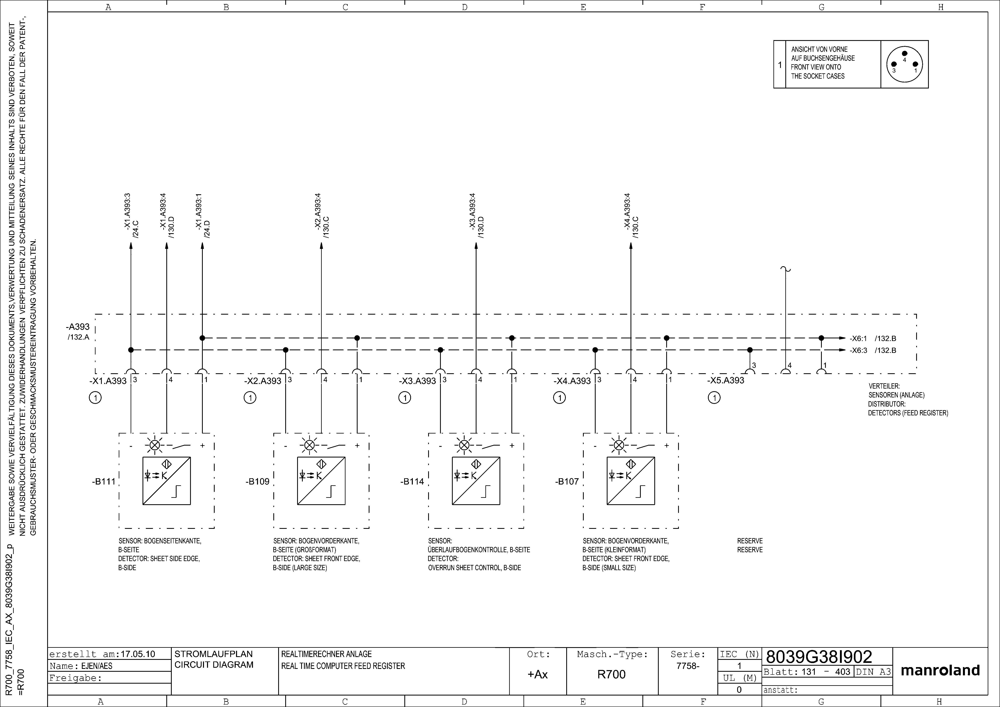

# +Ax — Sheet 131 of 403 — REALTIMERECHNER ANLAGE

**REAL TIME COMPUTER FEED REGISTER**

> Part of the manroland **R700** printing press IEC/UL circuit diagrams.
> Drawing class: **Stromlaufplan / Circuit diagram** (DIN A3).
> Document `+Ax` covers the **Central control console** machine section.

## At a glance

| Field | Value |
|---|---|
| Document | `+Ax`  (8039G38I902) |
| Sheet | **131** of 403 |
| Section (DE) | REALTIMERECHNER ANLAGE |
| Section (EN) | REAL TIME COMPUTER FEED REGISTER |
| Section type | CIRCUIT — Circuit diagram |
| Machine type | `R700` |
| Series | `7758` |
| Created | 17.05.10 |
| Replaces | — |
| Columns used | A, B, C, D, E, F, G, H |
| Path numbers | — |
| Labels on sheet | 81 |
| Cross-refs out | 9 |
| Cross-refs in | 24 |

**Previous:** [+Ax sheet 130](SHEET_0130.md) · **Next:** [+Ax sheet 132](SHEET_0132.md) · **Document TOC:** [_TOC.md](_TOC.md)  (+Ax) · **Master TOC:** [all sheets](../_MASTER_TOC.md)

## Sheet image (300 DPI, exact vector render)



_Rendered directly from the PDF vector layer at 300 DPI (1-bit), no OCR and no resampling. Use it to confirm anything ambiguous in the text below._

## Cross-references on this sheet

Each entry is a wire leaving this sheet. The printed token is `/sheet.column`; the link resolves to that sheet inside the same document.

| Ref | Target sheet | Col | Path | Destination on target | Target section | From col |
|---|---|---|---|---|---|---|
| `/24.C` | [+Ax sheet 24](SHEET_0024.md) | C | — | X1.A393:3 | SPANNUNGSVERSORGUNG, SCHALTSCHRANKBELÜFTUNG | A |
| `/130.D` | [+Ax sheet 130](SHEET_0130.md) | D | — | X1.A393:4 | REALTIMERECHNER ANLAGE | B |
| `/24.D` | [+Ax sheet 24](SHEET_0024.md) | D | — | X1.A393:1 | SPANNUNGSVERSORGUNG, SCHALTSCHRANKBELÜFTUNG | B |
| `/130.C` | [+Ax sheet 130](SHEET_0130.md) | C | — | X2.A393:4 | REALTIMERECHNER ANLAGE | C |
| `/130.D` | [+Ax sheet 130](SHEET_0130.md) | D | — | X3.A393:4 | REALTIMERECHNER ANLAGE | D |
| `/130.C` | [+Ax sheet 130](SHEET_0130.md) | C | — | X4.A393:4 | REALTIMERECHNER ANLAGE | E |
| `/132.A` | [+Ax sheet 132](SHEET_0132.md) | A | — | — | REALTIMERECHNER ANLAGE | A |
| `/132.B` | [+Ax sheet 132](SHEET_0132.md) | B | — | X6:1 | REALTIMERECHNER ANLAGE | G |
| `/132.B` | [+Ax sheet 132](SHEET_0132.md) | B | — | X6:3 | REALTIMERECHNER ANLAGE | G |

### Incoming references (sheets that point here)

Every other sheet that sends a wire to this one. `Back-ref` is the token printed on *that* sheet; `Path` is its line number.

| From sheet | Cols | Back-ref | Path | Refs | What continues there |
|---|---|---|---|---|---|
| [+Ax#24](SHEET_0024.md) | C, D | `/24.C`, `/24.D` | — | 2 | X1.A393:1; X1.A393:3 |
| [+Ax#130](SHEET_0130.md) | C, D | `/130.C`, `/130.D` | — | 4 | X1.A393:4; X2.A393:4; X3.A393:4; X4.A393:4 |
| [+Ax#132](SHEET_0132.md) | A | `/132.A` | — | 3 | X6:1; X6:3 |
| [+Ax#208](SHEET_0208.md) | G | `/208.G` | — | 3 | — |
| [+Ax#220](SHEET_0220.md) | F | `/220.F` | — | 3 | — |
| [+Ax#224](SHEET_0224.md) | G | `/224.G` | — | 3 | — |
| [+Ax#229](SHEET_0229.md) | A | `/229.A` | — | 3 | — |
| [+Ax#232](SHEET_0232.md) | C | `/232.C` | — | 3 | — |


## Devices on this sheet

| Tag | Class | Class meaning (IEC) | Col | Sub | Terminal | Sign |
|---|---|---|---|---|---|---|
| `A393` | A | Baugruppe / assembly, module, PC board | A | — | — | — |
| `B111` | B | Umformer / transducer, sensor | A | — | — | — |
| `B109` | B | Umformer / transducer, sensor | B | — | — | — |
| `B114` | B | Umformer / transducer, sensor | D | — | — | — |
| `B107` | B | Umformer / transducer, sensor | E | — | — | — |
| `X6:3` | X | Klemme / terminal, plug connector | G | — | 3 | — |
| `X6:1` | X | Klemme / terminal, plug connector | G | — | 1 | — |
| `X1.A393` | — | cross-device reference | A | — | — | — |
| `X2.A393` | — | cross-device reference | B | — | — | — |
| `X3.A393` | — | cross-device reference | D | — | — | — |
| `X4.A393` | — | cross-device reference | E | — | — | — |
| `X4.A393:4` | — | cross-device reference | E | — | 4 | — |
| `X3.A393:4` | — | cross-device reference | D | — | 4 | — |
| `X1.A393:1` | — | cross-device reference | B | — | 1 | — |
| `X1.A393:4` | — | cross-device reference | A | — | 4 | — |
| `X1.A393:3` | — | cross-device reference | A | — | 3 | — |
| `X2.A393:4` | — | cross-device reference | C | — | 4 | — |
| `X5.A393` | — | cross-device reference | F | — | — | — |

## Potentials / nets

_No named potentials on this sheet._

## Wire-end annotations (grouped as printed)

A wire that continues elsewhere is annotated with a small cluster: the destination description, the path/line number `#NN`, and the `/sheet.column` cross reference. Each row below is one such cluster exactly as it is grouped on the drawing.

| Col | Y | Path | Cross-ref | Text on the wire |
|---|---|---|---|---|
| G | 55.9 | — | — | `FRONT VIEW ONTO ANSICHT VON VORNE AUF BUCHSENGEHÄUSE` |
| G | 68.2 | — | — | `1 THE SOCKET CASES 4` |
| H | 81.0 | — | — | `3 1` |
| A | 229.9 | — | `/24.C` | `X1.A393:3` |
| B | 229.9 | — | `/130.D` | `X1.A393:4` |
| B | 229.9 | — | `/24.D` | `X1.A393:1` |
| C | 229.9 | — | `/130.C` | `X2.A393:4` |
| D | 229.9 | — | `/130.D` | `X3.A393:4` |
| E | 229.9 | — | `/130.C` | `X4.A393:4` |
| A | 384.4 | — | — | `A393` |
| A | 397.5 | — | `/132.A` | — |
| G | 399.2 | — | `/132.B` | `X6:1` |
| G | 413.4 | — | `/132.B` | `X6:3` |
| G | 431.2 | — | — | `3 4 1` |
| C | 448.2 | — | — | `X1.A393 3 4 1 X2.A393 3 4 1 X3.A393 3 4 1 X4.A393 3 4 1` |
| F | 448.2 | — | — | `X5.A393` |
| H | 457.0 | — | — | `DISTRIBUTOR: DETECTORS (FEED REGISTER) SENSOREN (ANLAGE) VERTEILER:` |
| D | 470.3 | — | — | `1 1 1 1 1` |
| D | 526.1 | — | — | `+ + + +` |
| A | 568.6 | — | — | `B111` |
| B | 568.6 | — | — | `B109` |
| D | 568.6 | — | — | `B114` |
| E | 568.6 | — | — | `B107` |
| A | 641.2 | — | — | `B SEITE DETECTOR: SHEET SIDE EDGE, B SIDE SENSOR: BOGENSEITENKANTE,` |
| C | 641.2 | — | — | `B SEITE (GROßFORMAT) DETECTOR: SHEET FRONT EDGE, B SIDE (LARGE SIZE) SENSOR: BOGENVORDERKANTE,` |
| D | 641.2 | — | — | `ÜBERLAUFBOGENKONTROLLE, B SEITE DETECTOR: SENSOR:` |
| E | 641.2 | — | — | `B SEITE (KLEINFORMAT) DETECTOR: SHEET FRONT EDGE, B SIDE (SMALL SIZE) SENSOR: BOGENVORDERKANTE,` |
| F | 641.2 | — | — | `RESERVE RESERVE` |
| D | 673.2 | — | — | `OVERRUN SHEET CONTROL, B SIDE` |


## Reconstructed tables

This sheet carries tabular content (pin map / terminal assignment / index). The grid below was rebuilt from the drawing's own rule lines, so each row is exactly one physical row of the table.

### Table 1 — 1 data rows × 2 columns (at x=240.9, y=402.5)

| 1 X2.A393 1 + | 3 |
|---|---|
| `B109` |  |


### Table 2 — 1 data rows × 2 columns (at x=425.2, y=402.5)

| 1 X3.A393 1 + | 3 |
|---|---|
| `B114` |  |


### Table 3 — 1 data rows × 2 columns (at x=609.4, y=402.5)

| 1 X4.A393 1 + | 3 |
|---|---|
| `B107` |  |


## Notes and free text on this sheet

| Text | Col | Y (pt) |
|---|---|---|
| `VERTEILER:` | H | 456.98 |
| `SENSOREN (ANLAGE)` | H | 467.64 |
| `DISTRIBUTOR:` | H | 478.25 |
| `DETECTORS (FEED REGISTER)` | H | 488.9 |
| `SENSOR: BOGENSEITENKANTE,` | A | 641.24 |
| `B SEITE` | A | 651.82 |
| `DETECTOR: SHEET SIDE EDGE,` | A | 662.5 |
| `B SIDE` | A | 673.09 |
| `SENSOR: BOGENVORDERKANTE,` | C | 641.25 |
| `B SEITE (GROßFORMAT)` | C | 651.89 |
| `DETECTOR: SHEET FRONT EDGE,` | C | 662.51 |
| `B SIDE (LARGE SIZE)` | C | 673.13 |
| `SENSOR:` | D | 641.23 |
| `ÜBERLAUFBOGENKONTROLLE, B SEITE` | D | 651.89 |
| `DETECTOR:` | D | 662.5 |
| `OVERRUN SHEET CONTROL, B SIDE` | D | 673.16 |
| `SENSOR: BOGENVORDERKANTE,` | E | 641.25 |
| `B SEITE (KLEINFORMAT)` | E | 651.88 |
| `DETECTOR: SHEET FRONT EDGE,` | E | 662.51 |
| `B SIDE (SMALL SIZE)` | E | 673.14 |
| `RESERVE` | F | 641.21 |
| `ANSICHT VON VORNE` | G | 55.91 |
| `AUF BUCHSENGEHÄUSE` | G | 66.54 |
| `FRONT VIEW ONTO` | G | 77.13 |
| `THE SOCKET CASES` | G | 87.78 |

## Complete label inventory (exact text from the drawing)

Every text object inside the drawing area of this sheet, in DIN reading order (column A→H, then top→bottom). This is the authoritative list: if a string is not here it is not printed on this sheet.

| Col | Y | X | Dir | Type | Text |
|---|---|---|---|---|---|
| A | 229.9 | 147.7 | ↕ | device ref | `X1.A393:3` |
| A | 229.9 | 190.2 | ↕ | device ref | `X1.A393:4` |
| A | 262.5 | 157.6 | ↕ | cross-reference | `/24.C` |
| A | 384.4 | 78.5 | → | device tag | `A393` |
| A | 397.5 | 80.8 | → | cross-reference | `/132.A` |
| A | 448.2 | 158.5 | → | number | `3` |
| A | 448.9 | 106.6 | → | device ref | `X1.A393` |
| A | 470.3 | 111.6 | → | number | `1` |
| A | 568.6 | 109.7 | → | device tag | `B111` |
| A | 641.2 | 141.4 | → | text | `SENSOR: BOGENSEITENKANTE,` |
| A | 651.8 | 140.9 | → | text | `B SEITE` |
| A | 662.5 | 140.9 | → | text | `DETECTOR: SHEET SIDE EDGE,` |
| A | 673.1 | 140.9 | → | text | `B SIDE` |
| B | 229.9 | 232.7 | ↕ | device ref | `X1.A393:1` |
| B | 257.7 | 200.1 | ↕ | cross-reference | `/130.D` |
| B | 262.5 | 242.6 | ↕ | cross-reference | `/24.D` |
| B | 448.2 | 201.0 | → | number | `4` |
| B | 448.2 | 242.9 | → | number | `1` |
| B | 448.9 | 290.8 | → | device ref | `X2.A393` |
| B | 470.3 | 295.9 | → | number | `1` |
| B | 526.1 | 238.0 | → | number | `+` |
| B | 568.6 | 292.5 | → | device tag | `B109` |
| C | 229.9 | 374.5 | ↕ | device ref | `X2.A393:4` |
| C | 257.7 | 384.4 | ↕ | cross-reference | `/130.C` |
| C | 448.2 | 342.7 | → | number | `3` |
| C | 448.2 | 385.2 | → | number | `4` |
| C | 448.2 | 427.2 | → | number | `1` |
| C | 526.1 | 422.2 | → | number | `+` |
| C | 641.3 | 325.7 | → | text | `SENSOR: BOGENVORDERKANTE,` |
| C | 651.9 | 325.1 | → | text | `B SEITE (GROßFORMAT)` |
| C | 662.5 | 325.1 | → | text | `DETECTOR: SHEET FRONT EDGE,` |
| C | 673.1 | 325.1 | → | text | `B SIDE (LARGE SIZE)` |
| D | 229.9 | 558.7 | ↕ | device ref | `X3.A393:4` |
| D | 257.7 | 568.6 | ↕ | cross-reference | `/130.D` |
| D | 448.2 | 527.0 | → | number | `3` |
| D | 448.2 | 569.5 | → | number | `4` |
| D | 448.2 | 611.4 | → | number | `1` |
| D | 448.9 | 475.1 | → | device ref | `X3.A393` |
| D | 470.3 | 480.1 | → | number | `1` |
| D | 526.1 | 606.5 | → | number | `+` |
| D | 568.6 | 476.8 | → | device tag | `B114` |
| D | 641.2 | 510.0 | → | text | `SENSOR:` |
| D | 651.9 | 509.4 | → | text | `ÜBERLAUFBOGENKONTROLLE, B SEITE` |
| D | 662.5 | 509.4 | → | text | `DETECTOR:` |
| D | 673.2 | 510.0 | → | text | `OVERRUN SHEET CONTROL, B SIDE` |
| E | 229.9 | 743.0 | ↕ | device ref | `X4.A393:4` |
| E | 257.7 | 752.9 | ↕ | cross-reference | `/130.C` |
| E | 448.2 | 711.2 | → | number | `3` |
| E | 448.2 | 753.7 | → | number | `4` |
| E | 448.9 | 659.3 | → | device ref | `X4.A393` |
| E | 470.3 | 664.4 | → | number | `1` |
| E | 568.6 | 661.0 | → | device tag | `B107` |
| E | 641.3 | 694.2 | → | text | `SENSOR: BOGENVORDERKANTE,` |
| E | 651.9 | 693.6 | → | text | `B SEITE (KLEINFORMAT)` |
| E | 662.5 | 693.6 | → | text | `DETECTOR: SHEET FRONT EDGE,` |
| E | 673.1 | 693.6 | → | text | `B SIDE (SMALL SIZE)` |
| F | 431.2 | 895.5 | → | number | `3` |
| F | 448.2 | 795.7 | → | number | `1` |
| F | 448.2 | 842.2 | → | device ref | `X5.A393` |
| F | 470.3 | 848.6 | → | number | `1` |
| F | 526.1 | 790.7 | → | number | `+` |
| F | 641.2 | 877.9 | → | text | `RESERVE` |
| F | 651.8 | 877.9 | → | text | `RESERVE` |
| G | 55.9 | 942.5 | → | text | `ANSICHT VON VORNE` |
| G | 66.5 | 942.5 | → | text | `AUF BUCHSENGEHÄUSE` |
| G | 72.6 | 925.8 | → | number | `1` |
| G | 77.1 | 941.7 | → | text | `FRONT VIEW ONTO` |
| G | 87.8 | 942.2 | → | text | `THE SOCKET CASES` |
| G | 399.3 | 1011.7 | → | device tag | `X6:1` |
| G | 413.4 | 1011.7 | → | device tag | `X6:3` |
| G | 431.2 | 938.0 | → | number | `4` |
| G | 431.2 | 979.9 | → | number | `1` |
| H | 68.2 | 1075.2 | → | number | `4` |
| H | 81.0 | 1062.4 | → | number | `3` |
| H | 81.0 | 1088.4 | → | number | `1` |
| H | 399.2 | 1041.7 | → | cross-reference | `/132.B` |
| H | 413.4 | 1041.7 | → | cross-reference | `/132.B` |
| H | 457.0 | 1034.6 | → | text | `VERTEILER:` |
| H | 467.6 | 1034.4 | → | text | `SENSOREN (ANLAGE)` |
| H | 478.2 | 1033.8 | → | text | `DISTRIBUTOR:` |
| H | 488.9 | 1033.8 | → | text | `DETECTORS (FEED REGISTER)` |

## Reading-order text block

The same content as a plain block, grouped by DIN column — convenient to paste or to match against a visual description.

```text
=== Column A ===
 229.9  147.7  devref       X1.A393:3
 229.9  190.2  devref       X1.A393:4
 262.5  157.6  xref         /24.C
 384.4   78.5  devtag       A393
 397.5   80.8  xref         /132.A
 448.2  158.5  numeric      3
 448.9  106.6  devref       X1.A393
 470.3  111.6  numeric      1
 568.6  109.7  devtag       B111
 641.2  141.4  text         SENSOR: BOGENSEITENKANTE,
 651.8  140.9  text         B SEITE
 662.5  140.9  text         DETECTOR: SHEET SIDE EDGE,
 673.1  140.9  text         B SIDE
=== Column B ===
 229.9  232.7  devref       X1.A393:1
 257.7  200.1  xref         /130.D
 262.5  242.6  xref         /24.D
 448.2  201.0  numeric      4
 448.2  242.9  numeric      1
 448.9  290.8  devref       X2.A393
 470.3  295.9  numeric      1
 526.1  238.0  numeric      +
 568.6  292.5  devtag       B109
=== Column C ===
 229.9  374.5  devref       X2.A393:4
 257.7  384.4  xref         /130.C
 448.2  342.7  numeric      3
 448.2  385.2  numeric      4
 448.2  427.2  numeric      1
 526.1  422.2  numeric      +
 641.3  325.7  text         SENSOR: BOGENVORDERKANTE,
 651.9  325.1  text         B SEITE (GROßFORMAT)
 662.5  325.1  text         DETECTOR: SHEET FRONT EDGE,
 673.1  325.1  text         B SIDE (LARGE SIZE)
=== Column D ===
 229.9  558.7  devref       X3.A393:4
 257.7  568.6  xref         /130.D
 448.2  527.0  numeric      3
 448.2  569.5  numeric      4
 448.2  611.4  numeric      1
 448.9  475.1  devref       X3.A393
 470.3  480.1  numeric      1
 526.1  606.5  numeric      +
 568.6  476.8  devtag       B114
 641.2  510.0  text         SENSOR:
 651.9  509.4  text         ÜBERLAUFBOGENKONTROLLE, B SEITE
 662.5  509.4  text         DETECTOR:
 673.2  510.0  text         OVERRUN SHEET CONTROL, B SIDE
=== Column E ===
 229.9  743.0  devref       X4.A393:4
 257.7  752.9  xref         /130.C
 448.2  711.2  numeric      3
 448.2  753.7  numeric      4
 448.9  659.3  devref       X4.A393
 470.3  664.4  numeric      1
 568.6  661.0  devtag       B107
 641.3  694.2  text         SENSOR: BOGENVORDERKANTE,
 651.9  693.6  text         B SEITE (KLEINFORMAT)
 662.5  693.6  text         DETECTOR: SHEET FRONT EDGE,
 673.1  693.6  text         B SIDE (SMALL SIZE)
=== Column F ===
 431.2  895.5  numeric      3
 448.2  795.7  numeric      1
 448.2  842.2  devref       X5.A393
 470.3  848.6  numeric      1
 526.1  790.7  numeric      +
 641.2  877.9  text         RESERVE
 651.8  877.9  text         RESERVE
=== Column G ===
  55.9  942.5  text         ANSICHT VON VORNE
  66.5  942.5  text         AUF BUCHSENGEHÄUSE
  72.6  925.8  numeric      1
  77.1  941.7  text         FRONT VIEW ONTO
  87.8  942.2  text         THE SOCKET CASES
 399.3 1011.7  devtag       X6:1
 413.4 1011.7  devtag       X6:3
 431.2  938.0  numeric      4
 431.2  979.9  numeric      1
=== Column H ===
  68.2 1075.2  numeric      4
  81.0 1062.4  numeric      3
  81.0 1088.4  numeric      1
 399.2 1041.7  xref         /132.B
 413.4 1041.7  xref         /132.B
 457.0 1034.6  text         VERTEILER:
 467.6 1034.4  text         SENSOREN (ANLAGE)
 478.2 1033.8  text         DISTRIBUTOR:
 488.9 1033.8  text         DETECTORS (FEED REGISTER)
```

---
_Generated from the PDF vector text layer; no OCR. Source: `R700_7758_IEC_AX_8039G38I902_p`, sheet 131._
