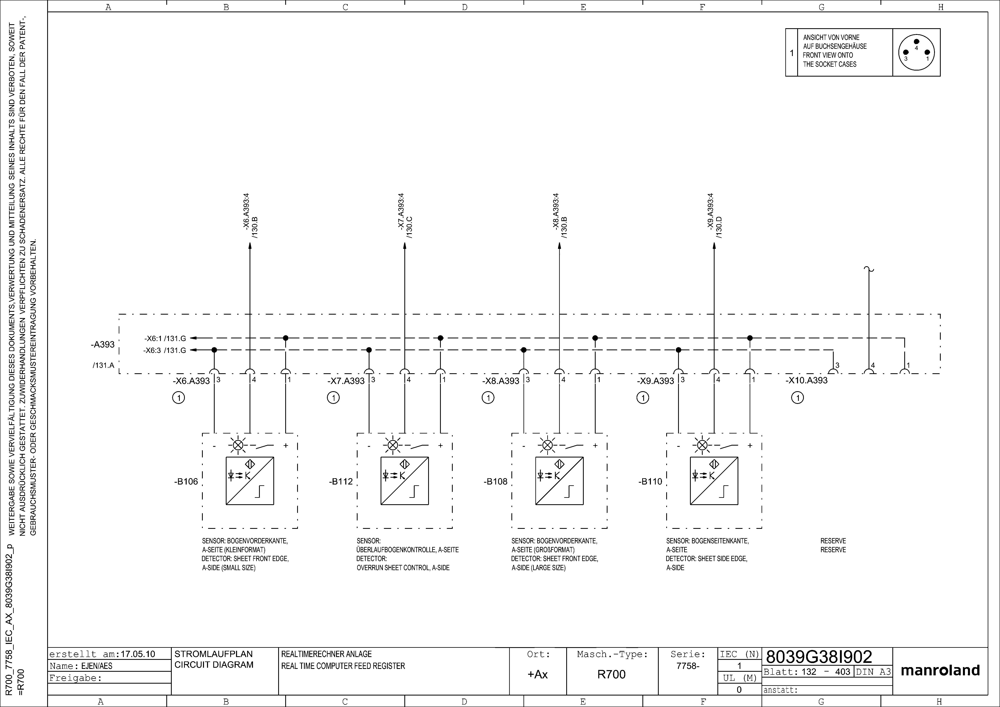

# +Ax — Sheet 132 of 403 — REALTIMERECHNER ANLAGE

**REAL TIME COMPUTER FEED REGISTER**

> Part of the manroland **R700** printing press IEC/UL circuit diagrams.
> Drawing class: **Stromlaufplan / Circuit diagram** (DIN A3).
> Document `+Ax` covers the **Central control console** machine section.

## At a glance

| Field | Value |
|---|---|
| Document | `+Ax`  (8039G38I902) |
| Sheet | **132** of 403 |
| Section (DE) | REALTIMERECHNER ANLAGE |
| Section (EN) | REAL TIME COMPUTER FEED REGISTER |
| Section type | CIRCUIT — Circuit diagram |
| Machine type | `R700` |
| Series | `7758` |
| Created | 17.05.10 |
| Replaces | — |
| Columns used | A, B, C, D, E, F, G, H |
| Path numbers | — |
| Labels on sheet | 73 |
| Cross-refs out | 7 |
| Cross-refs in | 22 |

**Previous:** [+Ax sheet 131](SHEET_0131.md) · **Next:** [+Ax sheet 133](SHEET_0133.md) · **Document TOC:** [_TOC.md](_TOC.md)  (+Ax) · **Master TOC:** [all sheets](../_MASTER_TOC.md)

## Sheet image (300 DPI, exact vector render)



_Rendered directly from the PDF vector layer at 300 DPI (1-bit), no OCR and no resampling. Use it to confirm anything ambiguous in the text below._

## Cross-references on this sheet

Each entry is a wire leaving this sheet. The printed token is `/sheet.column`; the link resolves to that sheet inside the same document.

| Ref | Target sheet | Col | Path | Destination on target | Target section | From col |
|---|---|---|---|---|---|---|
| `/130.B` | [+Ax sheet 130](SHEET_0130.md) | B | — | X6.A393:4 | REALTIMERECHNER ANLAGE | B |
| `/130.C` | [+Ax sheet 130](SHEET_0130.md) | C | — | X7.A393:4 | REALTIMERECHNER ANLAGE | D |
| `/130.B` | [+Ax sheet 130](SHEET_0130.md) | B | — | X8.A393:4 | REALTIMERECHNER ANLAGE | E |
| `/130.D` | [+Ax sheet 130](SHEET_0130.md) | D | — | X9.A393:4 | REALTIMERECHNER ANLAGE | F |
| `/131.G` | [+Ax sheet 131](SHEET_0131.md) | G | — | X6:1 | REALTIMERECHNER ANLAGE | A |
| `/131.G` | [+Ax sheet 131](SHEET_0131.md) | G | — | X6:3 | REALTIMERECHNER ANLAGE | A |
| `/131.A` | [+Ax sheet 131](SHEET_0131.md) | A | — | — | REALTIMERECHNER ANLAGE | A |

### Incoming references (sheets that point here)

Every other sheet that sends a wire to this one. `Back-ref` is the token printed on *that* sheet; `Path` is its line number.

| From sheet | Cols | Back-ref | Path | Refs | What continues there |
|---|---|---|---|---|---|
| [+Ax#130](SHEET_0130.md) | B, C, D | `/130.B`, `/130.C`, `/130.D` | — | 4 | X6.A393:4; X7.A393:4; X8.A393:4; X9.A393:4 |
| [+Ax#131](SHEET_0131.md) | A, G | `/131.A`, `/131.G` | — | 3 | X6:1; X6:3 |
| [+Ax#234](SHEET_0234.md) | C | `/234.C` | — | 3 | — |
| [+Ax#236](SHEET_0236.md) | B | `/236.B` | — | 3 | — |
| [+Ax#239](SHEET_0239.md) | A | `/239.A` | — | 3 | — |
| [+Ax#242](SHEET_0242.md) | E | `/242.E` | — | 3 | — |
| [+Ax#245](SHEET_0245.md) | F | `/245.F` | — | 3 | — |


## Devices on this sheet

| Tag | Class | Class meaning (IEC) | Col | Sub | Terminal | Sign |
|---|---|---|---|---|---|---|
| `B106` | B | Umformer / transducer, sensor | B | — | — | — |
| `B112` | B | Umformer / transducer, sensor | C | — | — | — |
| `B108` | B | Umformer / transducer, sensor | D | — | — | — |
| `B110` | B | Umformer / transducer, sensor | F | — | — | — |
| `A393` | A | Baugruppe / assembly, module, PC board | A | — | — | — |
| `X6:1` | X | Klemme / terminal, plug connector | A | — | 1 | — |
| `X6:3` | X | Klemme / terminal, plug connector | A | — | 3 | — |
| `X6.A393` | — | cross-device reference | B | — | — | — |
| `X7.A393` | — | cross-device reference | C | — | — | — |
| `X8.A393` | — | cross-device reference | D | — | — | — |
| `X9.A393` | — | cross-device reference | F | — | — | — |
| `X6.A393:4` | — | cross-device reference | B | — | 4 | — |
| `X7.A393:4` | — | cross-device reference | C | — | 4 | — |
| `X8.A393:4` | — | cross-device reference | E | — | 4 | — |
| `X9.A393:4` | — | cross-device reference | F | — | 4 | — |
| `X10.A393` | — | cross-device reference | G | — | — | — |

## Potentials / nets

_No named potentials on this sheet._

## Wire-end annotations (grouped as printed)

A wire that continues elsewhere is annotated with a small cluster: the destination description, the path/line number `#NN`, and the `/sheet.column` cross reference. Each row below is one such cluster exactly as it is grouped on the drawing.

| Col | Y | Path | Cross-ref | Text on the wire |
|---|---|---|---|---|
| G | 41.7 | — | — | `FRONT VIEW ONTO ANSICHT VON VORNE AUF BUCHSENGEHÄUSE` |
| G | 54.0 | — | — | `1 THE SOCKET CASES 4` |
| H | 66.8 | — | — | `3 1` |
| B | 229.9 | — | `/130.B` | `X6.A393:4` |
| D | 229.9 | — | `/130.C` | `X7.A393:4` |
| E | 229.9 | — | `/130.B` | `X8.A393:4` |
| F | 229.9 | — | `/130.D` | `X9.A393:4` |
| A | 399.3 | — | `/131.G` | `X6:1` |
| A | 405.7 | — | — | `A393` |
| A | 413.4 | — | `/131.G` | `X6:3` |
| A | 431.1 | — | `/131.A` | — |
| G | 431.2 | — | — | `3 4 1` |
| D | 448.2 | — | — | `X6.A393 3 4 1 X7.A393 3 4 1 X8.A393 3 4 1 X9.A393 3 4 1` |
| G | 448.2 | — | — | `X10.A393` |
| D | 470.3 | — | — | `1 1 1 1 1` |
| D | 526.1 | — | — | `+ + + +` |
| B | 568.6 | — | — | `B106` |
| C | 568.6 | — | — | `B112` |
| D | 568.6 | — | — | `B108` |
| F | 568.6 | — | — | `B110` |
| B | 641.2 | — | — | `DETECTOR: SHEET FRONT EDGE, SENSOR: BOGENVORDERKANTE, A SEITE (KLEINFORMAT)` |
| D | 641.2 | — | — | `ÜBERLAUFBOGENKONTROLLE, A SEITE DETECTOR: SENSOR:` |
| E | 641.2 | — | — | `DETECTOR: SHEET FRONT EDGE, SENSOR: BOGENVORDERKANTE, A SEITE (GROßFORMAT)` |
| F | 641.2 | — | — | `DETECTOR: SHEET SIDE EDGE, SENSOR: BOGENSEITENKANTE, A SEITE` |
| G | 641.2 | — | — | `RESERVE RESERVE` |
| B | 673.1 | — | — | `A SIDE (SMALL SIZE)` |
| E | 673.1 | — | — | `A SIDE (LARGE SIZE)` |
| F | 673.1 | — | — | `A SIDE` |
| C | 673.2 | — | — | `OVERRUN SHEET CONTROL, A SIDE` |


## Reconstructed tables

This sheet carries tabular content (pin map / terminal assignment / index). The grid below was rebuilt from the drawing's own rule lines, so each row is exactly one physical row of the table.

### Table 1 — 1 data rows × 2 columns (at x=340.2, y=402.5)

| 1 X7.A393 1 + | 3 |
|---|---|
| `B112` |  |


### Table 2 — 1 data rows × 2 columns (at x=524.4, y=402.5)

| 1 X8.A393 1 + | 3 |
|---|---|
| `B108` |  |


### Table 3 — 1 data rows × 2 columns (at x=708.7, y=402.5)

| 1 X9.A393 1 + | 3 |
|---|---|
| `B110` |  |


## Notes and free text on this sheet

| Text | Col | Y (pt) |
|---|---|---|
| `SENSOR: BOGENVORDERKANTE,` | B | 641.25 |
| `A SEITE (KLEINFORMAT)` | B | 651.89 |
| `DETECTOR: SHEET FRONT EDGE,` | B | 662.51 |
| `A SIDE (SMALL SIZE)` | B | 673.15 |
| `SENSOR:` | C | 641.23 |
| `ÜBERLAUFBOGENKONTROLLE, A SEITE` | D | 651.89 |
| `DETECTOR:` | C | 662.5 |
| `OVERRUN SHEET CONTROL, A SIDE` | C | 673.16 |
| `SENSOR: BOGENVORDERKANTE,` | E | 641.25 |
| `A SEITE (GROßFORMAT)` | E | 651.9 |
| `DETECTOR: SHEET FRONT EDGE,` | E | 662.51 |
| `A SIDE (LARGE SIZE)` | E | 673.15 |
| `SENSOR: BOGENSEITENKANTE,` | F | 641.24 |
| `A SEITE` | F | 651.85 |
| `DETECTOR: SHEET SIDE EDGE,` | F | 662.5 |
| `A SIDE` | F | 673.13 |
| `RESERVE` | G | 641.21 |
| `ANSICHT VON VORNE` | G | 41.73 |
| `AUF BUCHSENGEHÄUSE` | G | 52.37 |
| `FRONT VIEW ONTO` | G | 62.96 |
| `THE SOCKET CASES` | G | 73.61 |

## Complete label inventory (exact text from the drawing)

Every text object inside the drawing area of this sheet, in DIN reading order (column A→H, then top→bottom). This is the authoritative list: if a string is not here it is not printed on this sheet.

| Col | Y | X | Dir | Type | Text |
|---|---|---|---|---|---|
| A | 399.3 | 172.1 | → | device tag | `X6:1` |
| A | 405.7 | 108.3 | → | device tag | `A393` |
| A | 413.4 | 170.6 | → | device tag | `X6:3` |
| A | 431.1 | 110.6 | → | cross-reference | `/131.A` |
| B | 229.9 | 289.4 | ↕ | device ref | `X6.A393:4` |
| B | 258.0 | 299.3 | ↕ | cross-reference | `/130.B` |
| B | 399.3 | 195.3 | → | cross-reference | `/131.G` |
| B | 413.4 | 195.3 | → | cross-reference | `/131.G` |
| B | 448.2 | 257.7 | → | number | `3` |
| B | 448.2 | 300.2 | → | number | `4` |
| B | 448.9 | 205.8 | → | device ref | `X6.A393` |
| B | 470.3 | 210.8 | → | number | `1` |
| B | 526.1 | 337.2 | → | number | `+` |
| B | 568.6 | 207.5 | → | device tag | `B106` |
| B | 641.3 | 240.7 | → | text | `SENSOR: BOGENVORDERKANTE,` |
| B | 651.9 | 240.9 | → | text | `A SEITE (KLEINFORMAT)` |
| B | 662.5 | 240.1 | → | text | `DETECTOR: SHEET FRONT EDGE,` |
| B | 673.2 | 240.9 | → | text | `A SIDE (SMALL SIZE)` |
| C | 229.9 | 473.7 | ↕ | device ref | `X7.A393:4` |
| C | 448.2 | 342.1 | → | number | `1` |
| C | 448.2 | 441.9 | → | number | `3` |
| C | 448.9 | 390.0 | → | device ref | `X7.A393` |
| C | 470.3 | 395.1 | → | number | `1` |
| C | 568.6 | 391.7 | → | device tag | `B112` |
| C | 641.2 | 424.9 | → | text | `SENSOR:` |
| C | 662.5 | 424.3 | → | text | `DETECTOR:` |
| C | 673.2 | 424.9 | → | text | `OVERRUN SHEET CONTROL, A SIDE` |
| D | 257.7 | 483.6 | ↕ | cross-reference | `/130.C` |
| D | 448.2 | 484.4 | → | number | `4` |
| D | 448.2 | 526.4 | → | number | `1` |
| D | 448.9 | 574.3 | → | device ref | `X8.A393` |
| D | 470.3 | 579.3 | → | number | `1` |
| D | 526.1 | 521.4 | → | number | `+` |
| D | 568.6 | 576.0 | → | device tag | `B108` |
| D | 651.9 | 424.3 | → | text | `ÜBERLAUFBOGENKONTROLLE, A SEITE` |
| E | 229.9 | 657.9 | ↕ | device ref | `X8.A393:4` |
| E | 258.0 | 667.8 | ↕ | cross-reference | `/130.B` |
| E | 448.2 | 626.2 | → | number | `3` |
| E | 448.2 | 668.7 | → | number | `4` |
| E | 448.2 | 710.6 | → | number | `1` |
| E | 526.1 | 705.7 | → | number | `+` |
| E | 641.3 | 609.2 | → | text | `SENSOR: BOGENVORDERKANTE,` |
| E | 651.9 | 609.4 | → | text | `A SEITE (GROßFORMAT)` |
| E | 662.5 | 608.6 | → | text | `DETECTOR: SHEET FRONT EDGE,` |
| E | 673.1 | 609.4 | → | text | `A SIDE (LARGE SIZE)` |
| F | 229.9 | 842.2 | ↕ | device ref | `X9.A393:4` |
| F | 257.7 | 852.1 | ↕ | cross-reference | `/130.D` |
| F | 448.2 | 810.4 | → | number | `3` |
| F | 448.2 | 852.9 | → | number | `4` |
| F | 448.2 | 894.9 | → | number | `1` |
| F | 448.9 | 758.6 | → | device ref | `X9.A393` |
| F | 470.3 | 763.6 | → | number | `1` |
| F | 526.1 | 889.9 | → | number | `+` |
| F | 568.6 | 760.3 | → | device tag | `B110` |
| F | 641.2 | 793.4 | → | text | `SENSOR: BOGENSEITENKANTE,` |
| F | 651.9 | 793.7 | → | text | `A SEITE` |
| F | 662.5 | 792.9 | → | text | `DETECTOR: SHEET SIDE EDGE,` |
| F | 673.1 | 793.7 | → | text | `A SIDE` |
| G | 41.7 | 956.7 | → | text | `ANSICHT VON VORNE` |
| G | 52.4 | 956.7 | → | text | `AUF BUCHSENGEHÄUSE` |
| G | 58.4 | 940.0 | → | number | `1` |
| G | 63.0 | 955.8 | → | text | `FRONT VIEW ONTO` |
| G | 73.6 | 956.4 | → | text | `THE SOCKET CASES` |
| G | 431.2 | 994.7 | → | number | `3` |
| G | 431.2 | 1037.2 | → | number | `4` |
| G | 448.2 | 935.4 | → | device ref | `X10.A393` |
| G | 470.3 | 947.9 | → | number | `1` |
| G | 641.2 | 977.1 | → | text | `RESERVE` |
| G | 651.8 | 977.1 | → | text | `RESERVE` |
| H | 54.0 | 1089.4 | → | number | `4` |
| H | 66.8 | 1076.6 | → | number | `3` |
| H | 66.8 | 1102.5 | → | number | `1` |
| H | 431.2 | 1079.1 | → | number | `1` |

## Reading-order text block

The same content as a plain block, grouped by DIN column — convenient to paste or to match against a visual description.

```text
=== Column A ===
 399.3  172.1  devtag       X6:1
 405.7  108.3  devtag       A393
 413.4  170.6  devtag       X6:3
 431.1  110.6  xref         /131.A
=== Column B ===
 229.9  289.4  devref       X6.A393:4
 258.0  299.3  xref         /130.B
 399.3  195.3  xref         /131.G
 413.4  195.3  xref         /131.G
 448.2  257.7  numeric      3
 448.2  300.2  numeric      4
 448.9  205.8  devref       X6.A393
 470.3  210.8  numeric      1
 526.1  337.2  numeric      +
 568.6  207.5  devtag       B106
 641.3  240.7  text         SENSOR: BOGENVORDERKANTE,
 651.9  240.9  text         A SEITE (KLEINFORMAT)
 662.5  240.1  text         DETECTOR: SHEET FRONT EDGE,
 673.2  240.9  text         A SIDE (SMALL SIZE)
=== Column C ===
 229.9  473.7  devref       X7.A393:4
 448.2  342.1  numeric      1
 448.2  441.9  numeric      3
 448.9  390.0  devref       X7.A393
 470.3  395.1  numeric      1
 568.6  391.7  devtag       B112
 641.2  424.9  text         SENSOR:
 662.5  424.3  text         DETECTOR:
 673.2  424.9  text         OVERRUN SHEET CONTROL, A SIDE
=== Column D ===
 257.7  483.6  xref         /130.C
 448.2  484.4  numeric      4
 448.2  526.4  numeric      1
 448.9  574.3  devref       X8.A393
 470.3  579.3  numeric      1
 526.1  521.4  numeric      +
 568.6  576.0  devtag       B108
 651.9  424.3  text         ÜBERLAUFBOGENKONTROLLE, A SEITE
=== Column E ===
 229.9  657.9  devref       X8.A393:4
 258.0  667.8  xref         /130.B
 448.2  626.2  numeric      3
 448.2  668.7  numeric      4
 448.2  710.6  numeric      1
 526.1  705.7  numeric      +
 641.3  609.2  text         SENSOR: BOGENVORDERKANTE,
 651.9  609.4  text         A SEITE (GROßFORMAT)
 662.5  608.6  text         DETECTOR: SHEET FRONT EDGE,
 673.1  609.4  text         A SIDE (LARGE SIZE)
=== Column F ===
 229.9  842.2  devref       X9.A393:4
 257.7  852.1  xref         /130.D
 448.2  810.4  numeric      3
 448.2  852.9  numeric      4
 448.2  894.9  numeric      1
 448.9  758.6  devref       X9.A393
 470.3  763.6  numeric      1
 526.1  889.9  numeric      +
 568.6  760.3  devtag       B110
 641.2  793.4  text         SENSOR: BOGENSEITENKANTE,
 651.9  793.7  text         A SEITE
 662.5  792.9  text         DETECTOR: SHEET SIDE EDGE,
 673.1  793.7  text         A SIDE
=== Column G ===
  41.7  956.7  text         ANSICHT VON VORNE
  52.4  956.7  text         AUF BUCHSENGEHÄUSE
  58.4  940.0  numeric      1
  63.0  955.8  text         FRONT VIEW ONTO
  73.6  956.4  text         THE SOCKET CASES
 431.2  994.7  numeric      3
 431.2 1037.2  numeric      4
 448.2  935.4  devref       X10.A393
 470.3  947.9  numeric      1
 641.2  977.1  text         RESERVE
 651.8  977.1  text         RESERVE
=== Column H ===
  54.0 1089.4  numeric      4
  66.8 1076.6  numeric      3
  66.8 1102.5  numeric      1
 431.2 1079.1  numeric      1
```

---
_Generated from the PDF vector text layer; no OCR. Source: `R700_7758_IEC_AX_8039G38I902_p`, sheet 132._
