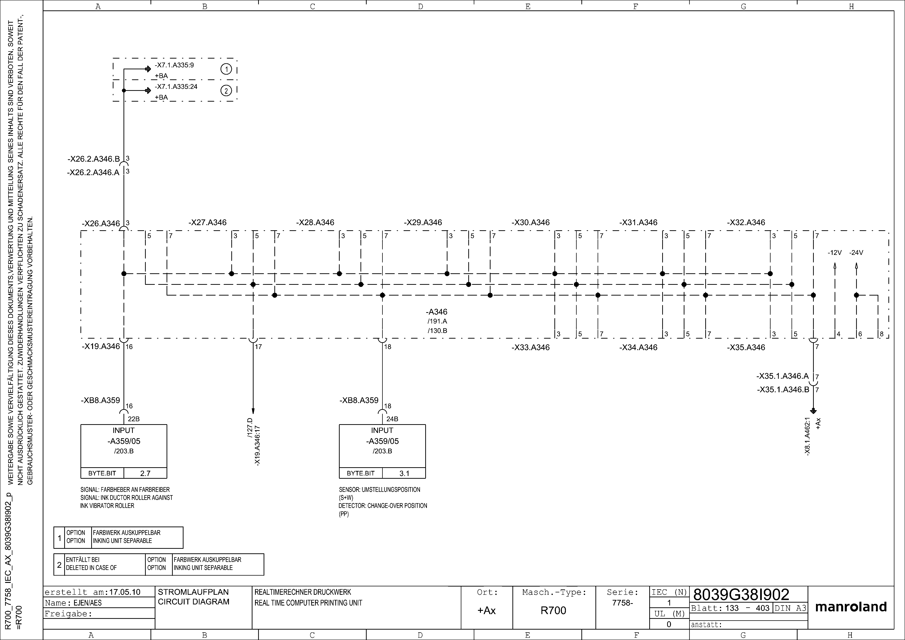

# +Ax — Sheet 133 of 403 — REALTIMERECHNER DRUCKWERK

**REAL TIME COMPUTER PRINTING UNIT**

> Part of the manroland **R700** printing press IEC/UL circuit diagrams.
> Drawing class: **Stromlaufplan / Circuit diagram** (DIN A3).
> Document `+Ax` covers the **Central control console** machine section.

## At a glance

| Field | Value |
|---|---|
| Document | `+Ax`  (8039G38I902) |
| Sheet | **133** of 403 |
| Section (DE) | REALTIMERECHNER DRUCKWERK |
| Section (EN) | REAL TIME COMPUTER PRINTING UNIT |
| Section type | CIRCUIT — Circuit diagram |
| Machine type | `R700` |
| Series | `7758` |
| Created | 17.05.10 |
| Replaces | — |
| Columns used | A, B, C, D, E, F, G, H |
| Path numbers | — |
| Labels on sheet | 105 |
| Cross-refs out | 5 |
| Cross-refs in | 47 |

**Previous:** [+Ax sheet 132](SHEET_0132.md) · **Next:** [+Ax sheet 134](SHEET_0134.md) · **Document TOC:** [_TOC.md](_TOC.md)  (+Ax) · **Master TOC:** [all sheets](../_MASTER_TOC.md)

## Sheet image (300 DPI, exact vector render)



_Rendered directly from the PDF vector layer at 300 DPI (1-bit), no OCR and no resampling. Use it to confirm anything ambiguous in the text below._

## Cross-references on this sheet

Each entry is a wire leaving this sheet. The printed token is `/sheet.column`; the link resolves to that sheet inside the same document.

| Ref | Target sheet | Col | Path | Destination on target | Target section | From col |
|---|---|---|---|---|---|---|
| `/191.A` | [+Ax sheet 191](SHEET_0191.md) | A | — | — | RESERVE | D |
| `/130.B` | [+Ax sheet 130](SHEET_0130.md) | B | — | — | REALTIMERECHNER ANLAGE | D |
| `/127.D` | [+Ax sheet 127](SHEET_0127.md) | D | — | — | REALTIMERECHNER ANLEGER | B |
| `/203.B` | [+Ax sheet 203](SHEET_0203.md) | B | — | — | REFERENZMODUL | A |
| `/203.B` | [+Ax sheet 203](SHEET_0203.md) | B | — | — | REFERENZMODUL | D |

### Incoming references (sheets that point here)

Every other sheet that sends a wire to this one. `Back-ref` is the token printed on *that* sheet; `Path` is its line number.

| From sheet | Cols | Back-ref | Path | Refs | What continues there |
|---|---|---|---|---|---|
| [+Ax#127](SHEET_0127.md) | D | `/127.D` | — | 1 | — |
| [+Ax#130](SHEET_0130.md) | B | `/130.B` | — | 1 | — |
| [+Ax#191](SHEET_0191.md) | A | `/191.A` | — | 1 | — |
| [+Ax#203](SHEET_0203.md) | B | `/203.B` | — | 2 | — |
| [+Ax#238](SHEET_0238.md) | F | `/238.F` | — | 2 | — |
| [+Ax#259](SHEET_0259.md) | A | `/259.A` | — | 3 | — |
| [+Ax#268](SHEET_0268.md) | F, G | `/268.F`, `/268.G` | — | 5 | — |
| [+Ax#270](SHEET_0270.md) | C | `/270.C` | — | 3 | — |
| [+Ax#272](SHEET_0272.md) | A | `/272.A` | — | 3 | — |
| [+Ax#273](SHEET_0273.md) | E | `/273.E` | — | 3 | — |
| [+Ax#274](SHEET_0274.md) | G | `/274.G` | — | 3 | — |
| [+Ax#275](SHEET_0275.md) | B, E | `/275.B`, `/275.E` | — | 6 | — |
| [+Ax#276](SHEET_0276.md) | G | `/276.G` | — | 3 | — |
| [+Ax#278](SHEET_0278.md) | B, F, G | `/278.B`, `/278.F`, `/278.G` | — | 11 | — |


## Devices on this sheet

| Tag | Class | Class meaning (IEC) | Col | Sub | Terminal | Sign |
|---|---|---|---|---|---|---|
| `A346` | A | Baugruppe / assembly, module, PC board | D | — | — | — |
| `A359/05` | A | Baugruppe / assembly, module, PC board | A | 05 | — | — |
| `A359/05` | A | Baugruppe / assembly, module, PC board | D | 05 | — | — |
| `X19.A346` | — | cross-device reference | A | — | — | — |
| `X26.A346` | — | cross-device reference | A | — | — | — |
| `X26.2.A346.A` | — | cross-device reference | A | — | — | — |
| `X26.2.A346.B` | — | cross-device reference | A | — | — | — |
| `X8.1.A462:1` | — | cross-device reference | H | — | 1 | — |
| `X35.1.A346.A` | — | cross-device reference | G | — | — | — |
| `X35.1.A346.B` | — | cross-device reference | G | — | — | — |
| `X7.1.A335:24` | — | cross-device reference | B | — | 24 | — |
| `X7.1.A335:9` | — | cross-device reference | B | — | 9 | — |
| `2.7` | — | cross-device reference | A | — | — | — |
| `XB8.A359` | — | cross-device reference | A | — | — | — |
| `3.1` | — | cross-device reference | D | — | — | — |
| `XB8.A359` | — | cross-device reference | C | — | — | — |
| `X19.A346:17` | — | cross-device reference | B | — | 17 | — |
| `X27.A346` | — | cross-device reference | B | — | — | — |
| `X28.A346` | — | cross-device reference | C | — | — | — |
| `X29.A346` | — | cross-device reference | D | — | — | — |
| `X30.A346` | — | cross-device reference | E | — | — | — |
| `X33.A346` | — | cross-device reference | E | — | — | — |
| `X31.A346` | — | cross-device reference | F | — | — | — |
| `X34.A346` | — | cross-device reference | F | — | — | — |
| `X32.A346` | — | cross-device reference | G | — | — | — |
| `X35.A346` | — | cross-device reference | G | — | — | — |

## Potentials / nets

| Potential | Count | Columns | Attached devices | Terminals |
|---|---|---|---|---|
| `12V` | 1 | H | — | — |
| `24V` | 1 | H | — | — |


A potential such as `L24+/4` or `M24+` is a named supply/return rail; every place it appears on this sheet is electrically common.

## Wire-end annotations (grouped as printed)

A wire that continues elsewhere is annotated with a small cluster: the destination description, the path/line number `#NN`, and the `/sheet.column` cross reference. Each row below is one such cluster exactly as it is grouped on the drawing.

| Col | Y | Path | Cross-ref | Text on the wire |
|---|---|---|---|---|
| B | 81.8 | — | — | `X7.1.A335:9` |
| B | 87.7 | — | — | `1` |
| B | 95.9 | — | — | `+BA` |
| B | 110.1 | — | — | `X7.1.A335:24` |
| B | 116.5 | — | — | `2` |
| B | 124.3 | — | — | `+BA` |
| A | 204.4 | — | — | `X26.2.A346.B 3` |
| A | 221.4 | — | — | `X26.2.A346.A 3` |
| D | 288.0 | — | — | `X27.A346 X28.A346 X29.A346 X30.A346` |
| F | 288.0 | — | — | `X31.A346` |
| G | 288.0 | — | — | `X32.A346` |
| A | 289.4 | — | — | `X26.A346 3` |
| D | 306.5 | — | — | `5 7 3 5 7 3 5 7 3 5 7 3 5 7` |
| F | 306.5 | — | — | `3 5 7` |
| G | 306.5 | — | — | `3 5 7` |
| H | 328.4 | — | — | `12V 24V` |
| D | 405.7 | — | — | `A346` |
| D | 418.7 | — | `/191.A`, `/130.B` | — |
| E | 435.4 | — | — | `3 5 7` |
| F | 435.4 | — | — | `3 5 7` |
| G | 435.4 | — | — | `3 5` |
| H | 435.4 | — | — | `4 6 8` |
| A | 451.0 | — | — | `X19.A346 16` |
| C | 452.4 | — | — | `17 18` |
| E | 452.4 | — | — | `X33.A346` |
| F | 452.4 | — | — | `X34.A346` |
| G | 452.4 | — | — | `X35.A346` |
| H | 452.4 | — | — | `7` |
| G | 490.0 | — | — | `X35.1.A346.A 7` |
| G | 507.7 | — | — | `X35.1.A346.B 7` |
| A | 521.9 | — | — | `XB8.A359 16` |
| C | 521.9 | — | — | `XB8.A359 18` |
| A | 547.4 | — | — | `22B` |
| D | 547.4 | — | — | `24B` |
| H | 548.2 | — | — | `X8.1.A462:1` |
| B | 549.6 | — | `/127.D` | — |
| H | 549.9 | — | — | `+Ax` |
| B | 559.6 | — | — | `X19.A346:17` |
| A | 561.9 | — | — | `INPUT` |
| D | 561.9 | — | — | `INPUT` |
| A | 575.7 | — | — | `A359/05` |
| D | 575.7 | — | — | `A359/05` |
| A | 589.5 | — | `/203.B` | — |
| D | 589.5 | — | `/203.B` | — |
| A | 618.6 | — | — | `BYTE.BIT 2.7` |
| D | 618.6 | — | — | `BYTE.BIT 3.1` |
| A | 641.2 | — | — | `INK VIBRATOR ROLLER SIGNAL: FARBHEBER AN FARBREIBER SIGNAL: INK DUCTOR ROLLER AGAINST` |
| D | 641.3 | — | — | `DETECTOR: CHANGE OVER POSITION (S+W) (PP) SENSOR: UMSTELLUNGSPOSITION` |
| A | 697.9 | — | — | `1 OPTION OPTION` |
| A | 697.9 | — | — | `FARBWERK AUSKUPPELBAR INKING UNIT SEPARABLE` |
| A | 733.4 | — | — | `2 ENTFÄLLT BEI DELETED IN CASE OF` |
| B | 733.4 | — | — | `OPTION OPTION` |
| B | 733.4 | — | — | `FARBWERK AUSKUPPELBAR INKING UNIT SEPARABLE` |


## Reconstructed tables

This sheet carries tabular content (pin map / terminal assignment / index). The grid below was rebuilt from the drawing's own rule lines, so each row is exactly one physical row of the table.

### Table 1 — 3 data rows × 25 columns (at x=106.3, y=104.9)

| X26.2.A346.B X26.2.A346.A X26.A346 | 3 3 3 | +BA 5 | X7.1.A335:24 2 X27.A346 7 | 3 | 5 | X28.A346 7 | 3 | 5 | X29.A346 7 |  | 3 | 5 | X30.A346 7 | 3 | 5 | X31.A346 7 | 3 | 5 | X32.A346 7 | 3 | 5 | 7 12V | 24V |  |
|---|---|---|---|---|---|---|---|---|---|---|---|---|---|---|---|---|---|---|---|---|---|---|---|---|
| `X19.A346 XB8.A359` | `16 16 22B` |  |  |  | `17` |  | `XB8.A359` |  | `18 18 24B` | `A346 /191.A /130.B` |  |  | `X33.A346` | `3` | `5` | `7 X34.A346` | `3` | `5` | `7 X35.A346` | `3 X35.1.A346.A X35.1.A346.B` | `5` | `7 7 7 +Ax` | `4` | `6` |
| `INPUT` | `A359/05 /203.B` |  |  | `/127.D` | `X19.A346:17` |  |  | `INPUT` | `A359/05 /203.B` |  |  |  |  |  |  |  |  |  |  |  | `X8.1.A462:1` |  |  |  |
| `BYTE.BIT` |  | `2.7` |  |  |  |  | `BYTE.BIT` |  | `3.1` |  |  |  |  |  |  |  |  |  |  |  |  |  |  |  |


## Notes and free text on this sheet

| Text | Col | Y (pt) |
|---|---|---|
| `+Ax` | H | 549.92 |
| `+BA` | B | 124.26 |
| `22B` | A | 547.37 |
| `INPUT` | A | 561.9 |
| `BYTE.BIT` | A | 619.15 |
| `SIGNAL: FARBHEBER AN FARBREIBER` | A | 641.25 |
| `SIGNAL: INK DUCTOR ROLLER AGAINST` | A | 651.9 |
| `INK VIBRATOR ROLLER` | A | 662.52 |
| `24B` | D | 547.37 |
| `INPUT` | D | 561.9 |
| `BYTE.BIT` | C | 619.15 |
| `SENSOR: UMSTELLUNGSPOSITION` | D | 641.26 |
| `(S+W)` | C | 651.78 |
| `DETECTOR: CHANGE OVER POSITION` | D | 662.52 |
| `(PP)` | C | 673.09 |
| `ENTFÄLLT BEI` | A | 733.35 |
| `DELETED IN CASE OF` | A | 744 |
| `OPTION` | B | 733.35 |
| `FARBWERK AUSKUPPELBAR` | B | 733.35 |
| `INKING UNIT SEPARABLE` | B | 744 |
| `OPTION` | A | 697.92 |
| `FARBWERK AUSKUPPELBAR` | A | 697.92 |
| `INKING UNIT SEPARABLE` | A | 708.56 |

## Complete label inventory (exact text from the drawing)

Every text object inside the drawing area of this sheet, in DIN reading order (column A→H, then top→bottom). This is the authoritative list: if a string is not here it is not printed on this sheet.

| Col | Y | X | Dir | Type | Text |
|---|---|---|---|---|---|
| A | 204.4 | 89.0 | → | device ref | `X26.2.A346.B` |
| A | 204.4 | 165.5 | → | number | `3` |
| A | 221.4 | 165.5 | → | number | `3` |
| A | 222.1 | 88.2 | → | device ref | `X26.2.A346.A` |
| A | 289.4 | 107.7 | → | device ref | `X26.A346` |
| A | 289.5 | 165.5 | → | number | `3` |
| A | 306.5 | 193.9 | → | number | `5` |
| A | 451.0 | 107.7 | → | device ref | `X19.A346` |
| A | 452.5 | 165.0 | → | number | `16` |
| A | 521.9 | 106.6 | → | device ref | `XB8.A359` |
| A | 530.4 | 165.0 | → | number | `16` |
| A | 547.4 | 168.4 | → | text | `22B` |
| A | 561.9 | 148.1 | → | text | `INPUT` |
| A | 575.7 | 141.6 | → | device tag | `A359/05` |
| A | 589.5 | 150.4 | → | cross-reference | `/203.B` |
| A | 618.6 | 184.5 | → | device ref | `2.7` |
| A | 619.1 | 116.2 | → | text | `BYTE.BIT` |
| A | 641.3 | 106.0 | → | text | `SIGNAL: FARBHEBER AN FARBREIBER` |
| A | 651.9 | 106.0 | → | text | `SIGNAL: INK DUCTOR ROLLER AGAINST` |
| A | 662.5 | 105.4 | → | text | `INK VIBRATOR ROLLER` |
| A | 697.9 | 87.6 | → | text | `OPTION` |
| A | 697.9 | 122.5 | → | text | `FARBWERK AUSKUPPELBAR` |
| A | 703.3 | 75.4 | → | number | `1` |
| A | 708.6 | 87.6 | → | text | `OPTION` |
| A | 708.6 | 122.5 | → | text | `INKING UNIT SEPARABLE` |
| A | 733.3 | 87.0 | → | text | `ENTFÄLLT BEI` |
| A | 738.7 | 75.1 | → | number | `2` |
| A | 744.0 | 87.0 | → | text | `DELETED IN CASE OF` |
| B | 81.8 | 203.8 | → | device ref | `X7.1.A335:9` |
| B | 87.7 | 295.9 | → | number | `1` |
| B | 95.9 | 203.8 | → | text | `+BA` |
| B | 110.1 | 203.8 | → | device ref | `X7.1.A335:24` |
| B | 116.5 | 295.6 | → | number | `2` |
| B | 124.3 | 203.8 | → | text | `+BA` |
| B | 288.0 | 248.0 | → | device ref | `X27.A346` |
| B | 306.5 | 222.2 | → | number | `7` |
| B | 306.5 | 307.3 | → | number | `3` |
| B | 306.5 | 335.6 | → | number | `5` |
| B | 452.5 | 335.1 | → | number | `17` |
| B | 549.6 | 324.9 | ↕ | cross-reference | `/127.D` |
| B | 559.6 | 334.8 | ↕ | device ref | `X19.A346:17` |
| B | 733.4 | 193.9 | → | text | `OPTION` |
| B | 733.4 | 228.8 | → | text | `FARBWERK AUSKUPPELBAR` |
| B | 744.0 | 193.9 | → | text | `OPTION` |
| B | 744.0 | 228.8 | → | text | `INKING UNIT SEPARABLE` |
| C | 288.0 | 389.8 | → | device ref | `X28.A346` |
| C | 306.5 | 364.0 | → | number | `7` |
| C | 306.5 | 449.0 | → | number | `3` |
| C | 306.5 | 477.4 | → | number | `5` |
| C | 521.9 | 446.7 | → | device ref | `XB8.A359` |
| C | 619.1 | 456.4 | → | text | `BYTE.BIT` |
| C | 651.8 | 445.9 | → | text | `(S+W)` |
| C | 673.1 | 445.9 | → | text | `(PP)` |
| D | 288.0 | 531.5 | → | device ref | `X29.A346` |
| D | 306.5 | 505.7 | → | number | `7` |
| D | 306.5 | 590.7 | → | number | `3` |
| D | 306.5 | 619.1 | → | number | `5` |
| D | 405.7 | 560.4 | → | device tag | `A346` |
| D | 418.7 | 562.7 | → | cross-reference | `/191.A` |
| D | 431.1 | 563.0 | → | cross-reference | `/130.B` |
| D | 452.5 | 505.1 | → | number | `18` |
| D | 530.4 | 505.1 | → | number | `18` |
| D | 547.4 | 508.5 | → | text | `24B` |
| D | 561.9 | 488.3 | → | text | `INPUT` |
| D | 575.7 | 481.7 | → | device tag | `A359/05` |
| D | 589.5 | 490.5 | → | cross-reference | `/203.B` |
| D | 618.6 | 525.5 | → | device ref | `3.1` |
| D | 641.3 | 446.2 | → | text | `SENSOR: UMSTELLUNGSPOSITION` |
| D | 662.5 | 445.6 | → | text | `DETECTOR: CHANGE OVER POSITION` |
| E | 288.0 | 673.2 | → | device ref | `X30.A346` |
| E | 306.5 | 647.4 | → | number | `7` |
| E | 306.5 | 732.5 | → | number | `3` |
| E | 306.5 | 760.8 | → | number | `5` |
| E | 435.4 | 732.5 | → | number | `3` |
| E | 435.4 | 760.8 | → | number | `5` |
| E | 452.4 | 673.2 | → | device ref | `X33.A346` |
| F | 288.0 | 815.0 | → | device ref | `X31.A346` |
| F | 306.5 | 789.2 | → | number | `7` |
| F | 306.5 | 874.2 | → | number | `3` |
| F | 306.5 | 902.6 | → | number | `5` |
| F | 435.4 | 789.2 | → | number | `7` |
| F | 435.4 | 874.2 | → | number | `3` |
| F | 435.4 | 902.6 | → | number | `5` |
| F | 452.4 | 815.0 | → | device ref | `X34.A346` |
| G | 288.0 | 956.7 | → | device ref | `X32.A346` |
| G | 306.5 | 930.9 | → | number | `7` |
| G | 306.5 | 1015.9 | → | number | `3` |
| G | 306.5 | 1044.3 | → | number | `5` |
| G | 435.4 | 930.9 | → | number | `7` |
| G | 435.4 | 1015.9 | → | number | `3` |
| G | 435.4 | 1044.3 | → | number | `5` |
| G | 452.4 | 956.7 | → | device ref | `X35.A346` |
| G | 490.0 | 995.2 | → | device ref | `X35.1.A346.A` |
| G | 507.7 | 996.1 | → | device ref | `X35.1.A346.B` |
| H | 306.5 | 1072.6 | → | number | `7` |
| H | 328.4 | 1089.1 | → | potential | `12V` |
| H | 328.4 | 1117.4 | → | potential | `24V` |
| H | 435.4 | 1101.0 | → | number | `4` |
| H | 435.4 | 1129.3 | → | number | `6` |
| H | 435.4 | 1157.7 | → | number | `8` |
| H | 452.5 | 1072.6 | → | number | `7` |
| H | 492.1 | 1072.6 | → | number | `7` |
| H | 509.1 | 1072.6 | → | number | `7` |
| H | 548.2 | 1058.3 | ↕ | device ref | `X8.1.A462:1` |
| H | 549.9 | 1072.6 | ↕ | text | `+Ax` |

## Reading-order text block

The same content as a plain block, grouped by DIN column — convenient to paste or to match against a visual description.

```text
=== Column A ===
 204.4   89.0  devref       X26.2.A346.B
 204.4  165.5  numeric      3
 221.4  165.5  numeric      3
 222.1   88.2  devref       X26.2.A346.A
 289.4  107.7  devref       X26.A346
 289.5  165.5  numeric      3
 306.5  193.9  numeric      5
 451.0  107.7  devref       X19.A346
 452.5  165.0  numeric      16
 521.9  106.6  devref       XB8.A359
 530.4  165.0  numeric      16
 547.4  168.4  text         22B
 561.9  148.1  text         INPUT
 575.7  141.6  devtag       A359/05
 589.5  150.4  xref         /203.B
 618.6  184.5  devref       2.7
 619.1  116.2  text         BYTE.BIT
 641.3  106.0  text         SIGNAL: FARBHEBER AN FARBREIBER
 651.9  106.0  text         SIGNAL: INK DUCTOR ROLLER AGAINST
 662.5  105.4  text         INK VIBRATOR ROLLER
 697.9   87.6  text         OPTION
 697.9  122.5  text         FARBWERK AUSKUPPELBAR
 703.3   75.4  numeric      1
 708.6   87.6  text         OPTION
 708.6  122.5  text         INKING UNIT SEPARABLE
 733.3   87.0  text         ENTFÄLLT BEI
 738.7   75.1  numeric      2
 744.0   87.0  text         DELETED IN CASE OF
=== Column B ===
  81.8  203.8  devref       X7.1.A335:9
  87.7  295.9  numeric      1
  95.9  203.8  text         +BA
 110.1  203.8  devref       X7.1.A335:24
 116.5  295.6  numeric      2
 124.3  203.8  text         +BA
 288.0  248.0  devref       X27.A346
 306.5  222.2  numeric      7
 306.5  307.3  numeric      3
 306.5  335.6  numeric      5
 452.5  335.1  numeric      17
 549.6  324.9  xref         /127.D
 559.6  334.8  devref       X19.A346:17
 733.4  193.9  text         OPTION
 733.4  228.8  text         FARBWERK AUSKUPPELBAR
 744.0  193.9  text         OPTION
 744.0  228.8  text         INKING UNIT SEPARABLE
=== Column C ===
 288.0  389.8  devref       X28.A346
 306.5  364.0  numeric      7
 306.5  449.0  numeric      3
 306.5  477.4  numeric      5
 521.9  446.7  devref       XB8.A359
 619.1  456.4  text         BYTE.BIT
 651.8  445.9  text         (S+W)
 673.1  445.9  text         (PP)
=== Column D ===
 288.0  531.5  devref       X29.A346
 306.5  505.7  numeric      7
 306.5  590.7  numeric      3
 306.5  619.1  numeric      5
 405.7  560.4  devtag       A346
 418.7  562.7  xref         /191.A
 431.1  563.0  xref         /130.B
 452.5  505.1  numeric      18
 530.4  505.1  numeric      18
 547.4  508.5  text         24B
 561.9  488.3  text         INPUT
 575.7  481.7  devtag       A359/05
 589.5  490.5  xref         /203.B
 618.6  525.5  devref       3.1
 641.3  446.2  text         SENSOR: UMSTELLUNGSPOSITION
 662.5  445.6  text         DETECTOR: CHANGE OVER POSITION
=== Column E ===
 288.0  673.2  devref       X30.A346
 306.5  647.4  numeric      7
 306.5  732.5  numeric      3
 306.5  760.8  numeric      5
 435.4  732.5  numeric      3
 435.4  760.8  numeric      5
 452.4  673.2  devref       X33.A346
=== Column F ===
 288.0  815.0  devref       X31.A346
 306.5  789.2  numeric      7
 306.5  874.2  numeric      3
 306.5  902.6  numeric      5
 435.4  789.2  numeric      7
 435.4  874.2  numeric      3
 435.4  902.6  numeric      5
 452.4  815.0  devref       X34.A346
=== Column G ===
 288.0  956.7  devref       X32.A346
 306.5  930.9  numeric      7
 306.5 1015.9  numeric      3
 306.5 1044.3  numeric      5
 435.4  930.9  numeric      7
 435.4 1015.9  numeric      3
 435.4 1044.3  numeric      5
 452.4  956.7  devref       X35.A346
 490.0  995.2  devref       X35.1.A346.A
 507.7  996.1  devref       X35.1.A346.B
=== Column H ===
 306.5 1072.6  numeric      7
 328.4 1089.1  net          12V
 328.4 1117.4  net          24V
 435.4 1101.0  numeric      4
 435.4 1129.3  numeric      6
 435.4 1157.7  numeric      8
 452.5 1072.6  numeric      7
 492.1 1072.6  numeric      7
 509.1 1072.6  numeric      7
 548.2 1058.3  devref       X8.1.A462:1
 549.9 1072.6  text         +Ax
```

---
_Generated from the PDF vector text layer; no OCR. Source: `R700_7758_IEC_AX_8039G38I902_p`, sheet 133._
