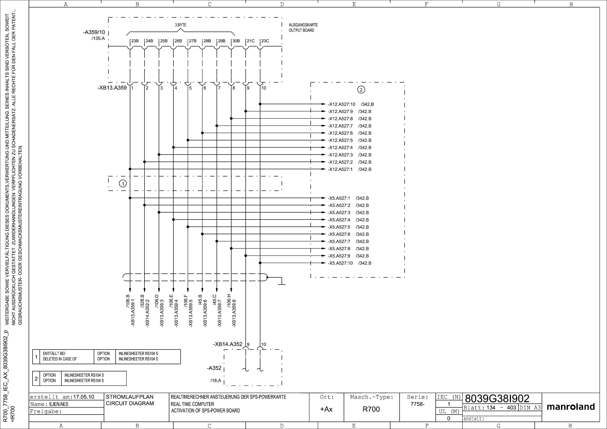

# +Ax — Sheet 134 of 403 — REALTIMERECHNER ANSTEUERUNG DER SPS POWERKARTE

**REAL TIME COMPUTER**

> Part of the manroland **R700** printing press IEC/UL circuit diagrams.
> Drawing class: **Stromlaufplan / Circuit diagram** (DIN A3).
> Document `+Ax` covers the **Central control console** machine section.

## At a glance

| Field | Value |
|---|---|
| Document | `+Ax`  (8039G38I902) |
| Sheet | **134** of 403 |
| Section (DE) | REALTIMERECHNER ANSTEUERUNG DER SPS POWERKARTE |
| Section (EN) | REAL TIME COMPUTER |
| Section type | CIRCUIT — Circuit diagram |
| Machine type | `R700` |
| Series | `7758` |
| Created | 17.05.10 |
| Replaces | — |
| Columns used | A, B, C, D, E |
| Path numbers | — |
| Labels on sheet | 101 |
| Cross-refs out | 30 |
| Cross-refs in | 42 |

**Previous:** [+Ax sheet 133](SHEET_0133.md) · **Next:** [+Ax sheet 135](SHEET_0135.md) · **Document TOC:** [_TOC.md](_TOC.md)  (+Ax) · **Master TOC:** [all sheets](../_MASTER_TOC.md)

## Sheet image (300 DPI, exact vector render)



_Rendered directly from the PDF vector layer at 300 DPI (1-bit), no OCR and no resampling. Use it to confirm anything ambiguous in the text below._

## Cross-references on this sheet

Each entry is a wire leaving this sheet. The printed token is `/sheet.column`; the link resolves to that sheet inside the same document.

| Ref | Target sheet | Col | Path | Destination on target | Target section | From col |
|---|---|---|---|---|---|---|
| `/135.A` | [+Ax sheet 135](SHEET_0135.md) | A | — | — | REALTIMERECHNER ANSTEUERUNG DER SPS POWERKARTE | A |
| `/342.B` | [+Ax sheet 342](SHEET_0342.md) | B | — | X12.A527:10 | OPTION: INLINESHEETER RS104 S | E |
| `/342.B` | [+Ax sheet 342](SHEET_0342.md) | B | — | X12.A527:9 | OPTION: INLINESHEETER RS104 S | E |
| `/342.B` | [+Ax sheet 342](SHEET_0342.md) | B | — | X12.A527:8 | OPTION: INLINESHEETER RS104 S | E |
| `/342.B` | [+Ax sheet 342](SHEET_0342.md) | B | — | X12.A527:7 | OPTION: INLINESHEETER RS104 S | E |
| `/342.B` | [+Ax sheet 342](SHEET_0342.md) | B | — | X12.A527:6 | OPTION: INLINESHEETER RS104 S | E |
| `/342.B` | [+Ax sheet 342](SHEET_0342.md) | B | — | X12.A527:5 | OPTION: INLINESHEETER RS104 S | E |
| `/342.B` | [+Ax sheet 342](SHEET_0342.md) | B | — | X12.A527:4 | OPTION: INLINESHEETER RS104 S | E |
| `/342.B` | [+Ax sheet 342](SHEET_0342.md) | B | — | X12.A527:3 | OPTION: INLINESHEETER RS104 S | E |
| `/342.B` | [+Ax sheet 342](SHEET_0342.md) | B | — | X12.A527:2 | OPTION: INLINESHEETER RS104 S | E |
| `/342.B` | [+Ax sheet 342](SHEET_0342.md) | B | — | X12.A527:1 | OPTION: INLINESHEETER RS104 S | E |
| `/342.B` | [+Ax sheet 342](SHEET_0342.md) | B | — | X5.A527:1 | OPTION: INLINESHEETER RS104 S | E |
| `/342.B` | [+Ax sheet 342](SHEET_0342.md) | B | — | X5.A527:2 | OPTION: INLINESHEETER RS104 S | E |
| `/342.B` | [+Ax sheet 342](SHEET_0342.md) | B | — | X5.A527:3 | OPTION: INLINESHEETER RS104 S | E |
| `/342.B` | [+Ax sheet 342](SHEET_0342.md) | B | — | X5.A527:4 | OPTION: INLINESHEETER RS104 S | E |
| `/342.B` | [+Ax sheet 342](SHEET_0342.md) | B | — | X5.A527:5 | OPTION: INLINESHEETER RS104 S | E |
| `/342.B` | [+Ax sheet 342](SHEET_0342.md) | B | — | X5.A527:6 | OPTION: INLINESHEETER RS104 S | E |
| `/342.B` | [+Ax sheet 342](SHEET_0342.md) | B | — | X5.A527:7 | OPTION: INLINESHEETER RS104 S | E |
| `/342.B` | [+Ax sheet 342](SHEET_0342.md) | B | — | X5.A527:8 | OPTION: INLINESHEETER RS104 S | E |
| `/342.B` | [+Ax sheet 342](SHEET_0342.md) | B | — | X5.A527:9 | OPTION: INLINESHEETER RS104 S | E |
| `/342.B` | [+Ax sheet 342](SHEET_0342.md) | B | — | X5.A527:10 | OPTION: INLINESHEETER RS104 S | E |
| `/106.H` | [+Ax sheet 106](SHEET_0106.md) | H | — | — | ANLEGER | C |
| `/106.E` | [+Ax sheet 106](SHEET_0106.md) | E | — | — | ANLEGER | B |
| `/45.B` | [+Ax sheet 45](SHEET_0045.md) | B | — | — | HAUPTANTRIEB | C |
| `/106.B` | [+Ax sheet 106](SHEET_0106.md) | B | — | — | ANLEGER | B |
| `/328.B` | [+Ax sheet 328](SHEET_0328.md) | B | — | — | OPTION: NONSTOP EINRICHTUNG MANUELL, ANLEGER | B |
| `/106.D` | [+Ax sheet 106](SHEET_0106.md) | D | — | — | ANLEGER | B |
| `/106.F` | [+Ax sheet 106](SHEET_0106.md) | F | — | — | ANLEGER | C |
| `/45.C` | [+Ax sheet 45](SHEET_0045.md) | C | — | — | HAUPTANTRIEB | C |
| `/18.A` | [+Ax sheet 18](SHEET_0018.md) | A | — | — | SPANNUNGSVERSORGUNG, SCHALTSCHRANKBELÜFTUNG | C |

### Incoming references (sheets that point here)

Every other sheet that sends a wire to this one. `Back-ref` is the token printed on *that* sheet; `Path` is its line number.

| From sheet | Cols | Back-ref | Path | Refs | What continues there |
|---|---|---|---|---|---|
| [+Ax#18](SHEET_0018.md) | A | `/18.A` | — | 1 | — |
| [+Ax#45](SHEET_0045.md) | C | `/45.C` | — | 2 | XB13.A359:7 |
| [+Ax#106](SHEET_0106.md) | B, D, E, G, H | `/106.B`, `/106.D`, `/106.E`, `/106.G`, `/106.H` | — | 5 | XB13.A359:5; XB13.A359:8 |
| [+Ax#135](SHEET_0135.md) | A | `/135.A` | — | 1 | — |
| [+Ax#250](SHEET_0250.md) | C | `/250.C` | — | 10 | — |
| [+Ax#251](SHEET_0251.md) | C | `/251.C` | — | 2 | — |
| [+Ax#328](SHEET_0328.md) | B | `/328.B` | — | 1 | XB14.A352:2 |
| [+Ax#342](SHEET_0342.md) | B | `/342.B` | — | 20 | X12.A527:1; X12.A527:10; X12.A527:2; X12.A527:3; X12.A527:4; X12.A527:5; X12.A527:6; X12.A527:7; X12.A527:8; X12.A527:9; X5.A527:1; X5.A527:10; X5.A527:2; X5.A5 |


## Devices on this sheet

| Tag | Class | Class meaning (IEC) | Col | Sub | Terminal | Sign |
|---|---|---|---|---|---|---|
| `A359/10` | A | Baugruppe / assembly, module, PC board | A | 10 | — | — |
| `A352` | A | Baugruppe / assembly, module, PC board | C | — | — | — |
| `XB13.A359` | — | cross-device reference | B | — | — | — |
| `XB14.A352` | — | cross-device reference | C | — | — | — |
| `XB13.A359:6` | — | cross-device reference | C | — | 6 | — |
| `XB13.A359:1` | — | cross-device reference | B | — | 1 | — |
| `XB13.A359:3` | — | cross-device reference | B | — | 3 | — |
| `XB13.A359:8` | — | cross-device reference | C | — | 8 | — |
| `XB13.A359:7` | — | cross-device reference | C | — | 7 | — |
| `XB13.A359:4` | — | cross-device reference | C | — | 4 | — |
| `XB13.A359:5` | — | cross-device reference | C | — | 5 | — |
| `XB14.A352:2` | — | cross-device reference | B | — | 2 | — |
| `X12.A527:10` | — | cross-device reference | E | — | 10 | — |
| `X12.A527:9` | — | cross-device reference | E | — | 9 | — |
| `X12.A527:8` | — | cross-device reference | E | — | 8 | — |
| `X12.A527:2` | — | cross-device reference | E | — | 2 | — |
| `X12.A527:1` | — | cross-device reference | E | — | 1 | — |
| `X12.A527:3` | — | cross-device reference | E | — | 3 | — |
| `X12.A527:7` | — | cross-device reference | E | — | 7 | — |
| `X12.A527:6` | — | cross-device reference | E | — | 6 | — |
| `X12.A527:5` | — | cross-device reference | E | — | 5 | — |
| `X12.A527:4` | — | cross-device reference | E | — | 4 | — |
| `X5.A527:7` | — | cross-device reference | E | — | 7 | — |
| `X5.A527:6` | — | cross-device reference | E | — | 6 | — |
| `X5.A527:5` | — | cross-device reference | E | — | 5 | — |
| `X5.A527:8` | — | cross-device reference | E | — | 8 | — |
| `X5.A527:10` | — | cross-device reference | E | — | 10 | — |
| `X5.A527:9` | — | cross-device reference | E | — | 9 | — |
| `X5.A527:4` | — | cross-device reference | E | — | 4 | — |
| `X5.A527:3` | — | cross-device reference | E | — | 3 | — |
| `X5.A527:2` | — | cross-device reference | E | — | 2 | — |
| `X5.A527:1` | — | cross-device reference | E | — | 1 | — |

## Potentials / nets

_No named potentials on this sheet._

## Wire-end annotations (grouped as printed)

A wire that continues elsewhere is annotated with a small cluster: the destination description, the path/line number `#NN`, and the `/sheet.column` cross reference. Each row below is one such cluster exactly as it is grouped on the drawing.

| Col | Y | Path | Cross-ref | Text on the wire |
|---|---|---|---|---|
| C | 45.9 | — | — | `3.BYTE` |
| D | 46.0 | — | — | `OUTPUT BOARD AUSGANGSKARTE` |
| A | 58.4 | — | — | `A359/10` |
| A | 71.5 | — | `/135.A` | — |
| C | 76.8 | — | — | `23B 24B 25B 26B 27B 28B 29B 30B 21C 23C` |
| C | 167.6 | — | — | `XB13.A359 1 2 3 4 5 6 7 8 9 10` |
| E | 173.2 | — | — | `2` |
| E | 200.8 | — | `/342.B` | `X12.A527:10` |
| E | 215.0 | — | `/342.B` | `X12.A527:9` |
| E | 229.2 | — | `/342.B` | `X12.A527:8` |
| E | 243.3 | — | `/342.B` | `X12.A527:7` |
| E | 257.5 | — | `/342.B` | `X12.A527:6` |
| E | 271.7 | — | `/342.B` | `X12.A527:5` |
| E | 285.9 | — | `/342.B` | `X12.A527:4` |
| E | 300.0 | — | `/342.B` | `X12.A527:3` |
| E | 314.2 | — | `/342.B` | `X12.A527:2` |
| E | 328.4 | — | `/342.B` | `X12.A527:1` |
| B | 356.9 | — | — | `1` |
| E | 385.1 | — | `/342.B` | `X5.A527:1` |
| E | 399.2 | — | `/342.B` | `X5.A527:2` |
| E | 413.4 | — | `/342.B` | `X5.A527:3` |
| E | 427.6 | — | `/342.B` | `X5.A527:4` |
| E | 441.8 | — | `/342.B` | `X5.A527:5` |
| E | 455.9 | — | `/342.B` | `X5.A527:6` |
| E | 470.1 | — | `/342.B` | `X5.A527:7` |
| E | 484.3 | — | `/342.B` | `X5.A527:8` |
| E | 498.4 | — | `/342.B` | `X5.A527:9` |
| E | 512.6 | — | `/342.B` | `X5.A527:10` |
| C | 577.4 | — | `/106.H` | — |
| B | 577.7 | — | `/106.E` | — |
| B | 578.0 | — | `/106.B` | — |
| B | 578.0 | — | `/328.B` | — |
| B | 578.0 | — | `/106.D` | — |
| C | 578.0 | — | `/106.F` | — |
| C | 578.0 | — | `/45.B` | — |
| C | 578.0 | — | `/45.C` | — |
| B | 586.5 | — | — | `XB13.A359:1` |
| B | 587.6 | — | — | `XB14.A352:2` |
| B | 587.9 | — | — | `XB13.A359:3` |
| C | 587.9 | — | — | `XB13.A359:4` |
| C | 587.9 | — | — | `XB13.A359:5` |
| C | 587.9 | — | — | `XB13.A359:6` |
| C | 587.9 | — | — | `XB13.A359:7` |
| C | 587.9 | — | — | `XB13.A359:8` |
| C | 670.7 | — | — | `XB14.A352 9 10` |
| A | 690.8 | — | — | `1 OPTION OPTION` |
| A | 690.8 | — | — | `ENTFÄLLT BEI DELETED IN CASE OF` |
| B | 690.9 | — | — | `INLINESHEETER RS104 S INLINESHEETER RS104 S` |
| C | 717.5 | — | — | `A352` |
| A | 733.4 | — | — | `OPTION OPTION` |
| A | 733.4 | — | — | `INLINESHEETER RS104 S INLINESHEETER RS104 S` |
| A | 738.7 | — | — | `2` |
| C | 742.9 | — | `/18.A` | — |


## Notes and free text on this sheet

| Text | Col | Y (pt) |
|---|---|---|
| `AUSGANGSKARTE` | D | 45.98 |
| `OUTPUT BOARD` | D | 56.62 |
| `23B` | B | 76.82 |
| `24B` | B | 76.82 |
| `25B` | B | 76.82 |
| `26B` | C | 76.82 |
| `27B` | C | 76.82 |
| `28B` | C | 76.82 |
| `29B` | C | 76.82 |
| `30B` | C | 76.82 |
| `21C` | D | 76.8 |
| `23C` | D | 76.8 |
| `ENTFÄLLT BEI` | A | 690.83 |
| `DELETED IN CASE OF` | A | 701.48 |
| `OPTION` | A | 733.35 |
| `OPTION` | B | 690.83 |
| `INLINESHEETER RS104 S` | B | 690.85 |
| `INLINESHEETER RS104 S` | A | 733.37 |
| `3.BYTE` | C | 45.93 |

## Complete label inventory (exact text from the drawing)

Every text object inside the drawing area of this sheet, in DIN reading order (column A→H, then top→bottom). This is the authoritative list: if a string is not here it is not printed on this sheet.

| Col | Y | X | Dir | Type | Text |
|---|---|---|---|---|---|
| A | 58.4 | 163.0 | → | device tag | `A359/10` |
| A | 71.5 | 180.0 | → | cross-reference | `/135.A` |
| A | 690.8 | 84.2 | → | text | `ENTFÄLLT BEI` |
| A | 696.2 | 68.3 | → | number | `1` |
| A | 701.5 | 84.2 | → | text | `DELETED IN CASE OF` |
| A | 733.4 | 84.8 | → | text | `OPTION` |
| A | 733.4 | 126.7 | → | text | `INLINESHEETER RS104 S` |
| A | 738.7 | 68.0 | → | number | `2` |
| A | 744.0 | 84.8 | → | text | `OPTION` |
| A | 744.0 | 126.7 | → | text | `INLINESHEETER RS104 S` |
| B | 76.8 | 257.7 | → | text | `23B` |
| B | 76.8 | 286.0 | → | text | `24B` |
| B | 76.8 | 314.4 | → | text | `25B` |
| B | 167.5 | 191.3 | → | device ref | `XB13.A359` |
| B | 169.0 | 257.1 | → | number | `1` |
| B | 169.0 | 286.0 | → | number | `2` |
| B | 169.0 | 314.4 | → | number | `3` |
| B | 356.9 | 239.2 | → | number | `1` |
| B | 577.7 | 331.9 | ↕ | cross-reference | `/106.E` |
| B | 578.0 | 246.9 | ↕ | cross-reference | `/106.B` |
| B | 578.0 | 275.2 | ↕ | cross-reference | `/328.B` |
| B | 578.0 | 303.6 | ↕ | cross-reference | `/106.D` |
| B | 586.5 | 256.8 | ↕ | device ref | `XB13.A359:1` |
| B | 587.6 | 285.2 | ↕ | device ref | `XB14.A352:2` |
| B | 587.9 | 313.5 | ↕ | device ref | `XB13.A359:3` |
| B | 690.8 | 191.1 | → | text | `OPTION` |
| B | 690.9 | 233.0 | → | text | `INLINESHEETER RS104 S` |
| B | 701.5 | 191.1 | → | text | `OPTION` |
| B | 701.5 | 233.0 | → | text | `INLINESHEETER RS104 S` |
| C | 45.9 | 343.5 | → | text | `3.BYTE` |
| C | 76.8 | 342.7 | → | text | `26B` |
| C | 76.8 | 371.1 | → | text | `27B` |
| C | 76.8 | 399.4 | → | text | `28B` |
| C | 76.8 | 427.7 | → | text | `29B` |
| C | 76.8 | 456.1 | → | text | `30B` |
| C | 169.0 | 342.7 | → | number | `4` |
| C | 169.0 | 371.1 | → | number | `5` |
| C | 169.0 | 399.4 | → | number | `6` |
| C | 169.0 | 427.7 | → | number | `7` |
| C | 169.0 | 456.1 | → | number | `8` |
| C | 577.4 | 445.3 | ↕ | cross-reference | `/106.H` |
| C | 578.0 | 360.3 | ↕ | cross-reference | `/106.F` |
| C | 578.0 | 388.6 | ↕ | cross-reference | `/45.B` |
| C | 578.0 | 417.0 | ↕ | cross-reference | `/45.C` |
| C | 587.9 | 341.9 | ↕ | device ref | `XB13.A359:4` |
| C | 587.9 | 370.2 | ↕ | device ref | `XB13.A359:5` |
| C | 587.9 | 398.5 | ↕ | device ref | `XB13.A359:6` |
| C | 587.9 | 426.9 | ↕ | device ref | `XB13.A359:7` |
| C | 587.9 | 455.2 | ↕ | device ref | `XB13.A359:8` |
| C | 670.7 | 418.1 | → | device ref | `XB14.A352` |
| C | 717.5 | 405.9 | → | device tag | `A352` |
| C | 742.9 | 413.0 | → | cross-reference | `/18.A` |
| D | 46.0 | 566.9 | → | text | `AUSGANGSKARTE` |
| D | 56.6 | 566.6 | → | text | `OUTPUT BOARD` |
| D | 76.8 | 484.4 | → | text | `21C` |
| D | 76.8 | 512.8 | → | text | `23C` |
| D | 169.0 | 484.4 | → | number | `9` |
| D | 169.0 | 512.2 | → | number | `10` |
| D | 672.1 | 484.4 | → | number | `9` |
| D | 672.1 | 512.2 | → | number | `10` |
| E | 173.2 | 706.7 | → | number | `2` |
| E | 200.8 | 643.2 | → | device ref | `X12.A527:10` |
| E | 200.8 | 708.0 | → | cross-reference | `/342.B` |
| E | 215.0 | 643.2 | → | device ref | `X12.A527:9` |
| E | 215.0 | 703.0 | → | cross-reference | `/342.B` |
| E | 229.2 | 643.2 | → | device ref | `X12.A527:8` |
| E | 229.2 | 703.0 | → | cross-reference | `/342.B` |
| E | 243.3 | 703.0 | → | cross-reference | `/342.B` |
| E | 243.4 | 643.2 | → | device ref | `X12.A527:7` |
| E | 257.5 | 643.2 | → | device ref | `X12.A527:6` |
| E | 257.5 | 703.0 | → | cross-reference | `/342.B` |
| E | 271.7 | 643.2 | → | device ref | `X12.A527:5` |
| E | 271.7 | 703.0 | → | cross-reference | `/342.B` |
| E | 285.9 | 643.2 | → | device ref | `X12.A527:4` |
| E | 285.9 | 703.0 | → | cross-reference | `/342.B` |
| E | 300.0 | 643.2 | → | device ref | `X12.A527:3` |
| E | 300.0 | 703.0 | → | cross-reference | `/342.B` |
| E | 314.2 | 643.2 | → | device ref | `X12.A527:2` |
| E | 314.2 | 703.0 | → | cross-reference | `/342.B` |
| E | 328.4 | 643.2 | → | device ref | `X12.A527:1` |
| E | 328.4 | 703.0 | → | cross-reference | `/342.B` |
| E | 385.1 | 643.2 | → | device ref | `X5.A527:1` |
| E | 385.1 | 698.0 | → | cross-reference | `/342.B` |
| E | 399.2 | 698.0 | → | cross-reference | `/342.B` |
| E | 399.3 | 643.2 | → | device ref | `X5.A527:2` |
| E | 413.4 | 643.2 | → | device ref | `X5.A527:3` |
| E | 413.4 | 698.0 | → | cross-reference | `/342.B` |
| E | 427.6 | 643.2 | → | device ref | `X5.A527:4` |
| E | 427.6 | 698.0 | → | cross-reference | `/342.B` |
| E | 441.8 | 643.2 | → | device ref | `X5.A527:5` |
| E | 441.8 | 698.0 | → | cross-reference | `/342.B` |
| E | 455.9 | 643.2 | → | device ref | `X5.A527:6` |
| E | 455.9 | 698.0 | → | cross-reference | `/342.B` |
| E | 470.1 | 643.2 | → | device ref | `X5.A527:7` |
| E | 470.1 | 698.0 | → | cross-reference | `/342.B` |
| E | 484.3 | 643.2 | → | device ref | `X5.A527:8` |
| E | 484.3 | 698.0 | → | cross-reference | `/342.B` |
| E | 498.5 | 643.2 | → | device ref | `X5.A527:9` |
| E | 498.5 | 698.0 | → | cross-reference | `/342.B` |
| E | 512.6 | 643.2 | → | device ref | `X5.A527:10` |
| E | 512.6 | 703.0 | → | cross-reference | `/342.B` |

## Reading-order text block

The same content as a plain block, grouped by DIN column — convenient to paste or to match against a visual description.

```text
=== Column A ===
  58.4  163.0  devtag       A359/10
  71.5  180.0  xref         /135.A
 690.8   84.2  text         ENTFÄLLT BEI
 696.2   68.3  numeric      1
 701.5   84.2  text         DELETED IN CASE OF
 733.4   84.8  text         OPTION
 733.4  126.7  text         INLINESHEETER RS104 S
 738.7   68.0  numeric      2
 744.0   84.8  text         OPTION
 744.0  126.7  text         INLINESHEETER RS104 S
=== Column B ===
  76.8  257.7  text         23B
  76.8  286.0  text         24B
  76.8  314.4  text         25B
 167.5  191.3  devref       XB13.A359
 169.0  257.1  numeric      1
 169.0  286.0  numeric      2
 169.0  314.4  numeric      3
 356.9  239.2  numeric      1
 577.7  331.9  xref         /106.E
 578.0  246.9  xref         /106.B
 578.0  275.2  xref         /328.B
 578.0  303.6  xref         /106.D
 586.5  256.8  devref       XB13.A359:1
 587.6  285.2  devref       XB14.A352:2
 587.9  313.5  devref       XB13.A359:3
 690.8  191.1  text         OPTION
 690.9  233.0  text         INLINESHEETER RS104 S
 701.5  191.1  text         OPTION
 701.5  233.0  text         INLINESHEETER RS104 S
=== Column C ===
  45.9  343.5  text         3.BYTE
  76.8  342.7  text         26B
  76.8  371.1  text         27B
  76.8  399.4  text         28B
  76.8  427.7  text         29B
  76.8  456.1  text         30B
 169.0  342.7  numeric      4
 169.0  371.1  numeric      5
 169.0  399.4  numeric      6
 169.0  427.7  numeric      7
 169.0  456.1  numeric      8
 577.4  445.3  xref         /106.H
 578.0  360.3  xref         /106.F
 578.0  388.6  xref         /45.B
 578.0  417.0  xref         /45.C
 587.9  341.9  devref       XB13.A359:4
 587.9  370.2  devref       XB13.A359:5
 587.9  398.5  devref       XB13.A359:6
 587.9  426.9  devref       XB13.A359:7
 587.9  455.2  devref       XB13.A359:8
 670.7  418.1  devref       XB14.A352
 717.5  405.9  devtag       A352
 742.9  413.0  xref         /18.A
=== Column D ===
  46.0  566.9  text         AUSGANGSKARTE
  56.6  566.6  text         OUTPUT BOARD
  76.8  484.4  text         21C
  76.8  512.8  text         23C
 169.0  484.4  numeric      9
 169.0  512.2  numeric      10
 672.1  484.4  numeric      9
 672.1  512.2  numeric      10
=== Column E ===
 173.2  706.7  numeric      2
 200.8  643.2  devref       X12.A527:10
 200.8  708.0  xref         /342.B
 215.0  643.2  devref       X12.A527:9
 215.0  703.0  xref         /342.B
 229.2  643.2  devref       X12.A527:8
 229.2  703.0  xref         /342.B
 243.3  703.0  xref         /342.B
 243.4  643.2  devref       X12.A527:7
 257.5  643.2  devref       X12.A527:6
 257.5  703.0  xref         /342.B
 271.7  643.2  devref       X12.A527:5
 271.7  703.0  xref         /342.B
 285.9  643.2  devref       X12.A527:4
 285.9  703.0  xref         /342.B
 300.0  643.2  devref       X12.A527:3
 300.0  703.0  xref         /342.B
 314.2  643.2  devref       X12.A527:2
 314.2  703.0  xref         /342.B
 328.4  643.2  devref       X12.A527:1
 328.4  703.0  xref         /342.B
 385.1  643.2  devref       X5.A527:1
 385.1  698.0  xref         /342.B
 399.2  698.0  xref         /342.B
 399.3  643.2  devref       X5.A527:2
 413.4  643.2  devref       X5.A527:3
 413.4  698.0  xref         /342.B
 427.6  643.2  devref       X5.A527:4
 427.6  698.0  xref         /342.B
 441.8  643.2  devref       X5.A527:5
 441.8  698.0  xref         /342.B
 455.9  643.2  devref       X5.A527:6
 455.9  698.0  xref         /342.B
 470.1  643.2  devref       X5.A527:7
 470.1  698.0  xref         /342.B
 484.3  643.2  devref       X5.A527:8
 484.3  698.0  xref         /342.B
 498.5  643.2  devref       X5.A527:9
 498.5  698.0  xref         /342.B
 512.6  643.2  devref       X5.A527:10
 512.6  703.0  xref         /342.B
```

---
_Generated from the PDF vector text layer; no OCR. Source: `R700_7758_IEC_AX_8039G38I902_p`, sheet 134._
