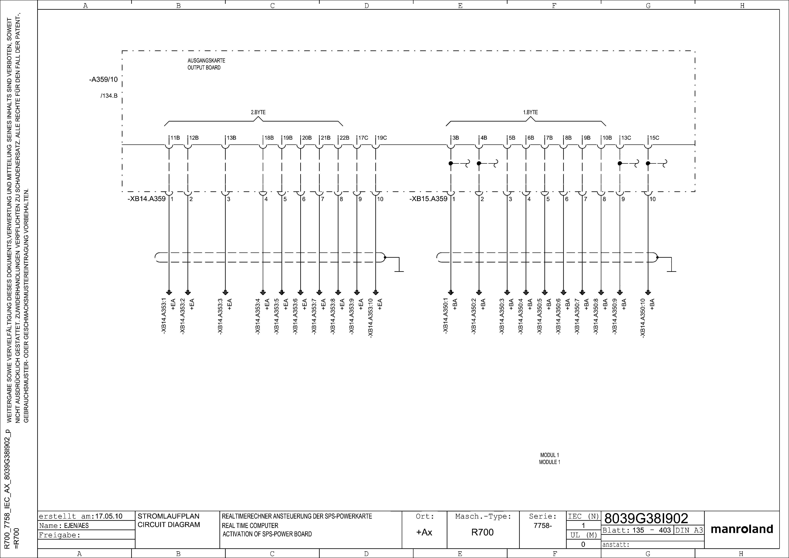

# +Ax — Sheet 135 of 403 — REALTIMERECHNER ANSTEUERUNG DER SPS POWERKARTE

**REAL TIME COMPUTER**

> Part of the manroland **R700** printing press IEC/UL circuit diagrams.
> Drawing class: **Stromlaufplan / Circuit diagram** (DIN A3).
> Document `+Ax` covers the **Central control console** machine section.

## At a glance

| Field | Value |
|---|---|
| Document | `+Ax`  (8039G38I902) |
| Sheet | **135** of 403 |
| Section (DE) | REALTIMERECHNER ANSTEUERUNG DER SPS POWERKARTE |
| Section (EN) | REAL TIME COMPUTER |
| Section type | CIRCUIT — Circuit diagram |
| Machine type | `R700` |
| Series | `7758` |
| Created | 17.05.10 |
| Replaces | — |
| Columns used | A, B, C, D, E, F, G |
| Path numbers | — |
| Labels on sheet | 90 |
| Cross-refs out | 1 |
| Cross-refs in | 21 |

**Previous:** [+Ax sheet 134](SHEET_0134.md) · **Next:** [+Ax sheet 136](SHEET_0136.md) · **Document TOC:** [_TOC.md](_TOC.md)  (+Ax) · **Master TOC:** [all sheets](../_MASTER_TOC.md)

## Sheet image (300 DPI, exact vector render)



_Rendered directly from the PDF vector layer at 300 DPI (1-bit), no OCR and no resampling. Use it to confirm anything ambiguous in the text below._

## Cross-references on this sheet

Each entry is a wire leaving this sheet. The printed token is `/sheet.column`; the link resolves to that sheet inside the same document.

| Ref | Target sheet | Col | Path | Destination on target | Target section | From col |
|---|---|---|---|---|---|---|
| `/134.B` | [+Ax sheet 134](SHEET_0134.md) | B | — | — | REALTIMERECHNER ANSTEUERUNG DER SPS POWERKARTE | A |

### Incoming references (sheets that point here)

Every other sheet that sends a wire to this one. `Back-ref` is the token printed on *that* sheet; `Path` is its line number.

| From sheet | Cols | Back-ref | Path | Refs | What continues there |
|---|---|---|---|---|---|
| [+Ax#134](SHEET_0134.md) | A | `/134.A` | — | 1 | — |
| [+Ax#251](SHEET_0251.md) | E | `/251.E` | — | 10 | — |
| [+Ax#252](SHEET_0252.md) | H | `/252.H` | — | 10 | — |


## Devices on this sheet

| Tag | Class | Class meaning (IEC) | Col | Sub | Terminal | Sign |
|---|---|---|---|---|---|---|
| `A359/10` | A | Baugruppe / assembly, module, PC board | A | 10 | — | — |
| `XB14.A359` | — | cross-device reference | B | — | — | — |
| `XB15.A359` | — | cross-device reference | E | — | — | — |
| `XB14.A353:1` | — | cross-device reference | B | — | 1 | — |
| `XB14.A353:2` | — | cross-device reference | B | — | 2 | — |
| `XB14.A353:5` | — | cross-device reference | C | — | 5 | — |
| `XB14.A353:6` | — | cross-device reference | C | — | 6 | — |
| `XB14.A353:7` | — | cross-device reference | C | — | 7 | — |
| `XB14.A353:8` | — | cross-device reference | D | — | 8 | — |
| `XB14.A353:9` | — | cross-device reference | D | — | 9 | — |
| `XB14.A353:10` | — | cross-device reference | D | — | 10 | — |
| `XB14.A353:3` | — | cross-device reference | B | — | 3 | — |
| `XB14.A353:4` | — | cross-device reference | C | — | 4 | — |
| `XB14.A350:1` | — | cross-device reference | E | — | 1 | — |
| `XB14.A350:2` | — | cross-device reference | E | — | 2 | — |
| `XB14.A350:3` | — | cross-device reference | E | — | 3 | — |
| `XB14.A350:4` | — | cross-device reference | F | — | 4 | — |
| `XB14.A350:5` | — | cross-device reference | F | — | 5 | — |
| `XB14.A350:6` | — | cross-device reference | F | — | 6 | — |
| `XB14.A350:7` | — | cross-device reference | F | — | 7 | — |
| `XB14.A350:8` | — | cross-device reference | F | — | 8 | — |
| `XB14.A350:9` | — | cross-device reference | G | — | 9 | — |
| `XB14.A350:10` | — | cross-device reference | G | — | 10 | — |

## Potentials / nets

_No named potentials on this sheet._

## Wire-end annotations (grouped as printed)

A wire that continues elsewhere is annotated with a small cluster: the destination description, the path/line number `#NN`, and the `/sheet.column` cross reference. Each row below is one such cluster exactly as it is grouped on the drawing.

| Col | Y | Path | Cross-ref | Text on the wire |
|---|---|---|---|---|
| B | 88.5 | — | — | `OUTPUT BOARD AUSGANGSKARTE` |
| A | 115.1 | — | — | `A359/10` |
| A | 140.6 | — | `/134.B` | — |
| D | 166.4 | — | — | `2.BYTE 1.BYTE` |
| E | 204.4 | — | — | `11B 12B 13B 18B 19B 20B 21B 22B 17C 19C 3B 4B 5B 6B 7B 8B 9B 10B 13C 15C` |
| C | 295.1 | — | — | `XB14.A359 1 2 3 4 5 6 7 8 9 10` |
| F | 295.1 | — | — | `XB15.A359 1 2 3 4 5 6 7 8 9 10` |
| B | 449.0 | — | — | `XB14.A353:1` |
| E | 449.0 | — | — | `XB14.A350:1` |
| B | 450.1 | — | — | `XB14.A353:2` |
| E | 450.1 | — | — | `XB14.A350:2` |
| B | 450.4 | — | — | `XB14.A353:3` |
| C | 450.4 | — | — | `XB14.A353:4` |
| C | 450.4 | — | — | `XB14.A353:5` |
| C | 450.4 | — | — | `XB14.A353:6` |
| C | 450.4 | — | — | `XB14.A353:7` |
| D | 450.4 | — | — | `XB14.A353:8` |
| D | 450.4 | — | — | `XB14.A353:9` |
| D | 450.4 | — | — | `XB14.A353:10` |
| E | 450.4 | — | — | `XB14.A350:3` |
| F | 450.4 | — | — | `XB14.A350:4` |
| F | 450.4 | — | — | `XB14.A350:5` |
| F | 450.4 | — | — | `XB14.A350:6` |
| F | 450.4 | — | — | `XB14.A350:7` |
| F | 450.4 | — | — | `XB14.A350:8` |
| G | 450.4 | — | — | `XB14.A350:9` |
| G | 450.4 | — | — | `XB14.A350:10` |
| B | 450.7 | — | — | `+EA` |
| B | 450.7 | — | — | `+EA` |
| C | 450.7 | — | — | `+EA` |
| C | 450.7 | — | — | `+EA` |
| C | 450.7 | — | — | `+EA` |
| C | 450.7 | — | — | `+EA` |
| D | 450.7 | — | — | `+EA` |
| D | 450.7 | — | — | `+EA` |
| D | 450.7 | — | — | `+EA` |
| D | 450.7 | — | — | `+EA` |
| E | 450.7 | — | — | `+BA` |
| E | 450.7 | — | — | `+BA` |
| F | 450.7 | — | — | `+BA` |
| F | 450.7 | — | — | `+BA` |
| F | 450.7 | — | — | `+BA` |
| F | 450.7 | — | — | `+BA` |
| F | 450.7 | — | — | `+BA` |
| G | 450.7 | — | — | `+BA` |
| G | 450.7 | — | — | `+BA` |
| G | 450.7 | — | — | `+BA` |
| F | 683.8 | — | — | `MODULE 1 MODUL 1` |


## Reconstructed tables

This sheet carries tabular content (pin map / terminal assignment / index). The grid below was rebuilt from the drawing's own rule lines, so each row is exactly one physical row of the table.

### Table 1 — 1 data rows × 9 columns (at x=255.1, y=182.8)

| 11B | 12B | 13B | 18B | 19B | 20B | 21B | 22B | 17C |
|---|---|---|---|---|---|---|---|---|
| `1` | `2` | `3` | `4` | `5` | `6` | `7` | `8` | `9` |


## Notes and free text on this sheet

| Text | Col | Y (pt) |
|---|---|---|
| `AUSGANGSKARTE` | B | 88.5 |
| `OUTPUT BOARD` | B | 99.14 |
| `+EA` | B | 450.71 |
| `+EA` | C | 450.71 |
| `+EA` | D | 450.71 |
| `+BA` | E | 450.71 |
| `+BA` | F | 450.71 |
| `+BA` | G | 450.71 |
| `18B` | C | 204.38 |
| `19B` | C | 204.38 |
| `20B` | C | 204.38 |
| `21B` | D | 204.38 |
| `22B` | D | 204.38 |
| `17C` | D | 204.36 |
| `19C` | D | 204.36 |
| `13B` | C | 204.38 |
| `11B` | B | 204.38 |
| `12B` | B | 204.38 |
| `3B` | E | 204.39 |
| `4B` | E | 204.39 |
| `5B` | F | 204.39 |
| `6B` | F | 204.39 |
| `7B` | F | 204.39 |
| `8B` | F | 204.39 |
| `9B` | F | 204.39 |
| `10B` | G | 204.38 |
| `13C` | G | 204.36 |
| `15C` | G | 204.36 |
| `2.BYTE` | C | 166.4 |
| `1.BYTE` | F | 166.38 |
| `MODUL 1` | F | 683.76 |
| `MODULE 1` | F | 694.39 |

## Complete label inventory (exact text from the drawing)

Every text object inside the drawing area of this sheet, in DIN reading order (column A→H, then top→bottom). This is the authoritative list: if a string is not here it is not printed on this sheet.

| Col | Y | X | Dir | Type | Text |
|---|---|---|---|---|---|
| A | 115.1 | 134.6 | → | device tag | `A359/10` |
| A | 140.6 | 151.9 | → | cross-reference | `/134.B` |
| B | 88.5 | 283.5 | → | text | `AUSGANGSKARTE` |
| B | 99.1 | 283.2 | → | text | `OUTPUT BOARD` |
| B | 204.4 | 257.1 | → | text | `11B` |
| B | 204.4 | 285.4 | → | text | `12B` |
| B | 295.1 | 192.8 | → | device ref | `XB14.A359` |
| B | 296.5 | 257.1 | → | number | `1` |
| B | 296.5 | 286.0 | → | number | `2` |
| B | 449.0 | 243.3 | ↕ | device ref | `XB14.A353:1` |
| B | 450.1 | 271.7 | ↕ | device ref | `XB14.A353:2` |
| B | 450.4 | 328.4 | ↕ | device ref | `XB14.A353:3` |
| B | 450.7 | 257.5 | ↕ | text | `+EA` |
| B | 450.7 | 285.8 | ↕ | text | `+EA` |
| C | 166.4 | 378.9 | → | text | `2.BYTE` |
| C | 204.4 | 342.1 | → | text | `13B` |
| C | 204.4 | 398.8 | → | text | `18B` |
| C | 204.4 | 427.2 | → | text | `19B` |
| C | 204.4 | 456.1 | → | text | `20B` |
| C | 296.5 | 342.7 | → | number | `3` |
| C | 296.5 | 399.4 | → | number | `4` |
| C | 296.5 | 427.7 | → | number | `5` |
| C | 296.5 | 456.1 | → | number | `6` |
| C | 450.4 | 385.1 | ↕ | device ref | `XB14.A353:4` |
| C | 450.4 | 413.4 | ↕ | device ref | `XB14.A353:5` |
| C | 450.4 | 441.8 | ↕ | device ref | `XB14.A353:6` |
| C | 450.4 | 470.1 | ↕ | device ref | `XB14.A353:7` |
| C | 450.7 | 342.5 | ↕ | text | `+EA` |
| C | 450.7 | 399.2 | ↕ | text | `+EA` |
| C | 450.7 | 427.6 | ↕ | text | `+EA` |
| C | 450.7 | 455.9 | ↕ | text | `+EA` |
| D | 204.4 | 484.4 | → | text | `21B` |
| D | 204.4 | 512.8 | → | text | `22B` |
| D | 204.4 | 540.6 | → | text | `17C` |
| D | 204.4 | 568.9 | → | text | `19C` |
| D | 296.5 | 484.4 | → | number | `7` |
| D | 296.5 | 512.8 | → | number | `8` |
| D | 296.5 | 541.1 | → | number | `9` |
| D | 296.5 | 568.9 | → | number | `10` |
| D | 450.4 | 498.5 | ↕ | device ref | `XB14.A353:8` |
| D | 450.4 | 526.8 | ↕ | device ref | `XB14.A353:9` |
| D | 450.4 | 555.2 | ↕ | device ref | `XB14.A353:10` |
| D | 450.7 | 484.3 | ↕ | text | `+EA` |
| D | 450.7 | 512.6 | ↕ | text | `+EA` |
| D | 450.7 | 541.0 | ↕ | text | `+EA` |
| D | 450.7 | 569.3 | ↕ | text | `+EA` |
| E | 204.4 | 682.9 | → | text | `3B` |
| E | 204.4 | 725.4 | → | text | `4B` |
| E | 295.1 | 618.0 | → | device ref | `XB15.A359` |
| E | 296.5 | 682.3 | → | number | `1` |
| E | 296.5 | 725.4 | → | number | `2` |
| E | 449.0 | 668.5 | ↕ | device ref | `XB14.A350:1` |
| E | 450.1 | 711.1 | ↕ | device ref | `XB14.A350:2` |
| E | 450.4 | 753.6 | ↕ | device ref | `XB14.A350:3` |
| E | 450.7 | 682.7 | ↕ | text | `+BA` |
| E | 450.7 | 725.2 | ↕ | text | `+BA` |
| F | 166.4 | 789.6 | → | text | `1.BYTE` |
| F | 204.4 | 767.9 | → | text | `5B` |
| F | 204.4 | 796.3 | → | text | `6B` |
| F | 204.4 | 824.3 | → | text | `7B` |
| F | 204.4 | 852.9 | → | text | `8B` |
| F | 204.4 | 881.3 | → | text | `9B` |
| F | 296.5 | 767.9 | → | number | `3` |
| F | 296.5 | 796.3 | → | number | `4` |
| F | 296.5 | 824.6 | → | number | `5` |
| F | 296.5 | 852.9 | → | number | `6` |
| F | 296.5 | 881.3 | → | number | `7` |
| F | 450.4 | 781.9 | ↕ | device ref | `XB14.A350:4` |
| F | 450.4 | 810.3 | ↕ | device ref | `XB14.A350:5` |
| F | 450.4 | 838.6 | ↕ | device ref | `XB14.A350:6` |
| F | 450.4 | 867.0 | ↕ | device ref | `XB14.A350:7` |
| F | 450.4 | 895.3 | ↕ | device ref | `XB14.A350:8` |
| F | 450.7 | 767.7 | ↕ | text | `+BA` |
| F | 450.7 | 796.1 | ↕ | text | `+BA` |
| F | 450.7 | 824.4 | ↕ | text | `+BA` |
| F | 450.7 | 852.8 | ↕ | text | `+BA` |
| F | 450.7 | 881.1 | ↕ | text | `+BA` |
| F | 683.8 | 815.7 | → | text | `MODUL 1` |
| F | 694.4 | 813.6 | → | text | `MODULE 1` |
| G | 204.4 | 909.1 | → | text | `10B` |
| G | 204.4 | 937.4 | → | text | `13C` |
| G | 204.4 | 979.9 | → | text | `15C` |
| G | 296.5 | 909.6 | → | number | `8` |
| G | 296.5 | 938.0 | → | number | `9` |
| G | 296.5 | 979.9 | → | number | `10` |
| G | 450.4 | 923.7 | ↕ | device ref | `XB14.A350:9` |
| G | 450.4 | 966.2 | ↕ | device ref | `XB14.A350:10` |
| G | 450.7 | 909.5 | ↕ | text | `+BA` |
| G | 450.7 | 937.8 | ↕ | text | `+BA` |
| G | 450.7 | 980.3 | ↕ | text | `+BA` |

## Reading-order text block

The same content as a plain block, grouped by DIN column — convenient to paste or to match against a visual description.

```text
=== Column A ===
 115.1  134.6  devtag       A359/10
 140.6  151.9  xref         /134.B
=== Column B ===
  88.5  283.5  text         AUSGANGSKARTE
  99.1  283.2  text         OUTPUT BOARD
 204.4  257.1  text         11B
 204.4  285.4  text         12B
 295.1  192.8  devref       XB14.A359
 296.5  257.1  numeric      1
 296.5  286.0  numeric      2
 449.0  243.3  devref       XB14.A353:1
 450.1  271.7  devref       XB14.A353:2
 450.4  328.4  devref       XB14.A353:3
 450.7  257.5  text         +EA
 450.7  285.8  text         +EA
=== Column C ===
 166.4  378.9  text         2.BYTE
 204.4  342.1  text         13B
 204.4  398.8  text         18B
 204.4  427.2  text         19B
 204.4  456.1  text         20B
 296.5  342.7  numeric      3
 296.5  399.4  numeric      4
 296.5  427.7  numeric      5
 296.5  456.1  numeric      6
 450.4  385.1  devref       XB14.A353:4
 450.4  413.4  devref       XB14.A353:5
 450.4  441.8  devref       XB14.A353:6
 450.4  470.1  devref       XB14.A353:7
 450.7  342.5  text         +EA
 450.7  399.2  text         +EA
 450.7  427.6  text         +EA
 450.7  455.9  text         +EA
=== Column D ===
 204.4  484.4  text         21B
 204.4  512.8  text         22B
 204.4  540.6  text         17C
 204.4  568.9  text         19C
 296.5  484.4  numeric      7
 296.5  512.8  numeric      8
 296.5  541.1  numeric      9
 296.5  568.9  numeric      10
 450.4  498.5  devref       XB14.A353:8
 450.4  526.8  devref       XB14.A353:9
 450.4  555.2  devref       XB14.A353:10
 450.7  484.3  text         +EA
 450.7  512.6  text         +EA
 450.7  541.0  text         +EA
 450.7  569.3  text         +EA
=== Column E ===
 204.4  682.9  text         3B
 204.4  725.4  text         4B
 295.1  618.0  devref       XB15.A359
 296.5  682.3  numeric      1
 296.5  725.4  numeric      2
 449.0  668.5  devref       XB14.A350:1
 450.1  711.1  devref       XB14.A350:2
 450.4  753.6  devref       XB14.A350:3
 450.7  682.7  text         +BA
 450.7  725.2  text         +BA
=== Column F ===
 166.4  789.6  text         1.BYTE
 204.4  767.9  text         5B
 204.4  796.3  text         6B
 204.4  824.3  text         7B
 204.4  852.9  text         8B
 204.4  881.3  text         9B
 296.5  767.9  numeric      3
 296.5  796.3  numeric      4
 296.5  824.6  numeric      5
 296.5  852.9  numeric      6
 296.5  881.3  numeric      7
 450.4  781.9  devref       XB14.A350:4
 450.4  810.3  devref       XB14.A350:5
 450.4  838.6  devref       XB14.A350:6
 450.4  867.0  devref       XB14.A350:7
 450.4  895.3  devref       XB14.A350:8
 450.7  767.7  text         +BA
 450.7  796.1  text         +BA
 450.7  824.4  text         +BA
 450.7  852.8  text         +BA
 450.7  881.1  text         +BA
 683.8  815.7  text         MODUL 1
 694.4  813.6  text         MODULE 1
=== Column G ===
 204.4  909.1  text         10B
 204.4  937.4  text         13C
 204.4  979.9  text         15C
 296.5  909.6  numeric      8
 296.5  938.0  numeric      9
 296.5  979.9  numeric      10
 450.4  923.7  devref       XB14.A350:9
 450.4  966.2  devref       XB14.A350:10
 450.7  909.5  text         +BA
 450.7  937.8  text         +BA
 450.7  980.3  text         +BA
```

---
_Generated from the PDF vector text layer; no OCR. Source: `R700_7758_IEC_AX_8039G38I902_p`, sheet 135._
