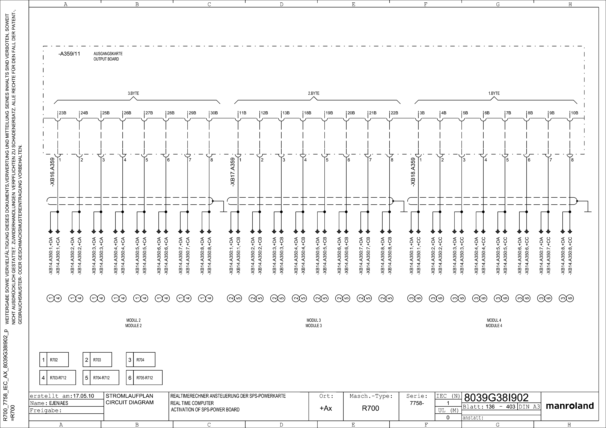

# +Ax — Sheet 136 of 403 — REALTIMERECHNER ANSTEUERUNG DER SPS POWERKARTE

**REAL TIME COMPUTER**

> Part of the manroland **R700** printing press IEC/UL circuit diagrams.
> Drawing class: **Stromlaufplan / Circuit diagram** (DIN A3).
> Document `+Ax` covers the **Central control console** machine section.

## At a glance

| Field | Value |
|---|---|
| Document | `+Ax`  (8039G38I902) |
| Sheet | **136** of 403 |
| Section (DE) | REALTIMERECHNER ANSTEUERUNG DER SPS POWERKARTE |
| Section (EN) | REAL TIME COMPUTER |
| Section type | CIRCUIT — Circuit diagram |
| Machine type | `R700` |
| Series | `7758` |
| Created | 17.05.10 |
| Replaces | — |
| Columns used | A, B, C, D, E, F, G, H |
| Path numbers | — |
| Labels on sheet | 171 |
| Cross-refs out | 0 |
| Cross-refs in | 24 |

**Previous:** [+Ax sheet 135](SHEET_0135.md) · **Next:** [+Ax sheet 137](SHEET_0137.md) · **Document TOC:** [_TOC.md](_TOC.md)  (+Ax) · **Master TOC:** [all sheets](../_MASTER_TOC.md)

## Sheet image (300 DPI, exact vector render)



_Rendered directly from the PDF vector layer at 300 DPI (1-bit), no OCR and no resampling. Use it to confirm anything ambiguous in the text below._

## Cross-references on this sheet

Each entry is a wire leaving this sheet. The printed token is `/sheet.column`; the link resolves to that sheet inside the same document.

_No outgoing cross-references on this sheet._

### Incoming references (sheets that point here)

Every other sheet that sends a wire to this one. `Back-ref` is the token printed on *that* sheet; `Path` is its line number.

| From sheet | Cols | Back-ref | Path | Refs | What continues there |
|---|---|---|---|---|---|
| [+Ax#254](SHEET_0254.md) | G | `/254.G` | — | 8 | — |
| [+Ax#255](SHEET_0255.md) | C | `/255.C` | — | 8 | — |
| [+Ax#257](SHEET_0257.md) | B | `/257.B` | — | 8 | — |


## Devices on this sheet

| Tag | Class | Class meaning (IEC) | Col | Sub | Terminal | Sign |
|---|---|---|---|---|---|---|
| `A359/11` | A | Baugruppe / assembly, module, PC board | A | 11 | — | — |
| `R702` | R | Widerstand / resistor | A | — | — | — |
| `R703` | R | Widerstand / resistor | A | — | — | — |
| `R704` | R | Widerstand / resistor | B | — | — | — |
| `XB16.A359` | — | cross-device reference | A | — | — | — |
| `XB17.A359` | — | cross-device reference | C | — | — | — |
| `XB18.A359` | — | cross-device reference | F | — | — | — |

## Potentials / nets

_No named potentials on this sheet._

## Wire-end annotations (grouped as printed)

A wire that continues elsewhere is annotated with a small cluster: the destination description, the path/line number `#NN`, and the `/sheet.column` cross reference. Each row below is one such cluster exactly as it is grouped on the drawing.

| Col | Y | Path | Cross-ref | Text on the wire |
|---|---|---|---|---|
| A | 100.9 | — | — | `A359/11 OUTPUT BOARD AUSGANGSKARTE` |
| D | 180.6 | — | — | `3.BYTE 2.BYTE 1.BYTE` |
| E | 218.6 | — | — | `23B 24B 25B 26B 27B 28B 29B 30B 11B 12B 13B 18B 19B 20B 21B 22B 3B 4B 5B 6B 7B 8B 9B 10B` |
| A | 309.8 | — | — | `XB16.A359` |
| C | 309.8 | — | — | `XB17.A359` |
| F | 309.8 | — | — | `XB18.A359` |
| A | 310.7 | — | — | `1 3` |
| B | 310.7 | — | — | `2 4 5 6 7 8 1 2` |
| E | 310.7 | — | — | `3 4 5 6 7 8 1 2` |
| G | 310.7 | — | — | `3 4 5 6 7 8` |
| C | 466.0 | — | — | `XB14.A350:1,+CB` |
| D | 466.0 | — | — | `XB14.A350:2,+CB` |
| D | 466.0 | — | — | `XB14.A350:3,+CB` |
| D | 466.0 | — | — | `XB14.A350:4,+CB` |
| E | 466.0 | — | — | `XB14.A350:5,+CB` |
| E | 466.0 | — | — | `XB14.A350:6,+CB` |
| E | 466.0 | — | — | `XB14.A350:7,+CB` |
| F | 466.0 | — | — | `XB14.A350:8,+CB` |
| F | 466.0 | — | — | `XB14.A350:1,+CC` |
| F | 466.0 | — | — | `XB14.A350:2,+CC` |
| G | 466.0 | — | — | `XB14.A350:3,+CC` |
| G | 466.0 | — | — | `XB14.A350:4,+CC` |
| G | 466.0 | — | — | `XB14.A350:5,+CC` |
| G | 466.0 | — | — | `XB14.A350:6,+CC` |
| H | 466.0 | — | — | `XB14.A350:7,+CC` |
| H | 466.0 | — | — | `XB14.A350:8,+CC` |
| A | 466.3 | — | — | `XB14.A350:1,+DA` |
| A | 466.3 | — | — | `XB14.A350:1,+CA` |
| A | 466.3 | — | — | `XB14.A350:2,+DA` |
| A | 466.3 | — | — | `XB14.A350:2,+CA` |
| A | 466.3 | — | — | `XB14.A350:3,+DA` |
| B | 466.3 | — | — | `XB14.A350:3,+CA` |
| B | 466.3 | — | — | `XB14.A350:4,+DA` |
| B | 466.3 | — | — | `XB14.A350:4,+CA` |
| B | 466.3 | — | — | `XB14.A350:5,+DA` |
| B | 466.3 | — | — | `XB14.A350:5,+CA` |
| B | 466.3 | — | — | `XB14.A350:6,+DA` |
| B | 466.3 | — | — | `XB14.A350:6,+CA` |
| C | 466.3 | — | — | `XB14.A350:7,+DA` |
| C | 466.3 | — | — | `XB14.A350:7,+CA` |
| C | 466.3 | — | — | `XB14.A350:8,+DA` |
| C | 466.3 | — | — | `XB14.A350:8,+CA` |
| C | 466.3 | — | — | `XB14.A350:1,+DA` |
| D | 466.3 | — | — | `XB14.A350:2,+DA` |
| D | 466.3 | — | — | `XB14.A350:3,+DA` |
| D | 466.3 | — | — | `XB14.A350:4,+DA` |
| E | 466.3 | — | — | `XB14.A350:5,+DA` |
| E | 466.3 | — | — | `XB14.A350:6,+DA` |
| E | 466.3 | — | — | `XB14.A350:7,+DA` |
| E | 466.3 | — | — | `XB14.A350:8,+DA` |
| F | 466.3 | — | — | `XB14.A350:1,+DA` |
| F | 466.3 | — | — | `XB14.A350:2,+DA` |
| F | 466.3 | — | — | `XB14.A350:3,+DA` |
| G | 466.3 | — | — | `XB14.A350:4,+DA` |
| G | 466.3 | — | — | `XB14.A350:5,+DA` |
| G | 466.3 | — | — | `XB14.A350:6,+DA` |
| H | 466.3 | — | — | `XB14.A350:7,+DA` |
| H | 466.3 | — | — | `XB14.A350:8,+DA` |
| A | 583.8 | — | — | `1` |
| A | 583.8 | — | — | `1 4` |
| A | 583.8 | — | — | `1` |
| B | 583.8 | — | — | `1` |
| B | 583.8 | — | — | `1` |
| B | 583.8 | — | — | `1` |
| C | 583.8 | — | — | `1` |
| C | 583.8 | — | — | `1` |
| A | 584.4 | — | — | `4` |
| B | 584.4 | — | — | `4` |
| B | 584.4 | — | — | `4` |
| B | 584.4 | — | — | `4` |
| B | 584.4 | — | — | `4` |
| C | 584.4 | — | — | `4` |
| C | 584.4 | — | — | `4` |
| C | 584.4 | — | — | `2` |
| D | 584.4 | — | — | `2` |
| D | 584.4 | — | — | `2` |
| D | 584.4 | — | — | `2` |
| E | 584.4 | — | — | `2` |
| E | 584.4 | — | — | `2` |
| E | 584.4 | — | — | `2` |
| E | 584.4 | — | — | `2` |
| F | 584.4 | — | — | `6` |
| F | 584.4 | — | — | `6` |
| G | 584.4 | — | — | `6` |
| G | 584.4 | — | — | `6` |
| G | 584.4 | — | — | `6` |
| G | 584.4 | — | — | `6` |
| H | 584.4 | — | — | `6` |
| H | 584.4 | — | — | `6` |
| C | 584.5 | — | — | `5` |
| D | 584.5 | — | — | `5` |
| D | 584.5 | — | — | `5` |
| D | 584.5 | — | — | `5` |
| E | 584.5 | — | — | `5` |
| E | 584.5 | — | — | `5` |
| E | 584.5 | — | — | `5` |
| F | 584.5 | — | — | `5` |
| F | 584.5 | — | — | `3` |
| F | 584.5 | — | — | `3` |
| F | 584.5 | — | — | `3` |
| G | 584.5 | — | — | `3` |
| G | 584.5 | — | — | `3` |
| G | 584.5 | — | — | `3` |
| H | 584.5 | — | — | `3` |
| H | 584.5 | — | — | `3` |
| D | 627.1 | — | — | `MODULE 2 MODUL 2 MODULE 3 MODUL 3 MODULE 4 MODUL 4` |
| A | 703.3 | — | — | `1` |
| A | 703.3 | — | — | `2` |
| B | 703.3 | — | — | `3` |
| A | 705.0 | — | — | `R702` |
| A | 705.0 | — | — | `R703` |
| B | 705.0 | — | — | `R704` |
| A | 738.7 | — | — | `4` |
| A | 738.7 | — | — | `5` |
| B | 738.7 | — | — | `6` |
| A | 740.5 | — | — | `R703 R712` |
| B | 740.5 | — | — | `R704 R712` |
| B | 740.5 | — | — | `R705 R712` |


## Reconstructed tables

This sheet carries tabular content (pin map / terminal assignment / index). The grid below was rebuilt from the drawing's own rule lines, so each row is exactly one physical row of the table.

### Table 1 — 0 data rows × 2 columns (at x=99.2, y=197.0) — **23B**

_none_


### Table 2 — 2 data rows × 1 columns (at x=155.9, y=197.0)

| C1 |
|---|
| `24B` |
| `2` |


### Table 3 — 2 data rows × 1 columns (at x=198.4, y=197.0)

| C1 |
|---|
| `25B` |
| `3` |


### Table 4 — 2 data rows × 1 columns (at x=240.9, y=197.0)

| C1 |
|---|
| `26B` |
| `4` |


### Table 5 — 2 data rows × 1 columns (at x=283.5, y=197.0)

| C1 |
|---|
| `27B` |
| `5` |


### Table 6 — 2 data rows × 1 columns (at x=326.0, y=197.0)

| C1 |
|---|
| `28B` |
| `6` |


### Table 7 — 2 data rows × 1 columns (at x=368.5, y=197.0)

| C1 |
|---|
| `29B` |
| `7` |


### Table 8 — 1 data rows × 3 columns (at x=411.0, y=197.0)

| 30B |  | 11B |
|---|---|---|
| `8` | `XB17.A359` | `1` |


### Table 9 — 2 data rows × 1 columns (at x=510.2, y=197.0)

| C1 |
|---|
| `12B` |
| `2` |


### Table 10 — 2 data rows × 1 columns (at x=552.8, y=197.0)

| C1 |
|---|
| `13B` |
| `3` |


### Table 11 — 2 data rows × 1 columns (at x=595.3, y=197.0)

| C1 |
|---|
| `18B` |
| `4` |


### Table 12 — 2 data rows × 1 columns (at x=637.8, y=197.0)

| C1 |
|---|
| `19B` |
| `5` |


### Table 13 — 2 data rows × 1 columns (at x=680.3, y=197.0)

| C1 |
|---|
| `20B` |
| `6` |


### Table 14 — 2 data rows × 1 columns (at x=722.8, y=197.0)

| C1 |
|---|
| `21B` |
| `7` |


### Table 15 — 1 data rows × 3 columns (at x=765.4, y=197.0)

| 22B |  | 3B |
|---|---|---|
| `8` | `XB18.A359` | `1` |


### Table 16 — 2 data rows × 1 columns (at x=864.6, y=197.0)

| C1 |
|---|
| `4B` |
| `2` |


### Table 17 — 2 data rows × 1 columns (at x=907.1, y=197.0)

| C1 |
|---|
| `5B` |
| `3` |


### Table 18 — 2 data rows × 1 columns (at x=949.6, y=197.0)

| C1 |
|---|
| `6B` |
| `4` |


### Table 19 — 2 data rows × 1 columns (at x=992.1, y=197.0)

| C1 |
|---|
| `7B` |
| `5` |


### Table 20 — 2 data rows × 1 columns (at x=1034.6, y=197.0)

| C1 |
|---|
| `8B` |
| `6` |


### Table 21 — 2 data rows × 1 columns (at x=1077.2, y=197.0)

| C1 |
|---|
| `9B` |
| `7` |


## Notes and free text on this sheet

| Text | Col | Y (pt) |
|---|---|---|
| `AUSGANGSKARTE` | B | 102.67 |
| `OUTPUT BOARD` | B | 113.31 |
| `XB14.A350:1,+DA` | A | 466.3 |
| `XB14.A350:1,+CA` | A | 466.3 |
| `XB14.A350:2,+DA` | A | 466.3 |
| `XB14.A350:2,+CA` | A | 466.3 |
| `XB14.A350:3,+DA` | A | 466.3 |
| `XB14.A350:3,+CA` | B | 466.3 |
| `XB14.A350:4,+DA` | B | 466.3 |
| `XB14.A350:4,+CA` | B | 466.3 |
| `XB14.A350:5,+DA` | B | 466.3 |
| `XB14.A350:5,+CA` | B | 466.3 |
| `XB14.A350:6,+DA` | B | 466.3 |
| `XB14.A350:6,+CA` | B | 466.3 |
| `XB14.A350:7,+DA` | C | 466.3 |
| `XB14.A350:7,+CA` | C | 466.3 |
| `XB14.A350:8,+DA` | C | 466.3 |
| `XB14.A350:8,+CA` | C | 466.3 |
| `XB14.A350:1,+DA` | C | 466.3 |
| `XB14.A350:1,+CB` | C | 466.02 |
| `XB14.A350:2,+DA` | D | 466.3 |
| `XB14.A350:2,+CB` | D | 466.02 |
| `XB14.A350:3,+DA` | D | 466.3 |
| `XB14.A350:3,+CB` | D | 466.02 |
| `XB14.A350:4,+DA` | D | 466.3 |
| `XB14.A350:4,+CB` | D | 466.02 |
| `XB14.A350:5,+DA` | E | 466.3 |
| `XB14.A350:5,+CB` | E | 466.02 |
| `XB14.A350:6,+DA` | E | 466.3 |
| `XB14.A350:6,+CB` | E | 466.02 |
| `XB14.A350:7,+DA` | E | 466.3 |
| `XB14.A350:7,+CB` | E | 466.02 |
| `XB14.A350:8,+DA` | E | 466.3 |
| `XB14.A350:8,+CB` | F | 466.02 |
| `XB14.A350:1,+DA` | F | 466.3 |
| `XB14.A350:1,+CC` | F | 466.01 |
| `XB14.A350:2,+DA` | F | 466.3 |
| `XB14.A350:2,+CC` | F | 466.01 |
| `XB14.A350:3,+DA` | F | 466.3 |
| `XB14.A350:3,+CC` | G | 466.01 |
| `XB14.A350:4,+DA` | G | 466.3 |
| `XB14.A350:4,+CC` | G | 466.01 |
| `XB14.A350:5,+DA` | G | 466.3 |
| `XB14.A350:5,+CC` | G | 466.01 |
| `XB14.A350:6,+DA` | G | 466.3 |
| `XB14.A350:6,+CC` | G | 466.01 |
| `XB14.A350:7,+DA` | H | 466.3 |
| `XB14.A350:7,+CC` | H | 466.01 |
| `XB14.A350:8,+DA` | H | 466.3 |
| `XB14.A350:8,+CC` | H | 466.01 |
| `25B` | B | 218.56 |
| `23B` | A | 218.56 |
| `24B` | A | 218.56 |
| `26B` | B | 218.56 |
| `27B` | B | 218.56 |
| `28B` | B | 218.56 |
| `29B` | C | 218.56 |
| `30B` | C | 218.56 |
| `12B` | D | 218.56 |
| `11B` | C | 218.56 |
| `13B` | D | 218.56 |
| `18B` | D | 218.56 |
| `19B` | E | 218.56 |
| `20B` | E | 218.56 |
| `21B` | E | 218.56 |
| `22B` | F | 218.56 |
| `4B` | F | 218.56 |
| `3B` | F | 218.56 |
| `5B` | G | 218.56 |
| `6B` | G | 218.56 |
| `7B` | G | 218.56 |
| `8B` | G | 218.56 |
| `9B` | H | 218.56 |
| `10B` | H | 218.56 |
| `3.BYTE` | B | 180.58 |
| `1.BYTE` | G | 180.55 |
| `2.BYTE` | D | 180.58 |
| `MODUL 4` | G | 627.11 |
| `MODULE 4` | G | 637.73 |
| `MODUL 3` | D | 627.11 |
| `MODULE 3` | D | 637.73 |
| `MODUL 2` | B | 627.1 |
| `MODULE 2` | B | 637.73 |
| `R703 R712` | A | 740.49 |
| `R704 R712` | B | 740.49 |
| `R705 R712` | B | 740.49 |

## Complete label inventory (exact text from the drawing)

Every text object inside the drawing area of this sheet, in DIN reading order (column A→H, then top→bottom). This is the authoritative list: if a string is not here it is not printed on this sheet.

| Col | Y | X | Dir | Type | Text |
|---|---|---|---|---|---|
| A | 100.9 | 114.8 | → | device tag | `A359/11` |
| A | 218.6 | 115.9 | → | text | `23B` |
| A | 218.6 | 158.5 | → | text | `24B` |
| A | 309.8 | 98.1 | ↕ | device ref | `XB16.A359` |
| A | 310.7 | 115.4 | → | number | `1` |
| A | 310.7 | 158.5 | → | number | `2` |
| A | 466.3 | 95.9 | ↕ | text | `XB14.A350:1,+DA` |
| A | 466.3 | 110.1 | ↕ | text | `XB14.A350:1,+CA` |
| A | 466.3 | 138.5 | ↕ | text | `XB14.A350:2,+DA` |
| A | 466.3 | 152.6 | ↕ | text | `XB14.A350:2,+CA` |
| A | 466.3 | 181.0 | ↕ | text | `XB14.A350:3,+DA` |
| A | 583.8 | 95.8 | ↕ | number | `1` |
| A | 583.8 | 138.3 | ↕ | number | `1` |
| A | 583.8 | 180.9 | ↕ | number | `1` |
| A | 584.4 | 110.5 | ↕ | number | `4` |
| A | 584.4 | 153.0 | ↕ | number | `4` |
| A | 703.3 | 82.5 | → | number | `1` |
| A | 703.3 | 167.2 | → | number | `2` |
| A | 705.0 | 98.4 | → | device tag | `R702` |
| A | 705.0 | 183.4 | → | device tag | `R703` |
| A | 738.7 | 82.2 | → | number | `4` |
| A | 738.7 | 167.1 | → | number | `5` |
| A | 740.5 | 98.4 | → | text | `R703 R712` |
| B | 102.7 | 184.3 | → | text | `AUSGANGSKARTE` |
| B | 113.3 | 184.0 | → | text | `OUTPUT BOARD` |
| B | 180.6 | 251.4 | → | text | `3.BYTE` |
| B | 218.6 | 201.0 | → | text | `25B` |
| B | 218.6 | 243.5 | → | text | `26B` |
| B | 218.6 | 286.0 | → | text | `27B` |
| B | 218.6 | 328.5 | → | text | `28B` |
| B | 310.7 | 201.0 | → | number | `3` |
| B | 310.7 | 243.5 | → | number | `4` |
| B | 310.7 | 286.0 | → | number | `5` |
| B | 310.7 | 328.5 | → | number | `6` |
| B | 466.3 | 195.2 | ↕ | text | `XB14.A350:3,+CA` |
| B | 466.3 | 223.5 | ↕ | text | `XB14.A350:4,+DA` |
| B | 466.3 | 237.7 | ↕ | text | `XB14.A350:4,+CA` |
| B | 466.3 | 266.0 | ↕ | text | `XB14.A350:5,+DA` |
| B | 466.3 | 280.2 | ↕ | text | `XB14.A350:5,+CA` |
| B | 466.3 | 308.5 | ↕ | text | `XB14.A350:6,+DA` |
| B | 466.3 | 322.7 | ↕ | text | `XB14.A350:6,+CA` |
| B | 583.8 | 223.4 | ↕ | number | `1` |
| B | 583.8 | 265.9 | ↕ | number | `1` |
| B | 583.8 | 308.4 | ↕ | number | `1` |
| B | 584.4 | 195.5 | ↕ | number | `4` |
| B | 584.4 | 238.1 | ↕ | number | `4` |
| B | 584.4 | 280.6 | ↕ | number | `4` |
| B | 584.4 | 323.1 | ↕ | number | `4` |
| B | 627.1 | 248.4 | → | text | `MODUL 2` |
| B | 637.7 | 246.2 | → | text | `MODULE 2` |
| B | 703.3 | 252.1 | → | number | `3` |
| B | 705.0 | 268.4 | → | device tag | `R704` |
| B | 738.7 | 252.3 | → | number | `6` |
| B | 740.5 | 183.4 | → | text | `R704 R712` |
| B | 740.5 | 268.4 | → | text | `R705 R712` |
| C | 218.6 | 371.1 | → | text | `29B` |
| C | 218.6 | 413.6 | → | text | `30B` |
| C | 218.6 | 469.7 | → | text | `11B` |
| C | 309.8 | 452.4 | ↕ | device ref | `XB17.A359` |
| C | 310.7 | 371.1 | → | number | `7` |
| C | 310.7 | 413.6 | → | number | `8` |
| C | 310.7 | 469.7 | → | number | `1` |
| C | 466.0 | 464.4 | ↕ | text | `XB14.A350:1,+CB` |
| C | 466.3 | 351.1 | ↕ | text | `XB14.A350:7,+DA` |
| C | 466.3 | 365.2 | ↕ | text | `XB14.A350:7,+CA` |
| C | 466.3 | 393.6 | ↕ | text | `XB14.A350:8,+DA` |
| C | 466.3 | 407.8 | ↕ | text | `XB14.A350:8,+CA` |
| C | 466.3 | 450.3 | ↕ | text | `XB14.A350:1,+DA` |
| C | 583.8 | 350.9 | ↕ | number | `1` |
| C | 583.8 | 393.5 | ↕ | number | `1` |
| C | 584.4 | 365.6 | ↕ | number | `4` |
| C | 584.4 | 408.1 | ↕ | number | `4` |
| C | 584.4 | 450.7 | ↕ | number | `2` |
| C | 584.5 | 464.8 | ↕ | number | `5` |
| D | 180.6 | 605.7 | → | text | `2.BYTE` |
| D | 218.6 | 512.2 | → | text | `12B` |
| D | 218.6 | 554.7 | → | text | `13B` |
| D | 218.6 | 597.3 | → | text | `18B` |
| D | 310.7 | 512.8 | → | number | `2` |
| D | 310.7 | 555.3 | → | number | `3` |
| D | 310.7 | 597.8 | → | number | `4` |
| D | 466.0 | 507.0 | ↕ | text | `XB14.A350:2,+CB` |
| D | 466.0 | 549.5 | ↕ | text | `XB14.A350:3,+CB` |
| D | 466.0 | 592.0 | ↕ | text | `XB14.A350:4,+CB` |
| D | 466.3 | 492.8 | ↕ | text | `XB14.A350:2,+DA` |
| D | 466.3 | 535.3 | ↕ | text | `XB14.A350:3,+DA` |
| D | 466.3 | 577.8 | ↕ | text | `XB14.A350:4,+DA` |
| D | 584.4 | 493.2 | ↕ | number | `2` |
| D | 584.4 | 535.7 | ↕ | number | `2` |
| D | 584.4 | 578.2 | ↕ | number | `2` |
| D | 584.5 | 507.3 | ↕ | number | `5` |
| D | 584.5 | 549.8 | ↕ | number | `5` |
| D | 584.5 | 592.3 | ↕ | number | `5` |
| D | 627.1 | 602.6 | → | text | `MODUL 3` |
| D | 637.7 | 600.5 | → | text | `MODULE 3` |
| E | 218.6 | 639.8 | → | text | `19B` |
| E | 218.6 | 682.9 | → | text | `20B` |
| E | 218.6 | 725.4 | → | text | `21B` |
| E | 310.7 | 640.3 | → | number | `5` |
| E | 310.7 | 682.9 | → | number | `6` |
| E | 310.7 | 725.4 | → | number | `7` |
| E | 466.0 | 634.5 | ↕ | text | `XB14.A350:5,+CB` |
| E | 466.0 | 677.0 | ↕ | text | `XB14.A350:6,+CB` |
| E | 466.0 | 719.6 | ↕ | text | `XB14.A350:7,+CB` |
| E | 466.3 | 620.4 | ↕ | text | `XB14.A350:5,+DA` |
| E | 466.3 | 662.9 | ↕ | text | `XB14.A350:6,+DA` |
| E | 466.3 | 705.4 | ↕ | text | `XB14.A350:7,+DA` |
| E | 466.3 | 747.9 | ↕ | text | `XB14.A350:8,+DA` |
| E | 584.4 | 620.7 | ↕ | number | `2` |
| E | 584.4 | 663.3 | ↕ | number | `2` |
| E | 584.4 | 705.8 | ↕ | number | `2` |
| E | 584.4 | 748.3 | ↕ | number | `2` |
| E | 584.5 | 634.8 | ↕ | number | `5` |
| E | 584.5 | 677.4 | ↕ | number | `5` |
| E | 584.5 | 719.9 | ↕ | number | `5` |
| F | 218.6 | 767.9 | → | text | `22B` |
| F | 218.6 | 824.6 | → | text | `3B` |
| F | 218.6 | 867.1 | → | text | `4B` |
| F | 309.8 | 806.8 | ↕ | device ref | `XB18.A359` |
| F | 310.7 | 767.9 | → | number | `8` |
| F | 310.7 | 824.0 | → | number | `1` |
| F | 310.7 | 867.1 | → | number | `2` |
| F | 466.0 | 762.1 | ↕ | text | `XB14.A350:8,+CB` |
| F | 466.0 | 818.8 | ↕ | text | `XB14.A350:1,+CC` |
| F | 466.0 | 861.3 | ↕ | text | `XB14.A350:2,+CC` |
| F | 466.3 | 804.6 | ↕ | text | `XB14.A350:1,+DA` |
| F | 466.3 | 847.1 | ↕ | text | `XB14.A350:2,+DA` |
| F | 466.3 | 889.6 | ↕ | text | `XB14.A350:3,+DA` |
| F | 584.4 | 819.2 | ↕ | number | `6` |
| F | 584.4 | 861.7 | ↕ | number | `6` |
| F | 584.5 | 762.4 | ↕ | number | `5` |
| F | 584.5 | 804.9 | ↕ | number | `3` |
| F | 584.5 | 847.4 | ↕ | number | `3` |
| F | 584.5 | 890.0 | ↕ | number | `3` |
| G | 180.6 | 959.7 | → | text | `1.BYTE` |
| G | 218.6 | 909.6 | → | text | `5B` |
| G | 218.6 | 952.2 | → | text | `6B` |
| G | 218.6 | 994.4 | → | text | `7B` |
| G | 218.6 | 1037.2 | → | text | `8B` |
| G | 310.7 | 909.6 | → | number | `3` |
| G | 310.7 | 952.2 | → | number | `4` |
| G | 310.7 | 994.7 | → | number | `5` |
| G | 310.7 | 1037.2 | → | number | `6` |
| G | 466.0 | 903.8 | ↕ | text | `XB14.A350:3,+CC` |
| G | 466.0 | 946.3 | ↕ | text | `XB14.A350:4,+CC` |
| G | 466.0 | 988.9 | ↕ | text | `XB14.A350:5,+CC` |
| G | 466.0 | 1031.4 | ↕ | text | `XB14.A350:6,+CC` |
| G | 466.3 | 932.2 | ↕ | text | `XB14.A350:4,+DA` |
| G | 466.3 | 974.7 | ↕ | text | `XB14.A350:5,+DA` |
| G | 466.3 | 1017.2 | ↕ | text | `XB14.A350:6,+DA` |
| G | 584.4 | 904.2 | ↕ | number | `6` |
| G | 584.4 | 946.7 | ↕ | number | `6` |
| G | 584.4 | 989.2 | ↕ | number | `6` |
| G | 584.4 | 1031.8 | ↕ | number | `6` |
| G | 584.5 | 932.5 | ↕ | number | `3` |
| G | 584.5 | 975.0 | ↕ | number | `3` |
| G | 584.5 | 1017.5 | ↕ | number | `3` |
| G | 627.1 | 956.9 | → | text | `MODUL 4` |
| G | 637.7 | 954.8 | → | text | `MODULE 4` |
| H | 218.6 | 1079.7 | → | text | `9B` |
| H | 218.6 | 1121.7 | → | text | `10B` |
| H | 310.7 | 1079.7 | → | number | `7` |
| H | 310.7 | 1122.2 | → | number | `8` |
| H | 466.0 | 1073.9 | ↕ | text | `XB14.A350:7,+CC` |
| H | 466.0 | 1116.4 | ↕ | text | `XB14.A350:8,+CC` |
| H | 466.3 | 1059.7 | ↕ | text | `XB14.A350:7,+DA` |
| H | 466.3 | 1102.2 | ↕ | text | `XB14.A350:8,+DA` |
| H | 584.4 | 1074.3 | ↕ | number | `6` |
| H | 584.4 | 1116.8 | ↕ | number | `6` |
| H | 584.5 | 1060.0 | ↕ | number | `3` |
| H | 584.5 | 1102.6 | ↕ | number | `3` |

## Reading-order text block

The same content as a plain block, grouped by DIN column — convenient to paste or to match against a visual description.

```text
=== Column A ===
 100.9  114.8  devtag       A359/11
 218.6  115.9  text         23B
 218.6  158.5  text         24B
 309.8   98.1  devref       XB16.A359
 310.7  115.4  numeric      1
 310.7  158.5  numeric      2
 466.3   95.9  text         XB14.A350:1,+DA
 466.3  110.1  text         XB14.A350:1,+CA
 466.3  138.5  text         XB14.A350:2,+DA
 466.3  152.6  text         XB14.A350:2,+CA
 466.3  181.0  text         XB14.A350:3,+DA
 583.8   95.8  numeric      1
 583.8  138.3  numeric      1
 583.8  180.9  numeric      1
 584.4  110.5  numeric      4
 584.4  153.0  numeric      4
 703.3   82.5  numeric      1
 703.3  167.2  numeric      2
 705.0   98.4  devtag       R702
 705.0  183.4  devtag       R703
 738.7   82.2  numeric      4
 738.7  167.1  numeric      5
 740.5   98.4  text         R703 R712
=== Column B ===
 102.7  184.3  text         AUSGANGSKARTE
 113.3  184.0  text         OUTPUT BOARD
 180.6  251.4  text         3.BYTE
 218.6  201.0  text         25B
 218.6  243.5  text         26B
 218.6  286.0  text         27B
 218.6  328.5  text         28B
 310.7  201.0  numeric      3
 310.7  243.5  numeric      4
 310.7  286.0  numeric      5
 310.7  328.5  numeric      6
 466.3  195.2  text         XB14.A350:3,+CA
 466.3  223.5  text         XB14.A350:4,+DA
 466.3  237.7  text         XB14.A350:4,+CA
 466.3  266.0  text         XB14.A350:5,+DA
 466.3  280.2  text         XB14.A350:5,+CA
 466.3  308.5  text         XB14.A350:6,+DA
 466.3  322.7  text         XB14.A350:6,+CA
 583.8  223.4  numeric      1
 583.8  265.9  numeric      1
 583.8  308.4  numeric      1
 584.4  195.5  numeric      4
 584.4  238.1  numeric      4
 584.4  280.6  numeric      4
 584.4  323.1  numeric      4
 627.1  248.4  text         MODUL 2
 637.7  246.2  text         MODULE 2
 703.3  252.1  numeric      3
 705.0  268.4  devtag       R704
 738.7  252.3  numeric      6
 740.5  183.4  text         R704 R712
 740.5  268.4  text         R705 R712
=== Column C ===
 218.6  371.1  text         29B
 218.6  413.6  text         30B
 218.6  469.7  text         11B
 309.8  452.4  devref       XB17.A359
 310.7  371.1  numeric      7
 310.7  413.6  numeric      8
 310.7  469.7  numeric      1
 466.0  464.4  text         XB14.A350:1,+CB
 466.3  351.1  text         XB14.A350:7,+DA
 466.3  365.2  text         XB14.A350:7,+CA
 466.3  393.6  text         XB14.A350:8,+DA
 466.3  407.8  text         XB14.A350:8,+CA
 466.3  450.3  text         XB14.A350:1,+DA
 583.8  350.9  numeric      1
 583.8  393.5  numeric      1
 584.4  365.6  numeric      4
 584.4  408.1  numeric      4
 584.4  450.7  numeric      2
 584.5  464.8  numeric      5
=== Column D ===
 180.6  605.7  text         2.BYTE
 218.6  512.2  text         12B
 218.6  554.7  text         13B
 218.6  597.3  text         18B
 310.7  512.8  numeric      2
 310.7  555.3  numeric      3
 310.7  597.8  numeric      4
 466.0  507.0  text         XB14.A350:2,+CB
 466.0  549.5  text         XB14.A350:3,+CB
 466.0  592.0  text         XB14.A350:4,+CB
 466.3  492.8  text         XB14.A350:2,+DA
 466.3  535.3  text         XB14.A350:3,+DA
 466.3  577.8  text         XB14.A350:4,+DA
 584.4  493.2  numeric      2
 584.4  535.7  numeric      2
 584.4  578.2  numeric      2
 584.5  507.3  numeric      5
 584.5  549.8  numeric      5
 584.5  592.3  numeric      5
 627.1  602.6  text         MODUL 3
 637.7  600.5  text         MODULE 3
=== Column E ===
 218.6  639.8  text         19B
 218.6  682.9  text         20B
 218.6  725.4  text         21B
 310.7  640.3  numeric      5
 310.7  682.9  numeric      6
 310.7  725.4  numeric      7
 466.0  634.5  text         XB14.A350:5,+CB
 466.0  677.0  text         XB14.A350:6,+CB
 466.0  719.6  text         XB14.A350:7,+CB
 466.3  620.4  text         XB14.A350:5,+DA
 466.3  662.9  text         XB14.A350:6,+DA
 466.3  705.4  text         XB14.A350:7,+DA
 466.3  747.9  text         XB14.A350:8,+DA
 584.4  620.7  numeric      2
 584.4  663.3  numeric      2
 584.4  705.8  numeric      2
 584.4  748.3  numeric      2
 584.5  634.8  numeric      5
 584.5  677.4  numeric      5
 584.5  719.9  numeric      5
=== Column F ===
 218.6  767.9  text         22B
 218.6  824.6  text         3B
 218.6  867.1  text         4B
 309.8  806.8  devref       XB18.A359
 310.7  767.9  numeric      8
 310.7  824.0  numeric      1
 310.7  867.1  numeric      2
 466.0  762.1  text         XB14.A350:8,+CB
 466.0  818.8  text         XB14.A350:1,+CC
 466.0  861.3  text         XB14.A350:2,+CC
 466.3  804.6  text         XB14.A350:1,+DA
 466.3  847.1  text         XB14.A350:2,+DA
 466.3  889.6  text         XB14.A350:3,+DA
 584.4  819.2  numeric      6
 584.4  861.7  numeric      6
 584.5  762.4  numeric      5
 584.5  804.9  numeric      3
 584.5  847.4  numeric      3
 584.5  890.0  numeric      3
=== Column G ===
 180.6  959.7  text         1.BYTE
 218.6  909.6  text         5B
 218.6  952.2  text         6B
 218.6  994.4  text         7B
 218.6 1037.2  text         8B
 310.7  909.6  numeric      3
 310.7  952.2  numeric      4
 310.7  994.7  numeric      5
 310.7 1037.2  numeric      6
 466.0  903.8  text         XB14.A350:3,+CC
 466.0  946.3  text         XB14.A350:4,+CC
 466.0  988.9  text         XB14.A350:5,+CC
 466.0 1031.4  text         XB14.A350:6,+CC
 466.3  932.2  text         XB14.A350:4,+DA
 466.3  974.7  text         XB14.A350:5,+DA
 466.3 1017.2  text         XB14.A350:6,+DA
 584.4  904.2  numeric      6
 584.4  946.7  numeric      6
 584.4  989.2  numeric      6
 584.4 1031.8  numeric      6
 584.5  932.5  numeric      3
 584.5  975.0  numeric      3
 584.5 1017.5  numeric      3
 627.1  956.9  text         MODUL 4
 637.7  954.8  text         MODULE 4
=== Column H ===
 218.6 1079.7  text         9B
 218.6 1121.7  text         10B
 310.7 1079.7  numeric      7
 310.7 1122.2  numeric      8
 466.0 1073.9  text         XB14.A350:7,+CC
 466.0 1116.4  text         XB14.A350:8,+CC
 466.3 1059.7  text         XB14.A350:7,+DA
 466.3 1102.2  text         XB14.A350:8,+DA
 584.4 1074.3  numeric      6
 584.4 1116.8  numeric      6
 584.5 1060.0  numeric      3
 584.5 1102.6  numeric      3
```

---
_Generated from the PDF vector text layer; no OCR. Source: `R700_7758_IEC_AX_8039G38I902_p`, sheet 136._
