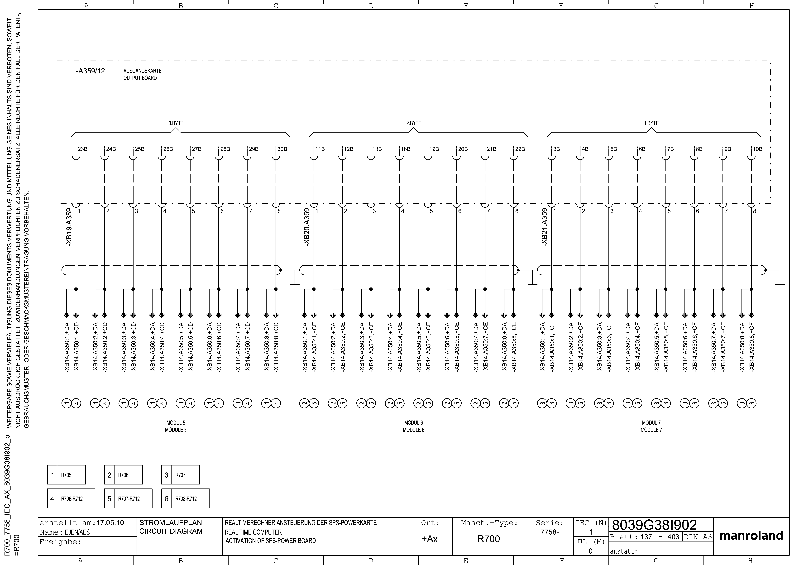

# +Ax — Sheet 137 of 403 — REALTIMERECHNER ANSTEUERUNG DER SPS POWERKARTE

**REAL TIME COMPUTER**

> Part of the manroland **R700** printing press IEC/UL circuit diagrams.
> Drawing class: **Stromlaufplan / Circuit diagram** (DIN A3).
> Document `+Ax` covers the **Central control console** machine section.

## At a glance

| Field | Value |
|---|---|
| Document | `+Ax`  (8039G38I902) |
| Sheet | **137** of 403 |
| Section (DE) | REALTIMERECHNER ANSTEUERUNG DER SPS POWERKARTE |
| Section (EN) | REAL TIME COMPUTER |
| Section type | CIRCUIT — Circuit diagram |
| Machine type | `R700` |
| Series | `7758` |
| Created | 17.05.10 |
| Replaces | — |
| Columns used | A, B, C, D, E, F, G, H |
| Path numbers | — |
| Labels on sheet | 171 |
| Cross-refs out | 0 |
| Cross-refs in | 24 |

**Previous:** [+Ax sheet 136](SHEET_0136.md) · **Next:** [+Ax sheet 138](SHEET_0138.md) · **Document TOC:** [_TOC.md](_TOC.md)  (+Ax) · **Master TOC:** [all sheets](../_MASTER_TOC.md)

## Sheet image (300 DPI, exact vector render)



_Rendered directly from the PDF vector layer at 300 DPI (1-bit), no OCR and no resampling. Use it to confirm anything ambiguous in the text below._

## Cross-references on this sheet

Each entry is a wire leaving this sheet. The printed token is `/sheet.column`; the link resolves to that sheet inside the same document.

_No outgoing cross-references on this sheet._

### Incoming references (sheets that point here)

Every other sheet that sends a wire to this one. `Back-ref` is the token printed on *that* sheet; `Path` is its line number.

| From sheet | Cols | Back-ref | Path | Refs | What continues there |
|---|---|---|---|---|---|
| [+Ax#259](SHEET_0259.md) | C | `/259.C` | — | 8 | — |
| [+Ax#260](SHEET_0260.md) | C | `/260.C` | — | 8 | — |
| [+Ax#261](SHEET_0261.md) | C | `/261.C` | — | 8 | — |


## Devices on this sheet

| Tag | Class | Class meaning (IEC) | Col | Sub | Terminal | Sign |
|---|---|---|---|---|---|---|
| `A359/12` | A | Baugruppe / assembly, module, PC board | A | 12 | — | — |
| `R705` | R | Widerstand / resistor | A | — | — | — |
| `R706` | R | Widerstand / resistor | A | — | — | — |
| `R707` | R | Widerstand / resistor | B | — | — | — |
| `XB19.A359` | — | cross-device reference | A | — | — | — |
| `XB20.A359` | — | cross-device reference | C | — | — | — |
| `XB21.A359` | — | cross-device reference | F | — | — | — |

## Potentials / nets

_No named potentials on this sheet._

## Wire-end annotations (grouped as printed)

A wire that continues elsewhere is annotated with a small cluster: the destination description, the path/line number `#NN`, and the `/sheet.column` cross reference. Each row below is one such cluster exactly as it is grouped on the drawing.

| Col | Y | Path | Cross-ref | Text on the wire |
|---|---|---|---|---|
| A | 100.9 | — | — | `A359/12 OUTPUT BOARD AUSGANGSKARTE` |
| D | 180.6 | — | — | `3.BYTE 2.BYTE 1.BYTE` |
| E | 218.6 | — | — | `23B 24B 25B 26B 27B 28B 29B 30B 11B 12B 13B 18B 19B 20B 21B 22B 3B 4B 5B 6B 7B 8B 9B 10B` |
| A | 309.8 | — | — | `XB19.A359` |
| C | 309.8 | — | — | `XB20.A359` |
| F | 309.8 | — | — | `XB21.A359` |
| D | 310.7 | — | — | `1 2 2 2 8` |
| B | 310.7 | — | — | `3 4 5 6 7 8 1` |
| E | 310.7 | — | — | `3 4 5 6 7 8 1` |
| G | 310.7 | — | — | `3 4 5 6 7` |
| C | 479.9 | — | — | `XB14.A350:1,+CE` |
| D | 479.9 | — | — | `XB14.A350:2,+CE` |
| D | 479.9 | — | — | `XB14.A350:3,+CE` |
| D | 479.9 | — | — | `XB14.A350:4,+CE` |
| E | 479.9 | — | — | `XB14.A350:5,+CE` |
| E | 479.9 | — | — | `XB14.A350:6,+CE` |
| E | 479.9 | — | — | `XB14.A350:7,+CE` |
| F | 479.9 | — | — | `XB14.A350:8,+CE` |
| A | 480.2 | — | — | `XB14.A350:1,+CD` |
| A | 480.2 | — | — | `XB14.A350:2,+CD` |
| B | 480.2 | — | — | `XB14.A350:3,+CD` |
| B | 480.2 | — | — | `XB14.A350:4,+CD` |
| B | 480.2 | — | — | `XB14.A350:5,+CD` |
| B | 480.2 | — | — | `XB14.A350:6,+CD` |
| C | 480.2 | — | — | `XB14.A350:7,+CD` |
| C | 480.2 | — | — | `XB14.A350:8,+CD` |
| F | 480.2 | — | — | `XB14.A350:1,+CF` |
| F | 480.2 | — | — | `XB14.A350:2,+CF` |
| G | 480.2 | — | — | `XB14.A350:3,+CF` |
| G | 480.2 | — | — | `XB14.A350:4,+CF` |
| G | 480.2 | — | — | `XB14.A350:5,+CF` |
| G | 480.2 | — | — | `XB14.A350:6,+CF` |
| H | 480.2 | — | — | `XB14.A350:7,+CF` |
| H | 480.2 | — | — | `XB14.A350:8,+CF` |
| A | 480.5 | — | — | `XB14.A350:1,+DA` |
| A | 480.5 | — | — | `XB14.A350:2,+DA` |
| A | 480.5 | — | — | `XB14.A350:3,+DA` |
| B | 480.5 | — | — | `XB14.A350:4,+DA` |
| B | 480.5 | — | — | `XB14.A350:5,+DA` |
| B | 480.5 | — | — | `XB14.A350:6,+DA` |
| C | 480.5 | — | — | `XB14.A350:7,+DA` |
| C | 480.5 | — | — | `XB14.A350:8,+DA` |
| C | 480.5 | — | — | `XB14.A350:1,+DA` |
| D | 480.5 | — | — | `XB14.A350:2,+DA` |
| D | 480.5 | — | — | `XB14.A350:3,+DA` |
| D | 480.5 | — | — | `XB14.A350:4,+DA` |
| E | 480.5 | — | — | `XB14.A350:5,+DA` |
| E | 480.5 | — | — | `XB14.A350:6,+DA` |
| E | 480.5 | — | — | `XB14.A350:7,+DA` |
| E | 480.5 | — | — | `XB14.A350:8,+DA` |
| F | 480.5 | — | — | `XB14.A350:1,+DA` |
| F | 480.5 | — | — | `XB14.A350:2,+DA` |
| F | 480.5 | — | — | `XB14.A350:3,+DA` |
| G | 480.5 | — | — | `XB14.A350:4,+DA` |
| G | 480.5 | — | — | `XB14.A350:5,+DA` |
| G | 480.5 | — | — | `XB14.A350:6,+DA` |
| H | 480.5 | — | — | `XB14.A350:7,+DA` |
| H | 480.5 | — | — | `XB14.A350:8,+DA` |
| A | 598.1 | — | — | `1` |
| A | 598.1 | — | — | `1` |
| A | 598.1 | — | — | `1` |
| B | 598.1 | — | — | `1` |
| B | 598.1 | — | — | `1` |
| B | 598.1 | — | — | `1` |
| C | 598.1 | — | — | `1` |
| C | 598.1 | — | — | `1` |
| A | 599.0 | — | — | `4` |
| A | 599.0 | — | — | `4` |
| B | 599.0 | — | — | `4` |
| B | 599.0 | — | — | `4` |
| B | 599.0 | — | — | `4` |
| B | 599.0 | — | — | `4` |
| C | 599.0 | — | — | `4` |
| C | 599.0 | — | — | `4` |
| C | 599.0 | — | — | `2` |
| C | 599.0 | — | — | `5` |
| D | 599.0 | — | — | `2` |
| D | 599.0 | — | — | `5` |
| D | 599.0 | — | — | `2` |
| D | 599.0 | — | — | `5` |
| D | 599.0 | — | — | `2` |
| D | 599.0 | — | — | `5` |
| E | 599.0 | — | — | `2` |
| E | 599.0 | — | — | `5` |
| E | 599.0 | — | — | `2` |
| E | 599.0 | — | — | `5` |
| E | 599.0 | — | — | `2` |
| E | 599.0 | — | — | `5` |
| E | 599.0 | — | — | `2` |
| F | 599.0 | — | — | `5` |
| F | 599.0 | — | — | `3` |
| F | 599.0 | — | — | `6` |
| F | 599.0 | — | — | `3` |
| F | 599.0 | — | — | `6` |
| F | 599.0 | — | — | `3` |
| G | 599.0 | — | — | `6` |
| G | 599.0 | — | — | `3` |
| G | 599.0 | — | — | `6` |
| G | 599.0 | — | — | `3` |
| G | 599.0 | — | — | `6` |
| G | 599.0 | — | — | `3` |
| G | 599.0 | — | — | `6` |
| H | 599.0 | — | — | `3` |
| H | 599.0 | — | — | `6` |
| H | 599.0 | — | — | `3` |
| H | 599.0 | — | — | `6` |
| D | 627.1 | — | — | `MODULE 5 MODUL 5 MODULE 6 MODUL 6 MODULE 7 MODUL 7` |
| A | 703.3 | — | — | `1` |
| A | 703.3 | — | — | `2` |
| B | 703.3 | — | — | `3` |
| A | 705.0 | — | — | `R705` |
| A | 705.0 | — | — | `R706` |
| B | 705.0 | — | — | `R707` |
| A | 738.7 | — | — | `4` |
| A | 738.7 | — | — | `5` |
| B | 738.7 | — | — | `6` |
| A | 740.5 | — | — | `R706 R712` |
| A | 740.5 | — | — | `R707 R712` |
| B | 740.5 | — | — | `R708 R712` |


## Reconstructed tables

This sheet carries tabular content (pin map / terminal assignment / index). The grid below was rebuilt from the drawing's own rule lines, so each row is exactly one physical row of the table.

### Table 1 — 0 data rows × 2 columns (at x=99.2, y=197.0) — **23B**

_none_


### Table 2 — 2 data rows × 1 columns (at x=155.9, y=197.0)

| C1 |
|---|
| `24B` |
| `2` |


### Table 3 — 2 data rows × 1 columns (at x=198.4, y=197.0)

| C1 |
|---|
| `25B` |
| `3` |


### Table 4 — 2 data rows × 1 columns (at x=240.9, y=197.0)

| C1 |
|---|
| `26B` |
| `4` |


### Table 5 — 2 data rows × 1 columns (at x=283.5, y=197.0)

| C1 |
|---|
| `27B` |
| `5` |


### Table 6 — 2 data rows × 1 columns (at x=326.0, y=197.0)

| C1 |
|---|
| `28B` |
| `6` |


### Table 7 — 2 data rows × 1 columns (at x=368.5, y=197.0)

| C1 |
|---|
| `29B` |
| `7` |


### Table 8 — 1 data rows × 3 columns (at x=411.0, y=197.0)

| 30B |  | 11B |
|---|---|---|
| `8` | `XB20.A359` | `1` |


### Table 9 — 2 data rows × 1 columns (at x=510.2, y=197.0)

| C1 |
|---|
| `12B` |
| `2` |


### Table 10 — 2 data rows × 1 columns (at x=552.8, y=197.0)

| C1 |
|---|
| `13B` |
| `3` |


### Table 11 — 2 data rows × 1 columns (at x=595.3, y=197.0)

| C1 |
|---|
| `18B` |
| `4` |


### Table 12 — 2 data rows × 1 columns (at x=637.8, y=197.0)

| C1 |
|---|
| `19B` |
| `5` |


### Table 13 — 2 data rows × 1 columns (at x=680.3, y=197.0)

| C1 |
|---|
| `20B` |
| `6` |


### Table 14 — 2 data rows × 1 columns (at x=722.8, y=197.0)

| C1 |
|---|
| `21B` |
| `7` |


### Table 15 — 1 data rows × 3 columns (at x=765.4, y=197.0)

| 22B |  | 3B |
|---|---|---|
| `8` | `XB21.A359` | `1` |


### Table 16 — 2 data rows × 1 columns (at x=864.6, y=197.0)

| C1 |
|---|
| `4B` |
| `2` |


### Table 17 — 2 data rows × 1 columns (at x=907.1, y=197.0)

| C1 |
|---|
| `5B` |
| `3` |


### Table 18 — 2 data rows × 1 columns (at x=949.6, y=197.0)

| C1 |
|---|
| `6B` |
| `4` |


### Table 19 — 2 data rows × 1 columns (at x=992.1, y=197.0)

| C1 |
|---|
| `7B` |
| `5` |


### Table 20 — 2 data rows × 1 columns (at x=1034.6, y=197.0)

| C1 |
|---|
| `8B` |
| `6` |


### Table 21 — 2 data rows × 1 columns (at x=1077.2, y=197.0)

| C1 |
|---|
| `9B` |
| `7` |


## Notes and free text on this sheet

| Text | Col | Y (pt) |
|---|---|---|
| `AUSGANGSKARTE` | B | 102.67 |
| `OUTPUT BOARD` | B | 113.31 |
| `XB14.A350:1,+DA` | A | 480.47 |
| `XB14.A350:1,+CD` | A | 480.19 |
| `XB14.A350:2,+DA` | A | 480.47 |
| `XB14.A350:2,+CD` | A | 480.19 |
| `XB14.A350:3,+DA` | A | 480.47 |
| `XB14.A350:3,+CD` | B | 480.19 |
| `XB14.A350:4,+DA` | B | 480.47 |
| `XB14.A350:4,+CD` | B | 480.19 |
| `XB14.A350:5,+DA` | B | 480.47 |
| `XB14.A350:5,+CD` | B | 480.19 |
| `XB14.A350:6,+DA` | B | 480.47 |
| `XB14.A350:6,+CD` | B | 480.19 |
| `XB14.A350:7,+DA` | C | 480.47 |
| `XB14.A350:7,+CD` | C | 480.19 |
| `XB14.A350:8,+DA` | C | 480.47 |
| `XB14.A350:8,+CD` | C | 480.19 |
| `XB14.A350:1,+DA` | C | 480.47 |
| `XB14.A350:1,+CE` | C | 479.9 |
| `XB14.A350:2,+DA` | D | 480.47 |
| `XB14.A350:2,+CE` | D | 479.9 |
| `XB14.A350:3,+DA` | D | 480.47 |
| `XB14.A350:3,+CE` | D | 479.9 |
| `XB14.A350:4,+DA` | D | 480.47 |
| `XB14.A350:4,+CE` | D | 479.9 |
| `XB14.A350:5,+DA` | E | 480.47 |
| `XB14.A350:5,+CE` | E | 479.9 |
| `XB14.A350:6,+DA` | E | 480.47 |
| `XB14.A350:6,+CE` | E | 479.9 |
| `XB14.A350:7,+DA` | E | 480.47 |
| `XB14.A350:7,+CE` | E | 479.9 |
| `XB14.A350:8,+DA` | E | 480.47 |
| `XB14.A350:8,+CE` | F | 479.9 |
| `XB14.A350:1,+DA` | F | 480.47 |
| `XB14.A350:1,+CF` | F | 480.19 |
| `XB14.A350:2,+DA` | F | 480.47 |
| `XB14.A350:2,+CF` | F | 480.19 |
| `XB14.A350:3,+DA` | F | 480.47 |
| `XB14.A350:3,+CF` | G | 480.19 |
| `XB14.A350:4,+DA` | G | 480.47 |
| `XB14.A350:4,+CF` | G | 480.19 |
| `XB14.A350:5,+DA` | G | 480.47 |
| `XB14.A350:5,+CF` | G | 480.19 |
| `XB14.A350:6,+DA` | G | 480.47 |
| `XB14.A350:6,+CF` | G | 480.19 |
| `XB14.A350:7,+DA` | H | 480.47 |
| `XB14.A350:7,+CF` | H | 480.19 |
| `XB14.A350:8,+DA` | H | 480.47 |
| `XB14.A350:8,+CF` | H | 480.19 |
| `10B` | H | 218.56 |
| `12B` | D | 218.56 |
| `24B` | A | 218.56 |
| `4B` | F | 218.56 |
| `23B` | A | 218.56 |
| `25B` | B | 218.56 |
| `26B` | B | 218.56 |
| `27B` | B | 218.56 |
| `28B` | B | 218.56 |
| `29B` | C | 218.56 |
| `30B` | C | 218.56 |
| `11B` | C | 218.56 |
| `13B` | D | 218.56 |
| `18B` | D | 218.56 |
| `19B` | E | 218.56 |
| `20B` | E | 218.56 |
| `21B` | E | 218.56 |
| `22B` | F | 218.56 |
| `3B` | F | 218.56 |
| `5B` | G | 218.56 |
| `6B` | G | 218.56 |
| `7B` | G | 218.56 |
| `8B` | G | 218.56 |
| `9B` | H | 218.56 |
| `3.BYTE` | B | 180.58 |
| `1.BYTE` | G | 180.55 |
| `2.BYTE` | D | 180.58 |
| `MODUL 7` | G | 627.11 |
| `MODULE 7` | G | 637.73 |
| `MODUL 6` | D | 627.11 |
| `MODULE 6` | D | 637.73 |
| `MODUL 5` | B | 627.11 |
| `MODULE 5` | B | 637.73 |
| `R706 R712` | A | 740.49 |
| `R707 R712` | A | 740.49 |
| `R708 R712` | B | 740.49 |

## Complete label inventory (exact text from the drawing)

Every text object inside the drawing area of this sheet, in DIN reading order (column A→H, then top→bottom). This is the authoritative list: if a string is not here it is not printed on this sheet.

| Col | Y | X | Dir | Type | Text |
|---|---|---|---|---|---|
| A | 100.9 | 113.4 | → | device tag | `A359/12` |
| A | 218.6 | 115.9 | → | text | `23B` |
| A | 218.6 | 158.5 | → | text | `24B` |
| A | 309.8 | 98.1 | ↕ | device ref | `XB19.A359` |
| A | 310.7 | 115.4 | → | number | `1` |
| A | 310.7 | 158.5 | → | number | `2` |
| A | 480.2 | 110.1 | ↕ | text | `XB14.A350:1,+CD` |
| A | 480.2 | 152.6 | ↕ | text | `XB14.A350:2,+CD` |
| A | 480.5 | 95.9 | ↕ | text | `XB14.A350:1,+DA` |
| A | 480.5 | 138.5 | ↕ | text | `XB14.A350:2,+DA` |
| A | 480.5 | 181.0 | ↕ | text | `XB14.A350:3,+DA` |
| A | 598.1 | 96.2 | ↕ | number | `1` |
| A | 598.1 | 138.7 | ↕ | number | `1` |
| A | 598.1 | 181.2 | ↕ | number | `1` |
| A | 599.0 | 110.8 | ↕ | number | `4` |
| A | 599.0 | 153.4 | ↕ | number | `4` |
| A | 703.3 | 75.4 | → | number | `1` |
| A | 703.3 | 160.2 | → | number | `2` |
| A | 705.0 | 91.3 | → | device tag | `R705` |
| A | 705.0 | 176.3 | → | device tag | `R706` |
| A | 738.7 | 75.1 | → | number | `4` |
| A | 738.7 | 160.0 | → | number | `5` |
| A | 740.5 | 91.3 | → | text | `R706 R712` |
| A | 740.5 | 176.3 | → | text | `R707 R712` |
| B | 102.7 | 184.3 | → | text | `AUSGANGSKARTE` |
| B | 113.3 | 184.0 | → | text | `OUTPUT BOARD` |
| B | 180.6 | 251.4 | → | text | `3.BYTE` |
| B | 218.6 | 201.0 | → | text | `25B` |
| B | 218.6 | 243.5 | → | text | `26B` |
| B | 218.6 | 286.0 | → | text | `27B` |
| B | 218.6 | 328.5 | → | text | `28B` |
| B | 310.7 | 201.0 | → | number | `3` |
| B | 310.7 | 243.5 | → | number | `4` |
| B | 310.7 | 286.0 | → | number | `5` |
| B | 310.7 | 328.5 | → | number | `6` |
| B | 480.2 | 195.2 | ↕ | text | `XB14.A350:3,+CD` |
| B | 480.2 | 237.7 | ↕ | text | `XB14.A350:4,+CD` |
| B | 480.2 | 280.2 | ↕ | text | `XB14.A350:5,+CD` |
| B | 480.2 | 322.7 | ↕ | text | `XB14.A350:6,+CD` |
| B | 480.5 | 223.5 | ↕ | text | `XB14.A350:4,+DA` |
| B | 480.5 | 266.0 | ↕ | text | `XB14.A350:5,+DA` |
| B | 480.5 | 308.5 | ↕ | text | `XB14.A350:6,+DA` |
| B | 598.1 | 223.7 | ↕ | number | `1` |
| B | 598.1 | 266.2 | ↕ | number | `1` |
| B | 598.1 | 308.8 | ↕ | number | `1` |
| B | 599.0 | 195.9 | ↕ | number | `4` |
| B | 599.0 | 238.4 | ↕ | number | `4` |
| B | 599.0 | 280.9 | ↕ | number | `4` |
| B | 599.0 | 323.4 | ↕ | number | `4` |
| B | 627.1 | 248.3 | → | text | `MODUL 5` |
| B | 637.7 | 246.1 | → | text | `MODULE 5` |
| B | 703.3 | 245.1 | → | number | `3` |
| B | 705.0 | 261.4 | → | device tag | `R707` |
| B | 738.7 | 245.2 | → | number | `6` |
| B | 740.5 | 261.4 | → | text | `R708 R712` |
| C | 218.6 | 371.1 | → | text | `29B` |
| C | 218.6 | 413.6 | → | text | `30B` |
| C | 218.6 | 469.7 | → | text | `11B` |
| C | 309.8 | 452.4 | ↕ | device ref | `XB20.A359` |
| C | 310.7 | 371.1 | → | number | `7` |
| C | 310.7 | 413.6 | → | number | `8` |
| C | 310.7 | 469.7 | → | number | `1` |
| C | 479.9 | 464.4 | ↕ | text | `XB14.A350:1,+CE` |
| C | 480.2 | 365.2 | ↕ | text | `XB14.A350:7,+CD` |
| C | 480.2 | 407.8 | ↕ | text | `XB14.A350:8,+CD` |
| C | 480.5 | 351.1 | ↕ | text | `XB14.A350:7,+DA` |
| C | 480.5 | 393.6 | ↕ | text | `XB14.A350:8,+DA` |
| C | 480.5 | 450.3 | ↕ | text | `XB14.A350:1,+DA` |
| C | 598.1 | 351.3 | ↕ | number | `1` |
| C | 598.1 | 393.8 | ↕ | number | `1` |
| C | 599.0 | 366.0 | ↕ | number | `4` |
| C | 599.0 | 408.5 | ↕ | number | `4` |
| C | 599.0 | 451.0 | ↕ | number | `2` |
| C | 599.0 | 465.2 | ↕ | number | `5` |
| D | 180.6 | 605.7 | → | text | `2.BYTE` |
| D | 218.6 | 512.2 | → | text | `12B` |
| D | 218.6 | 554.7 | → | text | `13B` |
| D | 218.6 | 597.3 | → | text | `18B` |
| D | 310.7 | 512.8 | → | number | `2` |
| D | 310.7 | 555.3 | → | number | `3` |
| D | 310.7 | 597.8 | → | number | `4` |
| D | 479.9 | 507.0 | ↕ | text | `XB14.A350:2,+CE` |
| D | 479.9 | 549.5 | ↕ | text | `XB14.A350:3,+CE` |
| D | 479.9 | 592.0 | ↕ | text | `XB14.A350:4,+CE` |
| D | 480.5 | 492.8 | ↕ | text | `XB14.A350:2,+DA` |
| D | 480.5 | 535.3 | ↕ | text | `XB14.A350:3,+DA` |
| D | 480.5 | 577.8 | ↕ | text | `XB14.A350:4,+DA` |
| D | 599.0 | 493.5 | ↕ | number | `2` |
| D | 599.0 | 507.7 | ↕ | number | `5` |
| D | 599.0 | 536.0 | ↕ | number | `2` |
| D | 599.0 | 550.2 | ↕ | number | `5` |
| D | 599.0 | 578.6 | ↕ | number | `2` |
| D | 599.0 | 592.7 | ↕ | number | `5` |
| D | 627.1 | 602.6 | → | text | `MODUL 6` |
| D | 637.7 | 600.5 | → | text | `MODULE 6` |
| E | 218.6 | 639.8 | → | text | `19B` |
| E | 218.6 | 682.9 | → | text | `20B` |
| E | 218.6 | 725.4 | → | text | `21B` |
| E | 310.7 | 640.3 | → | number | `5` |
| E | 310.7 | 682.9 | → | number | `6` |
| E | 310.7 | 725.4 | → | number | `7` |
| E | 479.9 | 634.5 | ↕ | text | `XB14.A350:5,+CE` |
| E | 479.9 | 677.0 | ↕ | text | `XB14.A350:6,+CE` |
| E | 479.9 | 719.6 | ↕ | text | `XB14.A350:7,+CE` |
| E | 480.5 | 620.4 | ↕ | text | `XB14.A350:5,+DA` |
| E | 480.5 | 662.9 | ↕ | text | `XB14.A350:6,+DA` |
| E | 480.5 | 705.4 | ↕ | text | `XB14.A350:7,+DA` |
| E | 480.5 | 747.9 | ↕ | text | `XB14.A350:8,+DA` |
| E | 599.0 | 621.1 | ↕ | number | `2` |
| E | 599.0 | 635.3 | ↕ | number | `5` |
| E | 599.0 | 663.6 | ↕ | number | `2` |
| E | 599.0 | 677.8 | ↕ | number | `5` |
| E | 599.0 | 706.1 | ↕ | number | `2` |
| E | 599.0 | 720.3 | ↕ | number | `5` |
| E | 599.0 | 748.6 | ↕ | number | `2` |
| F | 218.6 | 767.9 | → | text | `22B` |
| F | 218.6 | 824.6 | → | text | `3B` |
| F | 218.6 | 867.1 | → | text | `4B` |
| F | 309.8 | 806.8 | ↕ | device ref | `XB21.A359` |
| F | 310.7 | 767.9 | → | number | `8` |
| F | 310.7 | 824.0 | → | number | `1` |
| F | 310.7 | 867.1 | → | number | `2` |
| F | 479.9 | 762.1 | ↕ | text | `XB14.A350:8,+CE` |
| F | 480.2 | 818.8 | ↕ | text | `XB14.A350:1,+CF` |
| F | 480.2 | 861.3 | ↕ | text | `XB14.A350:2,+CF` |
| F | 480.5 | 804.6 | ↕ | text | `XB14.A350:1,+DA` |
| F | 480.5 | 847.1 | ↕ | text | `XB14.A350:2,+DA` |
| F | 480.5 | 889.6 | ↕ | text | `XB14.A350:3,+DA` |
| F | 599.0 | 762.8 | ↕ | number | `5` |
| F | 599.0 | 805.3 | ↕ | number | `3` |
| F | 599.0 | 819.5 | ↕ | number | `6` |
| F | 599.0 | 847.9 | ↕ | number | `3` |
| F | 599.0 | 862.0 | ↕ | number | `6` |
| F | 599.0 | 890.4 | ↕ | number | `3` |
| G | 180.6 | 959.7 | → | text | `1.BYTE` |
| G | 218.6 | 909.6 | → | text | `5B` |
| G | 218.6 | 952.2 | → | text | `6B` |
| G | 218.6 | 994.4 | → | text | `7B` |
| G | 218.6 | 1037.2 | → | text | `8B` |
| G | 310.7 | 909.6 | → | number | `3` |
| G | 310.7 | 952.2 | → | number | `4` |
| G | 310.7 | 994.7 | → | number | `5` |
| G | 310.7 | 1037.2 | → | number | `6` |
| G | 480.2 | 903.8 | ↕ | text | `XB14.A350:3,+CF` |
| G | 480.2 | 946.3 | ↕ | text | `XB14.A350:4,+CF` |
| G | 480.2 | 988.9 | ↕ | text | `XB14.A350:5,+CF` |
| G | 480.2 | 1031.4 | ↕ | text | `XB14.A350:6,+CF` |
| G | 480.5 | 932.2 | ↕ | text | `XB14.A350:4,+DA` |
| G | 480.5 | 974.7 | ↕ | text | `XB14.A350:5,+DA` |
| G | 480.5 | 1017.2 | ↕ | text | `XB14.A350:6,+DA` |
| G | 599.0 | 904.5 | ↕ | number | `6` |
| G | 599.0 | 932.9 | ↕ | number | `3` |
| G | 599.0 | 947.1 | ↕ | number | `6` |
| G | 599.0 | 975.4 | ↕ | number | `3` |
| G | 599.0 | 989.6 | ↕ | number | `6` |
| G | 599.0 | 1017.9 | ↕ | number | `3` |
| G | 599.0 | 1032.1 | ↕ | number | `6` |
| G | 627.1 | 956.9 | → | text | `MODUL 7` |
| G | 637.7 | 954.8 | → | text | `MODULE 7` |
| H | 218.6 | 1079.7 | → | text | `9B` |
| H | 218.6 | 1121.7 | → | text | `10B` |
| H | 310.7 | 1079.7 | → | number | `7` |
| H | 310.7 | 1122.2 | → | number | `8` |
| H | 480.2 | 1073.9 | ↕ | text | `XB14.A350:7,+CF` |
| H | 480.2 | 1116.4 | ↕ | text | `XB14.A350:8,+CF` |
| H | 480.5 | 1059.7 | ↕ | text | `XB14.A350:7,+DA` |
| H | 480.5 | 1102.2 | ↕ | text | `XB14.A350:8,+DA` |
| H | 599.0 | 1060.5 | ↕ | number | `3` |
| H | 599.0 | 1074.6 | ↕ | number | `6` |
| H | 599.0 | 1103.0 | ↕ | number | `3` |
| H | 599.0 | 1117.1 | ↕ | number | `6` |

## Reading-order text block

The same content as a plain block, grouped by DIN column — convenient to paste or to match against a visual description.

```text
=== Column A ===
 100.9  113.4  devtag       A359/12
 218.6  115.9  text         23B
 218.6  158.5  text         24B
 309.8   98.1  devref       XB19.A359
 310.7  115.4  numeric      1
 310.7  158.5  numeric      2
 480.2  110.1  text         XB14.A350:1,+CD
 480.2  152.6  text         XB14.A350:2,+CD
 480.5   95.9  text         XB14.A350:1,+DA
 480.5  138.5  text         XB14.A350:2,+DA
 480.5  181.0  text         XB14.A350:3,+DA
 598.1   96.2  numeric      1
 598.1  138.7  numeric      1
 598.1  181.2  numeric      1
 599.0  110.8  numeric      4
 599.0  153.4  numeric      4
 703.3   75.4  numeric      1
 703.3  160.2  numeric      2
 705.0   91.3  devtag       R705
 705.0  176.3  devtag       R706
 738.7   75.1  numeric      4
 738.7  160.0  numeric      5
 740.5   91.3  text         R706 R712
 740.5  176.3  text         R707 R712
=== Column B ===
 102.7  184.3  text         AUSGANGSKARTE
 113.3  184.0  text         OUTPUT BOARD
 180.6  251.4  text         3.BYTE
 218.6  201.0  text         25B
 218.6  243.5  text         26B
 218.6  286.0  text         27B
 218.6  328.5  text         28B
 310.7  201.0  numeric      3
 310.7  243.5  numeric      4
 310.7  286.0  numeric      5
 310.7  328.5  numeric      6
 480.2  195.2  text         XB14.A350:3,+CD
 480.2  237.7  text         XB14.A350:4,+CD
 480.2  280.2  text         XB14.A350:5,+CD
 480.2  322.7  text         XB14.A350:6,+CD
 480.5  223.5  text         XB14.A350:4,+DA
 480.5  266.0  text         XB14.A350:5,+DA
 480.5  308.5  text         XB14.A350:6,+DA
 598.1  223.7  numeric      1
 598.1  266.2  numeric      1
 598.1  308.8  numeric      1
 599.0  195.9  numeric      4
 599.0  238.4  numeric      4
 599.0  280.9  numeric      4
 599.0  323.4  numeric      4
 627.1  248.3  text         MODUL 5
 637.7  246.1  text         MODULE 5
 703.3  245.1  numeric      3
 705.0  261.4  devtag       R707
 738.7  245.2  numeric      6
 740.5  261.4  text         R708 R712
=== Column C ===
 218.6  371.1  text         29B
 218.6  413.6  text         30B
 218.6  469.7  text         11B
 309.8  452.4  devref       XB20.A359
 310.7  371.1  numeric      7
 310.7  413.6  numeric      8
 310.7  469.7  numeric      1
 479.9  464.4  text         XB14.A350:1,+CE
 480.2  365.2  text         XB14.A350:7,+CD
 480.2  407.8  text         XB14.A350:8,+CD
 480.5  351.1  text         XB14.A350:7,+DA
 480.5  393.6  text         XB14.A350:8,+DA
 480.5  450.3  text         XB14.A350:1,+DA
 598.1  351.3  numeric      1
 598.1  393.8  numeric      1
 599.0  366.0  numeric      4
 599.0  408.5  numeric      4
 599.0  451.0  numeric      2
 599.0  465.2  numeric      5
=== Column D ===
 180.6  605.7  text         2.BYTE
 218.6  512.2  text         12B
 218.6  554.7  text         13B
 218.6  597.3  text         18B
 310.7  512.8  numeric      2
 310.7  555.3  numeric      3
 310.7  597.8  numeric      4
 479.9  507.0  text         XB14.A350:2,+CE
 479.9  549.5  text         XB14.A350:3,+CE
 479.9  592.0  text         XB14.A350:4,+CE
 480.5  492.8  text         XB14.A350:2,+DA
 480.5  535.3  text         XB14.A350:3,+DA
 480.5  577.8  text         XB14.A350:4,+DA
 599.0  493.5  numeric      2
 599.0  507.7  numeric      5
 599.0  536.0  numeric      2
 599.0  550.2  numeric      5
 599.0  578.6  numeric      2
 599.0  592.7  numeric      5
 627.1  602.6  text         MODUL 6
 637.7  600.5  text         MODULE 6
=== Column E ===
 218.6  639.8  text         19B
 218.6  682.9  text         20B
 218.6  725.4  text         21B
 310.7  640.3  numeric      5
 310.7  682.9  numeric      6
 310.7  725.4  numeric      7
 479.9  634.5  text         XB14.A350:5,+CE
 479.9  677.0  text         XB14.A350:6,+CE
 479.9  719.6  text         XB14.A350:7,+CE
 480.5  620.4  text         XB14.A350:5,+DA
 480.5  662.9  text         XB14.A350:6,+DA
 480.5  705.4  text         XB14.A350:7,+DA
 480.5  747.9  text         XB14.A350:8,+DA
 599.0  621.1  numeric      2
 599.0  635.3  numeric      5
 599.0  663.6  numeric      2
 599.0  677.8  numeric      5
 599.0  706.1  numeric      2
 599.0  720.3  numeric      5
 599.0  748.6  numeric      2
=== Column F ===
 218.6  767.9  text         22B
 218.6  824.6  text         3B
 218.6  867.1  text         4B
 309.8  806.8  devref       XB21.A359
 310.7  767.9  numeric      8
 310.7  824.0  numeric      1
 310.7  867.1  numeric      2
 479.9  762.1  text         XB14.A350:8,+CE
 480.2  818.8  text         XB14.A350:1,+CF
 480.2  861.3  text         XB14.A350:2,+CF
 480.5  804.6  text         XB14.A350:1,+DA
 480.5  847.1  text         XB14.A350:2,+DA
 480.5  889.6  text         XB14.A350:3,+DA
 599.0  762.8  numeric      5
 599.0  805.3  numeric      3
 599.0  819.5  numeric      6
 599.0  847.9  numeric      3
 599.0  862.0  numeric      6
 599.0  890.4  numeric      3
=== Column G ===
 180.6  959.7  text         1.BYTE
 218.6  909.6  text         5B
 218.6  952.2  text         6B
 218.6  994.4  text         7B
 218.6 1037.2  text         8B
 310.7  909.6  numeric      3
 310.7  952.2  numeric      4
 310.7  994.7  numeric      5
 310.7 1037.2  numeric      6
 480.2  903.8  text         XB14.A350:3,+CF
 480.2  946.3  text         XB14.A350:4,+CF
 480.2  988.9  text         XB14.A350:5,+CF
 480.2 1031.4  text         XB14.A350:6,+CF
 480.5  932.2  text         XB14.A350:4,+DA
 480.5  974.7  text         XB14.A350:5,+DA
 480.5 1017.2  text         XB14.A350:6,+DA
 599.0  904.5  numeric      6
 599.0  932.9  numeric      3
 599.0  947.1  numeric      6
 599.0  975.4  numeric      3
 599.0  989.6  numeric      6
 599.0 1017.9  numeric      3
 599.0 1032.1  numeric      6
 627.1  956.9  text         MODUL 7
 637.7  954.8  text         MODULE 7
=== Column H ===
 218.6 1079.7  text         9B
 218.6 1121.7  text         10B
 310.7 1079.7  numeric      7
 310.7 1122.2  numeric      8
 480.2 1073.9  text         XB14.A350:7,+CF
 480.2 1116.4  text         XB14.A350:8,+CF
 480.5 1059.7  text         XB14.A350:7,+DA
 480.5 1102.2  text         XB14.A350:8,+DA
 599.0 1060.5  numeric      3
 599.0 1074.6  numeric      6
 599.0 1103.0  numeric      3
 599.0 1117.1  numeric      6
```

---
_Generated from the PDF vector text layer; no OCR. Source: `R700_7758_IEC_AX_8039G38I902_p`, sheet 137._
