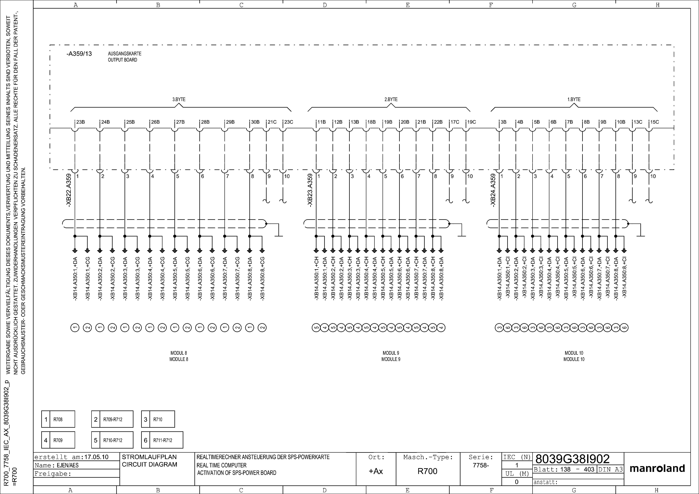

# +Ax — Sheet 138 of 403 — REALTIMERECHNER ANSTEUERUNG DER SPS POWERKARTE

**REAL TIME COMPUTER**

> Part of the manroland **R700** printing press IEC/UL circuit diagrams.
> Drawing class: **Stromlaufplan / Circuit diagram** (DIN A3).
> Document `+Ax` covers the **Central control console** machine section.

## At a glance

| Field | Value |
|---|---|
| Document | `+Ax`  (8039G38I902) |
| Sheet | **138** of 403 |
| Section (DE) | REALTIMERECHNER ANSTEUERUNG DER SPS POWERKARTE |
| Section (EN) | REAL TIME COMPUTER |
| Section type | CIRCUIT — Circuit diagram |
| Machine type | `R700` |
| Series | `7758` |
| Created | 17.05.10 |
| Replaces | — |
| Columns used | A, B, C, D, E, F, G, H |
| Path numbers | — |
| Labels on sheet | 183 |
| Cross-refs out | 0 |
| Cross-refs in | 30 |

**Previous:** [+Ax sheet 137](SHEET_0137.md) · **Next:** [+Ax sheet 139](SHEET_0139.md) · **Document TOC:** [_TOC.md](_TOC.md)  (+Ax) · **Master TOC:** [all sheets](../_MASTER_TOC.md)

## Sheet image (300 DPI, exact vector render)



_Rendered directly from the PDF vector layer at 300 DPI (1-bit), no OCR and no resampling. Use it to confirm anything ambiguous in the text below._

## Cross-references on this sheet

Each entry is a wire leaving this sheet. The printed token is `/sheet.column`; the link resolves to that sheet inside the same document.

_No outgoing cross-references on this sheet._

### Incoming references (sheets that point here)

Every other sheet that sends a wire to this one. `Back-ref` is the token printed on *that* sheet; `Path` is its line number.

| From sheet | Cols | Back-ref | Path | Refs | What continues there |
|---|---|---|---|---|---|
| [+Ax#262](SHEET_0262.md) | H | `/262.H` | — | 10 | — |
| [+Ax#264](SHEET_0264.md) | H | `/264.H` | — | 10 | — |
| [+Ax#266](SHEET_0266.md) | C | `/266.C` | — | 10 | — |


## Devices on this sheet

| Tag | Class | Class meaning (IEC) | Col | Sub | Terminal | Sign |
|---|---|---|---|---|---|---|
| `A359/13` | A | Baugruppe / assembly, module, PC board | A | 13 | — | — |
| `R708` | R | Widerstand / resistor | A | — | — | — |
| `R709` | R | Widerstand / resistor | A | — | — | — |
| `R710` | R | Widerstand / resistor | B | — | — | — |
| `XB22.A359` | — | cross-device reference | A | — | — | — |
| `XB23.A359` | — | cross-device reference | D | — | — | — |
| `XB24.A359` | — | cross-device reference | F | — | — | — |

## Potentials / nets

_No named potentials on this sheet._

## Wire-end annotations (grouped as printed)

A wire that continues elsewhere is annotated with a small cluster: the destination description, the path/line number `#NN`, and the `/sheet.column` cross reference. Each row below is one such cluster exactly as it is grouped on the drawing.

| Col | Y | Path | Cross-ref | Text on the wire |
|---|---|---|---|---|
| A | 86.8 | — | — | `A359/13 OUTPUT BOARD AUSGANGSKARTE` |
| E | 166.4 | — | — | `3.BYTE 2.BYTE 1.BYTE` |
| E | 204.4 | — | — | `23B 24B 25B 26B 27B 28B 29B 30B 21C 23C 11B 12B 13B 18B 19B 20B 21B 22B 17C 19C 3B 4B 5B 6B 7B 8B 9B 10B 13C 15C` |
| A | 295.6 | — | — | `XB22.A359` |
| D | 295.6 | — | — | `XB23.A359` |
| F | 295.6 | — | — | `XB24.A359` |
| B | 296.5 | — | — | `1 8 9 10` |
| B | 296.5 | — | — | `2 3 4 5 6 7` |
| D | 296.5 | — | — | `1` |
| D | 296.5 | — | — | `2` |
| D | 296.5 | — | — | `3` |
| E | 296.5 | — | — | `4` |
| E | 296.5 | — | — | `5` |
| E | 296.5 | — | — | `6` |
| E | 296.5 | — | — | `7` |
| E | 296.5 | — | — | `8` |
| F | 296.5 | — | — | `9 10` |
| F | 296.5 | — | — | `1` |
| G | 296.5 | — | — | `2 3 4 5 6 7 8 9 10` |
| D | 437.1 | — | — | `XB14.A350:1,+CH` |
| D | 437.1 | — | — | `XB14.A350:2,+CH` |
| D | 437.1 | — | — | `XB14.A350:3,+CH` |
| E | 437.1 | — | — | `XB14.A350:4,+CH` |
| E | 437.1 | — | — | `XB14.A350:5,+CH` |
| E | 437.1 | — | — | `XB14.A350:6,+CH` |
| E | 437.1 | — | — | `XB14.A350:7,+CH` |
| E | 437.1 | — | — | `XB14.A350:8,+CH` |
| F | 437.1 | — | — | `XB14.A350:1,+CI` |
| F | 437.1 | — | — | `XB14.A350:2,+CI` |
| G | 437.1 | — | — | `XB14.A350:3,+CI` |
| G | 437.1 | — | — | `XB14.A350:4,+CI` |
| G | 437.1 | — | — | `XB14.A350:5,+CI` |
| G | 437.1 | — | — | `XB14.A350:6,+CI` |
| G | 437.1 | — | — | `XB14.A350:7,+CI` |
| H | 437.1 | — | — | `XB14.A350:8,+CI` |
| A | 437.4 | — | — | `XB14.A350:1,+CG` |
| A | 437.4 | — | — | `XB14.A350:2,+CG` |
| B | 437.4 | — | — | `XB14.A350:3,+CG` |
| B | 437.4 | — | — | `XB14.A350:4,+CG` |
| B | 437.4 | — | — | `XB14.A350:5,+CG` |
| C | 437.4 | — | — | `XB14.A350:6,+CG` |
| C | 437.4 | — | — | `XB14.A350:7,+CG` |
| C | 437.4 | — | — | `XB14.A350:8,+CG` |
| A | 437.9 | — | — | `XB14.A350:1,+DA` |
| A | 437.9 | — | — | `XB14.A350:2,+DA` |
| B | 437.9 | — | — | `XB14.A350:3,+DA` |
| B | 437.9 | — | — | `XB14.A350:4,+DA` |
| B | 437.9 | — | — | `XB14.A350:5,+DA` |
| C | 437.9 | — | — | `XB14.A350:6,+DA` |
| C | 437.9 | — | — | `XB14.A350:7,+DA` |
| C | 437.9 | — | — | `XB14.A350:8,+DA` |
| D | 437.9 | — | — | `XB14.A350:1,+DA` |
| D | 437.9 | — | — | `XB14.A350:2,+DA` |
| D | 437.9 | — | — | `XB14.A350:3,+DA` |
| E | 437.9 | — | — | `XB14.A350:4,+DA` |
| E | 437.9 | — | — | `XB14.A350:5,+DA` |
| E | 437.9 | — | — | `XB14.A350:6,+DA` |
| E | 437.9 | — | — | `XB14.A350:7,+DA` |
| E | 437.9 | — | — | `XB14.A350:8,+DA` |
| F | 437.9 | — | — | `XB14.A350:1,+DA` |
| F | 437.9 | — | — | `XB14.A350:2,+DA` |
| G | 437.9 | — | — | `XB14.A350:3,+DA` |
| G | 437.9 | — | — | `XB14.A350:4,+DA` |
| G | 437.9 | — | — | `XB14.A350:5,+DA` |
| G | 437.9 | — | — | `XB14.A350:6,+DA` |
| G | 437.9 | — | — | `XB14.A350:7,+DA` |
| H | 437.9 | — | — | `XB14.A350:8,+DA` |
| A | 555.5 | — | — | `1` |
| A | 555.5 | — | — | `1` |
| B | 555.5 | — | — | `1` |
| B | 555.5 | — | — | `1` |
| B | 555.5 | — | — | `1` |
| C | 555.5 | — | — | `1` |
| C | 555.5 | — | — | `1` |
| C | 555.5 | — | — | `1` |
| A | 556.4 | — | — | `2` |
| A | 556.4 | — | — | `2` |
| B | 556.4 | — | — | `2` |
| B | 556.4 | — | — | `2` |
| B | 556.4 | — | — | `2` |
| C | 556.4 | — | — | `2` |
| C | 556.4 | — | — | `2` |
| C | 556.4 | — | — | `2` |
| D | 556.4 | — | — | `5` |
| D | 556.4 | — | — | `4` |
| D | 556.4 | — | — | `5` |
| D | 556.4 | — | — | `4` |
| D | 556.4 | — | — | `5` |
| D | 556.4 | — | — | `4` |
| E | 556.4 | — | — | `5` |
| E | 556.4 | — | — | `4` |
| E | 556.4 | — | — | `5` |
| E | 556.4 | — | — | `4` |
| E | 556.4 | — | — | `5` |
| E | 556.4 | — | — | `4` |
| E | 556.4 | — | — | `5` |
| E | 556.4 | — | — | `4` |
| E | 556.4 | — | — | `5` |
| E | 556.4 | — | — | `4` |
| F | 556.4 | — | — | `3` |
| F | 556.4 | — | — | `6` |
| F | 556.4 | — | — | `3` |
| F | 556.4 | — | — | `6` |
| G | 556.4 | — | — | `3` |
| G | 556.4 | — | — | `6` |
| G | 556.4 | — | — | `3` |
| G | 556.4 | — | — | `6` |
| G | 556.4 | — | — | `3` |
| G | 556.4 | — | — | `6` |
| G | 556.4 | — | — | `3` |
| G | 556.4 | — | — | `6` |
| G | 556.4 | — | — | `3` |
| G | 556.4 | — | — | `6` |
| H | 556.4 | — | — | `3` |
| H | 556.4 | — | — | `6` |
| B | 598.8 | — | — | `MODULE 8 MODUL 8` |
| E | 598.8 | — | — | `MODULE 9 MODUL 9` |
| G | 598.8 | — | — | `MODULE 10 MODUL 10` |
| A | 710.4 | — | — | `1` |
| A | 710.4 | — | — | `2` |
| B | 710.4 | — | — | `3` |
| A | 712.1 | — | — | `R708` |
| A | 712.1 | — | — | `R709 R712` |
| B | 712.1 | — | — | `R710` |
| A | 745.8 | — | — | `4` |
| A | 745.8 | — | — | `5` |
| B | 745.8 | — | — | `6` |
| A | 747.5 | — | — | `R709` |
| A | 747.6 | — | — | `R710 R712` |
| B | 747.6 | — | — | `R711 R712` |


## Reconstructed tables

This sheet carries tabular content (pin map / terminal assignment / index). The grid below was rebuilt from the drawing's own rule lines, so each row is exactly one physical row of the table.

### Table 1 — 1 data rows × 29 columns (at x=127.6, y=182.8)

| 23B | 24B | 25B | 26B | 27B | 28B | 29B | 30B | 21C | 23C | 11B | 12B | 13B | 18B | 19B | 20B | 21B | 22B | 17C | 19C | 3B | 4B | 5B | 6B | 7B | 8B | 9B | 10B | 13C |
|---|---|---|---|---|---|---|---|---|---|---|---|---|---|---|---|---|---|---|---|---|---|---|---|---|---|---|---|---|
| `1` | `2` | `3` | `4` | `5` | `6` | `7` | `8` | `9` | `XB23.A359 10` | `1` | `2` | `3` | `4` | `5` | `6` | `7` | `8` | `9` | `XB24.A359 10` | `1` | `2` | `3` | `4` | `5` | `6` | `7` | `8` | `9` |


## Notes and free text on this sheet

| Text | Col | Y (pt) |
|---|---|---|
| `AUSGANGSKARTE` | B | 88.5 |
| `OUTPUT BOARD` | B | 99.14 |
| `XB14.A350:1,+DA` | A | 437.95 |
| `XB14.A350:2,+DA` | A | 437.95 |
| `XB14.A350:3,+DA` | B | 437.95 |
| `XB14.A350:4,+DA` | B | 437.95 |
| `XB14.A350:5,+DA` | B | 437.95 |
| `XB14.A350:6,+DA` | C | 437.95 |
| `XB14.A350:7,+DA` | C | 437.95 |
| `XB14.A350:8,+DA` | C | 437.95 |
| `XB14.A350:1,+CH` | D | 437.1 |
| `XB14.A350:2,+CH` | D | 437.1 |
| `XB14.A350:3,+CH` | D | 437.1 |
| `XB14.A350:4,+CH` | E | 437.1 |
| `XB14.A350:5,+CH` | E | 437.1 |
| `XB14.A350:6,+CH` | E | 437.1 |
| `XB14.A350:7,+CH` | E | 437.1 |
| `XB14.A350:8,+CH` | E | 437.1 |
| `XB14.A350:1,+CG` | A | 437.39 |
| `XB14.A350:2,+CG` | A | 437.39 |
| `XB14.A350:3,+CG` | B | 437.39 |
| `XB14.A350:4,+CG` | B | 437.39 |
| `XB14.A350:5,+CG` | B | 437.39 |
| `XB14.A350:6,+CG` | C | 437.39 |
| `XB14.A350:7,+CG` | C | 437.39 |
| `XB14.A350:8,+CG` | C | 437.39 |
| `XB14.A350:1,+DA` | D | 437.95 |
| `XB14.A350:2,+DA` | D | 437.95 |
| `XB14.A350:3,+DA` | D | 437.95 |
| `XB14.A350:4,+DA` | E | 437.95 |
| `XB14.A350:5,+DA` | E | 437.95 |
| `XB14.A350:6,+DA` | E | 437.95 |
| `XB14.A350:7,+DA` | E | 437.95 |
| `XB14.A350:8,+DA` | E | 437.95 |
| `XB14.A350:1,+DA` | F | 437.95 |
| `XB14.A350:2,+DA` | F | 437.95 |
| `XB14.A350:3,+DA` | G | 437.95 |
| `XB14.A350:4,+DA` | G | 437.95 |
| `XB14.A350:5,+DA` | G | 437.95 |
| `XB14.A350:6,+DA` | G | 437.95 |
| `XB14.A350:7,+DA` | G | 437.95 |
| `XB14.A350:8,+DA` | H | 437.95 |
| `XB14.A350:1,+CI` | F | 437.1 |
| `XB14.A350:2,+CI` | F | 437.1 |
| `XB14.A350:3,+CI` | G | 437.1 |
| `XB14.A350:4,+CI` | G | 437.1 |
| `XB14.A350:5,+CI` | G | 437.1 |
| `XB14.A350:6,+CI` | G | 437.1 |
| `XB14.A350:7,+CI` | G | 437.1 |
| `XB14.A350:8,+CI` | H | 437.1 |
| `3B` | F | 204.39 |
| `4B` | F | 204.39 |
| `5B` | G | 204.39 |
| `6B` | G | 204.39 |
| `7B` | G | 204.39 |
| `8B` | G | 204.39 |
| `9B` | G | 204.39 |
| `10B` | H | 204.38 |
| `13C` | H | 204.36 |
| `15C` | H | 204.36 |
| `11B` | D | 204.38 |
| `12B` | D | 204.38 |
| `13B` | D | 204.38 |
| `18B` | E | 204.38 |
| `19B` | E | 204.38 |
| `20B` | E | 204.38 |
| `21B` | E | 204.38 |
| `22B` | E | 204.38 |
| `17C` | F | 204.36 |
| `19C` | F | 204.36 |
| `30B` | C | 204.38 |
| `21C` | C | 204.36 |
| `23C` | D | 204.36 |
| `23B` | A | 204.38 |
| `24B` | A | 204.38 |
| `25B` | B | 204.38 |
| `26B` | B | 204.38 |
| `27B` | B | 204.38 |
| `28B` | C | 204.38 |
| `29B` | C | 204.38 |
| `R709 R712` | A | 712.15 |
| `R710 R712` | A | 747.58 |
| `R711 R712` | B | 747.58 |
| `2.BYTE` | E | 166.4 |
| `1.BYTE` | G | 166.38 |
| `3.BYTE` | B | 166.4 |
| `MODUL 8` | B | 598.76 |
| `MODULE 8` | B | 609.39 |
| `MODUL 9` | E | 598.76 |
| `MODULE 9` | E | 609.39 |
| `MODUL 10` | G | 598.77 |
| `MODULE 10` | G | 609.39 |

## Complete label inventory (exact text from the drawing)

Every text object inside the drawing area of this sheet, in DIN reading order (column A→H, then top→bottom). This is the authoritative list: if a string is not here it is not printed on this sheet.

| Col | Y | X | Dir | Type | Text |
|---|---|---|---|---|---|
| A | 86.8 | 113.4 | → | device tag | `A359/13` |
| A | 204.4 | 130.1 | → | text | `23B` |
| A | 204.4 | 172.6 | → | text | `24B` |
| A | 295.7 | 112.3 | ↕ | device ref | `XB22.A359` |
| A | 296.5 | 129.5 | → | number | `1` |
| A | 296.5 | 172.6 | → | number | `2` |
| A | 437.4 | 145.6 | ↕ | text | `XB14.A350:1,+CG` |
| A | 437.4 | 188.1 | ↕ | text | `XB14.A350:2,+CG` |
| A | 438.0 | 124.3 | ↕ | text | `XB14.A350:1,+DA` |
| A | 438.0 | 166.8 | ↕ | text | `XB14.A350:2,+DA` |
| A | 555.5 | 124.5 | ↕ | number | `1` |
| A | 555.5 | 167.0 | ↕ | number | `1` |
| A | 556.4 | 146.3 | ↕ | number | `2` |
| A | 556.4 | 188.8 | ↕ | number | `2` |
| A | 710.3 | 75.4 | → | number | `1` |
| A | 710.3 | 160.2 | → | number | `2` |
| A | 712.1 | 91.3 | → | device tag | `R708` |
| A | 712.1 | 176.3 | → | text | `R709 R712` |
| A | 745.8 | 75.1 | → | number | `4` |
| A | 745.8 | 160.0 | → | number | `5` |
| A | 747.5 | 91.3 | → | device tag | `R709` |
| A | 747.6 | 176.3 | → | text | `R710 R712` |
| B | 88.5 | 184.3 | → | text | `AUSGANGSKARTE` |
| B | 99.1 | 184.0 | → | text | `OUTPUT BOARD` |
| B | 166.4 | 293.9 | → | text | `3.BYTE` |
| B | 204.4 | 215.1 | → | text | `25B` |
| B | 204.4 | 257.7 | → | text | `26B` |
| B | 204.4 | 300.2 | → | text | `27B` |
| B | 296.5 | 215.1 | → | number | `3` |
| B | 296.5 | 257.7 | → | number | `4` |
| B | 296.5 | 300.2 | → | number | `5` |
| B | 437.4 | 230.6 | ↕ | text | `XB14.A350:3,+CG` |
| B | 437.4 | 273.1 | ↕ | text | `XB14.A350:4,+CG` |
| B | 437.4 | 315.6 | ↕ | text | `XB14.A350:5,+CG` |
| B | 438.0 | 209.3 | ↕ | text | `XB14.A350:3,+DA` |
| B | 438.0 | 251.8 | ↕ | text | `XB14.A350:4,+DA` |
| B | 438.0 | 294.4 | ↕ | text | `XB14.A350:5,+DA` |
| B | 555.5 | 209.5 | ↕ | number | `1` |
| B | 555.5 | 252.1 | ↕ | number | `1` |
| B | 555.5 | 294.6 | ↕ | number | `1` |
| B | 556.4 | 231.3 | ↕ | number | `2` |
| B | 556.4 | 273.8 | ↕ | number | `2` |
| B | 556.4 | 316.4 | ↕ | number | `2` |
| B | 598.8 | 290.8 | → | text | `MODUL 8` |
| B | 609.4 | 288.7 | → | text | `MODULE 8` |
| B | 710.3 | 245.1 | → | number | `3` |
| B | 712.1 | 261.4 | → | device tag | `R710` |
| B | 745.8 | 245.2 | → | number | `6` |
| B | 747.6 | 261.4 | → | text | `R711 R712` |
| C | 204.4 | 342.7 | → | text | `28B` |
| C | 204.4 | 385.2 | → | text | `29B` |
| C | 204.4 | 427.7 | → | text | `30B` |
| C | 204.4 | 456.1 | → | text | `21C` |
| C | 296.5 | 342.7 | → | number | `6` |
| C | 296.5 | 385.2 | → | number | `7` |
| C | 296.5 | 427.7 | → | number | `8` |
| C | 296.5 | 456.1 | → | number | `9` |
| C | 437.4 | 358.2 | ↕ | text | `XB14.A350:6,+CG` |
| C | 437.4 | 400.7 | ↕ | text | `XB14.A350:7,+CG` |
| C | 437.4 | 443.2 | ↕ | text | `XB14.A350:8,+CG` |
| C | 438.0 | 336.9 | ↕ | text | `XB14.A350:6,+DA` |
| C | 438.0 | 379.4 | ↕ | text | `XB14.A350:7,+DA` |
| C | 438.0 | 421.9 | ↕ | text | `XB14.A350:8,+DA` |
| C | 555.5 | 337.1 | ↕ | number | `1` |
| C | 555.5 | 379.6 | ↕ | number | `1` |
| C | 555.5 | 422.1 | ↕ | number | `1` |
| C | 556.4 | 358.9 | ↕ | number | `2` |
| C | 556.4 | 401.4 | ↕ | number | `2` |
| C | 556.4 | 443.9 | ↕ | number | `2` |
| D | 204.4 | 484.4 | → | text | `23C` |
| D | 204.4 | 540.6 | → | text | `11B` |
| D | 204.4 | 568.9 | → | text | `12B` |
| D | 204.4 | 597.3 | → | text | `13B` |
| D | 295.7 | 523.3 | ↕ | device ref | `XB23.A359` |
| D | 296.5 | 483.9 | → | number | `10` |
| D | 296.5 | 540.6 | → | number | `1` |
| D | 296.5 | 569.5 | → | number | `2` |
| D | 296.5 | 597.8 | → | number | `3` |
| D | 437.1 | 535.3 | ↕ | text | `XB14.A350:1,+CH` |
| D | 437.1 | 563.7 | ↕ | text | `XB14.A350:2,+CH` |
| D | 437.1 | 592.0 | ↕ | text | `XB14.A350:3,+CH` |
| D | 438.0 | 549.5 | ↕ | text | `XB14.A350:1,+DA` |
| D | 438.0 | 577.8 | ↕ | text | `XB14.A350:2,+DA` |
| D | 438.0 | 606.2 | ↕ | text | `XB14.A350:3,+DA` |
| D | 556.4 | 536.0 | ↕ | number | `5` |
| D | 556.4 | 550.2 | ↕ | number | `4` |
| D | 556.4 | 564.4 | ↕ | number | `5` |
| D | 556.4 | 578.6 | ↕ | number | `4` |
| D | 556.4 | 592.7 | ↕ | number | `5` |
| D | 556.4 | 606.9 | ↕ | number | `4` |
| E | 166.4 | 655.3 | → | text | `2.BYTE` |
| E | 204.4 | 625.6 | → | text | `18B` |
| E | 204.4 | 654.0 | → | text | `19B` |
| E | 204.4 | 682.9 | → | text | `20B` |
| E | 204.4 | 711.2 | → | text | `21B` |
| E | 204.4 | 739.6 | → | text | `22B` |
| E | 296.5 | 626.2 | → | number | `4` |
| E | 296.5 | 654.5 | → | number | `5` |
| E | 296.5 | 682.9 | → | number | `6` |
| E | 296.5 | 711.2 | → | number | `7` |
| E | 296.5 | 739.6 | → | number | `8` |
| E | 437.1 | 620.4 | ↕ | text | `XB14.A350:4,+CH` |
| E | 437.1 | 648.7 | ↕ | text | `XB14.A350:5,+CH` |
| E | 437.1 | 677.1 | ↕ | text | `XB14.A350:6,+CH` |
| E | 437.1 | 705.4 | ↕ | text | `XB14.A350:7,+CH` |
| E | 437.1 | 733.7 | ↕ | text | `XB14.A350:8,+CH` |
| E | 438.0 | 634.5 | ↕ | text | `XB14.A350:4,+DA` |
| E | 438.0 | 662.9 | ↕ | text | `XB14.A350:5,+DA` |
| E | 438.0 | 691.2 | ↕ | text | `XB14.A350:6,+DA` |
| E | 438.0 | 719.6 | ↕ | text | `XB14.A350:7,+DA` |
| E | 438.0 | 747.9 | ↕ | text | `XB14.A350:8,+DA` |
| E | 556.4 | 621.1 | ↕ | number | `5` |
| E | 556.4 | 635.3 | ↕ | number | `4` |
| E | 556.4 | 649.4 | ↕ | number | `5` |
| E | 556.4 | 663.6 | ↕ | number | `4` |
| E | 556.4 | 677.8 | ↕ | number | `5` |
| E | 556.4 | 691.9 | ↕ | number | `4` |
| E | 556.4 | 706.1 | ↕ | number | `5` |
| E | 556.4 | 720.3 | ↕ | number | `4` |
| E | 556.4 | 734.5 | ↕ | number | `5` |
| E | 556.4 | 748.6 | ↕ | number | `4` |
| E | 598.8 | 652.2 | → | text | `MODUL 9` |
| E | 609.4 | 650.1 | → | text | `MODULE 9` |
| F | 204.4 | 767.3 | → | text | `17C` |
| F | 204.4 | 795.7 | → | text | `19C` |
| F | 204.4 | 852.9 | → | text | `3B` |
| F | 204.4 | 881.3 | → | text | `4B` |
| F | 295.7 | 835.1 | ↕ | device ref | `XB24.A359` |
| F | 296.5 | 767.9 | → | number | `9` |
| F | 296.5 | 795.7 | → | number | `10` |
| F | 296.5 | 852.4 | → | number | `1` |
| F | 296.5 | 881.3 | → | number | `2` |
| F | 437.1 | 861.3 | ↕ | text | `XB14.A350:1,+CI` |
| F | 437.1 | 889.6 | ↕ | text | `XB14.A350:2,+CI` |
| F | 438.0 | 847.1 | ↕ | text | `XB14.A350:1,+DA` |
| F | 438.0 | 875.5 | ↕ | text | `XB14.A350:2,+DA` |
| F | 556.4 | 847.9 | ↕ | number | `3` |
| F | 556.4 | 862.0 | ↕ | number | `6` |
| F | 556.4 | 876.2 | ↕ | number | `3` |
| F | 556.4 | 890.4 | ↕ | number | `6` |
| G | 166.4 | 966.7 | → | text | `1.BYTE` |
| G | 204.4 | 909.6 | → | text | `5B` |
| G | 204.4 | 938.0 | → | text | `6B` |
| G | 204.4 | 966.0 | → | text | `7B` |
| G | 204.4 | 994.7 | → | text | `8B` |
| G | 204.4 | 1023.0 | → | text | `9B` |
| G | 296.5 | 909.6 | → | number | `3` |
| G | 296.5 | 938.0 | → | number | `4` |
| G | 296.5 | 966.3 | → | number | `5` |
| G | 296.5 | 994.7 | → | number | `6` |
| G | 296.5 | 1023.0 | → | number | `7` |
| G | 437.1 | 918.0 | ↕ | text | `XB14.A350:3,+CI` |
| G | 437.1 | 946.3 | ↕ | text | `XB14.A350:4,+CI` |
| G | 437.1 | 974.7 | ↕ | text | `XB14.A350:5,+CI` |
| G | 437.1 | 1003.0 | ↕ | text | `XB14.A350:6,+CI` |
| G | 437.1 | 1031.4 | ↕ | text | `XB14.A350:7,+CI` |
| G | 438.0 | 903.8 | ↕ | text | `XB14.A350:3,+DA` |
| G | 438.0 | 932.2 | ↕ | text | `XB14.A350:4,+DA` |
| G | 438.0 | 960.5 | ↕ | text | `XB14.A350:5,+DA` |
| G | 438.0 | 988.9 | ↕ | text | `XB14.A350:6,+DA` |
| G | 438.0 | 1017.2 | ↕ | text | `XB14.A350:7,+DA` |
| G | 556.4 | 904.5 | ↕ | number | `3` |
| G | 556.4 | 918.7 | ↕ | number | `6` |
| G | 556.4 | 932.9 | ↕ | number | `3` |
| G | 556.4 | 947.1 | ↕ | number | `6` |
| G | 556.4 | 961.2 | ↕ | number | `3` |
| G | 556.4 | 975.4 | ↕ | number | `6` |
| G | 556.4 | 989.6 | ↕ | number | `3` |
| G | 556.4 | 1003.8 | ↕ | number | `6` |
| G | 556.4 | 1017.9 | ↕ | number | `3` |
| G | 556.4 | 1032.1 | ↕ | number | `6` |
| G | 598.8 | 962.3 | → | text | `MODUL 10` |
| G | 609.4 | 960.2 | → | text | `MODULE 10` |
| H | 204.4 | 1050.8 | → | text | `10B` |
| H | 204.4 | 1079.1 | → | text | `13C` |
| H | 204.4 | 1107.5 | → | text | `15C` |
| H | 296.5 | 1051.4 | → | number | `8` |
| H | 296.5 | 1079.7 | → | number | `9` |
| H | 296.5 | 1107.5 | → | number | `10` |
| H | 437.1 | 1059.7 | ↕ | text | `XB14.A350:8,+CI` |
| H | 438.0 | 1045.6 | ↕ | text | `XB14.A350:8,+DA` |
| H | 556.4 | 1046.3 | ↕ | number | `3` |
| H | 556.4 | 1060.5 | ↕ | number | `6` |

## Reading-order text block

The same content as a plain block, grouped by DIN column — convenient to paste or to match against a visual description.

```text
=== Column A ===
  86.8  113.4  devtag       A359/13
 204.4  130.1  text         23B
 204.4  172.6  text         24B
 295.7  112.3  devref       XB22.A359
 296.5  129.5  numeric      1
 296.5  172.6  numeric      2
 437.4  145.6  text         XB14.A350:1,+CG
 437.4  188.1  text         XB14.A350:2,+CG
 438.0  124.3  text         XB14.A350:1,+DA
 438.0  166.8  text         XB14.A350:2,+DA
 555.5  124.5  numeric      1
 555.5  167.0  numeric      1
 556.4  146.3  numeric      2
 556.4  188.8  numeric      2
 710.3   75.4  numeric      1
 710.3  160.2  numeric      2
 712.1   91.3  devtag       R708
 712.1  176.3  text         R709 R712
 745.8   75.1  numeric      4
 745.8  160.0  numeric      5
 747.5   91.3  devtag       R709
 747.6  176.3  text         R710 R712
=== Column B ===
  88.5  184.3  text         AUSGANGSKARTE
  99.1  184.0  text         OUTPUT BOARD
 166.4  293.9  text         3.BYTE
 204.4  215.1  text         25B
 204.4  257.7  text         26B
 204.4  300.2  text         27B
 296.5  215.1  numeric      3
 296.5  257.7  numeric      4
 296.5  300.2  numeric      5
 437.4  230.6  text         XB14.A350:3,+CG
 437.4  273.1  text         XB14.A350:4,+CG
 437.4  315.6  text         XB14.A350:5,+CG
 438.0  209.3  text         XB14.A350:3,+DA
 438.0  251.8  text         XB14.A350:4,+DA
 438.0  294.4  text         XB14.A350:5,+DA
 555.5  209.5  numeric      1
 555.5  252.1  numeric      1
 555.5  294.6  numeric      1
 556.4  231.3  numeric      2
 556.4  273.8  numeric      2
 556.4  316.4  numeric      2
 598.8  290.8  text         MODUL 8
 609.4  288.7  text         MODULE 8
 710.3  245.1  numeric      3
 712.1  261.4  devtag       R710
 745.8  245.2  numeric      6
 747.6  261.4  text         R711 R712
=== Column C ===
 204.4  342.7  text         28B
 204.4  385.2  text         29B
 204.4  427.7  text         30B
 204.4  456.1  text         21C
 296.5  342.7  numeric      6
 296.5  385.2  numeric      7
 296.5  427.7  numeric      8
 296.5  456.1  numeric      9
 437.4  358.2  text         XB14.A350:6,+CG
 437.4  400.7  text         XB14.A350:7,+CG
 437.4  443.2  text         XB14.A350:8,+CG
 438.0  336.9  text         XB14.A350:6,+DA
 438.0  379.4  text         XB14.A350:7,+DA
 438.0  421.9  text         XB14.A350:8,+DA
 555.5  337.1  numeric      1
 555.5  379.6  numeric      1
 555.5  422.1  numeric      1
 556.4  358.9  numeric      2
 556.4  401.4  numeric      2
 556.4  443.9  numeric      2
=== Column D ===
 204.4  484.4  text         23C
 204.4  540.6  text         11B
 204.4  568.9  text         12B
 204.4  597.3  text         13B
 295.7  523.3  devref       XB23.A359
 296.5  483.9  numeric      10
 296.5  540.6  numeric      1
 296.5  569.5  numeric      2
 296.5  597.8  numeric      3
 437.1  535.3  text         XB14.A350:1,+CH
 437.1  563.7  text         XB14.A350:2,+CH
 437.1  592.0  text         XB14.A350:3,+CH
 438.0  549.5  text         XB14.A350:1,+DA
 438.0  577.8  text         XB14.A350:2,+DA
 438.0  606.2  text         XB14.A350:3,+DA
 556.4  536.0  numeric      5
 556.4  550.2  numeric      4
 556.4  564.4  numeric      5
 556.4  578.6  numeric      4
 556.4  592.7  numeric      5
 556.4  606.9  numeric      4
=== Column E ===
 166.4  655.3  text         2.BYTE
 204.4  625.6  text         18B
 204.4  654.0  text         19B
 204.4  682.9  text         20B
 204.4  711.2  text         21B
 204.4  739.6  text         22B
 296.5  626.2  numeric      4
 296.5  654.5  numeric      5
 296.5  682.9  numeric      6
 296.5  711.2  numeric      7
 296.5  739.6  numeric      8
 437.1  620.4  text         XB14.A350:4,+CH
 437.1  648.7  text         XB14.A350:5,+CH
 437.1  677.1  text         XB14.A350:6,+CH
 437.1  705.4  text         XB14.A350:7,+CH
 437.1  733.7  text         XB14.A350:8,+CH
 438.0  634.5  text         XB14.A350:4,+DA
 438.0  662.9  text         XB14.A350:5,+DA
 438.0  691.2  text         XB14.A350:6,+DA
 438.0  719.6  text         XB14.A350:7,+DA
 438.0  747.9  text         XB14.A350:8,+DA
 556.4  621.1  numeric      5
 556.4  635.3  numeric      4
 556.4  649.4  numeric      5
 556.4  663.6  numeric      4
 556.4  677.8  numeric      5
 556.4  691.9  numeric      4
 556.4  706.1  numeric      5
 556.4  720.3  numeric      4
 556.4  734.5  numeric      5
 556.4  748.6  numeric      4
 598.8  652.2  text         MODUL 9
 609.4  650.1  text         MODULE 9
=== Column F ===
 204.4  767.3  text         17C
 204.4  795.7  text         19C
 204.4  852.9  text         3B
 204.4  881.3  text         4B
 295.7  835.1  devref       XB24.A359
 296.5  767.9  numeric      9
 296.5  795.7  numeric      10
 296.5  852.4  numeric      1
 296.5  881.3  numeric      2
 437.1  861.3  text         XB14.A350:1,+CI
 437.1  889.6  text         XB14.A350:2,+CI
 438.0  847.1  text         XB14.A350:1,+DA
 438.0  875.5  text         XB14.A350:2,+DA
 556.4  847.9  numeric      3
 556.4  862.0  numeric      6
 556.4  876.2  numeric      3
 556.4  890.4  numeric      6
=== Column G ===
 166.4  966.7  text         1.BYTE
 204.4  909.6  text         5B
 204.4  938.0  text         6B
 204.4  966.0  text         7B
 204.4  994.7  text         8B
 204.4 1023.0  text         9B
 296.5  909.6  numeric      3
 296.5  938.0  numeric      4
 296.5  966.3  numeric      5
 296.5  994.7  numeric      6
 296.5 1023.0  numeric      7
 437.1  918.0  text         XB14.A350:3,+CI
 437.1  946.3  text         XB14.A350:4,+CI
 437.1  974.7  text         XB14.A350:5,+CI
 437.1 1003.0  text         XB14.A350:6,+CI
 437.1 1031.4  text         XB14.A350:7,+CI
 438.0  903.8  text         XB14.A350:3,+DA
 438.0  932.2  text         XB14.A350:4,+DA
 438.0  960.5  text         XB14.A350:5,+DA
 438.0  988.9  text         XB14.A350:6,+DA
 438.0 1017.2  text         XB14.A350:7,+DA
 556.4  904.5  numeric      3
 556.4  918.7  numeric      6
 556.4  932.9  numeric      3
 556.4  947.1  numeric      6
 556.4  961.2  numeric      3
 556.4  975.4  numeric      6
 556.4  989.6  numeric      3
 556.4 1003.8  numeric      6
 556.4 1017.9  numeric      3
 556.4 1032.1  numeric      6
 598.8  962.3  text         MODUL 10
 609.4  960.2  text         MODULE 10
=== Column H ===
 204.4 1050.8  text         10B
 204.4 1079.1  text         13C
 204.4 1107.5  text         15C
 296.5 1051.4  numeric      8
 296.5 1079.7  numeric      9
 296.5 1107.5  numeric      10
 437.1 1059.7  text         XB14.A350:8,+CI
 438.0 1045.6  text         XB14.A350:8,+DA
 556.4 1046.3  numeric      3
 556.4 1060.5  numeric      6
```

---
_Generated from the PDF vector text layer; no OCR. Source: `R700_7758_IEC_AX_8039G38I902_p`, sheet 138._
