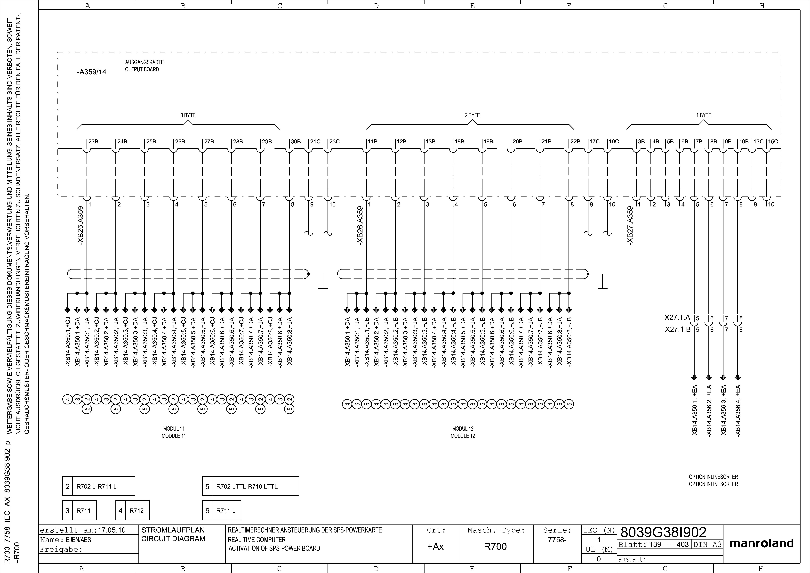

# +Ax — Sheet 139 of 403 — REALTIMERECHNER ANSTEUERUNG DER SPS POWERKARTE

**REAL TIME COMPUTER**

> Part of the manroland **R700** printing press IEC/UL circuit diagrams.
> Drawing class: **Stromlaufplan / Circuit diagram** (DIN A3).
> Document `+Ax` covers the **Central control console** machine section.

## At a glance

| Field | Value |
|---|---|
| Document | `+Ax`  (8039G38I902) |
| Sheet | **139** of 403 |
| Section (DE) | REALTIMERECHNER ANSTEUERUNG DER SPS POWERKARTE |
| Section (EN) | REAL TIME COMPUTER |
| Section type | CIRCUIT — Circuit diagram |
| Machine type | `R700` |
| Series | `7758` |
| Created | 17.05.10 |
| Replaces | — |
| Columns used | A, B, C, D, E, F, G, H |
| Path numbers | — |
| Labels on sheet | 203 |
| Cross-refs out | 0 |
| Cross-refs in | 38 |

**Previous:** [+Ax sheet 138](SHEET_0138.md) · **Next:** [+Ax sheet 140](SHEET_0140.md) · **Document TOC:** [_TOC.md](_TOC.md)  (+Ax) · **Master TOC:** [all sheets](../_MASTER_TOC.md)

## Sheet image (300 DPI, exact vector render)



_Rendered directly from the PDF vector layer at 300 DPI (1-bit), no OCR and no resampling. Use it to confirm anything ambiguous in the text below._

## Cross-references on this sheet

Each entry is a wire leaving this sheet. The printed token is `/sheet.column`; the link resolves to that sheet inside the same document.

_No outgoing cross-references on this sheet._

### Incoming references (sheets that point here)

Every other sheet that sends a wire to this one. `Back-ref` is the token printed on *that* sheet; `Path` is its line number.

| From sheet | Cols | Back-ref | Path | Refs | What continues there |
|---|---|---|---|---|---|
| [+Ax#267](SHEET_0267.md) | G | `/267.G` | — | 10 | — |
| [+Ax#269](SHEET_0269.md) | B | `/269.B` | — | 10 | — |
| [+Ax#270](SHEET_0270.md) | A, E | `/270.A`, `/270.E` | — | 18 | — |


## Devices on this sheet

| Tag | Class | Class meaning (IEC) | Col | Sub | Terminal | Sign |
|---|---|---|---|---|---|---|
| `A359/14` | A | Baugruppe / assembly, module, PC board | A | 14 | — | — |
| `R711` | R | Widerstand / resistor | A | — | — | — |
| `R712` | R | Widerstand / resistor | B | — | — | — |
| `XB25.A359` | — | cross-device reference | A | — | — | — |
| `XB26.A359` | — | cross-device reference | D | — | — | — |
| `XB27.A359` | — | cross-device reference | G | — | — | — |
| `X27.1.B` | — | cross-device reference | G | — | — | — |
| `X27.1.A` | — | cross-device reference | G | — | — | — |

## Potentials / nets

_No named potentials on this sheet._

## Wire-end annotations (grouped as printed)

A wire that continues elsewhere is annotated with a small cluster: the destination description, the path/line number `#NN`, and the `/sheet.column` cross reference. Each row below is one such cluster exactly as it is grouped on the drawing.

| Col | Y | Path | Cross-ref | Text on the wire |
|---|---|---|---|---|
| B | 88.5 | — | — | `OUTPUT BOARD AUSGANGSKARTE` |
| A | 100.9 | — | — | `A359/14` |
| D | 166.4 | — | — | `3.BYTE 2.BYTE` |
| G | 166.4 | — | — | `1.BYTE` |
| A | 204.4 | — | — | `23B` |
| A | 204.4 | — | — | `24B` |
| B | 204.4 | — | — | `25B` |
| B | 204.4 | — | — | `26B` |
| B | 204.4 | — | — | `27B` |
| C | 204.4 | — | — | `28B` |
| C | 204.4 | — | — | `29B` |
| C | 204.4 | — | — | `30B 21C 23C` |
| D | 204.4 | — | — | `11B` |
| D | 204.4 | — | — | `12B` |
| E | 204.4 | — | — | `13B` |
| E | 204.4 | — | — | `18B` |
| E | 204.4 | — | — | `19B` |
| E | 204.4 | — | — | `20B` |
| F | 204.4 | — | — | `21B` |
| F | 204.4 | — | — | `22B 17C 19C` |
| G | 204.4 | — | — | `3B 4B 5B 6B 7B 8B 9B 10B 13C` |
| H | 204.4 | — | — | `15C` |
| A | 296.5 | — | — | `1` |
| A | 296.5 | — | — | `2` |
| B | 296.5 | — | — | `3` |
| B | 296.5 | — | — | `4` |
| B | 296.5 | — | — | `5` |
| C | 296.5 | — | — | `6` |
| C | 296.5 | — | — | `7` |
| C | 296.5 | — | — | `8 9 10` |
| D | 296.5 | — | — | `1` |
| D | 296.5 | — | — | `2` |
| E | 296.5 | — | — | `3` |
| E | 296.5 | — | — | `4` |
| E | 296.5 | — | — | `5` |
| E | 296.5 | — | — | `6` |
| F | 296.5 | — | — | `7` |
| F | 296.5 | — | — | `8 9 10` |
| G | 296.5 | — | — | `1 2 3 4 5 6 7 8 9` |
| H | 296.5 | — | — | `10` |
| A | 302.7 | — | — | `XB25.A359` |
| D | 302.7 | — | — | `XB26.A359` |
| G | 302.7 | — | — | `XB27.A359` |
| G | 461.7 | — | — | `X27.1.A 5` |
| G | 463.8 | — | — | `6` |
| H | 463.8 | — | — | `7` |
| H | 463.8 | — | — | `8` |
| A | 465.4 | — | — | `XB14.A350:1,+CJ` |
| A | 465.4 | — | — | `XB14.A350:2,+CJ` |
| A | 465.4 | — | — | `XB14.A350:3,+CJ` |
| B | 465.4 | — | — | `XB14.A350:4,+CJ` |
| B | 465.4 | — | — | `XB14.A350:5,+CJ` |
| B | 465.4 | — | — | `XB14.A350:6,+CJ` |
| C | 465.4 | — | — | `XB14.A350:7,+CJ` |
| C | 465.4 | — | — | `XB14.A350:8,+CJ` |
| D | 466.0 | — | — | `XB14.A350:1,+JB` |
| D | 466.0 | — | — | `XB14.A350:2,+JB` |
| E | 466.0 | — | — | `XB14.A350:3,+JB` |
| E | 466.0 | — | — | `XB14.A350:4,+JB` |
| E | 466.0 | — | — | `XB14.A350:5,+JB` |
| E | 466.0 | — | — | `XB14.A350:6,+JB` |
| F | 466.0 | — | — | `XB14.A350:7,+JB` |
| F | 466.0 | — | — | `XB14.A350:8,+JB` |
| A | 466.3 | — | — | `XB14.A350:1,+DA` |
| A | 466.3 | — | — | `XB14.A350:1,+JA` |
| A | 466.3 | — | — | `XB14.A350:2,+DA` |
| A | 466.3 | — | — | `XB14.A350:2,+JA` |
| B | 466.3 | — | — | `XB14.A350:3,+DA` |
| B | 466.3 | — | — | `XB14.A350:3,+JA` |
| B | 466.3 | — | — | `XB14.A350:4,+DA` |
| B | 466.3 | — | — | `XB14.A350:4,+JA` |
| B | 466.3 | — | — | `XB14.A350:5,+DA` |
| B | 466.3 | — | — | `XB14.A350:5,+JA` |
| B | 466.3 | — | — | `XB14.A350:6,+DA` |
| C | 466.3 | — | — | `XB14.A350:6,+JA` |
| C | 466.3 | — | — | `XB14.A350:7,+DA` |
| C | 466.3 | — | — | `XB14.A350:7,+JA` |
| C | 466.3 | — | — | `XB14.A350:8,+DA` |
| C | 466.3 | — | — | `XB14.A350:8,+JA` |
| D | 466.3 | — | — | `XB14.A350:1,+DA` |
| D | 466.3 | — | — | `XB14.A350:1,+JA` |
| D | 466.3 | — | — | `XB14.A350:2,+DA` |
| D | 466.3 | — | — | `XB14.A350:2,+JA` |
| D | 466.3 | — | — | `XB14.A350:3,+DA` |
| D | 466.3 | — | — | `XB14.A350:3,+JA` |
| E | 466.3 | — | — | `XB14.A350:4,+DA` |
| E | 466.3 | — | — | `XB14.A350:4,+JA` |
| E | 466.3 | — | — | `XB14.A350:5,+DA` |
| E | 466.3 | — | — | `XB14.A350:5,+JA` |
| E | 466.3 | — | — | `XB14.A350:6,+DA` |
| E | 466.3 | — | — | `XB14.A350:6,+JA` |
| F | 466.3 | — | — | `XB14.A350:7,+DA` |
| F | 466.3 | — | — | `XB14.A350:7,+JA` |
| F | 466.3 | — | — | `XB14.A350:8,+DA` |
| F | 466.3 | — | — | `XB14.A350:8,+JA` |
| G | 479.4 | — | — | `X27.1.B 5` |
| G | 480.8 | — | — | `6` |
| H | 480.8 | — | — | `7` |
| H | 480.8 | — | — | `8` |
| G | 565.5 | — | — | `XB14.A356:1, +EA` |
| G | 565.5 | — | — | `XB14.A356:2, +EA` |
| H | 565.5 | — | — | `XB14.A356:3, +EA` |
| H | 565.5 | — | — | `XB14.A356:4, +EA` |
| A | 584.8 | — | — | `4` |
| A | 584.8 | — | — | `3` |
| A | 584.8 | — | — | `2` |
| A | 584.8 | — | — | `4` |
| A | 584.8 | — | — | `3` |
| A | 584.8 | — | — | `2` |
| A | 584.8 | — | — | `4` |
| B | 584.8 | — | — | `3` |
| B | 584.8 | — | — | `2` |
| B | 584.8 | — | — | `4` |
| B | 584.8 | — | — | `3` |
| B | 584.8 | — | — | `2` |
| B | 584.8 | — | — | `4` |
| B | 584.8 | — | — | `3` |
| B | 584.8 | — | — | `2` |
| B | 584.8 | — | — | `4` |
| B | 584.8 | — | — | `3` |
| C | 584.8 | — | — | `2` |
| C | 584.8 | — | — | `4` |
| C | 584.8 | — | — | `3` |
| C | 584.8 | — | — | `2` |
| C | 584.8 | — | — | `4` |
| C | 584.8 | — | — | `3` |
| C | 584.8 | — | — | `2` |
| D | 591.9 | — | — | `4` |
| D | 591.9 | — | — | `6` |
| D | 591.9 | — | — | `5` |
| D | 591.9 | — | — | `4` |
| D | 591.9 | — | — | `6` |
| D | 591.9 | — | — | `5` |
| D | 591.9 | — | — | `4` |
| D | 591.9 | — | — | `6` |
| E | 591.9 | — | — | `5` |
| E | 591.9 | — | — | `4` |
| E | 591.9 | — | — | `6` |
| E | 591.9 | — | — | `5` |
| E | 591.9 | — | — | `4` |
| E | 591.9 | — | — | `6` |
| E | 591.9 | — | — | `5` |
| E | 591.9 | — | — | `4` |
| E | 591.9 | — | — | `6` |
| E | 591.9 | — | — | `5` |
| F | 591.9 | — | — | `4` |
| F | 591.9 | — | — | `6` |
| F | 591.9 | — | — | `5` |
| F | 591.9 | — | — | `4` |
| F | 591.9 | — | — | `6` |
| F | 591.9 | — | — | `5` |
| A | 599.0 | — | — | `5` |
| A | 599.0 | — | — | `5` |
| B | 599.0 | — | — | `5` |
| B | 599.0 | — | — | `5` |
| B | 599.0 | — | — | `5` |
| C | 599.0 | — | — | `5` |
| C | 599.0 | — | — | `5` |
| C | 599.0 | — | — | `5` |
| B | 627.1 | — | — | `MODULE 11 MODUL 11` |
| E | 627.1 | — | — | `MODULE 12 MODUL 12` |
| G | 698.0 | — | — | `OPTION INLINESORTER OPTION INLINESORTER` |
| B | 710.4 | — | — | `2 5` |
| A | 711.1 | — | — | `R702 L R711 L` |
| C | 711.1 | — | — | `R702 LTTL R710 LTTL` |
| B | 745.8 | — | — | `3 6` |
| A | 745.8 | — | — | `4 R712` |
| A | 746.5 | — | — | `R711` |
| B | 746.5 | — | — | `R711 L` |


## Reconstructed tables

This sheet carries tabular content (pin map / terminal assignment / index). The grid below was rebuilt from the drawing's own rule lines, so each row is exactly one physical row of the table.

### Table 1 — 1 data rows × 29 columns (at x=127.6, y=182.8)

| 23B | 24B | 25B | 26B | 27B | 28B | 29B | 30B | 21C | 23C | 11B | 12B | 13B | 18B | 19B | 20B | 21B | 22B | 17C | 19C | 3B | 4B | 5B | 6B | 7B | 8B | 9B | 10B | 13C |
|---|---|---|---|---|---|---|---|---|---|---|---|---|---|---|---|---|---|---|---|---|---|---|---|---|---|---|---|---|
| `1` | `2` | `3` | `4` | `5` | `6` | `7` | `8` | `9` | `10 XB26.A359` | `1` | `2` | `3` | `4` | `5` | `6` | `7` | `8` | `9` | `10 XB27.A359` | `1` | `2` | `3` | `4` | `5` | `6` | `7` | `8` | `9` |


## Notes and free text on this sheet

| Text | Col | Y (pt) |
|---|---|---|
| `AUSGANGSKARTE` | B | 88.5 |
| `OUTPUT BOARD` | B | 99.14 |
| `XB14.A350:1,+JA` | A | 466.3 |
| `XB14.A350:1,+DA` | A | 466.3 |
| `XB14.A350:2,+DA` | D | 466.3 |
| `XB14.A350:1,+JB` | D | 466.02 |
| `XB14.A350:2,+JA` | A | 466.3 |
| `XB14.A350:2,+DA` | A | 466.3 |
| `XB14.A350:3,+JA` | B | 466.3 |
| `XB14.A350:3,+DA` | B | 466.3 |
| `XB14.A350:4,+JA` | B | 466.3 |
| `XB14.A350:4,+DA` | B | 466.3 |
| `XB14.A350:5,+JA` | B | 466.3 |
| `XB14.A350:5,+DA` | B | 466.3 |
| `XB14.A350:6,+JA` | C | 466.3 |
| `XB14.A350:6,+DA` | B | 466.3 |
| `XB14.A350:7,+JA` | C | 466.3 |
| `XB14.A350:7,+DA` | C | 466.3 |
| `XB14.A350:8,+JA` | C | 466.3 |
| `XB14.A350:8,+DA` | C | 466.3 |
| `XB14.A350:5,+CJ` | B | 465.45 |
| `XB14.A350:1,+CJ` | A | 465.45 |
| `XB14.A350:2,+CJ` | A | 465.45 |
| `XB14.A350:3,+CJ` | A | 465.45 |
| `XB14.A350:4,+CJ` | B | 465.45 |
| `XB14.A350:6,+CJ` | B | 465.45 |
| `XB14.A350:7,+CJ` | C | 465.45 |
| `XB14.A350:8,+CJ` | C | 465.45 |
| `XB14.A350:3,+DA` | D | 466.3 |
| `XB14.A350:2,+JB` | D | 466.02 |
| `XB14.A350:4,+DA` | E | 466.3 |
| `XB14.A350:3,+JB` | E | 466.02 |
| `XB14.A350:5,+DA` | E | 466.3 |
| `XB14.A350:4,+JB` | E | 466.02 |
| `XB14.A350:6,+DA` | E | 466.3 |
| `XB14.A350:5,+JB` | E | 466.02 |
| `XB14.A350:7,+DA` | F | 466.3 |
| `XB14.A350:6,+JB` | E | 466.02 |
| `XB14.A350:8,+DA` | F | 466.3 |
| `XB14.A350:7,+JB` | F | 466.02 |
| `XB14.A350:8,+JB` | F | 466.02 |
| `XB14.A350:1,+DA` | D | 466.3 |
| `XB14.A350:1,+JA` | D | 466.3 |
| `XB14.A350:2,+JA` | D | 466.3 |
| `XB14.A350:3,+JA` | D | 466.3 |
| `XB14.A350:4,+JA` | E | 466.3 |
| `XB14.A350:5,+JA` | E | 466.3 |
| `XB14.A350:6,+JA` | E | 466.3 |
| `XB14.A350:7,+JA` | F | 466.3 |
| `XB14.A350:8,+JA` | F | 466.3 |
| `XB14.A356:3, +EA` | H | 565.52 |
| `XB14.A356:4, +EA` | H | 565.52 |
| `XB14.A356:2, +EA` | G | 565.52 |
| `XB14.A356:1, +EA` | G | 565.52 |
| `23B` | A | 204.38 |
| `11B` | D | 204.38 |
| `24B` | A | 204.38 |
| `25B` | B | 204.38 |
| `26B` | B | 204.38 |
| `27B` | B | 204.38 |
| `28B` | C | 204.38 |
| `29B` | C | 204.38 |
| `30B` | C | 204.38 |
| `21C` | C | 204.36 |
| `23C` | D | 204.36 |
| `13C` | H | 204.36 |
| `10B` | H | 204.38 |
| `9B` | H | 204.39 |
| `8B` | H | 204.39 |
| `7B` | G | 204.39 |
| `6B` | G | 204.39 |
| `5B` | G | 204.39 |
| `4B` | G | 204.39 |
| `3B` | G | 204.39 |
| `12B` | D | 204.38 |
| `13B` | E | 204.38 |
| `18B` | E | 204.38 |
| `19B` | E | 204.38 |
| `20B` | E | 204.38 |
| `21B` | F | 204.38 |
| `22B` | F | 204.38 |
| `17C` | F | 204.36 |
| `19C` | F | 204.36 |
| `15C` | H | 204.36 |
| `R702 LTTL R710 LTTL` | C | 711.09 |
| `R711 L` | B | 746.53 |
| `R702 L R711 L` | A | 711.1 |
| `MODUL 11` | B | 627.07 |
| `MODULE 11` | B | 637.7 |
| `MODUL 12` | E | 627.1 |
| `MODULE 12` | E | 637.73 |
| `3.BYTE` | B | 166.4 |
| `2.BYTE` | E | 166.4 |
| `OPTION INLINESORTER` | G | 697.95 |
| `1.BYTE` | G | 166.38 |

## Complete label inventory (exact text from the drawing)

Every text object inside the drawing area of this sheet, in DIN reading order (column A→H, then top→bottom). This is the authoritative list: if a string is not here it is not printed on this sheet.

| Col | Y | X | Dir | Type | Text |
|---|---|---|---|---|---|
| A | 100.9 | 113.4 | → | device tag | `A359/14` |
| A | 204.4 | 130.1 | → | text | `23B` |
| A | 204.4 | 172.6 | → | text | `24B` |
| A | 296.5 | 129.5 | → | number | `1` |
| A | 296.5 | 172.6 | → | number | `2` |
| A | 302.7 | 113.7 | ↕ | device ref | `XB25.A359` |
| A | 465.4 | 95.9 | ↕ | text | `XB14.A350:1,+CJ` |
| A | 465.4 | 138.5 | ↕ | text | `XB14.A350:2,+CJ` |
| A | 465.4 | 181.0 | ↕ | text | `XB14.A350:3,+CJ` |
| A | 466.3 | 110.1 | ↕ | text | `XB14.A350:1,+DA` |
| A | 466.3 | 124.3 | ↕ | text | `XB14.A350:1,+JA` |
| A | 466.3 | 152.6 | ↕ | text | `XB14.A350:2,+DA` |
| A | 466.3 | 166.8 | ↕ | text | `XB14.A350:2,+JA` |
| A | 584.8 | 96.7 | ↕ | number | `4` |
| A | 584.8 | 110.8 | ↕ | number | `3` |
| A | 584.8 | 125.0 | ↕ | number | `2` |
| A | 584.8 | 139.2 | ↕ | number | `4` |
| A | 584.8 | 153.4 | ↕ | number | `3` |
| A | 584.8 | 167.5 | ↕ | number | `2` |
| A | 584.8 | 181.7 | ↕ | number | `4` |
| A | 599.0 | 125.0 | ↕ | number | `5` |
| A | 599.0 | 167.5 | ↕ | number | `5` |
| A | 710.3 | 96.4 | → | number | `2` |
| A | 711.1 | 112.5 | → | text | `R702 L R711 L` |
| A | 745.8 | 96.2 | → | number | `3` |
| A | 745.8 | 174.3 | → | number | `4` |
| A | 746.5 | 112.5 | → | device tag | `R711` |
| B | 88.5 | 184.3 | → | text | `AUSGANGSKARTE` |
| B | 99.1 | 184.0 | → | text | `OUTPUT BOARD` |
| B | 166.4 | 265.5 | → | text | `3.BYTE` |
| B | 204.4 | 215.1 | → | text | `25B` |
| B | 204.4 | 257.7 | → | text | `26B` |
| B | 204.4 | 300.2 | → | text | `27B` |
| B | 296.5 | 215.1 | → | number | `3` |
| B | 296.5 | 257.7 | → | number | `4` |
| B | 296.5 | 300.2 | → | number | `5` |
| B | 465.4 | 223.5 | ↕ | text | `XB14.A350:4,+CJ` |
| B | 465.4 | 266.0 | ↕ | text | `XB14.A350:5,+CJ` |
| B | 465.4 | 308.5 | ↕ | text | `XB14.A350:6,+CJ` |
| B | 466.3 | 195.2 | ↕ | text | `XB14.A350:3,+DA` |
| B | 466.3 | 209.3 | ↕ | text | `XB14.A350:3,+JA` |
| B | 466.3 | 237.7 | ↕ | text | `XB14.A350:4,+DA` |
| B | 466.3 | 251.8 | ↕ | text | `XB14.A350:4,+JA` |
| B | 466.3 | 280.2 | ↕ | text | `XB14.A350:5,+DA` |
| B | 466.3 | 294.4 | ↕ | text | `XB14.A350:5,+JA` |
| B | 466.3 | 322.7 | ↕ | text | `XB14.A350:6,+DA` |
| B | 584.8 | 195.9 | ↕ | number | `3` |
| B | 584.8 | 210.1 | ↕ | number | `2` |
| B | 584.8 | 224.2 | ↕ | number | `4` |
| B | 584.8 | 238.4 | ↕ | number | `3` |
| B | 584.8 | 252.6 | ↕ | number | `2` |
| B | 584.8 | 266.7 | ↕ | number | `4` |
| B | 584.8 | 280.9 | ↕ | number | `3` |
| B | 584.8 | 295.1 | ↕ | number | `2` |
| B | 584.8 | 309.3 | ↕ | number | `4` |
| B | 584.8 | 323.4 | ↕ | number | `3` |
| B | 599.0 | 210.1 | ↕ | number | `5` |
| B | 599.0 | 252.6 | ↕ | number | `5` |
| B | 599.0 | 295.1 | ↕ | number | `5` |
| B | 627.1 | 240.0 | → | text | `MODUL 11` |
| B | 637.7 | 237.8 | → | text | `MODULE 11` |
| B | 710.3 | 301.7 | → | number | `5` |
| B | 745.8 | 301.9 | → | number | `6` |
| B | 746.5 | 190.5 | → | device tag | `R712` |
| B | 746.5 | 318.0 | → | text | `R711 L` |
| C | 204.4 | 342.7 | → | text | `28B` |
| C | 204.4 | 385.2 | → | text | `29B` |
| C | 204.4 | 427.7 | → | text | `30B` |
| C | 204.4 | 456.1 | → | text | `21C` |
| C | 296.5 | 342.7 | → | number | `6` |
| C | 296.5 | 385.2 | → | number | `7` |
| C | 296.5 | 427.7 | → | number | `8` |
| C | 296.5 | 456.1 | → | number | `9` |
| C | 465.4 | 351.1 | ↕ | text | `XB14.A350:7,+CJ` |
| C | 465.4 | 393.6 | ↕ | text | `XB14.A350:8,+CJ` |
| C | 466.3 | 336.9 | ↕ | text | `XB14.A350:6,+JA` |
| C | 466.3 | 365.2 | ↕ | text | `XB14.A350:7,+DA` |
| C | 466.3 | 379.4 | ↕ | text | `XB14.A350:7,+JA` |
| C | 466.3 | 407.8 | ↕ | text | `XB14.A350:8,+DA` |
| C | 466.3 | 421.9 | ↕ | text | `XB14.A350:8,+JA` |
| C | 584.8 | 337.6 | ↕ | number | `2` |
| C | 584.8 | 351.8 | ↕ | number | `4` |
| C | 584.8 | 366.0 | ↕ | number | `3` |
| C | 584.8 | 380.1 | ↕ | number | `2` |
| C | 584.8 | 394.3 | ↕ | number | `4` |
| C | 584.8 | 408.5 | ↕ | number | `3` |
| C | 584.8 | 422.7 | ↕ | number | `2` |
| C | 599.0 | 337.6 | ↕ | number | `5` |
| C | 599.0 | 380.1 | ↕ | number | `5` |
| C | 599.0 | 422.7 | ↕ | number | `5` |
| C | 711.1 | 318.0 | → | text | `R702 LTTL R710 LTTL` |
| D | 204.4 | 484.4 | → | text | `23C` |
| D | 204.4 | 540.6 | → | text | `11B` |
| D | 204.4 | 583.1 | → | text | `12B` |
| D | 296.5 | 483.9 | → | number | `10` |
| D | 296.5 | 540.6 | → | number | `1` |
| D | 296.5 | 583.7 | → | number | `2` |
| D | 302.7 | 524.7 | ↕ | device ref | `XB26.A359` |
| D | 466.0 | 535.3 | ↕ | text | `XB14.A350:1,+JB` |
| D | 466.0 | 577.8 | ↕ | text | `XB14.A350:2,+JB` |
| D | 466.3 | 507.0 | ↕ | text | `XB14.A350:1,+DA` |
| D | 466.3 | 521.1 | ↕ | text | `XB14.A350:1,+JA` |
| D | 466.3 | 549.5 | ↕ | text | `XB14.A350:2,+DA` |
| D | 466.3 | 563.6 | ↕ | text | `XB14.A350:2,+JA` |
| D | 466.3 | 592.0 | ↕ | text | `XB14.A350:3,+DA` |
| D | 466.3 | 606.2 | ↕ | text | `XB14.A350:3,+JA` |
| D | 591.9 | 507.7 | ↕ | number | `4` |
| D | 591.9 | 521.9 | ↕ | number | `6` |
| D | 591.9 | 536.0 | ↕ | number | `5` |
| D | 591.9 | 550.2 | ↕ | number | `4` |
| D | 591.9 | 564.4 | ↕ | number | `6` |
| D | 591.9 | 578.6 | ↕ | number | `5` |
| D | 591.9 | 592.7 | ↕ | number | `4` |
| D | 591.9 | 606.9 | ↕ | number | `6` |
| E | 166.4 | 683.6 | → | text | `2.BYTE` |
| E | 204.4 | 625.6 | → | text | `13B` |
| E | 204.4 | 668.1 | → | text | `18B` |
| E | 204.4 | 710.6 | → | text | `19B` |
| E | 204.4 | 753.7 | → | text | `20B` |
| E | 296.5 | 626.2 | → | number | `3` |
| E | 296.5 | 668.7 | → | number | `4` |
| E | 296.5 | 711.2 | → | number | `5` |
| E | 296.5 | 753.7 | → | number | `6` |
| E | 466.0 | 620.3 | ↕ | text | `XB14.A350:3,+JB` |
| E | 466.0 | 662.9 | ↕ | text | `XB14.A350:4,+JB` |
| E | 466.0 | 705.4 | ↕ | text | `XB14.A350:5,+JB` |
| E | 466.0 | 747.9 | ↕ | text | `XB14.A350:6,+JB` |
| E | 466.3 | 634.5 | ↕ | text | `XB14.A350:4,+DA` |
| E | 466.3 | 648.7 | ↕ | text | `XB14.A350:4,+JA` |
| E | 466.3 | 677.0 | ↕ | text | `XB14.A350:5,+DA` |
| E | 466.3 | 691.2 | ↕ | text | `XB14.A350:5,+JA` |
| E | 466.3 | 719.6 | ↕ | text | `XB14.A350:6,+DA` |
| E | 466.3 | 733.7 | ↕ | text | `XB14.A350:6,+JA` |
| E | 591.9 | 621.1 | ↕ | number | `5` |
| E | 591.9 | 635.3 | ↕ | number | `4` |
| E | 591.9 | 649.4 | ↕ | number | `6` |
| E | 591.9 | 663.6 | ↕ | number | `5` |
| E | 591.9 | 677.8 | ↕ | number | `4` |
| E | 591.9 | 691.9 | ↕ | number | `6` |
| E | 591.9 | 706.1 | ↕ | number | `5` |
| E | 591.9 | 720.3 | ↕ | number | `4` |
| E | 591.9 | 734.5 | ↕ | number | `6` |
| E | 591.9 | 748.6 | ↕ | number | `5` |
| E | 627.1 | 664.8 | → | text | `MODUL 12` |
| E | 637.7 | 662.6 | → | text | `MODULE 12` |
| F | 204.4 | 796.3 | → | text | `21B` |
| F | 204.4 | 838.8 | → | text | `22B` |
| F | 204.4 | 866.6 | → | text | `17C` |
| F | 204.4 | 894.9 | → | text | `19C` |
| F | 296.5 | 796.3 | → | number | `7` |
| F | 296.5 | 838.8 | → | number | `8` |
| F | 296.5 | 867.1 | → | number | `9` |
| F | 296.5 | 894.9 | → | number | `10` |
| F | 466.0 | 790.4 | ↕ | text | `XB14.A350:7,+JB` |
| F | 466.0 | 832.9 | ↕ | text | `XB14.A350:8,+JB` |
| F | 466.3 | 762.1 | ↕ | text | `XB14.A350:7,+DA` |
| F | 466.3 | 776.2 | ↕ | text | `XB14.A350:7,+JA` |
| F | 466.3 | 804.6 | ↕ | text | `XB14.A350:8,+DA` |
| F | 466.3 | 818.8 | ↕ | text | `XB14.A350:8,+JA` |
| F | 591.9 | 762.8 | ↕ | number | `4` |
| F | 591.9 | 777.0 | ↕ | number | `6` |
| F | 591.9 | 791.2 | ↕ | number | `5` |
| F | 591.9 | 805.3 | ↕ | number | `4` |
| F | 591.9 | 819.5 | ↕ | number | `6` |
| F | 591.9 | 833.7 | ↕ | number | `5` |
| G | 166.4 | 1023.4 | → | text | `1.BYTE` |
| G | 204.4 | 938.0 | → | text | `3B` |
| G | 204.4 | 959.2 | → | text | `4B` |
| G | 204.4 | 980.5 | → | text | `5B` |
| G | 204.4 | 1001.8 | → | text | `6B` |
| G | 204.4 | 1022.7 | → | text | `7B` |
| G | 296.5 | 937.4 | → | number | `1` |
| G | 296.5 | 959.2 | → | number | `2` |
| G | 296.5 | 980.5 | → | number | `3` |
| G | 296.5 | 1001.8 | → | number | `4` |
| G | 296.5 | 1023.0 | → | number | `5` |
| G | 296.5 | 1044.3 | → | number | `6` |
| G | 302.7 | 921.6 | ↕ | device ref | `XB27.A359` |
| G | 461.7 | 973.4 | → | device ref | `X27.1.A` |
| G | 463.8 | 1023.0 | → | number | `5` |
| G | 463.8 | 1044.3 | → | number | `6` |
| G | 479.4 | 974.3 | → | device ref | `X27.1.B` |
| G | 480.8 | 1023.0 | → | number | `5` |
| G | 480.8 | 1044.3 | → | number | `6` |
| G | 565.5 | 1017.2 | ↕ | text | `XB14.A356:1, +EA` |
| G | 565.5 | 1038.5 | ↕ | text | `XB14.A356:2, +EA` |
| G | 698.0 | 1012.8 | → | text | `OPTION INLINESORTER` |
| G | 708.6 | 1012.8 | → | text | `OPTION INLINESORTER` |
| H | 204.4 | 1044.3 | → | text | `8B` |
| H | 204.4 | 1065.5 | → | text | `9B` |
| H | 204.4 | 1086.2 | → | text | `10B` |
| H | 204.4 | 1107.5 | → | text | `13C` |
| H | 204.4 | 1128.8 | → | text | `15C` |
| H | 296.5 | 1065.5 | → | number | `7` |
| H | 296.5 | 1086.8 | → | number | `8` |
| H | 296.5 | 1108.1 | → | number | `9` |
| H | 296.5 | 1128.8 | → | number | `10` |
| H | 463.8 | 1065.5 | → | number | `7` |
| H | 463.8 | 1086.8 | → | number | `8` |
| H | 480.8 | 1065.5 | → | number | `7` |
| H | 480.8 | 1086.8 | → | number | `8` |
| H | 565.5 | 1059.7 | ↕ | text | `XB14.A356:3, +EA` |
| H | 565.5 | 1081.0 | ↕ | text | `XB14.A356:4, +EA` |

## Reading-order text block

The same content as a plain block, grouped by DIN column — convenient to paste or to match against a visual description.

```text
=== Column A ===
 100.9  113.4  devtag       A359/14
 204.4  130.1  text         23B
 204.4  172.6  text         24B
 296.5  129.5  numeric      1
 296.5  172.6  numeric      2
 302.7  113.7  devref       XB25.A359
 465.4   95.9  text         XB14.A350:1,+CJ
 465.4  138.5  text         XB14.A350:2,+CJ
 465.4  181.0  text         XB14.A350:3,+CJ
 466.3  110.1  text         XB14.A350:1,+DA
 466.3  124.3  text         XB14.A350:1,+JA
 466.3  152.6  text         XB14.A350:2,+DA
 466.3  166.8  text         XB14.A350:2,+JA
 584.8   96.7  numeric      4
 584.8  110.8  numeric      3
 584.8  125.0  numeric      2
 584.8  139.2  numeric      4
 584.8  153.4  numeric      3
 584.8  167.5  numeric      2
 584.8  181.7  numeric      4
 599.0  125.0  numeric      5
 599.0  167.5  numeric      5
 710.3   96.4  numeric      2
 711.1  112.5  text         R702 L R711 L
 745.8   96.2  numeric      3
 745.8  174.3  numeric      4
 746.5  112.5  devtag       R711
=== Column B ===
  88.5  184.3  text         AUSGANGSKARTE
  99.1  184.0  text         OUTPUT BOARD
 166.4  265.5  text         3.BYTE
 204.4  215.1  text         25B
 204.4  257.7  text         26B
 204.4  300.2  text         27B
 296.5  215.1  numeric      3
 296.5  257.7  numeric      4
 296.5  300.2  numeric      5
 465.4  223.5  text         XB14.A350:4,+CJ
 465.4  266.0  text         XB14.A350:5,+CJ
 465.4  308.5  text         XB14.A350:6,+CJ
 466.3  195.2  text         XB14.A350:3,+DA
 466.3  209.3  text         XB14.A350:3,+JA
 466.3  237.7  text         XB14.A350:4,+DA
 466.3  251.8  text         XB14.A350:4,+JA
 466.3  280.2  text         XB14.A350:5,+DA
 466.3  294.4  text         XB14.A350:5,+JA
 466.3  322.7  text         XB14.A350:6,+DA
 584.8  195.9  numeric      3
 584.8  210.1  numeric      2
 584.8  224.2  numeric      4
 584.8  238.4  numeric      3
 584.8  252.6  numeric      2
 584.8  266.7  numeric      4
 584.8  280.9  numeric      3
 584.8  295.1  numeric      2
 584.8  309.3  numeric      4
 584.8  323.4  numeric      3
 599.0  210.1  numeric      5
 599.0  252.6  numeric      5
 599.0  295.1  numeric      5
 627.1  240.0  text         MODUL 11
 637.7  237.8  text         MODULE 11
 710.3  301.7  numeric      5
 745.8  301.9  numeric      6
 746.5  190.5  devtag       R712
 746.5  318.0  text         R711 L
=== Column C ===
 204.4  342.7  text         28B
 204.4  385.2  text         29B
 204.4  427.7  text         30B
 204.4  456.1  text         21C
 296.5  342.7  numeric      6
 296.5  385.2  numeric      7
 296.5  427.7  numeric      8
 296.5  456.1  numeric      9
 465.4  351.1  text         XB14.A350:7,+CJ
 465.4  393.6  text         XB14.A350:8,+CJ
 466.3  336.9  text         XB14.A350:6,+JA
 466.3  365.2  text         XB14.A350:7,+DA
 466.3  379.4  text         XB14.A350:7,+JA
 466.3  407.8  text         XB14.A350:8,+DA
 466.3  421.9  text         XB14.A350:8,+JA
 584.8  337.6  numeric      2
 584.8  351.8  numeric      4
 584.8  366.0  numeric      3
 584.8  380.1  numeric      2
 584.8  394.3  numeric      4
 584.8  408.5  numeric      3
 584.8  422.7  numeric      2
 599.0  337.6  numeric      5
 599.0  380.1  numeric      5
 599.0  422.7  numeric      5
 711.1  318.0  text         R702 LTTL R710 LTTL
=== Column D ===
 204.4  484.4  text         23C
 204.4  540.6  text         11B
 204.4  583.1  text         12B
 296.5  483.9  numeric      10
 296.5  540.6  numeric      1
 296.5  583.7  numeric      2
 302.7  524.7  devref       XB26.A359
 466.0  535.3  text         XB14.A350:1,+JB
 466.0  577.8  text         XB14.A350:2,+JB
 466.3  507.0  text         XB14.A350:1,+DA
 466.3  521.1  text         XB14.A350:1,+JA
 466.3  549.5  text         XB14.A350:2,+DA
 466.3  563.6  text         XB14.A350:2,+JA
 466.3  592.0  text         XB14.A350:3,+DA
 466.3  606.2  text         XB14.A350:3,+JA
 591.9  507.7  numeric      4
 591.9  521.9  numeric      6
 591.9  536.0  numeric      5
 591.9  550.2  numeric      4
 591.9  564.4  numeric      6
 591.9  578.6  numeric      5
 591.9  592.7  numeric      4
 591.9  606.9  numeric      6
=== Column E ===
 166.4  683.6  text         2.BYTE
 204.4  625.6  text         13B
 204.4  668.1  text         18B
 204.4  710.6  text         19B
 204.4  753.7  text         20B
 296.5  626.2  numeric      3
 296.5  668.7  numeric      4
 296.5  711.2  numeric      5
 296.5  753.7  numeric      6
 466.0  620.3  text         XB14.A350:3,+JB
 466.0  662.9  text         XB14.A350:4,+JB
 466.0  705.4  text         XB14.A350:5,+JB
 466.0  747.9  text         XB14.A350:6,+JB
 466.3  634.5  text         XB14.A350:4,+DA
 466.3  648.7  text         XB14.A350:4,+JA
 466.3  677.0  text         XB14.A350:5,+DA
 466.3  691.2  text         XB14.A350:5,+JA
 466.3  719.6  text         XB14.A350:6,+DA
 466.3  733.7  text         XB14.A350:6,+JA
 591.9  621.1  numeric      5
 591.9  635.3  numeric      4
 591.9  649.4  numeric      6
 591.9  663.6  numeric      5
 591.9  677.8  numeric      4
 591.9  691.9  numeric      6
 591.9  706.1  numeric      5
 591.9  720.3  numeric      4
 591.9  734.5  numeric      6
 591.9  748.6  numeric      5
 627.1  664.8  text         MODUL 12
 637.7  662.6  text         MODULE 12
=== Column F ===
 204.4  796.3  text         21B
 204.4  838.8  text         22B
 204.4  866.6  text         17C
 204.4  894.9  text         19C
 296.5  796.3  numeric      7
 296.5  838.8  numeric      8
 296.5  867.1  numeric      9
 296.5  894.9  numeric      10
 466.0  790.4  text         XB14.A350:7,+JB
 466.0  832.9  text         XB14.A350:8,+JB
 466.3  762.1  text         XB14.A350:7,+DA
 466.3  776.2  text         XB14.A350:7,+JA
 466.3  804.6  text         XB14.A350:8,+DA
 466.3  818.8  text         XB14.A350:8,+JA
 591.9  762.8  numeric      4
 591.9  777.0  numeric      6
 591.9  791.2  numeric      5
 591.9  805.3  numeric      4
 591.9  819.5  numeric      6
 591.9  833.7  numeric      5
=== Column G ===
 166.4 1023.4  text         1.BYTE
 204.4  938.0  text         3B
 204.4  959.2  text         4B
 204.4  980.5  text         5B
 204.4 1001.8  text         6B
 204.4 1022.7  text         7B
 296.5  937.4  numeric      1
 296.5  959.2  numeric      2
 296.5  980.5  numeric      3
 296.5 1001.8  numeric      4
 296.5 1023.0  numeric      5
 296.5 1044.3  numeric      6
 302.7  921.6  devref       XB27.A359
 461.7  973.4  devref       X27.1.A
 463.8 1023.0  numeric      5
 463.8 1044.3  numeric      6
 479.4  974.3  devref       X27.1.B
 480.8 1023.0  numeric      5
 480.8 1044.3  numeric      6
 565.5 1017.2  text         XB14.A356:1, +EA
 565.5 1038.5  text         XB14.A356:2, +EA
 698.0 1012.8  text         OPTION INLINESORTER
 708.6 1012.8  text         OPTION INLINESORTER
=== Column H ===
 204.4 1044.3  text         8B
 204.4 1065.5  text         9B
 204.4 1086.2  text         10B
 204.4 1107.5  text         13C
 204.4 1128.8  text         15C
 296.5 1065.5  numeric      7
 296.5 1086.8  numeric      8
 296.5 1108.1  numeric      9
 296.5 1128.8  numeric      10
 463.8 1065.5  numeric      7
 463.8 1086.8  numeric      8
 480.8 1065.5  numeric      7
 480.8 1086.8  numeric      8
 565.5 1059.7  text         XB14.A356:3, +EA
 565.5 1081.0  text         XB14.A356:4, +EA
```

---
_Generated from the PDF vector text layer; no OCR. Source: `R700_7758_IEC_AX_8039G38I902_p`, sheet 139._
