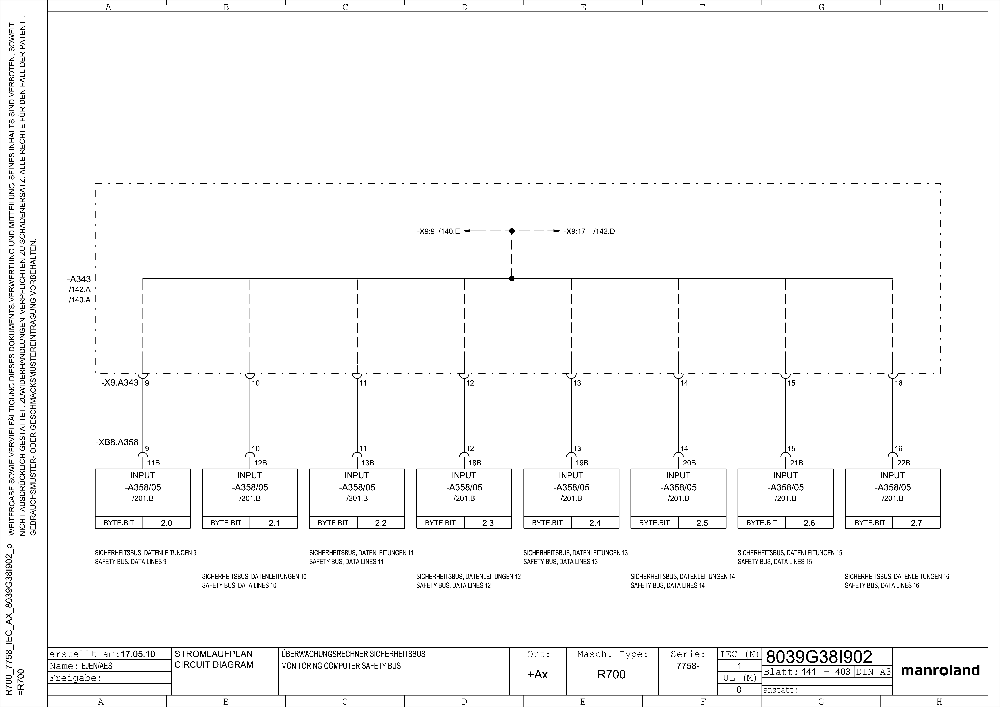

# +Ax — Sheet 141 of 403 — ÜBERWACHUNGSRECHNER SICHERHEITSBUS

**MONITORING COMPUTER SAFETY BUS**

> Part of the manroland **R700** printing press IEC/UL circuit diagrams.
> Drawing class: **Stromlaufplan / Circuit diagram** (DIN A3).
> Document `+Ax` covers the **Central control console** machine section.

## At a glance

| Field | Value |
|---|---|
| Document | `+Ax`  (8039G38I902) |
| Sheet | **141** of 403 |
| Section (DE) | ÜBERWACHUNGSRECHNER SICHERHEITSBUS |
| Section (EN) | MONITORING COMPUTER SAFETY BUS |
| Section type | CIRCUIT — Circuit diagram |
| Machine type | `R700` |
| Series | `7758` |
| Created | 17.05.10 |
| Replaces | — |
| Columns used | A, B, C, D, E, F, G, H |
| Path numbers | — |
| Labels on sheet | 89 |
| Cross-refs out | 12 |
| Cross-refs in | 28 |

**Previous:** [+Ax sheet 140](SHEET_0140.md) · **Next:** [+Ax sheet 142](SHEET_0142.md) · **Document TOC:** [_TOC.md](_TOC.md)  (+Ax) · **Master TOC:** [all sheets](../_MASTER_TOC.md)

## Sheet image (300 DPI, exact vector render)



_Rendered directly from the PDF vector layer at 300 DPI (1-bit), no OCR and no resampling. Use it to confirm anything ambiguous in the text below._

## Cross-references on this sheet

Each entry is a wire leaving this sheet. The printed token is `/sheet.column`; the link resolves to that sheet inside the same document.

| Ref | Target sheet | Col | Path | Destination on target | Target section | From col |
|---|---|---|---|---|---|---|
| `/140.E` | [+Ax sheet 140](SHEET_0140.md) | E | — | X9:9 X9:17 | ÜBERWACHUNGSRECHNER SICHERHEITSBUS | D |
| `/142.D` | [+Ax sheet 142](SHEET_0142.md) | D | — | X9:9 X9:17 | ÜBERWACHUNGSRECHNER SICHERHEITSBUS | D |
| `/142.A` | [+Ax sheet 142](SHEET_0142.md) | A | — | — | ÜBERWACHUNGSRECHNER SICHERHEITSBUS | A |
| `/140.A` | [+Ax sheet 140](SHEET_0140.md) | A | — | — | ÜBERWACHUNGSRECHNER SICHERHEITSBUS | A |
| `/201.B` | [+Ax sheet 201](SHEET_0201.md) | B | — | — | REFERENZMODUL | A |
| `/201.B` | [+Ax sheet 201](SHEET_0201.md) | B | — | — | REFERENZMODUL | B |
| `/201.B` | [+Ax sheet 201](SHEET_0201.md) | B | — | — | REFERENZMODUL | C |
| `/201.B` | [+Ax sheet 201](SHEET_0201.md) | B | — | — | REFERENZMODUL | D |
| `/201.B` | [+Ax sheet 201](SHEET_0201.md) | B | — | — | REFERENZMODUL | E |
| `/201.B` | [+Ax sheet 201](SHEET_0201.md) | B | — | — | REFERENZMODUL | F |
| `/201.B` | [+Ax sheet 201](SHEET_0201.md) | B | — | — | REFERENZMODUL | G |
| `/201.B` | [+Ax sheet 201](SHEET_0201.md) | B | — | — | REFERENZMODUL | H |

### Incoming references (sheets that point here)

Every other sheet that sends a wire to this one. `Back-ref` is the token printed on *that* sheet; `Path` is its line number.

| From sheet | Cols | Back-ref | Path | Refs | What continues there |
|---|---|---|---|---|---|
| [+Ax#140](SHEET_0140.md) | A, E | `/140.A`, `/140.E` | — | 2 | X9:9 |
| [+Ax#142](SHEET_0142.md) | A, E | `/142.A`, `/142.E` | — | 2 | X1:1 X9:17 |
| [+Ax#201](SHEET_0201.md) | B | `/201.B` | — | 8 | — |
| [+Ax#238](SHEET_0238.md) | E | `/238.E` | — | 8 | — |
| [+Ax#240](SHEET_0240.md) | G | `/240.G` | — | 8 | — |


## Devices on this sheet

| Tag | Class | Class meaning (IEC) | Col | Sub | Terminal | Sign |
|---|---|---|---|---|---|---|
| `A358/05` | A | Baugruppe / assembly, module, PC board | A | 05 | — | — |
| `A358/05` | A | Baugruppe / assembly, module, PC board | B | 05 | — | — |
| `A358/05` | A | Baugruppe / assembly, module, PC board | C | 05 | — | — |
| `A358/05` | A | Baugruppe / assembly, module, PC board | D | 05 | — | — |
| `A358/05` | A | Baugruppe / assembly, module, PC board | E | 05 | — | — |
| `A358/05` | A | Baugruppe / assembly, module, PC board | F | 05 | — | — |
| `A358/05` | A | Baugruppe / assembly, module, PC board | G | 05 | — | — |
| `A343` | A | Baugruppe / assembly, module, PC board | A | — | — | — |
| `A358/05` | A | Baugruppe / assembly, module, PC board | H | 05 | — | — |
| `X9:17` | X | Klemme / terminal, plug connector | E | — | 17 | — |
| `X9:9` | X | Klemme / terminal, plug connector | D | — | 9 | — |
| `2.0` | — | cross-device reference | A | — | — | — |
| `XB8.A358` | — | cross-device reference | A | — | — | — |
| `X9.A343` | — | cross-device reference | A | — | — | — |
| `2.1` | — | cross-device reference | B | — | — | — |
| `2.2` | — | cross-device reference | C | — | — | — |
| `2.3` | — | cross-device reference | D | — | — | — |
| `2.4` | — | cross-device reference | E | — | — | — |
| `2.5` | — | cross-device reference | F | — | — | — |
| `2.6` | — | cross-device reference | G | — | — | — |
| `2.7` | — | cross-device reference | H | — | — | — |

## Potentials / nets

_No named potentials on this sheet._

## Wire-end annotations (grouped as printed)

A wire that continues elsewhere is annotated with a small cluster: the destination description, the path/line number `#NN`, and the `/sheet.column` cross reference. Each row below is one such cluster exactly as it is grouped on the drawing.

| Col | Y | Path | Cross-ref | Text on the wire |
|---|---|---|---|---|
| D | 271.7 | — | `/140.E`, `/142.D` | `X9:9 X9:17` |
| A | 327.7 | — | — | `A343` |
| A | 340.8 | — | `/142.A`, `/140.A` | — |
| A | 451.0 | — | — | `X9.A343 9` |
| B | 452.4 | — | — | `10` |
| C | 452.4 | — | — | `11` |
| D | 452.4 | — | — | `12` |
| E | 452.4 | — | — | `13` |
| F | 452.4 | — | — | `14` |
| G | 452.4 | — | — | `15` |
| H | 452.4 | — | — | `16` |
| A | 521.9 | — | — | `XB8.A358 9` |
| B | 530.4 | — | — | `10` |
| C | 530.4 | — | — | `11` |
| D | 530.4 | — | — | `12` |
| E | 530.4 | — | — | `13` |
| F | 530.4 | — | — | `14` |
| G | 530.4 | — | — | `15` |
| H | 530.4 | — | — | `16` |
| A | 547.4 | — | — | `11B` |
| B | 547.4 | — | — | `12B` |
| C | 547.4 | — | — | `13B` |
| D | 547.4 | — | — | `18B` |
| E | 547.4 | — | — | `19B` |
| F | 547.4 | — | — | `20B` |
| G | 547.4 | — | — | `21B` |
| H | 547.4 | — | — | `22B` |
| A | 561.9 | — | — | `INPUT` |
| B | 561.9 | — | — | `INPUT` |
| C | 561.9 | — | — | `INPUT` |
| D | 561.9 | — | — | `INPUT` |
| E | 561.9 | — | — | `INPUT` |
| F | 561.9 | — | — | `INPUT` |
| G | 561.9 | — | — | `INPUT` |
| H | 561.9 | — | — | `INPUT` |
| A | 575.7 | — | — | `A358/05` |
| B | 575.7 | — | — | `A358/05` |
| C | 575.7 | — | — | `A358/05` |
| D | 575.7 | — | — | `A358/05` |
| E | 575.7 | — | — | `A358/05` |
| F | 575.7 | — | — | `A358/05` |
| G | 575.7 | — | — | `A358/05` |
| H | 575.7 | — | — | `A358/05` |
| A | 589.5 | — | `/201.B` | — |
| B | 589.5 | — | `/201.B` | — |
| C | 589.5 | — | `/201.B` | — |
| D | 589.5 | — | `/201.B` | — |
| E | 589.5 | — | `/201.B` | — |
| F | 589.5 | — | `/201.B` | — |
| G | 589.5 | — | `/201.B` | — |
| H | 589.5 | — | `/201.B` | — |
| A | 618.6 | — | — | `BYTE.BIT 2.0` |
| B | 618.6 | — | — | `BYTE.BIT 2.1` |
| C | 618.6 | — | — | `BYTE.BIT 2.2` |
| D | 618.6 | — | — | `BYTE.BIT 2.3` |
| E | 618.6 | — | — | `BYTE.BIT 2.4` |
| F | 618.6 | — | — | `BYTE.BIT 2.5` |
| G | 618.6 | — | — | `BYTE.BIT 2.6` |
| H | 618.6 | — | — | `BYTE.BIT 2.7` |
| A | 655.4 | — | — | `SICHERHEITSBUS, DATENLEITUNGEN 9 SAFETY BUS, DATA LINES 9` |
| C | 655.4 | — | — | `SICHERHEITSBUS, DATENLEITUNGEN 11 SAFETY BUS, DATA LINES 11` |
| E | 655.4 | — | — | `SICHERHEITSBUS, DATENLEITUNGEN 13 SAFETY BUS, DATA LINES 13` |
| G | 655.4 | — | — | `SICHERHEITSBUS, DATENLEITUNGEN 15 SAFETY BUS, DATA LINES 15` |
| B | 683.8 | — | — | `SICHERHEITSBUS, DATENLEITUNGEN 10 SAFETY BUS, DATA LINES 10` |
| D | 683.8 | — | — | `SICHERHEITSBUS, DATENLEITUNGEN 12 SAFETY BUS, DATA LINES 12` |
| F | 683.8 | — | — | `SICHERHEITSBUS, DATENLEITUNGEN 14 SAFETY BUS, DATA LINES 14` |
| H | 683.8 | — | — | `SICHERHEITSBUS, DATENLEITUNGEN 16 SAFETY BUS, DATA LINES 16` |


## Reconstructed tables

This sheet carries tabular content (pin map / terminal assignment / index). The grid below was rebuilt from the drawing's own rule lines, so each row is exactly one physical row of the table.

### Table 1 — 2 data rows × 2 columns (at x=113.4, y=275.0)

| X9.A343 XB8.A358 | 9 9 11B |
|---|---|
| `INPUT` | `A358/05 /201.B` |
| `BYTE.BIT` | `2.0` |


### Table 2 — 1 data rows × 2 columns (at x=240.9, y=275.0) — **10 10 12B**

| INPUT | A358/05 /201.B |
|---|---|
| `BYTE.BIT` | `2.1` |


### Table 3 — 1 data rows × 2 columns (at x=368.5, y=275.0) — **11 11 13B**

| INPUT | A358/05 /201.B |
|---|---|
| `BYTE.BIT` | `2.2` |


### Table 4 — 1 data rows × 2 columns (at x=496.1, y=275.0) — **/140.E X9:9 12 12 18B**

| INPUT | A358/05 /201.B |
|---|---|
| `BYTE.BIT` | `2.3` |


### Table 5 — 1 data rows × 2 columns (at x=623.6, y=275.0) — **X9:17 /142.D 13 13 19B**

| INPUT | A358/05 /201.B |
|---|---|
| `BYTE.BIT` | `2.4` |


### Table 6 — 1 data rows × 2 columns (at x=751.2, y=275.0) — **14 14 20B**

| INPUT | A358/05 /201.B |
|---|---|
| `BYTE.BIT` | `2.5` |


### Table 7 — 1 data rows × 2 columns (at x=878.7, y=275.0) — **15 15 21B**

| INPUT | A358/05 /201.B |
|---|---|
| `BYTE.BIT` | `2.6` |


### Table 8 — 1 data rows × 2 columns (at x=1006.3, y=275.0) — **16 16 22B**

| INPUT | A358/05 /201.B |
|---|---|
| `BYTE.BIT` | `2.7` |


## Notes and free text on this sheet

| Text | Col | Y (pt) |
|---|---|---|
| `11B` | A | 547.37 |
| `INPUT` | A | 561.9 |
| `BYTE.BIT` | A | 619.15 |
| `SICHERHEITSBUS, DATENLEITUNGEN 9` | A | 655.43 |
| `SAFETY BUS, DATA LINES 9` | A | 666.04 |
| `12B` | B | 547.37 |
| `INPUT` | B | 561.9 |
| `BYTE.BIT` | B | 619.15 |
| `SICHERHEITSBUS, DATENLEITUNGEN 10` | B | 683.78 |
| `SAFETY BUS, DATA LINES 10` | B | 694.39 |
| `13B` | C | 547.37 |
| `INPUT` | C | 561.9 |
| `BYTE.BIT` | C | 619.15 |
| `SICHERHEITSBUS, DATENLEITUNGEN 11` | C | 655.43 |
| `SAFETY BUS, DATA LINES 11` | C | 666.03 |
| `18B` | D | 547.37 |
| `INPUT` | D | 561.9 |
| `BYTE.BIT` | D | 619.15 |
| `SICHERHEITSBUS, DATENLEITUNGEN 12` | D | 683.78 |
| `SAFETY BUS, DATA LINES 12` | D | 694.39 |
| `19B` | E | 547.37 |
| `INPUT` | E | 561.9 |
| `BYTE.BIT` | E | 619.15 |
| `SICHERHEITSBUS, DATENLEITUNGEN 13` | E | 655.43 |
| `SAFETY BUS, DATA LINES 13` | E | 666.05 |
| `20B` | F | 547.37 |
| `INPUT` | F | 561.9 |
| `BYTE.BIT` | F | 619.15 |
| `SICHERHEITSBUS, DATENLEITUNGEN 14` | F | 683.78 |
| `SAFETY BUS, DATA LINES 14` | F | 694.39 |
| `21B` | G | 547.37 |
| `INPUT` | G | 561.9 |
| `SICHERHEITSBUS, DATENLEITUNGEN 15` | G | 655.43 |
| `SAFETY BUS, DATA LINES 15` | G | 666.05 |
| `22B` | H | 547.37 |
| `INPUT` | H | 561.9 |
| `BYTE.BIT` | G | 619.15 |
| `SICHERHEITSBUS, DATENLEITUNGEN 16` | H | 683.78 |
| `SAFETY BUS, DATA LINES 16` | H | 694.39 |

## Complete label inventory (exact text from the drawing)

Every text object inside the drawing area of this sheet, in DIN reading order (column A→H, then top→bottom). This is the authoritative list: if a string is not here it is not printed on this sheet.

| Col | Y | X | Dir | Type | Text |
|---|---|---|---|---|---|
| A | 327.7 | 79.9 | → | device tag | `A343` |
| A | 340.8 | 82.2 | → | cross-reference | `/142.A` |
| A | 353.2 | 82.2 | → | cross-reference | `/140.A` |
| A | 451.0 | 120.8 | → | device ref | `X9.A343` |
| A | 452.5 | 172.6 | → | number | `9` |
| A | 521.9 | 113.7 | → | device ref | `XB8.A358` |
| A | 530.4 | 172.6 | → | number | `9` |
| A | 547.4 | 174.9 | → | text | `11B` |
| A | 561.9 | 155.2 | → | text | `INPUT` |
| A | 575.7 | 148.7 | → | device tag | `A358/05` |
| A | 589.5 | 157.5 | → | cross-reference | `/201.B` |
| A | 618.6 | 191.6 | → | device ref | `2.0` |
| A | 619.1 | 123.3 | → | text | `BYTE.BIT` |
| A | 655.4 | 113.1 | → | text | `SICHERHEITSBUS, DATENLEITUNGEN 9` |
| A | 666.0 | 113.1 | → | text | `SAFETY BUS, DATA LINES 9` |
| B | 452.5 | 299.6 | → | number | `10` |
| B | 530.4 | 299.6 | → | number | `10` |
| B | 547.4 | 302.5 | → | text | `12B` |
| B | 561.9 | 282.8 | → | text | `INPUT` |
| B | 575.7 | 276.2 | → | device tag | `A358/05` |
| B | 589.5 | 285.0 | → | cross-reference | `/201.B` |
| B | 618.6 | 320.0 | → | device ref | `2.1` |
| B | 619.1 | 250.9 | → | text | `BYTE.BIT` |
| B | 683.8 | 240.7 | → | text | `SICHERHEITSBUS, DATENLEITUNGEN 10` |
| B | 694.4 | 240.7 | → | text | `SAFETY BUS, DATA LINES 10` |
| C | 452.5 | 427.2 | → | number | `11` |
| C | 530.4 | 427.2 | → | number | `11` |
| C | 547.4 | 430.0 | → | text | `13B` |
| C | 561.9 | 410.3 | → | text | `INPUT` |
| C | 575.7 | 403.8 | → | device tag | `A358/05` |
| C | 589.5 | 412.6 | → | cross-reference | `/201.B` |
| C | 618.6 | 446.7 | → | device ref | `2.2` |
| C | 619.1 | 378.4 | → | text | `BYTE.BIT` |
| C | 655.4 | 368.2 | → | text | `SICHERHEITSBUS, DATENLEITUNGEN 11` |
| C | 666.0 | 368.2 | → | text | `SAFETY BUS, DATA LINES 11` |
| D | 271.7 | 496.6 | → | device tag | `X9:9` |
| D | 271.7 | 522.1 | → | cross-reference | `/140.E` |
| D | 452.5 | 554.7 | → | number | `12` |
| D | 530.4 | 554.7 | → | number | `12` |
| D | 547.4 | 557.6 | → | text | `18B` |
| D | 561.9 | 537.9 | → | text | `INPUT` |
| D | 575.7 | 531.4 | → | device tag | `A358/05` |
| D | 589.5 | 540.1 | → | cross-reference | `/201.B` |
| D | 618.6 | 574.3 | → | device ref | `2.3` |
| D | 619.1 | 506.0 | → | text | `BYTE.BIT` |
| D | 683.8 | 495.8 | → | text | `SICHERHEITSBUS, DATENLEITUNGEN 12` |
| D | 694.4 | 495.8 | → | text | `SAFETY BUS, DATA LINES 12` |
| E | 271.7 | 671.5 | → | device tag | `X9:17` |
| E | 271.7 | 706.5 | → | cross-reference | `/142.D` |
| E | 452.5 | 682.3 | → | number | `13` |
| E | 530.4 | 682.3 | → | number | `13` |
| E | 547.4 | 685.1 | → | text | `19B` |
| E | 561.9 | 665.4 | → | text | `INPUT` |
| E | 575.7 | 658.9 | → | device tag | `A358/05` |
| E | 589.5 | 667.7 | → | cross-reference | `/201.B` |
| E | 618.6 | 701.9 | → | device ref | `2.4` |
| E | 619.1 | 633.5 | → | text | `BYTE.BIT` |
| E | 655.4 | 623.3 | → | text | `SICHERHEITSBUS, DATENLEITUNGEN 13` |
| E | 666.0 | 623.3 | → | text | `SAFETY BUS, DATA LINES 13` |
| F | 452.5 | 809.9 | → | number | `14` |
| F | 530.4 | 809.9 | → | number | `14` |
| F | 547.4 | 813.3 | → | text | `20B` |
| F | 561.9 | 793.0 | → | text | `INPUT` |
| F | 575.7 | 786.5 | → | device tag | `A358/05` |
| F | 589.5 | 795.3 | → | cross-reference | `/201.B` |
| F | 618.6 | 829.4 | → | device ref | `2.5` |
| F | 619.1 | 761.1 | → | text | `BYTE.BIT` |
| F | 619.1 | 888.7 | → | text | `BYTE.BIT` |
| F | 683.8 | 750.9 | → | text | `SICHERHEITSBUS, DATENLEITUNGEN 14` |
| F | 694.4 | 750.9 | → | text | `SAFETY BUS, DATA LINES 14` |
| G | 452.5 | 937.4 | → | number | `15` |
| G | 530.4 | 937.4 | → | number | `15` |
| G | 547.4 | 940.8 | → | text | `21B` |
| G | 561.9 | 920.6 | → | text | `INPUT` |
| G | 575.7 | 914.0 | → | device tag | `A358/05` |
| G | 589.5 | 922.8 | → | cross-reference | `/201.B` |
| G | 618.6 | 957.0 | → | device ref | `2.6` |
| G | 619.1 | 1017.6 | → | text | `BYTE.BIT` |
| G | 655.4 | 878.5 | → | text | `SICHERHEITSBUS, DATENLEITUNGEN 15` |
| G | 666.0 | 878.5 | → | text | `SAFETY BUS, DATA LINES 15` |
| H | 452.5 | 1065.0 | → | number | `16` |
| H | 530.4 | 1065.0 | → | number | `16` |
| H | 547.4 | 1068.4 | → | text | `22B` |
| H | 561.9 | 1048.1 | → | text | `INPUT` |
| H | 575.7 | 1041.6 | → | device tag | `A358/05` |
| H | 589.5 | 1050.4 | → | cross-reference | `/201.B` |
| H | 618.6 | 1084.5 | → | device ref | `2.7` |
| H | 683.8 | 1006.0 | → | text | `SICHERHEITSBUS, DATENLEITUNGEN 16` |
| H | 694.4 | 1006.0 | → | text | `SAFETY BUS, DATA LINES 16` |

## Reading-order text block

The same content as a plain block, grouped by DIN column — convenient to paste or to match against a visual description.

```text
=== Column A ===
 327.7   79.9  devtag       A343
 340.8   82.2  xref         /142.A
 353.2   82.2  xref         /140.A
 451.0  120.8  devref       X9.A343
 452.5  172.6  numeric      9
 521.9  113.7  devref       XB8.A358
 530.4  172.6  numeric      9
 547.4  174.9  text         11B
 561.9  155.2  text         INPUT
 575.7  148.7  devtag       A358/05
 589.5  157.5  xref         /201.B
 618.6  191.6  devref       2.0
 619.1  123.3  text         BYTE.BIT
 655.4  113.1  text         SICHERHEITSBUS, DATENLEITUNGEN 9
 666.0  113.1  text         SAFETY BUS, DATA LINES 9
=== Column B ===
 452.5  299.6  numeric      10
 530.4  299.6  numeric      10
 547.4  302.5  text         12B
 561.9  282.8  text         INPUT
 575.7  276.2  devtag       A358/05
 589.5  285.0  xref         /201.B
 618.6  320.0  devref       2.1
 619.1  250.9  text         BYTE.BIT
 683.8  240.7  text         SICHERHEITSBUS, DATENLEITUNGEN 10
 694.4  240.7  text         SAFETY BUS, DATA LINES 10
=== Column C ===
 452.5  427.2  numeric      11
 530.4  427.2  numeric      11
 547.4  430.0  text         13B
 561.9  410.3  text         INPUT
 575.7  403.8  devtag       A358/05
 589.5  412.6  xref         /201.B
 618.6  446.7  devref       2.2
 619.1  378.4  text         BYTE.BIT
 655.4  368.2  text         SICHERHEITSBUS, DATENLEITUNGEN 11
 666.0  368.2  text         SAFETY BUS, DATA LINES 11
=== Column D ===
 271.7  496.6  devtag       X9:9
 271.7  522.1  xref         /140.E
 452.5  554.7  numeric      12
 530.4  554.7  numeric      12
 547.4  557.6  text         18B
 561.9  537.9  text         INPUT
 575.7  531.4  devtag       A358/05
 589.5  540.1  xref         /201.B
 618.6  574.3  devref       2.3
 619.1  506.0  text         BYTE.BIT
 683.8  495.8  text         SICHERHEITSBUS, DATENLEITUNGEN 12
 694.4  495.8  text         SAFETY BUS, DATA LINES 12
=== Column E ===
 271.7  671.5  devtag       X9:17
 271.7  706.5  xref         /142.D
 452.5  682.3  numeric      13
 530.4  682.3  numeric      13
 547.4  685.1  text         19B
 561.9  665.4  text         INPUT
 575.7  658.9  devtag       A358/05
 589.5  667.7  xref         /201.B
 618.6  701.9  devref       2.4
 619.1  633.5  text         BYTE.BIT
 655.4  623.3  text         SICHERHEITSBUS, DATENLEITUNGEN 13
 666.0  623.3  text         SAFETY BUS, DATA LINES 13
=== Column F ===
 452.5  809.9  numeric      14
 530.4  809.9  numeric      14
 547.4  813.3  text         20B
 561.9  793.0  text         INPUT
 575.7  786.5  devtag       A358/05
 589.5  795.3  xref         /201.B
 618.6  829.4  devref       2.5
 619.1  761.1  text         BYTE.BIT
 619.1  888.7  text         BYTE.BIT
 683.8  750.9  text         SICHERHEITSBUS, DATENLEITUNGEN 14
 694.4  750.9  text         SAFETY BUS, DATA LINES 14
=== Column G ===
 452.5  937.4  numeric      15
 530.4  937.4  numeric      15
 547.4  940.8  text         21B
 561.9  920.6  text         INPUT
 575.7  914.0  devtag       A358/05
 589.5  922.8  xref         /201.B
 618.6  957.0  devref       2.6
 619.1 1017.6  text         BYTE.BIT
 655.4  878.5  text         SICHERHEITSBUS, DATENLEITUNGEN 15
 666.0  878.5  text         SAFETY BUS, DATA LINES 15
=== Column H ===
 452.5 1065.0  numeric      16
 530.4 1065.0  numeric      16
 547.4 1068.4  text         22B
 561.9 1048.1  text         INPUT
 575.7 1041.6  devtag       A358/05
 589.5 1050.4  xref         /201.B
 618.6 1084.5  devref       2.7
 683.8 1006.0  text         SICHERHEITSBUS, DATENLEITUNGEN 16
 694.4 1006.0  text         SAFETY BUS, DATA LINES 16
```

---
_Generated from the PDF vector text layer; no OCR. Source: `R700_7758_IEC_AX_8039G38I902_p`, sheet 141._
