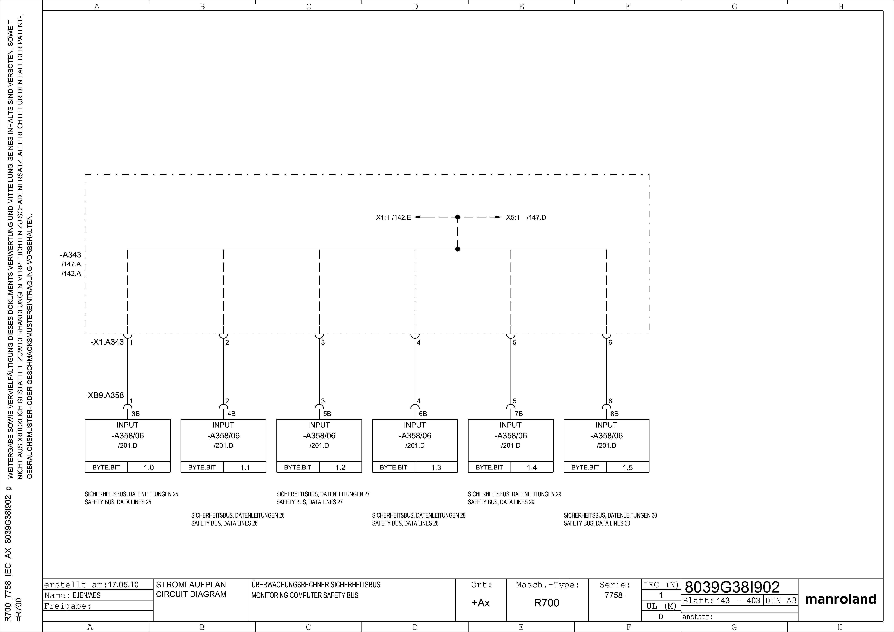

# +Ax — Sheet 143 of 403 — ÜBERWACHUNGSRECHNER SICHERHEITSBUS

**MONITORING COMPUTER SAFETY BUS**

> Part of the manroland **R700** printing press IEC/UL circuit diagrams.
> Drawing class: **Stromlaufplan / Circuit diagram** (DIN A3).
> Document `+Ax` covers the **Central control console** machine section.

## At a glance

| Field | Value |
|---|---|
| Document | `+Ax`  (8039G38I902) |
| Sheet | **143** of 403 |
| Section (DE) | ÜBERWACHUNGSRECHNER SICHERHEITSBUS |
| Section (EN) | MONITORING COMPUTER SAFETY BUS |
| Section type | CIRCUIT — Circuit diagram |
| Machine type | `R700` |
| Series | `7758` |
| Created | 17.05.10 |
| Replaces | — |
| Columns used | A, B, C, D, E, F |
| Path numbers | — |
| Labels on sheet | 69 |
| Cross-refs out | 10 |
| Cross-refs in | 22 |

**Previous:** [+Ax sheet 142](SHEET_0142.md) · **Next:** [+Ax sheet 144](SHEET_0144.md) · **Document TOC:** [_TOC.md](_TOC.md)  (+Ax) · **Master TOC:** [all sheets](../_MASTER_TOC.md)

## Sheet image (300 DPI, exact vector render)



_Rendered directly from the PDF vector layer at 300 DPI (1-bit), no OCR and no resampling. Use it to confirm anything ambiguous in the text below._

## Cross-references on this sheet

Each entry is a wire leaving this sheet. The printed token is `/sheet.column`; the link resolves to that sheet inside the same document.

| Ref | Target sheet | Col | Path | Destination on target | Target section | From col |
|---|---|---|---|---|---|---|
| `/142.E` | [+Ax sheet 142](SHEET_0142.md) | E | — | X1:1 X5:1 | ÜBERWACHUNGSRECHNER SICHERHEITSBUS | D |
| `/147.D` | [+Ax sheet 147](SHEET_0147.md) | D | — | X1:1 X5:1 | ÜBERWACHUNGSRECHNER SICHERHEITSBUS | D |
| `/147.A` | [+Ax sheet 147](SHEET_0147.md) | A | — | — | ÜBERWACHUNGSRECHNER SICHERHEITSBUS | A |
| `/142.A` | [+Ax sheet 142](SHEET_0142.md) | A | — | — | ÜBERWACHUNGSRECHNER SICHERHEITSBUS | A |
| `/201.D` | [+Ax sheet 201](SHEET_0201.md) | D | — | — | REFERENZMODUL | A |
| `/201.D` | [+Ax sheet 201](SHEET_0201.md) | D | — | — | REFERENZMODUL | B |
| `/201.D` | [+Ax sheet 201](SHEET_0201.md) | D | — | — | REFERENZMODUL | C |
| `/201.D` | [+Ax sheet 201](SHEET_0201.md) | D | — | — | REFERENZMODUL | D |
| `/201.D` | [+Ax sheet 201](SHEET_0201.md) | D | — | — | REFERENZMODUL | E |
| `/201.D` | [+Ax sheet 201](SHEET_0201.md) | D | — | — | REFERENZMODUL | F |

### Incoming references (sheets that point here)

Every other sheet that sends a wire to this one. `Back-ref` is the token printed on *that* sheet; `Path` is its line number.

| From sheet | Cols | Back-ref | Path | Refs | What continues there |
|---|---|---|---|---|---|
| [+Ax#142](SHEET_0142.md) | A, E | `/142.A`, `/142.E` | — | 2 | X1:1 X9:17 |
| [+Ax#147](SHEET_0147.md) | A, D | `/147.A`, `/147.D` | — | 2 | X5:1 |
| [+Ax#201](SHEET_0201.md) | D | `/201.D` | — | 6 | — |
| [+Ax#207](SHEET_0207.md) | E | `/207.E` | — | 6 | — |
| [+Ax#242](SHEET_0242.md) | B | `/242.B` | — | 6 | — |


## Devices on this sheet

| Tag | Class | Class meaning (IEC) | Col | Sub | Terminal | Sign |
|---|---|---|---|---|---|---|
| `A358/06` | A | Baugruppe / assembly, module, PC board | A | 06 | — | — |
| `A358/06` | A | Baugruppe / assembly, module, PC board | B | 06 | — | — |
| `A358/06` | A | Baugruppe / assembly, module, PC board | C | 06 | — | — |
| `A358/06` | A | Baugruppe / assembly, module, PC board | D | 06 | — | — |
| `A358/06` | A | Baugruppe / assembly, module, PC board | E | 06 | — | — |
| `A358/06` | A | Baugruppe / assembly, module, PC board | F | 06 | — | — |
| `A343` | A | Baugruppe / assembly, module, PC board | A | — | — | — |
| `X1:1` | X | Klemme / terminal, plug connector | D | — | 1 | — |
| `X5:1` | X | Klemme / terminal, plug connector | E | — | 1 | — |
| `1.0` | — | cross-device reference | A | — | — | — |
| `XB9.A358` | — | cross-device reference | A | — | — | — |
| `X1.A343` | — | cross-device reference | A | — | — | — |
| `1.1` | — | cross-device reference | B | — | — | — |
| `1.2` | — | cross-device reference | C | — | — | — |
| `1.3` | — | cross-device reference | D | — | — | — |
| `1.4` | — | cross-device reference | E | — | — | — |
| `1.5` | — | cross-device reference | F | — | — | — |

## Potentials / nets

_No named potentials on this sheet._

## Wire-end annotations (grouped as printed)

A wire that continues elsewhere is annotated with a small cluster: the destination description, the path/line number `#NN`, and the `/sheet.column` cross reference. Each row below is one such cluster exactly as it is grouped on the drawing.

| Col | Y | Path | Cross-ref | Text on the wire |
|---|---|---|---|---|
| D | 285.9 | — | `/142.E`, `/147.D` | `X1:1 X5:1` |
| A | 334.8 | — | — | `A343` |
| A | 347.9 | — | `/147.A`, `/142.A` | — |
| A | 451.0 | — | — | `X1.A343 1` |
| B | 452.4 | — | — | `2` |
| C | 452.4 | — | — | `3` |
| D | 452.4 | — | — | `4` |
| E | 452.4 | — | — | `5` |
| F | 452.4 | — | — | `6` |
| A | 521.9 | — | — | `XB9.A358 1` |
| B | 530.4 | — | — | `2` |
| C | 530.4 | — | — | `3` |
| D | 530.4 | — | — | `4` |
| E | 530.4 | — | — | `5` |
| F | 530.4 | — | — | `6` |
| A | 547.4 | — | — | `3B` |
| B | 547.4 | — | — | `4B` |
| C | 547.4 | — | — | `5B` |
| D | 547.4 | — | — | `6B` |
| E | 547.4 | — | — | `7B` |
| F | 547.4 | — | — | `8B` |
| A | 561.9 | — | — | `INPUT` |
| B | 561.9 | — | — | `INPUT` |
| C | 561.9 | — | — | `INPUT` |
| D | 561.9 | — | — | `INPUT` |
| E | 561.9 | — | — | `INPUT` |
| F | 561.9 | — | — | `INPUT` |
| A | 575.7 | — | — | `A358/06` |
| B | 575.7 | — | — | `A358/06` |
| C | 575.7 | — | — | `A358/06` |
| D | 575.7 | — | — | `A358/06` |
| E | 575.7 | — | — | `A358/06` |
| F | 575.7 | — | — | `A358/06` |
| A | 589.5 | — | `/201.D` | — |
| B | 589.5 | — | `/201.D` | — |
| C | 589.5 | — | `/201.D` | — |
| D | 589.5 | — | `/201.D` | — |
| E | 589.5 | — | `/201.D` | — |
| F | 589.5 | — | `/201.D` | — |
| A | 618.6 | — | — | `BYTE.BIT 1.0` |
| B | 618.6 | — | — | `BYTE.BIT 1.1` |
| C | 618.6 | — | — | `BYTE.BIT 1.2` |
| D | 618.6 | — | — | `BYTE.BIT 1.3` |
| E | 618.6 | — | — | `BYTE.BIT 1.4` |
| F | 618.6 | — | — | `BYTE.BIT 1.5` |
| A | 655.4 | — | — | `SICHERHEITSBUS, DATENLEITUNGEN 25 SAFETY BUS, DATA LINES 25` |
| C | 655.4 | — | — | `SICHERHEITSBUS, DATENLEITUNGEN 27 SAFETY BUS, DATA LINES 27` |
| E | 655.4 | — | — | `SICHERHEITSBUS, DATENLEITUNGEN 29 SAFETY BUS, DATA LINES 29` |
| B | 683.8 | — | — | `SICHERHEITSBUS, DATENLEITUNGEN 26 SAFETY BUS, DATA LINES 26` |
| D | 683.8 | — | — | `SICHERHEITSBUS, DATENLEITUNGEN 28 SAFETY BUS, DATA LINES 28` |
| F | 683.8 | — | — | `SICHERHEITSBUS, DATENLEITUNGEN 30 SAFETY BUS, DATA LINES 30` |


## Reconstructed tables

This sheet carries tabular content (pin map / terminal assignment / index). The grid below was rebuilt from the drawing's own rule lines, so each row is exactly one physical row of the table.

### Table 1 — 2 data rows × 2 columns (at x=113.4, y=289.1)

| X1.A343 XB9.A358 | 1 1 3B |
|---|---|
| `INPUT` | `A358/06 /201.D` |
| `BYTE.BIT` | `1.0` |


### Table 2 — 1 data rows × 2 columns (at x=240.9, y=289.1) — **2 2 4B**

| INPUT | A358/06 /201.D |
|---|---|
| `BYTE.BIT` | `1.1` |


### Table 3 — 1 data rows × 2 columns (at x=368.5, y=289.1) — **3 3 5B**

| INPUT | A358/06 /201.D |
|---|---|
| `BYTE.BIT` | `1.2` |


### Table 4 — 1 data rows × 2 columns (at x=496.1, y=289.1) — **/142.E X1:1 4 4 6B**

| INPUT | A358/06 /201.D |
|---|---|
| `BYTE.BIT` | `1.3` |


### Table 5 — 1 data rows × 2 columns (at x=623.6, y=289.1) — **X5:1 /147.D 5 5 7B**

| INPUT | A358/06 /201.D |
|---|---|
| `BYTE.BIT` | `1.4` |


### Table 6 — 1 data rows × 2 columns (at x=751.2, y=289.1) — **6 6 8B**

| INPUT | A358/06 /201.D |
|---|---|
| `BYTE.BIT` | `1.5` |


## Notes and free text on this sheet

| Text | Col | Y (pt) |
|---|---|---|
| `3B` | A | 547.36 |
| `INPUT` | A | 561.9 |
| `BYTE.BIT` | A | 619.15 |
| `SICHERHEITSBUS, DATENLEITUNGEN 25` | A | 655.43 |
| `SAFETY BUS, DATA LINES 25` | A | 666.05 |
| `4B` | B | 547.36 |
| `INPUT` | B | 561.9 |
| `BYTE.BIT` | B | 619.15 |
| `SICHERHEITSBUS, DATENLEITUNGEN 26` | B | 683.78 |
| `SAFETY BUS, DATA LINES 26` | B | 694.39 |
| `5B` | C | 547.36 |
| `INPUT` | C | 561.9 |
| `BYTE.BIT` | C | 619.15 |
| `SICHERHEITSBUS, DATENLEITUNGEN 27` | C | 655.43 |
| `SAFETY BUS, DATA LINES 27` | C | 666.05 |
| `6B` | D | 547.36 |
| `INPUT` | D | 561.9 |
| `BYTE.BIT` | D | 619.15 |
| `SICHERHEITSBUS, DATENLEITUNGEN 28` | D | 683.78 |
| `SAFETY BUS, DATA LINES 28` | D | 694.39 |
| `7B` | E | 547.36 |
| `INPUT` | E | 561.9 |
| `BYTE.BIT` | E | 619.15 |
| `SICHERHEITSBUS, DATENLEITUNGEN 29` | E | 655.43 |
| `SAFETY BUS, DATA LINES 29` | E | 666.05 |
| `8B` | F | 547.36 |
| `INPUT` | F | 561.9 |
| `BYTE.BIT` | F | 619.15 |
| `SICHERHEITSBUS, DATENLEITUNGEN 30` | F | 683.78 |
| `SAFETY BUS, DATA LINES 30` | F | 694.39 |

## Complete label inventory (exact text from the drawing)

Every text object inside the drawing area of this sheet, in DIN reading order (column A→H, then top→bottom). This is the authoritative list: if a string is not here it is not printed on this sheet.

| Col | Y | X | Dir | Type | Text |
|---|---|---|---|---|---|
| A | 334.8 | 79.9 | → | device tag | `A343` |
| A | 347.9 | 82.2 | → | cross-reference | `/147.A` |
| A | 360.3 | 82.2 | → | cross-reference | `/142.A` |
| A | 451.0 | 120.8 | → | device ref | `X1.A343` |
| A | 452.5 | 172.1 | → | number | `1` |
| A | 521.9 | 113.7 | → | device ref | `XB9.A358` |
| A | 530.4 | 172.1 | → | number | `1` |
| A | 547.4 | 175.5 | → | text | `3B` |
| A | 561.9 | 155.2 | → | text | `INPUT` |
| A | 575.7 | 148.7 | → | device tag | `A358/06` |
| A | 589.5 | 157.3 | → | cross-reference | `/201.D` |
| A | 618.6 | 191.3 | → | device ref | `1.0` |
| A | 619.1 | 123.3 | → | text | `BYTE.BIT` |
| A | 655.4 | 113.1 | → | text | `SICHERHEITSBUS, DATENLEITUNGEN 25` |
| A | 666.0 | 113.1 | → | text | `SAFETY BUS, DATA LINES 25` |
| B | 452.5 | 300.2 | → | number | `2` |
| B | 530.4 | 300.2 | → | number | `2` |
| B | 547.4 | 303.0 | → | text | `4B` |
| B | 561.9 | 282.8 | → | text | `INPUT` |
| B | 575.7 | 276.2 | → | device tag | `A358/06` |
| B | 589.5 | 284.9 | → | cross-reference | `/201.D` |
| B | 618.6 | 319.7 | → | device ref | `1.1` |
| B | 619.1 | 250.9 | → | text | `BYTE.BIT` |
| B | 683.8 | 254.8 | → | text | `SICHERHEITSBUS, DATENLEITUNGEN 26` |
| B | 694.4 | 254.8 | → | text | `SAFETY BUS, DATA LINES 26` |
| C | 452.5 | 427.7 | → | number | `3` |
| C | 530.4 | 427.7 | → | number | `3` |
| C | 547.4 | 430.6 | → | text | `5B` |
| C | 561.9 | 410.3 | → | text | `INPUT` |
| C | 575.7 | 403.8 | → | device tag | `A358/06` |
| C | 589.5 | 412.4 | → | cross-reference | `/201.D` |
| C | 618.6 | 446.5 | → | device ref | `1.2` |
| C | 619.1 | 378.4 | → | text | `BYTE.BIT` |
| C | 655.4 | 368.2 | → | text | `SICHERHEITSBUS, DATENLEITUNGEN 27` |
| C | 666.0 | 368.2 | → | text | `SAFETY BUS, DATA LINES 27` |
| D | 285.9 | 498.0 | → | device tag | `X1:1` |
| D | 285.9 | 522.1 | → | cross-reference | `/142.E` |
| D | 452.5 | 555.3 | → | number | `4` |
| D | 530.4 | 555.3 | → | number | `4` |
| D | 547.4 | 558.1 | → | text | `6B` |
| D | 561.9 | 537.9 | → | text | `INPUT` |
| D | 575.7 | 531.4 | → | device tag | `A358/06` |
| D | 589.5 | 540.0 | → | cross-reference | `/201.D` |
| D | 618.6 | 574.0 | → | device ref | `1.3` |
| D | 619.1 | 506.0 | → | text | `BYTE.BIT` |
| D | 683.8 | 495.8 | → | text | `SICHERHEITSBUS, DATENLEITUNGEN 28` |
| D | 694.4 | 495.8 | → | text | `SAFETY BUS, DATA LINES 28` |
| E | 285.9 | 671.5 | → | device tag | `X5:1` |
| E | 285.9 | 701.6 | → | cross-reference | `/147.D` |
| E | 452.5 | 682.9 | → | number | `5` |
| E | 530.4 | 682.9 | → | number | `5` |
| E | 547.4 | 685.7 | → | text | `7B` |
| E | 561.9 | 665.4 | → | text | `INPUT` |
| E | 575.7 | 658.9 | → | device tag | `A358/06` |
| E | 589.5 | 667.6 | → | cross-reference | `/201.D` |
| E | 618.6 | 701.6 | → | device ref | `1.4` |
| E | 619.1 | 633.5 | → | text | `BYTE.BIT` |
| E | 655.4 | 623.3 | → | text | `SICHERHEITSBUS, DATENLEITUNGEN 29` |
| E | 666.0 | 623.3 | → | text | `SAFETY BUS, DATA LINES 29` |
| F | 452.5 | 810.4 | → | number | `6` |
| F | 530.4 | 810.4 | → | number | `6` |
| F | 547.4 | 813.3 | → | text | `8B` |
| F | 561.9 | 793.0 | → | text | `INPUT` |
| F | 575.7 | 786.5 | → | device tag | `A358/06` |
| F | 589.5 | 795.1 | → | cross-reference | `/201.D` |
| F | 618.6 | 829.1 | → | device ref | `1.5` |
| F | 619.1 | 761.1 | → | text | `BYTE.BIT` |
| F | 683.8 | 750.9 | → | text | `SICHERHEITSBUS, DATENLEITUNGEN 30` |
| F | 694.4 | 750.9 | → | text | `SAFETY BUS, DATA LINES 30` |

## Reading-order text block

The same content as a plain block, grouped by DIN column — convenient to paste or to match against a visual description.

```text
=== Column A ===
 334.8   79.9  devtag       A343
 347.9   82.2  xref         /147.A
 360.3   82.2  xref         /142.A
 451.0  120.8  devref       X1.A343
 452.5  172.1  numeric      1
 521.9  113.7  devref       XB9.A358
 530.4  172.1  numeric      1
 547.4  175.5  text         3B
 561.9  155.2  text         INPUT
 575.7  148.7  devtag       A358/06
 589.5  157.3  xref         /201.D
 618.6  191.3  devref       1.0
 619.1  123.3  text         BYTE.BIT
 655.4  113.1  text         SICHERHEITSBUS, DATENLEITUNGEN 25
 666.0  113.1  text         SAFETY BUS, DATA LINES 25
=== Column B ===
 452.5  300.2  numeric      2
 530.4  300.2  numeric      2
 547.4  303.0  text         4B
 561.9  282.8  text         INPUT
 575.7  276.2  devtag       A358/06
 589.5  284.9  xref         /201.D
 618.6  319.7  devref       1.1
 619.1  250.9  text         BYTE.BIT
 683.8  254.8  text         SICHERHEITSBUS, DATENLEITUNGEN 26
 694.4  254.8  text         SAFETY BUS, DATA LINES 26
=== Column C ===
 452.5  427.7  numeric      3
 530.4  427.7  numeric      3
 547.4  430.6  text         5B
 561.9  410.3  text         INPUT
 575.7  403.8  devtag       A358/06
 589.5  412.4  xref         /201.D
 618.6  446.5  devref       1.2
 619.1  378.4  text         BYTE.BIT
 655.4  368.2  text         SICHERHEITSBUS, DATENLEITUNGEN 27
 666.0  368.2  text         SAFETY BUS, DATA LINES 27
=== Column D ===
 285.9  498.0  devtag       X1:1
 285.9  522.1  xref         /142.E
 452.5  555.3  numeric      4
 530.4  555.3  numeric      4
 547.4  558.1  text         6B
 561.9  537.9  text         INPUT
 575.7  531.4  devtag       A358/06
 589.5  540.0  xref         /201.D
 618.6  574.0  devref       1.3
 619.1  506.0  text         BYTE.BIT
 683.8  495.8  text         SICHERHEITSBUS, DATENLEITUNGEN 28
 694.4  495.8  text         SAFETY BUS, DATA LINES 28
=== Column E ===
 285.9  671.5  devtag       X5:1
 285.9  701.6  xref         /147.D
 452.5  682.9  numeric      5
 530.4  682.9  numeric      5
 547.4  685.7  text         7B
 561.9  665.4  text         INPUT
 575.7  658.9  devtag       A358/06
 589.5  667.6  xref         /201.D
 618.6  701.6  devref       1.4
 619.1  633.5  text         BYTE.BIT
 655.4  623.3  text         SICHERHEITSBUS, DATENLEITUNGEN 29
 666.0  623.3  text         SAFETY BUS, DATA LINES 29
=== Column F ===
 452.5  810.4  numeric      6
 530.4  810.4  numeric      6
 547.4  813.3  text         8B
 561.9  793.0  text         INPUT
 575.7  786.5  devtag       A358/06
 589.5  795.1  xref         /201.D
 618.6  829.1  devref       1.5
 619.1  761.1  text         BYTE.BIT
 683.8  750.9  text         SICHERHEITSBUS, DATENLEITUNGEN 30
 694.4  750.9  text         SAFETY BUS, DATA LINES 30
```

---
_Generated from the PDF vector text layer; no OCR. Source: `R700_7758_IEC_AX_8039G38I902_p`, sheet 143._
