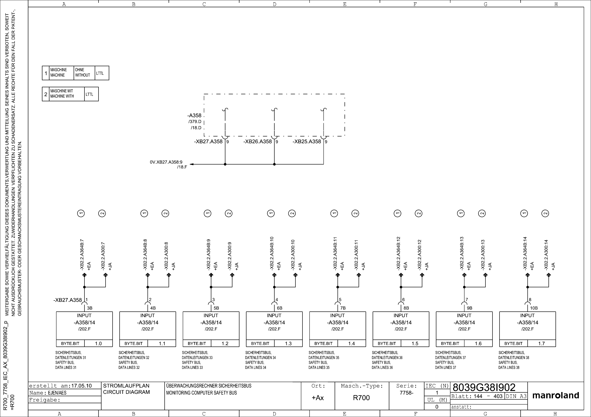

# +Ax — Sheet 144 of 403 — ÜBERWACHUNGSRECHNER SICHERHEITSBUS

**MONITORING COMPUTER SAFETY BUS**

> Part of the manroland **R700** printing press IEC/UL circuit diagrams.
> Drawing class: **Stromlaufplan / Circuit diagram** (DIN A3).
> Document `+Ax` covers the **Central control console** machine section.

## At a glance

| Field | Value |
|---|---|
| Document | `+Ax`  (8039G38I902) |
| Sheet | **144** of 403 |
| Section (DE) | ÜBERWACHUNGSRECHNER SICHERHEITSBUS |
| Section (EN) | MONITORING COMPUTER SAFETY BUS |
| Section type | CIRCUIT — Circuit diagram |
| Machine type | `R700` |
| Series | `7758` |
| Created | 17.05.10 |
| Replaces | — |
| Columns used | A, B, C, D, E, F, G, H |
| Path numbers | — |
| Labels on sheet | 158 |
| Cross-refs out | 11 |
| Cross-refs in | 22 |

**Previous:** [+Ax sheet 143](SHEET_0143.md) · **Next:** [+Ax sheet 145](SHEET_0145.md) · **Document TOC:** [_TOC.md](_TOC.md)  (+Ax) · **Master TOC:** [all sheets](../_MASTER_TOC.md)

## Sheet image (300 DPI, exact vector render)



_Rendered directly from the PDF vector layer at 300 DPI (1-bit), no OCR and no resampling. Use it to confirm anything ambiguous in the text below._

## Cross-references on this sheet

Each entry is a wire leaving this sheet. The printed token is `/sheet.column`; the link resolves to that sheet inside the same document.

| Ref | Target sheet | Col | Path | Destination on target | Target section | From col |
|---|---|---|---|---|---|---|
| `/379.D` | [+Ax sheet 379](SHEET_0379.md) | D | — | — | OPTION: TELEPRESENCE | C |
| `/18.D` | [+Ax sheet 18](SHEET_0018.md) | D | — | — | SPANNUNGSVERSORGUNG, SCHALTSCHRANKBELÜFTUNG | C |
| `/18.F` | [+Ax sheet 18](SHEET_0018.md) | F | — | 0V.XB27.A358:9 | SPANNUNGSVERSORGUNG, SCHALTSCHRANKBELÜFTUNG | B |
| `/202.F` | [+Ax sheet 202](SHEET_0202.md) | F | — | — | REFERENZMODUL | A |
| `/202.F` | [+Ax sheet 202](SHEET_0202.md) | F | — | — | REFERENZMODUL | B |
| `/202.F` | [+Ax sheet 202](SHEET_0202.md) | F | — | — | REFERENZMODUL | C |
| `/202.F` | [+Ax sheet 202](SHEET_0202.md) | F | — | — | REFERENZMODUL | D |
| `/202.F` | [+Ax sheet 202](SHEET_0202.md) | F | — | — | REFERENZMODUL | E |
| `/202.F` | [+Ax sheet 202](SHEET_0202.md) | F | — | — | REFERENZMODUL | F |
| `/202.F` | [+Ax sheet 202](SHEET_0202.md) | F | — | — | REFERENZMODUL | G |
| `/202.F` | [+Ax sheet 202](SHEET_0202.md) | F | — | — | REFERENZMODUL | H |

### Incoming references (sheets that point here)

Every other sheet that sends a wire to this one. `Back-ref` is the token printed on *that* sheet; `Path` is its line number.

| From sheet | Cols | Back-ref | Path | Refs | What continues there |
|---|---|---|---|---|---|
| [+Ax#18](SHEET_0018.md) | D, F | `/18.D`, `/18.F` | — | 2 | 0V.XB27.A358:9 |
| [+Ax#202](SHEET_0202.md) | F | `/202.F` | — | 8 | — |
| [+Ax#267](SHEET_0267.md) | H | `/267.H` | — | 1 | — |
| [+Ax#269](SHEET_0269.md) | A | `/269.A` | — | 1 | — |
| [+Ax#270](SHEET_0270.md) | D, E | `/270.D`, `/270.E` | — | 9 | — |
| [+Ax#379](SHEET_0379.md) | D | `/379.D` | — | 1 | — |


## Devices on this sheet

| Tag | Class | Class meaning (IEC) | Col | Sub | Terminal | Sign |
|---|---|---|---|---|---|---|
| `A358/14` | A | Baugruppe / assembly, module, PC board | A | 14 | — | — |
| `A358/14` | A | Baugruppe / assembly, module, PC board | B | 14 | — | — |
| `A358/14` | A | Baugruppe / assembly, module, PC board | C | 14 | — | — |
| `A358/14` | A | Baugruppe / assembly, module, PC board | D | 14 | — | — |
| `A358/14` | A | Baugruppe / assembly, module, PC board | E | 14 | — | — |
| `A358/14` | A | Baugruppe / assembly, module, PC board | F | 14 | — | — |
| `A358/14` | A | Baugruppe / assembly, module, PC board | G | 14 | — | — |
| `A358/14` | A | Baugruppe / assembly, module, PC board | H | 14 | — | — |
| `A358` | A | Baugruppe / assembly, module, PC board | C | — | — | — |
| `1.0` | — | cross-device reference | A | — | — | — |
| `1.1` | — | cross-device reference | B | — | — | — |
| `1.2` | — | cross-device reference | C | — | — | — |
| `1.3` | — | cross-device reference | D | — | — | — |
| `1.4` | — | cross-device reference | E | — | — | — |
| `1.5` | — | cross-device reference | F | — | — | — |
| `1.6` | — | cross-device reference | G | — | — | — |
| `1.7` | — | cross-device reference | H | — | — | — |
| `XB27.A358` | — | cross-device reference | A | — | — | — |
| `XB2.2.A364B:8` | — | cross-device reference | B | — | 8 | — |
| `XB2.2.A364B:9` | — | cross-device reference | C | — | 9 | — |
| `XB2.2.A364B:10` | — | cross-device reference | D | — | 10 | — |
| `XB2.2.A364B:11` | — | cross-device reference | E | — | 11 | — |
| `XB2.2.A364B:12` | — | cross-device reference | F | — | 12 | — |
| `XB2.2.A364B:13` | — | cross-device reference | G | — | 13 | — |
| `XB2.2.A364B:14` | — | cross-device reference | H | — | 14 | — |
| `XB27.A358` | — | cross-device reference | C | — | — | — |
| `XB26.A358` | — | cross-device reference | D | — | — | — |
| `XB25.A358` | — | cross-device reference | D | — | — | — |
| `XB2.2.A300:7` | — | cross-device reference | B | — | 7 | — |
| `XB2.2.A364B:7` | — | cross-device reference | A | — | 7 | — |
| `XB2.2.A300:8` | — | cross-device reference | B | — | 8 | — |
| `XB2.2.A300:9` | — | cross-device reference | C | — | 9 | — |
| `XB2.2.A300:10` | — | cross-device reference | D | — | 10 | — |
| `XB2.2.A300:11` | — | cross-device reference | E | — | 11 | — |
| `XB2.2.A300:12` | — | cross-device reference | F | — | 12 | — |
| `XB2.2.A300:13` | — | cross-device reference | G | — | 13 | — |
| `XB2.2.A300:14` | — | cross-device reference | H | — | 14 | — |

## Potentials / nets

| Potential | Count | Columns | Attached devices | Terminals |
|---|---|---|---|---|
| `0V` | 1 | B | `A358`, `XB27` | `9` |


A potential such as `L24+/4` or `M24+` is a named supply/return rail; every place it appears on this sheet is electrically common.

## Wire-end annotations (grouped as printed)

A wire that continues elsewhere is annotated with a small cluster: the destination description, the path/line number `#NN`, and the `/sheet.column` cross reference. Each row below is one such cluster exactly as it is grouped on the drawing.

| Col | Y | Path | Cross-ref | Text on the wire |
|---|---|---|---|---|
| A | 138.1 | — | — | `1 MASCHINE MACHINE` |
| A | 138.1 | — | — | `OHNE WITHOUT LTTL` |
| A | 180.6 | — | — | `2 MASCHINE MIT MACHINE WITH` |
| A | 187.7 | — | — | `LTTL` |
| C | 228.5 | — | — | `A358` |
| C | 241.6 | — | `/379.D` | — |
| C | 254.0 | — | `/18.D` | — |
| D | 280.9 | — | — | `XB27.A358 9 XB26.A358 9 XB25.A358 9` |
| B | 323.4 | — | `/18.F` | `0V.XB27.A358:9` |
| A | 428.0 | — | — | `1` |
| B | 428.0 | — | — | `1` |
| C | 428.0 | — | — | `1` |
| D | 428.0 | — | — | `1` |
| E | 428.0 | — | — | `1` |
| F | 428.0 | — | — | `1` |
| G | 428.0 | — | — | `1` |
| H | 428.0 | — | — | `1` |
| B | 428.9 | — | — | `2` |
| B | 428.9 | — | — | `2` |
| C | 428.9 | — | — | `2` |
| D | 428.9 | — | — | `2` |
| E | 428.9 | — | — | `2` |
| F | 428.9 | — | — | `2` |
| G | 428.9 | — | — | `2` |
| H | 428.9 | — | — | `2` |
| D | 477.9 | — | — | `XB2.2.A364B:10` |
| E | 477.9 | — | — | `XB2.2.A364B:11` |
| F | 477.9 | — | — | `XB2.2.A364B:12` |
| G | 477.9 | — | — | `XB2.2.A364B:13` |
| H | 477.9 | — | — | `XB2.2.A364B:14` |
| A | 482.7 | — | — | `XB2.2.A364B:7` |
| B | 482.7 | — | — | `XB2.2.A364B:8` |
| C | 482.7 | — | — | `XB2.2.A364B:9` |
| D | 483.9 | — | — | `XB2.2.A300:10` |
| E | 483.9 | — | — | `XB2.2.A300:11` |
| F | 483.9 | — | — | `XB2.2.A300:12` |
| G | 483.9 | — | — | `XB2.2.A300:13` |
| H | 483.9 | — | — | `XB2.2.A300:14` |
| B | 488.7 | — | — | `XB2.2.A300:7` |
| B | 488.7 | — | — | `XB2.2.A300:8` |
| C | 488.7 | — | — | `XB2.2.A300:9` |
| A | 529.0 | — | — | `+EA` |
| B | 529.0 | — | — | `+EA` |
| C | 529.0 | — | — | `+EA` |
| D | 529.0 | — | — | `+EA` |
| E | 529.0 | — | — | `+EA` |
| F | 529.0 | — | — | `+EA` |
| G | 529.0 | — | — | `+EA` |
| H | 529.0 | — | — | `+EA` |
| B | 530.4 | — | — | `+JA` |
| C | 530.4 | — | — | `+JA` |
| C | 530.4 | — | — | `+JA` |
| D | 530.4 | — | — | `+JA` |
| E | 530.4 | — | — | `+JA` |
| F | 530.4 | — | — | `+JA` |
| G | 530.4 | — | — | `+JA` |
| H | 530.4 | — | — | `+JA` |
| D | 601.2 | — | — | `XB27.A358 1 2 3 4 5 6 7 8` |
| A | 618.2 | — | — | `3B` |
| B | 618.2 | — | — | `4B` |
| C | 618.2 | — | — | `5B` |
| D | 618.2 | — | — | `6B` |
| E | 618.2 | — | — | `7B` |
| F | 618.2 | — | — | `8B` |
| G | 618.2 | — | — | `9B` |
| H | 618.2 | — | — | `10B` |
| A | 632.8 | — | — | `INPUT` |
| B | 632.8 | — | — | `INPUT` |
| C | 632.8 | — | — | `INPUT` |
| D | 632.8 | — | — | `INPUT` |
| E | 632.8 | — | — | `INPUT` |
| F | 632.8 | — | — | `INPUT` |
| G | 632.8 | — | — | `INPUT` |
| H | 632.8 | — | — | `INPUT` |
| A | 646.6 | — | — | `A358/14` |
| B | 646.6 | — | — | `A358/14` |
| C | 646.6 | — | — | `A358/14` |
| D | 646.6 | — | — | `A358/14` |
| E | 646.6 | — | — | `A358/14` |
| F | 646.6 | — | — | `A358/14` |
| G | 646.6 | — | — | `A358/14` |
| H | 646.6 | — | — | `A358/14` |
| A | 660.4 | — | `/202.F` | — |
| B | 660.4 | — | `/202.F` | — |
| C | 660.4 | — | `/202.F` | — |
| D | 660.4 | — | `/202.F` | — |
| E | 660.4 | — | `/202.F` | — |
| F | 660.4 | — | `/202.F` | — |
| G | 660.4 | — | `/202.F` | — |
| H | 660.4 | — | `/202.F` | — |
| A | 689.4 | — | — | `BYTE.BIT 1.0` |
| B | 689.4 | — | — | `BYTE.BIT 1.1` |
| C | 689.4 | — | — | `BYTE.BIT 1.2` |
| D | 689.4 | — | — | `BYTE.BIT 1.3` |
| E | 689.4 | — | — | `BYTE.BIT 1.4` |
| F | 689.4 | — | — | `BYTE.BIT 1.5` |
| G | 689.4 | — | — | `BYTE.BIT 1.6` |
| H | 689.4 | — | — | `BYTE.BIT 1.7` |
| A | 709.5 | — | — | `DATENLEITUNGEN 31 DATA LINES 31 SICHERHEITSBUS, SAFETY BUS,` |
| B | 709.5 | — | — | `DATENLEITUNGEN 32 DATA LINES 32 SICHERHEITSBUS, SAFETY BUS,` |
| C | 709.5 | — | — | `DATENLEITUNGEN 33 DATA LINES 33 SICHERHEITSBUS, SAFETY BUS,` |
| D | 709.5 | — | — | `DATENLEITUNGEN 34 DATA LINES 34 SICHERHEITSBUS, SAFETY BUS,` |
| E | 709.5 | — | — | `DATENLEITUNGEN 35 DATA LINES 35 SICHERHEITSBUS, SAFETY BUS,` |
| F | 709.5 | — | — | `DATENLEITUNGEN 36 DATA LINES 36 SICHERHEITSBUS, SAFETY BUS,` |
| G | 709.5 | — | — | `DATENLEITUNGEN 37 DATA LINES 37 SICHERHEITSBUS, SAFETY BUS,` |
| G | 709.5 | — | — | `DATENLEITUNGEN 38 DATA LINES 38 SICHERHEITSBUS, SAFETY BUS,` |


## Reconstructed tables

This sheet carries tabular content (pin map / terminal assignment / index). The grid below was rebuilt from the drawing's own rule lines, so each row is exactly one physical row of the table.

### Table 1 — 3 data rows × 2 columns (at x=113.4, y=331.7)

| 1 XB2.2.A364B:7 | 2 XB2.2.A300:7 +EA +JA |
|---|---|
| `XB27.A358` | `1 3B` |
| `INPUT` | `A358/14 /202.F` |
| `BYTE.BIT` | `1.0` |


### Table 2 — 3 data rows × 6 columns (at x=240.9, y=331.7)

| 1 XB2.2.A364B:8 | 2 XB2.2.A300:8 +EA +JA | /18.F | 1 XB2.2.A364B:9 | +EA | 2 XB2.2.A300:9 +JA |
|---|---|---|---|---|---|
|  | `2 4B` |  |  | `3 5B` |  |
| `INPUT` | `A358/14 /202.F` |  | `INPUT` | `A358/14 /202.F` |  |
| `BYTE.BIT` | `1.1` |  | `BYTE.BIT` | `1.2` |  |


### Table 3 — 3 data rows × 2 columns (at x=496.1, y=331.7)

| 1 XB2.2.A364B:10 | 2 XB2.2.A300:10 +EA +JA |
|---|---|
|  | `4 6B` |
| `INPUT` | `A358/14 /202.F` |
| `BYTE.BIT` | `1.3` |


### Table 4 — 3 data rows × 3 columns (at x=623.6, y=331.7)

|  | 1 XB2.2.A364B:11 | 2 XB2.2.A300:11 +EA +JA |
|---|---|---|
|  |  | `5 7B` |
|  | `INPUT` | `A358/14 /202.F` |
| `BYTE.BIT` |  | `1.4` |


### Table 5 — 3 data rows × 2 columns (at x=751.2, y=331.7)

| 1 XB2.2.A364B:12 | 2 XB2.2.A300:12 +EA +JA |
|---|---|
|  | `6 8B` |
| `INPUT` | `A358/14 /202.F` |
| `BYTE.BIT` | `1.5` |


### Table 6 — 3 data rows × 2 columns (at x=878.7, y=331.7)

| 1 XB2.2.A364B:13 | 2 XB2.2.A300:13 +EA +JA |
|---|---|
|  | `7 9B` |
| `INPUT` | `A358/14 /202.F` |
| `BYTE.BIT` | `1.6` |


### Table 7 — 3 data rows × 2 columns (at x=1006.3, y=331.7)

| 1 XB2.2.A364B:14 | 2 XB2.2.A300:14 +EA +JA |
|---|---|
|  | `8 10B` |
| `INPUT` | `A358/14 /202.F` |
| `BYTE.BIT` | `1.7` |


## Notes and free text on this sheet

| Text | Col | Y (pt) |
|---|---|---|
| `3B` | A | 618.22 |
| `INPUT` | A | 632.76 |
| `BYTE.BIT` | A | 690.01 |
| `SICHERHEITSBUS,` | A | 709.46 |
| `DATENLEITUNGEN 31` | A | 719.36 |
| `SAFETY BUS,` | A | 729.33 |
| `DATA LINES 31` | A | 739.27 |
| `4B` | B | 618.22 |
| `INPUT` | B | 632.76 |
| `BYTE.BIT` | B | 690.01 |
| `SICHERHEITSBUS,` | B | 709.46 |
| `DATENLEITUNGEN 32` | B | 719.37 |
| `SAFETY BUS,` | B | 729.33 |
| `DATA LINES 32` | B | 739.28 |
| `5B` | C | 618.22 |
| `INPUT` | C | 632.76 |
| `BYTE.BIT` | C | 690.01 |
| `SICHERHEITSBUS,` | C | 709.46 |
| `DATENLEITUNGEN 33` | C | 719.37 |
| `SAFETY BUS,` | C | 729.33 |
| `DATA LINES 33` | C | 739.29 |
| `6B` | D | 618.22 |
| `INPUT` | D | 632.76 |
| `BYTE.BIT` | D | 690.01 |
| `SICHERHEITSBUS,` | D | 709.46 |
| `DATENLEITUNGEN 34` | D | 719.37 |
| `SAFETY BUS,` | D | 729.33 |
| `DATA LINES 34` | D | 739.29 |
| `7B` | E | 618.22 |
| `INPUT` | E | 632.76 |
| `BYTE.BIT` | E | 690.01 |
| `SICHERHEITSBUS,` | E | 709.46 |
| `DATENLEITUNGEN 35` | E | 719.37 |
| `SAFETY BUS,` | E | 729.33 |
| `DATA LINES 35` | E | 739.29 |
| `8B` | F | 618.22 |
| `INPUT` | F | 632.76 |
| `BYTE.BIT` | F | 690.01 |
| `SICHERHEITSBUS,` | F | 709.46 |
| `DATENLEITUNGEN 36` | F | 719.37 |
| `SAFETY BUS,` | F | 729.33 |
| `DATA LINES 36` | F | 739.29 |
| `9B` | G | 618.22 |
| `INPUT` | G | 632.76 |
| `DATENLEITUNGEN 37` | G | 719.37 |
| `DATA LINES 37` | F | 739.29 |
| `10B` | H | 618.24 |
| `INPUT` | H | 632.76 |
| `BYTE.BIT` | G | 690.01 |
| `SICHERHEITSBUS,` | G | 709.46 |
| `DATENLEITUNGEN 38` | G | 719.37 |
| `SAFETY BUS,` | G | 729.33 |
| `DATA LINES 38` | G | 739.29 |
| `+EA` | B | 528.95 |
| `+EA` | C | 528.95 |
| `+EA` | D | 528.95 |
| `+EA` | E | 528.95 |
| `+EA` | F | 528.95 |
| `+EA` | G | 528.95 |
| `+EA` | H | 528.95 |
| `+JA` | B | 530.36 |
| `+EA` | A | 528.95 |
| `+JA` | C | 530.36 |
| `+JA` | D | 530.36 |
| `+JA` | E | 530.36 |
| `+JA` | F | 530.36 |
| `+JA` | G | 530.36 |
| `+JA` | H | 530.36 |
| `MASCHINE` | A | 138.1 |
| `MACHINE` | A | 148.74 |
| `MASCHINE MIT` | A | 180.63 |
| `MACHINE WITH` | A | 191.22 |
| `OHNE` | A | 138.1 |
| `WITHOUT` | A | 148.7 |
| `LTTL` | B | 145.16 |
| `LTTL` | A | 187.68 |

## Complete label inventory (exact text from the drawing)

Every text object inside the drawing area of this sheet, in DIN reading order (column A→H, then top→bottom). This is the authoritative list: if a string is not here it is not printed on this sheet.

| Col | Y | X | Dir | Type | Text |
|---|---|---|---|---|---|
| A | 138.1 | 101.5 | → | text | `MASCHINE` |
| A | 138.1 | 151.4 | → | text | `OHNE` |
| A | 143.4 | 89.6 | → | number | `1` |
| A | 148.7 | 101.5 | → | text | `MACHINE` |
| A | 148.7 | 151.7 | → | text | `WITHOUT` |
| A | 180.6 | 101.5 | → | text | `MASCHINE MIT` |
| A | 185.9 | 89.3 | → | number | `2` |
| A | 187.7 | 172.8 | → | text | `LTTL` |
| A | 191.2 | 101.5 | → | text | `MACHINE WITH` |
| A | 428.0 | 159.9 | ↕ | number | `1` |
| A | 482.7 | 161.1 | ↕ | device ref | `XB2.2.A364B:7` |
| A | 528.9 | 175.3 | ↕ | text | `+EA` |
| A | 601.2 | 107.7 | → | device ref | `XB27.A358` |
| A | 601.3 | 172.1 | → | number | `1` |
| A | 618.2 | 175.5 | → | text | `3B` |
| A | 632.8 | 155.2 | → | text | `INPUT` |
| A | 646.6 | 148.7 | → | device tag | `A358/14` |
| A | 660.4 | 157.7 | → | cross-reference | `/202.F` |
| A | 689.4 | 191.3 | → | device ref | `1.0` |
| A | 690.0 | 123.3 | → | text | `BYTE.BIT` |
| A | 709.5 | 111.7 | → | text | `SICHERHEITSBUS,` |
| A | 719.4 | 111.4 | → | text | `DATENLEITUNGEN 31` |
| A | 729.3 | 111.7 | → | text | `SAFETY BUS,` |
| A | 739.3 | 111.4 | → | text | `DATA LINES 31` |
| B | 145.2 | 194.0 | → | text | `LTTL` |
| B | 323.4 | 302.2 | → | potential | `0V.XB27.A358:9` |
| B | 428.0 | 287.5 | ↕ | number | `1` |
| B | 428.9 | 203.0 | ↕ | number | `2` |
| B | 428.9 | 330.5 | ↕ | number | `2` |
| B | 482.7 | 288.7 | ↕ | device ref | `XB2.2.A364B:8` |
| B | 488.7 | 203.7 | ↕ | device ref | `XB2.2.A300:7` |
| B | 488.7 | 331.2 | ↕ | device ref | `XB2.2.A300:8` |
| B | 528.9 | 302.8 | ↕ | text | `+EA` |
| B | 530.4 | 217.8 | ↕ | text | `+JA` |
| B | 601.3 | 300.2 | → | number | `2` |
| B | 618.2 | 303.0 | → | text | `4B` |
| B | 632.8 | 282.8 | → | text | `INPUT` |
| B | 646.6 | 276.2 | → | device tag | `A358/14` |
| B | 660.4 | 285.3 | → | cross-reference | `/202.F` |
| B | 689.4 | 319.7 | → | device ref | `1.1` |
| B | 690.0 | 250.9 | → | text | `BYTE.BIT` |
| B | 709.5 | 239.2 | → | text | `SICHERHEITSBUS,` |
| B | 719.4 | 239.0 | → | text | `DATENLEITUNGEN 32` |
| B | 729.3 | 239.2 | → | text | `SAFETY BUS,` |
| B | 739.3 | 239.0 | → | text | `DATA LINES 32` |
| C | 228.5 | 377.6 | → | device tag | `A358` |
| C | 241.6 | 379.8 | → | cross-reference | `/379.D` |
| C | 254.0 | 384.7 | → | cross-reference | `/18.D` |
| C | 280.9 | 391.2 | → | device ref | `XB27.A358` |
| C | 282.4 | 456.1 | → | number | `9` |
| C | 333.3 | 357.2 | → | cross-reference | `/18.F` |
| C | 428.0 | 415.1 | ↕ | number | `1` |
| C | 428.9 | 458.1 | ↕ | number | `2` |
| C | 482.7 | 416.3 | ↕ | device ref | `XB2.2.A364B:9` |
| C | 488.7 | 458.8 | ↕ | device ref | `XB2.2.A300:9` |
| C | 528.9 | 430.4 | ↕ | text | `+EA` |
| C | 530.4 | 345.4 | ↕ | text | `+JA` |
| C | 530.4 | 472.9 | ↕ | text | `+JA` |
| C | 601.3 | 427.7 | → | number | `3` |
| C | 618.2 | 430.6 | → | text | `5B` |
| C | 632.8 | 410.3 | → | text | `INPUT` |
| C | 646.6 | 403.8 | → | device tag | `A358/14` |
| C | 660.4 | 412.9 | → | cross-reference | `/202.F` |
| C | 689.4 | 446.5 | → | device ref | `1.2` |
| C | 690.0 | 378.4 | → | text | `BYTE.BIT` |
| C | 709.5 | 366.8 | → | text | `SICHERHEITSBUS,` |
| C | 719.4 | 366.5 | → | text | `DATENLEITUNGEN 33` |
| C | 729.3 | 366.8 | → | text | `SAFETY BUS,` |
| C | 739.3 | 366.5 | → | text | `DATA LINES 33` |
| D | 280.9 | 490.4 | → | device ref | `XB26.A358` |
| D | 280.9 | 589.6 | → | device ref | `XB25.A358` |
| D | 282.4 | 555.3 | → | number | `9` |
| D | 428.0 | 542.6 | ↕ | number | `1` |
| D | 428.9 | 585.6 | ↕ | number | `2` |
| D | 477.9 | 543.8 | ↕ | device ref | `XB2.2.A364B:10` |
| D | 483.9 | 586.3 | ↕ | device ref | `XB2.2.A300:10` |
| D | 528.9 | 558.0 | ↕ | text | `+EA` |
| D | 530.4 | 600.5 | ↕ | text | `+JA` |
| D | 601.3 | 555.3 | → | number | `4` |
| D | 618.2 | 558.1 | → | text | `6B` |
| D | 632.8 | 537.9 | → | text | `INPUT` |
| D | 646.6 | 531.4 | → | device tag | `A358/14` |
| D | 660.4 | 540.4 | → | cross-reference | `/202.F` |
| D | 689.4 | 574.0 | → | device ref | `1.3` |
| D | 690.0 | 506.0 | → | text | `BYTE.BIT` |
| D | 709.5 | 494.4 | → | text | `SICHERHEITSBUS,` |
| D | 719.4 | 494.1 | → | text | `DATENLEITUNGEN 34` |
| D | 729.3 | 494.4 | → | text | `SAFETY BUS,` |
| D | 739.3 | 494.1 | → | text | `DATA LINES 34` |
| E | 282.4 | 654.5 | → | number | `9` |
| E | 428.0 | 670.2 | ↕ | number | `1` |
| E | 428.9 | 713.2 | ↕ | number | `2` |
| E | 477.9 | 671.4 | ↕ | device ref | `XB2.2.A364B:11` |
| E | 483.9 | 713.9 | ↕ | device ref | `XB2.2.A300:11` |
| E | 528.9 | 685.5 | ↕ | text | `+EA` |
| E | 530.4 | 728.0 | ↕ | text | `+JA` |
| E | 601.3 | 682.9 | → | number | `5` |
| E | 618.2 | 685.7 | → | text | `7B` |
| E | 632.8 | 665.4 | → | text | `INPUT` |
| E | 646.6 | 658.9 | → | device tag | `A358/14` |
| E | 660.4 | 668.0 | → | cross-reference | `/202.F` |
| E | 689.4 | 701.6 | → | device ref | `1.4` |
| E | 690.0 | 633.5 | → | text | `BYTE.BIT` |
| E | 709.5 | 621.9 | → | text | `SICHERHEITSBUS,` |
| E | 719.4 | 621.6 | → | text | `DATENLEITUNGEN 35` |
| E | 729.3 | 621.9 | → | text | `SAFETY BUS,` |
| E | 739.3 | 621.6 | → | text | `DATA LINES 35` |
| F | 428.0 | 797.7 | ↕ | number | `1` |
| F | 428.9 | 840.8 | ↕ | number | `2` |
| F | 477.9 | 798.9 | ↕ | device ref | `XB2.2.A364B:12` |
| F | 483.9 | 841.5 | ↕ | device ref | `XB2.2.A300:12` |
| F | 528.9 | 813.1 | ↕ | text | `+EA` |
| F | 530.4 | 855.6 | ↕ | text | `+JA` |
| F | 601.3 | 810.4 | → | number | `6` |
| F | 618.2 | 813.3 | → | text | `8B` |
| F | 632.8 | 793.0 | → | text | `INPUT` |
| F | 646.6 | 786.5 | → | device tag | `A358/14` |
| F | 660.4 | 795.5 | → | cross-reference | `/202.F` |
| F | 689.4 | 829.1 | → | device ref | `1.5` |
| F | 690.0 | 761.1 | → | text | `BYTE.BIT` |
| F | 690.0 | 888.7 | → | text | `BYTE.BIT` |
| F | 709.5 | 749.5 | → | text | `SICHERHEITSBUS,` |
| F | 709.5 | 877.0 | → | text | `SICHERHEITSBUS,` |
| F | 719.4 | 749.2 | → | text | `DATENLEITUNGEN 36` |
| F | 729.3 | 749.5 | → | text | `SAFETY BUS,` |
| F | 729.3 | 877.0 | → | text | `SAFETY BUS,` |
| F | 739.3 | 749.2 | → | text | `DATA LINES 36` |
| F | 739.3 | 876.8 | → | text | `DATA LINES 37` |
| G | 428.0 | 925.3 | ↕ | number | `1` |
| G | 428.9 | 968.3 | ↕ | number | `2` |
| G | 477.9 | 926.5 | ↕ | device ref | `XB2.2.A364B:13` |
| G | 483.9 | 969.0 | ↕ | device ref | `XB2.2.A300:13` |
| G | 528.9 | 940.6 | ↕ | text | `+EA` |
| G | 530.4 | 983.1 | ↕ | text | `+JA` |
| G | 601.3 | 938.0 | → | number | `7` |
| G | 618.2 | 940.8 | → | text | `9B` |
| G | 632.8 | 920.6 | → | text | `INPUT` |
| G | 646.6 | 914.0 | → | device tag | `A358/14` |
| G | 660.4 | 923.1 | → | cross-reference | `/202.F` |
| G | 689.4 | 956.7 | → | device ref | `1.6` |
| G | 690.0 | 1016.2 | → | text | `BYTE.BIT` |
| G | 709.5 | 1004.6 | → | text | `SICHERHEITSBUS,` |
| G | 719.4 | 876.8 | → | text | `DATENLEITUNGEN 37` |
| G | 719.4 | 1004.3 | → | text | `DATENLEITUNGEN 38` |
| G | 729.3 | 1004.6 | → | text | `SAFETY BUS,` |
| G | 739.3 | 1004.3 | → | text | `DATA LINES 38` |
| H | 428.0 | 1052.8 | ↕ | number | `1` |
| H | 428.9 | 1095.9 | ↕ | number | `2` |
| H | 477.9 | 1054.1 | ↕ | device ref | `XB2.2.A364B:14` |
| H | 483.9 | 1096.6 | ↕ | device ref | `XB2.2.A300:14` |
| H | 528.9 | 1068.2 | ↕ | text | `+EA` |
| H | 530.4 | 1110.7 | ↕ | text | `+JA` |
| H | 601.3 | 1065.5 | → | number | `8` |
| H | 618.2 | 1067.8 | → | text | `10B` |
| H | 632.8 | 1048.1 | → | text | `INPUT` |
| H | 646.6 | 1041.6 | → | device tag | `A358/14` |
| H | 660.4 | 1050.7 | → | cross-reference | `/202.F` |
| H | 689.4 | 1084.3 | → | device ref | `1.7` |

## Reading-order text block

The same content as a plain block, grouped by DIN column — convenient to paste or to match against a visual description.

```text
=== Column A ===
 138.1  101.5  text         MASCHINE
 138.1  151.4  text         OHNE
 143.4   89.6  numeric      1
 148.7  101.5  text         MACHINE
 148.7  151.7  text         WITHOUT
 180.6  101.5  text         MASCHINE MIT
 185.9   89.3  numeric      2
 187.7  172.8  text         LTTL
 191.2  101.5  text         MACHINE WITH
 428.0  159.9  numeric      1
 482.7  161.1  devref       XB2.2.A364B:7
 528.9  175.3  text         +EA
 601.2  107.7  devref       XB27.A358
 601.3  172.1  numeric      1
 618.2  175.5  text         3B
 632.8  155.2  text         INPUT
 646.6  148.7  devtag       A358/14
 660.4  157.7  xref         /202.F
 689.4  191.3  devref       1.0
 690.0  123.3  text         BYTE.BIT
 709.5  111.7  text         SICHERHEITSBUS,
 719.4  111.4  text         DATENLEITUNGEN 31
 729.3  111.7  text         SAFETY BUS,
 739.3  111.4  text         DATA LINES 31
=== Column B ===
 145.2  194.0  text         LTTL
 323.4  302.2  net          0V.XB27.A358:9
 428.0  287.5  numeric      1
 428.9  203.0  numeric      2
 428.9  330.5  numeric      2
 482.7  288.7  devref       XB2.2.A364B:8
 488.7  203.7  devref       XB2.2.A300:7
 488.7  331.2  devref       XB2.2.A300:8
 528.9  302.8  text         +EA
 530.4  217.8  text         +JA
 601.3  300.2  numeric      2
 618.2  303.0  text         4B
 632.8  282.8  text         INPUT
 646.6  276.2  devtag       A358/14
 660.4  285.3  xref         /202.F
 689.4  319.7  devref       1.1
 690.0  250.9  text         BYTE.BIT
 709.5  239.2  text         SICHERHEITSBUS,
 719.4  239.0  text         DATENLEITUNGEN 32
 729.3  239.2  text         SAFETY BUS,
 739.3  239.0  text         DATA LINES 32
=== Column C ===
 228.5  377.6  devtag       A358
 241.6  379.8  xref         /379.D
 254.0  384.7  xref         /18.D
 280.9  391.2  devref       XB27.A358
 282.4  456.1  numeric      9
 333.3  357.2  xref         /18.F
 428.0  415.1  numeric      1
 428.9  458.1  numeric      2
 482.7  416.3  devref       XB2.2.A364B:9
 488.7  458.8  devref       XB2.2.A300:9
 528.9  430.4  text         +EA
 530.4  345.4  text         +JA
 530.4  472.9  text         +JA
 601.3  427.7  numeric      3
 618.2  430.6  text         5B
 632.8  410.3  text         INPUT
 646.6  403.8  devtag       A358/14
 660.4  412.9  xref         /202.F
 689.4  446.5  devref       1.2
 690.0  378.4  text         BYTE.BIT
 709.5  366.8  text         SICHERHEITSBUS,
 719.4  366.5  text         DATENLEITUNGEN 33
 729.3  366.8  text         SAFETY BUS,
 739.3  366.5  text         DATA LINES 33
=== Column D ===
 280.9  490.4  devref       XB26.A358
 280.9  589.6  devref       XB25.A358
 282.4  555.3  numeric      9
 428.0  542.6  numeric      1
 428.9  585.6  numeric      2
 477.9  543.8  devref       XB2.2.A364B:10
 483.9  586.3  devref       XB2.2.A300:10
 528.9  558.0  text         +EA
 530.4  600.5  text         +JA
 601.3  555.3  numeric      4
 618.2  558.1  text         6B
 632.8  537.9  text         INPUT
 646.6  531.4  devtag       A358/14
 660.4  540.4  xref         /202.F
 689.4  574.0  devref       1.3
 690.0  506.0  text         BYTE.BIT
 709.5  494.4  text         SICHERHEITSBUS,
 719.4  494.1  text         DATENLEITUNGEN 34
 729.3  494.4  text         SAFETY BUS,
 739.3  494.1  text         DATA LINES 34
=== Column E ===
 282.4  654.5  numeric      9
 428.0  670.2  numeric      1
 428.9  713.2  numeric      2
 477.9  671.4  devref       XB2.2.A364B:11
 483.9  713.9  devref       XB2.2.A300:11
 528.9  685.5  text         +EA
 530.4  728.0  text         +JA
 601.3  682.9  numeric      5
 618.2  685.7  text         7B
 632.8  665.4  text         INPUT
 646.6  658.9  devtag       A358/14
 660.4  668.0  xref         /202.F
 689.4  701.6  devref       1.4
 690.0  633.5  text         BYTE.BIT
 709.5  621.9  text         SICHERHEITSBUS,
 719.4  621.6  text         DATENLEITUNGEN 35
 729.3  621.9  text         SAFETY BUS,
 739.3  621.6  text         DATA LINES 35
=== Column F ===
 428.0  797.7  numeric      1
 428.9  840.8  numeric      2
 477.9  798.9  devref       XB2.2.A364B:12
 483.9  841.5  devref       XB2.2.A300:12
 528.9  813.1  text         +EA
 530.4  855.6  text         +JA
 601.3  810.4  numeric      6
 618.2  813.3  text         8B
 632.8  793.0  text         INPUT
 646.6  786.5  devtag       A358/14
 660.4  795.5  xref         /202.F
 689.4  829.1  devref       1.5
 690.0  761.1  text         BYTE.BIT
 690.0  888.7  text         BYTE.BIT
 709.5  749.5  text         SICHERHEITSBUS,
 709.5  877.0  text         SICHERHEITSBUS,
 719.4  749.2  text         DATENLEITUNGEN 36
 729.3  749.5  text         SAFETY BUS,
 729.3  877.0  text         SAFETY BUS,
 739.3  749.2  text         DATA LINES 36
 739.3  876.8  text         DATA LINES 37
=== Column G ===
 428.0  925.3  numeric      1
 428.9  968.3  numeric      2
 477.9  926.5  devref       XB2.2.A364B:13
 483.9  969.0  devref       XB2.2.A300:13
 528.9  940.6  text         +EA
 530.4  983.1  text         +JA
 601.3  938.0  numeric      7
 618.2  940.8  text         9B
 632.8  920.6  text         INPUT
 646.6  914.0  devtag       A358/14
 660.4  923.1  xref         /202.F
 689.4  956.7  devref       1.6
 690.0 1016.2  text         BYTE.BIT
 709.5 1004.6  text         SICHERHEITSBUS,
 719.4  876.8  text         DATENLEITUNGEN 37
 719.4 1004.3  text         DATENLEITUNGEN 38
 729.3 1004.6  text         SAFETY BUS,
 739.3 1004.3  text         DATA LINES 38
=== Column H ===
 428.0 1052.8  numeric      1
 428.9 1095.9  numeric      2
 477.9 1054.1  devref       XB2.2.A364B:14
 483.9 1096.6  devref       XB2.2.A300:14
 528.9 1068.2  text         +EA
 530.4 1110.7  text         +JA
 601.3 1065.5  numeric      8
 618.2 1067.8  text         10B
 632.8 1048.1  text         INPUT
 646.6 1041.6  devtag       A358/14
 660.4 1050.7  xref         /202.F
 689.4 1084.3  devref       1.7
```

---
_Generated from the PDF vector text layer; no OCR. Source: `R700_7758_IEC_AX_8039G38I902_p`, sheet 144._
