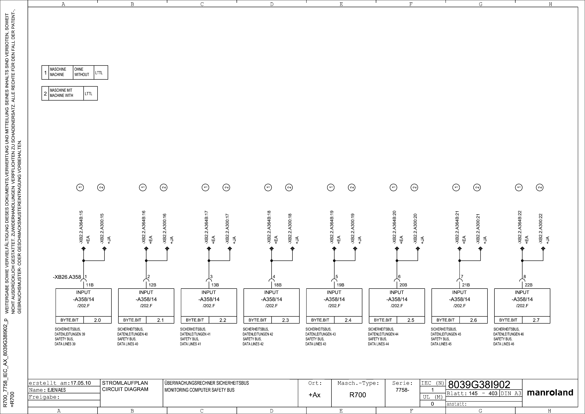

# +Ax — Sheet 145 of 403 — ÜBERWACHUNGSRECHNER SICHERHEITSBUS

**MONITORING COMPUTER SAFETY BUS**

> Part of the manroland **R700** printing press IEC/UL circuit diagrams.
> Drawing class: **Stromlaufplan / Circuit diagram** (DIN A3).
> Document `+Ax` covers the **Central control console** machine section.

## At a glance

| Field | Value |
|---|---|
| Document | `+Ax`  (8039G38I902) |
| Sheet | **145** of 403 |
| Section (DE) | ÜBERWACHUNGSRECHNER SICHERHEITSBUS |
| Section (EN) | MONITORING COMPUTER SAFETY BUS |
| Section type | CIRCUIT — Circuit diagram |
| Machine type | `R700` |
| Series | `7758` |
| Created | 17.05.10 |
| Replaces | — |
| Columns used | A, B, C, D, E, F, G, H |
| Path numbers | — |
| Labels on sheet | 147 |
| Cross-refs out | 8 |
| Cross-refs in | 16 |

**Previous:** [+Ax sheet 144](SHEET_0144.md) · **Next:** [+Ax sheet 146](SHEET_0146.md) · **Document TOC:** [_TOC.md](_TOC.md)  (+Ax) · **Master TOC:** [all sheets](../_MASTER_TOC.md)

## Sheet image (300 DPI, exact vector render)



_Rendered directly from the PDF vector layer at 300 DPI (1-bit), no OCR and no resampling. Use it to confirm anything ambiguous in the text below._

## Cross-references on this sheet

Each entry is a wire leaving this sheet. The printed token is `/sheet.column`; the link resolves to that sheet inside the same document.

| Ref | Target sheet | Col | Path | Destination on target | Target section | From col |
|---|---|---|---|---|---|---|
| `/202.F` | [+Ax sheet 202](SHEET_0202.md) | F | — | — | REFERENZMODUL | A |
| `/202.F` | [+Ax sheet 202](SHEET_0202.md) | F | — | — | REFERENZMODUL | B |
| `/202.F` | [+Ax sheet 202](SHEET_0202.md) | F | — | — | REFERENZMODUL | C |
| `/202.F` | [+Ax sheet 202](SHEET_0202.md) | F | — | — | REFERENZMODUL | D |
| `/202.F` | [+Ax sheet 202](SHEET_0202.md) | F | — | — | REFERENZMODUL | E |
| `/202.F` | [+Ax sheet 202](SHEET_0202.md) | F | — | — | REFERENZMODUL | F |
| `/202.F` | [+Ax sheet 202](SHEET_0202.md) | F | — | — | REFERENZMODUL | G |
| `/202.F` | [+Ax sheet 202](SHEET_0202.md) | F | — | — | REFERENZMODUL | H |

### Incoming references (sheets that point here)

Every other sheet that sends a wire to this one. `Back-ref` is the token printed on *that* sheet; `Path` is its line number.

| From sheet | Cols | Back-ref | Path | Refs | What continues there |
|---|---|---|---|---|---|
| [+Ax#202](SHEET_0202.md) | F | `/202.F` | — | 8 | — |
| [+Ax#269](SHEET_0269.md) | A | `/269.A` | — | 8 | — |


## Devices on this sheet

| Tag | Class | Class meaning (IEC) | Col | Sub | Terminal | Sign |
|---|---|---|---|---|---|---|
| `A358/14` | A | Baugruppe / assembly, module, PC board | A | 14 | — | — |
| `A358/14` | A | Baugruppe / assembly, module, PC board | B | 14 | — | — |
| `A358/14` | A | Baugruppe / assembly, module, PC board | C | 14 | — | — |
| `A358/14` | A | Baugruppe / assembly, module, PC board | D | 14 | — | — |
| `A358/14` | A | Baugruppe / assembly, module, PC board | E | 14 | — | — |
| `A358/14` | A | Baugruppe / assembly, module, PC board | F | 14 | — | — |
| `A358/14` | A | Baugruppe / assembly, module, PC board | G | 14 | — | — |
| `A358/14` | A | Baugruppe / assembly, module, PC board | H | 14 | — | — |
| `2.0` | — | cross-device reference | A | — | — | — |
| `2.1` | — | cross-device reference | B | — | — | — |
| `2.2` | — | cross-device reference | C | — | — | — |
| `2.3` | — | cross-device reference | D | — | — | — |
| `2.4` | — | cross-device reference | E | — | — | — |
| `2.5` | — | cross-device reference | F | — | — | — |
| `2.6` | — | cross-device reference | G | — | — | — |
| `2.7` | — | cross-device reference | H | — | — | — |
| `XB26.A358` | — | cross-device reference | A | — | — | — |
| `XB2.2.A364B:15` | — | cross-device reference | A | — | 15 | — |
| `XB2.2.A364B:16` | — | cross-device reference | B | — | 16 | — |
| `XB2.2.A364B:17` | — | cross-device reference | C | — | 17 | — |
| `XB2.2.A364B:18` | — | cross-device reference | D | — | 18 | — |
| `XB2.2.A364B:19` | — | cross-device reference | E | — | 19 | — |
| `XB2.2.A364B:20` | — | cross-device reference | F | — | 20 | — |
| `XB2.2.A364B:21` | — | cross-device reference | G | — | 21 | — |
| `XB2.2.A364B:22` | — | cross-device reference | H | — | 22 | — |
| `XB2.2.A300:15` | — | cross-device reference | B | — | 15 | — |
| `XB2.2.A300:16` | — | cross-device reference | B | — | 16 | — |
| `XB2.2.A300:17` | — | cross-device reference | C | — | 17 | — |
| `XB2.2.A300:18` | — | cross-device reference | D | — | 18 | — |
| `XB2.2.A300:19` | — | cross-device reference | E | — | 19 | — |
| `XB2.2.A300:20` | — | cross-device reference | F | — | 20 | — |
| `XB2.2.A300:21` | — | cross-device reference | G | — | 21 | — |
| `XB2.2.A300:22` | — | cross-device reference | H | — | 22 | — |

## Potentials / nets

_No named potentials on this sheet._

## Wire-end annotations (grouped as printed)

A wire that continues elsewhere is annotated with a small cluster: the destination description, the path/line number `#NN`, and the `/sheet.column` cross reference. Each row below is one such cluster exactly as it is grouped on the drawing.

| Col | Y | Path | Cross-ref | Text on the wire |
|---|---|---|---|---|
| A | 138.1 | — | — | `1 MASCHINE MACHINE` |
| A | 138.1 | — | — | `OHNE WITHOUT LTTL` |
| A | 180.6 | — | — | `2 MASCHINE MIT MACHINE WITH` |
| A | 187.7 | — | — | `LTTL` |
| A | 378.4 | — | — | `1` |
| B | 378.4 | — | — | `1` |
| C | 378.4 | — | — | `1` |
| D | 378.4 | — | — | `1` |
| E | 378.4 | — | — | `1` |
| F | 378.4 | — | — | `1` |
| G | 378.4 | — | — | `1` |
| H | 378.4 | — | — | `1` |
| B | 379.3 | — | — | `2` |
| B | 379.3 | — | — | `2` |
| C | 379.3 | — | — | `2` |
| D | 379.3 | — | — | `2` |
| E | 379.3 | — | — | `2` |
| F | 379.3 | — | — | `2` |
| G | 379.3 | — | — | `2` |
| H | 379.3 | — | — | `2` |
| A | 428.3 | — | — | `XB2.2.A364B:15` |
| B | 428.3 | — | — | `XB2.2.A364B:16` |
| C | 428.3 | — | — | `XB2.2.A364B:17` |
| D | 428.3 | — | — | `XB2.2.A364B:18` |
| E | 428.3 | — | — | `XB2.2.A364B:19` |
| F | 428.3 | — | — | `XB2.2.A364B:20` |
| G | 428.3 | — | — | `XB2.2.A364B:21` |
| H | 428.3 | — | — | `XB2.2.A364B:22` |
| B | 434.3 | — | — | `XB2.2.A300:15` |
| B | 434.3 | — | — | `XB2.2.A300:16` |
| C | 434.3 | — | — | `XB2.2.A300:17` |
| D | 434.3 | — | — | `XB2.2.A300:18` |
| E | 434.3 | — | — | `XB2.2.A300:19` |
| F | 434.3 | — | — | `XB2.2.A300:20` |
| G | 434.3 | — | — | `XB2.2.A300:21` |
| H | 434.3 | — | — | `XB2.2.A300:22` |
| A | 479.3 | — | — | `+EA` |
| B | 479.3 | — | — | `+EA` |
| C | 479.3 | — | — | `+EA` |
| D | 479.3 | — | — | `+EA` |
| E | 479.3 | — | — | `+EA` |
| F | 479.3 | — | — | `+EA` |
| G | 479.3 | — | — | `+EA` |
| H | 479.3 | — | — | `+EA` |
| B | 480.8 | — | — | `+JA` |
| C | 480.8 | — | — | `+JA` |
| C | 480.8 | — | — | `+JA` |
| D | 480.8 | — | — | `+JA` |
| E | 480.8 | — | — | `+JA` |
| F | 480.8 | — | — | `+JA` |
| G | 480.8 | — | — | `+JA` |
| H | 480.8 | — | — | `+JA` |
| D | 558.7 | — | — | `XB26.A358 1 2 3 4 5 6 7 8` |
| A | 575.7 | — | — | `11B` |
| B | 575.7 | — | — | `12B` |
| C | 575.7 | — | — | `13B` |
| D | 575.7 | — | — | `18B` |
| E | 575.7 | — | — | `19B` |
| F | 575.7 | — | — | `20B` |
| G | 575.7 | — | — | `21B` |
| H | 575.7 | — | — | `22B` |
| A | 590.2 | — | — | `INPUT` |
| B | 590.2 | — | — | `INPUT` |
| C | 590.2 | — | — | `INPUT` |
| D | 590.2 | — | — | `INPUT` |
| E | 590.2 | — | — | `INPUT` |
| F | 590.2 | — | — | `INPUT` |
| G | 590.2 | — | — | `INPUT` |
| H | 590.2 | — | — | `INPUT` |
| A | 604.1 | — | — | `A358/14` |
| B | 604.1 | — | — | `A358/14` |
| C | 604.1 | — | — | `A358/14` |
| D | 604.1 | — | — | `A358/14` |
| E | 604.1 | — | — | `A358/14` |
| F | 604.1 | — | — | `A358/14` |
| G | 604.1 | — | — | `A358/14` |
| H | 604.1 | — | — | `A358/14` |
| A | 617.9 | — | `/202.F` | — |
| B | 617.9 | — | `/202.F` | — |
| C | 617.9 | — | `/202.F` | — |
| D | 617.9 | — | `/202.F` | — |
| E | 617.9 | — | `/202.F` | — |
| F | 617.9 | — | `/202.F` | — |
| G | 617.9 | — | `/202.F` | — |
| H | 617.9 | — | `/202.F` | — |
| A | 646.9 | — | — | `BYTE.BIT 2.0` |
| B | 646.9 | — | — | `BYTE.BIT 2.1` |
| C | 646.9 | — | — | `BYTE.BIT 2.2` |
| D | 646.9 | — | — | `BYTE.BIT 2.3` |
| E | 646.9 | — | — | `BYTE.BIT 2.4` |
| F | 646.9 | — | — | `BYTE.BIT 2.5` |
| G | 646.9 | — | — | `BYTE.BIT 2.6` |
| H | 646.9 | — | — | `BYTE.BIT 2.7` |
| A | 666.9 | — | — | `DATENLEITUNGEN 39 DATA LINES 39 SICHERHEITSBUS, SAFETY BUS,` |
| B | 666.9 | — | — | `DATENLEITUNGEN 40 DATA LINES 40 SICHERHEITSBUS, SAFETY BUS,` |
| C | 666.9 | — | — | `DATENLEITUNGEN 41 DATA LINES 41 SICHERHEITSBUS, SAFETY BUS,` |
| D | 666.9 | — | — | `DATENLEITUNGEN 42 DATA LINES 42 SICHERHEITSBUS, SAFETY BUS,` |
| E | 666.9 | — | — | `DATENLEITUNGEN 43 DATA LINES 43 SICHERHEITSBUS, SAFETY BUS,` |
| F | 666.9 | — | — | `DATENLEITUNGEN 44 DATA LINES 44 SICHERHEITSBUS, SAFETY BUS,` |
| G | 666.9 | — | — | `DATENLEITUNGEN 45 DATA LINES 45 SICHERHEITSBUS, SAFETY BUS,` |
| G | 666.9 | — | — | `DATENLEITUNGEN 46 DATA LINES 46 SICHERHEITSBUS, SAFETY BUS,` |


## Reconstructed tables

This sheet carries tabular content (pin map / terminal assignment / index). The grid below was rebuilt from the drawing's own rule lines, so each row is exactly one physical row of the table.

### Table 1 — 2 data rows × 2 columns (at x=113.4, y=530.1)

| XB26.A358 | 1 11B |
|---|---|
| `INPUT` | `A358/14 /202.F` |
| `BYTE.BIT` | `2.0` |


### Table 2 — 1 data rows × 2 columns (at x=240.9, y=530.1) — **2 12B**

| INPUT | A358/14 /202.F |
|---|---|
| `BYTE.BIT` | `2.1` |


### Table 3 — 1 data rows × 2 columns (at x=368.5, y=530.1) — **3 13B**

| INPUT | A358/14 /202.F |
|---|---|
| `BYTE.BIT` | `2.2` |


### Table 4 — 1 data rows × 2 columns (at x=496.1, y=530.1) — **4 18B**

| INPUT | A358/14 /202.F |
|---|---|
| `BYTE.BIT` | `2.3` |


### Table 5 — 1 data rows × 2 columns (at x=623.6, y=530.1) — **5 19B**

| INPUT | A358/14 /202.F |
|---|---|
| `BYTE.BIT` | `2.4` |


### Table 6 — 1 data rows × 2 columns (at x=751.2, y=530.1) — **6 20B**

| INPUT | A358/14 /202.F |
|---|---|
| `BYTE.BIT` | `2.5` |


### Table 7 — 1 data rows × 2 columns (at x=878.7, y=530.1) — **7 21B**

| INPUT | A358/14 /202.F |
|---|---|
| `BYTE.BIT` | `2.6` |


### Table 8 — 1 data rows × 2 columns (at x=1006.3, y=530.1) — **8 22B**

| INPUT | A358/14 /202.F |
|---|---|
| `BYTE.BIT` | `2.7` |


## Notes and free text on this sheet

| Text | Col | Y (pt) |
|---|---|---|
| `11B` | A | 575.72 |
| `INPUT` | A | 590.24 |
| `BYTE.BIT` | A | 647.49 |
| `SICHERHEITSBUS,` | A | 666.94 |
| `DATENLEITUNGEN 39` | A | 676.85 |
| `SAFETY BUS,` | A | 686.81 |
| `DATA LINES 39` | A | 696.77 |
| `12B` | B | 575.72 |
| `INPUT` | B | 590.24 |
| `BYTE.BIT` | B | 647.49 |
| `SICHERHEITSBUS,` | B | 666.94 |
| `DATENLEITUNGEN 40` | B | 676.85 |
| `SAFETY BUS,` | B | 686.81 |
| `DATA LINES 40` | B | 696.77 |
| `13B` | C | 575.72 |
| `INPUT` | C | 590.24 |
| `BYTE.BIT` | C | 647.49 |
| `SICHERHEITSBUS,` | C | 666.94 |
| `DATENLEITUNGEN 41` | C | 676.84 |
| `SAFETY BUS,` | C | 686.81 |
| `DATA LINES 41` | C | 696.75 |
| `18B` | D | 575.72 |
| `INPUT` | D | 590.24 |
| `BYTE.BIT` | D | 647.49 |
| `SICHERHEITSBUS,` | D | 666.94 |
| `DATENLEITUNGEN 42` | D | 676.85 |
| `SAFETY BUS,` | D | 686.81 |
| `DATA LINES 42` | D | 696.76 |
| `19B` | E | 575.72 |
| `INPUT` | E | 590.24 |
| `BYTE.BIT` | E | 647.49 |
| `SICHERHEITSBUS,` | E | 666.94 |
| `DATENLEITUNGEN 43` | E | 676.85 |
| `SAFETY BUS,` | E | 686.81 |
| `DATA LINES 43` | E | 696.77 |
| `20B` | F | 575.72 |
| `INPUT` | F | 590.24 |
| `BYTE.BIT` | F | 647.49 |
| `SICHERHEITSBUS,` | F | 666.94 |
| `DATENLEITUNGEN 44` | F | 676.85 |
| `SAFETY BUS,` | F | 686.81 |
| `DATA LINES 44` | F | 696.77 |
| `21B` | G | 575.72 |
| `INPUT` | G | 590.24 |
| `DATENLEITUNGEN 45` | G | 676.85 |
| `DATA LINES 45` | F | 696.77 |
| `22B` | H | 575.72 |
| `INPUT` | H | 590.24 |
| `BYTE.BIT` | G | 647.49 |
| `SICHERHEITSBUS,` | G | 666.94 |
| `DATENLEITUNGEN 46` | G | 676.85 |
| `SAFETY BUS,` | G | 686.81 |
| `DATA LINES 46` | G | 696.77 |
| `+EA` | A | 479.34 |
| `+EA` | B | 479.34 |
| `+EA` | C | 479.34 |
| `+EA` | D | 479.34 |
| `+EA` | E | 479.34 |
| `+EA` | F | 479.34 |
| `+EA` | G | 479.34 |
| `+EA` | H | 479.34 |
| `+JA` | B | 480.76 |
| `+JA` | C | 480.76 |
| `+JA` | D | 480.76 |
| `+JA` | E | 480.76 |
| `+JA` | F | 480.76 |
| `+JA` | G | 480.76 |
| `+JA` | H | 480.76 |
| `MASCHINE` | A | 138.1 |
| `MACHINE` | A | 148.74 |
| `MASCHINE MIT` | A | 180.63 |
| `MACHINE WITH` | A | 191.22 |
| `OHNE` | A | 138.1 |
| `WITHOUT` | A | 148.7 |
| `LTTL` | B | 145.16 |
| `LTTL` | A | 187.68 |

## Complete label inventory (exact text from the drawing)

Every text object inside the drawing area of this sheet, in DIN reading order (column A→H, then top→bottom). This is the authoritative list: if a string is not here it is not printed on this sheet.

| Col | Y | X | Dir | Type | Text |
|---|---|---|---|---|---|
| A | 138.1 | 101.5 | → | text | `MASCHINE` |
| A | 138.1 | 151.4 | → | text | `OHNE` |
| A | 143.4 | 89.6 | → | number | `1` |
| A | 148.7 | 101.5 | → | text | `MACHINE` |
| A | 148.7 | 151.7 | → | text | `WITHOUT` |
| A | 180.6 | 101.5 | → | text | `MASCHINE MIT` |
| A | 185.9 | 89.3 | → | number | `2` |
| A | 187.7 | 172.8 | → | text | `LTTL` |
| A | 191.2 | 101.5 | → | text | `MACHINE WITH` |
| A | 378.4 | 159.9 | ↕ | number | `1` |
| A | 428.3 | 161.1 | ↕ | device ref | `XB2.2.A364B:15` |
| A | 479.3 | 175.3 | ↕ | text | `+EA` |
| A | 558.7 | 107.7 | → | device ref | `XB26.A358` |
| A | 558.7 | 172.1 | → | number | `1` |
| A | 575.7 | 174.9 | → | text | `11B` |
| A | 590.2 | 155.2 | → | text | `INPUT` |
| A | 604.1 | 148.7 | → | device tag | `A358/14` |
| A | 617.9 | 157.7 | → | cross-reference | `/202.F` |
| A | 646.9 | 191.6 | → | device ref | `2.0` |
| A | 647.5 | 123.3 | → | text | `BYTE.BIT` |
| A | 666.9 | 111.7 | → | text | `SICHERHEITSBUS,` |
| A | 676.9 | 111.4 | → | text | `DATENLEITUNGEN 39` |
| A | 686.8 | 111.7 | → | text | `SAFETY BUS,` |
| A | 696.8 | 111.4 | → | text | `DATA LINES 39` |
| B | 145.2 | 194.0 | → | text | `LTTL` |
| B | 378.4 | 287.5 | ↕ | number | `1` |
| B | 379.3 | 203.0 | ↕ | number | `2` |
| B | 379.3 | 330.5 | ↕ | number | `2` |
| B | 428.3 | 288.7 | ↕ | device ref | `XB2.2.A364B:16` |
| B | 434.3 | 203.7 | ↕ | device ref | `XB2.2.A300:15` |
| B | 434.3 | 331.2 | ↕ | device ref | `XB2.2.A300:16` |
| B | 479.3 | 302.8 | ↕ | text | `+EA` |
| B | 480.8 | 217.8 | ↕ | text | `+JA` |
| B | 558.7 | 300.2 | → | number | `2` |
| B | 575.7 | 302.5 | → | text | `12B` |
| B | 590.2 | 282.8 | → | text | `INPUT` |
| B | 604.1 | 276.2 | → | device tag | `A358/14` |
| B | 617.9 | 285.3 | → | cross-reference | `/202.F` |
| B | 646.9 | 320.0 | → | device ref | `2.1` |
| B | 647.5 | 250.9 | → | text | `BYTE.BIT` |
| B | 666.9 | 239.2 | → | text | `SICHERHEITSBUS,` |
| B | 676.9 | 239.0 | → | text | `DATENLEITUNGEN 40` |
| B | 686.8 | 239.2 | → | text | `SAFETY BUS,` |
| B | 696.8 | 239.0 | → | text | `DATA LINES 40` |
| C | 378.4 | 415.1 | ↕ | number | `1` |
| C | 379.3 | 458.1 | ↕ | number | `2` |
| C | 428.3 | 416.3 | ↕ | device ref | `XB2.2.A364B:17` |
| C | 434.3 | 458.8 | ↕ | device ref | `XB2.2.A300:17` |
| C | 479.3 | 430.4 | ↕ | text | `+EA` |
| C | 480.8 | 345.4 | ↕ | text | `+JA` |
| C | 480.8 | 472.9 | ↕ | text | `+JA` |
| C | 558.7 | 427.7 | → | number | `3` |
| C | 575.7 | 430.0 | → | text | `13B` |
| C | 590.2 | 410.3 | → | text | `INPUT` |
| C | 604.1 | 403.8 | → | device tag | `A358/14` |
| C | 617.9 | 412.9 | → | cross-reference | `/202.F` |
| C | 646.9 | 446.7 | → | device ref | `2.2` |
| C | 647.5 | 378.4 | → | text | `BYTE.BIT` |
| C | 666.9 | 366.8 | → | text | `SICHERHEITSBUS,` |
| C | 676.8 | 366.5 | → | text | `DATENLEITUNGEN 41` |
| C | 686.8 | 366.8 | → | text | `SAFETY BUS,` |
| C | 696.7 | 366.5 | → | text | `DATA LINES 41` |
| D | 378.4 | 542.6 | ↕ | number | `1` |
| D | 379.3 | 585.6 | ↕ | number | `2` |
| D | 428.3 | 543.8 | ↕ | device ref | `XB2.2.A364B:18` |
| D | 434.3 | 586.3 | ↕ | device ref | `XB2.2.A300:18` |
| D | 479.3 | 558.0 | ↕ | text | `+EA` |
| D | 480.8 | 600.5 | ↕ | text | `+JA` |
| D | 558.7 | 555.3 | → | number | `4` |
| D | 575.7 | 557.6 | → | text | `18B` |
| D | 590.2 | 537.9 | → | text | `INPUT` |
| D | 604.1 | 531.4 | → | device tag | `A358/14` |
| D | 617.9 | 540.4 | → | cross-reference | `/202.F` |
| D | 646.9 | 574.3 | → | device ref | `2.3` |
| D | 647.5 | 506.0 | → | text | `BYTE.BIT` |
| D | 666.9 | 494.4 | → | text | `SICHERHEITSBUS,` |
| D | 676.9 | 494.1 | → | text | `DATENLEITUNGEN 42` |
| D | 686.8 | 494.4 | → | text | `SAFETY BUS,` |
| D | 696.8 | 494.1 | → | text | `DATA LINES 42` |
| E | 378.4 | 670.2 | ↕ | number | `1` |
| E | 379.3 | 713.2 | ↕ | number | `2` |
| E | 428.3 | 671.4 | ↕ | device ref | `XB2.2.A364B:19` |
| E | 434.3 | 713.9 | ↕ | device ref | `XB2.2.A300:19` |
| E | 479.3 | 685.5 | ↕ | text | `+EA` |
| E | 480.8 | 728.0 | ↕ | text | `+JA` |
| E | 558.7 | 682.9 | → | number | `5` |
| E | 575.7 | 685.1 | → | text | `19B` |
| E | 590.2 | 665.4 | → | text | `INPUT` |
| E | 604.1 | 658.9 | → | device tag | `A358/14` |
| E | 617.9 | 668.0 | → | cross-reference | `/202.F` |
| E | 646.9 | 701.9 | → | device ref | `2.4` |
| E | 647.5 | 633.5 | → | text | `BYTE.BIT` |
| E | 666.9 | 621.9 | → | text | `SICHERHEITSBUS,` |
| E | 676.9 | 621.6 | → | text | `DATENLEITUNGEN 43` |
| E | 686.8 | 621.9 | → | text | `SAFETY BUS,` |
| E | 696.8 | 621.6 | → | text | `DATA LINES 43` |
| F | 378.4 | 797.7 | ↕ | number | `1` |
| F | 379.3 | 840.8 | ↕ | number | `2` |
| F | 428.3 | 798.9 | ↕ | device ref | `XB2.2.A364B:20` |
| F | 434.3 | 841.5 | ↕ | device ref | `XB2.2.A300:20` |
| F | 479.3 | 813.1 | ↕ | text | `+EA` |
| F | 480.8 | 855.6 | ↕ | text | `+JA` |
| F | 558.7 | 810.4 | → | number | `6` |
| F | 575.7 | 813.3 | → | text | `20B` |
| F | 590.2 | 793.0 | → | text | `INPUT` |
| F | 604.1 | 786.5 | → | device tag | `A358/14` |
| F | 617.9 | 795.5 | → | cross-reference | `/202.F` |
| F | 646.9 | 829.4 | → | device ref | `2.5` |
| F | 647.5 | 761.1 | → | text | `BYTE.BIT` |
| F | 647.5 | 888.7 | → | text | `BYTE.BIT` |
| F | 666.9 | 749.5 | → | text | `SICHERHEITSBUS,` |
| F | 666.9 | 877.0 | → | text | `SICHERHEITSBUS,` |
| F | 676.9 | 749.2 | → | text | `DATENLEITUNGEN 44` |
| F | 686.8 | 749.5 | → | text | `SAFETY BUS,` |
| F | 686.8 | 877.0 | → | text | `SAFETY BUS,` |
| F | 696.8 | 749.2 | → | text | `DATA LINES 44` |
| F | 696.8 | 876.8 | → | text | `DATA LINES 45` |
| G | 378.4 | 925.3 | ↕ | number | `1` |
| G | 379.3 | 968.3 | ↕ | number | `2` |
| G | 428.3 | 926.5 | ↕ | device ref | `XB2.2.A364B:21` |
| G | 434.3 | 969.0 | ↕ | device ref | `XB2.2.A300:21` |
| G | 479.3 | 940.6 | ↕ | text | `+EA` |
| G | 480.8 | 983.1 | ↕ | text | `+JA` |
| G | 558.7 | 938.0 | → | number | `7` |
| G | 575.7 | 940.8 | → | text | `21B` |
| G | 590.2 | 920.6 | → | text | `INPUT` |
| G | 604.1 | 914.0 | → | device tag | `A358/14` |
| G | 617.9 | 923.1 | → | cross-reference | `/202.F` |
| G | 646.9 | 957.0 | → | device ref | `2.6` |
| G | 647.5 | 1016.2 | → | text | `BYTE.BIT` |
| G | 666.9 | 1004.6 | → | text | `SICHERHEITSBUS,` |
| G | 676.9 | 876.8 | → | text | `DATENLEITUNGEN 45` |
| G | 676.9 | 1004.3 | → | text | `DATENLEITUNGEN 46` |
| G | 686.8 | 1004.6 | → | text | `SAFETY BUS,` |
| G | 696.8 | 1004.3 | → | text | `DATA LINES 46` |
| H | 378.4 | 1052.8 | ↕ | number | `1` |
| H | 379.3 | 1095.9 | ↕ | number | `2` |
| H | 428.3 | 1054.1 | ↕ | device ref | `XB2.2.A364B:22` |
| H | 434.3 | 1096.6 | ↕ | device ref | `XB2.2.A300:22` |
| H | 479.3 | 1068.2 | ↕ | text | `+EA` |
| H | 480.8 | 1110.7 | ↕ | text | `+JA` |
| H | 558.7 | 1065.5 | → | number | `8` |
| H | 575.7 | 1068.4 | → | text | `22B` |
| H | 590.2 | 1048.1 | → | text | `INPUT` |
| H | 604.1 | 1041.6 | → | device tag | `A358/14` |
| H | 617.9 | 1050.7 | → | cross-reference | `/202.F` |
| H | 646.9 | 1084.5 | → | device ref | `2.7` |

## Reading-order text block

The same content as a plain block, grouped by DIN column — convenient to paste or to match against a visual description.

```text
=== Column A ===
 138.1  101.5  text         MASCHINE
 138.1  151.4  text         OHNE
 143.4   89.6  numeric      1
 148.7  101.5  text         MACHINE
 148.7  151.7  text         WITHOUT
 180.6  101.5  text         MASCHINE MIT
 185.9   89.3  numeric      2
 187.7  172.8  text         LTTL
 191.2  101.5  text         MACHINE WITH
 378.4  159.9  numeric      1
 428.3  161.1  devref       XB2.2.A364B:15
 479.3  175.3  text         +EA
 558.7  107.7  devref       XB26.A358
 558.7  172.1  numeric      1
 575.7  174.9  text         11B
 590.2  155.2  text         INPUT
 604.1  148.7  devtag       A358/14
 617.9  157.7  xref         /202.F
 646.9  191.6  devref       2.0
 647.5  123.3  text         BYTE.BIT
 666.9  111.7  text         SICHERHEITSBUS,
 676.9  111.4  text         DATENLEITUNGEN 39
 686.8  111.7  text         SAFETY BUS,
 696.8  111.4  text         DATA LINES 39
=== Column B ===
 145.2  194.0  text         LTTL
 378.4  287.5  numeric      1
 379.3  203.0  numeric      2
 379.3  330.5  numeric      2
 428.3  288.7  devref       XB2.2.A364B:16
 434.3  203.7  devref       XB2.2.A300:15
 434.3  331.2  devref       XB2.2.A300:16
 479.3  302.8  text         +EA
 480.8  217.8  text         +JA
 558.7  300.2  numeric      2
 575.7  302.5  text         12B
 590.2  282.8  text         INPUT
 604.1  276.2  devtag       A358/14
 617.9  285.3  xref         /202.F
 646.9  320.0  devref       2.1
 647.5  250.9  text         BYTE.BIT
 666.9  239.2  text         SICHERHEITSBUS,
 676.9  239.0  text         DATENLEITUNGEN 40
 686.8  239.2  text         SAFETY BUS,
 696.8  239.0  text         DATA LINES 40
=== Column C ===
 378.4  415.1  numeric      1
 379.3  458.1  numeric      2
 428.3  416.3  devref       XB2.2.A364B:17
 434.3  458.8  devref       XB2.2.A300:17
 479.3  430.4  text         +EA
 480.8  345.4  text         +JA
 480.8  472.9  text         +JA
 558.7  427.7  numeric      3
 575.7  430.0  text         13B
 590.2  410.3  text         INPUT
 604.1  403.8  devtag       A358/14
 617.9  412.9  xref         /202.F
 646.9  446.7  devref       2.2
 647.5  378.4  text         BYTE.BIT
 666.9  366.8  text         SICHERHEITSBUS,
 676.8  366.5  text         DATENLEITUNGEN 41
 686.8  366.8  text         SAFETY BUS,
 696.7  366.5  text         DATA LINES 41
=== Column D ===
 378.4  542.6  numeric      1
 379.3  585.6  numeric      2
 428.3  543.8  devref       XB2.2.A364B:18
 434.3  586.3  devref       XB2.2.A300:18
 479.3  558.0  text         +EA
 480.8  600.5  text         +JA
 558.7  555.3  numeric      4
 575.7  557.6  text         18B
 590.2  537.9  text         INPUT
 604.1  531.4  devtag       A358/14
 617.9  540.4  xref         /202.F
 646.9  574.3  devref       2.3
 647.5  506.0  text         BYTE.BIT
 666.9  494.4  text         SICHERHEITSBUS,
 676.9  494.1  text         DATENLEITUNGEN 42
 686.8  494.4  text         SAFETY BUS,
 696.8  494.1  text         DATA LINES 42
=== Column E ===
 378.4  670.2  numeric      1
 379.3  713.2  numeric      2
 428.3  671.4  devref       XB2.2.A364B:19
 434.3  713.9  devref       XB2.2.A300:19
 479.3  685.5  text         +EA
 480.8  728.0  text         +JA
 558.7  682.9  numeric      5
 575.7  685.1  text         19B
 590.2  665.4  text         INPUT
 604.1  658.9  devtag       A358/14
 617.9  668.0  xref         /202.F
 646.9  701.9  devref       2.4
 647.5  633.5  text         BYTE.BIT
 666.9  621.9  text         SICHERHEITSBUS,
 676.9  621.6  text         DATENLEITUNGEN 43
 686.8  621.9  text         SAFETY BUS,
 696.8  621.6  text         DATA LINES 43
=== Column F ===
 378.4  797.7  numeric      1
 379.3  840.8  numeric      2
 428.3  798.9  devref       XB2.2.A364B:20
 434.3  841.5  devref       XB2.2.A300:20
 479.3  813.1  text         +EA
 480.8  855.6  text         +JA
 558.7  810.4  numeric      6
 575.7  813.3  text         20B
 590.2  793.0  text         INPUT
 604.1  786.5  devtag       A358/14
 617.9  795.5  xref         /202.F
 646.9  829.4  devref       2.5
 647.5  761.1  text         BYTE.BIT
 647.5  888.7  text         BYTE.BIT
 666.9  749.5  text         SICHERHEITSBUS,
 666.9  877.0  text         SICHERHEITSBUS,
 676.9  749.2  text         DATENLEITUNGEN 44
 686.8  749.5  text         SAFETY BUS,
 686.8  877.0  text         SAFETY BUS,
 696.8  749.2  text         DATA LINES 44
 696.8  876.8  text         DATA LINES 45
=== Column G ===
 378.4  925.3  numeric      1
 379.3  968.3  numeric      2
 428.3  926.5  devref       XB2.2.A364B:21
 434.3  969.0  devref       XB2.2.A300:21
 479.3  940.6  text         +EA
 480.8  983.1  text         +JA
 558.7  938.0  numeric      7
 575.7  940.8  text         21B
 590.2  920.6  text         INPUT
 604.1  914.0  devtag       A358/14
 617.9  923.1  xref         /202.F
 646.9  957.0  devref       2.6
 647.5 1016.2  text         BYTE.BIT
 666.9 1004.6  text         SICHERHEITSBUS,
 676.9  876.8  text         DATENLEITUNGEN 45
 676.9 1004.3  text         DATENLEITUNGEN 46
 686.8 1004.6  text         SAFETY BUS,
 696.8 1004.3  text         DATA LINES 46
=== Column H ===
 378.4 1052.8  numeric      1
 379.3 1095.9  numeric      2
 428.3 1054.1  devref       XB2.2.A364B:22
 434.3 1096.6  devref       XB2.2.A300:22
 479.3 1068.2  text         +EA
 480.8 1110.7  text         +JA
 558.7 1065.5  numeric      8
 575.7 1068.4  text         22B
 590.2 1048.1  text         INPUT
 604.1 1041.6  devtag       A358/14
 617.9 1050.7  xref         /202.F
 646.9 1084.5  devref       2.7
```

---
_Generated from the PDF vector text layer; no OCR. Source: `R700_7758_IEC_AX_8039G38I902_p`, sheet 145._
