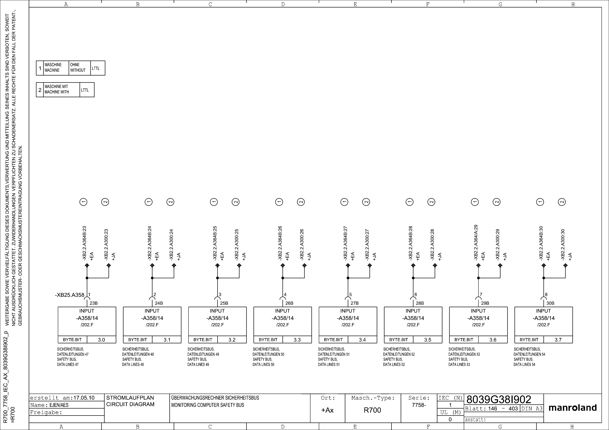

# +Ax — Sheet 146 of 403 — ÜBERWACHUNGSRECHNER SICHERHEITSBUS

**MONITORING COMPUTER SAFETY BUS**

> Part of the manroland **R700** printing press IEC/UL circuit diagrams.
> Drawing class: **Stromlaufplan / Circuit diagram** (DIN A3).
> Document `+Ax` covers the **Central control console** machine section.

## At a glance

| Field | Value |
|---|---|
| Document | `+Ax`  (8039G38I902) |
| Sheet | **146** of 403 |
| Section (DE) | ÜBERWACHUNGSRECHNER SICHERHEITSBUS |
| Section (EN) | MONITORING COMPUTER SAFETY BUS |
| Section type | CIRCUIT — Circuit diagram |
| Machine type | `R700` |
| Series | `7758` |
| Created | 17.05.10 |
| Replaces | — |
| Columns used | A, B, C, D, E, F, G, H |
| Path numbers | — |
| Labels on sheet | 147 |
| Cross-refs out | 8 |
| Cross-refs in | 16 |

**Previous:** [+Ax sheet 145](SHEET_0145.md) · **Next:** [+Ax sheet 147](SHEET_0147.md) · **Document TOC:** [_TOC.md](_TOC.md)  (+Ax) · **Master TOC:** [all sheets](../_MASTER_TOC.md)

## Sheet image (300 DPI, exact vector render)



_Rendered directly from the PDF vector layer at 300 DPI (1-bit), no OCR and no resampling. Use it to confirm anything ambiguous in the text below._

## Cross-references on this sheet

Each entry is a wire leaving this sheet. The printed token is `/sheet.column`; the link resolves to that sheet inside the same document.

| Ref | Target sheet | Col | Path | Destination on target | Target section | From col |
|---|---|---|---|---|---|---|
| `/202.F` | [+Ax sheet 202](SHEET_0202.md) | F | — | — | REFERENZMODUL | A |
| `/202.F` | [+Ax sheet 202](SHEET_0202.md) | F | — | — | REFERENZMODUL | B |
| `/202.F` | [+Ax sheet 202](SHEET_0202.md) | F | — | — | REFERENZMODUL | C |
| `/202.F` | [+Ax sheet 202](SHEET_0202.md) | F | — | — | REFERENZMODUL | D |
| `/202.F` | [+Ax sheet 202](SHEET_0202.md) | F | — | — | REFERENZMODUL | E |
| `/202.F` | [+Ax sheet 202](SHEET_0202.md) | F | — | — | REFERENZMODUL | F |
| `/202.F` | [+Ax sheet 202](SHEET_0202.md) | F | — | — | REFERENZMODUL | G |
| `/202.F` | [+Ax sheet 202](SHEET_0202.md) | F | — | — | REFERENZMODUL | H |

### Incoming references (sheets that point here)

Every other sheet that sends a wire to this one. `Back-ref` is the token printed on *that* sheet; `Path` is its line number.

| From sheet | Cols | Back-ref | Path | Refs | What continues there |
|---|---|---|---|---|---|
| [+Ax#202](SHEET_0202.md) | F | `/202.F` | — | 8 | — |
| [+Ax#267](SHEET_0267.md) | H | `/267.H` | — | 8 | — |


## Devices on this sheet

| Tag | Class | Class meaning (IEC) | Col | Sub | Terminal | Sign |
|---|---|---|---|---|---|---|
| `A358/14` | A | Baugruppe / assembly, module, PC board | A | 14 | — | — |
| `A358/14` | A | Baugruppe / assembly, module, PC board | B | 14 | — | — |
| `A358/14` | A | Baugruppe / assembly, module, PC board | C | 14 | — | — |
| `A358/14` | A | Baugruppe / assembly, module, PC board | D | 14 | — | — |
| `A358/14` | A | Baugruppe / assembly, module, PC board | E | 14 | — | — |
| `A358/14` | A | Baugruppe / assembly, module, PC board | F | 14 | — | — |
| `A358/14` | A | Baugruppe / assembly, module, PC board | G | 14 | — | — |
| `A358/14` | A | Baugruppe / assembly, module, PC board | H | 14 | — | — |
| `3.0` | — | cross-device reference | A | — | — | — |
| `3.1` | — | cross-device reference | B | — | — | — |
| `3.2` | — | cross-device reference | C | — | — | — |
| `3.3` | — | cross-device reference | D | — | — | — |
| `3.4` | — | cross-device reference | E | — | — | — |
| `3.5` | — | cross-device reference | F | — | — | — |
| `3.6` | — | cross-device reference | G | — | — | — |
| `3.7` | — | cross-device reference | H | — | — | — |
| `XB25.A358` | — | cross-device reference | A | — | — | — |
| `XB2.2.A364B:23` | — | cross-device reference | A | — | 23 | — |
| `XB2.2.A364B:24` | — | cross-device reference | B | — | 24 | — |
| `XB2.2.A364B:25` | — | cross-device reference | C | — | 25 | — |
| `XB2.2.A364B:26` | — | cross-device reference | D | — | 26 | — |
| `XB2.2.A364B:27` | — | cross-device reference | E | — | 27 | — |
| `XB2.2.A364B:28` | — | cross-device reference | F | — | 28 | — |
| `XB2.2.A364B:30` | — | cross-device reference | H | — | 30 | — |
| `XB2.2.A300:23` | — | cross-device reference | B | — | 23 | — |
| `XB2.2.A300:24` | — | cross-device reference | B | — | 24 | — |
| `XB2.2.A300:25` | — | cross-device reference | C | — | 25 | — |
| `XB2.2.A300:26` | — | cross-device reference | D | — | 26 | — |
| `XB2.2.A300:27` | — | cross-device reference | E | — | 27 | — |
| `XB2.2.A300:28` | — | cross-device reference | F | — | 28 | — |
| `XB2.2.A300:29` | — | cross-device reference | G | — | 29 | — |
| `XB2.2.A300:30` | — | cross-device reference | H | — | 30 | — |

## Potentials / nets

_No named potentials on this sheet._

## Wire-end annotations (grouped as printed)

A wire that continues elsewhere is annotated with a small cluster: the destination description, the path/line number `#NN`, and the `/sheet.column` cross reference. Each row below is one such cluster exactly as it is grouped on the drawing.

| Col | Y | Path | Cross-ref | Text on the wire |
|---|---|---|---|---|
| A | 123.9 | — | — | `MASCHINE MACHINE` |
| A | 123.9 | — | — | `OHNE WITHOUT LTTL` |
| A | 129.2 | — | — | `1` |
| A | 166.5 | — | — | `MASCHINE MIT MACHINE WITH` |
| A | 171.8 | — | — | `2` |
| A | 173.5 | — | — | `LTTL` |
| A | 392.5 | — | — | `1` |
| B | 392.5 | — | — | `1` |
| C | 392.5 | — | — | `1` |
| D | 392.5 | — | — | `1` |
| E | 392.5 | — | — | `1` |
| F | 392.5 | — | — | `1` |
| G | 392.5 | — | — | `1` |
| H | 392.5 | — | — | `1` |
| B | 393.4 | — | — | `2` |
| B | 393.4 | — | — | `2` |
| C | 393.4 | — | — | `2` |
| D | 393.4 | — | — | `2` |
| E | 393.4 | — | — | `2` |
| F | 393.4 | — | — | `2` |
| G | 393.4 | — | — | `2` |
| H | 393.4 | — | — | `2` |
| G | 439.9 | — | — | `XB2.2.A364/A:29` |
| A | 442.5 | — | — | `XB2.2.A364B:23` |
| B | 442.5 | — | — | `XB2.2.A364B:24` |
| C | 442.5 | — | — | `XB2.2.A364B:25` |
| D | 442.5 | — | — | `XB2.2.A364B:26` |
| E | 442.5 | — | — | `XB2.2.A364B:27` |
| F | 442.5 | — | — | `XB2.2.A364B:28` |
| H | 442.5 | — | — | `XB2.2.A364B:30` |
| B | 448.4 | — | — | `XB2.2.A300:23` |
| B | 448.4 | — | — | `XB2.2.A300:24` |
| C | 448.4 | — | — | `XB2.2.A300:25` |
| D | 448.4 | — | — | `XB2.2.A300:26` |
| E | 448.4 | — | — | `XB2.2.A300:27` |
| F | 448.4 | — | — | `XB2.2.A300:28` |
| G | 448.4 | — | — | `XB2.2.A300:29` |
| H | 448.4 | — | — | `XB2.2.A300:30` |
| A | 493.5 | — | — | `+EA` |
| B | 493.5 | — | — | `+EA` |
| C | 493.5 | — | — | `+EA` |
| D | 493.5 | — | — | `+EA` |
| E | 493.5 | — | — | `+EA` |
| F | 493.5 | — | — | `+EA` |
| G | 493.5 | — | — | `+EA` |
| H | 493.5 | — | — | `+EA` |
| B | 494.9 | — | — | `+JA` |
| C | 494.9 | — | — | `+JA` |
| C | 494.9 | — | — | `+JA` |
| D | 494.9 | — | — | `+JA` |
| E | 494.9 | — | — | `+JA` |
| F | 494.9 | — | — | `+JA` |
| G | 494.9 | — | — | `+JA` |
| H | 494.9 | — | — | `+JA` |
| D | 572.9 | — | — | `XB25.A358 1 2 3 4 5 6 7 8` |
| A | 589.9 | — | — | `23B` |
| B | 589.9 | — | — | `24B` |
| C | 589.9 | — | — | `25B` |
| D | 589.9 | — | — | `26B` |
| E | 589.9 | — | — | `27B` |
| F | 589.9 | — | — | `28B` |
| G | 589.9 | — | — | `29B` |
| H | 589.9 | — | — | `30B` |
| A | 604.4 | — | — | `INPUT` |
| B | 604.4 | — | — | `INPUT` |
| C | 604.4 | — | — | `INPUT` |
| D | 604.4 | — | — | `INPUT` |
| E | 604.4 | — | — | `INPUT` |
| F | 604.4 | — | — | `INPUT` |
| G | 604.4 | — | — | `INPUT` |
| H | 604.4 | — | — | `INPUT` |
| A | 618.3 | — | — | `A358/14` |
| B | 618.3 | — | — | `A358/14` |
| C | 618.3 | — | — | `A358/14` |
| D | 618.3 | — | — | `A358/14` |
| E | 618.3 | — | — | `A358/14` |
| F | 618.3 | — | — | `A358/14` |
| G | 618.3 | — | — | `A358/14` |
| H | 618.3 | — | — | `A358/14` |
| A | 632.0 | — | `/202.F` | — |
| B | 632.0 | — | `/202.F` | — |
| C | 632.0 | — | `/202.F` | — |
| D | 632.0 | — | `/202.F` | — |
| E | 632.0 | — | `/202.F` | — |
| F | 632.0 | — | `/202.F` | — |
| G | 632.0 | — | `/202.F` | — |
| H | 632.0 | — | `/202.F` | — |
| A | 661.1 | — | — | `BYTE.BIT 3.0` |
| B | 661.1 | — | — | `BYTE.BIT 3.1` |
| C | 661.1 | — | — | `BYTE.BIT 3.2` |
| D | 661.1 | — | — | `BYTE.BIT 3.3` |
| E | 661.1 | — | — | `BYTE.BIT 3.4` |
| F | 661.1 | — | — | `BYTE.BIT 3.5` |
| G | 661.1 | — | — | `BYTE.BIT 3.6` |
| H | 661.1 | — | — | `BYTE.BIT 3.7` |
| A | 681.1 | — | — | `DATENLEITUNGEN 47 DATA LINES 47 SICHERHEITSBUS, SAFETY BUS,` |
| B | 681.1 | — | — | `DATENLEITUNGEN 48 DATA LINES 48 SICHERHEITSBUS, SAFETY BUS,` |
| C | 681.1 | — | — | `DATENLEITUNGEN 49 DATA LINES 49 SICHERHEITSBUS, SAFETY BUS,` |
| D | 681.1 | — | — | `DATENLEITUNGEN 50 DATA LINES 50 SICHERHEITSBUS, SAFETY BUS,` |
| E | 681.1 | — | — | `DATENLEITUNGEN 51 DATA LINES 51 SICHERHEITSBUS, SAFETY BUS,` |
| F | 681.1 | — | — | `DATENLEITUNGEN 52 DATA LINES 52 SICHERHEITSBUS, SAFETY BUS,` |
| G | 681.1 | — | — | `DATENLEITUNGEN 53 DATA LINES 53 SICHERHEITSBUS, SAFETY BUS,` |
| G | 681.1 | — | — | `DATENLEITUNGEN 54 DATA LINES 54 SICHERHEITSBUS, SAFETY BUS,` |


## Reconstructed tables

This sheet carries tabular content (pin map / terminal assignment / index). The grid below was rebuilt from the drawing's own rule lines, so each row is exactly one physical row of the table.

### Table 1 — 2 data rows × 2 columns (at x=113.4, y=544.3)

| XB25.A358 | 1 23B |
|---|---|
| `INPUT` | `A358/14 /202.F` |
| `BYTE.BIT` | `3.0` |


### Table 2 — 1 data rows × 2 columns (at x=240.9, y=544.3) — **2 24B**

| INPUT | A358/14 /202.F |
|---|---|
| `BYTE.BIT` | `3.1` |


### Table 3 — 1 data rows × 2 columns (at x=368.5, y=544.3) — **3 25B**

| INPUT | A358/14 /202.F |
|---|---|
| `BYTE.BIT` | `3.2` |


### Table 4 — 1 data rows × 2 columns (at x=496.1, y=544.3) — **4 26B**

| INPUT | A358/14 /202.F |
|---|---|
| `BYTE.BIT` | `3.3` |


### Table 5 — 1 data rows × 2 columns (at x=623.6, y=544.3) — **5 27B**

| INPUT | A358/14 /202.F |
|---|---|
| `BYTE.BIT` | `3.4` |


### Table 6 — 1 data rows × 2 columns (at x=751.2, y=544.3) — **6 28B**

| INPUT | A358/14 /202.F |
|---|---|
| `BYTE.BIT` | `3.5` |


### Table 7 — 1 data rows × 2 columns (at x=878.7, y=544.3) — **7 29B**

| INPUT | A358/14 /202.F |
|---|---|
| `BYTE.BIT` | `3.6` |


### Table 8 — 1 data rows × 2 columns (at x=1006.3, y=544.3) — **8 30B**

| INPUT | A358/14 /202.F |
|---|---|
| `BYTE.BIT` | `3.7` |


## Notes and free text on this sheet

| Text | Col | Y (pt) |
|---|---|---|
| `23B` | A | 589.89 |
| `INPUT` | A | 604.42 |
| `BYTE.BIT` | A | 661.67 |
| `SICHERHEITSBUS,` | A | 681.11 |
| `DATENLEITUNGEN 47` | A | 691.03 |
| `SAFETY BUS,` | A | 700.98 |
| `DATA LINES 47` | A | 710.94 |
| `24B` | B | 589.89 |
| `INPUT` | B | 604.42 |
| `BYTE.BIT` | B | 661.67 |
| `SICHERHEITSBUS,` | B | 681.11 |
| `DATENLEITUNGEN 48` | B | 691.03 |
| `SAFETY BUS,` | B | 700.98 |
| `DATA LINES 48` | B | 710.94 |
| `25B` | C | 589.89 |
| `INPUT` | C | 604.42 |
| `BYTE.BIT` | C | 661.67 |
| `SICHERHEITSBUS,` | C | 681.11 |
| `DATENLEITUNGEN 49` | C | 691.03 |
| `SAFETY BUS,` | C | 700.98 |
| `DATA LINES 49` | C | 710.94 |
| `26B` | D | 589.89 |
| `INPUT` | D | 604.42 |
| `BYTE.BIT` | D | 661.67 |
| `SICHERHEITSBUS,` | D | 681.11 |
| `DATENLEITUNGEN 50` | D | 691.03 |
| `SAFETY BUS,` | D | 700.98 |
| `DATA LINES 50` | D | 710.94 |
| `27B` | E | 589.89 |
| `INPUT` | E | 604.42 |
| `BYTE.BIT` | E | 661.67 |
| `SICHERHEITSBUS,` | E | 681.11 |
| `DATENLEITUNGEN 51` | E | 691.01 |
| `SAFETY BUS,` | E | 700.98 |
| `DATA LINES 51` | E | 710.92 |
| `28B` | F | 589.89 |
| `INPUT` | F | 604.42 |
| `BYTE.BIT` | F | 661.67 |
| `SICHERHEITSBUS,` | F | 681.11 |
| `DATENLEITUNGEN 52` | F | 691.02 |
| `SAFETY BUS,` | F | 700.98 |
| `DATA LINES 52` | F | 710.93 |
| `29B` | G | 589.89 |
| `INPUT` | G | 604.42 |
| `DATENLEITUNGEN 53` | G | 691.03 |
| `DATA LINES 53` | F | 710.94 |
| `30B` | H | 589.89 |
| `INPUT` | H | 604.42 |
| `BYTE.BIT` | G | 661.67 |
| `SICHERHEITSBUS,` | G | 681.11 |
| `DATENLEITUNGEN 54` | G | 691.03 |
| `SAFETY BUS,` | G | 700.98 |
| `DATA LINES 54` | G | 710.94 |
| `+EA` | A | 493.51 |
| `+EA` | B | 493.51 |
| `+EA` | C | 493.51 |
| `+EA` | D | 493.51 |
| `+EA` | E | 493.51 |
| `+EA` | F | 493.51 |
| `XB2.2.A364/A:29` | G | 439.94 |
| `+EA` | G | 493.51 |
| `+EA` | H | 493.51 |
| `+JA` | B | 494.93 |
| `+JA` | C | 494.93 |
| `+JA` | D | 494.93 |
| `+JA` | E | 494.93 |
| `+JA` | F | 494.93 |
| `+JA` | G | 494.93 |
| `+JA` | H | 494.93 |
| `MASCHINE` | A | 123.93 |
| `MACHINE` | A | 134.57 |
| `MASCHINE MIT` | A | 166.46 |
| `MACHINE WITH` | A | 177.05 |
| `OHNE` | A | 123.93 |
| `WITHOUT` | A | 134.53 |
| `LTTL` | A | 130.98 |

## Complete label inventory (exact text from the drawing)

Every text object inside the drawing area of this sheet, in DIN reading order (column A→H, then top→bottom). This is the authoritative list: if a string is not here it is not printed on this sheet.

| Col | Y | X | Dir | Type | Text |
|---|---|---|---|---|---|
| A | 123.9 | 87.3 | → | text | `MASCHINE` |
| A | 123.9 | 137.2 | → | text | `OHNE` |
| A | 129.2 | 75.4 | → | number | `1` |
| A | 131.0 | 179.9 | → | text | `LTTL` |
| A | 134.5 | 137.5 | → | text | `WITHOUT` |
| A | 134.6 | 87.3 | → | text | `MACHINE` |
| A | 166.5 | 87.3 | → | text | `MASCHINE MIT` |
| A | 171.8 | 75.1 | → | number | `2` |
| A | 173.5 | 158.6 | → | text | `LTTL` |
| A | 177.0 | 87.3 | → | text | `MACHINE WITH` |
| A | 392.5 | 159.9 | ↕ | number | `1` |
| A | 442.5 | 161.1 | ↕ | device ref | `XB2.2.A364B:23` |
| A | 493.5 | 175.3 | ↕ | text | `+EA` |
| A | 572.9 | 107.7 | → | device ref | `XB25.A358` |
| A | 572.9 | 172.1 | → | number | `1` |
| A | 589.9 | 175.5 | → | text | `23B` |
| A | 604.4 | 155.2 | → | text | `INPUT` |
| A | 618.3 | 148.7 | → | device tag | `A358/14` |
| A | 632.0 | 157.7 | → | cross-reference | `/202.F` |
| A | 661.1 | 191.6 | → | device ref | `3.0` |
| A | 661.7 | 123.3 | → | text | `BYTE.BIT` |
| A | 681.1 | 111.7 | → | text | `SICHERHEITSBUS,` |
| A | 691.0 | 111.4 | → | text | `DATENLEITUNGEN 47` |
| A | 701.0 | 111.7 | → | text | `SAFETY BUS,` |
| A | 710.9 | 111.4 | → | text | `DATA LINES 47` |
| B | 392.5 | 287.5 | ↕ | number | `1` |
| B | 393.4 | 203.0 | ↕ | number | `2` |
| B | 393.4 | 330.5 | ↕ | number | `2` |
| B | 442.5 | 288.7 | ↕ | device ref | `XB2.2.A364B:24` |
| B | 448.4 | 203.7 | ↕ | device ref | `XB2.2.A300:23` |
| B | 448.4 | 331.2 | ↕ | device ref | `XB2.2.A300:24` |
| B | 493.5 | 302.8 | ↕ | text | `+EA` |
| B | 494.9 | 217.8 | ↕ | text | `+JA` |
| B | 572.9 | 300.2 | → | number | `2` |
| B | 589.9 | 303.0 | → | text | `24B` |
| B | 604.4 | 282.8 | → | text | `INPUT` |
| B | 618.3 | 276.2 | → | device tag | `A358/14` |
| B | 632.0 | 285.3 | → | cross-reference | `/202.F` |
| B | 661.1 | 320.0 | → | device ref | `3.1` |
| B | 661.7 | 250.9 | → | text | `BYTE.BIT` |
| B | 681.1 | 239.2 | → | text | `SICHERHEITSBUS,` |
| B | 691.0 | 239.0 | → | text | `DATENLEITUNGEN 48` |
| B | 701.0 | 239.2 | → | text | `SAFETY BUS,` |
| B | 710.9 | 239.0 | → | text | `DATA LINES 48` |
| C | 392.5 | 415.1 | ↕ | number | `1` |
| C | 393.4 | 458.1 | ↕ | number | `2` |
| C | 442.5 | 416.3 | ↕ | device ref | `XB2.2.A364B:25` |
| C | 448.4 | 458.8 | ↕ | device ref | `XB2.2.A300:25` |
| C | 493.5 | 430.4 | ↕ | text | `+EA` |
| C | 494.9 | 345.4 | ↕ | text | `+JA` |
| C | 494.9 | 472.9 | ↕ | text | `+JA` |
| C | 572.9 | 427.7 | → | number | `3` |
| C | 589.9 | 430.6 | → | text | `25B` |
| C | 604.4 | 410.3 | → | text | `INPUT` |
| C | 618.3 | 403.8 | → | device tag | `A358/14` |
| C | 632.0 | 412.9 | → | cross-reference | `/202.F` |
| C | 661.1 | 446.7 | → | device ref | `3.2` |
| C | 661.7 | 378.4 | → | text | `BYTE.BIT` |
| C | 681.1 | 366.8 | → | text | `SICHERHEITSBUS,` |
| C | 691.0 | 366.5 | → | text | `DATENLEITUNGEN 49` |
| C | 701.0 | 366.8 | → | text | `SAFETY BUS,` |
| C | 710.9 | 366.5 | → | text | `DATA LINES 49` |
| D | 392.5 | 542.6 | ↕ | number | `1` |
| D | 393.4 | 585.6 | ↕ | number | `2` |
| D | 442.5 | 543.8 | ↕ | device ref | `XB2.2.A364B:26` |
| D | 448.4 | 586.3 | ↕ | device ref | `XB2.2.A300:26` |
| D | 493.5 | 558.0 | ↕ | text | `+EA` |
| D | 494.9 | 600.5 | ↕ | text | `+JA` |
| D | 572.9 | 555.3 | → | number | `4` |
| D | 589.9 | 558.1 | → | text | `26B` |
| D | 604.4 | 537.9 | → | text | `INPUT` |
| D | 618.3 | 531.4 | → | device tag | `A358/14` |
| D | 632.0 | 540.4 | → | cross-reference | `/202.F` |
| D | 661.1 | 574.3 | → | device ref | `3.3` |
| D | 661.7 | 506.0 | → | text | `BYTE.BIT` |
| D | 681.1 | 494.4 | → | text | `SICHERHEITSBUS,` |
| D | 691.0 | 494.1 | → | text | `DATENLEITUNGEN 50` |
| D | 701.0 | 494.4 | → | text | `SAFETY BUS,` |
| D | 710.9 | 494.1 | → | text | `DATA LINES 50` |
| E | 392.5 | 670.2 | ↕ | number | `1` |
| E | 393.4 | 713.2 | ↕ | number | `2` |
| E | 442.5 | 671.4 | ↕ | device ref | `XB2.2.A364B:27` |
| E | 448.4 | 713.9 | ↕ | device ref | `XB2.2.A300:27` |
| E | 493.5 | 685.5 | ↕ | text | `+EA` |
| E | 494.9 | 728.0 | ↕ | text | `+JA` |
| E | 572.9 | 682.9 | → | number | `5` |
| E | 589.9 | 685.7 | → | text | `27B` |
| E | 604.4 | 665.4 | → | text | `INPUT` |
| E | 618.3 | 658.9 | → | device tag | `A358/14` |
| E | 632.0 | 668.0 | → | cross-reference | `/202.F` |
| E | 661.1 | 701.9 | → | device ref | `3.4` |
| E | 661.7 | 633.5 | → | text | `BYTE.BIT` |
| E | 681.1 | 621.9 | → | text | `SICHERHEITSBUS,` |
| E | 691.0 | 621.6 | → | text | `DATENLEITUNGEN 51` |
| E | 701.0 | 621.9 | → | text | `SAFETY BUS,` |
| E | 710.9 | 621.6 | → | text | `DATA LINES 51` |
| F | 392.5 | 797.7 | ↕ | number | `1` |
| F | 393.4 | 840.8 | ↕ | number | `2` |
| F | 442.5 | 798.9 | ↕ | device ref | `XB2.2.A364B:28` |
| F | 448.4 | 841.5 | ↕ | device ref | `XB2.2.A300:28` |
| F | 493.5 | 813.1 | ↕ | text | `+EA` |
| F | 494.9 | 855.6 | ↕ | text | `+JA` |
| F | 572.9 | 810.4 | → | number | `6` |
| F | 589.9 | 813.3 | → | text | `28B` |
| F | 604.4 | 793.0 | → | text | `INPUT` |
| F | 618.3 | 786.5 | → | device tag | `A358/14` |
| F | 632.0 | 795.5 | → | cross-reference | `/202.F` |
| F | 661.1 | 829.4 | → | device ref | `3.5` |
| F | 661.7 | 761.1 | → | text | `BYTE.BIT` |
| F | 661.7 | 888.7 | → | text | `BYTE.BIT` |
| F | 681.1 | 749.5 | → | text | `SICHERHEITSBUS,` |
| F | 681.1 | 877.0 | → | text | `SICHERHEITSBUS,` |
| F | 691.0 | 749.2 | → | text | `DATENLEITUNGEN 52` |
| F | 701.0 | 749.5 | → | text | `SAFETY BUS,` |
| F | 701.0 | 877.0 | → | text | `SAFETY BUS,` |
| F | 710.9 | 749.2 | → | text | `DATA LINES 52` |
| F | 710.9 | 876.8 | → | text | `DATA LINES 53` |
| G | 392.5 | 925.3 | ↕ | number | `1` |
| G | 393.4 | 968.3 | ↕ | number | `2` |
| G | 439.9 | 926.5 | ↕ | text | `XB2.2.A364/A:29` |
| G | 448.4 | 969.0 | ↕ | device ref | `XB2.2.A300:29` |
| G | 493.5 | 940.6 | ↕ | text | `+EA` |
| G | 494.9 | 983.1 | ↕ | text | `+JA` |
| G | 572.9 | 938.0 | → | number | `7` |
| G | 589.9 | 940.8 | → | text | `29B` |
| G | 604.4 | 920.6 | → | text | `INPUT` |
| G | 618.3 | 914.0 | → | device tag | `A358/14` |
| G | 632.0 | 923.1 | → | cross-reference | `/202.F` |
| G | 661.1 | 957.0 | → | device ref | `3.6` |
| G | 661.7 | 1016.2 | → | text | `BYTE.BIT` |
| G | 681.1 | 1004.6 | → | text | `SICHERHEITSBUS,` |
| G | 691.0 | 876.8 | → | text | `DATENLEITUNGEN 53` |
| G | 691.0 | 1004.3 | → | text | `DATENLEITUNGEN 54` |
| G | 701.0 | 1004.6 | → | text | `SAFETY BUS,` |
| G | 710.9 | 1004.3 | → | text | `DATA LINES 54` |
| H | 392.5 | 1052.8 | ↕ | number | `1` |
| H | 393.4 | 1095.9 | ↕ | number | `2` |
| H | 442.5 | 1054.1 | ↕ | device ref | `XB2.2.A364B:30` |
| H | 448.4 | 1096.6 | ↕ | device ref | `XB2.2.A300:30` |
| H | 493.5 | 1068.2 | ↕ | text | `+EA` |
| H | 494.9 | 1110.7 | ↕ | text | `+JA` |
| H | 572.9 | 1065.5 | → | number | `8` |
| H | 589.9 | 1068.4 | → | text | `30B` |
| H | 604.4 | 1048.1 | → | text | `INPUT` |
| H | 618.3 | 1041.6 | → | device tag | `A358/14` |
| H | 632.0 | 1050.7 | → | cross-reference | `/202.F` |
| H | 661.1 | 1084.5 | → | device ref | `3.7` |

## Reading-order text block

The same content as a plain block, grouped by DIN column — convenient to paste or to match against a visual description.

```text
=== Column A ===
 123.9   87.3  text         MASCHINE
 123.9  137.2  text         OHNE
 129.2   75.4  numeric      1
 131.0  179.9  text         LTTL
 134.5  137.5  text         WITHOUT
 134.6   87.3  text         MACHINE
 166.5   87.3  text         MASCHINE MIT
 171.8   75.1  numeric      2
 173.5  158.6  text         LTTL
 177.0   87.3  text         MACHINE WITH
 392.5  159.9  numeric      1
 442.5  161.1  devref       XB2.2.A364B:23
 493.5  175.3  text         +EA
 572.9  107.7  devref       XB25.A358
 572.9  172.1  numeric      1
 589.9  175.5  text         23B
 604.4  155.2  text         INPUT
 618.3  148.7  devtag       A358/14
 632.0  157.7  xref         /202.F
 661.1  191.6  devref       3.0
 661.7  123.3  text         BYTE.BIT
 681.1  111.7  text         SICHERHEITSBUS,
 691.0  111.4  text         DATENLEITUNGEN 47
 701.0  111.7  text         SAFETY BUS,
 710.9  111.4  text         DATA LINES 47
=== Column B ===
 392.5  287.5  numeric      1
 393.4  203.0  numeric      2
 393.4  330.5  numeric      2
 442.5  288.7  devref       XB2.2.A364B:24
 448.4  203.7  devref       XB2.2.A300:23
 448.4  331.2  devref       XB2.2.A300:24
 493.5  302.8  text         +EA
 494.9  217.8  text         +JA
 572.9  300.2  numeric      2
 589.9  303.0  text         24B
 604.4  282.8  text         INPUT
 618.3  276.2  devtag       A358/14
 632.0  285.3  xref         /202.F
 661.1  320.0  devref       3.1
 661.7  250.9  text         BYTE.BIT
 681.1  239.2  text         SICHERHEITSBUS,
 691.0  239.0  text         DATENLEITUNGEN 48
 701.0  239.2  text         SAFETY BUS,
 710.9  239.0  text         DATA LINES 48
=== Column C ===
 392.5  415.1  numeric      1
 393.4  458.1  numeric      2
 442.5  416.3  devref       XB2.2.A364B:25
 448.4  458.8  devref       XB2.2.A300:25
 493.5  430.4  text         +EA
 494.9  345.4  text         +JA
 494.9  472.9  text         +JA
 572.9  427.7  numeric      3
 589.9  430.6  text         25B
 604.4  410.3  text         INPUT
 618.3  403.8  devtag       A358/14
 632.0  412.9  xref         /202.F
 661.1  446.7  devref       3.2
 661.7  378.4  text         BYTE.BIT
 681.1  366.8  text         SICHERHEITSBUS,
 691.0  366.5  text         DATENLEITUNGEN 49
 701.0  366.8  text         SAFETY BUS,
 710.9  366.5  text         DATA LINES 49
=== Column D ===
 392.5  542.6  numeric      1
 393.4  585.6  numeric      2
 442.5  543.8  devref       XB2.2.A364B:26
 448.4  586.3  devref       XB2.2.A300:26
 493.5  558.0  text         +EA
 494.9  600.5  text         +JA
 572.9  555.3  numeric      4
 589.9  558.1  text         26B
 604.4  537.9  text         INPUT
 618.3  531.4  devtag       A358/14
 632.0  540.4  xref         /202.F
 661.1  574.3  devref       3.3
 661.7  506.0  text         BYTE.BIT
 681.1  494.4  text         SICHERHEITSBUS,
 691.0  494.1  text         DATENLEITUNGEN 50
 701.0  494.4  text         SAFETY BUS,
 710.9  494.1  text         DATA LINES 50
=== Column E ===
 392.5  670.2  numeric      1
 393.4  713.2  numeric      2
 442.5  671.4  devref       XB2.2.A364B:27
 448.4  713.9  devref       XB2.2.A300:27
 493.5  685.5  text         +EA
 494.9  728.0  text         +JA
 572.9  682.9  numeric      5
 589.9  685.7  text         27B
 604.4  665.4  text         INPUT
 618.3  658.9  devtag       A358/14
 632.0  668.0  xref         /202.F
 661.1  701.9  devref       3.4
 661.7  633.5  text         BYTE.BIT
 681.1  621.9  text         SICHERHEITSBUS,
 691.0  621.6  text         DATENLEITUNGEN 51
 701.0  621.9  text         SAFETY BUS,
 710.9  621.6  text         DATA LINES 51
=== Column F ===
 392.5  797.7  numeric      1
 393.4  840.8  numeric      2
 442.5  798.9  devref       XB2.2.A364B:28
 448.4  841.5  devref       XB2.2.A300:28
 493.5  813.1  text         +EA
 494.9  855.6  text         +JA
 572.9  810.4  numeric      6
 589.9  813.3  text         28B
 604.4  793.0  text         INPUT
 618.3  786.5  devtag       A358/14
 632.0  795.5  xref         /202.F
 661.1  829.4  devref       3.5
 661.7  761.1  text         BYTE.BIT
 661.7  888.7  text         BYTE.BIT
 681.1  749.5  text         SICHERHEITSBUS,
 681.1  877.0  text         SICHERHEITSBUS,
 691.0  749.2  text         DATENLEITUNGEN 52
 701.0  749.5  text         SAFETY BUS,
 701.0  877.0  text         SAFETY BUS,
 710.9  749.2  text         DATA LINES 52
 710.9  876.8  text         DATA LINES 53
=== Column G ===
 392.5  925.3  numeric      1
 393.4  968.3  numeric      2
 439.9  926.5  text         XB2.2.A364/A:29
 448.4  969.0  devref       XB2.2.A300:29
 493.5  940.6  text         +EA
 494.9  983.1  text         +JA
 572.9  938.0  numeric      7
 589.9  940.8  text         29B
 604.4  920.6  text         INPUT
 618.3  914.0  devtag       A358/14
 632.0  923.1  xref         /202.F
 661.1  957.0  devref       3.6
 661.7 1016.2  text         BYTE.BIT
 681.1 1004.6  text         SICHERHEITSBUS,
 691.0  876.8  text         DATENLEITUNGEN 53
 691.0 1004.3  text         DATENLEITUNGEN 54
 701.0 1004.6  text         SAFETY BUS,
 710.9 1004.3  text         DATA LINES 54
=== Column H ===
 392.5 1052.8  numeric      1
 393.4 1095.9  numeric      2
 442.5 1054.1  devref       XB2.2.A364B:30
 448.4 1096.6  devref       XB2.2.A300:30
 493.5 1068.2  text         +EA
 494.9 1110.7  text         +JA
 572.9 1065.5  numeric      8
 589.9 1068.4  text         30B
 604.4 1048.1  text         INPUT
 618.3 1041.6  devtag       A358/14
 632.0 1050.7  xref         /202.F
 661.1 1084.5  devref       3.7
```

---
_Generated from the PDF vector text layer; no OCR. Source: `R700_7758_IEC_AX_8039G38I902_p`, sheet 146._
