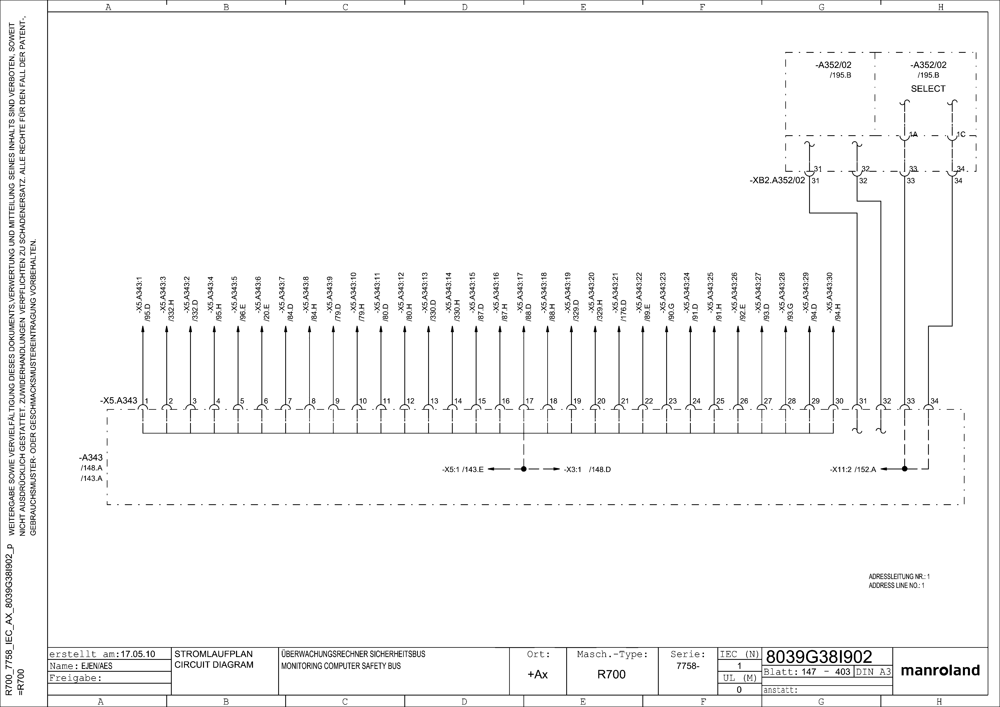

# +Ax — Sheet 147 of 403 — ÜBERWACHUNGSRECHNER SICHERHEITSBUS

**MONITORING COMPUTER SAFETY BUS**

> Part of the manroland **R700** printing press IEC/UL circuit diagrams.
> Drawing class: **Stromlaufplan / Circuit diagram** (DIN A3).
> Document `+Ax` covers the **Central control console** machine section.

## At a glance

| Field | Value |
|---|---|
| Document | `+Ax`  (8039G38I902) |
| Sheet | **147** of 403 |
| Section (DE) | ÜBERWACHUNGSRECHNER SICHERHEITSBUS |
| Section (EN) | MONITORING COMPUTER SAFETY BUS |
| Section type | CIRCUIT — Circuit diagram |
| Machine type | `R700` |
| Series | `7758` |
| Created | 17.05.10 |
| Replaces | — |
| Columns used | A, B, C, D, E, F, G, H |
| Path numbers | — |
| Labels on sheet | 122 |
| Cross-refs out | 37 |
| Cross-refs in | 75 |

**Previous:** [+Ax sheet 146](SHEET_0146.md) · **Next:** [+Ax sheet 148](SHEET_0148.md) · **Document TOC:** [_TOC.md](_TOC.md)  (+Ax) · **Master TOC:** [all sheets](../_MASTER_TOC.md)

## Sheet image (300 DPI, exact vector render)



_Rendered directly from the PDF vector layer at 300 DPI (1-bit), no OCR and no resampling. Use it to confirm anything ambiguous in the text below._

## Cross-references on this sheet

Each entry is a wire leaving this sheet. The printed token is `/sheet.column`; the link resolves to that sheet inside the same document.

| Ref | Target sheet | Col | Path | Destination on target | Target section | From col |
|---|---|---|---|---|---|---|
| `/195.B` | [+Ax sheet 195](SHEET_0195.md) | B | — | — | REFERENZMODUL | G |
| `/195.B` | [+Ax sheet 195](SHEET_0195.md) | B | — | — | REFERENZMODUL | H |
| `/79.H` | [+Ax sheet 79](SHEET_0079.md) | H | — | X5.A343:10 | ANLEGER | C |
| `/80.D` | [+Ax sheet 80](SHEET_0080.md) | D | — | X5.A343:11 | ANLEGER | C |
| `/80.H` | [+Ax sheet 80](SHEET_0080.md) | H | — | X5.A343:12 | ANLEGER | D |
| `/330.D` | [+Ax sheet 330](SHEET_0330.md) | D | — | X5.A343:13 | OPTION: NONSTOP EINRICHTUNG MANUELL, ANLEGER | D |
| `/330.H` | [+Ax sheet 330](SHEET_0330.md) | H | — | X5.A343:14 | OPTION: NONSTOP EINRICHTUNG MANUELL, ANLEGER | D |
| `/87.D` | [+Ax sheet 87](SHEET_0087.md) | D | — | X5.A343:15 | ANLEGER | D |
| `/87.H` | [+Ax sheet 87](SHEET_0087.md) | H | — | X5.A343:16 | ANLEGER | D |
| `/88.D` | [+Ax sheet 88](SHEET_0088.md) | D | — | X5.A343:17 | ANLEGER | E |
| `/88.H` | [+Ax sheet 88](SHEET_0088.md) | H | — | X5.A343:18 | ANLEGER | E |
| `/329.D` | [+Ax sheet 329](SHEET_0329.md) | D | — | X5.A343:19 | OPTION: NONSTOP EINRICHTUNG MANUELL, ANLEGER | E |
| `/329.H` | [+Ax sheet 329](SHEET_0329.md) | H | — | X5.A343:20 | OPTION: NONSTOP EINRICHTUNG MANUELL, ANLEGER | E |
| `/176.D` | [+Ax sheet 176](SHEET_0176.md) | D | — | X5.A343:21 | RESERVE | E |
| `/89.E` | [+Ax sheet 89](SHEET_0089.md) | E | — | X5.A343:22 | ANLEGER | F |
| `/90.G` | [+Ax sheet 90](SHEET_0090.md) | G | — | X5.A343:23 | ANLEGER | F |
| `/91.D` | [+Ax sheet 91](SHEET_0091.md) | D | — | X5.A343:24 | ANLEGER | F |
| `/91.H` | [+Ax sheet 91](SHEET_0091.md) | H | — | X5.A343:25 | ANLEGER | F |
| `/92.E` | [+Ax sheet 92](SHEET_0092.md) | E | — | X5.A343:26 | ANLEGER | F |
| `/93.D` | [+Ax sheet 93](SHEET_0093.md) | D | — | X5.A343:27 | ANLEGER | G |
| `/93.G` | [+Ax sheet 93](SHEET_0093.md) | G | — | X5.A343:28 | ANLEGER | G |
| `/94.D` | [+Ax sheet 94](SHEET_0094.md) | D | — | X5.A343:29 | ANLEGER | G |
| `/94.H` | [+Ax sheet 94](SHEET_0094.md) | H | — | X5.A343:30 | ANLEGER | G |
| `/95.D` | [+Ax sheet 95](SHEET_0095.md) | D | — | X5.A343:1 | ANLEGER | A |
| `/332.H` | [+Ax sheet 332](SHEET_0332.md) | H | — | X5.A343:3 | OPTION: NONSTOP EINRICHTUNG MANUELL, ANLEGER | B |
| `/332.D` | [+Ax sheet 332](SHEET_0332.md) | D | — | X5.A343:2 | OPTION: NONSTOP EINRICHTUNG MANUELL, ANLEGER | B |
| `/95.H` | [+Ax sheet 95](SHEET_0095.md) | H | — | X5.A343:4 | ANLEGER | B |
| `/96.E` | [+Ax sheet 96](SHEET_0096.md) | E | — | X5.A343:5 | ANLEGER | B |
| `/20.E` | [+Ax sheet 20](SHEET_0020.md) | E | — | X5.A343:6 | SPANNUNGSVERSORGUNG, SCHALTSCHRANKBELÜFTUNG | B |
| `/84.D` | [+Ax sheet 84](SHEET_0084.md) | D | — | X5.A343:7 | ANLEGER | C |
| `/84.H` | [+Ax sheet 84](SHEET_0084.md) | H | — | X5.A343:8 | ANLEGER | C |
| `/79.D` | [+Ax sheet 79](SHEET_0079.md) | D | — | X5.A343:9 | ANLEGER | C |
| `/148.A` | [+Ax sheet 148](SHEET_0148.md) | A | — | — | ÜBERWACHUNGSRECHNER SICHERHEITSBUS | A |
| `/143.A` | [+Ax sheet 143](SHEET_0143.md) | A | — | — | ÜBERWACHUNGSRECHNER SICHERHEITSBUS | A |
| `/143.E` | [+Ax sheet 143](SHEET_0143.md) | E | — | X5:1 | ÜBERWACHUNGSRECHNER SICHERHEITSBUS | D |
| `/152.A` | [+Ax sheet 152](SHEET_0152.md) | A | — | X3:1 X11:2 | ÜBERWACHUNGSRECHNER SICHERHEITSBUS | F |
| `/148.D` | [+Ax sheet 148](SHEET_0148.md) | D | — | X3:1 X11:2 | ÜBERWACHUNGSRECHNER SICHERHEITSBUS | F |

### Incoming references (sheets that point here)

Every other sheet that sends a wire to this one. `Back-ref` is the token printed on *that* sheet; `Path` is its line number.

| From sheet | Cols | Back-ref | Path | Refs | What continues there |
|---|---|---|---|---|---|
| [+Ax#20](SHEET_0020.md) | E | `/20.E` | — | 1 | X5.A343:6 |
| [+Ax#79](SHEET_0079.md) | D, H | `/79.D`, `/79.H` | — | 2 | X5.A343:10; X5.A343:9 |
| [+Ax#80](SHEET_0080.md) | D, H | `/80.D`, `/80.H` | — | 2 | X5.A343:11; X5.A343:12 |
| [+Ax#84](SHEET_0084.md) | D, H | `/84.D`, `/84.H` | — | 2 | X5.A343:7; X5.A343:8 |
| [+Ax#87](SHEET_0087.md) | D, H | `/87.D`, `/87.H` | — | 2 | X5.A343:15; X5.A343:16 |
| [+Ax#88](SHEET_0088.md) | D, H | `/88.D`, `/88.H` | — | 2 | X5.A343:17; X5.A343:18 |
| [+Ax#89](SHEET_0089.md) | E | `/89.E` | — | 1 | X5.A343:22 |
| [+Ax#90](SHEET_0090.md) | G | `/90.G` | — | 1 | X5.A343:23 |
| [+Ax#91](SHEET_0091.md) | D, H | `/91.D`, `/91.H` | — | 2 | X5.A343:24; X5.A343:25 |
| [+Ax#92](SHEET_0092.md) | E | `/92.E` | — | 1 | X5.A343:26 |
| [+Ax#93](SHEET_0093.md) | D, G | `/93.D`, `/93.G` | — | 2 | X5.A343:27; X5.A343:28 |
| [+Ax#94](SHEET_0094.md) | D, H | `/94.D`, `/94.H` | — | 2 | X5.A343:29; X5.A343:30 |
| [+Ax#95](SHEET_0095.md) | D, H | `/95.D`, `/95.H` | — | 2 | X5.A343:1; X5.A343:4 |
| [+Ax#96](SHEET_0096.md) | E | `/96.E` | — | 1 | X5.A343:5 |
| [+Ax#143](SHEET_0143.md) | A, D | `/143.A`, `/143.D` | — | 2 | X1:1 X5:1 |
| [+Ax#148](SHEET_0148.md) | A, F | `/148.A`, `/148.F` | — | 2 | X15:1 X3:1 |
| [+Ax#152](SHEET_0152.md) | A | `/152.A` | — | 1 | — |
| [+Ax#176](SHEET_0176.md) | D | `/176.D` | — | 1 | X5.A343:21 |
| [+Ax#195](SHEET_0195.md) | B | `/195.B` | — | 2 | — |
| [+Ax#219](SHEET_0219.md) | B | `/219.B` | — | 4 | — |
| [+Ax#230](SHEET_0230.md) | G, H | `/230.G`, `/230.H` | — | 34 | — |
| [+Ax#329](SHEET_0329.md) | D, H | `/329.D`, `/329.H` | — | 2 | X5.A343:19; X5.A343:20 |
| [+Ax#330](SHEET_0330.md) | D, H | `/330.D`, `/330.H` | — | 2 | X5.A343:13; X5.A343:14 |
| [+Ax#332](SHEET_0332.md) | D, H | `/332.D`, `/332.H` | — | 2 | X5.A343:2; X5.A343:3 |


## Devices on this sheet

| Tag | Class | Class meaning (IEC) | Col | Sub | Terminal | Sign |
|---|---|---|---|---|---|---|
| `A343` | A | Baugruppe / assembly, module, PC board | A | — | — | — |
| `A352/02` | A | Baugruppe / assembly, module, PC board | H | 02 | — | — |
| `A352/02` | A | Baugruppe / assembly, module, PC board | G | 02 | — | — |
| `X11:2` | X | Klemme / terminal, plug connector | G | — | 2 | — |
| `X3:1` | X | Klemme / terminal, plug connector | E | — | 1 | — |
| `X5:1` | X | Klemme / terminal, plug connector | D | — | 1 | — |
| `X5.A343` | — | cross-device reference | A | — | — | — |
| `X5.A343:1` | — | cross-device reference | A | — | 1 | — |
| `X5.A343:6` | — | cross-device reference | B | — | 6 | — |
| `X5.A343:5` | — | cross-device reference | B | — | 5 | — |
| `X5.A343:4` | — | cross-device reference | B | — | 4 | — |
| `X5.A343:3` | — | cross-device reference | A | — | 3 | — |
| `X5.A343:2` | — | cross-device reference | B | — | 2 | — |
| `X5.A343:7` | — | cross-device reference | B | — | 7 | — |
| `X5.A343:15` | — | cross-device reference | D | — | 15 | — |
| `X5.A343:14` | — | cross-device reference | D | — | 14 | — |
| `X5.A343:13` | — | cross-device reference | D | — | 13 | — |
| `X5.A343:16` | — | cross-device reference | D | — | 16 | — |
| `X5.A343:18` | — | cross-device reference | E | — | 18 | — |
| `X5.A343:17` | — | cross-device reference | D | — | 17 | — |
| `X5.A343:11` | — | cross-device reference | C | — | 11 | — |
| `X5.A343:10` | — | cross-device reference | C | — | 10 | — |
| `X5.A343:9` | — | cross-device reference | C | — | 9 | — |
| `X5.A343:8` | — | cross-device reference | C | — | 8 | — |
| `X5.A343:12` | — | cross-device reference | C | — | 12 | — |
| `X5.A343:19` | — | cross-device reference | E | — | 19 | — |
| `X5.A343:20` | — | cross-device reference | E | — | 20 | — |
| `X5.A343:30` | — | cross-device reference | G | — | 30 | — |
| `X5.A343:29` | — | cross-device reference | G | — | 29 | — |
| `X5.A343:24` | — | cross-device reference | F | — | 24 | — |
| `X5.A343:23` | — | cross-device reference | F | — | 23 | — |
| `X5.A343:22` | — | cross-device reference | E | — | 22 | — |
| `X5.A343:21` | — | cross-device reference | E | — | 21 | — |
| `X5.A343:25` | — | cross-device reference | F | — | 25 | — |
| `X5.A343:28` | — | cross-device reference | G | — | 28 | — |
| `X5.A343:27` | — | cross-device reference | F | — | 27 | — |
| `X5.A343:26` | — | cross-device reference | F | — | 26 | — |

## Potentials / nets

_No named potentials on this sheet._

## Wire-end annotations (grouped as printed)

A wire that continues elsewhere is annotated with a small cluster: the destination description, the path/line number `#NN`, and the `/sheet.column` cross reference. Each row below is one such cluster exactly as it is grouped on the drawing.

| Col | Y | Path | Cross-ref | Text on the wire |
|---|---|---|---|---|
| G | 72.6 | — | — | `A352/02` |
| H | 72.6 | — | — | `A352/02` |
| G | 85.7 | — | `/195.B` | — |
| H | 85.7 | — | `/195.B` | — |
| H | 100.9 | — | — | `SELECT` |
| H | 156.2 | — | — | `1A 1C` |
| G | 197.3 | — | — | `31 32` |
| H | 197.3 | — | — | `33 34` |
| G | 210.1 | — | — | `XB2.A352/02 31 32` |
| H | 211.5 | — | — | `33 34` |
| C | 324.3 | — | `/79.H` | `X5.A343:10` |
| C | 324.3 | — | `/80.D` | `X5.A343:11` |
| D | 324.3 | — | `/80.H` | `X5.A343:12` |
| D | 324.3 | — | `/330.D` | `X5.A343:13` |
| D | 324.3 | — | `/330.H` | `X5.A343:14` |
| D | 324.3 | — | `/87.D` | `X5.A343:15` |
| D | 324.3 | — | `/87.H` | `X5.A343:16` |
| E | 324.3 | — | `/88.D` | `X5.A343:17` |
| E | 324.3 | — | `/88.H` | `X5.A343:18` |
| E | 324.3 | — | `/329.D` | `X5.A343:19` |
| E | 324.3 | — | `/329.H` | `X5.A343:20` |
| E | 324.3 | — | `/176.D` | `X5.A343:21` |
| F | 324.3 | — | `/89.E` | `X5.A343:22` |
| F | 324.3 | — | `/90.G` | `X5.A343:23` |
| F | 324.3 | — | `/91.D` | `X5.A343:24` |
| F | 324.3 | — | `/91.H` | `X5.A343:25` |
| F | 324.3 | — | `/92.E` | `X5.A343:26` |
| G | 324.3 | — | `/93.D` | `X5.A343:27` |
| G | 324.3 | — | `/93.G` | `X5.A343:28` |
| G | 324.3 | — | `/94.D` | `X5.A343:29` |
| G | 324.3 | — | `/94.H` | `X5.A343:30` |
| A | 329.1 | — | `/95.D` | `X5.A343:1` |
| B | 329.1 | — | `/332.H` | `X5.A343:3` |
| B | 329.1 | — | `/332.D` | `X5.A343:2` |
| B | 329.1 | — | `/95.H` | `X5.A343:4` |
| B | 329.1 | — | `/96.E` | `X5.A343:5` |
| B | 329.1 | — | `/20.E` | `X5.A343:6` |
| C | 329.1 | — | `/84.D` | `X5.A343:7` |
| C | 329.1 | — | `/84.H` | `X5.A343:8` |
| C | 329.1 | — | `/79.D` | `X5.A343:9` |
| D | 472.3 | — | — | `X5.A343 1 2 3 4 5 6 7 8 9 10 11 12 13 14 15 16 17 18 19 20 21 22 23 24 25 26 27 28 29 30 31 32 33 34` |
| A | 540.3 | — | — | `A343` |
| A | 553.4 | — | `/148.A`, `/143.A` | — |
| D | 555.1 | — | `/143.E` | `X5:1` |
| F | 555.1 | — | `/152.A`, `/148.D` | `X3:1 X11:2` |
| H | 683.8 | — | — | `ADRESSLEITUNG NR.: 1 ADDRESS LINE NO.: 1` |


## Reconstructed tables

This sheet carries tabular content (pin map / terminal assignment / index). The grid below was rebuilt from the drawing's own rule lines, so each row is exactly one physical row of the table.

### Table 1 — 2 data rows × 31 columns (at x=170.1, y=62.4) — **A352/02 /195.B**

|  |  |  |  |  |  |  |  |  |  |  |  |  |  |  |  |  |  |  |  |  |  |  |  |  |  |  |  | 31 |  | 32 |
|---|---|---|---|---|---|---|---|---|---|---|---|---|---|---|---|---|---|---|---|---|---|---|---|---|---|---|---|---|---|---|
|  |  |  |  |  |  |  |  |  |  |  |  |  |  |  |  |  |  |  |  |  |  |  |  |  |  | `XB2.A352/02` |  | `31` |  | `32` |
| `X5.A343:3 /95.D 1` | `X5.A343:2 /332.H 2` | `X5.A343:4 /332.D 3` | `X5.A343:5 /95.H 4` | `X5.A343:6 /96.E 5` | `X5.A343:7 /20.E 6` | `X5.A343:8 /84.D 7` | `X5.A343:9 /84.H 8` | `X5.A343:10 /79.D 9` | `X5.A343:11 /79.H 10` | `X5.A343:12 /80.D 11` | `X5.A343:13 /80.H 12` | `X5.A343:14 /330.D 13` | `X5.A343:15 /330.H 14` | `X5.A343:16 /87.D 15` | `X5.A343:17 /87.H 16` | `X5.A343:18 /88.D 17` | `X5.A343:19 /88.H 18` | `X5.A343:20 /329.D 19` | `X5.A343:21 /329.H 20` | `X5.A343:22 /176.D 21` | `X5.A343:23 /89.E 22` | `X5.A343:24 /90.G 23` | `X5.A343:25 /91.D 24` | `X5.A343:26 /91.H 25` | `X5.A343:27 /92.E 26` | `X5.A343:28 /93.D 27` | `X5.A343:29 /93.G 28` | `X5.A343:30 /94.D 29` | `/94.H 30` | `31` |


### Table 2 — 3 data rows × 4 columns (at x=1048.8, y=62.4)

|  | SELECT 1A | A352/02 /195.B | 1C |
|---|---|---|---|
|  | `33` |  | `34` |
|  | `33` |  | `34` |
| `32` | `33` | `34` |  |


## Notes and free text on this sheet

| Text | Col | Y (pt) |
|---|---|---|
| `SELECT` | H | 100.93 |
| `1A` | H | 156.18 |
| `1C` | H | 156.24 |
| `XB2.A352/02` | G | 210.07 |
| `ADRESSLEITUNG NR.: 1` | H | 683.76 |
| `ADDRESS LINE NO.: 1` | H | 694.39 |

## Complete label inventory (exact text from the drawing)

Every text object inside the drawing area of this sheet, in DIN reading order (column A→H, then top→bottom). This is the authoritative list: if a string is not here it is not printed on this sheet.

| Col | Y | X | Dir | Type | Text |
|---|---|---|---|---|---|
| A | 329.1 | 161.9 | ↕ | device ref | `X5.A343:1` |
| A | 329.1 | 190.2 | ↕ | device ref | `X5.A343:3` |
| A | 361.7 | 171.8 | ↕ | cross-reference | `/95.D` |
| A | 472.3 | 119.3 | → | device ref | `X5.A343` |
| A | 473.7 | 172.1 | → | number | `1` |
| A | 540.3 | 94.1 | → | device tag | `A343` |
| A | 553.4 | 96.4 | → | cross-reference | `/148.A` |
| A | 565.8 | 96.4 | → | cross-reference | `/143.A` |
| B | 329.1 | 218.5 | ↕ | device ref | `X5.A343:2` |
| B | 329.1 | 246.9 | ↕ | device ref | `X5.A343:4` |
| B | 329.1 | 275.2 | ↕ | device ref | `X5.A343:5` |
| B | 329.1 | 303.6 | ↕ | device ref | `X5.A343:6` |
| B | 329.1 | 331.9 | ↕ | device ref | `X5.A343:7` |
| B | 356.9 | 200.1 | ↕ | cross-reference | `/332.H` |
| B | 356.9 | 228.5 | ↕ | cross-reference | `/332.D` |
| B | 361.7 | 256.8 | ↕ | cross-reference | `/95.H` |
| B | 362.0 | 285.1 | ↕ | cross-reference | `/96.E` |
| B | 362.0 | 313.5 | ↕ | cross-reference | `/20.E` |
| B | 473.7 | 201.0 | → | number | `2` |
| B | 473.7 | 229.3 | → | number | `3` |
| B | 473.7 | 257.7 | → | number | `4` |
| B | 473.7 | 286.0 | → | number | `5` |
| B | 473.7 | 314.4 | → | number | `6` |
| C | 324.3 | 417.0 | ↕ | device ref | `X5.A343:10` |
| C | 324.3 | 445.3 | ↕ | device ref | `X5.A343:11` |
| C | 324.3 | 473.7 | ↕ | device ref | `X5.A343:12` |
| C | 329.1 | 360.3 | ↕ | device ref | `X5.A343:8` |
| C | 329.1 | 388.6 | ↕ | device ref | `X5.A343:9` |
| C | 361.7 | 341.9 | ↕ | cross-reference | `/84.D` |
| C | 361.7 | 370.2 | ↕ | cross-reference | `/84.H` |
| C | 361.7 | 398.5 | ↕ | cross-reference | `/79.D` |
| C | 361.7 | 426.9 | ↕ | cross-reference | `/79.H` |
| C | 361.7 | 455.2 | ↕ | cross-reference | `/80.D` |
| C | 473.7 | 342.7 | → | number | `7` |
| C | 473.7 | 371.1 | → | number | `8` |
| C | 473.7 | 399.4 | → | number | `9` |
| C | 473.7 | 427.2 | → | number | `10` |
| C | 473.7 | 455.5 | → | number | `11` |
| D | 324.3 | 502.0 | ↕ | device ref | `X5.A343:13` |
| D | 324.3 | 530.4 | ↕ | device ref | `X5.A343:14` |
| D | 324.3 | 558.7 | ↕ | device ref | `X5.A343:15` |
| D | 324.3 | 587.1 | ↕ | device ref | `X5.A343:16` |
| D | 324.3 | 615.4 | ↕ | device ref | `X5.A343:17` |
| D | 356.9 | 511.9 | ↕ | cross-reference | `/330.D` |
| D | 356.9 | 540.3 | ↕ | cross-reference | `/330.H` |
| D | 361.7 | 483.6 | ↕ | cross-reference | `/80.H` |
| D | 361.7 | 568.6 | ↕ | cross-reference | `/87.D` |
| D | 361.7 | 597.0 | ↕ | cross-reference | `/87.H` |
| D | 473.7 | 483.9 | → | number | `12` |
| D | 473.7 | 512.2 | → | number | `13` |
| D | 473.7 | 540.6 | → | number | `14` |
| D | 473.7 | 568.9 | → | number | `15` |
| D | 473.7 | 597.3 | → | number | `16` |
| D | 555.1 | 550.5 | → | cross-reference | `/143.E` |
| D | 555.2 | 526.4 | → | device tag | `X5:1` |
| E | 324.3 | 643.7 | ↕ | device ref | `X5.A343:18` |
| E | 324.3 | 672.1 | ↕ | device ref | `X5.A343:19` |
| E | 324.3 | 700.4 | ↕ | device ref | `X5.A343:20` |
| E | 324.3 | 728.8 | ↕ | device ref | `X5.A343:21` |
| E | 324.3 | 757.1 | ↕ | device ref | `X5.A343:22` |
| E | 356.9 | 682.0 | ↕ | cross-reference | `/329.D` |
| E | 356.9 | 710.4 | ↕ | cross-reference | `/329.H` |
| E | 356.9 | 738.7 | ↕ | cross-reference | `/176.D` |
| E | 361.7 | 625.3 | ↕ | cross-reference | `/88.D` |
| E | 361.7 | 653.7 | ↕ | cross-reference | `/88.H` |
| E | 473.7 | 625.6 | → | number | `17` |
| E | 473.7 | 654.0 | → | number | `18` |
| E | 473.7 | 682.3 | → | number | `19` |
| E | 473.7 | 711.2 | → | number | `20` |
| E | 473.7 | 739.6 | → | number | `21` |
| E | 555.2 | 671.5 | → | device tag | `X3:1` |
| E | 555.2 | 701.6 | → | cross-reference | `/148.D` |
| F | 324.3 | 785.5 | ↕ | device ref | `X5.A343:23` |
| F | 324.3 | 813.8 | ↕ | device ref | `X5.A343:24` |
| F | 324.3 | 842.2 | ↕ | device ref | `X5.A343:25` |
| F | 324.3 | 870.5 | ↕ | device ref | `X5.A343:26` |
| F | 324.3 | 898.9 | ↕ | device ref | `X5.A343:27` |
| F | 361.1 | 795.4 | ↕ | cross-reference | `/90.G` |
| F | 361.7 | 823.7 | ↕ | cross-reference | `/91.D` |
| F | 361.7 | 852.1 | ↕ | cross-reference | `/91.H` |
| F | 362.0 | 767.0 | ↕ | cross-reference | `/89.E` |
| F | 362.0 | 880.4 | ↕ | cross-reference | `/92.E` |
| F | 473.7 | 767.9 | → | number | `22` |
| F | 473.7 | 796.3 | → | number | `23` |
| F | 473.7 | 824.6 | → | number | `24` |
| F | 473.7 | 852.9 | → | number | `25` |
| F | 473.7 | 881.3 | → | number | `26` |
| G | 72.6 | 970.9 | → | device tag | `A352/02` |
| G | 85.7 | 988.2 | → | cross-reference | `/195.B` |
| G | 197.3 | 969.2 | → | number | `31` |
| G | 197.3 | 1025.9 | → | number | `32` |
| G | 210.1 | 892.6 | → | text | `XB2.A352/02` |
| G | 211.5 | 966.3 | → | number | `31` |
| G | 211.5 | 1023.0 | → | number | `32` |
| G | 324.3 | 927.2 | ↕ | device ref | `X5.A343:28` |
| G | 324.3 | 955.6 | ↕ | device ref | `X5.A343:29` |
| G | 324.3 | 983.9 | ↕ | device ref | `X5.A343:30` |
| G | 361.1 | 937.1 | ↕ | cross-reference | `/93.G` |
| G | 361.7 | 908.8 | ↕ | cross-reference | `/93.D` |
| G | 361.7 | 965.5 | ↕ | cross-reference | `/94.D` |
| G | 361.7 | 993.8 | ↕ | cross-reference | `/94.H` |
| G | 473.7 | 909.6 | → | number | `27` |
| G | 473.7 | 938.0 | → | number | `28` |
| G | 473.7 | 966.3 | → | number | `29` |
| G | 473.7 | 994.7 | → | number | `30` |
| G | 473.7 | 1023.0 | → | number | `31` |
| G | 555.1 | 1017.6 | → | cross-reference | `/152.A` |
| G | 555.2 | 988.2 | → | device tag | `X11:2` |
| H | 72.6 | 1084.1 | → | device tag | `A352/02` |
| H | 85.7 | 1092.9 | → | cross-reference | `/195.B` |
| H | 100.9 | 1084.7 | → | text | `SELECT` |
| H | 156.2 | 1082.0 | → | text | `1A` |
| H | 156.2 | 1138.7 | → | text | `1C` |
| H | 197.3 | 1082.6 | → | number | `33` |
| H | 197.3 | 1139.2 | → | number | `34` |
| H | 211.5 | 1079.7 | → | number | `33` |
| H | 211.5 | 1136.4 | → | number | `34` |
| H | 473.7 | 1051.4 | → | number | `32` |
| H | 473.7 | 1079.7 | → | number | `33` |
| H | 473.7 | 1108.1 | → | number | `34` |
| H | 683.8 | 1034.6 | → | text | `ADRESSLEITUNG NR.: 1` |
| H | 694.4 | 1034.6 | → | text | `ADDRESS LINE NO.: 1` |

## Reading-order text block

The same content as a plain block, grouped by DIN column — convenient to paste or to match against a visual description.

```text
=== Column A ===
 329.1  161.9  devref       X5.A343:1
 329.1  190.2  devref       X5.A343:3
 361.7  171.8  xref         /95.D
 472.3  119.3  devref       X5.A343
 473.7  172.1  numeric      1
 540.3   94.1  devtag       A343
 553.4   96.4  xref         /148.A
 565.8   96.4  xref         /143.A
=== Column B ===
 329.1  218.5  devref       X5.A343:2
 329.1  246.9  devref       X5.A343:4
 329.1  275.2  devref       X5.A343:5
 329.1  303.6  devref       X5.A343:6
 329.1  331.9  devref       X5.A343:7
 356.9  200.1  xref         /332.H
 356.9  228.5  xref         /332.D
 361.7  256.8  xref         /95.H
 362.0  285.1  xref         /96.E
 362.0  313.5  xref         /20.E
 473.7  201.0  numeric      2
 473.7  229.3  numeric      3
 473.7  257.7  numeric      4
 473.7  286.0  numeric      5
 473.7  314.4  numeric      6
=== Column C ===
 324.3  417.0  devref       X5.A343:10
 324.3  445.3  devref       X5.A343:11
 324.3  473.7  devref       X5.A343:12
 329.1  360.3  devref       X5.A343:8
 329.1  388.6  devref       X5.A343:9
 361.7  341.9  xref         /84.D
 361.7  370.2  xref         /84.H
 361.7  398.5  xref         /79.D
 361.7  426.9  xref         /79.H
 361.7  455.2  xref         /80.D
 473.7  342.7  numeric      7
 473.7  371.1  numeric      8
 473.7  399.4  numeric      9
 473.7  427.2  numeric      10
 473.7  455.5  numeric      11
=== Column D ===
 324.3  502.0  devref       X5.A343:13
 324.3  530.4  devref       X5.A343:14
 324.3  558.7  devref       X5.A343:15
 324.3  587.1  devref       X5.A343:16
 324.3  615.4  devref       X5.A343:17
 356.9  511.9  xref         /330.D
 356.9  540.3  xref         /330.H
 361.7  483.6  xref         /80.H
 361.7  568.6  xref         /87.D
 361.7  597.0  xref         /87.H
 473.7  483.9  numeric      12
 473.7  512.2  numeric      13
 473.7  540.6  numeric      14
 473.7  568.9  numeric      15
 473.7  597.3  numeric      16
 555.1  550.5  xref         /143.E
 555.2  526.4  devtag       X5:1
=== Column E ===
 324.3  643.7  devref       X5.A343:18
 324.3  672.1  devref       X5.A343:19
 324.3  700.4  devref       X5.A343:20
 324.3  728.8  devref       X5.A343:21
 324.3  757.1  devref       X5.A343:22
 356.9  682.0  xref         /329.D
 356.9  710.4  xref         /329.H
 356.9  738.7  xref         /176.D
 361.7  625.3  xref         /88.D
 361.7  653.7  xref         /88.H
 473.7  625.6  numeric      17
 473.7  654.0  numeric      18
 473.7  682.3  numeric      19
 473.7  711.2  numeric      20
 473.7  739.6  numeric      21
 555.2  671.5  devtag       X3:1
 555.2  701.6  xref         /148.D
=== Column F ===
 324.3  785.5  devref       X5.A343:23
 324.3  813.8  devref       X5.A343:24
 324.3  842.2  devref       X5.A343:25
 324.3  870.5  devref       X5.A343:26
 324.3  898.9  devref       X5.A343:27
 361.1  795.4  xref         /90.G
 361.7  823.7  xref         /91.D
 361.7  852.1  xref         /91.H
 362.0  767.0  xref         /89.E
 362.0  880.4  xref         /92.E
 473.7  767.9  numeric      22
 473.7  796.3  numeric      23
 473.7  824.6  numeric      24
 473.7  852.9  numeric      25
 473.7  881.3  numeric      26
=== Column G ===
  72.6  970.9  devtag       A352/02
  85.7  988.2  xref         /195.B
 197.3  969.2  numeric      31
 197.3 1025.9  numeric      32
 210.1  892.6  text         XB2.A352/02
 211.5  966.3  numeric      31
 211.5 1023.0  numeric      32
 324.3  927.2  devref       X5.A343:28
 324.3  955.6  devref       X5.A343:29
 324.3  983.9  devref       X5.A343:30
 361.1  937.1  xref         /93.G
 361.7  908.8  xref         /93.D
 361.7  965.5  xref         /94.D
 361.7  993.8  xref         /94.H
 473.7  909.6  numeric      27
 473.7  938.0  numeric      28
 473.7  966.3  numeric      29
 473.7  994.7  numeric      30
 473.7 1023.0  numeric      31
 555.1 1017.6  xref         /152.A
 555.2  988.2  devtag       X11:2
=== Column H ===
  72.6 1084.1  devtag       A352/02
  85.7 1092.9  xref         /195.B
 100.9 1084.7  text         SELECT
 156.2 1082.0  text         1A
 156.2 1138.7  text         1C
 197.3 1082.6  numeric      33
 197.3 1139.2  numeric      34
 211.5 1079.7  numeric      33
 211.5 1136.4  numeric      34
 473.7 1051.4  numeric      32
 473.7 1079.7  numeric      33
 473.7 1108.1  numeric      34
 683.8 1034.6  text         ADRESSLEITUNG NR.: 1
 694.4 1034.6  text         ADDRESS LINE NO.: 1
```

---
_Generated from the PDF vector text layer; no OCR. Source: `R700_7758_IEC_AX_8039G38I902_p`, sheet 147._
