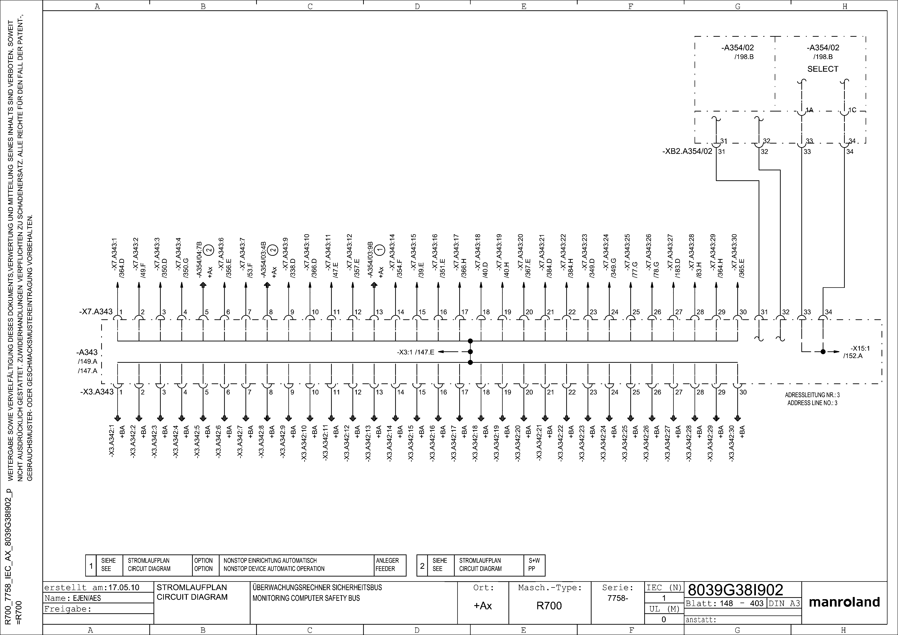

# +Ax — Sheet 148 of 403 — ÜBERWACHUNGSRECHNER SICHERHEITSBUS

**MONITORING COMPUTER SAFETY BUS**

> Part of the manroland **R700** printing press IEC/UL circuit diagrams.
> Drawing class: **Stromlaufplan / Circuit diagram** (DIN A3).
> Document `+Ax` covers the **Central control console** machine section.

## At a glance

| Field | Value |
|---|---|
| Document | `+Ax`  (8039G38I902) |
| Sheet | **148** of 403 |
| Section (DE) | ÜBERWACHUNGSRECHNER SICHERHEITSBUS |
| Section (EN) | MONITORING COMPUTER SAFETY BUS |
| Section type | CIRCUIT — Circuit diagram |
| Machine type | `R700` |
| Series | `7758` |
| Created | 17.05.10 |
| Replaces | — |
| Columns used | A, B, C, D, E, F, G, H |
| Path numbers | — |
| Labels on sheet | 232 |
| Cross-refs out | 33 |
| Cross-refs in | 101 |

**Previous:** [+Ax sheet 147](SHEET_0147.md) · **Next:** [+Ax sheet 149](SHEET_0149.md) · **Document TOC:** [_TOC.md](_TOC.md)  (+Ax) · **Master TOC:** [all sheets](../_MASTER_TOC.md)

## Sheet image (300 DPI, exact vector render)



_Rendered directly from the PDF vector layer at 300 DPI (1-bit), no OCR and no resampling. Use it to confirm anything ambiguous in the text below._

## Cross-references on this sheet

Each entry is a wire leaving this sheet. The printed token is `/sheet.column`; the link resolves to that sheet inside the same document.

| Ref | Target sheet | Col | Path | Destination on target | Target section | From col |
|---|---|---|---|---|---|---|
| `/198.B` | [+Ax sheet 198](SHEET_0198.md) | B | — | — | REFERENZMODUL | G |
| `/198.B` | [+Ax sheet 198](SHEET_0198.md) | B | — | — | REFERENZMODUL | H |
| `/366.D` | [+Ax sheet 366](SHEET_0366.md) | D | — | X7.A343:10 | OPTION: LOGISTIK AUSLEGER | C |
| `/47.E` | [+Ax sheet 47](SHEET_0047.md) | E | — | X7.A343:11 | NOT AUS | C |
| `/357.E` | [+Ax sheet 357](SHEET_0357.md) | E | — | X7.A343:12 | OPTION: LOGISTIK ANLEGER | C |
| `/354.F` | [+Ax sheet 354](SHEET_0354.md) | F | — | X7.A343:14 | OPTION: LOGISTIK ANLEGER | D |
| `/39.E` | [+Ax sheet 39](SHEET_0039.md) | E | — | X7.A343:15 | HAUPTANTRIEB | D |
| `/351.E` | [+Ax sheet 351](SHEET_0351.md) | E | — | X7.A343:16 | OPTION: LOGISTIK ANLEGER | D |
| `/366.H` | [+Ax sheet 366](SHEET_0366.md) | H | — | X7.A343:17 | OPTION: LOGISTIK AUSLEGER | D |
| `/40.D` | [+Ax sheet 40](SHEET_0040.md) | D | — | X7.A343:18 | HAUPTANTRIEB | E |
| `/40.H` | [+Ax sheet 40](SHEET_0040.md) | H | — | X7.A343:19 | HAUPTANTRIEB | E |
| `/367.E` | [+Ax sheet 367](SHEET_0367.md) | E | — | X7.A343:20 | OPTION: LOGISTIK AUSLEGER | E |
| `/384.D` | [+Ax sheet 384](SHEET_0384.md) | D | — | X7.A343:21 | OPTION: INLINEFOILER PRINDOR | E |
| `/384.H` | [+Ax sheet 384](SHEET_0384.md) | H | — | X7.A343:22 | OPTION: INLINEFOILER PRINDOR | E |
| `/349.D` | [+Ax sheet 349](SHEET_0349.md) | D | — | X7.A343:23 | OPTION: LOGISTIK ANLEGER | F |
| `/349.G` | [+Ax sheet 349](SHEET_0349.md) | G | — | X7.A343:24 | OPTION: LOGISTIK ANLEGER | F |
| `/77.G` | [+Ax sheet 77](SHEET_0077.md) | G | — | X7.A343:25 | ANLEGER | F |
| `/78.G` | [+Ax sheet 78](SHEET_0078.md) | G | — | X7.A343:26 | ANLEGER | F |
| `/183.D` | [+Ax sheet 183](SHEET_0183.md) | D | — | X7.A343:27 | RESERVE | F |
| `/83.H` | [+Ax sheet 83](SHEET_0083.md) | H | — | X7.A343:28 | ANLEGER | G |
| `/364.H` | [+Ax sheet 364](SHEET_0364.md) | H | — | X7.A343:29 | OPTION: LOGISTIK AUSLEGER | G |
| `/365.E` | [+Ax sheet 365](SHEET_0365.md) | E | — | X7.A343:30 | OPTION: LOGISTIK AUSLEGER | G |
| `/364.D` | [+Ax sheet 364](SHEET_0364.md) | D | — | X7.A343:1 | OPTION: LOGISTIK AUSLEGER | A |
| `/49.F` | [+Ax sheet 49](SHEET_0049.md) | F | — | X7.A343:2 | NOT AUS | A |
| `/350.D` | [+Ax sheet 350](SHEET_0350.md) | D | — | X7.A343:3 | OPTION: LOGISTIK ANLEGER | B |
| `/350.G` | [+Ax sheet 350](SHEET_0350.md) | G | — | X7.A343:4 | OPTION: LOGISTIK ANLEGER | B |
| `/356.E` | [+Ax sheet 356](SHEET_0356.md) | E | — | X7.A343:6 | OPTION: LOGISTIK ANLEGER | B |
| `/53.F` | [+Ax sheet 53](SHEET_0053.md) | F | — | X7.A343:7 | SIGNALGEBER: AKUSTISCHE WARNSIGNALE | B |
| `/338.D` | [+Ax sheet 338](SHEET_0338.md) | D | — | X7.A343:9 | OPTION: INLINESHEETER RS104 S | C |
| `/147.E` | [+Ax sheet 147](SHEET_0147.md) | E | — | X15:1 X3:1 | ÜBERWACHUNGSRECHNER SICHERHEITSBUS | F |
| `/152.A` | [+Ax sheet 152](SHEET_0152.md) | A | — | — | ÜBERWACHUNGSRECHNER SICHERHEITSBUS | H |
| `/149.A` | [+Ax sheet 149](SHEET_0149.md) | A | — | — | ÜBERWACHUNGSRECHNER SICHERHEITSBUS | A |
| `/147.A` | [+Ax sheet 147](SHEET_0147.md) | A | — | — | ÜBERWACHUNGSRECHNER SICHERHEITSBUS | A |

### Incoming references (sheets that point here)

Every other sheet that sends a wire to this one. `Back-ref` is the token printed on *that* sheet; `Path` is its line number.

| From sheet | Cols | Back-ref | Path | Refs | What continues there |
|---|---|---|---|---|---|
| [+Ax#39](SHEET_0039.md) | E | `/39.E` | — | 1 | X7.A343:15 |
| [+Ax#40](SHEET_0040.md) | D, H | `/40.D`, `/40.H` | — | 2 | X7.A343:18; X7.A343:19 |
| [+Ax#47](SHEET_0047.md) | E | `/47.E` | — | 1 | X7.A343:11 |
| [+Ax#49](SHEET_0049.md) | E | `/49.E` | — | 1 | X7.A343:2 |
| [+Ax#53](SHEET_0053.md) | F | `/53.F` | — | 1 | X7.A343:7 |
| [+Ax#77](SHEET_0077.md) | G | `/77.G` | — | 1 | X7.A343:25 |
| [+Ax#78](SHEET_0078.md) | G | `/78.G` | — | 1 | X7.A343:26 |
| [+Ax#83](SHEET_0083.md) | H | `/83.H` | — | 1 | X7.A343:28 |
| [+Ax#147](SHEET_0147.md) | A, F | `/147.A`, `/147.F` | — | 2 | X3:1 X11:2 |
| [+Ax#149](SHEET_0149.md) | A | `/149.A` | — | 1 | — |
| [+Ax#152](SHEET_0152.md) | A | `/152.A` | — | 1 | X15:1 |
| [+Ax#183](SHEET_0183.md) | D | `/183.D` | — | 1 | X7.A343:27 |
| [+Ax#198](SHEET_0198.md) | B | `/198.B` | — | 2 | — |
| [+Ax#219](SHEET_0219.md) | F | `/219.F` | — | 4 | — |
| [+Ax#222](SHEET_0222.md) | G, H | `/222.G`, `/222.H` | — | 30 | — |
| [+Ax#235](SHEET_0235.md) | E, F | `/235.E`, `/235.F` | — | 34 | — |
| [+Ax#338](SHEET_0338.md) | D | `/338.D` | — | 1 | X7.A343:9 |
| [+Ax#349](SHEET_0349.md) | D, G | `/349.D`, `/349.G` | — | 2 | X7.A343:23; X7.A343:24 |
| [+Ax#350](SHEET_0350.md) | D, G | `/350.D`, `/350.G` | — | 2 | X7.A343:3; X7.A343:4 |
| [+Ax#351](SHEET_0351.md) | E | `/351.E` | — | 1 | X7.A343:16 |
| [+Ax#354](SHEET_0354.md) | F | `/354.F` | — | 1 | X7.A343:14 |
| [+Ax#356](SHEET_0356.md) | E | `/356.E` | — | 1 | X7.A343:6 |
| [+Ax#357](SHEET_0357.md) | E | `/357.E` | — | 1 | X7.A343:12 |
| [+Ax#364](SHEET_0364.md) | D, H | `/364.D`, `/364.H` | — | 2 | X7.A343:1; X7.A343:29 |
| [+Ax#365](SHEET_0365.md) | E | `/365.E` | — | 1 | X7.A343:30 |
| [+Ax#366](SHEET_0366.md) | D, H | `/366.D`, `/366.H` | — | 2 | X7.A343:10; X7.A343:17 |
| [+Ax#367](SHEET_0367.md) | D | `/367.D` | — | 1 | X7.A343:20 |
| [+Ax#384](SHEET_0384.md) | D, H | `/384.D`, `/384.H` | — | 2 | X7.A343:21; X7.A343:22 |


## Devices on this sheet

| Tag | Class | Class meaning (IEC) | Col | Sub | Terminal | Sign |
|---|---|---|---|---|---|---|
| `A343` | A | Baugruppe / assembly, module, PC board | A | — | — | — |
| `A354/02` | A | Baugruppe / assembly, module, PC board | H | 02 | — | — |
| `A354/02` | A | Baugruppe / assembly, module, PC board | G | 02 | — | — |
| `A354/04:7B` | A | Baugruppe / assembly, module, PC board | B | 04 | 7B | — |
| `A354/03:4B` | A | Baugruppe / assembly, module, PC board | C | 03 | 4B | — |
| `A354/03:9B` | A | Baugruppe / assembly, module, PC board | D | 03 | 9B | — |
| `X15:1` | X | Klemme / terminal, plug connector | H | — | 1 | — |
| `X3:1` | X | Klemme / terminal, plug connector | D | — | 1 | — |
| `X7.A343` | — | cross-device reference | A | — | — | — |
| `X3.A343` | — | cross-device reference | A | — | — | — |
| `X3.A342:1` | — | cross-device reference | A | — | 1 | — |
| `X3.A342:2` | — | cross-device reference | A | — | 2 | — |
| `X3.A342:3` | — | cross-device reference | B | — | 3 | — |
| `X3.A342:4` | — | cross-device reference | B | — | 4 | — |
| `X3.A342:5` | — | cross-device reference | B | — | 5 | — |
| `X3.A342:6` | — | cross-device reference | B | — | 6 | — |
| `X3.A342:7` | — | cross-device reference | B | — | 7 | — |
| `X3.A342:8` | — | cross-device reference | C | — | 8 | — |
| `X3.A342:9` | — | cross-device reference | C | — | 9 | — |
| `X3.A342:10` | — | cross-device reference | C | — | 10 | — |
| `X3.A342:11` | — | cross-device reference | C | — | 11 | — |
| `X3.A342:12` | — | cross-device reference | C | — | 12 | — |
| `X3.A342:13` | — | cross-device reference | D | — | 13 | — |
| `X3.A342:14` | — | cross-device reference | D | — | 14 | — |
| `X3.A342:15` | — | cross-device reference | D | — | 15 | — |
| `X3.A342:16` | — | cross-device reference | D | — | 16 | — |
| `X3.A342:17` | — | cross-device reference | D | — | 17 | — |
| `X3.A342:18` | — | cross-device reference | E | — | 18 | — |
| `X3.A342:19` | — | cross-device reference | E | — | 19 | — |
| `X3.A342:20` | — | cross-device reference | E | — | 20 | — |
| `X3.A342:21` | — | cross-device reference | E | — | 21 | — |
| `X3.A342:22` | — | cross-device reference | E | — | 22 | — |
| `X3.A342:23` | — | cross-device reference | F | — | 23 | — |
| `X3.A342:24` | — | cross-device reference | F | — | 24 | — |
| `X3.A342:25` | — | cross-device reference | F | — | 25 | — |
| `X3.A342:26` | — | cross-device reference | F | — | 26 | — |
| `X3.A342:27` | — | cross-device reference | F | — | 27 | — |
| `X3.A342:28` | — | cross-device reference | G | — | 28 | — |
| `X3.A342:29` | — | cross-device reference | G | — | 29 | — |
| `X3.A342:30` | — | cross-device reference | G | — | 30 | — |
| `X7.A343:12` | — | cross-device reference | C | — | 12 | — |
| `X7.A343:16` | — | cross-device reference | D | — | 16 | — |
| `X7.A343:15` | — | cross-device reference | D | — | 15 | — |
| `X7.A343:14` | — | cross-device reference | D | — | 14 | — |
| `X7.A343:20` | — | cross-device reference | E | — | 20 | — |
| `X7.A343:21` | — | cross-device reference | E | — | 21 | — |
| `X7.A343:19` | — | cross-device reference | E | — | 19 | — |
| `X7.A343:17` | — | cross-device reference | D | — | 17 | — |
| `X7.A343:18` | — | cross-device reference | E | — | 18 | — |
| `X7.A343:11` | — | cross-device reference | C | — | 11 | — |
| `X7.A343:1` | — | cross-device reference | A | — | 1 | — |
| `X7.A343:7` | — | cross-device reference | B | — | 7 | — |
| `X7.A343:9` | — | cross-device reference | C | — | 9 | — |
| `X7.A343:10` | — | cross-device reference | C | — | 10 | — |
| `X7.A343:6` | — | cross-device reference | B | — | 6 | — |
| `X7.A343:2` | — | cross-device reference | A | — | 2 | — |
| `X7.A343:3` | — | cross-device reference | B | — | 3 | — |
| `X7.A343:4` | — | cross-device reference | B | — | 4 | — |
| `X7.A343:30` | — | cross-device reference | G | — | 30 | — |
| `X7.A343:29` | — | cross-device reference | G | — | 29 | — |
| `X7.A343:22` | — | cross-device reference | E | — | 22 | — |
| `X7.A343:26` | — | cross-device reference | F | — | 26 | — |
| `X7.A343:27` | — | cross-device reference | F | — | 27 | — |
| `X7.A343:28` | — | cross-device reference | G | — | 28 | — |
| `X7.A343:23` | — | cross-device reference | F | — | 23 | — |
| `X7.A343:24` | — | cross-device reference | F | — | 24 | — |
| `X7.A343:25` | — | cross-device reference | F | — | 25 | — |

## Potentials / nets

_No named potentials on this sheet._

## Wire-end annotations (grouped as printed)

A wire that continues elsewhere is annotated with a small cluster: the destination description, the path/line number `#NN`, and the `/sheet.column` cross reference. Each row below is one such cluster exactly as it is grouped on the drawing.

| Col | Y | Path | Cross-ref | Text on the wire |
|---|---|---|---|---|
| G | 58.4 | — | — | `A354/02` |
| H | 58.4 | — | — | `A354/02` |
| G | 71.5 | — | `/198.B` | — |
| H | 71.5 | — | `/198.B` | — |
| H | 86.8 | — | — | `SELECT` |
| H | 142.0 | — | — | `1A 1C` |
| G | 183.2 | — | — | `31 32` |
| H | 183.2 | — | — | `33 34` |
| G | 195.9 | — | — | `XB2.A354/02 31 32` |
| H | 197.3 | — | — | `33 34` |
| C | 310.1 | — | `/366.D` | `X7.A343:10` |
| C | 310.1 | — | `/47.E` | `X7.A343:11` |
| C | 310.1 | — | `/357.E` | `X7.A343:12` |
| D | 310.1 | — | `/354.F` | `X7.A343:14` |
| D | 310.1 | — | `/39.E` | `X7.A343:15` |
| D | 310.1 | — | `/351.E` | `X7.A343:16` |
| D | 310.1 | — | `/366.H` | `X7.A343:17` |
| E | 310.1 | — | `/40.D` | `X7.A343:18` |
| E | 310.1 | — | `/40.H` | `X7.A343:19` |
| E | 310.1 | — | `/367.E` | `X7.A343:20` |
| E | 310.1 | — | `/384.D` | `X7.A343:21` |
| E | 310.1 | — | `/384.H` | `X7.A343:22` |
| F | 310.1 | — | `/349.D` | `X7.A343:23` |
| F | 310.1 | — | `/349.G` | `X7.A343:24` |
| F | 310.1 | — | `/77.G` | `X7.A343:25` |
| F | 310.1 | — | `/78.G` | `X7.A343:26` |
| F | 310.1 | — | `/183.D` | `X7.A343:27` |
| G | 310.1 | — | `/83.H` | `X7.A343:28` |
| G | 310.1 | — | `/364.H` | `X7.A343:29` |
| G | 310.1 | — | `/365.E` | `X7.A343:30` |
| A | 314.9 | — | `/364.D` | `X7.A343:1` |
| A | 314.9 | — | `/49.F` | `X7.A343:2` |
| B | 314.9 | — | `/350.D` | `X7.A343:3` |
| B | 314.9 | — | `/350.G` | `X7.A343:4` |
| B | 314.9 | — | `/356.E` | `X7.A343:6` |
| B | 314.9 | — | `/53.F` | `X7.A343:7` |
| C | 314.9 | — | `/338.D` | `X7.A343:9` |
| B | 320.0 | — | — | `A354/04:7B` |
| C | 320.0 | — | — | `A354/03:4B` |
| D | 320.0 | — | — | `A354/03:9B` |
| D | 328.8 | — | — | `1` |
| B | 329.7 | — | — | `2` |
| C | 329.7 | — | — | `2` |
| B | 353.8 | — | — | `+Ax` |
| C | 353.8 | — | — | `+Ax` |
| D | 353.8 | — | — | `+Ax` |
| D | 408.5 | — | — | `X7.A343 1 2 3 4 5 6 7 8 9 10 11 12 13 14 15 16 17 18 19 20 21 22 23 24 25 26 27 28 29 30 31 32 33 34` |
| F | 458.1 | — | `/147.E` | `X3:1 X15:1` |
| A | 462.4 | — | — | `A343` |
| H | 468.0 | — | `/152.A` | — |
| A | 475.4 | — | `/149.A`, `/147.A` | — |
| D | 514.8 | — | — | `X3.A343 1 2 3 4 5 6 7 8 9 10 11 12 13 14 15 16 17 18 19 20 21 22 23 24 25 26 27 28 29 30` |
| H | 520.8 | — | — | `ADRESSLEITUNG NR.: 3` |
| H | 531.4 | — | — | `ADDRESS LINE NO.: 3` |
| A | 562.4 | — | — | `X3.A342:1` |
| C | 562.4 | — | — | `X3.A342:11` |
| E | 562.4 | — | — | `X3.A342:21` |
| A | 563.5 | — | — | `X3.A342:2` |
| C | 563.5 | — | — | `X3.A342:12` |
| E | 563.5 | — | — | `X3.A342:22` |
| B | 563.8 | — | — | `X3.A342:3` |
| B | 563.8 | — | — | `X3.A342:4` |
| B | 563.8 | — | — | `X3.A342:5` |
| B | 563.8 | — | — | `X3.A342:6` |
| B | 563.8 | — | — | `X3.A342:7` |
| C | 563.8 | — | — | `X3.A342:8` |
| C | 563.8 | — | — | `X3.A342:9` |
| C | 563.8 | — | — | `X3.A342:10` |
| D | 563.8 | — | — | `X3.A342:13` |
| D | 563.8 | — | — | `X3.A342:14` |
| D | 563.8 | — | — | `X3.A342:15` |
| D | 563.8 | — | — | `X3.A342:16` |
| D | 563.8 | — | — | `X3.A342:17` |
| E | 563.8 | — | — | `X3.A342:18` |
| E | 563.8 | — | — | `X3.A342:19` |
| E | 563.8 | — | — | `X3.A342:20` |
| F | 563.8 | — | — | `X3.A342:23` |
| F | 563.8 | — | — | `X3.A342:24` |
| F | 563.8 | — | — | `X3.A342:25` |
| F | 563.8 | — | — | `X3.A342:26` |
| F | 563.8 | — | — | `X3.A342:27` |
| G | 563.8 | — | — | `X3.A342:28` |
| G | 563.8 | — | — | `X3.A342:29` |
| G | 563.8 | — | — | `X3.A342:30` |
| A | 564.1 | — | — | `+BA` |
| A | 564.1 | — | — | `+BA` |
| B | 564.1 | — | — | `+BA` |
| B | 564.1 | — | — | `+BA` |
| B | 564.1 | — | — | `+BA` |
| B | 564.1 | — | — | `+BA` |
| B | 564.1 | — | — | `+BA` |
| C | 564.1 | — | — | `+BA` |
| C | 564.1 | — | — | `+BA` |
| C | 564.1 | — | — | `+BA` |
| C | 564.1 | — | — | `+BA` |
| C | 564.1 | — | — | `+BA` |
| D | 564.1 | — | — | `+BA` |
| D | 564.1 | — | — | `+BA` |
| D | 564.1 | — | — | `+BA` |
| D | 564.1 | — | — | `+BA` |
| D | 564.1 | — | — | `+BA` |
| E | 564.1 | — | — | `+BA` |
| E | 564.1 | — | — | `+BA` |
| E | 564.1 | — | — | `+BA` |
| E | 564.1 | — | — | `+BA` |
| E | 564.1 | — | — | `+BA` |
| F | 564.1 | — | — | `+BA` |
| F | 564.1 | — | — | `+BA` |
| F | 564.1 | — | — | `+BA` |
| F | 564.1 | — | — | `+BA` |
| F | 564.1 | — | — | `+BA` |
| G | 564.1 | — | — | `+BA` |
| G | 564.1 | — | — | `+BA` |
| G | 564.1 | — | — | `+BA` |
| E | 740.3 | — | — | `PP S+W` |
| A | 740.4 | — | — | `1 SIEHE SEE STROMLAUFPLAN CIRCUIT DIAGRAM` |
| B | 740.4 | — | — | `OPTION OPTION` |
| D | 740.4 | — | — | `2 SIEHE SEE STROMLAUFPLAN CIRCUIT DIAGRAM` |
| C | 740.5 | — | — | `NONSTOP EINRICHTUNG AUTOMATISCH NONSTOP DEVICE AUTOMATIC OPERATION` |
| D | 740.5 | — | — | `FEEDER ANLEGER` |


## Reconstructed tables

This sheet carries tabular content (pin map / terminal assignment / index). The grid below was rebuilt from the drawing's own rule lines, so each row is exactly one physical row of the table.

### Table 1 — 3 data rows × 32 columns (at x=155.9, y=48.2) — **A354/02 /198.B**

|  |  |  |  |  |  |  |  |  |  |  |  |  |  |  |  |  |  |  |  |  |  |  |  |  |  |  |  |  | 31 |  | 32 |
|---|---|---|---|---|---|---|---|---|---|---|---|---|---|---|---|---|---|---|---|---|---|---|---|---|---|---|---|---|---|---|---|
|  |  |  |  |  |  |  |  |  |  |  |  |  |  |  |  |  |  |  |  |  |  |  |  |  |  |  | `XB2.A354/02` |  | `31` |  | `32` |
| `X7.A343:2 /364.D 1` | `X7.A343:3 /49.F 2` | `X7.A343:4 /350.D 3` | `A354/04:7B /350.G 4` | `X7.A343:6 2 +Ax 5` | `X7.A343:7 /356.E 6` | `A354/03:4B /53.F 7` | `X7.A343:9 2 +Ax 8` | `X7.A343:10 /338.D 9` | `X7.A343:11 /366.D 10` | `X7.A343:12 /47.E 11` | `A354/03:9B /357.E 12` | `X7.A343:14 1 +Ax 13` | `X7.A343:15 /354.F 14` | `X7.A343:16 /39.E 15` | `X7.A343:17 /351.E 16` | `/366.H 17` | `X7.A343:18` | `X7.A343:19 /40.D 18` | `X7.A343:20 /40.H 19` | `X7.A343:21 /367.E 20` | `X7.A343:22 /384.D 21` | `X7.A343:23 /384.H 22` | `X7.A343:24 /349.D 23` | `X7.A343:25 /349.G 24` | `X7.A343:26 /77.G 25` | `X7.A343:27 /78.G 26` | `X7.A343:28 /183.D 27` | `X7.A343:29 /83.H 28` | `X7.A343:30 /364.H 29` | `/365.E 30` | `31` |
|  |  |  |  |  |  |  |  |  |  |  |  |  | `X3:1` | `/147.E` |  |  |  |  |  |  |  |  |  |  |  |  |  |  |  |  |  |


### Table 2 — 4 data rows × 4 columns (at x=1034.6, y=48.2)

|  | SELECT 1A | A354/02 /198.B | 1C |
|---|---|---|---|
|  | `33` |  | `34` |
|  | `33` |  | `34` |
| `32` | `33` | `34` |  |
|  |  |  | `X15:1 /152.A` |


## Notes and free text on this sheet

| Text | Col | Y (pt) |
|---|---|---|
| `+BA` | A | 564.1 |
| `+BA` | B | 564.1 |
| `+BA` | C | 564.1 |
| `+BA` | D | 564.1 |
| `+BA` | E | 564.1 |
| `+BA` | F | 564.1 |
| `+BA` | G | 564.1 |
| `SELECT` | H | 86.75 |
| `1A` | H | 142 |
| `1C` | H | 142.06 |
| `XB2.A354/02` | G | 195.9 |
| `+Ax` | B | 353.77 |
| `+Ax` | C | 353.77 |
| `+Ax` | D | 353.77 |
| `ADRESSLEITUNG NR.: 3` | H | 520.79 |
| `ADDRESS LINE NO.: 3` | H | 531.41 |
| `SIEHE` | A | 740.42 |
| `SEE` | A | 751.02 |
| `STROMLAUFPLAN` | A | 740.48 |
| `CIRCUIT DIAGRAM` | A | 751.11 |
| `OPTION` | B | 740.44 |
| `NONSTOP EINRICHTUNG AUTOMATISCH` | C | 740.48 |
| `NONSTOP DEVICE AUTOMATIC OPERATION` | C | 751.1 |
| `ANLEGER` | D | 740.48 |
| `FEEDER` | D | 751.07 |
| `SIEHE` | D | 740.42 |
| `SEE` | D | 751.02 |
| `STROMLAUFPLAN` | E | 740.48 |
| `CIRCUIT DIAGRAM` | E | 751.11 |
| `S+W` | E | 740.33 |
| `PP` | E | 750.96 |

## Complete label inventory (exact text from the drawing)

Every text object inside the drawing area of this sheet, in DIN reading order (column A→H, then top→bottom). This is the authoritative list: if a string is not here it is not printed on this sheet.

| Col | Y | X | Dir | Type | Text |
|---|---|---|---|---|---|
| A | 314.9 | 147.7 | ↕ | device ref | `X7.A343:1` |
| A | 314.9 | 176.0 | ↕ | device ref | `X7.A343:2` |
| A | 342.7 | 157.6 | ↕ | cross-reference | `/364.D` |
| A | 348.4 | 185.9 | ↕ | cross-reference | `/49.F` |
| A | 408.5 | 105.2 | → | device ref | `X7.A343` |
| A | 409.9 | 157.9 | → | number | `1` |
| A | 409.9 | 186.8 | → | number | `2` |
| A | 462.3 | 101.2 | → | device tag | `A343` |
| A | 475.4 | 103.5 | → | cross-reference | `/149.A` |
| A | 487.8 | 103.5 | → | cross-reference | `/147.A` |
| A | 514.8 | 106.6 | → | device ref | `X3.A343` |
| A | 516.2 | 157.9 | → | number | `1` |
| A | 516.2 | 186.8 | → | number | `2` |
| A | 562.4 | 144.1 | ↕ | device ref | `X3.A342:1` |
| A | 563.5 | 172.5 | ↕ | device ref | `X3.A342:2` |
| A | 564.1 | 158.3 | ↕ | text | `+BA` |
| A | 564.1 | 186.6 | ↕ | text | `+BA` |
| A | 740.4 | 134.4 | → | text | `SIEHE` |
| A | 740.5 | 169.8 | → | text | `STROMLAUFPLAN` |
| A | 745.8 | 117.9 | → | number | `1` |
| A | 751.0 | 134.4 | → | text | `SEE` |
| A | 751.1 | 169.8 | → | text | `CIRCUIT DIAGRAM` |
| B | 314.9 | 204.4 | ↕ | device ref | `X7.A343:3` |
| B | 314.9 | 232.7 | ↕ | device ref | `X7.A343:4` |
| B | 314.9 | 289.4 | ↕ | device ref | `X7.A343:6` |
| B | 314.9 | 317.8 | ↕ | device ref | `X7.A343:7` |
| B | 320.0 | 260.4 | ↕ | device tag | `A354/04:7B` |
| B | 329.7 | 273.8 | ↕ | number | `2` |
| B | 342.1 | 242.6 | ↕ | cross-reference | `/350.G` |
| B | 342.7 | 214.3 | ↕ | cross-reference | `/350.D` |
| B | 343.0 | 299.3 | ↕ | cross-reference | `/356.E` |
| B | 348.4 | 327.7 | ↕ | cross-reference | `/53.F` |
| B | 353.8 | 274.6 | ↕ | text | `+Ax` |
| B | 409.9 | 215.1 | → | number | `3` |
| B | 409.9 | 243.5 | → | number | `4` |
| B | 409.9 | 271.8 | → | number | `5` |
| B | 409.9 | 300.2 | → | number | `6` |
| B | 409.9 | 328.5 | → | number | `7` |
| B | 516.2 | 215.1 | → | number | `3` |
| B | 516.2 | 243.5 | → | number | `4` |
| B | 516.2 | 271.8 | → | number | `5` |
| B | 516.2 | 300.2 | → | number | `6` |
| B | 516.2 | 328.5 | → | number | `7` |
| B | 563.8 | 200.8 | ↕ | device ref | `X3.A342:3` |
| B | 563.8 | 229.2 | ↕ | device ref | `X3.A342:4` |
| B | 563.8 | 257.5 | ↕ | device ref | `X3.A342:5` |
| B | 563.8 | 285.9 | ↕ | device ref | `X3.A342:6` |
| B | 563.8 | 314.2 | ↕ | device ref | `X3.A342:7` |
| B | 564.1 | 215.0 | ↕ | text | `+BA` |
| B | 564.1 | 243.3 | ↕ | text | `+BA` |
| B | 564.1 | 271.7 | ↕ | text | `+BA` |
| B | 564.1 | 300.0 | ↕ | text | `+BA` |
| B | 564.1 | 328.4 | ↕ | text | `+BA` |
| B | 740.4 | 257.7 | → | text | `OPTION` |
| B | 751.1 | 257.7 | → | text | `OPTION` |
| C | 310.1 | 402.8 | ↕ | device ref | `X7.A343:10` |
| C | 310.1 | 431.2 | ↕ | device ref | `X7.A343:11` |
| C | 310.1 | 459.5 | ↕ | device ref | `X7.A343:12` |
| C | 314.9 | 374.5 | ↕ | device ref | `X7.A343:9` |
| C | 320.0 | 345.4 | ↕ | device tag | `A354/03:4B` |
| C | 329.7 | 358.9 | ↕ | number | `2` |
| C | 342.7 | 384.4 | ↕ | cross-reference | `/338.D` |
| C | 342.7 | 412.7 | ↕ | cross-reference | `/366.D` |
| C | 343.0 | 469.4 | ↕ | cross-reference | `/357.E` |
| C | 347.8 | 441.0 | ↕ | cross-reference | `/47.E` |
| C | 353.8 | 359.6 | ↕ | text | `+Ax` |
| C | 409.9 | 356.9 | → | number | `8` |
| C | 409.9 | 385.2 | → | number | `9` |
| C | 409.9 | 413.0 | → | number | `10` |
| C | 409.9 | 441.4 | → | number | `11` |
| C | 409.9 | 469.7 | → | number | `12` |
| C | 516.2 | 356.9 | → | number | `8` |
| C | 516.2 | 385.2 | → | number | `9` |
| C | 516.2 | 413.0 | → | number | `10` |
| C | 516.2 | 441.4 | → | number | `11` |
| C | 516.2 | 469.7 | → | number | `12` |
| C | 562.4 | 427.6 | ↕ | device ref | `X3.A342:11` |
| C | 563.5 | 456.0 | ↕ | device ref | `X3.A342:12` |
| C | 563.8 | 342.6 | ↕ | device ref | `X3.A342:8` |
| C | 563.8 | 370.9 | ↕ | device ref | `X3.A342:9` |
| C | 563.8 | 399.3 | ↕ | device ref | `X3.A342:10` |
| C | 564.1 | 356.7 | ↕ | text | `+BA` |
| C | 564.1 | 385.0 | ↕ | text | `+BA` |
| C | 564.1 | 413.4 | ↕ | text | `+BA` |
| C | 564.1 | 441.7 | ↕ | text | `+BA` |
| C | 564.1 | 470.1 | ↕ | text | `+BA` |
| C | 740.5 | 296.8 | → | text | `NONSTOP EINRICHTUNG AUTOMATISCH` |
| C | 751.1 | 296.8 | → | text | `NONSTOP DEVICE AUTOMATIC OPERATION` |
| D | 310.1 | 516.2 | ↕ | device ref | `X7.A343:14` |
| D | 310.1 | 544.5 | ↕ | device ref | `X7.A343:15` |
| D | 310.1 | 572.9 | ↕ | device ref | `X7.A343:16` |
| D | 310.1 | 601.2 | ↕ | device ref | `X7.A343:17` |
| D | 320.0 | 487.1 | ↕ | device tag | `A354/03:9B` |
| D | 328.8 | 500.1 | ↕ | number | `1` |
| D | 342.7 | 611.2 | ↕ | cross-reference | `/366.H` |
| D | 343.0 | 582.8 | ↕ | cross-reference | `/351.E` |
| D | 343.6 | 526.1 | ↕ | cross-reference | `/354.F` |
| D | 347.8 | 554.4 | ↕ | cross-reference | `/39.E` |
| D | 353.8 | 501.4 | ↕ | text | `+Ax` |
| D | 409.9 | 498.0 | → | number | `13` |
| D | 409.9 | 526.4 | → | number | `14` |
| D | 409.9 | 554.7 | → | number | `15` |
| D | 409.9 | 583.1 | → | number | `16` |
| D | 409.9 | 611.4 | → | number | `17` |
| D | 463.0 | 526.4 | → | device tag | `X3:1` |
| D | 463.0 | 550.5 | → | cross-reference | `/147.E` |
| D | 516.2 | 498.0 | → | number | `13` |
| D | 516.2 | 526.4 | → | number | `14` |
| D | 516.2 | 554.7 | → | number | `15` |
| D | 516.2 | 583.1 | → | number | `16` |
| D | 516.2 | 611.4 | → | number | `17` |
| D | 563.8 | 484.3 | ↕ | device ref | `X3.A342:13` |
| D | 563.8 | 512.6 | ↕ | device ref | `X3.A342:14` |
| D | 563.8 | 541.0 | ↕ | device ref | `X3.A342:15` |
| D | 563.8 | 569.3 | ↕ | device ref | `X3.A342:16` |
| D | 563.8 | 597.7 | ↕ | device ref | `X3.A342:17` |
| D | 564.1 | 498.4 | ↕ | text | `+BA` |
| D | 564.1 | 526.8 | ↕ | text | `+BA` |
| D | 564.1 | 555.1 | ↕ | text | `+BA` |
| D | 564.1 | 583.5 | ↕ | text | `+BA` |
| D | 564.1 | 611.8 | ↕ | text | `+BA` |
| D | 740.4 | 573.7 | → | text | `SIEHE` |
| D | 740.5 | 498.9 | → | text | `ANLEGER` |
| D | 745.8 | 557.0 | → | number | `2` |
| D | 751.0 | 573.7 | → | text | `SEE` |
| D | 751.1 | 498.0 | → | text | `FEEDER` |
| E | 310.1 | 629.6 | ↕ | device ref | `X7.A343:18` |
| E | 310.1 | 657.9 | ↕ | device ref | `X7.A343:19` |
| E | 310.1 | 686.3 | ↕ | device ref | `X7.A343:20` |
| E | 310.1 | 714.6 | ↕ | device ref | `X7.A343:21` |
| E | 310.1 | 743.0 | ↕ | device ref | `X7.A343:22` |
| E | 342.7 | 724.5 | ↕ | cross-reference | `/384.D` |
| E | 342.7 | 752.9 | ↕ | cross-reference | `/384.H` |
| E | 343.0 | 696.2 | ↕ | cross-reference | `/367.E` |
| E | 347.5 | 639.5 | ↕ | cross-reference | `/40.D` |
| E | 347.5 | 667.8 | ↕ | cross-reference | `/40.H` |
| E | 409.9 | 639.8 | → | number | `18` |
| E | 409.9 | 668.1 | → | number | `19` |
| E | 409.9 | 697.0 | → | number | `20` |
| E | 409.9 | 725.4 | → | number | `21` |
| E | 409.9 | 753.7 | → | number | `22` |
| E | 516.2 | 639.8 | → | number | `18` |
| E | 516.2 | 668.1 | → | number | `19` |
| E | 516.2 | 697.0 | → | number | `20` |
| E | 516.2 | 725.4 | → | number | `21` |
| E | 516.2 | 753.7 | → | number | `22` |
| E | 562.4 | 711.1 | ↕ | device ref | `X3.A342:21` |
| E | 563.5 | 739.4 | ↕ | device ref | `X3.A342:22` |
| E | 563.8 | 626.0 | ↕ | device ref | `X3.A342:18` |
| E | 563.8 | 654.4 | ↕ | device ref | `X3.A342:19` |
| E | 563.8 | 682.7 | ↕ | device ref | `X3.A342:20` |
| E | 564.1 | 640.2 | ↕ | text | `+BA` |
| E | 564.1 | 668.5 | ↕ | text | `+BA` |
| E | 564.1 | 696.9 | ↕ | text | `+BA` |
| E | 564.1 | 725.2 | ↕ | text | `+BA` |
| E | 564.1 | 753.6 | ↕ | text | `+BA` |
| E | 740.3 | 701.3 | → | text | `S+W` |
| E | 740.5 | 609.2 | → | text | `STROMLAUFPLAN` |
| E | 751.0 | 700.7 | → | text | `PP` |
| E | 751.1 | 609.2 | → | text | `CIRCUIT DIAGRAM` |
| F | 310.1 | 771.3 | ↕ | device ref | `X7.A343:23` |
| F | 310.1 | 799.7 | ↕ | device ref | `X7.A343:24` |
| F | 310.1 | 828.0 | ↕ | device ref | `X7.A343:25` |
| F | 310.1 | 856.3 | ↕ | device ref | `X7.A343:26` |
| F | 310.1 | 884.7 | ↕ | device ref | `X7.A343:27` |
| F | 342.1 | 809.6 | ↕ | cross-reference | `/349.G` |
| F | 342.7 | 781.2 | ↕ | cross-reference | `/349.D` |
| F | 342.7 | 894.6 | ↕ | cross-reference | `/183.D` |
| F | 347.0 | 837.9 | ↕ | cross-reference | `/77.G` |
| F | 347.0 | 866.3 | ↕ | cross-reference | `/78.G` |
| F | 409.9 | 782.1 | → | number | `23` |
| F | 409.9 | 810.4 | → | number | `24` |
| F | 409.9 | 838.8 | → | number | `25` |
| F | 409.9 | 867.1 | → | number | `26` |
| F | 409.9 | 895.5 | → | number | `27` |
| F | 516.2 | 782.1 | → | number | `23` |
| F | 516.2 | 810.4 | → | number | `24` |
| F | 516.2 | 838.8 | → | number | `25` |
| F | 516.2 | 867.1 | → | number | `26` |
| F | 516.2 | 895.5 | → | number | `27` |
| F | 563.8 | 767.8 | ↕ | device ref | `X3.A342:23` |
| F | 563.8 | 796.1 | ↕ | device ref | `X3.A342:24` |
| F | 563.8 | 824.5 | ↕ | device ref | `X3.A342:25` |
| F | 563.8 | 852.8 | ↕ | device ref | `X3.A342:26` |
| F | 563.8 | 881.2 | ↕ | device ref | `X3.A342:27` |
| F | 564.1 | 781.9 | ↕ | text | `+BA` |
| F | 564.1 | 810.2 | ↕ | text | `+BA` |
| F | 564.1 | 838.6 | ↕ | text | `+BA` |
| F | 564.1 | 866.9 | ↕ | text | `+BA` |
| F | 564.1 | 895.3 | ↕ | text | `+BA` |
| G | 58.4 | 956.7 | → | device tag | `A354/02` |
| G | 71.5 | 974.0 | → | cross-reference | `/198.B` |
| G | 183.2 | 955.0 | → | number | `31` |
| G | 183.2 | 1011.7 | → | number | `32` |
| G | 195.9 | 878.5 | → | text | `XB2.A354/02` |
| G | 197.3 | 952.2 | → | number | `31` |
| G | 197.3 | 1008.9 | → | number | `32` |
| G | 310.1 | 913.0 | ↕ | device ref | `X7.A343:28` |
| G | 310.1 | 941.4 | ↕ | device ref | `X7.A343:29` |
| G | 310.1 | 969.7 | ↕ | device ref | `X7.A343:30` |
| G | 342.7 | 951.3 | ↕ | cross-reference | `/364.H` |
| G | 343.0 | 979.6 | ↕ | cross-reference | `/365.E` |
| G | 347.5 | 923.0 | ↕ | cross-reference | `/83.H` |
| G | 409.9 | 923.8 | → | number | `28` |
| G | 409.9 | 952.2 | → | number | `29` |
| G | 409.9 | 980.5 | → | number | `30` |
| G | 409.9 | 1008.9 | → | number | `31` |
| G | 409.9 | 1037.2 | → | number | `32` |
| G | 516.2 | 923.8 | → | number | `28` |
| G | 516.2 | 952.2 | → | number | `29` |
| G | 516.2 | 980.5 | → | number | `30` |
| G | 563.8 | 909.5 | ↕ | device ref | `X3.A342:28` |
| G | 563.8 | 937.8 | ↕ | device ref | `X3.A342:29` |
| G | 563.8 | 966.2 | ↕ | device ref | `X3.A342:30` |
| G | 564.1 | 923.6 | ↕ | text | `+BA` |
| G | 564.1 | 952.0 | ↕ | text | `+BA` |
| G | 564.1 | 980.3 | ↕ | text | `+BA` |
| H | 58.4 | 1069.9 | → | device tag | `A354/02` |
| H | 71.5 | 1078.7 | → | cross-reference | `/198.B` |
| H | 86.8 | 1070.5 | → | text | `SELECT` |
| H | 142.0 | 1067.8 | → | text | `1A` |
| H | 142.1 | 1124.5 | → | text | `1C` |
| H | 183.2 | 1068.4 | → | number | `33` |
| H | 183.2 | 1125.1 | → | number | `34` |
| H | 197.3 | 1065.5 | → | number | `33` |
| H | 197.3 | 1122.2 | → | number | `34` |
| H | 409.9 | 1065.5 | → | number | `33` |
| H | 409.9 | 1093.9 | → | number | `34` |
| H | 458.1 | 1127.9 | → | device tag | `X15:1` |
| H | 468.0 | 1118.3 | → | cross-reference | `/152.A` |
| H | 520.8 | 1041.1 | → | text | `ADRESSLEITUNG NR.: 3` |
| H | 531.4 | 1044.4 | → | text | `ADDRESS LINE NO.: 3` |

## Reading-order text block

The same content as a plain block, grouped by DIN column — convenient to paste or to match against a visual description.

```text
=== Column A ===
 314.9  147.7  devref       X7.A343:1
 314.9  176.0  devref       X7.A343:2
 342.7  157.6  xref         /364.D
 348.4  185.9  xref         /49.F
 408.5  105.2  devref       X7.A343
 409.9  157.9  numeric      1
 409.9  186.8  numeric      2
 462.3  101.2  devtag       A343
 475.4  103.5  xref         /149.A
 487.8  103.5  xref         /147.A
 514.8  106.6  devref       X3.A343
 516.2  157.9  numeric      1
 516.2  186.8  numeric      2
 562.4  144.1  devref       X3.A342:1
 563.5  172.5  devref       X3.A342:2
 564.1  158.3  text         +BA
 564.1  186.6  text         +BA
 740.4  134.4  text         SIEHE
 740.5  169.8  text         STROMLAUFPLAN
 745.8  117.9  numeric      1
 751.0  134.4  text         SEE
 751.1  169.8  text         CIRCUIT DIAGRAM
=== Column B ===
 314.9  204.4  devref       X7.A343:3
 314.9  232.7  devref       X7.A343:4
 314.9  289.4  devref       X7.A343:6
 314.9  317.8  devref       X7.A343:7
 320.0  260.4  devtag       A354/04:7B
 329.7  273.8  numeric      2
 342.1  242.6  xref         /350.G
 342.7  214.3  xref         /350.D
 343.0  299.3  xref         /356.E
 348.4  327.7  xref         /53.F
 353.8  274.6  text         +Ax
 409.9  215.1  numeric      3
 409.9  243.5  numeric      4
 409.9  271.8  numeric      5
 409.9  300.2  numeric      6
 409.9  328.5  numeric      7
 516.2  215.1  numeric      3
 516.2  243.5  numeric      4
 516.2  271.8  numeric      5
 516.2  300.2  numeric      6
 516.2  328.5  numeric      7
 563.8  200.8  devref       X3.A342:3
 563.8  229.2  devref       X3.A342:4
 563.8  257.5  devref       X3.A342:5
 563.8  285.9  devref       X3.A342:6
 563.8  314.2  devref       X3.A342:7
 564.1  215.0  text         +BA
 564.1  243.3  text         +BA
 564.1  271.7  text         +BA
 564.1  300.0  text         +BA
 564.1  328.4  text         +BA
 740.4  257.7  text         OPTION
 751.1  257.7  text         OPTION
=== Column C ===
 310.1  402.8  devref       X7.A343:10
 310.1  431.2  devref       X7.A343:11
 310.1  459.5  devref       X7.A343:12
 314.9  374.5  devref       X7.A343:9
 320.0  345.4  devtag       A354/03:4B
 329.7  358.9  numeric      2
 342.7  384.4  xref         /338.D
 342.7  412.7  xref         /366.D
 343.0  469.4  xref         /357.E
 347.8  441.0  xref         /47.E
 353.8  359.6  text         +Ax
 409.9  356.9  numeric      8
 409.9  385.2  numeric      9
 409.9  413.0  numeric      10
 409.9  441.4  numeric      11
 409.9  469.7  numeric      12
 516.2  356.9  numeric      8
 516.2  385.2  numeric      9
 516.2  413.0  numeric      10
 516.2  441.4  numeric      11
 516.2  469.7  numeric      12
 562.4  427.6  devref       X3.A342:11
 563.5  456.0  devref       X3.A342:12
 563.8  342.6  devref       X3.A342:8
 563.8  370.9  devref       X3.A342:9
 563.8  399.3  devref       X3.A342:10
 564.1  356.7  text         +BA
 564.1  385.0  text         +BA
 564.1  413.4  text         +BA
 564.1  441.7  text         +BA
 564.1  470.1  text         +BA
 740.5  296.8  text         NONSTOP EINRICHTUNG AUTOMATISCH
 751.1  296.8  text         NONSTOP DEVICE AUTOMATIC OPERATION
=== Column D ===
 310.1  516.2  devref       X7.A343:14
 310.1  544.5  devref       X7.A343:15
 310.1  572.9  devref       X7.A343:16
 310.1  601.2  devref       X7.A343:17
 320.0  487.1  devtag       A354/03:9B
 328.8  500.1  numeric      1
 342.7  611.2  xref         /366.H
 343.0  582.8  xref         /351.E
 343.6  526.1  xref         /354.F
 347.8  554.4  xref         /39.E
 353.8  501.4  text         +Ax
 409.9  498.0  numeric      13
 409.9  526.4  numeric      14
 409.9  554.7  numeric      15
 409.9  583.1  numeric      16
 409.9  611.4  numeric      17
 463.0  526.4  devtag       X3:1
 463.0  550.5  xref         /147.E
 516.2  498.0  numeric      13
 516.2  526.4  numeric      14
 516.2  554.7  numeric      15
 516.2  583.1  numeric      16
 516.2  611.4  numeric      17
 563.8  484.3  devref       X3.A342:13
 563.8  512.6  devref       X3.A342:14
 563.8  541.0  devref       X3.A342:15
 563.8  569.3  devref       X3.A342:16
 563.8  597.7  devref       X3.A342:17
 564.1  498.4  text         +BA
 564.1  526.8  text         +BA
 564.1  555.1  text         +BA
 564.1  583.5  text         +BA
 564.1  611.8  text         +BA
 740.4  573.7  text         SIEHE
 740.5  498.9  text         ANLEGER
 745.8  557.0  numeric      2
 751.0  573.7  text         SEE
 751.1  498.0  text         FEEDER
=== Column E ===
 310.1  629.6  devref       X7.A343:18
 310.1  657.9  devref       X7.A343:19
 310.1  686.3  devref       X7.A343:20
 310.1  714.6  devref       X7.A343:21
 310.1  743.0  devref       X7.A343:22
 342.7  724.5  xref         /384.D
 342.7  752.9  xref         /384.H
 343.0  696.2  xref         /367.E
 347.5  639.5  xref         /40.D
 347.5  667.8  xref         /40.H
 409.9  639.8  numeric      18
 409.9  668.1  numeric      19
 409.9  697.0  numeric      20
 409.9  725.4  numeric      21
 409.9  753.7  numeric      22
 516.2  639.8  numeric      18
 516.2  668.1  numeric      19
 516.2  697.0  numeric      20
 516.2  725.4  numeric      21
 516.2  753.7  numeric      22
 562.4  711.1  devref       X3.A342:21
 563.5  739.4  devref       X3.A342:22
 563.8  626.0  devref       X3.A342:18
 563.8  654.4  devref       X3.A342:19
 563.8  682.7  devref       X3.A342:20
 564.1  640.2  text         +BA
 564.1  668.5  text         +BA
 564.1  696.9  text         +BA
 564.1  725.2  text         +BA
 564.1  753.6  text         +BA
 740.3  701.3  text         S+W
 740.5  609.2  text         STROMLAUFPLAN
 751.0  700.7  text         PP
 751.1  609.2  text         CIRCUIT DIAGRAM
=== Column F ===
 310.1  771.3  devref       X7.A343:23
 310.1  799.7  devref       X7.A343:24
 310.1  828.0  devref       X7.A343:25
 310.1  856.3  devref       X7.A343:26
 310.1  884.7  devref       X7.A343:27
 342.1  809.6  xref         /349.G
 342.7  781.2  xref         /349.D
 342.7  894.6  xref         /183.D
 347.0  837.9  xref         /77.G
 347.0  866.3  xref         /78.G
 409.9  782.1  numeric      23
 409.9  810.4  numeric      24
 409.9  838.8  numeric      25
 409.9  867.1  numeric      26
 409.9  895.5  numeric      27
 516.2  782.1  numeric      23
 516.2  810.4  numeric      24
 516.2  838.8  numeric      25
 516.2  867.1  numeric      26
 516.2  895.5  numeric      27
 563.8  767.8  devref       X3.A342:23
 563.8  796.1  devref       X3.A342:24
 563.8  824.5  devref       X3.A342:25
 563.8  852.8  devref       X3.A342:26
 563.8  881.2  devref       X3.A342:27
 564.1  781.9  text         +BA
 564.1  810.2  text         +BA
 564.1  838.6  text         +BA
 564.1  866.9  text         +BA
 564.1  895.3  text         +BA
=== Column G ===
  58.4  956.7  devtag       A354/02
  71.5  974.0  xref         /198.B
 183.2  955.0  numeric      31
 183.2 1011.7  numeric      32
 195.9  878.5  text         XB2.A354/02
 197.3  952.2  numeric      31
 197.3 1008.9  numeric      32
 310.1  913.0  devref       X7.A343:28
 310.1  941.4  devref       X7.A343:29
 310.1  969.7  devref       X7.A343:30
 342.7  951.3  xref         /364.H
 343.0  979.6  xref         /365.E
 347.5  923.0  xref         /83.H
 409.9  923.8  numeric      28
 409.9  952.2  numeric      29
 409.9  980.5  numeric      30
 409.9 1008.9  numeric      31
 409.9 1037.2  numeric      32
 516.2  923.8  numeric      28
 516.2  952.2  numeric      29
 516.2  980.5  numeric      30
 563.8  909.5  devref       X3.A342:28
 563.8  937.8  devref       X3.A342:29
 563.8  966.2  devref       X3.A342:30
 564.1  923.6  text         +BA
 564.1  952.0  text         +BA
 564.1  980.3  text         +BA
=== Column H ===
  58.4 1069.9  devtag       A354/02
  71.5 1078.7  xref         /198.B
  86.8 1070.5  text         SELECT
 142.0 1067.8  text         1A
 142.1 1124.5  text         1C
 183.2 1068.4  numeric      33
 183.2 1125.1  numeric      34
 197.3 1065.5  numeric      33
 197.3 1122.2  numeric      34
 409.9 1065.5  numeric      33
 409.9 1093.9  numeric      34
 458.1 1127.9  devtag       X15:1
 468.0 1118.3  xref         /152.A
 520.8 1041.1  text         ADRESSLEITUNG NR.: 3
 531.4 1044.4  text         ADDRESS LINE NO.: 3
```

---
_Generated from the PDF vector text layer; no OCR. Source: `R700_7758_IEC_AX_8039G38I902_p`, sheet 148._
