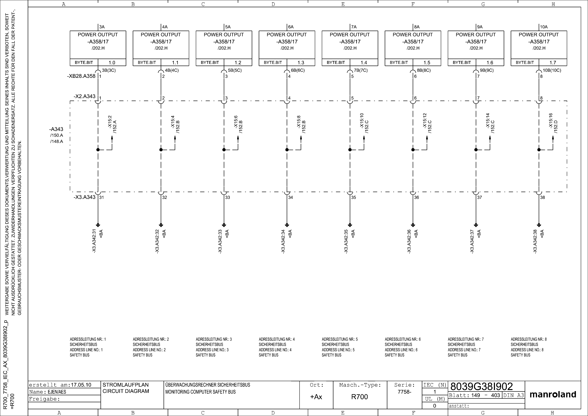

# +Ax — Sheet 149 of 403 — ÜBERWACHUNGSRECHNER SICHERHEITSBUS

**MONITORING COMPUTER SAFETY BUS**

> Part of the manroland **R700** printing press IEC/UL circuit diagrams.
> Drawing class: **Stromlaufplan / Circuit diagram** (DIN A3).
> Document `+Ax` covers the **Central control console** machine section.

## At a glance

| Field | Value |
|---|---|
| Document | `+Ax`  (8039G38I902) |
| Sheet | **149** of 403 |
| Section (DE) | ÜBERWACHUNGSRECHNER SICHERHEITSBUS |
| Section (EN) | MONITORING COMPUTER SAFETY BUS |
| Section type | CIRCUIT — Circuit diagram |
| Machine type | `R700` |
| Series | `7758` |
| Created | 17.05.10 |
| Replaces | — |
| Columns used | A, B, C, D, E, F, G, H |
| Path numbers | — |
| Labels on sheet | 150 |
| Cross-refs out | 18 |
| Cross-refs in | 42 |

**Previous:** [+Ax sheet 148](SHEET_0148.md) · **Next:** [+Ax sheet 150](SHEET_0150.md) · **Document TOC:** [_TOC.md](_TOC.md)  (+Ax) · **Master TOC:** [all sheets](../_MASTER_TOC.md)

## Sheet image (300 DPI, exact vector render)



_Rendered directly from the PDF vector layer at 300 DPI (1-bit), no OCR and no resampling. Use it to confirm anything ambiguous in the text below._

## Cross-references on this sheet

Each entry is a wire leaving this sheet. The printed token is `/sheet.column`; the link resolves to that sheet inside the same document.

| Ref | Target sheet | Col | Path | Destination on target | Target section | From col |
|---|---|---|---|---|---|---|
| `/202.H` | [+Ax sheet 202](SHEET_0202.md) | H | — | — | REFERENZMODUL | A |
| `/202.H` | [+Ax sheet 202](SHEET_0202.md) | H | — | — | REFERENZMODUL | B |
| `/202.H` | [+Ax sheet 202](SHEET_0202.md) | H | — | — | REFERENZMODUL | C |
| `/202.H` | [+Ax sheet 202](SHEET_0202.md) | H | — | — | REFERENZMODUL | D |
| `/202.H` | [+Ax sheet 202](SHEET_0202.md) | H | — | — | REFERENZMODUL | E |
| `/202.H` | [+Ax sheet 202](SHEET_0202.md) | H | — | — | REFERENZMODUL | F |
| `/202.H` | [+Ax sheet 202](SHEET_0202.md) | H | — | — | REFERENZMODUL | G |
| `/202.H` | [+Ax sheet 202](SHEET_0202.md) | H | — | — | REFERENZMODUL | H |
| `/152.C` | [+Ax sheet 152](SHEET_0152.md) | C | — | X15:10 | ÜBERWACHUNGSRECHNER SICHERHEITSBUS | E |
| `/152.C` | [+Ax sheet 152](SHEET_0152.md) | C | — | X15:12 | ÜBERWACHUNGSRECHNER SICHERHEITSBUS | F |
| `/152.C` | [+Ax sheet 152](SHEET_0152.md) | C | — | X15:14 | ÜBERWACHUNGSRECHNER SICHERHEITSBUS | G |
| `/152.D` | [+Ax sheet 152](SHEET_0152.md) | D | — | X15:16 | ÜBERWACHUNGSRECHNER SICHERHEITSBUS | H |
| `/152.A` | [+Ax sheet 152](SHEET_0152.md) | A | — | X15:2 | ÜBERWACHUNGSRECHNER SICHERHEITSBUS | B |
| `/152.B` | [+Ax sheet 152](SHEET_0152.md) | B | — | X15:4 | ÜBERWACHUNGSRECHNER SICHERHEITSBUS | C |
| `/152.B` | [+Ax sheet 152](SHEET_0152.md) | B | — | X15:6 | ÜBERWACHUNGSRECHNER SICHERHEITSBUS | D |
| `/152.B` | [+Ax sheet 152](SHEET_0152.md) | B | — | X15:8 | ÜBERWACHUNGSRECHNER SICHERHEITSBUS | D |
| `/150.A` | [+Ax sheet 150](SHEET_0150.md) | A | — | — | ÜBERWACHUNGSRECHNER SICHERHEITSBUS | A |
| `/148.A` | [+Ax sheet 148](SHEET_0148.md) | A | — | — | ÜBERWACHUNGSRECHNER SICHERHEITSBUS | A |

### Incoming references (sheets that point here)

Every other sheet that sends a wire to this one. `Back-ref` is the token printed on *that* sheet; `Path` is its line number.

| From sheet | Cols | Back-ref | Path | Refs | What continues there |
|---|---|---|---|---|---|
| [+Ax#148](SHEET_0148.md) | A | `/148.A` | — | 1 | — |
| [+Ax#150](SHEET_0150.md) | A | `/150.A` | — | 1 | — |
| [+Ax#152](SHEET_0152.md) | A, B, C, D | `/152.A`, `/152.B`, `/152.C`, `/152.D` | — | 8 | X11:2 X15:2; X15:10; X15:12; X15:14; X15:16; X15:4; X15:6; X15:8 |
| [+Ax#202](SHEET_0202.md) | H | `/202.H` | — | 8 | — |
| [+Ax#217](SHEET_0217.md) | G | `/217.G` | — | 8 | — |
| [+Ax#222](SHEET_0222.md) | H | `/222.H` | — | 8 | — |
| [+Ax#272](SHEET_0272.md) | C | `/272.C` | — | 8 | — |


## Devices on this sheet

| Tag | Class | Class meaning (IEC) | Col | Sub | Terminal | Sign |
|---|---|---|---|---|---|---|
| `A358/17` | A | Baugruppe / assembly, module, PC board | A | 17 | — | — |
| `A358/17` | A | Baugruppe / assembly, module, PC board | B | 17 | — | — |
| `A358/17` | A | Baugruppe / assembly, module, PC board | C | 17 | — | — |
| `A358/17` | A | Baugruppe / assembly, module, PC board | D | 17 | — | — |
| `A358/17` | A | Baugruppe / assembly, module, PC board | E | 17 | — | — |
| `A358/17` | A | Baugruppe / assembly, module, PC board | F | 17 | — | — |
| `A358/17` | A | Baugruppe / assembly, module, PC board | G | 17 | — | — |
| `A358/17` | A | Baugruppe / assembly, module, PC board | H | 17 | — | — |
| `A343` | A | Baugruppe / assembly, module, PC board | A | — | — | — |
| `X15:2` | X | Klemme / terminal, plug connector | B | — | 2 | — |
| `X15:10` | X | Klemme / terminal, plug connector | E | — | 10 | — |
| `X15:8` | X | Klemme / terminal, plug connector | D | — | 8 | — |
| `X15:6` | X | Klemme / terminal, plug connector | C | — | 6 | — |
| `X15:4` | X | Klemme / terminal, plug connector | C | — | 4 | — |
| `X15:12` | X | Klemme / terminal, plug connector | F | — | 12 | — |
| `X15:16` | X | Klemme / terminal, plug connector | H | — | 16 | — |
| `X15:14` | X | Klemme / terminal, plug connector | G | — | 14 | — |
| `XB28.A358` | — | cross-device reference | A | — | — | — |
| `1.0` | — | cross-device reference | B | — | — | — |
| `1.1` | — | cross-device reference | C | — | — | — |
| `1.2` | — | cross-device reference | C | — | — | — |
| `1.3` | — | cross-device reference | D | — | — | — |
| `1.4` | — | cross-device reference | E | — | — | — |
| `1.5` | — | cross-device reference | F | — | — | — |
| `1.6` | — | cross-device reference | G | — | — | — |
| `1.7` | — | cross-device reference | H | — | — | — |
| `X2.A343` | — | cross-device reference | A | — | — | — |
| `X3.A343` | — | cross-device reference | A | — | — | — |
| `X3.A342:31` | — | cross-device reference | A | — | 31 | — |
| `X3.A342:32` | — | cross-device reference | B | — | 32 | — |
| `X3.A342:33` | — | cross-device reference | C | — | 33 | — |
| `X3.A342:34` | — | cross-device reference | D | — | 34 | — |
| `X3.A342:35` | — | cross-device reference | E | — | 35 | — |
| `X3.A342:36` | — | cross-device reference | F | — | 36 | — |
| `X3.A342:37` | — | cross-device reference | G | — | 37 | — |
| `X3.A342:38` | — | cross-device reference | H | — | 38 | — |

## Potentials / nets

_No named potentials on this sheet._

## Wire-end annotations (grouped as printed)

A wire that continues elsewhere is annotated with a small cluster: the destination description, the path/line number `#NN`, and the `/sheet.column` cross reference. Each row below is one such cluster exactly as it is grouped on the drawing.

| Col | Y | Path | Cross-ref | Text on the wire |
|---|---|---|---|---|
| B | 50.6 | — | — | `3A` |
| B | 50.6 | — | — | `4A` |
| C | 50.6 | — | — | `5A` |
| D | 50.6 | — | — | `6A` |
| E | 50.6 | — | — | `7A` |
| F | 50.6 | — | — | `8A` |
| G | 50.6 | — | — | `9A` |
| H | 50.6 | — | — | `10A` |
| A | 65.8 | — | — | `POWER OUTPUT` |
| B | 65.8 | — | — | `POWER OUTPUT` |
| C | 65.8 | — | — | `POWER OUTPUT` |
| D | 65.8 | — | — | `POWER OUTPUT` |
| E | 65.8 | — | — | `POWER OUTPUT` |
| F | 65.8 | — | — | `POWER OUTPUT` |
| G | 65.8 | — | — | `POWER OUTPUT` |
| H | 65.8 | — | — | `POWER OUTPUT` |
| A | 79.7 | — | — | `A358/17` |
| B | 79.7 | — | — | `A358/17` |
| C | 79.7 | — | — | `A358/17` |
| D | 79.7 | — | — | `A358/17` |
| E | 79.7 | — | — | `A358/17` |
| F | 79.7 | — | — | `A358/17` |
| G | 79.7 | — | — | `A358/17` |
| H | 79.7 | — | — | `A358/17` |
| A | 93.5 | — | `/202.H` | — |
| B | 93.5 | — | `/202.H` | — |
| C | 93.5 | — | `/202.H` | — |
| D | 93.5 | — | `/202.H` | — |
| E | 93.5 | — | `/202.H` | — |
| F | 93.5 | — | `/202.H` | — |
| G | 93.5 | — | `/202.H` | — |
| H | 93.5 | — | `/202.H` | — |
| A | 122.5 | — | — | `BYTE.BIT 1.0` |
| B | 122.5 | — | — | `BYTE.BIT 1.1` |
| C | 122.5 | — | — | `BYTE.BIT 1.2` |
| D | 122.5 | — | — | `BYTE.BIT 1.3` |
| E | 122.5 | — | — | `BYTE.BIT 1.4` |
| F | 122.5 | — | — | `BYTE.BIT 1.5` |
| G | 122.5 | — | — | `BYTE.BIT 1.6` |
| H | 122.5 | — | — | `BYTE.BIT 1.7` |
| B | 138.5 | — | — | `3B(3C)` |
| C | 138.5 | — | — | `4B(4C)` |
| C | 138.5 | — | — | `5B(5C)` |
| D | 138.5 | — | — | `6B(6C)` |
| E | 138.5 | — | — | `7B(7C)` |
| F | 138.5 | — | — | `8B(8C)` |
| G | 138.5 | — | — | `9B(9C)` |
| H | 138.5 | — | — | `10B(10C)` |
| A | 149.1 | — | — | `XB28.A358 1` |
| E | 150.6 | — | — | `2 3 4 5 6 7 8` |
| E | 190.2 | — | — | `X2.A343 1 2 3 4 5 6 7 8` |
| E | 229.0 | — | `/152.C` | `X15:10` |
| F | 229.0 | — | `/152.C` | `X15:12` |
| G | 229.0 | — | `/152.C` | `X15:14` |
| H | 229.0 | — | `/152.D` | `X15:16` |
| B | 233.9 | — | `/152.A` | `X15:2` |
| C | 233.9 | — | `/152.B` | `X15:4` |
| D | 233.9 | — | `/152.B` | `X15:6` |
| D | 233.9 | — | `/152.B` | `X15:8` |
| A | 256.8 | — | — | `A343` |
| A | 269.9 | — | `/150.A`, `/148.A` | — |
| E | 394.3 | — | — | `X3.A343 31 32 33 34 35 36 37 38` |
| A | 463.2 | — | — | `X3.A342:31` |
| B | 464.3 | — | — | `X3.A342:32` |
| C | 464.6 | — | — | `X3.A342:33` |
| D | 464.6 | — | — | `X3.A342:34` |
| E | 464.6 | — | — | `X3.A342:35` |
| F | 464.6 | — | — | `X3.A342:36` |
| G | 464.6 | — | — | `X3.A342:37` |
| H | 464.6 | — | — | `X3.A342:38` |
| B | 464.9 | — | — | `+BA` |
| B | 464.9 | — | — | `+BA` |
| C | 464.9 | — | — | `+BA` |
| D | 464.9 | — | — | `+BA` |
| E | 464.9 | — | — | `+BA` |
| F | 464.9 | — | — | `+BA` |
| G | 464.9 | — | — | `+BA` |
| H | 464.9 | — | — | `+BA` |
| A | 683.8 | — | — | `SICHERHEITSBUS SAFETY BUS ADRESSLEITUNG NR.: 1 ADDRESS LINE NO.: 1` |
| B | 683.8 | — | — | `SICHERHEITSBUS SAFETY BUS ADRESSLEITUNG NR.: 2 ADDRESS LINE NO.: 2` |
| C | 683.8 | — | — | `SICHERHEITSBUS SAFETY BUS ADRESSLEITUNG NR.: 3 ADDRESS LINE NO.: 3` |
| D | 683.8 | — | — | `SICHERHEITSBUS SAFETY BUS ADRESSLEITUNG NR.: 4 ADDRESS LINE NO.: 4` |
| E | 683.8 | — | — | `SICHERHEITSBUS SAFETY BUS ADRESSLEITUNG NR.: 5 ADDRESS LINE NO.: 5` |
| F | 683.8 | — | — | `SICHERHEITSBUS SAFETY BUS ADRESSLEITUNG NR.: 6 ADDRESS LINE NO.: 6` |
| G | 683.8 | — | — | `SICHERHEITSBUS SAFETY BUS ADRESSLEITUNG NR.: 7 ADDRESS LINE NO.: 7` |
| H | 683.8 | — | — | `SICHERHEITSBUS SAFETY BUS ADRESSLEITUNG NR.: 8 ADDRESS LINE NO.: 8` |


## Reconstructed tables

This sheet carries tabular content (pin map / terminal assignment / index). The grid below was rebuilt from the drawing's own rule lines, so each row is exactly one physical row of the table.

### Table 1 — 1 data rows × 2 columns (at x=141.7, y=62.4)

| POWER | OUTPUT A358/17 /202.H |
|---|---|
| `BYTE.BIT` | `1.0` |


### Table 2 — 1 data rows × 2 columns (at x=269.3, y=62.4)

| POWER | OUTPUT A358/17 /202.H |
|---|---|
| `BYTE.BIT` | `1.1` |


### Table 3 — 1 data rows × 2 columns (at x=396.9, y=62.4)

| POWER | OUTPUT A358/17 /202.H |
|---|---|
| `BYTE.BIT` | `1.2` |


### Table 4 — 1 data rows × 2 columns (at x=524.4, y=62.4)

| POWER | OUTPUT A358/17 /202.H |
|---|---|
| `BYTE.BIT` | `1.3` |


### Table 5 — 1 data rows × 2 columns (at x=652.0, y=62.4)

| POWER | OUTPUT A358/17 /202.H |
|---|---|
| `BYTE.BIT` | `1.4` |


### Table 6 — 1 data rows × 2 columns (at x=779.5, y=62.4)

| POWER | OUTPUT A358/17 /202.H |
|---|---|
| `BYTE.BIT` | `1.5` |


### Table 7 — 1 data rows × 2 columns (at x=907.1, y=62.4)

| POWER | OUTPUT A358/17 /202.H |
|---|---|
| `BYTE.BIT` | `1.6` |


### Table 8 — 1 data rows × 2 columns (at x=1034.6, y=62.4)

| POWER | OUTPUT A358/17 /202.H |
|---|---|
| `BYTE.BIT` | `1.7` |


## Notes and free text on this sheet

| Text | Col | Y (pt) |
|---|---|---|
| `3A` | B | 50.58 |
| `3B(3C)` | B | 138.51 |
| `POWER OUTPUT` | A | 65.76 |
| `BYTE.BIT` | A | 123.08 |
| `ADRESSLEITUNG NR.: 1` | A | 683.76 |
| `SICHERHEITSBUS` | A | 694.4 |
| `ADDRESS LINE NO.: 1` | A | 705.02 |
| `SAFETY BUS` | A | 715.64 |
| `4A` | B | 50.58 |
| `4B(4C)` | C | 138.51 |
| `POWER OUTPUT` | B | 65.76 |
| `BYTE.BIT` | B | 123.08 |
| `ADRESSLEITUNG NR.: 2` | B | 683.78 |
| `SICHERHEITSBUS` | B | 694.4 |
| `ADDRESS LINE NO.: 2` | B | 705.04 |
| `SAFETY BUS` | B | 715.64 |
| `5A` | C | 50.58 |
| `5B(5C)` | C | 138.51 |
| `POWER OUTPUT` | C | 65.76 |
| `BYTE.BIT` | C | 123.08 |
| `ADRESSLEITUNG NR.: 3` | C | 683.78 |
| `SICHERHEITSBUS` | C | 694.4 |
| `ADDRESS LINE NO.: 3` | C | 705.04 |
| `SAFETY BUS` | C | 715.64 |
| `6A` | D | 50.58 |
| `6B(6C)` | D | 138.51 |
| `POWER OUTPUT` | D | 65.76 |
| `BYTE.BIT` | D | 123.08 |
| `ADRESSLEITUNG NR.: 4` | D | 683.78 |
| `SICHERHEITSBUS` | D | 694.4 |
| `ADDRESS LINE NO.: 4` | D | 705.04 |
| `SAFETY BUS` | D | 715.64 |
| `7A` | E | 50.58 |
| `7B(7C)` | E | 138.51 |
| `POWER OUTPUT` | E | 65.76 |
| `BYTE.BIT` | E | 123.08 |
| `ADRESSLEITUNG NR.: 5` | E | 683.78 |
| `SICHERHEITSBUS` | E | 694.4 |
| `ADDRESS LINE NO.: 5` | E | 705.04 |
| `SAFETY BUS` | E | 715.64 |
| `8A` | F | 50.58 |
| `8B(8C)` | F | 138.51 |
| `POWER OUTPUT` | F | 65.76 |
| `BYTE.BIT` | F | 123.08 |
| `ADRESSLEITUNG NR.: 6` | F | 683.78 |
| `SICHERHEITSBUS` | F | 694.4 |
| `ADDRESS LINE NO.: 6` | F | 705.04 |
| `SAFETY BUS` | F | 715.64 |
| `9A` | G | 50.58 |
| `9B(9C)` | G | 138.51 |
| `POWER OUTPUT` | G | 65.76 |
| `BYTE.BIT` | G | 123.08 |
| `ADRESSLEITUNG NR.: 7` | G | 683.78 |
| `SICHERHEITSBUS` | G | 694.4 |
| `ADDRESS LINE NO.: 7` | G | 705.04 |
| `SAFETY BUS` | G | 715.64 |
| `10A` | H | 50.6 |
| `10B(10C)` | H | 138.51 |
| `POWER OUTPUT` | H | 65.76 |
| `BYTE.BIT` | H | 123.08 |
| `ADRESSLEITUNG NR.: 8` | H | 683.78 |
| `SICHERHEITSBUS` | H | 694.4 |
| `ADDRESS LINE NO.: 8` | H | 705.04 |
| `SAFETY BUS` | H | 715.64 |
| `+BA` | B | 464.88 |
| `+BA` | C | 464.88 |
| `+BA` | D | 464.88 |
| `+BA` | E | 464.88 |
| `+BA` | F | 464.88 |
| `+BA` | G | 464.88 |
| `+BA` | H | 464.88 |

## Complete label inventory (exact text from the drawing)

Every text object inside the drawing area of this sheet, in DIN reading order (column A→H, then top→bottom). This is the authoritative list: if a string is not here it is not printed on this sheet.

| Col | Y | X | Dir | Type | Text |
|---|---|---|---|---|---|
| A | 65.8 | 157.6 | → | text | `POWER OUTPUT` |
| A | 79.7 | 177.0 | → | device tag | `A358/17` |
| A | 93.5 | 186.0 | → | cross-reference | `/202.H` |
| A | 123.1 | 151.7 | → | text | `BYTE.BIT` |
| A | 149.1 | 136.1 | → | device ref | `XB28.A358` |
| A | 190.2 | 149.1 | → | device ref | `X2.A343` |
| A | 256.8 | 99.8 | → | device tag | `A343` |
| A | 269.9 | 102.0 | → | cross-reference | `/150.A` |
| A | 282.3 | 102.0 | → | cross-reference | `/148.A` |
| A | 394.3 | 149.1 | → | device ref | `X3.A343` |
| A | 463.2 | 186.7 | ↕ | device ref | `X3.A342:31` |
| A | 683.8 | 141.7 | → | text | `ADRESSLEITUNG NR.: 1` |
| A | 694.4 | 141.4 | → | text | `SICHERHEITSBUS` |
| A | 705.0 | 141.7 | → | text | `ADDRESS LINE NO.: 1` |
| A | 715.6 | 141.4 | → | text | `SAFETY BUS` |
| B | 50.6 | 201.0 | → | text | `3A` |
| B | 50.6 | 328.5 | → | text | `4A` |
| B | 65.8 | 285.2 | → | text | `POWER OUTPUT` |
| B | 79.7 | 304.6 | → | device tag | `A358/17` |
| B | 93.5 | 313.5 | → | cross-reference | `/202.H` |
| B | 122.5 | 219.7 | → | device ref | `1.0` |
| B | 123.1 | 279.2 | → | text | `BYTE.BIT` |
| B | 138.5 | 206.6 | → | text | `3B(3C)` |
| B | 150.6 | 200.4 | → | number | `1` |
| B | 150.6 | 328.5 | → | number | `2` |
| B | 194.5 | 200.4 | → | number | `1` |
| B | 194.5 | 328.5 | → | number | `2` |
| B | 233.9 | 218.6 | ↕ | device tag | `X15:2` |
| B | 243.8 | 228.5 | ↕ | cross-reference | `/152.A` |
| B | 395.8 | 201.0 | → | number | `31` |
| B | 395.8 | 328.5 | → | number | `32` |
| B | 464.3 | 314.2 | ↕ | device ref | `X3.A342:32` |
| B | 464.9 | 200.8 | ↕ | text | `+BA` |
| B | 464.9 | 328.4 | ↕ | text | `+BA` |
| B | 683.8 | 269.3 | → | text | `ADRESSLEITUNG NR.: 2` |
| B | 694.4 | 269.0 | → | text | `SICHERHEITSBUS` |
| B | 705.0 | 269.3 | → | text | `ADDRESS LINE NO.: 2` |
| B | 715.6 | 269.0 | → | text | `SAFETY BUS` |
| C | 50.6 | 456.1 | → | text | `5A` |
| C | 65.8 | 412.7 | → | text | `POWER OUTPUT` |
| C | 79.7 | 432.1 | → | device tag | `A358/17` |
| C | 93.5 | 441.1 | → | cross-reference | `/202.H` |
| C | 122.5 | 348.1 | → | device ref | `1.1` |
| C | 122.5 | 474.8 | → | device ref | `1.2` |
| C | 123.1 | 406.8 | → | text | `BYTE.BIT` |
| C | 138.5 | 334.2 | → | text | `4B(4C)` |
| C | 138.5 | 461.8 | → | text | `5B(5C)` |
| C | 150.6 | 456.1 | → | number | `3` |
| C | 194.5 | 456.1 | → | number | `3` |
| C | 233.9 | 346.1 | ↕ | device tag | `X15:4` |
| C | 233.9 | 473.7 | ↕ | device tag | `X15:6` |
| C | 243.8 | 356.0 | ↕ | cross-reference | `/152.B` |
| C | 395.8 | 456.1 | → | number | `33` |
| C | 464.6 | 441.8 | ↕ | device ref | `X3.A342:33` |
| C | 464.9 | 455.9 | ↕ | text | `+BA` |
| C | 683.8 | 396.9 | → | text | `ADRESSLEITUNG NR.: 3` |
| C | 694.4 | 396.6 | → | text | `SICHERHEITSBUS` |
| C | 705.0 | 396.9 | → | text | `ADDRESS LINE NO.: 3` |
| C | 715.6 | 396.6 | → | text | `SAFETY BUS` |
| D | 50.6 | 583.7 | → | text | `6A` |
| D | 65.8 | 540.3 | → | text | `POWER OUTPUT` |
| D | 79.7 | 559.7 | → | device tag | `A358/17` |
| D | 93.5 | 568.6 | → | cross-reference | `/202.H` |
| D | 122.5 | 602.4 | → | device ref | `1.3` |
| D | 123.1 | 534.3 | → | text | `BYTE.BIT` |
| D | 138.5 | 589.3 | → | text | `6B(6C)` |
| D | 150.6 | 583.7 | → | number | `4` |
| D | 194.5 | 583.7 | → | number | `4` |
| D | 233.9 | 601.2 | ↕ | device tag | `X15:8` |
| D | 243.8 | 483.6 | ↕ | cross-reference | `/152.B` |
| D | 243.8 | 611.1 | ↕ | cross-reference | `/152.B` |
| D | 395.8 | 583.7 | → | number | `34` |
| D | 464.6 | 569.3 | ↕ | device ref | `X3.A342:34` |
| D | 464.9 | 583.5 | ↕ | text | `+BA` |
| D | 683.8 | 524.4 | → | text | `ADRESSLEITUNG NR.: 4` |
| D | 694.4 | 524.1 | → | text | `SICHERHEITSBUS` |
| D | 705.0 | 524.4 | → | text | `ADDRESS LINE NO.: 4` |
| D | 715.6 | 524.1 | → | text | `SAFETY BUS` |
| E | 50.6 | 711.2 | → | text | `7A` |
| E | 65.8 | 667.8 | → | text | `POWER OUTPUT` |
| E | 79.7 | 687.3 | → | device tag | `A358/17` |
| E | 93.5 | 696.2 | → | cross-reference | `/202.H` |
| E | 122.5 | 729.9 | → | device ref | `1.4` |
| E | 123.1 | 661.9 | → | text | `BYTE.BIT` |
| E | 138.5 | 716.9 | → | text | `7B(7C)` |
| E | 150.6 | 711.2 | → | number | `5` |
| E | 194.5 | 711.2 | → | number | `5` |
| E | 229.0 | 728.8 | ↕ | device tag | `X15:10` |
| E | 243.5 | 738.7 | ↕ | cross-reference | `/152.C` |
| E | 395.8 | 711.2 | → | number | `35` |
| E | 464.6 | 696.9 | ↕ | device ref | `X3.A342:35` |
| E | 464.9 | 711.0 | ↕ | text | `+BA` |
| E | 683.8 | 652.0 | → | text | `ADRESSLEITUNG NR.: 5` |
| E | 694.4 | 651.7 | → | text | `SICHERHEITSBUS` |
| E | 705.0 | 652.0 | → | text | `ADDRESS LINE NO.: 5` |
| E | 715.6 | 651.7 | → | text | `SAFETY BUS` |
| F | 50.6 | 838.8 | → | text | `8A` |
| F | 65.8 | 795.4 | → | text | `POWER OUTPUT` |
| F | 79.7 | 814.8 | → | device tag | `A358/17` |
| F | 93.5 | 823.7 | → | cross-reference | `/202.H` |
| F | 122.5 | 857.5 | → | device ref | `1.5` |
| F | 123.1 | 789.4 | → | text | `BYTE.BIT` |
| F | 138.5 | 844.4 | → | text | `8B(8C)` |
| F | 150.6 | 838.8 | → | number | `6` |
| F | 194.5 | 838.8 | → | number | `6` |
| F | 229.0 | 856.4 | ↕ | device tag | `X15:12` |
| F | 243.5 | 866.3 | ↕ | cross-reference | `/152.C` |
| F | 395.8 | 838.8 | → | number | `36` |
| F | 464.6 | 824.5 | ↕ | device ref | `X3.A342:36` |
| F | 464.9 | 838.6 | ↕ | text | `+BA` |
| F | 683.8 | 779.5 | → | text | `ADRESSLEITUNG NR.: 6` |
| F | 694.4 | 779.2 | → | text | `SICHERHEITSBUS` |
| F | 705.0 | 779.5 | → | text | `ADDRESS LINE NO.: 6` |
| F | 715.6 | 779.2 | → | text | `SAFETY BUS` |
| G | 50.6 | 966.3 | → | text | `9A` |
| G | 65.8 | 923.0 | → | text | `POWER OUTPUT` |
| G | 79.7 | 942.4 | → | device tag | `A358/17` |
| G | 93.5 | 951.3 | → | cross-reference | `/202.H` |
| G | 122.5 | 985.0 | → | device ref | `1.6` |
| G | 123.1 | 917.0 | → | text | `BYTE.BIT` |
| G | 138.5 | 972.0 | → | text | `9B(9C)` |
| G | 150.6 | 966.3 | → | number | `7` |
| G | 194.5 | 966.3 | → | number | `7` |
| G | 229.0 | 983.9 | ↕ | device tag | `X15:14` |
| G | 243.5 | 993.8 | ↕ | cross-reference | `/152.C` |
| G | 395.8 | 966.3 | → | number | `37` |
| G | 464.6 | 952.0 | ↕ | device ref | `X3.A342:37` |
| G | 464.9 | 966.2 | ↕ | text | `+BA` |
| G | 683.8 | 907.1 | → | text | `ADRESSLEITUNG NR.: 7` |
| G | 694.4 | 906.8 | → | text | `SICHERHEITSBUS` |
| G | 705.0 | 907.1 | → | text | `ADDRESS LINE NO.: 7` |
| G | 715.6 | 906.8 | → | text | `SAFETY BUS` |
| H | 50.6 | 1093.3 | → | text | `10A` |
| H | 65.8 | 1050.5 | → | text | `POWER OUTPUT` |
| H | 79.7 | 1069.9 | → | device tag | `A358/17` |
| H | 93.5 | 1078.9 | → | cross-reference | `/202.H` |
| H | 122.5 | 1112.6 | → | device ref | `1.7` |
| H | 123.1 | 1044.6 | → | text | `BYTE.BIT` |
| H | 138.5 | 1099.0 | → | text | `10B(10C)` |
| H | 150.6 | 1093.9 | → | number | `8` |
| H | 194.5 | 1093.9 | → | number | `8` |
| H | 229.0 | 1111.5 | ↕ | device tag | `X15:16` |
| H | 243.5 | 1121.4 | ↕ | cross-reference | `/152.D` |
| H | 395.8 | 1093.9 | → | number | `38` |
| H | 464.6 | 1079.6 | ↕ | device ref | `X3.A342:38` |
| H | 464.9 | 1093.7 | ↕ | text | `+BA` |
| H | 683.8 | 1034.6 | → | text | `ADRESSLEITUNG NR.: 8` |
| H | 694.4 | 1034.4 | → | text | `SICHERHEITSBUS` |
| H | 705.0 | 1034.6 | → | text | `ADDRESS LINE NO.: 8` |
| H | 715.6 | 1034.4 | → | text | `SAFETY BUS` |

## Reading-order text block

The same content as a plain block, grouped by DIN column — convenient to paste or to match against a visual description.

```text
=== Column A ===
  65.8  157.6  text         POWER OUTPUT
  79.7  177.0  devtag       A358/17
  93.5  186.0  xref         /202.H
 123.1  151.7  text         BYTE.BIT
 149.1  136.1  devref       XB28.A358
 190.2  149.1  devref       X2.A343
 256.8   99.8  devtag       A343
 269.9  102.0  xref         /150.A
 282.3  102.0  xref         /148.A
 394.3  149.1  devref       X3.A343
 463.2  186.7  devref       X3.A342:31
 683.8  141.7  text         ADRESSLEITUNG NR.: 1
 694.4  141.4  text         SICHERHEITSBUS
 705.0  141.7  text         ADDRESS LINE NO.: 1
 715.6  141.4  text         SAFETY BUS
=== Column B ===
  50.6  201.0  text         3A
  50.6  328.5  text         4A
  65.8  285.2  text         POWER OUTPUT
  79.7  304.6  devtag       A358/17
  93.5  313.5  xref         /202.H
 122.5  219.7  devref       1.0
 123.1  279.2  text         BYTE.BIT
 138.5  206.6  text         3B(3C)
 150.6  200.4  numeric      1
 150.6  328.5  numeric      2
 194.5  200.4  numeric      1
 194.5  328.5  numeric      2
 233.9  218.6  devtag       X15:2
 243.8  228.5  xref         /152.A
 395.8  201.0  numeric      31
 395.8  328.5  numeric      32
 464.3  314.2  devref       X3.A342:32
 464.9  200.8  text         +BA
 464.9  328.4  text         +BA
 683.8  269.3  text         ADRESSLEITUNG NR.: 2
 694.4  269.0  text         SICHERHEITSBUS
 705.0  269.3  text         ADDRESS LINE NO.: 2
 715.6  269.0  text         SAFETY BUS
=== Column C ===
  50.6  456.1  text         5A
  65.8  412.7  text         POWER OUTPUT
  79.7  432.1  devtag       A358/17
  93.5  441.1  xref         /202.H
 122.5  348.1  devref       1.1
 122.5  474.8  devref       1.2
 123.1  406.8  text         BYTE.BIT
 138.5  334.2  text         4B(4C)
 138.5  461.8  text         5B(5C)
 150.6  456.1  numeric      3
 194.5  456.1  numeric      3
 233.9  346.1  devtag       X15:4
 233.9  473.7  devtag       X15:6
 243.8  356.0  xref         /152.B
 395.8  456.1  numeric      33
 464.6  441.8  devref       X3.A342:33
 464.9  455.9  text         +BA
 683.8  396.9  text         ADRESSLEITUNG NR.: 3
 694.4  396.6  text         SICHERHEITSBUS
 705.0  396.9  text         ADDRESS LINE NO.: 3
 715.6  396.6  text         SAFETY BUS
=== Column D ===
  50.6  583.7  text         6A
  65.8  540.3  text         POWER OUTPUT
  79.7  559.7  devtag       A358/17
  93.5  568.6  xref         /202.H
 122.5  602.4  devref       1.3
 123.1  534.3  text         BYTE.BIT
 138.5  589.3  text         6B(6C)
 150.6  583.7  numeric      4
 194.5  583.7  numeric      4
 233.9  601.2  devtag       X15:8
 243.8  483.6  xref         /152.B
 243.8  611.1  xref         /152.B
 395.8  583.7  numeric      34
 464.6  569.3  devref       X3.A342:34
 464.9  583.5  text         +BA
 683.8  524.4  text         ADRESSLEITUNG NR.: 4
 694.4  524.1  text         SICHERHEITSBUS
 705.0  524.4  text         ADDRESS LINE NO.: 4
 715.6  524.1  text         SAFETY BUS
=== Column E ===
  50.6  711.2  text         7A
  65.8  667.8  text         POWER OUTPUT
  79.7  687.3  devtag       A358/17
  93.5  696.2  xref         /202.H
 122.5  729.9  devref       1.4
 123.1  661.9  text         BYTE.BIT
 138.5  716.9  text         7B(7C)
 150.6  711.2  numeric      5
 194.5  711.2  numeric      5
 229.0  728.8  devtag       X15:10
 243.5  738.7  xref         /152.C
 395.8  711.2  numeric      35
 464.6  696.9  devref       X3.A342:35
 464.9  711.0  text         +BA
 683.8  652.0  text         ADRESSLEITUNG NR.: 5
 694.4  651.7  text         SICHERHEITSBUS
 705.0  652.0  text         ADDRESS LINE NO.: 5
 715.6  651.7  text         SAFETY BUS
=== Column F ===
  50.6  838.8  text         8A
  65.8  795.4  text         POWER OUTPUT
  79.7  814.8  devtag       A358/17
  93.5  823.7  xref         /202.H
 122.5  857.5  devref       1.5
 123.1  789.4  text         BYTE.BIT
 138.5  844.4  text         8B(8C)
 150.6  838.8  numeric      6
 194.5  838.8  numeric      6
 229.0  856.4  devtag       X15:12
 243.5  866.3  xref         /152.C
 395.8  838.8  numeric      36
 464.6  824.5  devref       X3.A342:36
 464.9  838.6  text         +BA
 683.8  779.5  text         ADRESSLEITUNG NR.: 6
 694.4  779.2  text         SICHERHEITSBUS
 705.0  779.5  text         ADDRESS LINE NO.: 6
 715.6  779.2  text         SAFETY BUS
=== Column G ===
  50.6  966.3  text         9A
  65.8  923.0  text         POWER OUTPUT
  79.7  942.4  devtag       A358/17
  93.5  951.3  xref         /202.H
 122.5  985.0  devref       1.6
 123.1  917.0  text         BYTE.BIT
 138.5  972.0  text         9B(9C)
 150.6  966.3  numeric      7
 194.5  966.3  numeric      7
 229.0  983.9  devtag       X15:14
 243.5  993.8  xref         /152.C
 395.8  966.3  numeric      37
 464.6  952.0  devref       X3.A342:37
 464.9  966.2  text         +BA
 683.8  907.1  text         ADRESSLEITUNG NR.: 7
 694.4  906.8  text         SICHERHEITSBUS
 705.0  907.1  text         ADDRESS LINE NO.: 7
 715.6  906.8  text         SAFETY BUS
=== Column H ===
  50.6 1093.3  text         10A
  65.8 1050.5  text         POWER OUTPUT
  79.7 1069.9  devtag       A358/17
  93.5 1078.9  xref         /202.H
 122.5 1112.6  devref       1.7
 123.1 1044.6  text         BYTE.BIT
 138.5 1099.0  text         10B(10C)
 150.6 1093.9  numeric      8
 194.5 1093.9  numeric      8
 229.0 1111.5  devtag       X15:16
 243.5 1121.4  xref         /152.D
 395.8 1093.9  numeric      38
 464.6 1079.6  devref       X3.A342:38
 464.9 1093.7  text         +BA
 683.8 1034.6  text         ADRESSLEITUNG NR.: 8
 694.4 1034.4  text         SICHERHEITSBUS
 705.0 1034.6  text         ADDRESS LINE NO.: 8
 715.6 1034.4  text         SAFETY BUS
```

---
_Generated from the PDF vector text layer; no OCR. Source: `R700_7758_IEC_AX_8039G38I902_p`, sheet 149._
