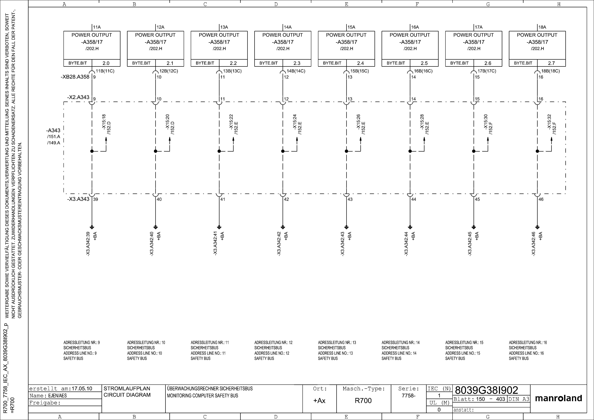

# +Ax — Sheet 150 of 403 — ÜBERWACHUNGSRECHNER SICHERHEITSBUS

**MONITORING COMPUTER SAFETY BUS**

> Part of the manroland **R700** printing press IEC/UL circuit diagrams.
> Drawing class: **Stromlaufplan / Circuit diagram** (DIN A3).
> Document `+Ax` covers the **Central control console** machine section.

## At a glance

| Field | Value |
|---|---|
| Document | `+Ax`  (8039G38I902) |
| Sheet | **150** of 403 |
| Section (DE) | ÜBERWACHUNGSRECHNER SICHERHEITSBUS |
| Section (EN) | MONITORING COMPUTER SAFETY BUS |
| Section type | CIRCUIT — Circuit diagram |
| Machine type | `R700` |
| Series | `7758` |
| Created | 17.05.10 |
| Replaces | — |
| Columns used | A, B, C, D, E, F, G, H |
| Path numbers | — |
| Labels on sheet | 150 |
| Cross-refs out | 18 |
| Cross-refs in | 42 |

**Previous:** [+Ax sheet 149](SHEET_0149.md) · **Next:** [+Ax sheet 151](SHEET_0151.md) · **Document TOC:** [_TOC.md](_TOC.md)  (+Ax) · **Master TOC:** [all sheets](../_MASTER_TOC.md)

## Sheet image (300 DPI, exact vector render)



_Rendered directly from the PDF vector layer at 300 DPI (1-bit), no OCR and no resampling. Use it to confirm anything ambiguous in the text below._

## Cross-references on this sheet

Each entry is a wire leaving this sheet. The printed token is `/sheet.column`; the link resolves to that sheet inside the same document.

| Ref | Target sheet | Col | Path | Destination on target | Target section | From col |
|---|---|---|---|---|---|---|
| `/202.H` | [+Ax sheet 202](SHEET_0202.md) | H | — | — | REFERENZMODUL | A |
| `/202.H` | [+Ax sheet 202](SHEET_0202.md) | H | — | — | REFERENZMODUL | B |
| `/202.H` | [+Ax sheet 202](SHEET_0202.md) | H | — | — | REFERENZMODUL | C |
| `/202.H` | [+Ax sheet 202](SHEET_0202.md) | H | — | — | REFERENZMODUL | D |
| `/202.H` | [+Ax sheet 202](SHEET_0202.md) | H | — | — | REFERENZMODUL | E |
| `/202.H` | [+Ax sheet 202](SHEET_0202.md) | H | — | — | REFERENZMODUL | F |
| `/202.H` | [+Ax sheet 202](SHEET_0202.md) | H | — | — | REFERENZMODUL | G |
| `/202.H` | [+Ax sheet 202](SHEET_0202.md) | H | — | — | REFERENZMODUL | H |
| `/152.D` | [+Ax sheet 152](SHEET_0152.md) | D | — | X15:18 | ÜBERWACHUNGSRECHNER SICHERHEITSBUS | B |
| `/152.D` | [+Ax sheet 152](SHEET_0152.md) | D | — | X15:20 | ÜBERWACHUNGSRECHNER SICHERHEITSBUS | C |
| `/152.E` | [+Ax sheet 152](SHEET_0152.md) | E | — | X15:22 | ÜBERWACHUNGSRECHNER SICHERHEITSBUS | C |
| `/152.E` | [+Ax sheet 152](SHEET_0152.md) | E | — | X15:24 | ÜBERWACHUNGSRECHNER SICHERHEITSBUS | D |
| `/152.E` | [+Ax sheet 152](SHEET_0152.md) | E | — | X15:26 | ÜBERWACHUNGSRECHNER SICHERHEITSBUS | E |
| `/152.E` | [+Ax sheet 152](SHEET_0152.md) | E | — | X15:28 | ÜBERWACHUNGSRECHNER SICHERHEITSBUS | F |
| `/152.F` | [+Ax sheet 152](SHEET_0152.md) | F | — | X15:30 | ÜBERWACHUNGSRECHNER SICHERHEITSBUS | G |
| `/152.F` | [+Ax sheet 152](SHEET_0152.md) | F | — | X15:32 | ÜBERWACHUNGSRECHNER SICHERHEITSBUS | H |
| `/151.A` | [+Ax sheet 151](SHEET_0151.md) | A | — | — | ÜBERWACHUNGSRECHNER SICHERHEITSBUS | A |
| `/149.A` | [+Ax sheet 149](SHEET_0149.md) | A | — | — | ÜBERWACHUNGSRECHNER SICHERHEITSBUS | A |

### Incoming references (sheets that point here)

Every other sheet that sends a wire to this one. `Back-ref` is the token printed on *that* sheet; `Path` is its line number.

| From sheet | Cols | Back-ref | Path | Refs | What continues there |
|---|---|---|---|---|---|
| [+Ax#149](SHEET_0149.md) | A | `/149.A` | — | 1 | — |
| [+Ax#151](SHEET_0151.md) | A | `/151.A` | — | 1 | — |
| [+Ax#152](SHEET_0152.md) | D, E, F | `/152.D`, `/152.E`, `/152.F` | — | 8 | X15:18; X15:20; X15:22; X15:24; X15:26; X15:28; X15:30; X15:32 |
| [+Ax#202](SHEET_0202.md) | H | `/202.H` | — | 8 | — |
| [+Ax#217](SHEET_0217.md) | G | `/217.G` | — | 8 | — |
| [+Ax#222](SHEET_0222.md) | H | `/222.H` | — | 8 | — |
| [+Ax#272](SHEET_0272.md) | C | `/272.C` | — | 8 | — |


## Devices on this sheet

| Tag | Class | Class meaning (IEC) | Col | Sub | Terminal | Sign |
|---|---|---|---|---|---|---|
| `A358/17` | A | Baugruppe / assembly, module, PC board | E | 17 | — | — |
| `A358/17` | A | Baugruppe / assembly, module, PC board | F | 17 | — | — |
| `A358/17` | A | Baugruppe / assembly, module, PC board | G | 17 | — | — |
| `A358/17` | A | Baugruppe / assembly, module, PC board | H | 17 | — | — |
| `A358/17` | A | Baugruppe / assembly, module, PC board | A | 17 | — | — |
| `A358/17` | A | Baugruppe / assembly, module, PC board | B | 17 | — | — |
| `A358/17` | A | Baugruppe / assembly, module, PC board | C | 17 | — | — |
| `A358/17` | A | Baugruppe / assembly, module, PC board | D | 17 | — | — |
| `A343` | A | Baugruppe / assembly, module, PC board | A | — | — | — |
| `X15:30` | X | Klemme / terminal, plug connector | G | — | 30 | — |
| `X15:28` | X | Klemme / terminal, plug connector | F | — | 28 | — |
| `X15:26` | X | Klemme / terminal, plug connector | E | — | 26 | — |
| `X15:24` | X | Klemme / terminal, plug connector | D | — | 24 | — |
| `X15:32` | X | Klemme / terminal, plug connector | H | — | 32 | — |
| `X15:22` | X | Klemme / terminal, plug connector | C | — | 22 | — |
| `X15:20` | X | Klemme / terminal, plug connector | B | — | 20 | — |
| `X15:18` | X | Klemme / terminal, plug connector | B | — | 18 | — |
| `XB28.A358` | — | cross-device reference | A | — | — | — |
| `2.4` | — | cross-device reference | E | — | — | — |
| `2.5` | — | cross-device reference | F | — | — | — |
| `2.6` | — | cross-device reference | G | — | — | — |
| `2.7` | — | cross-device reference | H | — | — | — |
| `2.0` | — | cross-device reference | B | — | — | — |
| `2.1` | — | cross-device reference | C | — | — | — |
| `2.2` | — | cross-device reference | C | — | — | — |
| `2.3` | — | cross-device reference | D | — | — | — |
| `X2.A343` | — | cross-device reference | A | — | — | — |
| `X3.A343` | — | cross-device reference | A | — | — | — |
| `X3.A342:39` | — | cross-device reference | A | — | 39 | — |
| `X3.A342:40` | — | cross-device reference | B | — | 40 | — |
| `X3.A342:41` | — | cross-device reference | C | — | 41 | — |
| `X3.A342:42` | — | cross-device reference | D | — | 42 | — |
| `X3.A342:43` | — | cross-device reference | E | — | 43 | — |
| `X3.A342:44` | — | cross-device reference | F | — | 44 | — |
| `X3.A342:45` | — | cross-device reference | G | — | 45 | — |
| `X3.A342:46` | — | cross-device reference | H | — | 46 | — |

## Potentials / nets

_No named potentials on this sheet._

## Wire-end annotations (grouped as printed)

A wire that continues elsewhere is annotated with a small cluster: the destination description, the path/line number `#NN`, and the `/sheet.column` cross reference. Each row below is one such cluster exactly as it is grouped on the drawing.

| Col | Y | Path | Cross-ref | Text on the wire |
|---|---|---|---|---|
| A | 50.6 | — | — | `11A` |
| B | 50.6 | — | — | `12A` |
| C | 50.6 | — | — | `13A` |
| D | 50.6 | — | — | `14A` |
| E | 50.6 | — | — | `15A` |
| F | 50.6 | — | — | `16A` |
| G | 50.6 | — | — | `17A` |
| H | 50.6 | — | — | `18A` |
| A | 65.8 | — | — | `POWER OUTPUT` |
| B | 65.8 | — | — | `POWER OUTPUT` |
| C | 65.8 | — | — | `POWER OUTPUT` |
| D | 65.8 | — | — | `POWER OUTPUT` |
| E | 65.8 | — | — | `POWER OUTPUT` |
| F | 65.8 | — | — | `POWER OUTPUT` |
| G | 65.8 | — | — | `POWER OUTPUT` |
| H | 65.8 | — | — | `POWER OUTPUT` |
| A | 79.7 | — | — | `A358/17` |
| B | 79.7 | — | — | `A358/17` |
| C | 79.7 | — | — | `A358/17` |
| D | 79.7 | — | — | `A358/17` |
| E | 79.7 | — | — | `A358/17` |
| F | 79.7 | — | — | `A358/17` |
| G | 79.7 | — | — | `A358/17` |
| H | 79.7 | — | — | `A358/17` |
| A | 93.5 | — | `/202.H` | — |
| B | 93.5 | — | `/202.H` | — |
| C | 93.5 | — | `/202.H` | — |
| D | 93.5 | — | `/202.H` | — |
| E | 93.5 | — | `/202.H` | — |
| F | 93.5 | — | `/202.H` | — |
| G | 93.5 | — | `/202.H` | — |
| H | 93.5 | — | `/202.H` | — |
| A | 122.5 | — | — | `BYTE.BIT 2.0` |
| B | 122.5 | — | — | `BYTE.BIT 2.1` |
| C | 122.5 | — | — | `BYTE.BIT 2.2` |
| D | 122.5 | — | — | `BYTE.BIT 2.3` |
| E | 122.5 | — | — | `BYTE.BIT 2.4` |
| F | 122.5 | — | — | `BYTE.BIT 2.5` |
| G | 122.5 | — | — | `BYTE.BIT 2.6` |
| H | 122.5 | — | — | `BYTE.BIT 2.7` |
| B | 138.5 | — | — | `11B(11C)` |
| B | 138.5 | — | — | `12B(12C)` |
| C | 138.5 | — | — | `13B(13C)` |
| D | 138.5 | — | — | `14B(14C)` |
| E | 138.5 | — | — | `15B(15C)` |
| F | 138.5 | — | — | `16B(16C)` |
| G | 138.5 | — | — | `17B(17C)` |
| H | 138.5 | — | — | `18B(18C)` |
| A | 149.1 | — | — | `XB28.A358 9` |
| E | 150.6 | — | — | `10 11 12 13 14 15 16` |
| D | 190.2 | — | — | `X2.A343 9 10 11 12 13 14 15 16` |
| B | 229.0 | — | `/152.D` | `X15:18` |
| C | 229.0 | — | `/152.D` | `X15:20` |
| C | 229.0 | — | `/152.E` | `X15:22` |
| D | 229.0 | — | `/152.E` | `X15:24` |
| E | 229.0 | — | `/152.E` | `X15:26` |
| F | 229.0 | — | `/152.E` | `X15:28` |
| G | 229.0 | — | `/152.F` | `X15:30` |
| H | 229.0 | — | `/152.F` | `X15:32` |
| A | 256.8 | — | — | `A343` |
| A | 269.9 | — | `/151.A`, `/149.A` | — |
| D | 394.3 | — | — | `X3.A343 39 40 41 42 43 44 45 46` |
| C | 463.2 | — | — | `X3.A342:41` |
| D | 464.3 | — | — | `X3.A342:42` |
| A | 464.6 | — | — | `X3.A342:39` |
| B | 464.6 | — | — | `X3.A342:40` |
| E | 464.6 | — | — | `X3.A342:43` |
| F | 464.6 | — | — | `X3.A342:44` |
| G | 464.6 | — | — | `X3.A342:45` |
| H | 464.6 | — | — | `X3.A342:46` |
| A | 464.9 | — | — | `+BA` |
| B | 464.9 | — | — | `+BA` |
| C | 464.9 | — | — | `+BA` |
| D | 464.9 | — | — | `+BA` |
| E | 464.9 | — | — | `+BA` |
| F | 464.9 | — | — | `+BA` |
| G | 464.9 | — | — | `+BA` |
| H | 464.9 | — | — | `+BA` |
| A | 683.8 | — | — | `SICHERHEITSBUS SAFETY BUS ADRESSLEITUNG NR.: 9 ADDRESS LINE NO.: 9` |
| B | 683.8 | — | — | `SICHERHEITSBUS SAFETY BUS ADRESSLEITUNG NR.: 10 ADDRESS LINE NO.: 10` |
| C | 683.8 | — | — | `SICHERHEITSBUS SAFETY BUS ADRESSLEITUNG NR.: 11 ADDRESS LINE NO.: 11` |
| D | 683.8 | — | — | `SICHERHEITSBUS SAFETY BUS ADRESSLEITUNG NR.: 12 ADDRESS LINE NO.: 12` |
| E | 683.8 | — | — | `SICHERHEITSBUS SAFETY BUS ADRESSLEITUNG NR.: 13 ADDRESS LINE NO.: 13` |
| F | 683.8 | — | — | `SICHERHEITSBUS SAFETY BUS ADRESSLEITUNG NR.: 14 ADDRESS LINE NO.: 14` |
| G | 683.8 | — | — | `SICHERHEITSBUS SAFETY BUS ADRESSLEITUNG NR.: 15 ADDRESS LINE NO.: 15` |
| H | 683.8 | — | — | `SICHERHEITSBUS SAFETY BUS ADRESSLEITUNG NR.: 16 ADDRESS LINE NO.: 16` |


## Reconstructed tables

This sheet carries tabular content (pin map / terminal assignment / index). The grid below was rebuilt from the drawing's own rule lines, so each row is exactly one physical row of the table.

### Table 1 — 1 data rows × 2 columns (at x=127.6, y=62.4)

| POWER | OUTPUT A358/17 /202.H |
|---|---|
| `BYTE.BIT` | `2.0` |


### Table 2 — 1 data rows × 2 columns (at x=255.1, y=62.4)

| POWER | OUTPUT A358/17 /202.H |
|---|---|
| `BYTE.BIT` | `2.1` |


### Table 3 — 1 data rows × 2 columns (at x=382.7, y=62.4)

| POWER | OUTPUT A358/17 /202.H |
|---|---|
| `BYTE.BIT` | `2.2` |


### Table 4 — 1 data rows × 2 columns (at x=510.2, y=62.4)

| POWER | OUTPUT A358/17 /202.H |
|---|---|
| `BYTE.BIT` | `2.3` |


### Table 5 — 1 data rows × 2 columns (at x=637.8, y=62.4)

| POWER | OUTPUT A358/17 /202.H |
|---|---|
| `BYTE.BIT` | `2.4` |


### Table 6 — 1 data rows × 2 columns (at x=765.4, y=62.4)

| POWER | OUTPUT A358/17 /202.H |
|---|---|
| `BYTE.BIT` | `2.5` |


### Table 7 — 1 data rows × 2 columns (at x=892.9, y=62.4)

| POWER | OUTPUT A358/17 /202.H |
|---|---|
| `BYTE.BIT` | `2.6` |


### Table 8 — 1 data rows × 2 columns (at x=1020.5, y=62.4)

| POWER | OUTPUT A358/17 /202.H |
|---|---|
| `BYTE.BIT` | `2.7` |


## Notes and free text on this sheet

| Text | Col | Y (pt) |
|---|---|---|
| `15A` | E | 50.6 |
| `15B(15C)` | E | 138.51 |
| `POWER OUTPUT` | E | 65.76 |
| `BYTE.BIT` | E | 123.08 |
| `ADRESSLEITUNG NR.: 13` | E | 683.78 |
| `SICHERHEITSBUS` | E | 694.4 |
| `ADDRESS LINE NO.: 13` | E | 705.04 |
| `SAFETY BUS` | E | 715.64 |
| `16A` | F | 50.6 |
| `16B(16C)` | F | 138.51 |
| `POWER OUTPUT` | F | 65.76 |
| `BYTE.BIT` | F | 123.08 |
| `ADRESSLEITUNG NR.: 14` | F | 683.78 |
| `SICHERHEITSBUS` | F | 694.4 |
| `ADDRESS LINE NO.: 14` | F | 705.04 |
| `SAFETY BUS` | F | 715.64 |
| `17A` | G | 50.6 |
| `17B(17C)` | G | 138.51 |
| `POWER OUTPUT` | G | 65.76 |
| `BYTE.BIT` | G | 123.08 |
| `ADRESSLEITUNG NR.: 15` | G | 683.78 |
| `SICHERHEITSBUS` | G | 694.4 |
| `ADDRESS LINE NO.: 15` | G | 705.04 |
| `SAFETY BUS` | G | 715.64 |
| `18A` | H | 50.6 |
| `18B(18C)` | H | 138.51 |
| `POWER OUTPUT` | H | 65.76 |
| `ADRESSLEITUNG NR.: 16` | H | 683.78 |
| `ADDRESS LINE NO.: 16` | H | 705.04 |
| `11A` | A | 50.6 |
| `11B(11C)` | B | 138.51 |
| `POWER OUTPUT` | A | 65.76 |
| `BYTE.BIT` | A | 123.08 |
| `ADRESSLEITUNG NR.: 9` | A | 683.78 |
| `SICHERHEITSBUS` | A | 694.4 |
| `ADDRESS LINE NO.: 9` | A | 705.04 |
| `SAFETY BUS` | A | 715.64 |
| `12A` | B | 50.6 |
| `12B(12C)` | B | 138.51 |
| `POWER OUTPUT` | B | 65.76 |
| `BYTE.BIT` | B | 123.08 |
| `ADRESSLEITUNG NR.: 10` | B | 683.78 |
| `SICHERHEITSBUS` | B | 694.4 |
| `ADDRESS LINE NO.: 10` | B | 705.04 |
| `SAFETY BUS` | B | 715.64 |
| `13A` | C | 50.6 |
| `13B(13C)` | C | 138.51 |
| `POWER OUTPUT` | C | 65.76 |
| `BYTE.BIT` | C | 123.08 |
| `ADRESSLEITUNG NR.: 11` | C | 683.77 |
| `SICHERHEITSBUS` | C | 694.4 |
| `ADDRESS LINE NO.: 11` | C | 705.03 |
| `SAFETY BUS` | C | 715.64 |
| `14A` | D | 50.6 |
| `14B(14C)` | D | 138.51 |
| `POWER OUTPUT` | D | 65.76 |
| `BYTE.BIT` | D | 123.08 |
| `ADRESSLEITUNG NR.: 12` | D | 683.78 |
| `SICHERHEITSBUS` | D | 694.4 |
| `ADDRESS LINE NO.: 12` | D | 705.04 |
| `SAFETY BUS` | D | 715.64 |
| `+BA` | A | 464.88 |
| `+BA` | B | 464.88 |
| `+BA` | C | 464.88 |
| `+BA` | D | 464.88 |
| `+BA` | E | 464.88 |
| `+BA` | F | 464.88 |
| `+BA` | G | 464.88 |
| `+BA` | H | 464.88 |

## Complete label inventory (exact text from the drawing)

Every text object inside the drawing area of this sheet, in DIN reading order (column A→H, then top→bottom). This is the authoritative list: if a string is not here it is not printed on this sheet.

| Col | Y | X | Dir | Type | Text |
|---|---|---|---|---|---|
| A | 50.6 | 186.2 | → | text | `11A` |
| A | 65.8 | 143.4 | → | text | `POWER OUTPUT` |
| A | 79.7 | 162.9 | → | device tag | `A358/17` |
| A | 93.5 | 171.8 | → | cross-reference | `/202.H` |
| A | 123.1 | 137.5 | → | text | `BYTE.BIT` |
| A | 149.1 | 121.9 | → | device ref | `XB28.A358` |
| A | 150.6 | 186.8 | → | number | `9` |
| A | 190.2 | 134.9 | → | device ref | `X2.A343` |
| A | 194.5 | 186.8 | → | number | `9` |
| A | 256.8 | 92.7 | → | device tag | `A343` |
| A | 269.9 | 95.0 | → | cross-reference | `/151.A` |
| A | 282.3 | 95.0 | → | cross-reference | `/149.A` |
| A | 394.3 | 134.9 | → | device ref | `X3.A343` |
| A | 395.8 | 186.8 | → | number | `39` |
| A | 464.6 | 172.5 | ↕ | device ref | `X3.A342:39` |
| A | 464.9 | 186.6 | ↕ | text | `+BA` |
| A | 683.8 | 127.6 | → | text | `ADRESSLEITUNG NR.: 9` |
| A | 694.4 | 127.3 | → | text | `SICHERHEITSBUS` |
| A | 705.0 | 127.6 | → | text | `ADDRESS LINE NO.: 9` |
| A | 715.6 | 127.3 | → | text | `SAFETY BUS` |
| B | 50.6 | 313.8 | → | text | `12A` |
| B | 65.8 | 271.0 | → | text | `POWER OUTPUT` |
| B | 79.7 | 290.4 | → | device tag | `A358/17` |
| B | 93.5 | 299.3 | → | cross-reference | `/202.H` |
| B | 122.5 | 205.8 | → | device ref | `2.0` |
| B | 123.1 | 265.0 | → | text | `BYTE.BIT` |
| B | 138.5 | 191.9 | → | text | `11B(11C)` |
| B | 138.5 | 319.5 | → | text | `12B(12C)` |
| B | 150.6 | 313.8 | → | number | `10` |
| B | 194.5 | 313.8 | → | number | `10` |
| B | 229.0 | 204.4 | ↕ | device tag | `X15:18` |
| B | 229.0 | 331.9 | ↕ | device tag | `X15:20` |
| B | 243.5 | 214.3 | ↕ | cross-reference | `/152.D` |
| B | 395.8 | 314.4 | → | number | `40` |
| B | 464.6 | 300.0 | ↕ | device ref | `X3.A342:40` |
| B | 464.9 | 314.2 | ↕ | text | `+BA` |
| B | 683.8 | 255.1 | → | text | `ADRESSLEITUNG NR.: 10` |
| B | 694.4 | 254.8 | → | text | `SICHERHEITSBUS` |
| B | 705.0 | 255.1 | → | text | `ADDRESS LINE NO.: 10` |
| B | 715.6 | 254.8 | → | text | `SAFETY BUS` |
| C | 50.6 | 441.4 | → | text | `13A` |
| C | 65.8 | 398.6 | → | text | `POWER OUTPUT` |
| C | 79.7 | 418.0 | → | device tag | `A358/17` |
| C | 93.5 | 426.9 | → | cross-reference | `/202.H` |
| C | 122.5 | 334.2 | → | device ref | `2.1` |
| C | 122.5 | 460.9 | → | device ref | `2.2` |
| C | 123.1 | 392.6 | → | text | `BYTE.BIT` |
| C | 138.5 | 447.0 | → | text | `13B(13C)` |
| C | 150.6 | 441.4 | → | number | `11` |
| C | 194.5 | 441.4 | → | number | `11` |
| C | 229.0 | 459.5 | ↕ | device tag | `X15:22` |
| C | 243.5 | 341.9 | ↕ | cross-reference | `/152.D` |
| C | 243.8 | 469.4 | ↕ | cross-reference | `/152.E` |
| C | 395.8 | 441.9 | → | number | `41` |
| C | 463.2 | 427.6 | ↕ | device ref | `X3.A342:41` |
| C | 464.9 | 441.7 | ↕ | text | `+BA` |
| C | 683.8 | 382.7 | → | text | `ADRESSLEITUNG NR.: 11` |
| C | 694.4 | 382.4 | → | text | `SICHERHEITSBUS` |
| C | 705.0 | 382.7 | → | text | `ADDRESS LINE NO.: 11` |
| C | 715.6 | 382.4 | → | text | `SAFETY BUS` |
| D | 50.6 | 568.9 | → | text | `14A` |
| D | 65.8 | 526.1 | → | text | `POWER OUTPUT` |
| D | 79.7 | 545.5 | → | device tag | `A358/17` |
| D | 93.5 | 554.5 | → | cross-reference | `/202.H` |
| D | 122.5 | 588.5 | → | device ref | `2.3` |
| D | 123.1 | 520.2 | → | text | `BYTE.BIT` |
| D | 138.5 | 574.6 | → | text | `14B(14C)` |
| D | 150.6 | 568.9 | → | number | `12` |
| D | 194.5 | 568.9 | → | number | `12` |
| D | 229.0 | 587.1 | ↕ | device tag | `X15:24` |
| D | 243.8 | 597.0 | ↕ | cross-reference | `/152.E` |
| D | 395.8 | 569.5 | → | number | `42` |
| D | 464.3 | 555.2 | ↕ | device ref | `X3.A342:42` |
| D | 464.9 | 569.3 | ↕ | text | `+BA` |
| D | 683.8 | 510.2 | → | text | `ADRESSLEITUNG NR.: 12` |
| D | 694.4 | 510.0 | → | text | `SICHERHEITSBUS` |
| D | 705.0 | 510.2 | → | text | `ADDRESS LINE NO.: 12` |
| D | 715.6 | 510.0 | → | text | `SAFETY BUS` |
| E | 50.6 | 696.5 | → | text | `15A` |
| E | 65.8 | 653.7 | → | text | `POWER OUTPUT` |
| E | 79.7 | 673.1 | → | device tag | `A358/17` |
| E | 93.5 | 682.0 | → | cross-reference | `/202.H` |
| E | 122.5 | 716.0 | → | device ref | `2.4` |
| E | 123.1 | 647.7 | → | text | `BYTE.BIT` |
| E | 138.5 | 702.1 | → | text | `15B(15C)` |
| E | 150.6 | 696.5 | → | number | `13` |
| E | 194.5 | 696.5 | → | number | `13` |
| E | 229.0 | 714.6 | ↕ | device tag | `X15:26` |
| E | 243.8 | 724.5 | ↕ | cross-reference | `/152.E` |
| E | 395.8 | 697.0 | → | number | `43` |
| E | 464.6 | 682.7 | ↕ | device ref | `X3.A342:43` |
| E | 464.9 | 696.9 | ↕ | text | `+BA` |
| E | 683.8 | 637.8 | → | text | `ADRESSLEITUNG NR.: 13` |
| E | 694.4 | 637.5 | → | text | `SICHERHEITSBUS` |
| E | 705.0 | 637.8 | → | text | `ADDRESS LINE NO.: 13` |
| E | 715.6 | 637.5 | → | text | `SAFETY BUS` |
| F | 50.6 | 824.0 | → | text | `16A` |
| F | 65.8 | 781.2 | → | text | `POWER OUTPUT` |
| F | 79.7 | 800.6 | → | device tag | `A358/17` |
| F | 93.5 | 809.6 | → | cross-reference | `/202.H` |
| F | 122.5 | 843.6 | → | device ref | `2.5` |
| F | 123.1 | 775.3 | → | text | `BYTE.BIT` |
| F | 138.5 | 829.7 | → | text | `16B(16C)` |
| F | 150.6 | 824.0 | → | number | `14` |
| F | 194.5 | 824.0 | → | number | `14` |
| F | 229.0 | 842.2 | ↕ | device tag | `X15:28` |
| F | 243.8 | 852.1 | ↕ | cross-reference | `/152.E` |
| F | 395.8 | 824.6 | → | number | `44` |
| F | 464.6 | 810.3 | ↕ | device ref | `X3.A342:44` |
| F | 464.9 | 824.4 | ↕ | text | `+BA` |
| F | 683.8 | 765.4 | → | text | `ADRESSLEITUNG NR.: 14` |
| F | 694.4 | 765.1 | → | text | `SICHERHEITSBUS` |
| F | 705.0 | 765.4 | → | text | `ADDRESS LINE NO.: 14` |
| F | 715.6 | 765.1 | → | text | `SAFETY BUS` |
| G | 50.6 | 951.6 | → | text | `17A` |
| G | 65.8 | 908.8 | → | text | `POWER OUTPUT` |
| G | 79.7 | 928.2 | → | device tag | `A358/17` |
| G | 93.5 | 937.1 | → | cross-reference | `/202.H` |
| G | 122.5 | 971.1 | → | device ref | `2.6` |
| G | 123.1 | 902.8 | → | text | `BYTE.BIT` |
| G | 123.1 | 1030.4 | → | text | `BYTE.BIT` |
| G | 138.5 | 957.3 | → | text | `17B(17C)` |
| G | 150.6 | 951.6 | → | number | `15` |
| G | 194.5 | 951.6 | → | number | `15` |
| G | 229.0 | 969.7 | ↕ | device tag | `X15:30` |
| G | 244.3 | 979.6 | ↕ | cross-reference | `/152.F` |
| G | 395.8 | 952.2 | → | number | `45` |
| G | 464.6 | 937.8 | ↕ | device ref | `X3.A342:45` |
| G | 464.9 | 952.0 | ↕ | text | `+BA` |
| G | 683.8 | 892.9 | → | text | `ADRESSLEITUNG NR.: 15` |
| G | 694.4 | 892.6 | → | text | `SICHERHEITSBUS` |
| G | 694.4 | 1020.2 | → | text | `SICHERHEITSBUS` |
| G | 705.0 | 892.9 | → | text | `ADDRESS LINE NO.: 15` |
| G | 715.6 | 892.6 | → | text | `SAFETY BUS` |
| G | 715.6 | 1020.2 | → | text | `SAFETY BUS` |
| H | 50.6 | 1079.1 | → | text | `18A` |
| H | 65.8 | 1036.3 | → | text | `POWER OUTPUT` |
| H | 79.7 | 1055.8 | → | device tag | `A358/17` |
| H | 93.5 | 1064.7 | → | cross-reference | `/202.H` |
| H | 122.5 | 1098.7 | → | device ref | `2.7` |
| H | 138.5 | 1084.8 | → | text | `18B(18C)` |
| H | 150.6 | 1079.1 | → | number | `16` |
| H | 194.5 | 1079.1 | → | number | `16` |
| H | 229.0 | 1097.3 | ↕ | device tag | `X15:32` |
| H | 244.3 | 1107.2 | ↕ | cross-reference | `/152.F` |
| H | 395.8 | 1079.7 | → | number | `46` |
| H | 464.6 | 1065.4 | ↕ | device ref | `X3.A342:46` |
| H | 464.9 | 1079.5 | ↕ | text | `+BA` |
| H | 683.8 | 1020.5 | → | text | `ADRESSLEITUNG NR.: 16` |
| H | 705.0 | 1020.5 | → | text | `ADDRESS LINE NO.: 16` |

## Reading-order text block

The same content as a plain block, grouped by DIN column — convenient to paste or to match against a visual description.

```text
=== Column A ===
  50.6  186.2  text         11A
  65.8  143.4  text         POWER OUTPUT
  79.7  162.9  devtag       A358/17
  93.5  171.8  xref         /202.H
 123.1  137.5  text         BYTE.BIT
 149.1  121.9  devref       XB28.A358
 150.6  186.8  numeric      9
 190.2  134.9  devref       X2.A343
 194.5  186.8  numeric      9
 256.8   92.7  devtag       A343
 269.9   95.0  xref         /151.A
 282.3   95.0  xref         /149.A
 394.3  134.9  devref       X3.A343
 395.8  186.8  numeric      39
 464.6  172.5  devref       X3.A342:39
 464.9  186.6  text         +BA
 683.8  127.6  text         ADRESSLEITUNG NR.: 9
 694.4  127.3  text         SICHERHEITSBUS
 705.0  127.6  text         ADDRESS LINE NO.: 9
 715.6  127.3  text         SAFETY BUS
=== Column B ===
  50.6  313.8  text         12A
  65.8  271.0  text         POWER OUTPUT
  79.7  290.4  devtag       A358/17
  93.5  299.3  xref         /202.H
 122.5  205.8  devref       2.0
 123.1  265.0  text         BYTE.BIT
 138.5  191.9  text         11B(11C)
 138.5  319.5  text         12B(12C)
 150.6  313.8  numeric      10
 194.5  313.8  numeric      10
 229.0  204.4  devtag       X15:18
 229.0  331.9  devtag       X15:20
 243.5  214.3  xref         /152.D
 395.8  314.4  numeric      40
 464.6  300.0  devref       X3.A342:40
 464.9  314.2  text         +BA
 683.8  255.1  text         ADRESSLEITUNG NR.: 10
 694.4  254.8  text         SICHERHEITSBUS
 705.0  255.1  text         ADDRESS LINE NO.: 10
 715.6  254.8  text         SAFETY BUS
=== Column C ===
  50.6  441.4  text         13A
  65.8  398.6  text         POWER OUTPUT
  79.7  418.0  devtag       A358/17
  93.5  426.9  xref         /202.H
 122.5  334.2  devref       2.1
 122.5  460.9  devref       2.2
 123.1  392.6  text         BYTE.BIT
 138.5  447.0  text         13B(13C)
 150.6  441.4  numeric      11
 194.5  441.4  numeric      11
 229.0  459.5  devtag       X15:22
 243.5  341.9  xref         /152.D
 243.8  469.4  xref         /152.E
 395.8  441.9  numeric      41
 463.2  427.6  devref       X3.A342:41
 464.9  441.7  text         +BA
 683.8  382.7  text         ADRESSLEITUNG NR.: 11
 694.4  382.4  text         SICHERHEITSBUS
 705.0  382.7  text         ADDRESS LINE NO.: 11
 715.6  382.4  text         SAFETY BUS
=== Column D ===
  50.6  568.9  text         14A
  65.8  526.1  text         POWER OUTPUT
  79.7  545.5  devtag       A358/17
  93.5  554.5  xref         /202.H
 122.5  588.5  devref       2.3
 123.1  520.2  text         BYTE.BIT
 138.5  574.6  text         14B(14C)
 150.6  568.9  numeric      12
 194.5  568.9  numeric      12
 229.0  587.1  devtag       X15:24
 243.8  597.0  xref         /152.E
 395.8  569.5  numeric      42
 464.3  555.2  devref       X3.A342:42
 464.9  569.3  text         +BA
 683.8  510.2  text         ADRESSLEITUNG NR.: 12
 694.4  510.0  text         SICHERHEITSBUS
 705.0  510.2  text         ADDRESS LINE NO.: 12
 715.6  510.0  text         SAFETY BUS
=== Column E ===
  50.6  696.5  text         15A
  65.8  653.7  text         POWER OUTPUT
  79.7  673.1  devtag       A358/17
  93.5  682.0  xref         /202.H
 122.5  716.0  devref       2.4
 123.1  647.7  text         BYTE.BIT
 138.5  702.1  text         15B(15C)
 150.6  696.5  numeric      13
 194.5  696.5  numeric      13
 229.0  714.6  devtag       X15:26
 243.8  724.5  xref         /152.E
 395.8  697.0  numeric      43
 464.6  682.7  devref       X3.A342:43
 464.9  696.9  text         +BA
 683.8  637.8  text         ADRESSLEITUNG NR.: 13
 694.4  637.5  text         SICHERHEITSBUS
 705.0  637.8  text         ADDRESS LINE NO.: 13
 715.6  637.5  text         SAFETY BUS
=== Column F ===
  50.6  824.0  text         16A
  65.8  781.2  text         POWER OUTPUT
  79.7  800.6  devtag       A358/17
  93.5  809.6  xref         /202.H
 122.5  843.6  devref       2.5
 123.1  775.3  text         BYTE.BIT
 138.5  829.7  text         16B(16C)
 150.6  824.0  numeric      14
 194.5  824.0  numeric      14
 229.0  842.2  devtag       X15:28
 243.8  852.1  xref         /152.E
 395.8  824.6  numeric      44
 464.6  810.3  devref       X3.A342:44
 464.9  824.4  text         +BA
 683.8  765.4  text         ADRESSLEITUNG NR.: 14
 694.4  765.1  text         SICHERHEITSBUS
 705.0  765.4  text         ADDRESS LINE NO.: 14
 715.6  765.1  text         SAFETY BUS
=== Column G ===
  50.6  951.6  text         17A
  65.8  908.8  text         POWER OUTPUT
  79.7  928.2  devtag       A358/17
  93.5  937.1  xref         /202.H
 122.5  971.1  devref       2.6
 123.1  902.8  text         BYTE.BIT
 123.1 1030.4  text         BYTE.BIT
 138.5  957.3  text         17B(17C)
 150.6  951.6  numeric      15
 194.5  951.6  numeric      15
 229.0  969.7  devtag       X15:30
 244.3  979.6  xref         /152.F
 395.8  952.2  numeric      45
 464.6  937.8  devref       X3.A342:45
 464.9  952.0  text         +BA
 683.8  892.9  text         ADRESSLEITUNG NR.: 15
 694.4  892.6  text         SICHERHEITSBUS
 694.4 1020.2  text         SICHERHEITSBUS
 705.0  892.9  text         ADDRESS LINE NO.: 15
 715.6  892.6  text         SAFETY BUS
 715.6 1020.2  text         SAFETY BUS
=== Column H ===
  50.6 1079.1  text         18A
  65.8 1036.3  text         POWER OUTPUT
  79.7 1055.8  devtag       A358/17
  93.5 1064.7  xref         /202.H
 122.5 1098.7  devref       2.7
 138.5 1084.8  text         18B(18C)
 150.6 1079.1  numeric      16
 194.5 1079.1  numeric      16
 229.0 1097.3  devtag       X15:32
 244.3 1107.2  xref         /152.F
 395.8 1079.7  numeric      46
 464.6 1065.4  devref       X3.A342:46
 464.9 1079.5  text         +BA
 683.8 1020.5  text         ADRESSLEITUNG NR.: 16
 705.0 1020.5  text         ADDRESS LINE NO.: 16
```

---
_Generated from the PDF vector text layer; no OCR. Source: `R700_7758_IEC_AX_8039G38I902_p`, sheet 150._
