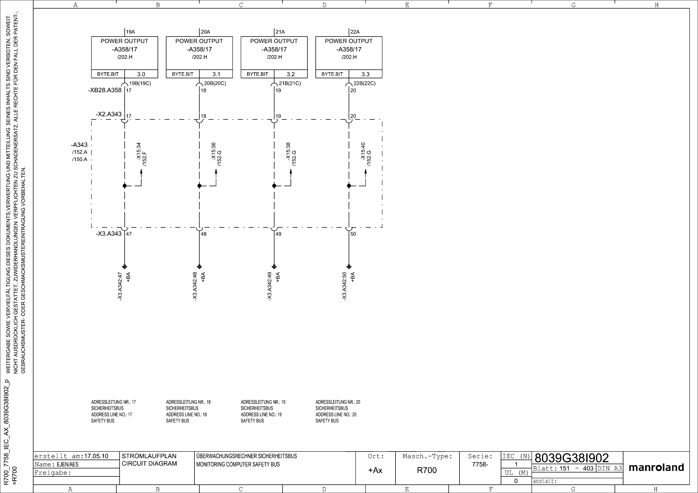

# +Ax — Sheet 151 of 403 — ÜBERWACHUNGSRECHNER SICHERHEITSBUS

**MONITORING COMPUTER SAFETY BUS**

> Part of the manroland **R700** printing press IEC/UL circuit diagrams.
> Drawing class: **Stromlaufplan / Circuit diagram** (DIN A3).
> Document `+Ax` covers the **Central control console** machine section.

## At a glance

| Field | Value |
|---|---|
| Document | `+Ax`  (8039G38I902) |
| Sheet | **151** of 403 |
| Section (DE) | ÜBERWACHUNGSRECHNER SICHERHEITSBUS |
| Section (EN) | MONITORING COMPUTER SAFETY BUS |
| Section type | CIRCUIT — Circuit diagram |
| Machine type | `R700` |
| Series | `7758` |
| Created | 17.05.10 |
| Replaces | — |
| Columns used | A, B, C, D, E |
| Path numbers | — |
| Labels on sheet | 78 |
| Cross-refs out | 10 |
| Cross-refs in | 22 |

**Previous:** [+Ax sheet 150](SHEET_0150.md) · **Next:** [+Ax sheet 152](SHEET_0152.md) · **Document TOC:** [_TOC.md](_TOC.md)  (+Ax) · **Master TOC:** [all sheets](../_MASTER_TOC.md)

## Sheet image (300 DPI, exact vector render)



_Rendered directly from the PDF vector layer at 300 DPI (1-bit), no OCR and no resampling. Use it to confirm anything ambiguous in the text below._

## Cross-references on this sheet

Each entry is a wire leaving this sheet. The printed token is `/sheet.column`; the link resolves to that sheet inside the same document.

| Ref | Target sheet | Col | Path | Destination on target | Target section | From col |
|---|---|---|---|---|---|---|
| `/202.H` | [+Ax sheet 202](SHEET_0202.md) | H | — | — | REFERENZMODUL | B |
| `/202.H` | [+Ax sheet 202](SHEET_0202.md) | H | — | — | REFERENZMODUL | C |
| `/202.H` | [+Ax sheet 202](SHEET_0202.md) | H | — | — | REFERENZMODUL | C |
| `/202.H` | [+Ax sheet 202](SHEET_0202.md) | H | — | — | REFERENZMODUL | D |
| `/152.F` | [+Ax sheet 152](SHEET_0152.md) | F | — | X15:34 | ÜBERWACHUNGSRECHNER SICHERHEITSBUS | B |
| `/152.G` | [+Ax sheet 152](SHEET_0152.md) | G | — | X15:36 | ÜBERWACHUNGSRECHNER SICHERHEITSBUS | C |
| `/152.G` | [+Ax sheet 152](SHEET_0152.md) | G | — | X15:38 | ÜBERWACHUNGSRECHNER SICHERHEITSBUS | D |
| `/152.G` | [+Ax sheet 152](SHEET_0152.md) | G | — | X15:40 | ÜBERWACHUNGSRECHNER SICHERHEITSBUS | E |
| `/152.A` | [+Ax sheet 152](SHEET_0152.md) | A | — | — | ÜBERWACHUNGSRECHNER SICHERHEITSBUS | A |
| `/150.A` | [+Ax sheet 150](SHEET_0150.md) | A | — | — | ÜBERWACHUNGSRECHNER SICHERHEITSBUS | A |

### Incoming references (sheets that point here)

Every other sheet that sends a wire to this one. `Back-ref` is the token printed on *that* sheet; `Path` is its line number.

| From sheet | Cols | Back-ref | Path | Refs | What continues there |
|---|---|---|---|---|---|
| [+Ax#150](SHEET_0150.md) | A | `/150.A` | — | 1 | — |
| [+Ax#152](SHEET_0152.md) | A, F, G | `/152.A`, `/152.F`, `/152.G` | — | 5 | X15:34; X15:36; X15:38; X15:40 |
| [+Ax#202](SHEET_0202.md) | H | `/202.H` | — | 4 | — |
| [+Ax#217](SHEET_0217.md) | G | `/217.G` | — | 4 | — |
| [+Ax#222](SHEET_0222.md) | H | `/222.H` | — | 4 | — |
| [+Ax#272](SHEET_0272.md) | C | `/272.C` | — | 4 | — |


## Devices on this sheet

| Tag | Class | Class meaning (IEC) | Col | Sub | Terminal | Sign |
|---|---|---|---|---|---|---|
| `A358/17` | A | Baugruppe / assembly, module, PC board | B | 17 | — | — |
| `A358/17` | A | Baugruppe / assembly, module, PC board | B | 17 | — | — |
| `A358/17` | A | Baugruppe / assembly, module, PC board | C | 17 | — | — |
| `A358/17` | A | Baugruppe / assembly, module, PC board | D | 17 | — | — |
| `A343` | A | Baugruppe / assembly, module, PC board | A | — | — | — |
| `X15:40` | X | Klemme / terminal, plug connector | D | — | 40 | — |
| `X15:38` | X | Klemme / terminal, plug connector | D | — | 38 | — |
| `X15:36` | X | Klemme / terminal, plug connector | C | — | 36 | — |
| `X15:34` | X | Klemme / terminal, plug connector | B | — | 34 | — |
| `XB28.A358` | — | cross-device reference | A | — | — | — |
| `3.0` | — | cross-device reference | B | — | — | — |
| `3.1` | — | cross-device reference | C | — | — | — |
| `3.2` | — | cross-device reference | D | — | — | — |
| `3.3` | — | cross-device reference | D | — | — | — |
| `X2.A343` | — | cross-device reference | A | — | — | — |
| `X3.A343` | — | cross-device reference | A | — | — | — |
| `X3.A342:47` | — | cross-device reference | B | — | 47 | — |
| `X3.A342:48` | — | cross-device reference | B | — | 48 | — |
| `X3.A342:49` | — | cross-device reference | C | — | 49 | — |
| `X3.A342:50` | — | cross-device reference | D | — | 50 | — |

## Potentials / nets

_No named potentials on this sheet._

## Wire-end annotations (grouped as printed)

A wire that continues elsewhere is annotated with a small cluster: the destination description, the path/line number `#NN`, and the `/sheet.column` cross reference. Each row below is one such cluster exactly as it is grouped on the drawing.

| Col | Y | Path | Cross-ref | Text on the wire |
|---|---|---|---|---|
| B | 50.6 | — | — | `19A` |
| C | 50.6 | — | — | `20A` |
| C | 50.6 | — | — | `21A` |
| D | 50.6 | — | — | `22A` |
| B | 65.8 | — | — | `POWER OUTPUT` |
| B | 65.8 | — | — | `POWER OUTPUT` |
| C | 65.8 | — | — | `POWER OUTPUT` |
| D | 65.8 | — | — | `POWER OUTPUT` |
| B | 79.7 | — | — | `A358/17` |
| B | 79.7 | — | — | `A358/17` |
| C | 79.7 | — | — | `A358/17` |
| D | 79.7 | — | — | `A358/17` |
| B | 93.5 | — | `/202.H` | — |
| C | 93.5 | — | `/202.H` | — |
| C | 93.5 | — | `/202.H` | — |
| D | 93.5 | — | `/202.H` | — |
| B | 122.5 | — | — | `BYTE.BIT 3.0` |
| B | 122.5 | — | — | `BYTE.BIT 3.1` |
| C | 122.5 | — | — | `BYTE.BIT 3.2` |
| D | 122.5 | — | — | `BYTE.BIT 3.3` |
| B | 138.5 | — | — | `19B(19C)` |
| C | 138.5 | — | — | `20B(20C)` |
| D | 138.5 | — | — | `21B(21C)` |
| D | 138.5 | — | — | `22B(22C)` |
| A | 149.1 | — | — | `XB28.A358 17` |
| C | 150.6 | — | — | `18 19 20` |
| C | 190.2 | — | — | `X2.A343 17 18 19 20` |
| A | 242.7 | — | — | `A343` |
| B | 243.2 | — | `/152.F` | `X15:34` |
| C | 243.2 | — | `/152.G` | `X15:36` |
| D | 243.2 | — | `/152.G` | `X15:38` |
| E | 243.2 | — | `/152.G` | `X15:40` |
| A | 255.7 | — | `/152.A`, `/150.A` | — |
| C | 394.3 | — | — | `X3.A343 47 48 49 50` |
| B | 464.6 | — | — | `X3.A342:47` |
| B | 464.6 | — | — | `X3.A342:48` |
| C | 464.6 | — | — | `X3.A342:49` |
| D | 464.6 | — | — | `X3.A342:50` |
| B | 464.9 | — | — | `+BA` |
| C | 464.9 | — | — | `+BA` |
| C | 464.9 | — | — | `+BA` |
| D | 464.9 | — | — | `+BA` |
| A | 683.8 | — | — | `SICHERHEITSBUS SAFETY BUS ADRESSLEITUNG NR.: 17 ADDRESS LINE NO.: 17` |
| B | 683.8 | — | — | `SICHERHEITSBUS SAFETY BUS ADRESSLEITUNG NR.: 18 ADDRESS LINE NO.: 18` |
| C | 683.8 | — | — | `SICHERHEITSBUS SAFETY BUS ADRESSLEITUNG NR.: 19 ADDRESS LINE NO.: 19` |
| D | 683.8 | — | — | `SICHERHEITSBUS SAFETY BUS ADRESSLEITUNG NR.: 20 ADDRESS LINE NO.: 20` |


## Reconstructed tables

This sheet carries tabular content (pin map / terminal assignment / index). The grid below was rebuilt from the drawing's own rule lines, so each row is exactly one physical row of the table.

### Table 1 — 1 data rows × 2 columns (at x=155.9, y=62.4)

| POWER | OUTPUT A358/17 /202.H |
|---|---|
| `BYTE.BIT` | `3.0` |


### Table 2 — 1 data rows × 2 columns (at x=283.5, y=62.4)

| POWER | OUTPUT A358/17 /202.H |
|---|---|
| `BYTE.BIT` | `3.1` |


### Table 3 — 1 data rows × 2 columns (at x=411.0, y=62.4)

| POWER | OUTPUT A358/17 /202.H |
|---|---|
| `BYTE.BIT` | `3.2` |


### Table 4 — 1 data rows × 2 columns (at x=538.6, y=62.4)

| POWER | OUTPUT A358/17 /202.H |
|---|---|
| `BYTE.BIT` | `3.3` |


## Notes and free text on this sheet

| Text | Col | Y (pt) |
|---|---|---|
| `19A` | B | 50.6 |
| `19B(19C)` | B | 138.51 |
| `POWER OUTPUT` | B | 65.76 |
| `BYTE.BIT` | A | 123.08 |
| `ADRESSLEITUNG NR.: 17` | A | 683.78 |
| `SICHERHEITSBUS` | A | 694.4 |
| `ADDRESS LINE NO.: 17` | A | 705.04 |
| `SAFETY BUS` | A | 715.64 |
| `20A` | C | 50.6 |
| `20B(20C)` | C | 138.51 |
| `BYTE.BIT` | B | 123.08 |
| `ADRESSLEITUNG NR.: 18` | B | 683.78 |
| `SICHERHEITSBUS` | B | 694.4 |
| `ADDRESS LINE NO.: 18` | B | 705.04 |
| `SAFETY BUS` | B | 715.64 |
| `21A` | C | 50.6 |
| `21B(21C)` | D | 138.51 |
| `POWER OUTPUT` | C | 65.76 |
| `BYTE.BIT` | C | 123.08 |
| `ADRESSLEITUNG NR.: 19` | C | 683.78 |
| `SICHERHEITSBUS` | C | 694.4 |
| `ADDRESS LINE NO.: 19` | C | 705.04 |
| `SAFETY BUS` | C | 715.64 |
| `22A` | D | 50.6 |
| `22B(22C)` | D | 138.51 |
| `POWER OUTPUT` | D | 65.76 |
| `BYTE.BIT` | D | 123.08 |
| `ADRESSLEITUNG NR.: 20` | D | 683.78 |
| `SICHERHEITSBUS` | D | 694.4 |
| `ADDRESS LINE NO.: 20` | D | 705.04 |
| `SAFETY BUS` | D | 715.64 |
| `+BA` | B | 464.88 |
| `+BA` | C | 464.88 |
| `+BA` | D | 464.88 |

## Complete label inventory (exact text from the drawing)

Every text object inside the drawing area of this sheet, in DIN reading order (column A→H, then top→bottom). This is the authoritative list: if a string is not here it is not printed on this sheet.

| Col | Y | X | Dir | Type | Text |
|---|---|---|---|---|---|
| A | 123.1 | 165.8 | → | text | `BYTE.BIT` |
| A | 149.1 | 150.2 | → | device ref | `XB28.A358` |
| A | 190.2 | 163.3 | → | device ref | `X2.A343` |
| A | 242.7 | 121.0 | → | device tag | `A343` |
| A | 255.7 | 123.3 | → | cross-reference | `/152.A` |
| A | 268.1 | 123.3 | → | cross-reference | `/150.A` |
| A | 394.3 | 163.3 | → | device ref | `X3.A343` |
| A | 683.8 | 155.9 | → | text | `ADRESSLEITUNG NR.: 17` |
| A | 694.4 | 155.6 | → | text | `SICHERHEITSBUS` |
| A | 705.0 | 155.9 | → | text | `ADDRESS LINE NO.: 17` |
| A | 715.6 | 155.6 | → | text | `SAFETY BUS` |
| B | 50.6 | 214.6 | → | text | `19A` |
| B | 65.8 | 171.8 | → | text | `POWER OUTPUT` |
| B | 65.8 | 299.3 | → | text | `POWER OUTPUT` |
| B | 79.7 | 191.2 | → | device tag | `A358/17` |
| B | 79.7 | 318.8 | → | device tag | `A358/17` |
| B | 93.5 | 200.1 | → | cross-reference | `/202.H` |
| B | 122.5 | 234.1 | → | device ref | `3.0` |
| B | 123.1 | 293.4 | → | text | `BYTE.BIT` |
| B | 138.5 | 220.3 | → | text | `19B(19C)` |
| B | 150.6 | 214.6 | → | number | `17` |
| B | 194.5 | 214.6 | → | number | `17` |
| B | 243.2 | 232.7 | ↕ | device tag | `X15:34` |
| B | 258.5 | 242.6 | ↕ | cross-reference | `/152.F` |
| B | 395.8 | 215.1 | → | number | `47` |
| B | 464.6 | 200.8 | ↕ | device ref | `X3.A342:47` |
| B | 464.6 | 328.4 | ↕ | device ref | `X3.A342:48` |
| B | 464.9 | 215.0 | ↕ | text | `+BA` |
| B | 683.8 | 283.5 | → | text | `ADRESSLEITUNG NR.: 18` |
| B | 694.4 | 283.2 | → | text | `SICHERHEITSBUS` |
| B | 705.0 | 283.5 | → | text | `ADDRESS LINE NO.: 18` |
| B | 715.6 | 283.2 | → | text | `SAFETY BUS` |
| C | 50.6 | 342.7 | → | text | `20A` |
| C | 50.6 | 470.3 | → | text | `21A` |
| C | 65.8 | 426.9 | → | text | `POWER OUTPUT` |
| C | 79.7 | 446.3 | → | device tag | `A358/17` |
| C | 93.5 | 327.7 | → | cross-reference | `/202.H` |
| C | 93.5 | 455.2 | → | cross-reference | `/202.H` |
| C | 122.5 | 362.6 | → | device ref | `3.1` |
| C | 123.1 | 420.9 | → | text | `BYTE.BIT` |
| C | 138.5 | 348.4 | → | text | `20B(20C)` |
| C | 150.6 | 342.1 | → | number | `18` |
| C | 150.6 | 469.7 | → | number | `19` |
| C | 194.5 | 342.1 | → | number | `18` |
| C | 194.5 | 469.7 | → | number | `19` |
| C | 243.2 | 360.3 | ↕ | device tag | `X15:36` |
| C | 257.1 | 370.2 | ↕ | cross-reference | `/152.G` |
| C | 395.8 | 342.7 | → | number | `48` |
| C | 395.8 | 470.3 | → | number | `49` |
| C | 464.6 | 456.0 | ↕ | device ref | `X3.A342:49` |
| C | 464.9 | 342.5 | ↕ | text | `+BA` |
| C | 464.9 | 470.1 | ↕ | text | `+BA` |
| C | 683.8 | 411.0 | → | text | `ADRESSLEITUNG NR.: 19` |
| C | 694.4 | 410.7 | → | text | `SICHERHEITSBUS` |
| C | 705.0 | 411.0 | → | text | `ADDRESS LINE NO.: 19` |
| C | 715.6 | 410.7 | → | text | `SAFETY BUS` |
| D | 50.6 | 597.8 | → | text | `22A` |
| D | 65.8 | 554.5 | → | text | `POWER OUTPUT` |
| D | 79.7 | 573.9 | → | device tag | `A358/17` |
| D | 93.5 | 582.8 | → | cross-reference | `/202.H` |
| D | 122.5 | 489.3 | → | device ref | `3.2` |
| D | 122.5 | 616.8 | → | device ref | `3.3` |
| D | 123.1 | 548.5 | → | text | `BYTE.BIT` |
| D | 138.5 | 475.9 | → | text | `21B(21C)` |
| D | 138.5 | 603.5 | → | text | `22B(22C)` |
| D | 150.6 | 597.8 | → | number | `20` |
| D | 194.5 | 597.8 | → | number | `20` |
| D | 243.2 | 487.9 | ↕ | device tag | `X15:38` |
| D | 243.2 | 615.4 | ↕ | device tag | `X15:40` |
| D | 257.1 | 497.8 | ↕ | cross-reference | `/152.G` |
| D | 395.8 | 597.8 | → | number | `50` |
| D | 464.6 | 583.5 | ↕ | device ref | `X3.A342:50` |
| D | 464.9 | 597.6 | ↕ | text | `+BA` |
| D | 683.8 | 538.6 | → | text | `ADRESSLEITUNG NR.: 20` |
| D | 694.4 | 538.3 | → | text | `SICHERHEITSBUS` |
| D | 705.0 | 538.6 | → | text | `ADDRESS LINE NO.: 20` |
| D | 715.6 | 538.3 | → | text | `SAFETY BUS` |
| E | 257.1 | 625.3 | ↕ | cross-reference | `/152.G` |

## Reading-order text block

The same content as a plain block, grouped by DIN column — convenient to paste or to match against a visual description.

```text
=== Column A ===
 123.1  165.8  text         BYTE.BIT
 149.1  150.2  devref       XB28.A358
 190.2  163.3  devref       X2.A343
 242.7  121.0  devtag       A343
 255.7  123.3  xref         /152.A
 268.1  123.3  xref         /150.A
 394.3  163.3  devref       X3.A343
 683.8  155.9  text         ADRESSLEITUNG NR.: 17
 694.4  155.6  text         SICHERHEITSBUS
 705.0  155.9  text         ADDRESS LINE NO.: 17
 715.6  155.6  text         SAFETY BUS
=== Column B ===
  50.6  214.6  text         19A
  65.8  171.8  text         POWER OUTPUT
  65.8  299.3  text         POWER OUTPUT
  79.7  191.2  devtag       A358/17
  79.7  318.8  devtag       A358/17
  93.5  200.1  xref         /202.H
 122.5  234.1  devref       3.0
 123.1  293.4  text         BYTE.BIT
 138.5  220.3  text         19B(19C)
 150.6  214.6  numeric      17
 194.5  214.6  numeric      17
 243.2  232.7  devtag       X15:34
 258.5  242.6  xref         /152.F
 395.8  215.1  numeric      47
 464.6  200.8  devref       X3.A342:47
 464.6  328.4  devref       X3.A342:48
 464.9  215.0  text         +BA
 683.8  283.5  text         ADRESSLEITUNG NR.: 18
 694.4  283.2  text         SICHERHEITSBUS
 705.0  283.5  text         ADDRESS LINE NO.: 18
 715.6  283.2  text         SAFETY BUS
=== Column C ===
  50.6  342.7  text         20A
  50.6  470.3  text         21A
  65.8  426.9  text         POWER OUTPUT
  79.7  446.3  devtag       A358/17
  93.5  327.7  xref         /202.H
  93.5  455.2  xref         /202.H
 122.5  362.6  devref       3.1
 123.1  420.9  text         BYTE.BIT
 138.5  348.4  text         20B(20C)
 150.6  342.1  numeric      18
 150.6  469.7  numeric      19
 194.5  342.1  numeric      18
 194.5  469.7  numeric      19
 243.2  360.3  devtag       X15:36
 257.1  370.2  xref         /152.G
 395.8  342.7  numeric      48
 395.8  470.3  numeric      49
 464.6  456.0  devref       X3.A342:49
 464.9  342.5  text         +BA
 464.9  470.1  text         +BA
 683.8  411.0  text         ADRESSLEITUNG NR.: 19
 694.4  410.7  text         SICHERHEITSBUS
 705.0  411.0  text         ADDRESS LINE NO.: 19
 715.6  410.7  text         SAFETY BUS
=== Column D ===
  50.6  597.8  text         22A
  65.8  554.5  text         POWER OUTPUT
  79.7  573.9  devtag       A358/17
  93.5  582.8  xref         /202.H
 122.5  489.3  devref       3.2
 122.5  616.8  devref       3.3
 123.1  548.5  text         BYTE.BIT
 138.5  475.9  text         21B(21C)
 138.5  603.5  text         22B(22C)
 150.6  597.8  numeric      20
 194.5  597.8  numeric      20
 243.2  487.9  devtag       X15:38
 243.2  615.4  devtag       X15:40
 257.1  497.8  xref         /152.G
 395.8  597.8  numeric      50
 464.6  583.5  devref       X3.A342:50
 464.9  597.6  text         +BA
 683.8  538.6  text         ADRESSLEITUNG NR.: 20
 694.4  538.3  text         SICHERHEITSBUS
 705.0  538.6  text         ADDRESS LINE NO.: 20
 715.6  538.3  text         SAFETY BUS
=== Column E ===
 257.1  625.3  xref         /152.G
```

---
_Generated from the PDF vector text layer; no OCR. Source: `R700_7758_IEC_AX_8039G38I902_p`, sheet 151._
