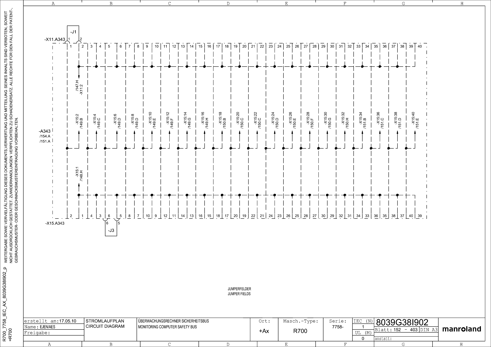

# +Ax — Sheet 152 of 403 — ÜBERWACHUNGSRECHNER SICHERHEITSBUS

**MONITORING COMPUTER SAFETY BUS**

> Part of the manroland **R700** printing press IEC/UL circuit diagrams.
> Drawing class: **Stromlaufplan / Circuit diagram** (DIN A3).
> Document `+Ax` covers the **Central control console** machine section.

## At a glance

| Field | Value |
|---|---|
| Document | `+Ax`  (8039G38I902) |
| Sheet | **152** of 403 |
| Section (DE) | ÜBERWACHUNGSRECHNER SICHERHEITSBUS |
| Section (EN) | MONITORING COMPUTER SAFETY BUS |
| Section type | CIRCUIT — Circuit diagram |
| Machine type | `R700` |
| Series | `7758` |
| Created | 17.05.10 |
| Replaces | — |
| Columns used | A, B, C, D, E, F, G |
| Path numbers | — |
| Labels on sheet | 137 |
| Cross-refs out | 24 |
| Cross-refs in | 104 |

**Previous:** [+Ax sheet 151](SHEET_0151.md) · **Next:** [+Ax sheet 153](SHEET_0153.md) · **Document TOC:** [_TOC.md](_TOC.md)  (+Ax) · **Master TOC:** [all sheets](../_MASTER_TOC.md)

## Sheet image (300 DPI, exact vector render)



_Rendered directly from the PDF vector layer at 300 DPI (1-bit), no OCR and no resampling. Use it to confirm anything ambiguous in the text below._

## Cross-references on this sheet

Each entry is a wire leaving this sheet. The printed token is `/sheet.column`; the link resolves to that sheet inside the same document.

| Ref | Target sheet | Col | Path | Destination on target | Target section | From col |
|---|---|---|---|---|---|---|
| `/147.H` | [+Ax sheet 147](SHEET_0147.md) | H | — | — | ÜBERWACHUNGSRECHNER SICHERHEITSBUS | A |
| `/149.B` | [+Ax sheet 149](SHEET_0149.md) | B | — | X11:2 X15:2 | ÜBERWACHUNGSRECHNER SICHERHEITSBUS | A |
| `/149.E` | [+Ax sheet 149](SHEET_0149.md) | E | — | X15:10 | ÜBERWACHUNGSRECHNER SICHERHEITSBUS | C |
| `/149.F` | [+Ax sheet 149](SHEET_0149.md) | F | — | X15:12 | ÜBERWACHUNGSRECHNER SICHERHEITSBUS | C |
| `/149.G` | [+Ax sheet 149](SHEET_0149.md) | G | — | X15:14 | ÜBERWACHUNGSRECHNER SICHERHEITSBUS | C |
| `/149.H` | [+Ax sheet 149](SHEET_0149.md) | H | — | X15:16 | ÜBERWACHUNGSRECHNER SICHERHEITSBUS | D |
| `/150.B` | [+Ax sheet 150](SHEET_0150.md) | B | — | X15:18 | ÜBERWACHUNGSRECHNER SICHERHEITSBUS | D |
| `/150.C` | [+Ax sheet 150](SHEET_0150.md) | C | — | X15:20 | ÜBERWACHUNGSRECHNER SICHERHEITSBUS | D |
| `/150.C` | [+Ax sheet 150](SHEET_0150.md) | C | — | X15:22 | ÜBERWACHUNGSRECHNER SICHERHEITSBUS | E |
| `/150.D` | [+Ax sheet 150](SHEET_0150.md) | D | — | X15:24 | ÜBERWACHUNGSRECHNER SICHERHEITSBUS | E |
| `/150.E` | [+Ax sheet 150](SHEET_0150.md) | E | — | X15:26 | ÜBERWACHUNGSRECHNER SICHERHEITSBUS | E |
| `/150.F` | [+Ax sheet 150](SHEET_0150.md) | F | — | X15:28 | ÜBERWACHUNGSRECHNER SICHERHEITSBUS | E |
| `/150.G` | [+Ax sheet 150](SHEET_0150.md) | G | — | X15:30 | ÜBERWACHUNGSRECHNER SICHERHEITSBUS | F |
| `/150.H` | [+Ax sheet 150](SHEET_0150.md) | H | — | X15:32 | ÜBERWACHUNGSRECHNER SICHERHEITSBUS | F |
| `/151.B` | [+Ax sheet 151](SHEET_0151.md) | B | — | X15:34 | ÜBERWACHUNGSRECHNER SICHERHEITSBUS | F |
| `/151.C` | [+Ax sheet 151](SHEET_0151.md) | C | — | X15:36 | ÜBERWACHUNGSRECHNER SICHERHEITSBUS | G |
| `/151.D` | [+Ax sheet 151](SHEET_0151.md) | D | — | X15:38 | ÜBERWACHUNGSRECHNER SICHERHEITSBUS | G |
| `/151.E` | [+Ax sheet 151](SHEET_0151.md) | E | — | X15:40 | ÜBERWACHUNGSRECHNER SICHERHEITSBUS | G |
| `/149.C` | [+Ax sheet 149](SHEET_0149.md) | C | — | X15:4 | ÜBERWACHUNGSRECHNER SICHERHEITSBUS | B |
| `/149.D` | [+Ax sheet 149](SHEET_0149.md) | D | — | X15:6 | ÜBERWACHUNGSRECHNER SICHERHEITSBUS | B |
| `/149.D` | [+Ax sheet 149](SHEET_0149.md) | D | — | X15:8 | ÜBERWACHUNGSRECHNER SICHERHEITSBUS | B |
| `/154.A` | [+Ax sheet 154](SHEET_0154.md) | A | — | — | ÜBERWACHUNGSRECHNER/ANSTEUERUNG NOT AUS | A |
| `/151.A` | [+Ax sheet 151](SHEET_0151.md) | A | — | — | ÜBERWACHUNGSRECHNER SICHERHEITSBUS | A |
| `/148.H` | [+Ax sheet 148](SHEET_0148.md) | H | — | X15:1 | ÜBERWACHUNGSRECHNER SICHERHEITSBUS | A |

### Incoming references (sheets that point here)

Every other sheet that sends a wire to this one. `Back-ref` is the token printed on *that* sheet; `Path` is its line number.

| From sheet | Cols | Back-ref | Path | Refs | What continues there |
|---|---|---|---|---|---|
| [+Ax#147](SHEET_0147.md) | F | `/147.F` | — | 1 | X3:1 X11:2 |
| [+Ax#148](SHEET_0148.md) | H | `/148.H` | — | 1 | — |
| [+Ax#149](SHEET_0149.md) | B, C, D, E, F, G, H | `/149.B`, `/149.C`, `/149.D`, `/149.E`, `/149.F`, `/149.G`, `/149.H` | — | 8 | X15:10; X15:12; X15:14; X15:16; X15:2; X15:4; X15:6; X15:8 |
| [+Ax#150](SHEET_0150.md) | B, C, D, E, F, G, H | `/150.B`, `/150.C`, `/150.D`, `/150.E`, `/150.F`, `/150.G`, `/150.H` | — | 8 | X15:18; X15:20; X15:22; X15:24; X15:26; X15:28; X15:30; X15:32 |
| [+Ax#151](SHEET_0151.md) | A, B, C, D, E | `/151.A`, `/151.B`, `/151.C`, `/151.D`, `/151.E` | — | 5 | X15:34; X15:36; X15:38; X15:40 |
| [+Ax#154](SHEET_0154.md) | A | `/154.A` | — | 1 | — |
| [+Ax#246](SHEET_0246.md) | B, C | `/246.B`, `/246.C` | — | 40 | — |
| [+Ax#252](SHEET_0252.md) | E, F | `/252.E`, `/252.F` | — | 40 | — |


## Devices on this sheet

| Tag | Class | Class meaning (IEC) | Col | Sub | Terminal | Sign |
|---|---|---|---|---|---|---|
| `A343` | A | Baugruppe / assembly, module, PC board | A | — | — | — |
| `X11:2` | X | Klemme / terminal, plug connector | A | — | 2 | — |
| `X15:2` | X | Klemme / terminal, plug connector | A | — | 2 | — |
| `X15:1` | X | Klemme / terminal, plug connector | A | — | 1 | — |
| `X15:4` | X | Klemme / terminal, plug connector | B | — | 4 | — |
| `X15:32` | X | Klemme / terminal, plug connector | F | — | 32 | — |
| `X15:30` | X | Klemme / terminal, plug connector | F | — | 30 | — |
| `X15:28` | X | Klemme / terminal, plug connector | E | — | 28 | — |
| `X15:26` | X | Klemme / terminal, plug connector | E | — | 26 | — |
| `X15:34` | X | Klemme / terminal, plug connector | F | — | 34 | — |
| `X15:40` | X | Klemme / terminal, plug connector | G | — | 40 | — |
| `X15:38` | X | Klemme / terminal, plug connector | G | — | 38 | — |
| `X15:36` | X | Klemme / terminal, plug connector | G | — | 36 | — |
| `X15:24` | X | Klemme / terminal, plug connector | E | — | 24 | — |
| `X15:12` | X | Klemme / terminal, plug connector | C | — | 12 | — |
| `X15:10` | X | Klemme / terminal, plug connector | C | — | 10 | — |
| `X15:8` | X | Klemme / terminal, plug connector | B | — | 8 | — |
| `X15:6` | X | Klemme / terminal, plug connector | B | — | 6 | — |
| `X15:14` | X | Klemme / terminal, plug connector | C | — | 14 | — |
| `X15:22` | X | Klemme / terminal, plug connector | D | — | 22 | — |
| `X15:20` | X | Klemme / terminal, plug connector | D | — | 20 | — |
| `X15:18` | X | Klemme / terminal, plug connector | D | — | 18 | — |
| `X15:16` | X | Klemme / terminal, plug connector | D | — | 16 | — |
| `J3` | J |  | B | — | — | — |
| `J1` | J |  | A | — | — | — |
| `X11.A343` | — | cross-device reference | A | — | — | — |
| `X15.A343` | — | cross-device reference | A | — | — | — |

## Potentials / nets

_No named potentials on this sheet._

## Wire-end annotations (grouped as printed)

A wire that continues elsewhere is annotated with a small cluster: the destination description, the path/line number `#NN`, and the `/sheet.column` cross reference. Each row below is one such cluster exactly as it is grouped on the drawing.

| Col | Y | Path | Cross-ref | Text on the wire |
|---|---|---|---|---|
| A | 72.6 | — | — | `J1` |
| A | 91.0 | — | — | `X11.A343 1 2` |
| D | 108.8 | — | — | `1 2 3 4 5 6 7 8 9 10 11 12 13 14 15 16 17 18 19 20 21 22 23 24 25 26 27 28 29 30 31 32 33 34 35 36 37 38 39 40` |
| A | 194.7 | — | `/147.H` | — |
| A | 204.9 | — | `/149.B` | `X15:2 X11:2` |
| C | 271.6 | — | `/149.E` | `X15:10` |
| C | 271.6 | — | `/149.F` | `X15:12` |
| C | 271.6 | — | `/149.G` | `X15:14` |
| D | 271.6 | — | `/149.H` | `X15:16` |
| D | 271.6 | — | `/150.B` | `X15:18` |
| D | 271.6 | — | `/150.C` | `X15:20` |
| E | 271.6 | — | `/150.C` | `X15:22` |
| E | 271.6 | — | `/150.D` | `X15:24` |
| E | 271.6 | — | `/150.E` | `X15:26` |
| E | 271.6 | — | `/150.F` | `X15:28` |
| F | 271.6 | — | `/150.G` | `X15:30` |
| F | 271.6 | — | `/150.H` | `X15:32` |
| F | 271.6 | — | `/151.B` | `X15:34` |
| G | 271.6 | — | `/151.C` | `X15:36` |
| G | 271.6 | — | `/151.D` | `X15:38` |
| G | 271.6 | — | `/151.E` | `X15:40` |
| B | 276.4 | — | `/149.C` | `X15:4` |
| B | 276.4 | — | `/149.D` | `X15:6` |
| B | 276.4 | — | `/149.D` | `X15:8` |
| A | 313.5 | — | — | `A343` |
| A | 326.6 | — | `/154.A`, `/151.A` | — |
| A | 403.9 | — | `/148.H` | `X15:1` |
| D | 519.8 | — | — | `2 1 4 3 6 5 8 7 10 9 12 11 14 13 16 15 18 17 20 19 22 21 24 23 26 25 28 27 30 29 32 31 34 33 36 35 38 37 40 39` |
| A | 537.5 | — | — | `X15.A343` |
| B | 537.5 | — | — | `6 5` |
| B | 554.5 | — | — | `J3` |
| D | 697.7 | — | — | `JUMPERFELDER JUMPER FIELDS` |


## Notes and free text on this sheet

| Text | Col | Y (pt) |
|---|---|---|
| `JUMPERFELDER` | D | 697.7 |
| `JUMPER FIELDS` | D | 709.7 |

## Complete label inventory (exact text from the drawing)

Every text object inside the drawing area of this sheet, in DIN reading order (column A→H, then top→bottom). This is the authoritative list: if a string is not here it is not printed on this sheet.

| Col | Y | X | Dir | Type | Text |
|---|---|---|---|---|---|
| A | 72.6 | 170.6 | → | device tag | `J1` |
| A | 91.0 | 107.7 | → | device ref | `X11.A343` |
| A | 91.0 | 165.0 | → | number | `1` |
| A | 91.0 | 193.9 | → | number | `2` |
| A | 108.7 | 169.2 | → | number | `1` |
| A | 194.7 | 183.1 | ↕ | cross-reference | `/147.H` |
| A | 204.9 | 193.0 | ↕ | device tag | `X11:2` |
| A | 276.4 | 183.1 | ↕ | device tag | `X15:2` |
| A | 286.3 | 193.0 | ↕ | cross-reference | `/149.B` |
| A | 313.5 | 94.1 | → | device tag | `A343` |
| A | 326.6 | 96.4 | → | cross-reference | `/154.A` |
| A | 339.0 | 96.4 | → | cross-reference | `/151.A` |
| A | 403.9 | 183.1 | ↕ | device tag | `X15:1` |
| A | 413.6 | 193.0 | ↕ | cross-reference | `/148.H` |
| A | 519.8 | 169.8 | → | number | `2` |
| A | 537.5 | 110.0 | → | device ref | `X15.A343` |
| B | 108.7 | 198.1 | → | number | `2` |
| B | 108.7 | 219.4 | → | number | `3` |
| B | 108.7 | 240.7 | → | number | `4` |
| B | 108.7 | 261.9 | → | number | `5` |
| B | 108.7 | 290.3 | → | number | `6` |
| B | 108.7 | 311.5 | → | number | `7` |
| B | 108.7 | 332.8 | → | number | `8` |
| B | 276.4 | 225.6 | ↕ | device tag | `X15:4` |
| B | 276.4 | 275.3 | ↕ | device tag | `X15:6` |
| B | 276.4 | 317.8 | ↕ | device tag | `X15:8` |
| B | 286.0 | 235.6 | ↕ | cross-reference | `/149.C` |
| B | 286.0 | 285.2 | ↕ | cross-reference | `/149.D` |
| B | 286.0 | 327.7 | ↕ | cross-reference | `/149.D` |
| B | 519.8 | 197.6 | → | number | `1` |
| B | 519.8 | 219.4 | → | number | `4` |
| B | 519.8 | 240.7 | → | number | `3` |
| B | 519.8 | 261.9 | → | number | `6` |
| B | 519.8 | 290.3 | → | number | `5` |
| B | 519.8 | 311.5 | → | number | `8` |
| B | 519.8 | 332.8 | → | number | `7` |
| B | 537.5 | 257.7 | → | number | `6` |
| B | 537.5 | 286.0 | → | number | `5` |
| B | 554.5 | 262.1 | → | device tag | `J3` |
| C | 108.7 | 354.0 | → | number | `9` |
| C | 108.7 | 374.7 | → | number | `10` |
| C | 108.7 | 396.0 | → | number | `11` |
| C | 108.7 | 417.3 | → | number | `12` |
| C | 108.7 | 438.5 | → | number | `13` |
| C | 108.7 | 459.8 | → | number | `14` |
| C | 271.6 | 360.3 | ↕ | device tag | `X15:10` |
| C | 271.6 | 402.8 | ↕ | device tag | `X15:12` |
| C | 271.6 | 445.3 | ↕ | device tag | `X15:14` |
| C | 285.5 | 455.2 | ↕ | cross-reference | `/149.G` |
| C | 286.3 | 370.2 | ↕ | cross-reference | `/149.E` |
| C | 286.9 | 412.7 | ↕ | cross-reference | `/149.F` |
| C | 519.8 | 353.5 | → | number | `10` |
| C | 519.8 | 375.3 | → | number | `9` |
| C | 519.8 | 396.0 | → | number | `12` |
| C | 519.8 | 417.3 | → | number | `11` |
| C | 519.8 | 438.5 | → | number | `14` |
| C | 519.8 | 459.8 | → | number | `13` |
| D | 108.7 | 481.0 | → | number | `15` |
| D | 108.7 | 502.3 | → | number | `16` |
| D | 108.7 | 523.6 | → | number | `17` |
| D | 108.7 | 544.8 | → | number | `18` |
| D | 108.7 | 566.1 | → | number | `19` |
| D | 108.7 | 587.9 | → | number | `20` |
| D | 108.7 | 609.2 | → | number | `21` |
| D | 271.6 | 487.9 | ↕ | device tag | `X15:16` |
| D | 271.6 | 530.4 | ↕ | device tag | `X15:18` |
| D | 271.6 | 572.9 | ↕ | device tag | `X15:20` |
| D | 271.6 | 615.4 | ↕ | device tag | `X15:22` |
| D | 286.0 | 497.8 | ↕ | cross-reference | `/149.H` |
| D | 286.0 | 582.8 | ↕ | cross-reference | `/150.C` |
| D | 286.3 | 540.3 | ↕ | cross-reference | `/150.B` |
| D | 519.8 | 481.0 | → | number | `16` |
| D | 519.8 | 502.3 | → | number | `15` |
| D | 519.8 | 523.6 | → | number | `18` |
| D | 519.8 | 544.8 | → | number | `17` |
| D | 519.8 | 566.6 | → | number | `20` |
| D | 519.8 | 587.3 | → | number | `19` |
| D | 519.8 | 609.2 | → | number | `22` |
| D | 697.7 | 552.5 | → | text | `JUMPERFELDER` |
| D | 709.7 | 552.5 | → | text | `JUMPER FIELDS` |
| E | 108.7 | 630.4 | → | number | `22` |
| E | 108.7 | 651.7 | → | number | `23` |
| E | 108.7 | 672.9 | → | number | `24` |
| E | 108.7 | 694.2 | → | number | `25` |
| E | 108.7 | 715.5 | → | number | `26` |
| E | 108.7 | 736.7 | → | number | `27` |
| E | 108.7 | 758.0 | → | number | `28` |
| E | 271.6 | 657.9 | ↕ | device tag | `X15:24` |
| E | 271.6 | 700.5 | ↕ | device tag | `X15:26` |
| E | 271.6 | 743.0 | ↕ | device tag | `X15:28` |
| E | 286.0 | 625.3 | ↕ | cross-reference | `/150.C` |
| E | 286.0 | 667.8 | ↕ | cross-reference | `/150.D` |
| E | 286.3 | 710.3 | ↕ | cross-reference | `/150.E` |
| E | 286.9 | 752.9 | ↕ | cross-reference | `/150.F` |
| E | 519.8 | 630.4 | → | number | `21` |
| E | 519.8 | 651.7 | → | number | `24` |
| E | 519.8 | 672.9 | → | number | `23` |
| E | 519.8 | 694.2 | → | number | `26` |
| E | 519.8 | 715.5 | → | number | `25` |
| E | 519.8 | 736.7 | → | number | `28` |
| E | 519.8 | 758.0 | → | number | `27` |
| F | 108.7 | 779.2 | → | number | `29` |
| F | 108.7 | 800.5 | → | number | `30` |
| F | 108.7 | 821.8 | → | number | `31` |
| F | 108.7 | 843.0 | → | number | `32` |
| F | 108.7 | 864.3 | → | number | `33` |
| F | 108.7 | 885.5 | → | number | `34` |
| F | 271.6 | 785.5 | ↕ | device tag | `X15:30` |
| F | 271.6 | 828.0 | ↕ | device tag | `X15:32` |
| F | 271.6 | 870.5 | ↕ | device tag | `X15:34` |
| F | 285.5 | 795.4 | ↕ | cross-reference | `/150.G` |
| F | 286.0 | 837.9 | ↕ | cross-reference | `/150.H` |
| F | 286.3 | 880.4 | ↕ | cross-reference | `/151.B` |
| F | 519.8 | 779.2 | → | number | `30` |
| F | 519.8 | 800.5 | → | number | `29` |
| F | 519.8 | 821.8 | → | number | `32` |
| F | 519.8 | 843.0 | → | number | `31` |
| F | 519.8 | 864.3 | → | number | `34` |
| F | 519.8 | 885.5 | → | number | `33` |
| G | 108.7 | 906.8 | → | number | `35` |
| G | 108.7 | 928.1 | → | number | `36` |
| G | 108.7 | 949.3 | → | number | `37` |
| G | 108.7 | 970.6 | → | number | `38` |
| G | 108.7 | 991.8 | → | number | `39` |
| G | 108.7 | 1013.1 | → | number | `40` |
| G | 271.6 | 913.1 | ↕ | device tag | `X15:36` |
| G | 271.6 | 955.6 | ↕ | device tag | `X15:38` |
| G | 271.6 | 998.1 | ↕ | device tag | `X15:40` |
| G | 286.0 | 923.0 | ↕ | cross-reference | `/151.C` |
| G | 286.0 | 965.5 | ↕ | cross-reference | `/151.D` |
| G | 286.3 | 1008.0 | ↕ | cross-reference | `/151.E` |
| G | 519.8 | 906.8 | → | number | `36` |
| G | 519.8 | 928.1 | → | number | `35` |
| G | 519.8 | 949.3 | → | number | `38` |
| G | 519.8 | 970.6 | → | number | `37` |
| G | 519.8 | 991.8 | → | number | `40` |
| G | 519.8 | 1013.1 | → | number | `39` |

## Reading-order text block

The same content as a plain block, grouped by DIN column — convenient to paste or to match against a visual description.

```text
=== Column A ===
  72.6  170.6  devtag       J1
  91.0  107.7  devref       X11.A343
  91.0  165.0  numeric      1
  91.0  193.9  numeric      2
 108.7  169.2  numeric      1
 194.7  183.1  xref         /147.H
 204.9  193.0  devtag       X11:2
 276.4  183.1  devtag       X15:2
 286.3  193.0  xref         /149.B
 313.5   94.1  devtag       A343
 326.6   96.4  xref         /154.A
 339.0   96.4  xref         /151.A
 403.9  183.1  devtag       X15:1
 413.6  193.0  xref         /148.H
 519.8  169.8  numeric      2
 537.5  110.0  devref       X15.A343
=== Column B ===
 108.7  198.1  numeric      2
 108.7  219.4  numeric      3
 108.7  240.7  numeric      4
 108.7  261.9  numeric      5
 108.7  290.3  numeric      6
 108.7  311.5  numeric      7
 108.7  332.8  numeric      8
 276.4  225.6  devtag       X15:4
 276.4  275.3  devtag       X15:6
 276.4  317.8  devtag       X15:8
 286.0  235.6  xref         /149.C
 286.0  285.2  xref         /149.D
 286.0  327.7  xref         /149.D
 519.8  197.6  numeric      1
 519.8  219.4  numeric      4
 519.8  240.7  numeric      3
 519.8  261.9  numeric      6
 519.8  290.3  numeric      5
 519.8  311.5  numeric      8
 519.8  332.8  numeric      7
 537.5  257.7  numeric      6
 537.5  286.0  numeric      5
 554.5  262.1  devtag       J3
=== Column C ===
 108.7  354.0  numeric      9
 108.7  374.7  numeric      10
 108.7  396.0  numeric      11
 108.7  417.3  numeric      12
 108.7  438.5  numeric      13
 108.7  459.8  numeric      14
 271.6  360.3  devtag       X15:10
 271.6  402.8  devtag       X15:12
 271.6  445.3  devtag       X15:14
 285.5  455.2  xref         /149.G
 286.3  370.2  xref         /149.E
 286.9  412.7  xref         /149.F
 519.8  353.5  numeric      10
 519.8  375.3  numeric      9
 519.8  396.0  numeric      12
 519.8  417.3  numeric      11
 519.8  438.5  numeric      14
 519.8  459.8  numeric      13
=== Column D ===
 108.7  481.0  numeric      15
 108.7  502.3  numeric      16
 108.7  523.6  numeric      17
 108.7  544.8  numeric      18
 108.7  566.1  numeric      19
 108.7  587.9  numeric      20
 108.7  609.2  numeric      21
 271.6  487.9  devtag       X15:16
 271.6  530.4  devtag       X15:18
 271.6  572.9  devtag       X15:20
 271.6  615.4  devtag       X15:22
 286.0  497.8  xref         /149.H
 286.0  582.8  xref         /150.C
 286.3  540.3  xref         /150.B
 519.8  481.0  numeric      16
 519.8  502.3  numeric      15
 519.8  523.6  numeric      18
 519.8  544.8  numeric      17
 519.8  566.6  numeric      20
 519.8  587.3  numeric      19
 519.8  609.2  numeric      22
 697.7  552.5  text         JUMPERFELDER
 709.7  552.5  text         JUMPER FIELDS
=== Column E ===
 108.7  630.4  numeric      22
 108.7  651.7  numeric      23
 108.7  672.9  numeric      24
 108.7  694.2  numeric      25
 108.7  715.5  numeric      26
 108.7  736.7  numeric      27
 108.7  758.0  numeric      28
 271.6  657.9  devtag       X15:24
 271.6  700.5  devtag       X15:26
 271.6  743.0  devtag       X15:28
 286.0  625.3  xref         /150.C
 286.0  667.8  xref         /150.D
 286.3  710.3  xref         /150.E
 286.9  752.9  xref         /150.F
 519.8  630.4  numeric      21
 519.8  651.7  numeric      24
 519.8  672.9  numeric      23
 519.8  694.2  numeric      26
 519.8  715.5  numeric      25
 519.8  736.7  numeric      28
 519.8  758.0  numeric      27
=== Column F ===
 108.7  779.2  numeric      29
 108.7  800.5  numeric      30
 108.7  821.8  numeric      31
 108.7  843.0  numeric      32
 108.7  864.3  numeric      33
 108.7  885.5  numeric      34
 271.6  785.5  devtag       X15:30
 271.6  828.0  devtag       X15:32
 271.6  870.5  devtag       X15:34
 285.5  795.4  xref         /150.G
 286.0  837.9  xref         /150.H
 286.3  880.4  xref         /151.B
 519.8  779.2  numeric      30
 519.8  800.5  numeric      29
 519.8  821.8  numeric      32
 519.8  843.0  numeric      31
 519.8  864.3  numeric      34
 519.8  885.5  numeric      33
=== Column G ===
 108.7  906.8  numeric      35
 108.7  928.1  numeric      36
 108.7  949.3  numeric      37
 108.7  970.6  numeric      38
 108.7  991.8  numeric      39
 108.7 1013.1  numeric      40
 271.6  913.1  devtag       X15:36
 271.6  955.6  devtag       X15:38
 271.6  998.1  devtag       X15:40
 286.0  923.0  xref         /151.C
 286.0  965.5  xref         /151.D
 286.3 1008.0  xref         /151.E
 519.8  906.8  numeric      36
 519.8  928.1  numeric      35
 519.8  949.3  numeric      38
 519.8  970.6  numeric      37
 519.8  991.8  numeric      40
 519.8 1013.1  numeric      39
```

---
_Generated from the PDF vector text layer; no OCR. Source: `R700_7758_IEC_AX_8039G38I902_p`, sheet 152._
