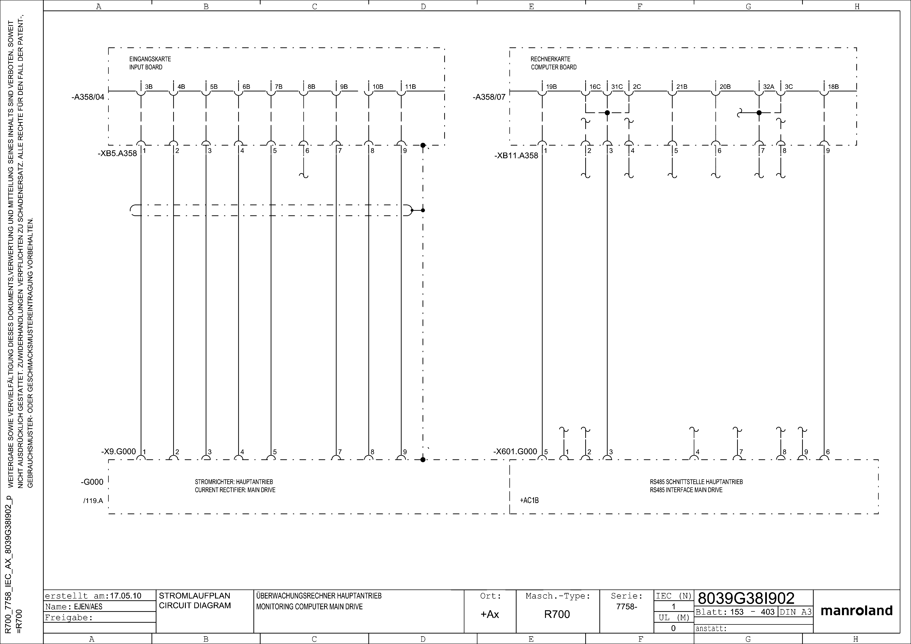

# +Ax — Sheet 153 of 403 — ÜBERWACHUNGSRECHNER HAUPTANTRIEB

**MONITORING COMPUTER MAIN DRIVE**

> Part of the manroland **R700** printing press IEC/UL circuit diagrams.
> Drawing class: **Stromlaufplan / Circuit diagram** (DIN A3).
> Document `+Ax` covers the **Central control console** machine section.

## At a glance

| Field | Value |
|---|---|
| Document | `+Ax`  (8039G38I902) |
| Sheet | **153** of 403 |
| Section (DE) | ÜBERWACHUNGSRECHNER HAUPTANTRIEB |
| Section (EN) | MONITORING COMPUTER MAIN DRIVE |
| Section type | CIRCUIT — Circuit diagram |
| Machine type | `R700` |
| Series | `7758` |
| Created | 17.05.10 |
| Replaces | — |
| Columns used | A, B, C, D, E, F, G, H |
| Path numbers | — |
| Labels on sheet | 72 |
| Cross-refs out | 1 |
| Cross-refs in | 36 |

**Previous:** [+Ax sheet 152](SHEET_0152.md) · **Next:** [+Ax sheet 154](SHEET_0154.md) · **Document TOC:** [_TOC.md](_TOC.md)  (+Ax) · **Master TOC:** [all sheets](../_MASTER_TOC.md)

## Sheet image (300 DPI, exact vector render)



_Rendered directly from the PDF vector layer at 300 DPI (1-bit), no OCR and no resampling. Use it to confirm anything ambiguous in the text below._

## Cross-references on this sheet

Each entry is a wire leaving this sheet. The printed token is `/sheet.column`; the link resolves to that sheet inside the same document.

| Ref | Target sheet | Col | Path | Destination on target | Target section | From col |
|---|---|---|---|---|---|---|
| `/119.A` | [+Ax sheet 119](SHEET_0119.md) | A | — | — | REALTIMERECHNER HAUPTANTRIEB | A |

### Incoming references (sheets that point here)

Every other sheet that sends a wire to this one. `Back-ref` is the token printed on *that* sheet; `Path` is its line number.

| From sheet | Cols | Back-ref | Path | Refs | What continues there |
|---|---|---|---|---|---|
| [+Ax#119](SHEET_0119.md) | A | `/119.A` | — | 1 | — |
| [+Ax#231](SHEET_0231.md) | F | `/231.F` | — | 9 | — |
| [+Ax#242](SHEET_0242.md) | H | `/242.H` | — | 8 | — |
| [+Ax#247](SHEET_0247.md) | B | `/247.B` | — | 9 | — |
| [+Ax#296](SHEET_0296.md) | A | `/296.A` | — | 9 | — |


## Devices on this sheet

| Tag | Class | Class meaning (IEC) | Col | Sub | Terminal | Sign |
|---|---|---|---|---|---|---|
| `A358/04` | A | Baugruppe / assembly, module, PC board | A | 04 | — | — |
| `A358/07` | A | Baugruppe / assembly, module, PC board | E | 07 | — | — |
| `G000` | G | Stromversorgung / power supply | A | — | — | — |
| `XB5.A358` | — | cross-device reference | A | — | — | — |
| `XB11.A358` | — | cross-device reference | E | — | — | — |
| `X9.G000` | — | cross-device reference | A | — | — | — |
| `X601.G000` | — | cross-device reference | E | — | — | — |

## Potentials / nets

_No named potentials on this sheet._

## Wire-end annotations (grouped as printed)

A wire that continues elsewhere is annotated with a small cluster: the destination description, the path/line number `#NN`, and the `/sheet.column` cross reference. Each row below is one such cluster exactly as it is grouped on the drawing.

| Col | Y | Path | Cross-ref | Text on the wire |
|---|---|---|---|---|
| A | 74.3 | — | — | `EINGANGSKARTE INPUT BOARD` |
| E | 74.3 | — | — | `RECHNERKARTE` |
| E | 85.0 | — | — | `COMPUTER BOARD` |
| E | 109.9 | — | — | `3B 4B 5B 6B 7B 8B 9B 10B 11B 19B 16C 31C 2C 21B 20B 32A 3C 18B` |
| A | 122.2 | — | — | `A358/04` |
| E | 122.2 | — | — | `A358/07` |
| C | 192.6 | — | — | `XB5.A358 1 2 3 4 5 6 7 8 9 '` |
| E | 193.1 | — | — | `XB11.A358 1` |
| G | 193.1 | — | — | `2 3 4 5 6 7 8 9` |
| E | 584.5 | — | — | `2 3 4 5 7 8 9 ' X601.G000 5 1 2 3 4 7 8 9 6` |
| A | 585.7 | — | — | `X9.G000 1` |
| A | 625.4 | — | — | `G000` |
| B | 627.1 | — | — | `STROMRICHTER: HAUPTANTRIEB CURRENT RECTIFIER: MAIN DRIVE` |
| G | 627.1 | — | — | `RS485 SCHNITTSTELLE HAUPTANTRIEB RS485 INTERFACE MAIN DRIVE` |
| E | 650.7 | — | — | `+AC1B` |
| A | 650.8 | — | `/119.A` | — |


## Notes and free text on this sheet

| Text | Col | Y (pt) |
|---|---|---|
| `EINGANGSKARTE` | A | 74.31 |
| `INPUT BOARD` | A | 84.95 |
| `RECHNERKARTE` | E | 74.33 |
| `COMPUTER BOARD` | E | 84.98 |
| `STROMRICHTER: HAUPTANTRIEB` | B | 627.09 |
| `CURRENT RECTIFIER: MAIN DRIVE` | B | 637.72 |
| `3B` | A | 109.9 |
| `4B` | B | 109.9 |
| `5B` | B | 109.9 |
| `6B` | B | 109.9 |
| `7B` | C | 109.9 |
| `8B` | C | 109.9 |
| `9B` | C | 109.9 |
| `10B` | D | 109.9 |
| `11B` | D | 109.9 |
| `19B` | E | 109.9 |
| `16C` | F | 109.87 |
| `31C` | F | 109.87 |
| `2C` | F | 109.86 |
| `21B` | F | 109.9 |
| `20B` | G | 109.9 |
| `32A` | G | 109.9 |
| `3C` | G | 109.86 |
| `18B` | H | 109.9 |
| `RS485 SCHNITTSTELLE HAUPTANTRIEB` | G | 627.09 |
| `RS485 INTERFACE MAIN DRIVE` | F | 637.71 |
| `+AC1B` | E | 650.67 |

## Complete label inventory (exact text from the drawing)

Every text object inside the drawing area of this sheet, in DIN reading order (column A→H, then top→bottom). This is the authoritative list: if a string is not here it is not printed on this sheet.

| Col | Y | X | Dir | Type | Text |
|---|---|---|---|---|---|
| A | 74.3 | 169.2 | → | text | `EINGANGSKARTE` |
| A | 85.0 | 169.2 | → | text | `INPUT BOARD` |
| A | 109.9 | 189.6 | → | text | `3B` |
| A | 122.2 | 93.5 | → | device tag | `A358/04` |
| A | 193.1 | 186.2 | → | number | `1` |
| A | 195.9 | 127.8 | → | device ref | `XB5.A358` |
| A | 585.7 | 132.4 | → | device ref | `X9.G000` |
| A | 587.1 | 186.2 | → | number | `1` |
| A | 625.3 | 105.7 | → | device tag | `G000` |
| A | 650.8 | 109.1 | → | cross-reference | `/119.A` |
| B | 109.9 | 232.2 | → | text | `4B` |
| B | 109.9 | 274.7 | → | text | `5B` |
| B | 109.9 | 317.2 | → | text | `6B` |
| B | 193.1 | 229.3 | → | number | `2` |
| B | 193.1 | 271.8 | → | number | `3` |
| B | 193.1 | 314.4 | → | number | `4` |
| B | 587.1 | 229.3 | → | number | `2` |
| B | 587.1 | 271.8 | → | number | `3` |
| B | 587.1 | 314.4 | → | number | `4` |
| B | 627.1 | 254.8 | → | text | `STROMRICHTER: HAUPTANTRIEB` |
| B | 637.7 | 254.8 | → | text | `CURRENT RECTIFIER: MAIN DRIVE` |
| C | 109.9 | 359.4 | → | text | `7B` |
| C | 109.9 | 402.2 | → | text | `8B` |
| C | 109.9 | 444.8 | → | text | `9B` |
| C | 193.1 | 356.9 | → | number | `5` |
| C | 193.1 | 399.4 | → | number | `6` |
| C | 193.1 | 441.9 | → | number | `7` |
| C | 587.1 | 356.9 | → | number | `5` |
| C | 587.1 | 441.9 | → | number | `7` |
| D | 109.9 | 486.7 | → | text | `10B` |
| D | 109.9 | 529.2 | → | text | `11B` |
| D | 192.6 | 558.1 | → | other | `'` |
| D | 193.1 | 484.4 | → | number | `8` |
| D | 193.1 | 527.0 | → | number | `9` |
| D | 584.5 | 558.1 | → | other | `'` |
| D | 587.1 | 484.4 | → | number | `8` |
| D | 587.1 | 527.0 | → | number | `9` |
| E | 74.3 | 693.6 | → | text | `RECHNERKARTE` |
| E | 85.0 | 694.2 | → | text | `COMPUTER BOARD` |
| E | 109.9 | 713.5 | → | text | `19B` |
| E | 122.2 | 618.0 | → | device tag | `A358/07` |
| E | 193.1 | 710.6 | → | number | `1` |
| E | 198.7 | 646.3 | → | device ref | `XB11.A358` |
| E | 585.7 | 644.9 | → | device ref | `X601.G000` |
| E | 587.1 | 711.2 | → | number | `5` |
| E | 587.1 | 739.0 | → | number | `1` |
| E | 650.7 | 679.7 | → | text | `+AC1B` |
| F | 109.9 | 770.2 | → | text | `16C` |
| F | 109.9 | 799.1 | → | text | `31C` |
| F | 109.9 | 827.4 | → | text | `2C` |
| F | 109.9 | 884.1 | → | text | `21B` |
| F | 193.1 | 767.9 | → | number | `2` |
| F | 193.1 | 796.3 | → | number | `3` |
| F | 193.1 | 824.6 | → | number | `4` |
| F | 193.1 | 881.3 | → | number | `5` |
| F | 587.1 | 767.9 | → | number | `2` |
| F | 587.1 | 796.3 | → | number | `3` |
| F | 637.7 | 849.5 | → | text | `RS485 INTERFACE MAIN DRIVE` |
| G | 109.9 | 940.8 | → | text | `20B` |
| G | 109.9 | 997.5 | → | text | `32A` |
| G | 109.9 | 1025.9 | → | text | `3C` |
| G | 193.1 | 938.0 | → | number | `6` |
| G | 193.1 | 994.7 | → | number | `7` |
| G | 193.1 | 1023.0 | → | number | `8` |
| G | 587.1 | 909.6 | → | number | `4` |
| G | 587.1 | 966.3 | → | number | `7` |
| G | 587.1 | 1023.0 | → | number | `8` |
| G | 627.1 | 849.5 | → | text | `RS485 SCHNITTSTELLE HAUPTANTRIEB` |
| H | 109.9 | 1082.0 | → | text | `18B` |
| H | 193.1 | 1079.7 | → | number | `9` |
| H | 587.1 | 1051.4 | → | number | `9` |
| H | 587.1 | 1079.7 | → | number | `6` |

## Reading-order text block

The same content as a plain block, grouped by DIN column — convenient to paste or to match against a visual description.

```text
=== Column A ===
  74.3  169.2  text         EINGANGSKARTE
  85.0  169.2  text         INPUT BOARD
 109.9  189.6  text         3B
 122.2   93.5  devtag       A358/04
 193.1  186.2  numeric      1
 195.9  127.8  devref       XB5.A358
 585.7  132.4  devref       X9.G000
 587.1  186.2  numeric      1
 625.3  105.7  devtag       G000
 650.8  109.1  xref         /119.A
=== Column B ===
 109.9  232.2  text         4B
 109.9  274.7  text         5B
 109.9  317.2  text         6B
 193.1  229.3  numeric      2
 193.1  271.8  numeric      3
 193.1  314.4  numeric      4
 587.1  229.3  numeric      2
 587.1  271.8  numeric      3
 587.1  314.4  numeric      4
 627.1  254.8  text         STROMRICHTER: HAUPTANTRIEB
 637.7  254.8  text         CURRENT RECTIFIER: MAIN DRIVE
=== Column C ===
 109.9  359.4  text         7B
 109.9  402.2  text         8B
 109.9  444.8  text         9B
 193.1  356.9  numeric      5
 193.1  399.4  numeric      6
 193.1  441.9  numeric      7
 587.1  356.9  numeric      5
 587.1  441.9  numeric      7
=== Column D ===
 109.9  486.7  text         10B
 109.9  529.2  text         11B
 192.6  558.1  other        `
 193.1  484.4  numeric      8
 193.1  527.0  numeric      9
 584.5  558.1  other        `
 587.1  484.4  numeric      8
 587.1  527.0  numeric      9
=== Column E ===
  74.3  693.6  text         RECHNERKARTE
  85.0  694.2  text         COMPUTER BOARD
 109.9  713.5  text         19B
 122.2  618.0  devtag       A358/07
 193.1  710.6  numeric      1
 198.7  646.3  devref       XB11.A358
 585.7  644.9  devref       X601.G000
 587.1  711.2  numeric      5
 587.1  739.0  numeric      1
 650.7  679.7  text         +AC1B
=== Column F ===
 109.9  770.2  text         16C
 109.9  799.1  text         31C
 109.9  827.4  text         2C
 109.9  884.1  text         21B
 193.1  767.9  numeric      2
 193.1  796.3  numeric      3
 193.1  824.6  numeric      4
 193.1  881.3  numeric      5
 587.1  767.9  numeric      2
 587.1  796.3  numeric      3
 637.7  849.5  text         RS485 INTERFACE MAIN DRIVE
=== Column G ===
 109.9  940.8  text         20B
 109.9  997.5  text         32A
 109.9 1025.9  text         3C
 193.1  938.0  numeric      6
 193.1  994.7  numeric      7
 193.1 1023.0  numeric      8
 587.1  909.6  numeric      4
 587.1  966.3  numeric      7
 587.1 1023.0  numeric      8
 627.1  849.5  text         RS485 SCHNITTSTELLE HAUPTANTRIEB
=== Column H ===
 109.9 1082.0  text         18B
 193.1 1079.7  numeric      9
 587.1 1051.4  numeric      9
 587.1 1079.7  numeric      6
```

---
_Generated from the PDF vector text layer; no OCR. Source: `R700_7758_IEC_AX_8039G38I902_p`, sheet 153._
