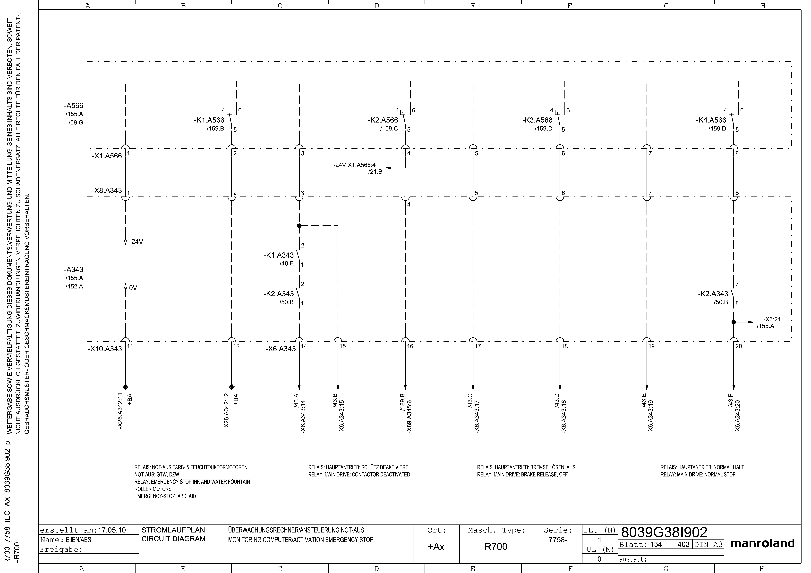

# +Ax — Sheet 154 of 403 — ÜBERWACHUNGSRECHNER/ANSTEUERUNG NOT AUS

**MONITORING COMPUTER/ACTIVATION EMERGENCY STOP**

> Part of the manroland **R700** printing press IEC/UL circuit diagrams.
> Drawing class: **Stromlaufplan / Circuit diagram** (DIN A3).
> Document `+Ax` covers the **Central control console** machine section.

## At a glance

| Field | Value |
|---|---|
| Document | `+Ax`  (8039G38I902) |
| Sheet | **154** of 403 |
| Section (DE) | ÜBERWACHUNGSRECHNER/ANSTEUERUNG NOT AUS |
| Section (EN) | MONITORING COMPUTER/ACTIVATION EMERGENCY STOP |
| Section type | CIRCUIT — Circuit diagram |
| Machine type | `R700` |
| Series | `7758` |
| Created | 17.05.10 |
| Replaces | — |
| Columns used | A, B, C, D, E, F, G, H |
| Path numbers | — |
| Labels on sheet | 102 |
| Cross-refs out | 20 |
| Cross-refs in | 45 |

**Previous:** [+Ax sheet 153](SHEET_0153.md) · **Next:** [+Ax sheet 155](SHEET_0155.md) · **Document TOC:** [_TOC.md](_TOC.md)  (+Ax) · **Master TOC:** [all sheets](../_MASTER_TOC.md)

## Sheet image (300 DPI, exact vector render)



_Rendered directly from the PDF vector layer at 300 DPI (1-bit), no OCR and no resampling. Use it to confirm anything ambiguous in the text below._

## Cross-references on this sheet

Each entry is a wire leaving this sheet. The printed token is `/sheet.column`; the link resolves to that sheet inside the same document.

| Ref | Target sheet | Col | Path | Destination on target | Target section | From col |
|---|---|---|---|---|---|---|
| `/155.A` | [+Ax sheet 155](SHEET_0155.md) | A | — | — | ÜBERWACHUNGSRECHNER/ANSTEUERUNG NOT AUS | A |
| `/59.G` | [+Ax sheet 59](SHEET_0059.md) | G | — | — | DRUCKLUFTANLAGE | A |
| `/159.B` | [+Ax sheet 159](SHEET_0159.md) | B | — | — | ÜBERWACHUNGSRECHNER/ANSTEUERUNG NOT AUS | B |
| `/159.C` | [+Ax sheet 159](SHEET_0159.md) | C | — | — | ÜBERWACHUNGSRECHNER/ANSTEUERUNG NOT AUS | D |
| `/159.D` | [+Ax sheet 159](SHEET_0159.md) | D | — | — | ÜBERWACHUNGSRECHNER/ANSTEUERUNG NOT AUS | F |
| `/159.D` | [+Ax sheet 159](SHEET_0159.md) | D | — | — | ÜBERWACHUNGSRECHNER/ANSTEUERUNG NOT AUS | H |
| `/21.B` | [+Ax sheet 21](SHEET_0021.md) | B | — | 24V.X1.A566:4 | SPANNUNGSVERSORGUNG, SCHALTSCHRANKBELÜFTUNG | D |
| `/48.E` | [+Ax sheet 48](SHEET_0048.md) | E | — | — | NOT AUS | C |
| `/155.A` | [+Ax sheet 155](SHEET_0155.md) | A | — | — | ÜBERWACHUNGSRECHNER/ANSTEUERUNG NOT AUS | A |
| `/152.A` | [+Ax sheet 152](SHEET_0152.md) | A | — | — | ÜBERWACHUNGSRECHNER SICHERHEITSBUS | A |
| `/50.B` | [+Ax sheet 50](SHEET_0050.md) | B | — | — | STOP SICHERN | C |
| `/50.B` | [+Ax sheet 50](SHEET_0050.md) | B | — | — | STOP SICHERN | H |
| `/155.A` | [+Ax sheet 155](SHEET_0155.md) | A | — | — | ÜBERWACHUNGSRECHNER/ANSTEUERUNG NOT AUS | H |
| `/43.E` | [+Ax sheet 43](SHEET_0043.md) | E | — | — | HAUPTANTRIEB | G |
| `/43.B` | [+Ax sheet 43](SHEET_0043.md) | B | — | — | HAUPTANTRIEB | D |
| `/189.B` | [+Ax sheet 189](SHEET_0189.md) | B | — | — | RESERVE | D |
| `/43.C` | [+Ax sheet 43](SHEET_0043.md) | C | — | — | HAUPTANTRIEB | E |
| `/43.D` | [+Ax sheet 43](SHEET_0043.md) | D | — | — | HAUPTANTRIEB | F |
| `/43.F` | [+Ax sheet 43](SHEET_0043.md) | F | — | — | HAUPTANTRIEB | H |
| `/43.A` | [+Ax sheet 43](SHEET_0043.md) | A | — | — | HAUPTANTRIEB | C |

### Incoming references (sheets that point here)

Every other sheet that sends a wire to this one. `Back-ref` is the token printed on *that* sheet; `Path` is its line number.

| From sheet | Cols | Back-ref | Path | Refs | What continues there |
|---|---|---|---|---|---|
| [+Ax#21](SHEET_0021.md) | B | `/21.B` | — | 1 | 24V.X1.A566:4 |
| [+Ax#43](SHEET_0043.md) | A, B, C, D, F | `/43.A`, `/43.B`, `/43.C`, `/43.D`, `/43.F` | — | 6 | X6.A343:14; X6.A343:15; X6.A343:17; X6.A343:18; X6.A343:19; X6.A343:20 |
| [+Ax#48](SHEET_0048.md) | E | `/48.E` | — | 1 | — |
| [+Ax#50](SHEET_0050.md) | B | `/50.B` | — | 2 | — |
| [+Ax#59](SHEET_0059.md) | F | `/59.F` | — | 1 | — |
| [+Ax#152](SHEET_0152.md) | A | `/152.A` | — | 1 | — |
| [+Ax#155](SHEET_0155.md) | A | `/155.A` | — | 3 | X6:21 |
| [+Ax#159](SHEET_0159.md) | B, C, D | `/159.B`, `/159.C`, `/159.D` | — | 4 | — |
| [+Ax#189](SHEET_0189.md) | B | `/189.B` | — | 1 | — |
| [+Ax#209](SHEET_0209.md) | E | `/209.E` | — | 8 | — |
| [+Ax#233](SHEET_0233.md) | E | `/233.E` | — | 7 | — |
| [+Ax#237](SHEET_0237.md) | G | `/237.G` | — | 8 | — |
| [+Ax#243](SHEET_0243.md) | H | `/243.H` | — | 2 | — |


## Devices on this sheet

| Tag | Class | Class meaning (IEC) | Col | Sub | Terminal | Sign |
|---|---|---|---|---|---|---|
| `A566` | A | Baugruppe / assembly, module, PC board | A | — | — | — |
| `A343` | A | Baugruppe / assembly, module, PC board | A | — | — | — |
| `X6:21` | X | Klemme / terminal, plug connector | H | — | 21 | — |
| `X8.A343` | — | cross-device reference | A | — | — | — |
| `X6.A343` | — | cross-device reference | C | — | — | — |
| `X10.A343` | — | cross-device reference | A | — | — | — |
| `X1.A566` | — | cross-device reference | A | — | — | — |
| `K3.A566` | — | cross-device reference | F | — | — | — |
| `K4.A566` | — | cross-device reference | G | — | — | — |
| `K1.A566` | — | cross-device reference | B | — | — | — |
| `X26.A342:11` | — | cross-device reference | A | — | 11 | — |
| `X26.A342:12` | — | cross-device reference | B | — | 12 | — |
| `K1.A343` | — | cross-device reference | C | — | — | — |
| `K2.A343` | — | cross-device reference | C | — | — | — |
| `K2.A343` | — | cross-device reference | G | — | — | — |
| `K2.A566` | — | cross-device reference | D | — | — | — |
| `X6.A343:14` | — | cross-device reference | C | — | 14 | — |
| `X6.A343:18` | — | cross-device reference | F | — | 18 | — |
| `X6.A343:17` | — | cross-device reference | E | — | 17 | — |
| `X6.A343:15` | — | cross-device reference | D | — | 15 | — |
| `X6.A343:20` | — | cross-device reference | H | — | 20 | — |
| `X6.A343:19` | — | cross-device reference | G | — | 19 | — |
| `X89.A345:6` | — | cross-device reference | D | — | 6 | — |

## Potentials / nets

| Potential | Count | Columns | Attached devices | Terminals |
|---|---|---|---|---|
| `0V` | 1 | A | — | — |
| `24V` | 2 | B, D | `A566`, `X1` | `4` |


A potential such as `L24+/4` or `M24+` is a named supply/return rail; every place it appears on this sheet is electrically common.

## Wire-end annotations (grouped as printed)

A wire that continues elsewhere is annotated with a small cluster: the destination description, the path/line number `#NN`, and the `/sheet.column` cross reference. Each row below is one such cluster exactly as it is grouped on the drawing.

| Col | Y | Path | Cross-ref | Text on the wire |
|---|---|---|---|---|
| A | 150.5 | — | — | `A566` |
| B | 158.4 | — | — | `K1.A566 6` |
| B | 158.4 | — | — | `4` |
| D | 158.4 | — | — | `K2.A566 6` |
| D | 158.4 | — | — | `4` |
| F | 158.4 | — | — | `K3.A566 6` |
| F | 158.4 | — | — | `4` |
| H | 158.4 | — | — | `K4.A566 6` |
| H | 158.4 | — | — | `4` |
| A | 163.6 | — | `/155.A` | — |
| A | 176.0 | — | `/59.G` | — |
| B | 184.9 | — | `/159.B` | — |
| D | 184.9 | — | `/159.C` | — |
| F | 184.9 | — | `/159.D` | — |
| H | 184.9 | — | `/159.D` | — |
| C | 186.7 | — | — | `5` |
| D | 186.7 | — | — | `5` |
| F | 186.7 | — | — | `5` |
| H | 186.7 | — | — | `5` |
| A | 221.4 | — | — | `X1.A566 1` |
| C | 221.4 | — | — | `2` |
| E | 221.4 | — | — | `3 5 6 7 8` |
| D | 221.4 | — | — | `4` |
| D | 238.4 | — | `/21.B` | `24V.X1.A566:4` |
| D | 275.3 | — | — | `X8.A343 1 3 5 6 7` |
| C | 279.5 | — | — | `2` |
| H | 279.5 | — | — | `8` |
| D | 296.5 | — | — | `4` |
| B | 350.7 | — | — | `24V` |
| C | 356.8 | — | — | `2` |
| C | 370.2 | — | — | `K1.A343 1` |
| C | 383.3 | — | `/48.E` | — |
| A | 391.5 | — | — | `A343` |
| A | 404.6 | — | `/155.A`, `/152.A` | — |
| C | 413.5 | — | — | `2` |
| H | 413.5 | — | — | `7` |
| A | 418.8 | — | — | `0V` |
| C | 426.9 | — | — | `K2.A343 1` |
| H | 426.9 | — | — | `K2.A343 8` |
| C | 440.0 | — | `/50.B` | — |
| H | 440.0 | — | `/50.B` | — |
| H | 465.2 | — | — | `X6:21` |
| H | 475.1 | — | `/155.A` | — |
| D | 504.9 | — | — | `X10.A343 11 20` |
| C | 504.9 | — | — | `12` |
| E | 504.9 | — | — | `X6.A343 14 15 17 18 19` |
| D | 504.9 | — | — | `16` |
| A | 576.6 | — | — | `X26.A342:11` |
| B | 577.7 | — | — | `X26.A342:12` |
| G | 577.7 | — | `/43.E` | — |
| D | 578.0 | — | `/43.B` | — |
| D | 578.0 | — | `/189.B` | — |
| E | 578.0 | — | `/43.C` | — |
| F | 578.0 | — | `/43.D` | — |
| H | 578.0 | — | `/43.F` | — |
| A | 578.3 | — | — | `+BA` |
| C | 578.3 | — | — | `+BA` |
| C | 578.3 | — | `/43.A` | — |
| C | 587.9 | — | — | `X6.A343:14` |
| D | 587.9 | — | — | `X6.A343:15` |
| D | 587.9 | — | — | `X89.A345:6` |
| E | 587.9 | — | — | `X6.A343:17` |
| F | 587.9 | — | — | `X6.A343:18` |
| G | 587.9 | — | — | `X6.A343:19` |
| H | 587.9 | — | — | `X6.A343:20` |
| B | 683.8 | — | — | `RELAIS: NOT AUS FARB & FEUCHTDUKTORMOTOREN NOT AUS: GTW, DZW RELAY: EMERGENCY STOP INK AND WATER FOUNTAIN ROLLER MOTORS EMERGENCY STOP: ABD, AID` |
| D | 683.8 | — | — | `RELAIS: HAUPTANTRIEB: SCHÜTZ DEAKTIVIERT RELAY: MAIN DRIVE: CONTACTOR DEACTIVATED` |
| F | 683.8 | — | — | `RELAIS: HAUPTANTRIEB: BREMSE LÖSEN, AUS RELAY: MAIN DRIVE: BRAKE RELEASE, OFF RELAIS: HAUPTANTRIEB: NORMAL HALT RELAY: MAIN DRIVE: NORMAL STOP` |


## Notes and free text on this sheet

| Text | Col | Y (pt) |
|---|---|---|
| `+BA` | A | 578.27 |
| `+BA` | C | 578.27 |
| `RELAIS: NOT AUS FARB & FEUCHTDUKTORMOTOREN` | B | 683.78 |
| `NOT AUS: GTW, DZW` | B | 694.35 |
| `RELAY: EMERGENCY STOP INK AND WATER FOUNTAIN` | B | 705.03 |
| `ROLLER MOTORS` | B | 715.68 |
| `EMERGENCY STOP: ABD, AID` | B | 726.3 |
| `RELAIS: HAUPTANTRIEB: SCHÜTZ DEAKTIVIERT` | D | 683.77 |
| `RELAY: MAIN DRIVE: CONTACTOR DEACTIVATED` | D | 694.41 |
| `RELAIS: HAUPTANTRIEB: NORMAL HALT` | G | 683.78 |
| `RELAY: MAIN DRIVE: NORMAL STOP` | G | 694.41 |
| `RELAIS: HAUPTANTRIEB: BREMSE LÖSEN, AUS` | F | 683.76 |
| `RELAY: MAIN DRIVE: BRAKE RELEASE, OFF` | F | 694.39 |

## Complete label inventory (exact text from the drawing)

Every text object inside the drawing area of this sheet, in DIN reading order (column A→H, then top→bottom). This is the authoritative list: if a string is not here it is not printed on this sheet.

| Col | Y | X | Dir | Type | Text |
|---|---|---|---|---|---|
| A | 150.5 | 94.1 | → | device tag | `A566` |
| A | 163.6 | 96.4 | → | cross-reference | `/155.A` |
| A | 176.0 | 100.9 | → | cross-reference | `/59.G` |
| A | 221.4 | 186.2 | → | number | `1` |
| A | 224.2 | 134.9 | → | device ref | `X1.A566` |
| A | 275.3 | 134.9 | → | device ref | `X8.A343` |
| A | 279.5 | 186.2 | → | number | `1` |
| A | 391.5 | 94.1 | → | device tag | `A343` |
| A | 404.6 | 96.4 | → | cross-reference | `/155.A` |
| A | 417.0 | 96.4 | → | cross-reference | `/152.A` |
| A | 418.7 | 189.6 | → | potential | `0V` |
| A | 504.9 | 186.2 | → | number | `11` |
| A | 507.7 | 129.0 | → | device ref | `X10.A343` |
| A | 576.6 | 172.5 | ↕ | device ref | `X26.A342:11` |
| A | 578.3 | 186.6 | ↕ | text | `+BA` |
| B | 158.4 | 325.7 | → | number | `4` |
| B | 171.8 | 285.2 | → | device ref | `K1.A566` |
| B | 184.9 | 303.6 | → | cross-reference | `/159.B` |
| B | 350.7 | 189.6 | → | potential | `24V` |
| B | 577.7 | 328.4 | ↕ | device ref | `X26.A342:12` |
| B | 683.8 | 197.6 | → | text | `RELAIS: NOT AUS FARB & FEUCHTDUKTORMOTOREN` |
| B | 694.4 | 197.6 | → | text | `NOT AUS: GTW, DZW` |
| B | 705.0 | 197.6 | → | text | `RELAY: EMERGENCY STOP INK AND WATER FOUNTAIN` |
| B | 715.7 | 197.6 | → | text | `ROLLER MOTORS` |
| B | 726.3 | 197.6 | → | text | `EMERGENCY STOP: ABD, AID` |
| C | 158.4 | 349.8 | → | number | `6` |
| C | 186.7 | 342.7 | → | number | `5` |
| C | 221.4 | 342.7 | → | number | `2` |
| C | 221.4 | 441.9 | → | number | `3` |
| C | 279.5 | 342.7 | → | number | `2` |
| C | 279.5 | 441.9 | → | number | `3` |
| C | 356.8 | 441.9 | → | number | `2` |
| C | 370.2 | 387.2 | → | device ref | `K1.A343` |
| C | 383.3 | 410.7 | → | cross-reference | `/48.E` |
| C | 385.1 | 441.4 | → | number | `1` |
| C | 413.5 | 441.9 | → | number | `2` |
| C | 426.9 | 387.2 | → | device ref | `K2.A343` |
| C | 440.0 | 410.5 | → | cross-reference | `/50.B` |
| C | 441.8 | 441.4 | → | number | `1` |
| C | 504.9 | 342.1 | → | number | `12` |
| C | 504.9 | 441.4 | → | number | `14` |
| C | 507.7 | 390.0 | → | device ref | `X6.A343` |
| C | 578.3 | 342.5 | ↕ | text | `+BA` |
| C | 578.3 | 431.1 | ↕ | cross-reference | `/43.A` |
| C | 587.9 | 441.1 | ↕ | device ref | `X6.A343:14` |
| D | 158.4 | 580.8 | → | number | `4` |
| D | 158.4 | 604.9 | → | number | `6` |
| D | 171.8 | 540.3 | → | device ref | `K2.A566` |
| D | 184.9 | 558.4 | → | cross-reference | `/159.C` |
| D | 186.7 | 597.8 | → | number | `5` |
| D | 221.4 | 597.8 | → | number | `4` |
| D | 238.4 | 489.5 | → | potential | `24V.X1.A566:4` |
| D | 248.3 | 540.9 | → | cross-reference | `/21.B` |
| D | 296.5 | 597.8 | → | number | `4` |
| D | 504.9 | 498.0 | → | number | `15` |
| D | 504.9 | 597.3 | → | number | `16` |
| D | 578.0 | 487.8 | ↕ | cross-reference | `/43.B` |
| D | 578.0 | 587.0 | ↕ | cross-reference | `/189.B` |
| D | 587.9 | 497.8 | ↕ | device ref | `X6.A343:15` |
| D | 587.9 | 597.0 | ↕ | device ref | `X89.A345:6` |
| D | 683.8 | 452.7 | → | text | `RELAIS: HAUPTANTRIEB: SCHÜTZ DEAKTIVIERT` |
| D | 694.4 | 452.7 | → | text | `RELAY: MAIN DRIVE: CONTACTOR DEACTIVATED` |
| E | 221.4 | 697.0 | → | number | `5` |
| E | 279.5 | 697.0 | → | number | `5` |
| E | 504.9 | 696.5 | → | number | `17` |
| E | 578.0 | 686.3 | ↕ | cross-reference | `/43.C` |
| E | 587.9 | 696.2 | ↕ | device ref | `X6.A343:17` |
| F | 158.4 | 807.6 | → | number | `4` |
| F | 158.4 | 831.7 | → | number | `6` |
| F | 171.8 | 767.1 | → | device ref | `K3.A566` |
| F | 184.9 | 785.2 | → | cross-reference | `/159.D` |
| F | 186.7 | 824.6 | → | number | `5` |
| F | 221.4 | 824.6 | → | number | `6` |
| F | 279.5 | 824.6 | → | number | `6` |
| F | 504.9 | 824.0 | → | number | `18` |
| F | 578.0 | 813.8 | ↕ | cross-reference | `/43.D` |
| F | 587.9 | 823.7 | ↕ | device ref | `X6.A343:18` |
| F | 683.8 | 700.7 | → | text | `RELAIS: HAUPTANTRIEB: BREMSE LÖSEN, AUS` |
| F | 694.4 | 700.7 | → | text | `RELAY: MAIN DRIVE: BRAKE RELEASE, OFF` |
| G | 171.8 | 1022.2 | → | device ref | `K4.A566` |
| G | 221.4 | 952.2 | → | number | `7` |
| G | 279.5 | 952.2 | → | number | `7` |
| G | 426.9 | 1025.0 | → | device ref | `K2.A343` |
| G | 504.9 | 951.6 | → | number | `19` |
| G | 577.7 | 941.4 | ↕ | cross-reference | `/43.E` |
| G | 587.9 | 951.3 | ↕ | device ref | `X6.A343:19` |
| G | 683.8 | 970.0 | → | text | `RELAIS: HAUPTANTRIEB: NORMAL HALT` |
| G | 694.4 | 970.0 | → | text | `RELAY: MAIN DRIVE: NORMAL STOP` |
| H | 158.4 | 1062.7 | → | number | `4` |
| H | 158.4 | 1086.8 | → | number | `6` |
| H | 184.9 | 1040.3 | → | cross-reference | `/159.D` |
| H | 186.7 | 1079.7 | → | number | `5` |
| H | 221.4 | 1079.7 | → | number | `8` |
| H | 279.5 | 1079.7 | → | number | `8` |
| H | 413.5 | 1079.7 | → | number | `7` |
| H | 440.0 | 1048.3 | → | cross-reference | `/50.B` |
| H | 441.8 | 1079.7 | → | number | `8` |
| H | 465.2 | 1120.8 | → | device tag | `X6:21` |
| H | 475.1 | 1111.2 | → | cross-reference | `/155.A` |
| H | 504.9 | 1079.7 | → | number | `20` |
| H | 578.0 | 1068.9 | ↕ | cross-reference | `/43.F` |
| H | 587.9 | 1078.9 | ↕ | device ref | `X6.A343:20` |

## Reading-order text block

The same content as a plain block, grouped by DIN column — convenient to paste or to match against a visual description.

```text
=== Column A ===
 150.5   94.1  devtag       A566
 163.6   96.4  xref         /155.A
 176.0  100.9  xref         /59.G
 221.4  186.2  numeric      1
 224.2  134.9  devref       X1.A566
 275.3  134.9  devref       X8.A343
 279.5  186.2  numeric      1
 391.5   94.1  devtag       A343
 404.6   96.4  xref         /155.A
 417.0   96.4  xref         /152.A
 418.7  189.6  net          0V
 504.9  186.2  numeric      11
 507.7  129.0  devref       X10.A343
 576.6  172.5  devref       X26.A342:11
 578.3  186.6  text         +BA
=== Column B ===
 158.4  325.7  numeric      4
 171.8  285.2  devref       K1.A566
 184.9  303.6  xref         /159.B
 350.7  189.6  net          24V
 577.7  328.4  devref       X26.A342:12
 683.8  197.6  text         RELAIS: NOT AUS FARB & FEUCHTDUKTORMOTOREN
 694.4  197.6  text         NOT AUS: GTW, DZW
 705.0  197.6  text         RELAY: EMERGENCY STOP INK AND WATER FOUNTAIN
 715.7  197.6  text         ROLLER MOTORS
 726.3  197.6  text         EMERGENCY STOP: ABD, AID
=== Column C ===
 158.4  349.8  numeric      6
 186.7  342.7  numeric      5
 221.4  342.7  numeric      2
 221.4  441.9  numeric      3
 279.5  342.7  numeric      2
 279.5  441.9  numeric      3
 356.8  441.9  numeric      2
 370.2  387.2  devref       K1.A343
 383.3  410.7  xref         /48.E
 385.1  441.4  numeric      1
 413.5  441.9  numeric      2
 426.9  387.2  devref       K2.A343
 440.0  410.5  xref         /50.B
 441.8  441.4  numeric      1
 504.9  342.1  numeric      12
 504.9  441.4  numeric      14
 507.7  390.0  devref       X6.A343
 578.3  342.5  text         +BA
 578.3  431.1  xref         /43.A
 587.9  441.1  devref       X6.A343:14
=== Column D ===
 158.4  580.8  numeric      4
 158.4  604.9  numeric      6
 171.8  540.3  devref       K2.A566
 184.9  558.4  xref         /159.C
 186.7  597.8  numeric      5
 221.4  597.8  numeric      4
 238.4  489.5  net          24V.X1.A566:4
 248.3  540.9  xref         /21.B
 296.5  597.8  numeric      4
 504.9  498.0  numeric      15
 504.9  597.3  numeric      16
 578.0  487.8  xref         /43.B
 578.0  587.0  xref         /189.B
 587.9  497.8  devref       X6.A343:15
 587.9  597.0  devref       X89.A345:6
 683.8  452.7  text         RELAIS: HAUPTANTRIEB: SCHÜTZ DEAKTIVIERT
 694.4  452.7  text         RELAY: MAIN DRIVE: CONTACTOR DEACTIVATED
=== Column E ===
 221.4  697.0  numeric      5
 279.5  697.0  numeric      5
 504.9  696.5  numeric      17
 578.0  686.3  xref         /43.C
 587.9  696.2  devref       X6.A343:17
=== Column F ===
 158.4  807.6  numeric      4
 158.4  831.7  numeric      6
 171.8  767.1  devref       K3.A566
 184.9  785.2  xref         /159.D
 186.7  824.6  numeric      5
 221.4  824.6  numeric      6
 279.5  824.6  numeric      6
 504.9  824.0  numeric      18
 578.0  813.8  xref         /43.D
 587.9  823.7  devref       X6.A343:18
 683.8  700.7  text         RELAIS: HAUPTANTRIEB: BREMSE LÖSEN, AUS
 694.4  700.7  text         RELAY: MAIN DRIVE: BRAKE RELEASE, OFF
=== Column G ===
 171.8 1022.2  devref       K4.A566
 221.4  952.2  numeric      7
 279.5  952.2  numeric      7
 426.9 1025.0  devref       K2.A343
 504.9  951.6  numeric      19
 577.7  941.4  xref         /43.E
 587.9  951.3  devref       X6.A343:19
 683.8  970.0  text         RELAIS: HAUPTANTRIEB: NORMAL HALT
 694.4  970.0  text         RELAY: MAIN DRIVE: NORMAL STOP
=== Column H ===
 158.4 1062.7  numeric      4
 158.4 1086.8  numeric      6
 184.9 1040.3  xref         /159.D
 186.7 1079.7  numeric      5
 221.4 1079.7  numeric      8
 279.5 1079.7  numeric      8
 413.5 1079.7  numeric      7
 440.0 1048.3  xref         /50.B
 441.8 1079.7  numeric      8
 465.2 1120.8  devtag       X6:21
 475.1 1111.2  xref         /155.A
 504.9 1079.7  numeric      20
 578.0 1068.9  xref         /43.F
 587.9 1078.9  devref       X6.A343:20
```

---
_Generated from the PDF vector text layer; no OCR. Source: `R700_7758_IEC_AX_8039G38I902_p`, sheet 154._
