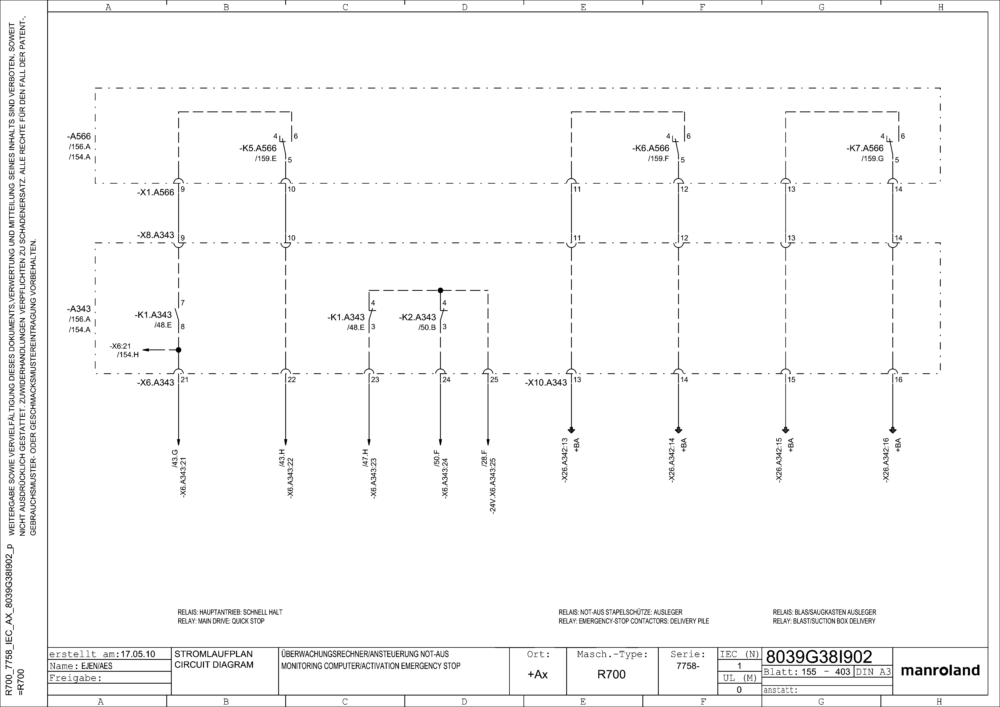

# +Ax — Sheet 155 of 403 — ÜBERWACHUNGSRECHNER/ANSTEUERUNG NOT AUS

**MONITORING COMPUTER/ACTIVATION EMERGENCY STOP**

> Part of the manroland **R700** printing press IEC/UL circuit diagrams.
> Drawing class: **Stromlaufplan / Circuit diagram** (DIN A3).
> Document `+Ax` covers the **Central control console** machine section.

## At a glance

| Field | Value |
|---|---|
| Document | `+Ax`  (8039G38I902) |
| Sheet | **155** of 403 |
| Section (DE) | ÜBERWACHUNGSRECHNER/ANSTEUERUNG NOT AUS |
| Section (EN) | MONITORING COMPUTER/ACTIVATION EMERGENCY STOP |
| Section type | CIRCUIT — Circuit diagram |
| Machine type | `R700` |
| Series | `7758` |
| Created | 17.05.10 |
| Replaces | — |
| Columns used | A, B, C, D, E, F, G, H |
| Path numbers | — |
| Labels on sheet | 84 |
| Cross-refs out | 16 |
| Cross-refs in | 37 |

**Previous:** [+Ax sheet 154](SHEET_0154.md) · **Next:** [+Ax sheet 156](SHEET_0156.md) · **Document TOC:** [_TOC.md](_TOC.md)  (+Ax) · **Master TOC:** [all sheets](../_MASTER_TOC.md)

## Sheet image (300 DPI, exact vector render)



_Rendered directly from the PDF vector layer at 300 DPI (1-bit), no OCR and no resampling. Use it to confirm anything ambiguous in the text below._

## Cross-references on this sheet

Each entry is a wire leaving this sheet. The printed token is `/sheet.column`; the link resolves to that sheet inside the same document.

| Ref | Target sheet | Col | Path | Destination on target | Target section | From col |
|---|---|---|---|---|---|---|
| `/156.A` | [+Ax sheet 156](SHEET_0156.md) | A | — | — | ÜBERWACHUNGSRECHNER/ANSTEUERUNG NOT AUS | A |
| `/154.A` | [+Ax sheet 154](SHEET_0154.md) | A | — | — | ÜBERWACHUNGSRECHNER/ANSTEUERUNG NOT AUS | A |
| `/159.E` | [+Ax sheet 159](SHEET_0159.md) | E | — | — | ÜBERWACHUNGSRECHNER/ANSTEUERUNG NOT AUS | B |
| `/159.F` | [+Ax sheet 159](SHEET_0159.md) | F | — | — | ÜBERWACHUNGSRECHNER/ANSTEUERUNG NOT AUS | F |
| `/159.G` | [+Ax sheet 159](SHEET_0159.md) | G | — | — | ÜBERWACHUNGSRECHNER/ANSTEUERUNG NOT AUS | G |
| `/156.A` | [+Ax sheet 156](SHEET_0156.md) | A | — | — | ÜBERWACHUNGSRECHNER/ANSTEUERUNG NOT AUS | A |
| `/154.A` | [+Ax sheet 154](SHEET_0154.md) | A | — | — | ÜBERWACHUNGSRECHNER/ANSTEUERUNG NOT AUS | A |
| `/48.E` | [+Ax sheet 48](SHEET_0048.md) | E | — | — | NOT AUS | A |
| `/48.E` | [+Ax sheet 48](SHEET_0048.md) | E | — | — | NOT AUS | C |
| `/50.B` | [+Ax sheet 50](SHEET_0050.md) | B | — | — | STOP SICHERN | D |
| `/154.H` | [+Ax sheet 154](SHEET_0154.md) | H | — | X6:21 | ÜBERWACHUNGSRECHNER/ANSTEUERUNG NOT AUS | A |
| `/43.H` | [+Ax sheet 43](SHEET_0043.md) | H | — | — | HAUPTANTRIEB | B |
| `/47.H` | [+Ax sheet 47](SHEET_0047.md) | H | — | — | NOT AUS | C |
| `/43.G` | [+Ax sheet 43](SHEET_0043.md) | G | — | — | HAUPTANTRIEB | B |
| `/50.F` | [+Ax sheet 50](SHEET_0050.md) | F | — | — | STOP SICHERN | D |
| `/28.F` | [+Ax sheet 28](SHEET_0028.md) | F | — | — | SPANNUNGSVERSORGUNG, SCHALTSCHRANKBELÜFTUNG | D |

### Incoming references (sheets that point here)

Every other sheet that sends a wire to this one. `Back-ref` is the token printed on *that* sheet; `Path` is its line number.

| From sheet | Cols | Back-ref | Path | Refs | What continues there |
|---|---|---|---|---|---|
| [+Ax#28](SHEET_0028.md) | F | `/28.F` | — | 1 | — |
| [+Ax#43](SHEET_0043.md) | G, H | `/43.G`, `/43.H` | — | 2 | X6.A343:21; X6.A343:22 |
| [+Ax#47](SHEET_0047.md) | H | `/47.H` | — | 1 | — |
| [+Ax#48](SHEET_0048.md) | E | `/48.E` | — | 2 | — |
| [+Ax#50](SHEET_0050.md) | B, F | `/50.B`, `/50.F` | — | 2 | X6.A343:24 |
| [+Ax#154](SHEET_0154.md) | A, H | `/154.A`, `/154.H` | — | 3 | — |
| [+Ax#156](SHEET_0156.md) | A | `/156.A` | — | 2 | — |
| [+Ax#159](SHEET_0159.md) | E, F, G | `/159.E`, `/159.F`, `/159.G` | — | 3 | — |
| [+Ax#209](SHEET_0209.md) | E | `/209.E` | — | 6 | — |
| [+Ax#233](SHEET_0233.md) | E | `/233.E` | — | 5 | — |
| [+Ax#237](SHEET_0237.md) | G | `/237.G` | — | 6 | — |
| [+Ax#243](SHEET_0243.md) | H | `/243.H` | — | 4 | — |


## Devices on this sheet

| Tag | Class | Class meaning (IEC) | Col | Sub | Terminal | Sign |
|---|---|---|---|---|---|---|
| `A566` | A | Baugruppe / assembly, module, PC board | A | — | — | — |
| `A343` | A | Baugruppe / assembly, module, PC board | A | — | — | — |
| `X6:21` | X | Klemme / terminal, plug connector | A | — | 21 | — |
| `X8.A343` | — | cross-device reference | A | — | — | — |
| `X1.A566` | — | cross-device reference | A | — | — | — |
| `K5.A566` | — | cross-device reference | B | — | — | — |
| `K6.A566` | — | cross-device reference | F | — | — | — |
| `K7.A566` | — | cross-device reference | G | — | — | — |
| `X6.A343` | — | cross-device reference | A | — | — | — |
| `X10.A343` | — | cross-device reference | E | — | — | — |
| `K1.A343` | — | cross-device reference | A | — | — | — |
| `K2.A343` | — | cross-device reference | D | — | — | — |
| `K1.A343` | — | cross-device reference | C | — | — | — |
| `X26.A342:13` | — | cross-device reference | E | — | 13 | — |
| `X26.A342:14` | — | cross-device reference | F | — | 14 | — |
| `X26.A342:15` | — | cross-device reference | G | — | 15 | — |
| `X26.A342:16` | — | cross-device reference | H | — | 16 | — |
| `X6.A343:24` | — | cross-device reference | D | — | 24 | — |
| `X6.A343:23` | — | cross-device reference | C | — | 23 | — |
| `X6.A343:22` | — | cross-device reference | C | — | 22 | — |
| `X6.A343:21` | — | cross-device reference | B | — | 21 | — |

## Potentials / nets

| Potential | Count | Columns | Attached devices | Terminals |
|---|---|---|---|---|
| `24V` | 1 | D | `A343`, `X6` | `25` |


A potential such as `L24+/4` or `M24+` is a named supply/return rail; every place it appears on this sheet is electrically common.

## Wire-end annotations (grouped as printed)

A wire that continues elsewhere is annotated with a small cluster: the destination description, the path/line number `#NN`, and the `/sheet.column` cross reference. Each row below is one such cluster exactly as it is grouped on the drawing.

| Col | Y | Path | Cross-ref | Text on the wire |
|---|---|---|---|---|
| A | 157.6 | — | — | `A566` |
| B | 158.4 | — | — | `K5.A566 6` |
| B | 158.4 | — | — | `4` |
| F | 158.4 | — | — | `K6.A566 6` |
| F | 158.4 | — | — | `4` |
| G | 158.4 | — | — | `K7.A566 6` |
| H | 158.4 | — | — | `4` |
| A | 170.7 | — | `/156.A`, `/154.A` | — |
| B | 184.9 | — | `/159.E` | — |
| F | 184.9 | — | `/159.F` | — |
| G | 184.9 | — | `/159.G` | — |
| C | 186.7 | — | — | `5` |
| F | 186.7 | — | — | `5` |
| H | 186.7 | — | — | `5` |
| D | 221.4 | — | — | `X1.A566 9 10 11 12 13 14` |
| D | 275.3 | — | — | `X8.A343 9 10 11 12 13 14` |
| B | 356.8 | — | — | `7` |
| C | 356.8 | — | — | `4` |
| D | 356.8 | — | — | `4` |
| A | 363.1 | — | — | `A343` |
| A | 370.2 | — | — | `K1.A343 8` |
| C | 373.1 | — | — | `K1.A343 3` |
| D | 373.1 | — | — | `K2.A343 3` |
| A | 376.2 | — | `/156.A`, `/154.A` | — |
| A | 383.3 | — | `/48.E` | — |
| C | 386.1 | — | `/48.E` | — |
| D | 386.1 | — | `/50.B` | — |
| A | 408.5 | — | `/154.H` | `X6:21` |
| D | 448.2 | — | — | `X6.A343 21 22 23 24 25 X10.A343 13 14 15 16` |
| E | 521.3 | — | — | `X26.A342:13` |
| F | 521.3 | — | — | `X26.A342:14` |
| G | 521.3 | — | — | `X26.A342:15` |
| H | 521.3 | — | — | `X26.A342:16` |
| E | 521.6 | — | — | `+BA` |
| F | 521.6 | — | — | `+BA` |
| G | 521.6 | — | — | `+BA` |
| H | 521.6 | — | — | `+BA` |
| B | 534.9 | — | `/43.H` | — |
| C | 534.9 | — | `/47.H` | — |
| B | 535.2 | — | `/43.G` | — |
| D | 535.5 | — | `/50.F` | — |
| D | 535.5 | — | `/28.F` | — |
| B | 544.0 | — | — | `X6.A343:21` |
| C | 545.1 | — | — | `X6.A343:22` |
| C | 545.4 | — | — | `X6.A343:23` |
| D | 545.4 | — | — | `X6.A343:24` |
| D | 545.4 | — | — | `24V.X6.A343:25` |
| D | 726.3 | — | — | `RELAIS: HAUPTANTRIEB: SCHNELL HALT RELAY: MAIN DRIVE: QUICK STOP RELAIS: NOT AUS STAPELSCHÜTZE: AUSLEGER RELAY: EMERGENCY STOP CONTACTORS: DELIVERY PILE` |
| G | 726.3 | — | — | `RELAIS: BLAS/SAUGKASTEN AUSLEGER RELAY: BLAST/SUCTION BOX DELIVERY` |


## Notes and free text on this sheet

| Text | Col | Y (pt) |
|---|---|---|
| `+BA` | E | 521.58 |
| `+BA` | F | 521.58 |
| `+BA` | G | 521.58 |
| `+BA` | H | 521.58 |
| `RELAIS: NOT AUS STAPELSCHÜTZE: AUSLEGER` | E | 726.29 |
| `RELAY: EMERGENCY STOP CONTACTORS: DELIVERY PILE` | E | 736.93 |
| `RELAIS: HAUPTANTRIEB: SCHNELL HALT` | B | 726.29 |
| `RELAY: MAIN DRIVE: QUICK STOP` | B | 736.92 |
| `RELAIS: BLAS/SAUGKASTEN AUSLEGER` | G | 726.28 |
| `RELAY: BLAST/SUCTION BOX DELIVERY` | G | 736.92 |

## Complete label inventory (exact text from the drawing)

Every text object inside the drawing area of this sheet, in DIN reading order (column A→H, then top→bottom). This is the authoritative list: if a string is not here it is not printed on this sheet.

| Col | Y | X | Dir | Type | Text |
|---|---|---|---|---|---|
| A | 157.6 | 79.9 | → | device tag | `A566` |
| A | 170.7 | 82.2 | → | cross-reference | `/156.A` |
| A | 183.1 | 82.2 | → | cross-reference | `/154.A` |
| A | 224.2 | 163.3 | → | device ref | `X1.A566` |
| A | 275.3 | 163.3 | → | device ref | `X8.A343` |
| A | 363.1 | 79.9 | → | device tag | `A343` |
| A | 370.2 | 160.4 | → | device ref | `K1.A343` |
| A | 376.2 | 82.2 | → | cross-reference | `/156.A` |
| A | 383.3 | 184.0 | → | cross-reference | `/48.E` |
| A | 388.6 | 82.2 | → | cross-reference | `/154.A` |
| A | 408.5 | 130.4 | → | device tag | `X6:21` |
| A | 418.4 | 139.5 | → | cross-reference | `/154.H` |
| A | 451.0 | 163.3 | → | device ref | `X6.A343` |
| B | 158.4 | 325.7 | → | number | `4` |
| B | 171.8 | 285.2 | → | device ref | `K5.A566` |
| B | 184.9 | 303.9 | → | cross-reference | `/159.E` |
| B | 221.4 | 215.1 | → | number | `9` |
| B | 279.5 | 215.1 | → | number | `9` |
| B | 356.8 | 215.1 | → | number | `7` |
| B | 385.1 | 215.1 | → | number | `8` |
| B | 448.2 | 215.1 | → | number | `21` |
| B | 534.9 | 331.9 | ↕ | cross-reference | `/43.H` |
| B | 535.2 | 204.4 | ↕ | cross-reference | `/43.G` |
| B | 544.0 | 214.3 | ↕ | device ref | `X6.A343:21` |
| B | 726.3 | 211.7 | → | text | `RELAIS: HAUPTANTRIEB: SCHNELL HALT` |
| B | 736.9 | 211.7 | → | text | `RELAY: MAIN DRIVE: QUICK STOP` |
| C | 158.4 | 349.8 | → | number | `6` |
| C | 186.7 | 342.7 | → | number | `5` |
| C | 221.4 | 342.1 | → | number | `10` |
| C | 279.5 | 342.1 | → | number | `10` |
| C | 356.8 | 441.9 | → | number | `4` |
| C | 373.1 | 390.0 | → | device ref | `K1.A343` |
| C | 385.1 | 441.9 | → | number | `3` |
| C | 386.1 | 413.6 | → | cross-reference | `/48.E` |
| C | 448.2 | 342.7 | → | number | `22` |
| C | 448.2 | 441.9 | → | number | `23` |
| C | 534.9 | 431.1 | ↕ | cross-reference | `/47.H` |
| C | 545.1 | 341.9 | ↕ | device ref | `X6.A343:22` |
| C | 545.4 | 441.1 | ↕ | device ref | `X6.A343:23` |
| D | 356.8 | 527.0 | → | number | `4` |
| D | 373.1 | 475.1 | → | device ref | `K2.A343` |
| D | 385.1 | 527.0 | → | number | `3` |
| D | 386.1 | 498.3 | → | cross-reference | `/50.B` |
| D | 448.2 | 527.0 | → | number | `24` |
| D | 448.2 | 583.7 | → | number | `25` |
| D | 535.5 | 516.2 | ↕ | cross-reference | `/50.F` |
| D | 535.5 | 572.9 | ↕ | cross-reference | `/28.F` |
| D | 545.4 | 526.1 | ↕ | device ref | `X6.A343:24` |
| D | 545.4 | 582.8 | ↕ | potential | `24V.X6.A343:25` |
| E | 221.4 | 682.3 | → | number | `11` |
| E | 279.5 | 682.3 | → | number | `11` |
| E | 448.2 | 682.3 | → | number | `13` |
| E | 451.0 | 625.0 | → | device ref | `X10.A343` |
| E | 521.3 | 668.6 | ↕ | device ref | `X26.A342:13` |
| E | 521.6 | 682.7 | ↕ | text | `+BA` |
| E | 726.3 | 665.3 | → | text | `RELAIS: NOT AUS STAPELSCHÜTZE: AUSLEGER` |
| E | 736.9 | 665.3 | → | text | `RELAY: EMERGENCY STOP CONTACTORS: DELIVERY PILE` |
| F | 158.4 | 793.4 | → | number | `4` |
| F | 158.4 | 817.5 | → | number | `6` |
| F | 171.8 | 752.9 | → | device ref | `K6.A566` |
| F | 184.9 | 771.9 | → | cross-reference | `/159.F` |
| F | 186.7 | 810.4 | → | number | `5` |
| F | 221.4 | 809.9 | → | number | `12` |
| F | 279.5 | 809.9 | → | number | `12` |
| F | 448.2 | 809.9 | → | number | `14` |
| F | 521.3 | 796.1 | ↕ | device ref | `X26.A342:14` |
| F | 521.6 | 810.2 | ↕ | text | `+BA` |
| G | 171.8 | 1008.0 | → | device ref | `K7.A566` |
| G | 184.9 | 1025.9 | → | cross-reference | `/159.G` |
| G | 221.4 | 937.4 | → | number | `13` |
| G | 279.5 | 937.4 | → | number | `13` |
| G | 448.2 | 937.4 | → | number | `15` |
| G | 521.3 | 923.7 | ↕ | device ref | `X26.A342:15` |
| G | 521.6 | 937.8 | ↕ | text | `+BA` |
| G | 726.3 | 920.4 | → | text | `RELAIS: BLAS/SAUGKASTEN AUSLEGER` |
| G | 736.9 | 920.4 | → | text | `RELAY: BLAST/SUCTION BOX DELIVERY` |
| H | 158.4 | 1048.5 | → | number | `4` |
| H | 158.4 | 1072.6 | → | number | `6` |
| H | 186.7 | 1065.5 | → | number | `5` |
| H | 221.4 | 1065.0 | → | number | `14` |
| H | 279.5 | 1065.0 | → | number | `14` |
| H | 448.2 | 1065.0 | → | number | `16` |
| H | 521.3 | 1051.2 | ↕ | device ref | `X26.A342:16` |
| H | 521.6 | 1065.4 | ↕ | text | `+BA` |

## Reading-order text block

The same content as a plain block, grouped by DIN column — convenient to paste or to match against a visual description.

```text
=== Column A ===
 157.6   79.9  devtag       A566
 170.7   82.2  xref         /156.A
 183.1   82.2  xref         /154.A
 224.2  163.3  devref       X1.A566
 275.3  163.3  devref       X8.A343
 363.1   79.9  devtag       A343
 370.2  160.4  devref       K1.A343
 376.2   82.2  xref         /156.A
 383.3  184.0  xref         /48.E
 388.6   82.2  xref         /154.A
 408.5  130.4  devtag       X6:21
 418.4  139.5  xref         /154.H
 451.0  163.3  devref       X6.A343
=== Column B ===
 158.4  325.7  numeric      4
 171.8  285.2  devref       K5.A566
 184.9  303.9  xref         /159.E
 221.4  215.1  numeric      9
 279.5  215.1  numeric      9
 356.8  215.1  numeric      7
 385.1  215.1  numeric      8
 448.2  215.1  numeric      21
 534.9  331.9  xref         /43.H
 535.2  204.4  xref         /43.G
 544.0  214.3  devref       X6.A343:21
 726.3  211.7  text         RELAIS: HAUPTANTRIEB: SCHNELL HALT
 736.9  211.7  text         RELAY: MAIN DRIVE: QUICK STOP
=== Column C ===
 158.4  349.8  numeric      6
 186.7  342.7  numeric      5
 221.4  342.1  numeric      10
 279.5  342.1  numeric      10
 356.8  441.9  numeric      4
 373.1  390.0  devref       K1.A343
 385.1  441.9  numeric      3
 386.1  413.6  xref         /48.E
 448.2  342.7  numeric      22
 448.2  441.9  numeric      23
 534.9  431.1  xref         /47.H
 545.1  341.9  devref       X6.A343:22
 545.4  441.1  devref       X6.A343:23
=== Column D ===
 356.8  527.0  numeric      4
 373.1  475.1  devref       K2.A343
 385.1  527.0  numeric      3
 386.1  498.3  xref         /50.B
 448.2  527.0  numeric      24
 448.2  583.7  numeric      25
 535.5  516.2  xref         /50.F
 535.5  572.9  xref         /28.F
 545.4  526.1  devref       X6.A343:24
 545.4  582.8  net          24V.X6.A343:25
=== Column E ===
 221.4  682.3  numeric      11
 279.5  682.3  numeric      11
 448.2  682.3  numeric      13
 451.0  625.0  devref       X10.A343
 521.3  668.6  devref       X26.A342:13
 521.6  682.7  text         +BA
 726.3  665.3  text         RELAIS: NOT AUS STAPELSCHÜTZE: AUSLEGER
 736.9  665.3  text         RELAY: EMERGENCY STOP CONTACTORS: DELIVERY PILE
=== Column F ===
 158.4  793.4  numeric      4
 158.4  817.5  numeric      6
 171.8  752.9  devref       K6.A566
 184.9  771.9  xref         /159.F
 186.7  810.4  numeric      5
 221.4  809.9  numeric      12
 279.5  809.9  numeric      12
 448.2  809.9  numeric      14
 521.3  796.1  devref       X26.A342:14
 521.6  810.2  text         +BA
=== Column G ===
 171.8 1008.0  devref       K7.A566
 184.9 1025.9  xref         /159.G
 221.4  937.4  numeric      13
 279.5  937.4  numeric      13
 448.2  937.4  numeric      15
 521.3  923.7  devref       X26.A342:15
 521.6  937.8  text         +BA
 726.3  920.4  text         RELAIS: BLAS/SAUGKASTEN AUSLEGER
 736.9  920.4  text         RELAY: BLAST/SUCTION BOX DELIVERY
=== Column H ===
 158.4 1048.5  numeric      4
 158.4 1072.6  numeric      6
 186.7 1065.5  numeric      5
 221.4 1065.0  numeric      14
 279.5 1065.0  numeric      14
 448.2 1065.0  numeric      16
 521.3 1051.2  devref       X26.A342:16
 521.6 1065.4  text         +BA
```

---
_Generated from the PDF vector text layer; no OCR. Source: `R700_7758_IEC_AX_8039G38I902_p`, sheet 155._
