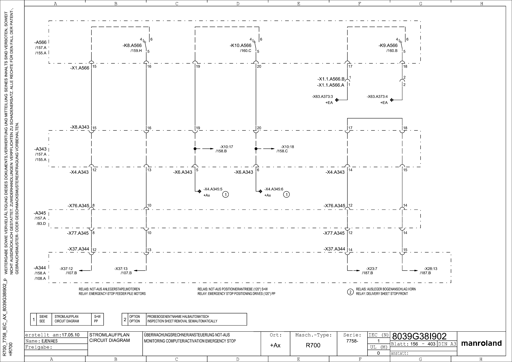

# +Ax — Sheet 156 of 403 — ÜBERWACHUNGSRECHNER/ANSTEUERUNG NOT AUS

**MONITORING COMPUTER/ACTIVATION EMERGENCY STOP**

> Part of the manroland **R700** printing press IEC/UL circuit diagrams.
> Drawing class: **Stromlaufplan / Circuit diagram** (DIN A3).
> Document `+Ax` covers the **Central control console** machine section.

## At a glance

| Field | Value |
|---|---|
| Document | `+Ax`  (8039G38I902) |
| Sheet | **156** of 403 |
| Section (DE) | ÜBERWACHUNGSRECHNER/ANSTEUERUNG NOT AUS |
| Section (EN) | MONITORING COMPUTER/ACTIVATION EMERGENCY STOP |
| Section type | CIRCUIT — Circuit diagram |
| Machine type | `R700` |
| Series | `7758` |
| Created | 17.05.10 |
| Replaces | — |
| Columns used | A, B, C, D, E, F, G |
| Path numbers | — |
| Labels on sheet | 116 |
| Cross-refs out | 17 |
| Cross-refs in | 51 |

**Previous:** [+Ax sheet 155](SHEET_0155.md) · **Next:** [+Ax sheet 157](SHEET_0157.md) · **Document TOC:** [_TOC.md](_TOC.md)  (+Ax) · **Master TOC:** [all sheets](../_MASTER_TOC.md)

## Sheet image (300 DPI, exact vector render)



_Rendered directly from the PDF vector layer at 300 DPI (1-bit), no OCR and no resampling. Use it to confirm anything ambiguous in the text below._

## Cross-references on this sheet

Each entry is a wire leaving this sheet. The printed token is `/sheet.column`; the link resolves to that sheet inside the same document.

| Ref | Target sheet | Col | Path | Destination on target | Target section | From col |
|---|---|---|---|---|---|---|
| `/157.A` | [+Ax sheet 157](SHEET_0157.md) | A | — | — | ÜBERWACHUNGSRECHNER/ANSTEUERUNG NOT AUS | A |
| `/155.A` | [+Ax sheet 155](SHEET_0155.md) | A | — | — | ÜBERWACHUNGSRECHNER/ANSTEUERUNG NOT AUS | A |
| `/160.B` | [+Ax sheet 160](SHEET_0160.md) | B | — | — | ÜBERWACHUNGSRECHNER/ANSTEUERUNG NOT AUS | G |
| `/159.H` | [+Ax sheet 159](SHEET_0159.md) | H | — | — | ÜBERWACHUNGSRECHNER/ANSTEUERUNG NOT AUS | B |
| `/160.C` | [+Ax sheet 160](SHEET_0160.md) | C | — | — | ÜBERWACHUNGSRECHNER/ANSTEUERUNG NOT AUS | D |
| `/158.B` | [+Ax sheet 158](SHEET_0158.md) | B | — | — | ÜBERWACHUNGSRECHNER/ANSTEUERUNG NOT AUS | D |
| `/158.C` | [+Ax sheet 158](SHEET_0158.md) | C | — | — | ÜBERWACHUNGSRECHNER/ANSTEUERUNG NOT AUS | E |
| `/157.A` | [+Ax sheet 157](SHEET_0157.md) | A | — | — | ÜBERWACHUNGSRECHNER/ANSTEUERUNG NOT AUS | A |
| `/155.A` | [+Ax sheet 155](SHEET_0155.md) | A | — | — | ÜBERWACHUNGSRECHNER/ANSTEUERUNG NOT AUS | A |
| `/157.A` | [+Ax sheet 157](SHEET_0157.md) | A | — | — | ÜBERWACHUNGSRECHNER/ANSTEUERUNG NOT AUS | A |
| `/83.D` | [+Ax sheet 83](SHEET_0083.md) | D | — | — | ANLEGER | A |
| `/107.B` | [+Ax sheet 107](SHEET_0107.md) | B | — | X23:7 X37:12 | ANLEGER | D |
| `/107.B` | [+Ax sheet 107](SHEET_0107.md) | B | — | X37:13 | ANLEGER | B |
| `/187.B` | [+Ax sheet 187](SHEET_0187.md) | B | — | — | RESERVE | F |
| `/187.B` | [+Ax sheet 187](SHEET_0187.md) | B | — | — | RESERVE | G |
| `/158.A` | [+Ax sheet 158](SHEET_0158.md) | A | — | — | ÜBERWACHUNGSRECHNER/ANSTEUERUNG NOT AUS | A |
| `/108.A` | [+Ax sheet 108](SHEET_0108.md) | A | — | — | ANLEGER | A |

### Incoming references (sheets that point here)

Every other sheet that sends a wire to this one. `Back-ref` is the token printed on *that* sheet; `Path` is its line number.

| From sheet | Cols | Back-ref | Path | Refs | What continues there |
|---|---|---|---|---|---|
| [+Ax#83](SHEET_0083.md) | C | `/83.C` | — | 1 | — |
| [+Ax#107](SHEET_0107.md) | B | `/107.B` | — | 2 | — |
| [+Ax#108](SHEET_0108.md) | A | `/108.A` | — | 1 | — |
| [+Ax#155](SHEET_0155.md) | A | `/155.A` | — | 2 | — |
| [+Ax#157](SHEET_0157.md) | A | `/157.A` | — | 3 | — |
| [+Ax#158](SHEET_0158.md) | A, B, D | `/158.A`, `/158.B`, `/158.D` | — | 3 | X10:17 X10:21; X10:18 |
| [+Ax#159](SHEET_0159.md) | H | `/159.H` | — | 1 | — |
| [+Ax#160](SHEET_0160.md) | B, C | `/160.B`, `/160.C` | — | 2 | — |
| [+Ax#187](SHEET_0187.md) | B | `/187.B` | — | 2 | X23:7; X28:13 |
| [+Ax#209](SHEET_0209.md) | E, G | `/209.E`, `/209.G` | — | 10 | — |
| [+Ax#226](SHEET_0226.md) | G | `/226.G` | — | 4 | — |
| [+Ax#233](SHEET_0233.md) | E | `/233.E` | — | 2 | — |
| [+Ax#237](SHEET_0237.md) | G | `/237.G` | — | 6 | — |
| [+Ax#279](SHEET_0279.md) | F | `/279.F` | — | 4 | — |
| [+Ax#285](SHEET_0285.md) | F, H | `/285.F`, `/285.H` | — | 8 | — |


## Devices on this sheet

| Tag | Class | Class meaning (IEC) | Col | Sub | Terminal | Sign |
|---|---|---|---|---|---|---|
| `A566` | A | Baugruppe / assembly, module, PC board | A | — | — | — |
| `A343` | A | Baugruppe / assembly, module, PC board | A | — | — | — |
| `A344` | A | Baugruppe / assembly, module, PC board | A | — | — | — |
| `A345` | A | Baugruppe / assembly, module, PC board | A | — | — | — |
| `X23:7` | X | Klemme / terminal, plug connector | F | — | 7 | — |
| `X37:12` | X | Klemme / terminal, plug connector | A | — | 12 | — |
| `X37:13` | X | Klemme / terminal, plug connector | B | — | 13 | — |
| `X10:17` | X | Klemme / terminal, plug connector | D | — | 17 | — |
| `X10:18` | X | Klemme / terminal, plug connector | E | — | 18 | — |
| `X28:13` | X | Klemme / terminal, plug connector | G | — | 13 | — |
| `K8.A566` | — | cross-device reference | B | — | — | — |
| `X1.A566` | — | cross-device reference | A | — | — | — |
| `K9.A566` | — | cross-device reference | F | — | — | — |
| `X1.1.A566.B` | — | cross-device reference | F | — | — | — |
| `X1.1.A566.A` | — | cross-device reference | F | — | — | — |
| `K10.A566` | — | cross-device reference | D | — | — | — |
| `X63.A373:3` | — | cross-device reference | E | — | 3 | — |
| `X63.A373:4` | — | cross-device reference | F | — | 4 | — |
| `X8.A343` | — | cross-device reference | A | — | — | — |
| `X37.A344` | — | cross-device reference | A | — | — | — |
| `X37.A344` | — | cross-device reference | F | — | — | — |
| `X77.A345` | — | cross-device reference | A | — | — | — |
| `X76.A345` | — | cross-device reference | A | — | — | — |
| `X76.A345` | — | cross-device reference | F | — | — | — |
| `X77.A345` | — | cross-device reference | F | — | — | — |
| `X4.A343` | — | cross-device reference | A | — | — | — |
| `X4.A343` | — | cross-device reference | F | — | — | — |
| `X6.A343` | — | cross-device reference | D | — | — | — |
| `X6.A343` | — | cross-device reference | C | — | — | — |
| `X4.A345:5` | — | cross-device reference | D | — | 5 | — |
| `X4.A345:6` | — | cross-device reference | E | — | 6 | — |

## Potentials / nets

_No named potentials on this sheet._

## Wire-end annotations (grouped as printed)

A wire that continues elsewhere is annotated with a small cluster: the destination description, the path/line number `#NN`, and the `/sheet.column` cross reference. Each row below is one such cluster exactly as it is grouped on the drawing.

| Col | Y | Path | Cross-ref | Text on the wire |
|---|---|---|---|---|
| B | 87.5 | — | — | `K8.A566 6` |
| B | 87.5 | — | — | `4` |
| D | 87.5 | — | — | `K10.A566 6` |
| D | 87.5 | — | — | `4` |
| G | 87.5 | — | — | `K9.A566 6` |
| G | 87.5 | — | — | `4` |
| A | 93.8 | — | — | `A566` |
| A | 106.9 | — | `/157.A`, `/155.A` | — |
| B | 114.0 | — | `/159.H` | — |
| D | 114.0 | — | `/160.C` | — |
| G | 114.0 | — | `/160.B` | — |
| C | 115.8 | — | — | `5` |
| D | 115.8 | — | — | `5` |
| G | 115.8 | — | — | `5` |
| B | 150.6 | — | — | `X1.A566 15 16` |
| D | 150.6 | — | — | `19 20` |
| F | 150.6 | — | — | `17 18` |
| F | 176.1 | — | — | `X1.1.A566.B 1 2` |
| F | 193.1 | — | — | `X1.1.A566.A 1 2` |
| E | 220.7 | — | — | `X63.A373:3` |
| F | 220.7 | — | — | `X63.A373:4` |
| F | 234.8 | — | — | `+EA` |
| F | 234.8 | — | — | `+EA` |
| B | 290.9 | — | — | `X8.A343 15 16` |
| E | 293.7 | — | — | `19 20 17 18` |
| D | 337.6 | — | — | `X10:17` |
| E | 337.6 | — | — | `X10:18` |
| A | 341.9 | — | — | `A343` |
| D | 347.5 | — | `/158.B` | — |
| E | 347.5 | — | `/158.C` | — |
| A | 354.9 | — | `/157.A`, `/155.A` | — |
| D | 391.5 | — | — | `X4.A343 12 13 X6.A343 5 X6.A343 6 X4.A343 14 15` |
| D | 436.1 | — | — | `X4.A345:5` |
| E | 436.1 | — | — | `X4.A345:6` |
| D | 449.1 | — | — | `1 1` |
| C | 450.4 | — | — | `+Ax` |
| D | 450.4 | — | — | `+Ax` |
| A | 473.7 | — | — | `X76.A345 8` |
| C | 473.7 | — | — | `10` |
| F | 473.7 | — | — | `X76.A345 12 14` |
| A | 490.7 | — | — | `A345` |
| A | 503.8 | — | `/157.A` | — |
| A | 516.2 | — | `/83.D` | — |
| A | 537.5 | — | — | `X77.A345 8` |
| C | 537.5 | — | — | `10` |
| F | 537.5 | — | — | `X77.A345 12 14` |
| D | 574.3 | — | — | `X37.A344 12 13 X37.A344 14 15` |
| A | 618.3 | — | — | `A344` |
| D | 621.1 | — | `/107.B` | `X37:12 X23:7` |
| B | 621.1 | — | `/107.B` | `X37:13` |
| G | 621.1 | — | — | `X28:13` |
| F | 631.0 | — | `/187.B` | — |
| G | 631.0 | — | `/187.B` | — |
| A | 631.3 | — | `/158.A`, `/108.A` | — |
| B | 669.6 | — | — | `RELAIS: NOT AUS ANLEGERSTAPELMOTOREN RELAY: EMERGENCY STOP FEEDER PILE MOTORS` |
| E | 669.6 | — | — | `RELAIS: NOT AUS POSITIONIERANTRIEBE (120°) S+W RELAY: EMERGENCY STOP POSITIONING DRIVES (120°) PP RELAIS: AUSLEGER BOGENANSCHLAG:VORN RELAY: DELIVERY SHEET STOP:FRONT` |
| F | 676.4 | — | — | `2` |
| B | 733.2 | — | — | `1 PP S+W OPTION OPTION` |
| A | 733.3 | — | — | `SIEHE SEE` |
| A | 733.4 | — | — | `STROMLAUFPLAN CIRCUIT DIAGRAM` |
| C | 733.4 | — | — | `PROBEBOGENENTNAHME HALBAUTOMATISCH INSPECTION SHEET REMOVAL SEMIAUTOMATICALLY` |
| B | 738.7 | — | — | `2` |


## Notes and free text on this sheet

| Text | Col | Y (pt) |
|---|---|---|
| `+EA` | F | 234.81 |
| `+Ax` | C | 450.36 |
| `+Ax` | D | 450.36 |
| `RELAIS: NOT AUS ANLEGERSTAPELMOTOREN` | B | 669.6 |
| `RELAY: EMERGENCY STOP FEEDER PILE MOTORS` | B | 680.24 |
| `RELAIS: AUSLEGER BOGENANSCHLAG:VORN` | F | 669.6 |
| `RELAY: DELIVERY SHEET STOP:FRONT` | F | 680.23 |
| `RELAIS: NOT AUS POSITIONIERANTRIEBE (120°) S+W` | D | 669.59 |
| `RELAY: EMERGENCY STOP POSITIONING DRIVES (120°) PP` | D | 680.23 |
| `SIEHE` | A | 733.33 |
| `SEE` | A | 743.93 |
| `STROMLAUFPLAN` | A | 733.39 |
| `CIRCUIT DIAGRAM` | A | 744.03 |
| `S+W` | B | 733.24 |
| `PP` | B | 743.87 |
| `OPTION` | B | 733.35 |
| `PROBEBOGENENTNAHME HALBAUTOMATISCH` | C | 733.39 |
| `INSPECTION SHEET REMOVAL SEMIAUTOMATICALLY` | C | 744.02 |

## Complete label inventory (exact text from the drawing)

Every text object inside the drawing area of this sheet, in DIN reading order (column A→H, then top→bottom). This is the authoritative list: if a string is not here it is not printed on this sheet.

| Col | Y | X | Dir | Type | Text |
|---|---|---|---|---|---|
| A | 93.8 | 79.9 | → | device tag | `A566` |
| A | 106.9 | 82.2 | → | cross-reference | `/157.A` |
| A | 119.3 | 82.2 | → | cross-reference | `/155.A` |
| A | 153.4 | 163.3 | → | device ref | `X1.A566` |
| A | 290.9 | 163.3 | → | device ref | `X8.A343` |
| A | 341.9 | 79.9 | → | device tag | `A343` |
| A | 354.9 | 82.2 | → | cross-reference | `/157.A` |
| A | 367.4 | 82.2 | → | cross-reference | `/155.A` |
| A | 395.7 | 161.9 | → | device ref | `X4.A343` |
| A | 473.7 | 157.3 | → | device ref | `X76.A345` |
| A | 490.7 | 78.5 | → | device tag | `A345` |
| A | 503.8 | 80.8 | → | cross-reference | `/157.A` |
| A | 516.2 | 85.6 | → | cross-reference | `/83.D` |
| A | 537.5 | 155.9 | → | device ref | `X77.A345` |
| A | 574.3 | 157.3 | → | device ref | `X37.A344` |
| A | 618.3 | 78.5 | → | device tag | `A344` |
| A | 621.1 | 138.6 | → | device tag | `X37:12` |
| A | 631.0 | 153.4 | → | cross-reference | `/107.B` |
| A | 631.3 | 80.8 | → | cross-reference | `/158.A` |
| A | 643.7 | 80.8 | → | cross-reference | `/108.A` |
| A | 733.3 | 91.8 | → | text | `SIEHE` |
| A | 733.4 | 127.3 | → | text | `STROMLAUFPLAN` |
| A | 738.7 | 75.4 | → | number | `1` |
| A | 743.9 | 91.8 | → | text | `SEE` |
| A | 744.0 | 127.3 | → | text | `CIRCUIT DIAGRAM` |
| B | 87.5 | 325.7 | → | number | `4` |
| B | 100.9 | 285.2 | → | device ref | `K8.A566` |
| B | 114.0 | 303.9 | → | cross-reference | `/159.H` |
| B | 150.6 | 214.6 | → | number | `15` |
| B | 293.7 | 214.6 | → | number | `15` |
| B | 391.5 | 214.6 | → | number | `12` |
| B | 473.7 | 215.1 | → | number | `8` |
| B | 537.5 | 215.1 | → | number | `8` |
| B | 577.2 | 214.6 | → | number | `12` |
| B | 621.1 | 265.9 | → | device tag | `X37:13` |
| B | 631.0 | 280.9 | → | cross-reference | `/107.B` |
| B | 669.6 | 183.4 | → | text | `RELAIS: NOT AUS ANLEGERSTAPELMOTOREN` |
| B | 680.2 | 183.4 | → | text | `RELAY: EMERGENCY STOP FEEDER PILE MOTORS` |
| B | 733.2 | 219.4 | → | text | `S+W` |
| B | 733.4 | 300.9 | → | text | `OPTION` |
| B | 738.7 | 287.7 | → | number | `2` |
| B | 743.9 | 218.8 | → | text | `PP` |
| B | 744.0 | 300.9 | → | text | `OPTION` |
| C | 87.5 | 349.8 | → | number | `6` |
| C | 115.8 | 342.7 | → | number | `5` |
| C | 150.6 | 342.1 | → | number | `16` |
| C | 150.6 | 455.5 | → | number | `19` |
| C | 293.7 | 342.1 | → | number | `16` |
| C | 293.7 | 455.5 | → | number | `19` |
| C | 391.5 | 342.1 | → | number | `13` |
| C | 391.5 | 456.1 | → | number | `5` |
| C | 395.7 | 402.8 | → | device ref | `X6.A343` |
| C | 450.4 | 473.1 | → | text | `+Ax` |
| C | 473.7 | 342.1 | → | number | `10` |
| C | 537.5 | 342.1 | → | number | `10` |
| C | 577.2 | 342.1 | → | number | `13` |
| C | 733.4 | 342.9 | → | text | `PROBEBOGENENTNAHME HALBAUTOMATISCH` |
| C | 744.0 | 342.9 | → | text | `INSPECTION SHEET REMOVAL SEMIAUTOMATICALLY` |
| D | 87.5 | 580.8 | → | number | `4` |
| D | 87.5 | 604.9 | → | number | `6` |
| D | 100.9 | 534.3 | → | device ref | `K10.A566` |
| D | 114.0 | 558.4 | → | cross-reference | `/160.C` |
| D | 115.8 | 597.8 | → | number | `5` |
| D | 150.6 | 597.8 | → | number | `20` |
| D | 293.7 | 597.8 | → | number | `20` |
| D | 337.6 | 511.4 | → | device tag | `X10:17` |
| D | 347.5 | 501.7 | → | cross-reference | `/158.B` |
| D | 391.5 | 597.8 | → | number | `6` |
| D | 395.7 | 544.5 | → | device ref | `X6.A343` |
| D | 436.1 | 473.1 | → | device ref | `X4.A345:5` |
| D | 449.1 | 522.7 | → | number | `1` |
| D | 450.4 | 614.8 | → | text | `+Ax` |
| D | 669.6 | 459.8 | → | text | `RELAIS: NOT AUS POSITIONIERANTRIEBE (120°) S+W` |
| D | 680.2 | 459.8 | → | text | `RELAY: EMERGENCY STOP POSITIONING DRIVES (120°) PP` |
| E | 220.7 | 725.4 | → | device ref | `X63.A373:3` |
| E | 337.6 | 653.1 | → | device tag | `X10:18` |
| E | 347.5 | 643.5 | → | cross-reference | `/158.C` |
| E | 436.1 | 614.8 | → | device ref | `X4.A345:6` |
| E | 449.1 | 664.4 | → | number | `1` |
| F | 100.9 | 880.4 | → | device ref | `K9.A566` |
| F | 150.6 | 809.9 | → | number | `17` |
| F | 176.1 | 811.8 | → | number | `1` |
| F | 178.9 | 738.4 | → | device ref | `X1.1.A566.B` |
| F | 193.1 | 737.6 | → | device ref | `X1.1.A566.A` |
| F | 193.1 | 809.9 | → | number | `1` |
| F | 220.7 | 852.9 | → | device ref | `X63.A373:4` |
| F | 234.8 | 756.9 | → | text | `+EA` |
| F | 234.8 | 884.4 | → | text | `+EA` |
| F | 293.7 | 809.9 | → | number | `17` |
| F | 391.5 | 809.9 | → | number | `14` |
| F | 395.7 | 757.1 | → | device ref | `X4.A343` |
| F | 473.7 | 752.6 | → | device ref | `X76.A345` |
| F | 473.7 | 809.9 | → | number | `12` |
| F | 537.5 | 751.2 | → | device ref | `X77.A345` |
| F | 537.5 | 809.9 | → | number | `12` |
| F | 574.3 | 752.6 | → | device ref | `X37.A344` |
| F | 577.2 | 809.9 | → | number | `14` |
| F | 621.1 | 851.5 | → | device tag | `X23:7` |
| F | 631.0 | 841.9 | → | cross-reference | `/187.B` |
| F | 669.6 | 828.3 | → | text | `RELAIS: AUSLEGER BOGENANSCHLAG:VORN` |
| F | 676.4 | 813.0 | → | number | `2` |
| F | 680.2 | 828.3 | → | text | `RELAY: DELIVERY SHEET STOP:FRONT` |
| G | 87.5 | 921.0 | → | number | `4` |
| G | 87.5 | 945.1 | → | number | `6` |
| G | 114.0 | 898.9 | → | cross-reference | `/160.B` |
| G | 115.8 | 938.0 | → | number | `5` |
| G | 150.6 | 937.4 | → | number | `18` |
| G | 176.1 | 938.3 | → | number | `2` |
| G | 193.1 | 938.0 | → | number | `2` |
| G | 293.7 | 937.4 | → | number | `18` |
| G | 391.5 | 937.4 | → | number | `15` |
| G | 473.7 | 937.4 | → | number | `14` |
| G | 537.5 | 937.4 | → | number | `14` |
| G | 577.2 | 937.4 | → | number | `15` |
| G | 621.1 | 986.2 | → | device tag | `X28:13` |
| G | 631.0 | 976.5 | → | cross-reference | `/187.B` |

## Reading-order text block

The same content as a plain block, grouped by DIN column — convenient to paste or to match against a visual description.

```text
=== Column A ===
  93.8   79.9  devtag       A566
 106.9   82.2  xref         /157.A
 119.3   82.2  xref         /155.A
 153.4  163.3  devref       X1.A566
 290.9  163.3  devref       X8.A343
 341.9   79.9  devtag       A343
 354.9   82.2  xref         /157.A
 367.4   82.2  xref         /155.A
 395.7  161.9  devref       X4.A343
 473.7  157.3  devref       X76.A345
 490.7   78.5  devtag       A345
 503.8   80.8  xref         /157.A
 516.2   85.6  xref         /83.D
 537.5  155.9  devref       X77.A345
 574.3  157.3  devref       X37.A344
 618.3   78.5  devtag       A344
 621.1  138.6  devtag       X37:12
 631.0  153.4  xref         /107.B
 631.3   80.8  xref         /158.A
 643.7   80.8  xref         /108.A
 733.3   91.8  text         SIEHE
 733.4  127.3  text         STROMLAUFPLAN
 738.7   75.4  numeric      1
 743.9   91.8  text         SEE
 744.0  127.3  text         CIRCUIT DIAGRAM
=== Column B ===
  87.5  325.7  numeric      4
 100.9  285.2  devref       K8.A566
 114.0  303.9  xref         /159.H
 150.6  214.6  numeric      15
 293.7  214.6  numeric      15
 391.5  214.6  numeric      12
 473.7  215.1  numeric      8
 537.5  215.1  numeric      8
 577.2  214.6  numeric      12
 621.1  265.9  devtag       X37:13
 631.0  280.9  xref         /107.B
 669.6  183.4  text         RELAIS: NOT AUS ANLEGERSTAPELMOTOREN
 680.2  183.4  text         RELAY: EMERGENCY STOP FEEDER PILE MOTORS
 733.2  219.4  text         S+W
 733.4  300.9  text         OPTION
 738.7  287.7  numeric      2
 743.9  218.8  text         PP
 744.0  300.9  text         OPTION
=== Column C ===
  87.5  349.8  numeric      6
 115.8  342.7  numeric      5
 150.6  342.1  numeric      16
 150.6  455.5  numeric      19
 293.7  342.1  numeric      16
 293.7  455.5  numeric      19
 391.5  342.1  numeric      13
 391.5  456.1  numeric      5
 395.7  402.8  devref       X6.A343
 450.4  473.1  text         +Ax
 473.7  342.1  numeric      10
 537.5  342.1  numeric      10
 577.2  342.1  numeric      13
 733.4  342.9  text         PROBEBOGENENTNAHME HALBAUTOMATISCH
 744.0  342.9  text         INSPECTION SHEET REMOVAL SEMIAUTOMATICALLY
=== Column D ===
  87.5  580.8  numeric      4
  87.5  604.9  numeric      6
 100.9  534.3  devref       K10.A566
 114.0  558.4  xref         /160.C
 115.8  597.8  numeric      5
 150.6  597.8  numeric      20
 293.7  597.8  numeric      20
 337.6  511.4  devtag       X10:17
 347.5  501.7  xref         /158.B
 391.5  597.8  numeric      6
 395.7  544.5  devref       X6.A343
 436.1  473.1  devref       X4.A345:5
 449.1  522.7  numeric      1
 450.4  614.8  text         +Ax
 669.6  459.8  text         RELAIS: NOT AUS POSITIONIERANTRIEBE (120°) S+W
 680.2  459.8  text         RELAY: EMERGENCY STOP POSITIONING DRIVES (120°) PP
=== Column E ===
 220.7  725.4  devref       X63.A373:3
 337.6  653.1  devtag       X10:18
 347.5  643.5  xref         /158.C
 436.1  614.8  devref       X4.A345:6
 449.1  664.4  numeric      1
=== Column F ===
 100.9  880.4  devref       K9.A566
 150.6  809.9  numeric      17
 176.1  811.8  numeric      1
 178.9  738.4  devref       X1.1.A566.B
 193.1  737.6  devref       X1.1.A566.A
 193.1  809.9  numeric      1
 220.7  852.9  devref       X63.A373:4
 234.8  756.9  text         +EA
 234.8  884.4  text         +EA
 293.7  809.9  numeric      17
 391.5  809.9  numeric      14
 395.7  757.1  devref       X4.A343
 473.7  752.6  devref       X76.A345
 473.7  809.9  numeric      12
 537.5  751.2  devref       X77.A345
 537.5  809.9  numeric      12
 574.3  752.6  devref       X37.A344
 577.2  809.9  numeric      14
 621.1  851.5  devtag       X23:7
 631.0  841.9  xref         /187.B
 669.6  828.3  text         RELAIS: AUSLEGER BOGENANSCHLAG:VORN
 676.4  813.0  numeric      2
 680.2  828.3  text         RELAY: DELIVERY SHEET STOP:FRONT
=== Column G ===
  87.5  921.0  numeric      4
  87.5  945.1  numeric      6
 114.0  898.9  xref         /160.B
 115.8  938.0  numeric      5
 150.6  937.4  numeric      18
 176.1  938.3  numeric      2
 193.1  938.0  numeric      2
 293.7  937.4  numeric      18
 391.5  937.4  numeric      15
 473.7  937.4  numeric      14
 537.5  937.4  numeric      14
 577.2  937.4  numeric      15
 621.1  986.2  devtag       X28:13
 631.0  976.5  xref         /187.B
```

---
_Generated from the PDF vector text layer; no OCR. Source: `R700_7758_IEC_AX_8039G38I902_p`, sheet 156._
