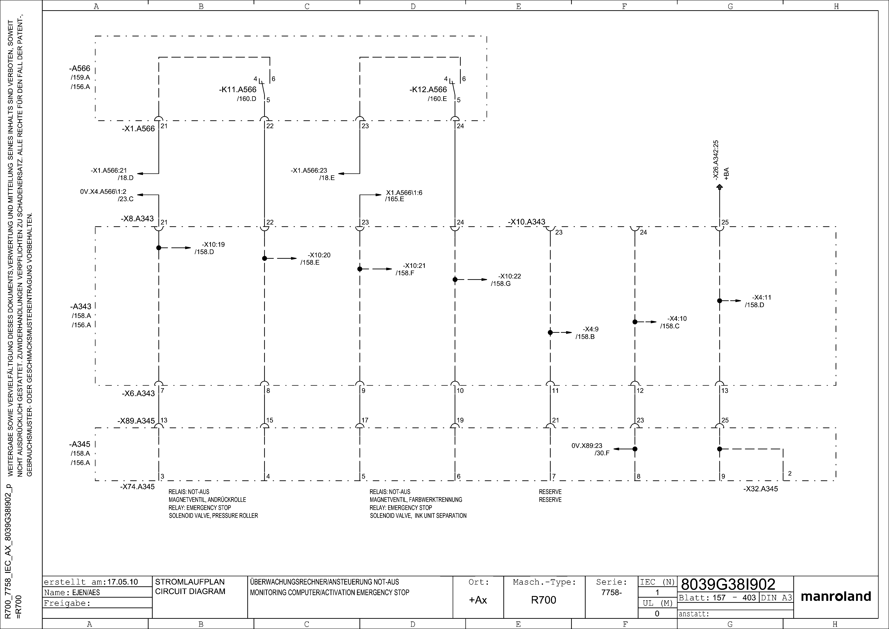

# +Ax — Sheet 157 of 403 — ÜBERWACHUNGSRECHNER/ANSTEUERUNG NOT AUS

**MONITORING COMPUTER/ACTIVATION EMERGENCY STOP**

> Part of the manroland **R700** printing press IEC/UL circuit diagrams.
> Drawing class: **Stromlaufplan / Circuit diagram** (DIN A3).
> Document `+Ax` covers the **Central control console** machine section.

## At a glance

| Field | Value |
|---|---|
| Document | `+Ax`  (8039G38I902) |
| Sheet | **157** of 403 |
| Section (DE) | ÜBERWACHUNGSRECHNER/ANSTEUERUNG NOT AUS |
| Section (EN) | MONITORING COMPUTER/ACTIVATION EMERGENCY STOP |
| Section type | CIRCUIT — Circuit diagram |
| Machine type | `R700` |
| Series | `7758` |
| Created | 17.05.10 |
| Replaces | — |
| Columns used | A, B, C, D, E, F, G, H |
| Path numbers | — |
| Labels on sheet | 95 |
| Cross-refs out | 20 |
| Cross-refs in | 53 |

**Previous:** [+Ax sheet 156](SHEET_0156.md) · **Next:** [+Ax sheet 158](SHEET_0158.md) · **Document TOC:** [_TOC.md](_TOC.md)  (+Ax) · **Master TOC:** [all sheets](../_MASTER_TOC.md)

## Sheet image (300 DPI, exact vector render)



_Rendered directly from the PDF vector layer at 300 DPI (1-bit), no OCR and no resampling. Use it to confirm anything ambiguous in the text below._

## Cross-references on this sheet

Each entry is a wire leaving this sheet. The printed token is `/sheet.column`; the link resolves to that sheet inside the same document.

| Ref | Target sheet | Col | Path | Destination on target | Target section | From col |
|---|---|---|---|---|---|---|
| `/159.A` | [+Ax sheet 159](SHEET_0159.md) | A | — | — | ÜBERWACHUNGSRECHNER/ANSTEUERUNG NOT AUS | A |
| `/156.A` | [+Ax sheet 156](SHEET_0156.md) | A | — | — | ÜBERWACHUNGSRECHNER/ANSTEUERUNG NOT AUS | A |
| `/160.E` | [+Ax sheet 160](SHEET_0160.md) | E | — | — | ÜBERWACHUNGSRECHNER/ANSTEUERUNG NOT AUS | D |
| `/160.D` | [+Ax sheet 160](SHEET_0160.md) | D | — | — | ÜBERWACHUNGSRECHNER/ANSTEUERUNG NOT AUS | B |
| `/18.D` | [+Ax sheet 18](SHEET_0018.md) | D | — | X1.A566:21 | SPANNUNGSVERSORGUNG, SCHALTSCHRANKBELÜFTUNG | A |
| `/18.E` | [+Ax sheet 18](SHEET_0018.md) | E | — | X1.A566:23 | SPANNUNGSVERSORGUNG, SCHALTSCHRANKBELÜFTUNG | C |
| `/23.C` | [+Ax sheet 23](SHEET_0023.md) | C | — | 0V.X4.A566\1:2 X1.A566\1:6 | SPANNUNGSVERSORGUNG, SCHALTSCHRANKBELÜFTUNG | B |
| `/165.E` | [+Ax sheet 165](SHEET_0165.md) | E | — | — | ÜBERWACHUNGSRECHNER/ANSTEUERUNG NOT AUS | D |
| `/158.D` | [+Ax sheet 158](SHEET_0158.md) | D | — | — | ÜBERWACHUNGSRECHNER/ANSTEUERUNG NOT AUS | B |
| `/158.E` | [+Ax sheet 158](SHEET_0158.md) | E | — | — | ÜBERWACHUNGSRECHNER/ANSTEUERUNG NOT AUS | C |
| `/158.F` | [+Ax sheet 158](SHEET_0158.md) | F | — | X10:22 | ÜBERWACHUNGSRECHNER/ANSTEUERUNG NOT AUS | D |
| `/158.G` | [+Ax sheet 158](SHEET_0158.md) | G | — | — | ÜBERWACHUNGSRECHNER/ANSTEUERUNG NOT AUS | E |
| `/158.D` | [+Ax sheet 158](SHEET_0158.md) | D | — | — | ÜBERWACHUNGSRECHNER/ANSTEUERUNG NOT AUS | G |
| `/158.A` | [+Ax sheet 158](SHEET_0158.md) | A | — | — | ÜBERWACHUNGSRECHNER/ANSTEUERUNG NOT AUS | A |
| `/156.A` | [+Ax sheet 156](SHEET_0156.md) | A | — | — | ÜBERWACHUNGSRECHNER/ANSTEUERUNG NOT AUS | A |
| `/158.C` | [+Ax sheet 158](SHEET_0158.md) | C | — | — | ÜBERWACHUNGSRECHNER/ANSTEUERUNG NOT AUS | F |
| `/158.B` | [+Ax sheet 158](SHEET_0158.md) | B | — | — | ÜBERWACHUNGSRECHNER/ANSTEUERUNG NOT AUS | F |
| `/30.F` | [+Ax sheet 30](SHEET_0030.md) | F | — | 0V.X89:23 | SPANNUNGSVERSORGUNG, SCHALTSCHRANKBELÜFTUNG | F |
| `/158.A` | [+Ax sheet 158](SHEET_0158.md) | A | — | — | ÜBERWACHUNGSRECHNER/ANSTEUERUNG NOT AUS | A |
| `/156.A` | [+Ax sheet 156](SHEET_0156.md) | A | — | — | ÜBERWACHUNGSRECHNER/ANSTEUERUNG NOT AUS | A |

### Incoming references (sheets that point here)

Every other sheet that sends a wire to this one. `Back-ref` is the token printed on *that* sheet; `Path` is its line number.

| From sheet | Cols | Back-ref | Path | Refs | What continues there |
|---|---|---|---|---|---|
| [+Ax#18](SHEET_0018.md) | D, E | `/18.D`, `/18.E` | — | 2 | X1.A566:21; X1.A566:23 |
| [+Ax#23](SHEET_0023.md) | C | `/23.C` | — | 1 | 0V.X4.A566\1:2 |
| [+Ax#30](SHEET_0030.md) | F | `/30.F` | — | 1 | — |
| [+Ax#156](SHEET_0156.md) | A | `/156.A` | — | 3 | — |
| [+Ax#158](SHEET_0158.md) | A, B, C, D, G | `/158.A`, `/158.B`, `/158.C`, `/158.D`, `/158.G` | — | 9 | X10:17 X10:21; X10:19; X10:20; X10:22; X4:11 X4:10 X4:9 |
| [+Ax#159](SHEET_0159.md) | A | `/159.A` | — | 1 | — |
| [+Ax#160](SHEET_0160.md) | D, E | `/160.D`, `/160.E` | — | 2 | — |
| [+Ax#165](SHEET_0165.md) | E | `/165.E` | — | 1 | — |
| [+Ax#209](SHEET_0209.md) | E | `/209.E` | — | 4 | — |
| [+Ax#233](SHEET_0233.md) | E | `/233.E` | — | 7 | — |
| [+Ax#237](SHEET_0237.md) | G | `/237.G` | — | 4 | — |
| [+Ax#243](SHEET_0243.md) | H | `/243.H` | — | 3 | — |
| [+Ax#275](SHEET_0275.md) | E | `/275.E` | — | 1 | — |
| [+Ax#285](SHEET_0285.md) | E | `/285.E` | — | 7 | — |
| [+Ax#289](SHEET_0289.md) | B | `/289.B` | — | 7 | — |


## Devices on this sheet

| Tag | Class | Class meaning (IEC) | Col | Sub | Terminal | Sign |
|---|---|---|---|---|---|---|
| `A345` | A | Baugruppe / assembly, module, PC board | A | — | — | — |
| `A343` | A | Baugruppe / assembly, module, PC board | A | — | — | — |
| `A566` | A | Baugruppe / assembly, module, PC board | A | — | — | — |
| `X10:22` | X | Klemme / terminal, plug connector | E | — | 22 | — |
| `X10:21` | X | Klemme / terminal, plug connector | D | — | 21 | — |
| `X10:19` | X | Klemme / terminal, plug connector | B | — | 19 | — |
| `X10:20` | X | Klemme / terminal, plug connector | C | — | 20 | — |
| `X4:9` | X | Klemme / terminal, plug connector | F | — | 9 | — |
| `X4:11` | X | Klemme / terminal, plug connector | G | — | 11 | — |
| `X4:10` | X | Klemme / terminal, plug connector | F | — | 10 | — |
| `X8.A343` | — | cross-device reference | A | — | — | — |
| `X6.A343` | — | cross-device reference | A | — | — | — |
| `X89.A345` | — | cross-device reference | A | — | — | — |
| `X26.A342:25` | — | cross-device reference | G | — | 25 | — |
| `K12.A566` | — | cross-device reference | D | — | — | — |
| `X1.A566` | — | cross-device reference | A | — | — | — |
| `K11.A566` | — | cross-device reference | B | — | — | — |
| `X1.A566:21` | — | cross-device reference | A | — | 21 | — |
| `X1.A566:23` | — | cross-device reference | C | — | 23 | — |
| `X1.A566\1:6` | — | cross-device reference | D | — | 6 | — |
| `X74.A345` | — | cross-device reference | A | — | — | — |
| `X32.A345` | — | cross-device reference | G | — | — | — |
| `X10.A343` | — | cross-device reference | E | — | — | — |

## Potentials / nets

| Potential | Count | Columns | Attached devices | Terminals |
|---|---|---|---|---|
| `0V` | 2 | A, F | `A566\1`, `X4`, `X89` | `2`, `23` |


A potential such as `L24+/4` or `M24+` is a named supply/return rail; every place it appears on this sheet is electrically common.

## Wire-end annotations (grouped as printed)

A wire that continues elsewhere is annotated with a small cluster: the destination description, the path/line number `#NN`, and the `/sheet.column` cross reference. Each row below is one such cluster exactly as it is grouped on the drawing.

| Col | Y | Path | Cross-ref | Text on the wire |
|---|---|---|---|---|
| A | 86.8 | — | — | `A566` |
| A | 99.8 | — | `/159.A`, `/156.A` | — |
| B | 101.7 | — | — | `K11.A566 6` |
| C | 101.7 | — | — | `4` |
| D | 101.7 | — | — | `K12.A566 6` |
| D | 101.7 | — | — | `4` |
| B | 128.2 | — | `/160.D` | — |
| D | 128.2 | — | `/160.E` | — |
| C | 130.0 | — | — | `5` |
| D | 130.0 | — | — | `5` |
| C | 164.7 | — | — | `X1.A566 21 23 24` |
| C | 164.7 | — | — | `22` |
| G | 187.7 | — | — | `X26.A342:25` |
| A | 224.2 | — | `/18.D` | `X1.A566:21` |
| C | 224.2 | — | `/18.E` | `X1.A566:23` |
| G | 224.2 | — | — | `+BA` |
| B | 252.6 | — | `/23.C` | `0V.X4.A566\1:2 X1.A566\1:6` |
| D | 262.5 | — | `/165.E` | — |
| D | 288.0 | — | — | `X8.A343 21 22 23 24 25` |
| E | 292.3 | — | — | `X10.A343` |
| F | 307.2 | — | — | `23 24` |
| B | 323.4 | — | — | `X10:19` |
| B | 333.4 | — | `/158.D` | — |
| C | 337.6 | — | — | `X10:20` |
| C | 347.5 | — | `/158.E` | — |
| D | 351.8 | — | — | `X10:21` |
| D | 361.7 | — | `/158.F` | `X10:22` |
| E | 375.9 | — | `/158.G` | — |
| G | 394.3 | — | — | `X4:11` |
| G | 404.2 | — | `/158.D` | — |
| A | 405.7 | — | — | `A343` |
| A | 418.7 | — | `/158.A`, `/156.A` | — |
| F | 422.6 | — | — | `X4:10` |
| F | 432.6 | — | `/158.C` | — |
| F | 436.8 | — | — | `X4:9` |
| F | 446.7 | — | `/158.B` | — |
| D | 519.1 | — | — | `X6.A343 7 8 9 10 11 12 13` |
| D | 558.7 | — | — | `X89.A345 13 15 17 19 21 23 25` |
| A | 589.9 | — | — | `A345` |
| F | 592.7 | — | `/30.F` | `0V.X89:23` |
| A | 603.0 | — | `/158.A`, `/156.A` | — |
| H | 630.0 | — | — | `2` |
| D | 633.9 | — | — | `3 4 5 6 7 8 9` |
| A | 647.2 | — | — | `X74.A345` |
| F | 650.0 | — | — | `RELAIS: NOT AUS RELAY: EMERGENCY STOP MAGNETVENTIL, FARBWERKTRENNUNG X32.A345` |
| B | 655.4 | — | — | `RELAIS: NOT AUS RELAY: EMERGENCY STOP MAGNETVENTIL, ANDRÜCKROLLE` |
| E | 655.4 | — | — | `RESERVE RESERVE` |
| B | 687.3 | — | — | `SOLENOID VALVE, PRESSURE ROLLER` |
| D | 687.3 | — | — | `SOLENOID VALVE, INK UNIT SEPARATION` |


## Notes and free text on this sheet

| Text | Col | Y (pt) |
|---|---|---|
| `+BA` | G | 224.22 |
| `RESERVE` | E | 655.39 |
| `RELAIS: NOT AUS` | D | 655.41 |
| `MAGNETVENTIL, FARBWERKTRENNUNG` | D | 666.06 |
| `RELAY: EMERGENCY STOP` | D | 676.69 |
| `SOLENOID VALVE, INK UNIT SEPARATION` | D | 687.32 |
| `RELAIS: NOT AUS` | B | 655.41 |
| `MAGNETVENTIL, ANDRÜCKROLLE` | B | 666.07 |
| `RELAY: EMERGENCY STOP` | B | 676.69 |
| `SOLENOID VALVE, PRESSURE ROLLER` | B | 687.33 |

## Complete label inventory (exact text from the drawing)

Every text object inside the drawing area of this sheet, in DIN reading order (column A→H, then top→bottom). This is the authoritative list: if a string is not here it is not printed on this sheet.

| Col | Y | X | Dir | Type | Text |
|---|---|---|---|---|---|
| A | 86.8 | 92.7 | → | device tag | `A566` |
| A | 99.8 | 95.0 | → | cross-reference | `/159.A` |
| A | 112.2 | 95.0 | → | cross-reference | `/156.A` |
| A | 167.6 | 163.3 | → | device ref | `X1.A566` |
| A | 224.2 | 121.6 | → | device ref | `X1.A566:21` |
| A | 234.1 | 157.9 | → | cross-reference | `/18.D` |
| A | 252.5 | 107.4 | → | potential | `0V.X4.A566\1:2` |
| A | 262.5 | 157.9 | → | cross-reference | `/23.C` |
| A | 288.0 | 161.9 | → | device ref | `X8.A343` |
| A | 405.7 | 94.1 | → | device tag | `A343` |
| A | 418.7 | 96.4 | → | cross-reference | `/158.A` |
| A | 431.1 | 96.4 | → | cross-reference | `/156.A` |
| A | 521.9 | 163.3 | → | device ref | `X6.A343` |
| A | 558.7 | 157.3 | → | device ref | `X89.A345` |
| A | 589.9 | 92.7 | → | device tag | `A345` |
| A | 603.0 | 95.0 | → | cross-reference | `/158.A` |
| A | 615.4 | 95.0 | → | cross-reference | `/156.A` |
| A | 647.2 | 161.0 | → | device ref | `X74.A345` |
| B | 115.1 | 293.4 | → | device ref | `K11.A566` |
| B | 128.2 | 317.5 | → | cross-reference | `/160.D` |
| B | 164.7 | 215.1 | → | number | `21` |
| B | 293.7 | 215.1 | → | number | `21` |
| B | 323.4 | 270.4 | → | device tag | `X10:19` |
| B | 333.4 | 260.8 | → | cross-reference | `/158.D` |
| B | 519.1 | 215.1 | → | number | `7` |
| B | 558.7 | 214.6 | → | number | `13` |
| B | 633.9 | 215.1 | → | number | `3` |
| B | 655.4 | 225.9 | → | text | `RELAIS: NOT AUS` |
| B | 666.1 | 226.2 | → | text | `MAGNETVENTIL, ANDRÜCKROLLE` |
| B | 676.7 | 225.9 | → | text | `RELAY: EMERGENCY STOP` |
| B | 687.3 | 226.5 | → | text | `SOLENOID VALVE, PRESSURE ROLLER` |
| C | 101.7 | 339.9 | → | number | `4` |
| C | 101.7 | 364.0 | → | number | `6` |
| C | 130.0 | 356.9 | → | number | `5` |
| C | 164.7 | 356.9 | → | number | `22` |
| C | 224.2 | 389.5 | → | device ref | `X1.A566:23` |
| C | 234.1 | 427.7 | → | cross-reference | `/18.E` |
| C | 293.7 | 356.9 | → | number | `22` |
| C | 337.6 | 412.2 | → | device tag | `X10:20` |
| C | 347.5 | 402.5 | → | cross-reference | `/158.E` |
| C | 519.1 | 356.9 | → | number | `8` |
| C | 558.7 | 356.3 | → | number | `15` |
| C | 633.9 | 356.9 | → | number | `4` |
| D | 101.7 | 595.0 | → | number | `4` |
| D | 101.7 | 619.1 | → | number | `6` |
| D | 115.1 | 548.5 | → | device ref | `K12.A566` |
| D | 128.2 | 573.2 | → | cross-reference | `/160.E` |
| D | 130.0 | 612.0 | → | number | `5` |
| D | 164.7 | 484.4 | → | number | `23` |
| D | 164.7 | 612.0 | → | number | `24` |
| D | 254.0 | 517.3 | → | device ref | `X1.A566\1:6` |
| D | 262.5 | 515.9 | → | cross-reference | `/165.E` |
| D | 293.7 | 484.4 | → | number | `23` |
| D | 293.7 | 612.0 | → | number | `24` |
| D | 351.8 | 539.7 | → | device tag | `X10:21` |
| D | 361.7 | 530.1 | → | cross-reference | `/158.F` |
| D | 519.1 | 484.4 | → | number | `9` |
| D | 519.1 | 611.4 | → | number | `10` |
| D | 558.7 | 483.9 | → | number | `17` |
| D | 558.7 | 611.4 | → | number | `19` |
| D | 633.9 | 484.4 | → | number | `5` |
| D | 633.9 | 612.0 | → | number | `6` |
| D | 655.4 | 495.2 | → | text | `RELAIS: NOT AUS` |
| D | 666.1 | 495.5 | → | text | `MAGNETVENTIL, FARBWERKTRENNUNG` |
| D | 676.7 | 495.2 | → | text | `RELAY: EMERGENCY STOP` |
| D | 687.3 | 495.8 | → | text | `SOLENOID VALVE, INK UNIT SEPARATION` |
| E | 292.3 | 680.3 | → | device ref | `X10.A343` |
| E | 307.2 | 743.8 | → | number | `23` |
| E | 366.0 | 667.3 | → | device tag | `X10:22` |
| E | 375.9 | 657.6 | → | cross-reference | `/158.G` |
| E | 519.1 | 739.0 | → | number | `11` |
| E | 558.7 | 739.6 | → | number | `21` |
| E | 633.9 | 739.6 | → | number | `7` |
| E | 655.4 | 722.0 | → | text | `RESERVE` |
| E | 666.0 | 722.0 | → | text | `RESERVE` |
| F | 307.2 | 857.2 | → | number | `24` |
| F | 422.7 | 894.0 | → | device tag | `X4:10` |
| F | 432.6 | 884.4 | → | cross-reference | `/158.C` |
| F | 436.8 | 780.7 | → | device tag | `X4:9` |
| F | 446.7 | 771.0 | → | cross-reference | `/158.B` |
| F | 519.1 | 852.4 | → | number | `12` |
| F | 558.7 | 852.9 | → | number | `23` |
| F | 592.7 | 765.6 | → | potential | `0V.X89:23` |
| F | 602.6 | 796.5 | → | cross-reference | `/30.F` |
| F | 633.9 | 852.9 | → | number | `8` |
| G | 187.7 | 954.9 | ↕ | device ref | `X26.A342:25` |
| G | 224.2 | 969.0 | ↕ | text | `+BA` |
| G | 293.7 | 966.3 | → | number | `25` |
| G | 394.3 | 1007.4 | → | device tag | `X4:11` |
| G | 404.2 | 997.8 | → | cross-reference | `/158.D` |
| G | 519.1 | 965.8 | → | number | `13` |
| G | 558.7 | 966.3 | → | number | `25` |
| G | 633.9 | 966.3 | → | number | `9` |
| G | 650.0 | 995.8 | → | device ref | `X32.A345` |
| H | 630.0 | 1055.6 | → | number | `2` |

## Reading-order text block

The same content as a plain block, grouped by DIN column — convenient to paste or to match against a visual description.

```text
=== Column A ===
  86.8   92.7  devtag       A566
  99.8   95.0  xref         /159.A
 112.2   95.0  xref         /156.A
 167.6  163.3  devref       X1.A566
 224.2  121.6  devref       X1.A566:21
 234.1  157.9  xref         /18.D
 252.5  107.4  net          0V.X4.A566\1:2
 262.5  157.9  xref         /23.C
 288.0  161.9  devref       X8.A343
 405.7   94.1  devtag       A343
 418.7   96.4  xref         /158.A
 431.1   96.4  xref         /156.A
 521.9  163.3  devref       X6.A343
 558.7  157.3  devref       X89.A345
 589.9   92.7  devtag       A345
 603.0   95.0  xref         /158.A
 615.4   95.0  xref         /156.A
 647.2  161.0  devref       X74.A345
=== Column B ===
 115.1  293.4  devref       K11.A566
 128.2  317.5  xref         /160.D
 164.7  215.1  numeric      21
 293.7  215.1  numeric      21
 323.4  270.4  devtag       X10:19
 333.4  260.8  xref         /158.D
 519.1  215.1  numeric      7
 558.7  214.6  numeric      13
 633.9  215.1  numeric      3
 655.4  225.9  text         RELAIS: NOT AUS
 666.1  226.2  text         MAGNETVENTIL, ANDRÜCKROLLE
 676.7  225.9  text         RELAY: EMERGENCY STOP
 687.3  226.5  text         SOLENOID VALVE, PRESSURE ROLLER
=== Column C ===
 101.7  339.9  numeric      4
 101.7  364.0  numeric      6
 130.0  356.9  numeric      5
 164.7  356.9  numeric      22
 224.2  389.5  devref       X1.A566:23
 234.1  427.7  xref         /18.E
 293.7  356.9  numeric      22
 337.6  412.2  devtag       X10:20
 347.5  402.5  xref         /158.E
 519.1  356.9  numeric      8
 558.7  356.3  numeric      15
 633.9  356.9  numeric      4
=== Column D ===
 101.7  595.0  numeric      4
 101.7  619.1  numeric      6
 115.1  548.5  devref       K12.A566
 128.2  573.2  xref         /160.E
 130.0  612.0  numeric      5
 164.7  484.4  numeric      23
 164.7  612.0  numeric      24
 254.0  517.3  devref       X1.A566\1:6
 262.5  515.9  xref         /165.E
 293.7  484.4  numeric      23
 293.7  612.0  numeric      24
 351.8  539.7  devtag       X10:21
 361.7  530.1  xref         /158.F
 519.1  484.4  numeric      9
 519.1  611.4  numeric      10
 558.7  483.9  numeric      17
 558.7  611.4  numeric      19
 633.9  484.4  numeric      5
 633.9  612.0  numeric      6
 655.4  495.2  text         RELAIS: NOT AUS
 666.1  495.5  text         MAGNETVENTIL, FARBWERKTRENNUNG
 676.7  495.2  text         RELAY: EMERGENCY STOP
 687.3  495.8  text         SOLENOID VALVE, INK UNIT SEPARATION
=== Column E ===
 292.3  680.3  devref       X10.A343
 307.2  743.8  numeric      23
 366.0  667.3  devtag       X10:22
 375.9  657.6  xref         /158.G
 519.1  739.0  numeric      11
 558.7  739.6  numeric      21
 633.9  739.6  numeric      7
 655.4  722.0  text         RESERVE
 666.0  722.0  text         RESERVE
=== Column F ===
 307.2  857.2  numeric      24
 422.7  894.0  devtag       X4:10
 432.6  884.4  xref         /158.C
 436.8  780.7  devtag       X4:9
 446.7  771.0  xref         /158.B
 519.1  852.4  numeric      12
 558.7  852.9  numeric      23
 592.7  765.6  net          0V.X89:23
 602.6  796.5  xref         /30.F
 633.9  852.9  numeric      8
=== Column G ===
 187.7  954.9  devref       X26.A342:25
 224.2  969.0  text         +BA
 293.7  966.3  numeric      25
 394.3 1007.4  devtag       X4:11
 404.2  997.8  xref         /158.D
 519.1  965.8  numeric      13
 558.7  966.3  numeric      25
 633.9  966.3  numeric      9
 650.0  995.8  devref       X32.A345
=== Column H ===
 630.0 1055.6  numeric      2
```

---
_Generated from the PDF vector text layer; no OCR. Source: `R700_7758_IEC_AX_8039G38I902_p`, sheet 157._
