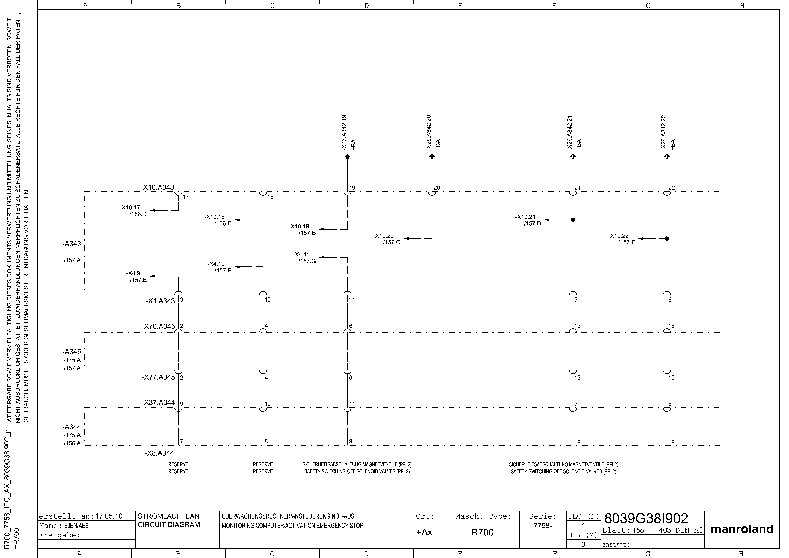

# +Ax — Sheet 158 of 403 — ÜBERWACHUNGSRECHNER/ANSTEUERUNG NOT AUS

**MONITORING COMPUTER/ACTIVATION EMERGENCY STOP**

> Part of the manroland **R700** printing press IEC/UL circuit diagrams.
> Drawing class: **Stromlaufplan / Circuit diagram** (DIN A3).
> Document `+Ax` covers the **Central control console** machine section.

## At a glance

| Field | Value |
|---|---|
| Document | `+Ax`  (8039G38I902) |
| Sheet | **158** of 403 |
| Section (DE) | ÜBERWACHUNGSRECHNER/ANSTEUERUNG NOT AUS |
| Section (EN) | MONITORING COMPUTER/ACTIVATION EMERGENCY STOP |
| Section type | CIRCUIT — Circuit diagram |
| Machine type | `R700` |
| Series | `7758` |
| Created | 17.05.10 |
| Replaces | — |
| Columns used | A, B, C, D, E, F, G |
| Path numbers | — |
| Labels on sheet | 79 |
| Cross-refs out | 14 |
| Cross-refs in | 45 |

**Previous:** [+Ax sheet 157](SHEET_0157.md) · **Next:** [+Ax sheet 159](SHEET_0159.md) · **Document TOC:** [_TOC.md](_TOC.md)  (+Ax) · **Master TOC:** [all sheets](../_MASTER_TOC.md)

## Sheet image (300 DPI, exact vector render)



_Rendered directly from the PDF vector layer at 300 DPI (1-bit), no OCR and no resampling. Use it to confirm anything ambiguous in the text below._

## Cross-references on this sheet

Each entry is a wire leaving this sheet. The printed token is `/sheet.column`; the link resolves to that sheet inside the same document.

| Ref | Target sheet | Col | Path | Destination on target | Target section | From col |
|---|---|---|---|---|---|---|
| `/156.D` | [+Ax sheet 156](SHEET_0156.md) | D | — | X10:17 X10:21 | ÜBERWACHUNGSRECHNER/ANSTEUERUNG NOT AUS | D |
| `/157.D` | [+Ax sheet 157](SHEET_0157.md) | D | — | X10:17 X10:21 | ÜBERWACHUNGSRECHNER/ANSTEUERUNG NOT AUS | D |
| `/156.E` | [+Ax sheet 156](SHEET_0156.md) | E | — | X10:18 | ÜBERWACHUNGSRECHNER/ANSTEUERUNG NOT AUS | B |
| `/157.B` | [+Ax sheet 157](SHEET_0157.md) | B | — | X10:19 | ÜBERWACHUNGSRECHNER/ANSTEUERUNG NOT AUS | C |
| `/157.C` | [+Ax sheet 157](SHEET_0157.md) | C | — | X10:20 | ÜBERWACHUNGSRECHNER/ANSTEUERUNG NOT AUS | D |
| `/157.E` | [+Ax sheet 157](SHEET_0157.md) | E | — | X10:22 | ÜBERWACHUNGSRECHNER/ANSTEUERUNG NOT AUS | G |
| `/157.G` | [+Ax sheet 157](SHEET_0157.md) | G | — | X4:11 X4:10 X4:9 | ÜBERWACHUNGSRECHNER/ANSTEUERUNG NOT AUS | B |
| `/157.F` | [+Ax sheet 157](SHEET_0157.md) | F | — | X4:11 X4:10 X4:9 | ÜBERWACHUNGSRECHNER/ANSTEUERUNG NOT AUS | B |
| `/157.E` | [+Ax sheet 157](SHEET_0157.md) | E | — | X4:11 X4:10 X4:9 | ÜBERWACHUNGSRECHNER/ANSTEUERUNG NOT AUS | B |
| `/157.A` | [+Ax sheet 157](SHEET_0157.md) | A | — | — | ÜBERWACHUNGSRECHNER/ANSTEUERUNG NOT AUS | A |
| `/175.A` | [+Ax sheet 175](SHEET_0175.md) | A | — | — | RESERVE | A |
| `/157.A` | [+Ax sheet 157](SHEET_0157.md) | A | — | — | ÜBERWACHUNGSRECHNER/ANSTEUERUNG NOT AUS | A |
| `/175.A` | [+Ax sheet 175](SHEET_0175.md) | A | — | — | RESERVE | A |
| `/156.A` | [+Ax sheet 156](SHEET_0156.md) | A | — | — | ÜBERWACHUNGSRECHNER/ANSTEUERUNG NOT AUS | A |

### Incoming references (sheets that point here)

Every other sheet that sends a wire to this one. `Back-ref` is the token printed on *that* sheet; `Path` is its line number.

| From sheet | Cols | Back-ref | Path | Refs | What continues there |
|---|---|---|---|---|---|
| [+Ax#156](SHEET_0156.md) | A, D, E | `/156.A`, `/156.D`, `/156.E` | — | 3 | — |
| [+Ax#157](SHEET_0157.md) | A, B, C, D, E, F, G | `/157.A`, `/157.B`, `/157.C`, `/157.D`, `/157.E`, `/157.F`, `/157.G` | — | 9 | X10:22 |
| [+Ax#175](SHEET_0175.md) | A | `/175.A` | — | 2 | — |
| [+Ax#226](SHEET_0226.md) | G | `/226.G` | — | 5 | — |
| [+Ax#237](SHEET_0237.md) | H | `/237.H` | — | 5 | — |
| [+Ax#243](SHEET_0243.md) | H | `/243.H` | — | 6 | — |
| [+Ax#279](SHEET_0279.md) | F | `/279.F` | — | 5 | — |
| [+Ax#285](SHEET_0285.md) | F, H | `/285.F`, `/285.H` | — | 10 | — |


## Devices on this sheet

| Tag | Class | Class meaning (IEC) | Col | Sub | Terminal | Sign |
|---|---|---|---|---|---|---|
| `A344` | A | Baugruppe / assembly, module, PC board | A | — | — | — |
| `A345` | A | Baugruppe / assembly, module, PC board | A | — | — | — |
| `A343` | A | Baugruppe / assembly, module, PC board | A | — | — | — |
| `X10:22` | X | Klemme / terminal, plug connector | G | — | 22 | — |
| `X10:21` | X | Klemme / terminal, plug connector | F | — | 21 | — |
| `X10:17` | X | Klemme / terminal, plug connector | A | — | 17 | — |
| `X10:18` | X | Klemme / terminal, plug connector | B | — | 18 | — |
| `X10:19` | X | Klemme / terminal, plug connector | C | — | 19 | — |
| `X10:20` | X | Klemme / terminal, plug connector | D | — | 20 | — |
| `X4:9` | X | Klemme / terminal, plug connector | B | — | 9 | — |
| `X4:10` | X | Klemme / terminal, plug connector | B | — | 10 | — |
| `X4:11` | X | Klemme / terminal, plug connector | C | — | 11 | — |
| `X37.A344` | — | cross-device reference | B | — | — | — |
| `X77.A345` | — | cross-device reference | B | — | — | — |
| `X4.A343` | — | cross-device reference | B | — | — | — |
| `X76.A345` | — | cross-device reference | B | — | — | — |
| `X26.A342:19` | — | cross-device reference | D | — | 19 | — |
| `X26.A342:20` | — | cross-device reference | E | — | 20 | — |
| `X26.A342:21` | — | cross-device reference | F | — | 21 | — |
| `X26.A342:22` | — | cross-device reference | G | — | 22 | — |
| `X8.A344` | — | cross-device reference | B | — | — | — |
| `X10.A343` | — | cross-device reference | B | — | — | — |

## Potentials / nets

_No named potentials on this sheet._

## Wire-end annotations (grouped as printed)

A wire that continues elsewhere is annotated with a small cluster: the destination description, the path/line number `#NN`, and the `/sheet.column` cross reference. Each row below is one such cluster exactly as it is grouped on the drawing.

| Col | Y | Path | Cross-ref | Text on the wire |
|---|---|---|---|---|
| D | 173.5 | — | — | `X26.A342:19` |
| E | 173.5 | — | — | `X26.A342:20` |
| F | 173.5 | — | — | `X26.A342:21` |
| G | 173.5 | — | — | `X26.A342:22` |
| D | 210.1 | — | — | `+BA` |
| E | 210.1 | — | — | `+BA` |
| F | 210.1 | — | — | `+BA` |
| G | 210.1 | — | — | `+BA` |
| B | 278.1 | — | — | `X10.A343` |
| F | 279.5 | — | — | `19 20 21 22` |
| C | 293.0 | — | — | `17 18` |
| D | 309.3 | — | `/156.D`, `/157.D` | `X10:17 X10:21` |
| B | 323.4 | — | `/156.E` | `X10:18` |
| C | 337.6 | — | `/157.B` | `X10:19` |
| D | 351.8 | — | `/157.C` | `X10:20` |
| G | 351.8 | — | `/157.E` | `X10:22` |
| A | 363.1 | — | — | `A343` |
| B | 380.1 | — | `/157.G`, `/157.F`, `/157.E` | `X4:9 X4:10 X4:11` |
| A | 388.6 | — | `/157.A` | — |
| D | 448.2 | — | — | `X4.A343 9 10 11 7 8` |
| D | 487.9 | — | — | `X76.A345 2 4 6 13 15` |
| A | 526.1 | — | — | `A345` |
| A | 539.2 | — | `/175.A`, `/157.A` | — |
| D | 564.4 | — | — | `X77.A345 2 4 6 13 15` |
| D | 602.7 | — | — | `X37.A344 9 10 11 7 8` |
| A | 639.5 | — | — | `A344` |
| A | 652.6 | — | `/175.A`, `/156.A` | — |
| G | 661.5 | — | — | `5 6` |
| C | 662.2 | — | — | `7 8 9` |
| B | 679.2 | — | — | `X8.A344` |
| B | 697.9 | — | — | `RESERVE RESERVE` |
| C | 697.9 | — | — | `RESERVE RESERVE` |
| D | 698.0 | — | — | `SICHERHEITSABSCHALTUNG MAGNETVENTILE (PPL2)` |
| F | 698.0 | — | — | `SICHERHEITSABSCHALTUNG MAGNETVENTILE (PPL2)` |
| D | 708.6 | — | — | `SAFETY SWITCHING OFF SOLENOID VALVES (PPL2)` |
| F | 708.6 | — | — | `SAFETY SWITCHING OFF SOLENOID VALVES (PPL2)` |


## Notes and free text on this sheet

| Text | Col | Y (pt) |
|---|---|---|
| `+BA` | D | 210.05 |
| `+BA` | E | 210.05 |
| `+BA` | F | 210.05 |
| `+BA` | G | 210.05 |
| `RESERVE` | B | 697.91 |
| `RESERVE` | C | 697.91 |
| `SICHERHEITSABSCHALTUNG MAGNETVENTILE (PPL2)` | D | 697.96 |
| `SAFETY SWITCHING OFF SOLENOID VALVES (PPL2)` | D | 708.57 |
| `SICHERHEITSABSCHALTUNG MAGNETVENTILE (PPL2)` | F | 697.96 |
| `SAFETY SWITCHING OFF SOLENOID VALVES (PPL2)` | F | 708.57 |

## Complete label inventory (exact text from the drawing)

Every text object inside the drawing area of this sheet, in DIN reading order (column A→H, then top→bottom). This is the authoritative list: if a string is not here it is not printed on this sheet.

| Col | Y | X | Dir | Type | Text |
|---|---|---|---|---|---|
| A | 309.3 | 180.9 | → | device tag | `X10:17` |
| A | 363.1 | 94.1 | → | device tag | `A343` |
| A | 388.6 | 96.4 | → | cross-reference | `/157.A` |
| A | 526.1 | 94.1 | → | device tag | `A345` |
| A | 539.2 | 96.4 | → | cross-reference | `/175.A` |
| A | 551.6 | 96.4 | → | cross-reference | `/157.A` |
| A | 639.5 | 94.1 | → | device tag | `A344` |
| A | 652.6 | 96.4 | → | cross-reference | `/175.A` |
| A | 665.0 | 96.4 | → | cross-reference | `/156.A` |
| B | 278.1 | 212.6 | → | device ref | `X10.A343` |
| B | 293.0 | 275.5 | → | number | `17` |
| B | 319.2 | 195.6 | → | cross-reference | `/156.D` |
| B | 323.4 | 308.4 | → | device tag | `X10:18` |
| B | 333.3 | 323.7 | → | cross-reference | `/156.E` |
| B | 394.3 | 313.2 | → | device tag | `X4:10` |
| B | 404.2 | 324.0 | → | cross-reference | `/157.F` |
| B | 408.5 | 190.5 | → | device tag | `X4:9` |
| B | 418.4 | 196.2 | → | cross-reference | `/157.E` |
| B | 448.2 | 271.8 | → | number | `9` |
| B | 449.6 | 220.0 | → | device ref | `X4.A343` |
| B | 487.9 | 214.0 | → | device ref | `X76.A345` |
| B | 487.9 | 271.8 | → | number | `2` |
| B | 564.4 | 214.0 | → | device ref | `X77.A345` |
| B | 565.8 | 271.8 | → | number | `2` |
| B | 602.7 | 214.0 | → | device ref | `X37.A344` |
| B | 605.5 | 271.8 | → | number | `9` |
| B | 662.2 | 271.8 | → | number | `7` |
| B | 679.2 | 218.6 | → | device ref | `X8.A344` |
| B | 697.9 | 254.0 | → | text | `RESERVE` |
| B | 708.5 | 254.0 | → | text | `RESERVE` |
| C | 293.0 | 403.1 | → | number | `18` |
| C | 337.6 | 436.0 | → | device tag | `X10:19` |
| C | 347.5 | 451.0 | → | cross-reference | `/157.B` |
| C | 380.1 | 442.2 | → | device tag | `X4:11` |
| C | 390.0 | 450.4 | → | cross-reference | `/157.G` |
| C | 448.2 | 398.8 | → | number | `10` |
| C | 487.9 | 399.4 | → | number | `4` |
| C | 565.8 | 399.4 | → | number | `4` |
| C | 605.5 | 398.8 | → | number | `10` |
| C | 662.2 | 399.4 | → | number | `8` |
| C | 697.9 | 381.5 | → | text | `RESERVE` |
| C | 708.5 | 381.5 | → | text | `RESERVE` |
| D | 173.5 | 515.5 | ↕ | device ref | `X26.A342:19` |
| D | 210.0 | 529.6 | ↕ | text | `+BA` |
| D | 279.5 | 526.4 | → | number | `19` |
| D | 351.8 | 563.5 | → | device tag | `X10:20` |
| D | 361.7 | 578.3 | → | cross-reference | `/157.C` |
| D | 448.2 | 526.4 | → | number | `11` |
| D | 487.9 | 527.0 | → | number | `6` |
| D | 565.8 | 527.0 | → | number | `6` |
| D | 605.5 | 526.4 | → | number | `11` |
| D | 662.2 | 527.0 | → | number | `9` |
| D | 698.0 | 456.4 | → | text | `SICHERHEITSABSCHALTUNG MAGNETVENTILE (PPL2)` |
| D | 708.6 | 459.3 | → | text | `SAFETY SWITCHING OFF SOLENOID VALVES (PPL2)` |
| E | 173.5 | 643.0 | ↕ | device ref | `X26.A342:20` |
| E | 210.0 | 657.2 | ↕ | text | `+BA` |
| E | 279.5 | 654.5 | → | number | `20` |
| F | 173.5 | 855.6 | ↕ | device ref | `X26.A342:21` |
| F | 210.0 | 869.8 | ↕ | text | `+BA` |
| F | 279.5 | 867.1 | → | number | `21` |
| F | 323.4 | 777.5 | → | device tag | `X10:21` |
| F | 333.4 | 790.9 | → | cross-reference | `/157.D` |
| F | 448.2 | 867.1 | → | number | `7` |
| F | 487.9 | 866.6 | → | number | `13` |
| F | 565.8 | 866.6 | → | number | `13` |
| F | 605.5 | 867.1 | → | number | `7` |
| F | 661.5 | 871.4 | → | number | `5` |
| F | 698.0 | 768.2 | → | text | `SICHERHEITSABSCHALTUNG MAGNETVENTILE (PPL2)` |
| F | 708.6 | 771.1 | → | text | `SAFETY SWITCHING OFF SOLENOID VALVES (PPL2)` |
| G | 173.5 | 997.4 | ↕ | device ref | `X26.A342:22` |
| G | 210.0 | 1011.5 | ↕ | text | `+BA` |
| G | 279.5 | 1008.9 | → | number | `22` |
| G | 351.8 | 918.1 | → | device tag | `X10:22` |
| G | 361.7 | 933.2 | → | cross-reference | `/157.E` |
| G | 448.2 | 1008.9 | → | number | `8` |
| G | 487.9 | 1008.3 | → | number | `15` |
| G | 565.8 | 1008.3 | → | number | `15` |
| G | 605.5 | 1008.9 | → | number | `8` |
| G | 661.5 | 1013.1 | → | number | `6` |

## Reading-order text block

The same content as a plain block, grouped by DIN column — convenient to paste or to match against a visual description.

```text
=== Column A ===
 309.3  180.9  devtag       X10:17
 363.1   94.1  devtag       A343
 388.6   96.4  xref         /157.A
 526.1   94.1  devtag       A345
 539.2   96.4  xref         /175.A
 551.6   96.4  xref         /157.A
 639.5   94.1  devtag       A344
 652.6   96.4  xref         /175.A
 665.0   96.4  xref         /156.A
=== Column B ===
 278.1  212.6  devref       X10.A343
 293.0  275.5  numeric      17
 319.2  195.6  xref         /156.D
 323.4  308.4  devtag       X10:18
 333.3  323.7  xref         /156.E
 394.3  313.2  devtag       X4:10
 404.2  324.0  xref         /157.F
 408.5  190.5  devtag       X4:9
 418.4  196.2  xref         /157.E
 448.2  271.8  numeric      9
 449.6  220.0  devref       X4.A343
 487.9  214.0  devref       X76.A345
 487.9  271.8  numeric      2
 564.4  214.0  devref       X77.A345
 565.8  271.8  numeric      2
 602.7  214.0  devref       X37.A344
 605.5  271.8  numeric      9
 662.2  271.8  numeric      7
 679.2  218.6  devref       X8.A344
 697.9  254.0  text         RESERVE
 708.5  254.0  text         RESERVE
=== Column C ===
 293.0  403.1  numeric      18
 337.6  436.0  devtag       X10:19
 347.5  451.0  xref         /157.B
 380.1  442.2  devtag       X4:11
 390.0  450.4  xref         /157.G
 448.2  398.8  numeric      10
 487.9  399.4  numeric      4
 565.8  399.4  numeric      4
 605.5  398.8  numeric      10
 662.2  399.4  numeric      8
 697.9  381.5  text         RESERVE
 708.5  381.5  text         RESERVE
=== Column D ===
 173.5  515.5  devref       X26.A342:19
 210.0  529.6  text         +BA
 279.5  526.4  numeric      19
 351.8  563.5  devtag       X10:20
 361.7  578.3  xref         /157.C
 448.2  526.4  numeric      11
 487.9  527.0  numeric      6
 565.8  527.0  numeric      6
 605.5  526.4  numeric      11
 662.2  527.0  numeric      9
 698.0  456.4  text         SICHERHEITSABSCHALTUNG MAGNETVENTILE (PPL2)
 708.6  459.3  text         SAFETY SWITCHING OFF SOLENOID VALVES (PPL2)
=== Column E ===
 173.5  643.0  devref       X26.A342:20
 210.0  657.2  text         +BA
 279.5  654.5  numeric      20
=== Column F ===
 173.5  855.6  devref       X26.A342:21
 210.0  869.8  text         +BA
 279.5  867.1  numeric      21
 323.4  777.5  devtag       X10:21
 333.4  790.9  xref         /157.D
 448.2  867.1  numeric      7
 487.9  866.6  numeric      13
 565.8  866.6  numeric      13
 605.5  867.1  numeric      7
 661.5  871.4  numeric      5
 698.0  768.2  text         SICHERHEITSABSCHALTUNG MAGNETVENTILE (PPL2)
 708.6  771.1  text         SAFETY SWITCHING OFF SOLENOID VALVES (PPL2)
=== Column G ===
 173.5  997.4  devref       X26.A342:22
 210.0 1011.5  text         +BA
 279.5 1008.9  numeric      22
 351.8  918.1  devtag       X10:22
 361.7  933.2  xref         /157.E
 448.2 1008.9  numeric      8
 487.9 1008.3  numeric      15
 565.8 1008.3  numeric      15
 605.5 1008.9  numeric      8
 661.5 1013.1  numeric      6
```

---
_Generated from the PDF vector text layer; no OCR. Source: `R700_7758_IEC_AX_8039G38I902_p`, sheet 158._
